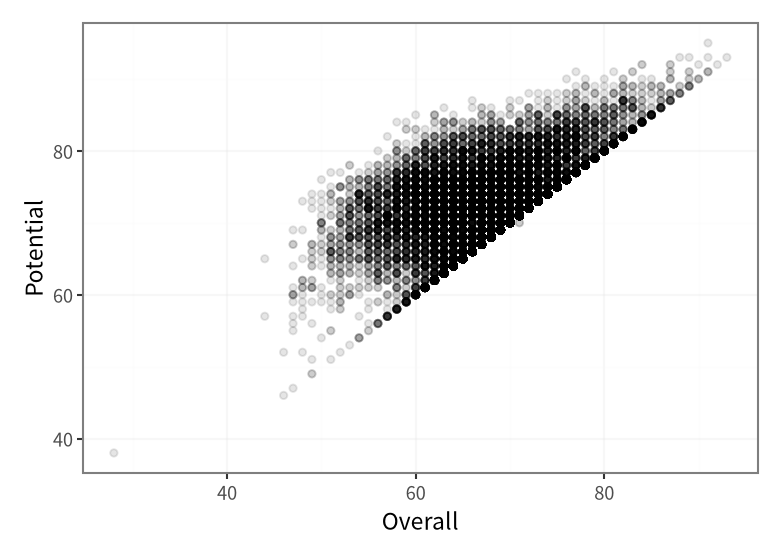
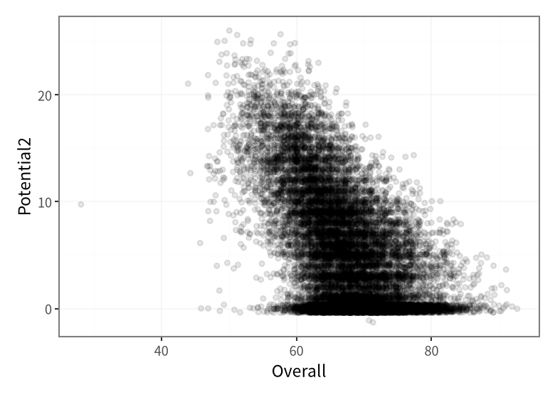
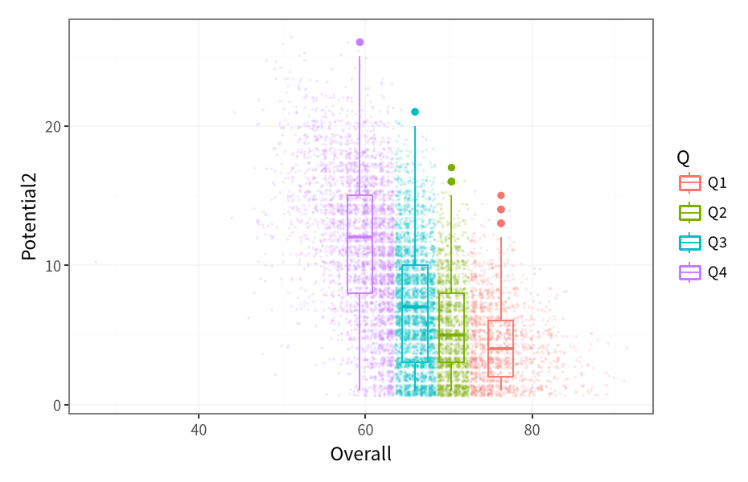

[앞 글](/posts/dv-07-grammar-of-graphics)의 plotnine은 데이터프레임을 받아 그린다. 원하는 그림을 그리려면 먼저 원하는 행과 열을 꺼낼 수 있어야 한다. 이 글은 판다스에서 열과 행을 고르는 방법을 정리하고, FIFA22 선수 자료로 고른 결과를 시각화한다.

```python
import numpy as np
import pandas as pd
```

## 1. 열 고르기

```python
np.random.seed(43052)
df = pd.DataFrame({'X1': np.random.normal(0, 1, 5).round(2),
                   'X2': np.random.normal(0, 1, 5).round(2),
                   'X3': np.random.normal(0, 1, 5).round(2),
                   'X4': np.random.normal(0, 1, 5).round(2)})
```

`X1` 열 하나를 고르는 방법은 여럿이다.

| 방법 | 결과 | 비고 |
|---|---|---|
| `df.X1` | Series | 가장 짧다. 이름에 공백이나 `.`이 있으면 못 쓴다 |
| `df['X1']` | Series | |
| `df[['X1']]` | DataFrame | 리스트로 주면 표 모양 유지 |
| `df.loc[:, 'X1']` | Series | 이름으로 |
| `df.loc[:, ['X1']]` | DataFrame | |
| `df.loc[:, [True, False, False, False]]` | DataFrame | 불 인덱싱 |
| `df.iloc[:, 0]` | Series | 위치로 |
| `df.iloc[:, [0]]` | DataFrame | |

> **주의** 대괄호 안에 이름 하나를 주면 Series(1차원), 리스트를 주면 DataFrame(2차원)이 나온다. plotnine이나 `groupby` 뒤에 쓸 때 어느 쪽인지에 따라 결과가 달라진다.

여러 열을 고를 때는 리스트, 슬라이싱, 불 리스트를 쓴다.

```python
df[['X1', 'X2', 'X3']]
df.loc[:, 'X1':'X3']     # 이름으로 슬라이싱
df.iloc[:, 0:3]          # 위치로 슬라이싱
```

세 줄 모두 `X1`, `X2`, `X3`을 고른다. 그런데 슬라이싱의 끝 처리가 다르다.

> **주의** `loc`의 슬라이싱은 **끝을 포함**하고(`'X1':'X3'`에 X3 포함), `iloc`의 슬라이싱은 파이썬 관례대로 **끝을 포함하지 않는다**(`0:3`은 0, 1, 2). 열 이름이 정수이면 특히 헷갈린다. 열 이름이 0, 1, 2, 3인 표에서 `loc[:, 0:2]`는 0, 1, 2열을, `iloc[:, 0:2]`는 0, 1열을 준다.

### 이름의 패턴으로 고르기

열이 28개인 영화 자료에서 이름에 `actor`가 들어간 열만 고르고 싶다.

```python
movie = pd.read_csv('https://raw.githubusercontent.com/PacktPublishing/Pandas-Cookbook/master/data/movie.csv')
```

열 이름마다 참/거짓을 계산해 불 리스트를 만들면 된다. 여기에 파이썬의 `lambda`와 `map`이 쓰인다.

- `lambda 입력: 출력`은 이름 없는 함수를 한 줄로 만든다. `f = lambda x: 'actor' in x`는 `def f(x): return 'actor' in x`와 같다.
- `map(함수, 리스트)`는 리스트의 원소마다 함수를 적용한다. `list(map(lambda x: x + 1, [1, 2, 3]))`은 `[2, 3, 4]`다. 리스트 컴프리헨션 `[x + 1 for x in [1, 2, 3]]`과 같은 일을 한다.

```python
movie.loc[:, map(lambda x: 'actor' in x, movie.columns)]          # actor가 들어간 열
movie.loc[:, [c.endswith('s') for c in movie.columns]]           # s로 끝나는 열
movie.loc[:, movie.columns.str.match('^[cd]')]                   # c나 d로 시작하는 열
```

첫 줄은 `actor_1_name`, `actor_1_facebook_likes` 등 6개 열을 고른다. 판다스에는 이런 일을 하는 `filter` 메서드도 있다. `movie.filter(like='actor')`, `movie.filter(regex='s$')`가 위의 첫째, 둘째 줄과 같은 결과를 준다.

## 2. 행 고르기

`iloc`과 `loc`에 인덱스를 하나만 주면 **행**을 고른다. `loc`과 `iloc`은 행과 더 친하다.

```python
np.random.seed(1)
df1 = pd.DataFrame(np.random.normal(size=(5, 4)).round(3), columns=list('ABCD'))
df1.iloc[0]       # 첫 행을 Series로 (세로로 눕는다)
df1.iloc[[0]]     # 첫 행을 DataFrame으로
```

```
A    1.624
B   -0.612
C   -0.528
D   -1.073
Name: 0, dtype: float64

       A      B      C      D
0  1.624 -0.612 -0.528 -1.073
```

열과 마찬가지로 하나를 주면 Series, 리스트를 주면 DataFrame이다. `df1.iloc[[0, 2], :]`, `df1.loc[[0, 2], :]`는 1행과 3행을 고른다. 기본 인덱스(0, 1, 2, ...)에서는 이름과 위치가 같아 `loc`과 `iloc`의 차이가 잘 드러나지 않는다.

### loc이 쓸모 있을 때: 날짜 인덱스

행에 이름이 있으면 `loc`이 편하다. 대표적인 경우가 날짜 인덱스다.

```python
np.random.seed(1)
ts = pd.DataFrame(np.random.normal(size=(20, 4)).round(3), columns=list('ABCD'),
                  index=pd.date_range('20201225', periods=20))
ts.loc['20210105':'20210108']
```

```
                A      B      C      D
2021-01-05  0.051 -0.637  0.191  2.100
2021-01-06  0.120  0.617  0.300 -0.352
2021-01-07 -1.143 -0.349 -0.209  0.587
2021-01-08  0.839  0.931  0.286  0.885
```

`iloc`으로 같은 행을 고르려면 1월 5일이 몇 번째 행인지 세야 한다(`ts.iloc[11:15]`). 일별 자료를 주 단위로 보고 싶으면 `ts.iloc[::7]`처럼 간격을 주어 고른다. 이런 간격 슬라이싱은 행에는 자주 쓰지만 열에는 거의 쓰지 않는다.

> **주의** `ts.loc['A']`는 A열이 아니라 **이름이 'A'인 행**을 찾으므로 `KeyError`가 난다. 열은 `ts['A']`로 고른다.

## 3. 조건으로 행 고르기

```python
np.random.seed(1)
df2 = pd.DataFrame(np.random.normal(size=(10, 4)).round(3), columns=list('ABCD'))
```

A가 양수이고 C가 음수인 행을 고르는 방법을 모았다. 결과는 모두 0행과 6행이다.

```python
df2[(df2.A > 0) & (df2.C < 0)]                              # 불 인덱싱
df2.loc[lambda d: (d.A > 0) & (d.C < 0)]                    # 함수를 넘김
df2.loc[map(lambda x, y: x > 0 and y < 0, df2.A, df2.C)]    # 원소별 계산
df2.query('A > 0 and C < 0')                                # 문자열 조건
```

두 번째 줄은 참/거짓 벡터 대신 **참/거짓 벡터를 돌려주는 함수**를 넘긴 것이다. `loc`은 함수를 받으면 데이터프레임 자신을 넣어 호출한다. 메서드를 이어 쓸 때(중간 결과에 이름이 없을 때) 쓸모 있다.

> **주의** 판다스의 조건 결합에는 `and`, `or` 대신 `&`, `|`를 쓰고 각 조건을 괄호로 묶는다.
> - `(df2.A > 0) and (df2.C < 0)`: `ValueError: The truth value of a Series is ambiguous`. `and`는 양쪽을 참/거짓 **하나**로 바꾸려 하는데 Series는 값이 여러 개다.
> - `df2.A > 0 & df2.C < 0`: `&`가 `>`보다 먼저 계산되어 `0 & df2.C`가 된다. 괄호가 필요하다.
>
> 반대로 `map` 안의 `lambda`는 숫자 하나씩 받으므로 `and`를 써도 된다. `query`의 문자열 안에서도 `and`를 쓸 수 있다.

### query

`query`는 조건을 문자열로 쓴다. 가장 읽기 쉽다.

```python
df2.query('A < B < C')                          # 연쇄 비교
meanA = df2.A.mean()
df2.query('A > @meanA and A < 0.8')             # @로 파이썬 변수 참조
df2.query('index == 0 or 3 <= index <= 5')      # 인덱스로
i1 = np.arange(3)
df2.query('index in @i1 or index == 5')         # 목록에 포함
ts.query('"2020-12-27" <= index <= "2021-01-03" and A + B < C')   # 날짜 + 열 계산
```

조건이 길면 문자열을 두 줄로 나눠 쓸 수 있다. 파이썬은 붙어 있는 두 문자열을 하나로 잇기 때문에 `'A > @meanA' ' and A < 0.8'`은 한 문자열이다. 이때 두 번째 문자열 앞의 공백을 빼먹으면 `@meanAand`가 되어 문법 오류가 난다.

| 방법 | 장점 | 단점 |
|---|---|---|
| 불 인덱싱 `df[(...) & (...)]` | 가장 기본, 어디서나 동작 | 데이터프레임 이름을 반복해 쓴다 |
| `loc[lambda d: ...]` | 이름 없는 중간 결과에도 적용 | 익숙해지는 데 시간이 걸린다 |
| `query('...')` | 읽기 쉽다, `and` 사용 가능 | 열 이름에 공백이 있으면 백틱으로 감싸야 한다 |

강의 당시(2021년)의 판다스에서는 `df2.iloc[df2.A > 0]`처럼 `iloc`에 불 Series를 넣으면 `NotImplementedError`가 났지만, 현재 버전에서는 동작한다. 그래도 불 인덱싱은 `loc`이나 대괄호로 하는 것이 일반적이다.

## 4. 예제: FIFA22 선수들의 잠재력

축구 게임 FIFA22에는 실제 선수들의 능력치가 세밀하게 들어 있다. 16,710명, 65개 변수다.

```python
fifa22 = pd.read_csv('https://raw.githubusercontent.com/guebin/2021DV/master/_notebooks/2021-10-25-FIFA22_official_data.csv')
fifa22 = fifa22.sort_values(by='Overall', ascending=False).reset_index(drop=True)
```

`Overall`은 현재 능력, `Potential`은 잠재 능력이다.

```python
from plotnine import *
ggplot(fifa22) + geom_point(aes(x='Overall', y='Potential'), alpha=0.1)
```



모든 점이 대각선 위쪽에 있다. 잠재력은 현재 능력보다 작지 않다. 그렇다면 둘의 차이(앞으로 성장할 여지)를 새 변수로 만들어 보는 것이 자연스럽다.

```python
fifa22['Potential2'] = fifa22['Potential'] - fifa22['Overall']
ggplot(fifa22) + geom_point(aes(x='Overall', y='Potential2'), alpha=0.1, position='jitter')
```



`Potential2`가 0인 선수가 6,362명으로 바닥에 띠를 이룬다. 이미 성장이 끝난 선수들일 것이다. 이들을 빼고 `Potential2 > 0.1`인 10,346명만 남긴다(전체 16,710명 중 나머지 2명은 `0 < Potential2 <= 0.1` 구간에 해당해 함께 제외된다).

```python
f2 = fifa22.query('Potential2 > 0.1').copy()    # 10,346명
```

현재 능력이 높을수록 성장 여지가 작고(상관계수 $-0.57$), **퍼짐도 작아 보인다**. 이것을 확인하려고 `Overall`을 사분위수 근처(63, 68, 72)에서 네 구간으로 나눈다. `map`에 구간을 돌려주는 함수를 넣어도 되고, `pd.cut`을 써도 된다.

```python
def q(x):
    if x > 72: return 'Q1'
    elif x > 68: return 'Q2'
    elif x > 63: return 'Q3'
    else: return 'Q4'
f2['Q'] = list(map(q, f2.Overall))
# 같은 결과: pd.cut(f2.Overall, bins=[-np.inf, 63, 68, 72, np.inf], labels=['Q4', 'Q3', 'Q2', 'Q1'])
```

| 구간 | 선수 수 | 성장 여지 평균 | 표준편차 |
|---|---|---|---|
| Q1 (73 이상) | 1,555 | 4.50 | 2.79 |
| Q2 (69~72) | 1,802 | 5.35 | 3.39 |
| Q3 (64~68) | 3,318 | 7.06 | 4.22 |
| Q4 (63 이하) | 3,671 | 11.50 | 5.12 |

구간별 박스플랏만 그리면 $x$축이 Q1~Q4라는 범주가 되어 원래 산점도와 연결하기 어렵다. 박스플랏을 각 구간의 `Overall` 평균 위치에 놓으면 산점도 위에 겹칠 수 있다.

```python
l = f2.groupby('Q').Overall.mean()     # Q1 76.3, Q2 70.3, Q3 66.0, Q4 59.3
f2['Qx'] = f2.Q.map(l)                 # 구간 이름 -> 그 구간의 평균 위치
(ggplot(f2)
 + geom_point(aes(x='Overall', y='Potential2', color='Q'), alpha=0.1, size=0.1, position='jitter')
 + geom_boxplot(aes(x='Qx', y='Potential2', color='Q', group='Q'), width=3, alpha=0))
```



Series의 `map`에 Series나 딕셔너리를 넘기면 값을 찾아 바꿔 준다(`'Q1'` → 76.3). 현재 능력이 높은 구간으로 갈수록 상자가 아래로 내려가고 좁아진다. 이미 잘하는 선수는 더 성장할 부분이 적고, 성장 여지도 비슷비슷하다.

## 정리

- 하나를 주면 Series, 리스트를 주면 DataFrame. `loc`은 이름(끝 포함), `iloc`은 위치(끝 제외).
- `loc`과 `iloc`에 인덱스 하나만 주면 행을 고른다. 열은 `df['A']`나 `df.loc[:, 'A']`.
- 조건 결합은 `&`, `|`와 괄호. `query`에서는 `and`, `or`와 `@변수`를 쓸 수 있다.
- `lambda`는 한 줄 함수, `map`은 원소별 적용. 열 이름 패턴 고르기와 새 변수 만들기에 쓴다.

## 참고자료

- 최규빈, 「데이터시각화」 강의노트 5~7주차 (전북대학교, 2021)
- [pandas: Indexing and selecting data](https://pandas.pydata.org/docs/user_guide/indexing.html)
