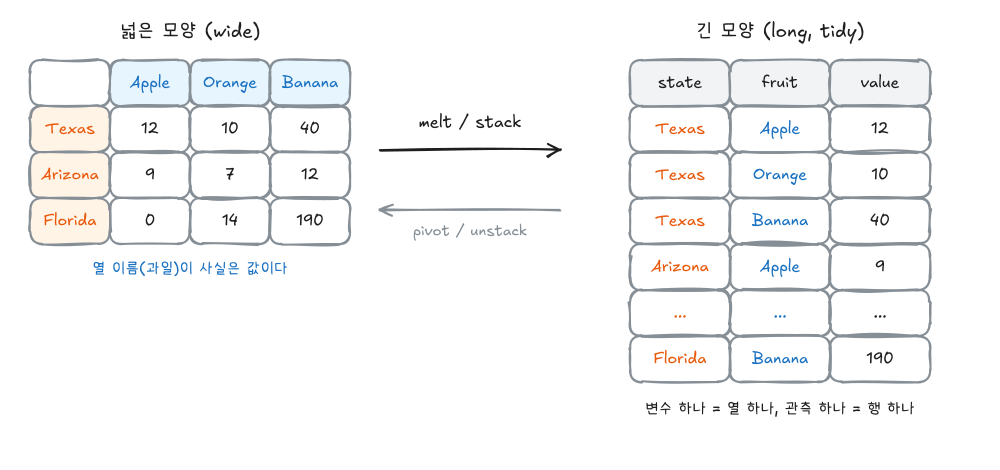
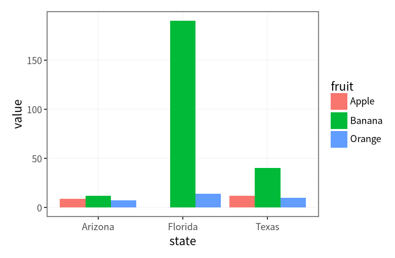

[6편](/posts/dv-06-good-visualization)에서 좋은 그림을 그리기 어려운 이유 중 하나로 "그림에 맞는 표의 모양을 떠올리고, 그 모양으로 바꾸는 것"을 꼽았다. [앞 글](/posts/dv-08-pandas-selection)이 표에서 일부를 꺼내는 법이었다면, 이 글은 표의 **모양을 바꾸는** 법이다. 그룹별로 요약하고, 넓은 표를 긴 표로 펴고, 여러 표를 잇는다.

```python
import numpy as np
import pandas as pd
```

## 1. groupby: 나누고, 계산하고, 합치기

2015년 미국 항공편 58,492건의 자료를 쓴다. 항공사(`AIRLINE`), 요일(`WEEKDAY`), 거리(`DIST`), 도착 지연 시간(`ARR_DELAY`, 분), 우회 여부(`DIVERTED`), 결항 여부(`CANCELLED`) 등 14개 변수가 있다.

```python
df = pd.read_csv('https://raw.githubusercontent.com/PacktPublishing/Pandas-Cookbook/master/data/flights.csv')
```

`groupby`는 데이터프레임을 그룹별 작은 데이터프레임으로 나눈다. 나누기만 해서는 쓸 일이 별로 없고, 나눈 뒤 **각 그룹에 계산을 적용**하기 위해 쓴다.

```python
g = df.groupby(by='AIRLINE')
list(g.groups)            # 14개 항공사
g.get_group('AA').shape   # (8900, 14): AA항공 편만 모은 데이터프레임
```

### agg

항공사별 평균 도착 지연을 구하는 방법이다. 결과는 모두 같다.

```python
df.groupby('AIRLINE').agg({'ARR_DELAY': 'mean'})       # 데이터프레임
df.groupby('AIRLINE')['ARR_DELAY'].agg('mean')         # 시리즈
df.groupby('AIRLINE')['ARR_DELAY'].mean()              # 시리즈
```

AA항공은 평균 5.54분, AS항공은 $-0.83$분(평균적으로 일찍 도착)이다. 딕셔너리 형식 `{열: 함수}`가 가장 일반적이다. 함수 자리에 `lambda`를 넣을 수 있고, 열마다 함수 여러 개를 줄 수 있다.

```python
df.groupby('AIRLINE').agg({'ARR_DELAY': lambda x: -np.mean(x)})
df.groupby(['AIRLINE', 'WEEKDAY']).agg({'CANCELLED': ['sum', 'mean'], 'DIVERTED': ['sum', 'mean']})
```

```
                CANCELLED        DIVERTED
                      sum   mean      sum   mean
AIRLINE WEEKDAY
AA      1              41  0.032        6  0.005
        2               9  0.007        2  0.002
        3              16  0.012        2  0.001
```

그룹 변수를 두 개 주면 (항공사, 요일) 조합마다 계산한다. 결항(`CANCELLED`)이 0/1 변수이므로 합은 결항 편수, 평균은 결항률이다. AA항공은 월요일에 41편, 3.2%가 결항됐다.

결과 열 이름을 직접 정하고 싶으면 **이름 붙인 집계**(named aggregation)를 쓴다.

```python
df.groupby('AIRLINE').agg(n=('ARR_DELAY', 'size'),
                          delay=('ARR_DELAY', 'mean'),
                          cancel=('CANCELLED', 'mean'))
```

```
             n  delay  cancel
AIRLINE
AA        8900  5.543   0.017
AS         768 -0.833   0.000
B6         543  8.693   0.002
DL       10601  0.340   0.004
```

> **주의** `agg({'ARR_DELAY': np.mean})`처럼 넘파이 함수를 넘겨도 되지만, 판다스 2.x 일부 버전은 이 경우 `'mean'` 문자열을 쓰라는 경고를 낸다. 문자열로 쓰는 편이 안전하다. 또 `'size'`와 `'count'`는 다르다. `size`는 행 수, `count`는 결측이 아닌 값의 수다.

### pd.cut: 연속형 변수로 그룹 만들기

거리(`DIST`)처럼 연속형 변수로 그룹을 나누려면 먼저 구간으로 바꾼다. 사분위수가 391, 690, 1199이므로 400, 700, 1200을 경계로 쓴다.

```python
bins = [-np.inf, 400, 700, 1200, np.inf]
cuts = pd.cut(df.DIST, bins=bins)                                  # (-inf, 400], (400, 700], ...
cuts2 = pd.cut(df.DIST, bins=bins, labels=['Q1', 'Q2', 'Q3', 'Q4'])  # 구간에 이름 붙이기
df.groupby([cuts, 'AIRLINE'], observed=True).agg({'DIVERTED': 'sum'})
```

`pd.cut`의 결과는 순서가 있는 범주형 Series다. 이것을 그룹 변수 자리에 그대로 넣을 수 있다. 우회 편수가 많은 네 항공사만 표로 펴 보면 다음과 같다.

| 거리 | AA | DL | UA | OO |
|---|---|---|---|---|
| 400 이하 | 0 | 1 | 2 | 5 |
| 400~700 | 3 | 12 | 1 | 7 |
| 700~1200 | 10 | 6 | 4 | 5 |
| 1200 초과 | 13 | 5 | 12 | 4 |

AA항공(26편)과 DL항공(24편)은 전체 우회 편수가 비슷하지만, AA는 700마일 넘는 장거리에서, DL은 400~700마일 구간에서 우회가 많다. 그룹을 하나 더 나누니 전체 합계에서는 보이지 않던 패턴이 보인다.

## 2. tidy data

해들리 위컴은 분석하기 좋은 표의 조건을 셋으로 정리했다.

1. 변수 하나가 열 하나다.
2. 관측 하나가 행 하나다.
3. 값 하나가 칸 하나다.

이 조건을 만족하는 표를 **tidy data**라고 한다. 느낌으로 말하면 plotnine으로 그리기 좋고, `query`나 `groupby`를 쓰기 좋은 표다. 다음 표는 주별 과일 값이다.

```python
url = 'https://raw.githubusercontent.com/PacktPublishing/Pandas-Cookbook/master/data/state_fruit.csv'
df = pd.read_csv(url, index_col=0)    # 왼쪽 위 칸이 비어 있어 첫 열을 인덱스로
```

```
         Apple  Orange  Banana
Texas       12      10      40
Arizona      9       7      12
Florida      0      14     190
```

사람이 읽기에는 좋지만 tidy가 아니다. "과일"이라는 변수가 열 이름 세 개(Apple, Orange, Banana)에 흩어져 있다. 이 표로는 `aes(x='state', y='value', fill='fruit')` 같은 맵핑을 할 수 없다. 변수는 주, 과일, 값 세 개이므로 열도 세 개여야 한다.



### stack과 melt

방법은 두 가지다. `stack`은 열 이름을 인덱스 쪽으로 내리고, `melt`는 지정한 열(`id_vars`)을 남기고 나머지 열을 녹여 (변수, 값) 두 열로 만든다.

```python
# 풀이 1: stack + reset_index (인덱스에 주 이름이 있을 때)
td = df.stack().reset_index().rename(columns={'level_0': 'state', 'level_1': 'fruit', 0: 'value'})

# 풀이 2: melt (주 이름이 열에 있을 때)
df2 = pd.read_csv(url)    # index_col 없이 읽으면 주 이름이 'Unnamed: 0' 열에 들어간다
df2.rename(columns={'Unnamed: 0': 'state'}).melt(id_vars='state', var_name='fruit', value_name='value')
```

```
     state   fruit  value
0    Texas   Apple     12
1  Arizona   Apple      9
2  Florida   Apple      0
3    Texas  Orange     10
...
```

두 풀이는 행 순서만 다르고 내용은 같다. 인덱스에 이름이 있는 표에 `melt`를 바로 쓰면(`df.melt()`) 주 이름이 사라진다. `melt`는 인덱스를 무시하기 때문이다. 반대로 열에 이름이 있는 표에 `stack`을 쓰면 주 이름까지 값으로 쌓인다. 그래서 `df.reset_index().melt(id_vars='index')`나 `df2.set_index('Unnamed: 0').stack()`처럼 인덱스와 열을 맞춰 준 뒤 변환한다.

| 지금 표 | 변환 | 반대 방향 |
|---|---|---|
| 구분 변수가 **인덱스**에 있다 | `stack()` → `reset_index()` | `unstack()` |
| 구분 변수가 **열**에 있다 | `melt(id_vars=...)` | `pivot(index=..., columns=..., values=...)` |

tidy로 바꾸면 그림은 한 줄이다.

```python
from plotnine import *
ggplot(td) + geom_col(aes(x='state', y='value', fill='fruit'), position='dodge')
```



## 3. 표 잇기: concat과 merge

### concat

연도별로 나뉜 주식 표 세 개가 있다. 2016년 표는 다음과 같고, 2017년(6종목), 2018년(3종목)도 같은 열을 갖는다.

```python
base = 'https://raw.githubusercontent.com/PacktPublishing/Pandas-Cookbook/master/data/'
df2016 = pd.read_csv(base + 'stocks_2016.csv')
df2017 = pd.read_csv(base + 'stocks_2017.csv')
df2018 = pd.read_csv(base + 'stocks_2018.csv')
```

```
  Symbol  Shares  Low  High
0   AAPL      80   95   110
1   TSLA      50   80   130
2    WMT      40   55    70
```

`pd.concat`은 표를 위아래로 잇는다(R의 `rbind`).

```python
pd.concat([df2016, df2017, df2018])                       # 인덱스 0, 1, 2, 0, 1, ... 그대로
pd.concat([df2016, df2017, df2018], ignore_index=True)    # 인덱스 0~11로 새로
pd.concat([df2016, df2017, df2018], axis='columns')       # 옆으로 (cbind), 행 수가 달라도 NaN으로 채움
```

`rbind`와 달리 열이 꼭 같을 필요는 없다. `pd.concat([df2016, df2017.iloc[:, 1:]])`처럼 한쪽에 `Symbol` 열이 없으면 그 자리를 `NaN`으로 채운다.

이은 뒤에 어느 표에서 왔는지 알려면 `keys`로 바깥 인덱스를 붙인다. 딕셔너리로 넘겨도 같다.

```python
pd.concat([df2016, df2017, df2018], keys=[2016, 2017, 2018])
pd.concat({2016: df2016, 2017: df2017, 2018: df2018})            # 같은 결과
pd.concat(dict(zip([2016, 2017, 2018], [df2016, df2017, df2018])))  # 같은 결과
```

`keys`의 길이가 표의 수와 다르면 `ValueError`가 난다. 바깥 인덱스를 열로 내리면(`reset_index(level=0)`) 연도가 변수 하나가 되어, 다시 `melt`로 tidy하게 만들 수 있다.

### merge

`merge`는 **공통 열의 값**을 기준으로 두 표를 잇는다. 성별·합격 여부별 인원 표와 성별 전체 인원 표가 있다고 하자.

```python
d1 = pd.DataFrame({'GEN': ['F', 'F', 'M', 'M'], 'STATE': ['FAIL', 'PASS', 'FAIL', 'PASS'],
                   'COUNT': [12, 28, 52, 168]})
d2 = pd.DataFrame({'GEN': ['F', 'M'], 'SUM': [40, 220]})
d2.merge(d1)
```

```
  GEN  SUM STATE  COUNT
0   F   40  FAIL     12
1   F   40  PASS     28
2   M  220  FAIL     52
3   M  220  PASS    168
```

공통 열 `GEN`을 찾아 `F`인 행에는 40을, `M`인 행에는 220을 붙였다. 이제 `COUNT / SUM`으로 합격률을 계산할 수 있다. 이 예는 [다음 글](/posts/dv-10-correlation-causation)의 심슨의 역설로 이어진다.

| | 기준 | 비유 |
|---|---|---|
| `concat` (기본) | 열 이름 | 위아래로 쌓기 (rbind) |
| `concat(axis=1)` | 행 인덱스 | 옆으로 붙이기 (cbind) |
| `merge` | 공통 열의 값 | 키로 짝짓기 (SQL join) |

## 정리

- `groupby(그룹).agg({열: 함수})`: 나누고, 계산하고, 합친다. 열 이름을 정하려면 `agg(새이름=(열, 함수))`.
- 연속형 변수로 그룹을 만들 때는 `pd.cut(x, bins, labels)`.
- tidy data: 변수 하나 = 열 하나, 관측 하나 = 행 하나. 넓은 표는 `melt`나 `stack`으로 편다.
- `concat`은 쌓기, `merge`는 공통 열로 짝짓기.

## 참고자료

- 최규빈, 「데이터시각화」 강의노트 8, 11주차 (전북대학교, 2021)
- Wickham, H. (2014). Tidy data. *Journal of Statistical Software*, 59(10).
- Petrou, T. *Pandas Cookbook*, Packt (자료 출처)
