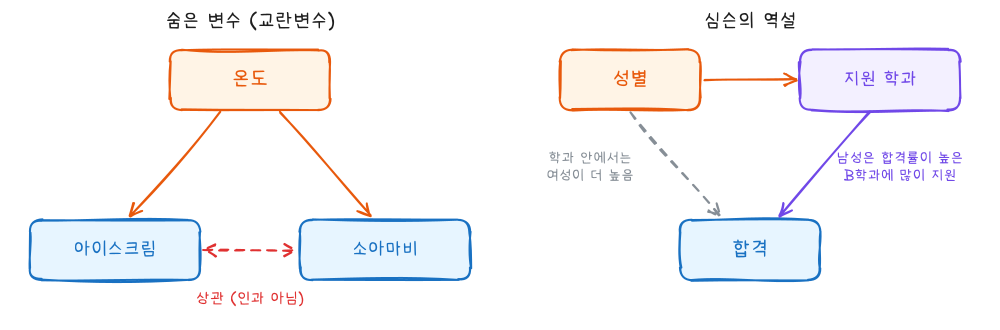
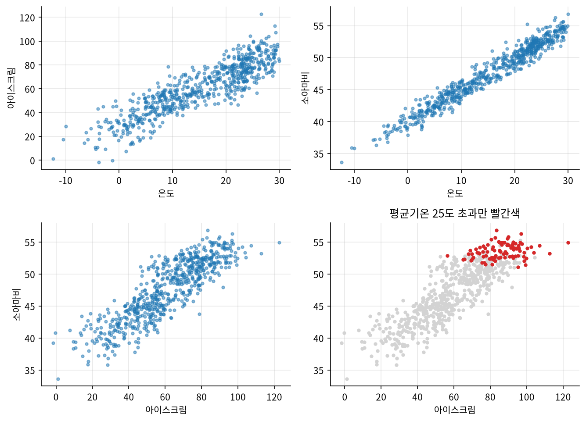
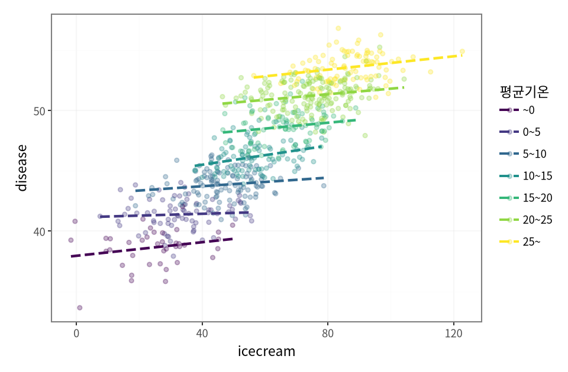
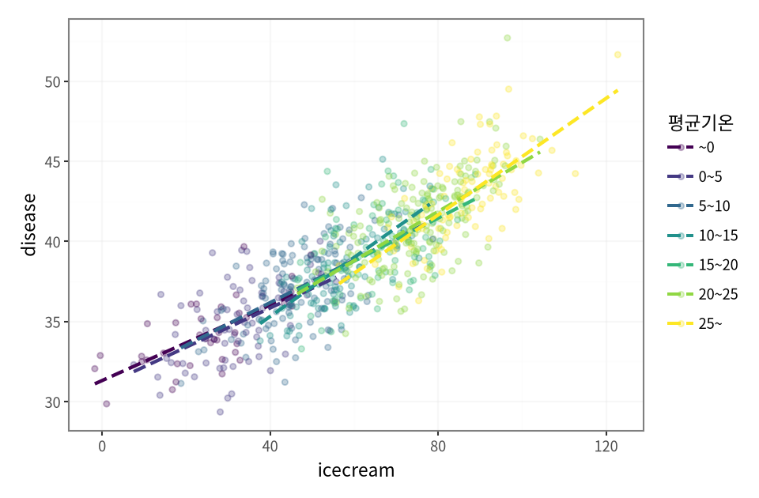
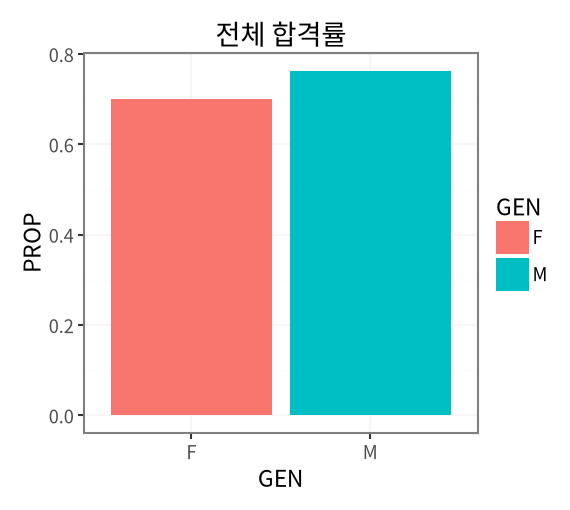
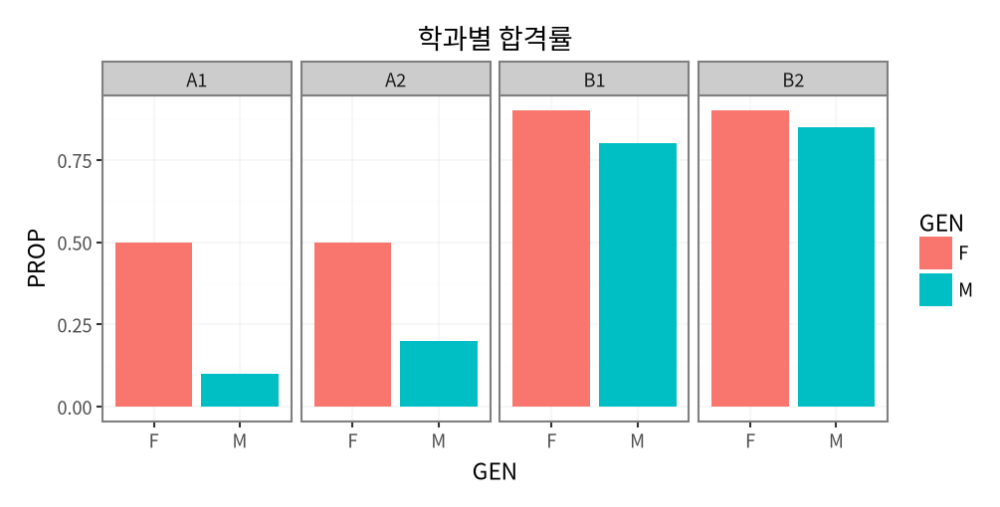

[4편](/posts/dv-04-scatter-correlation)에서 상관계수는 직선 관계의 강도만 잰다고 했다. 이 글은 한 걸음 더 나아가, 상관이 강해도 **원인은 아닐 수 있다**는 것을 그림으로 확인한다. 핵심 도구는 [7편](/posts/dv-07-grammar-of-graphics)의 색 맵핑과 면분할, [9편](/posts/dv-09-pandas-reshape)의 `pd.cut`, `groupby`, `merge`다.

```python
import numpy as np
import pandas as pd
import matplotlib.pyplot as plt
from plotnine import *
```

## 1. 아이스크림을 많이 먹으면 걸리는 병

『데이터 과학자의 사고법』에 나오는 이야기다. 20세기 중반 미국에서 아이스크림 판매량과 소아마비 발생이 함께 늘었다. 그래서 아이스크림의 어떤 성분이 소아마비를 일으킨다는 주장이 나왔다. 실제로는 여름이라는 공통 원인이 있었다. 여름에는 아이스크림을 많이 먹고, 수영장에 많이 가서 소아마비가 퍼졌다.

구조를 단순하게 하면 다음과 같다.



두 변수에 모두 영향을 주어 둘 사이에 상관을 만드는 변수를 **숨은 변수** 또는 **교란변수**(confounder)라고 한다. 아이스크림과 익사 사고, 지역별 교회 수와 범죄 건수(둘 다 인구가 원인)도 같은 구조다.

### 모의자료 만들기

전주의 2020년 1월 1일부터 2021년 10월 17일까지 656일의 일평균기온을 쓰고, 아이스크림 판매량과 소아마비 발생은 온도에서 만들어 낸다. 두 변수 모두 온도에만 의존하고 **서로는 아무 관계가 없도록** 만들었다.

```python
df = pd.read_csv('https://raw.githubusercontent.com/guebin/2021DV/571a4ed82e7106d4ab6979865cc3ea89759784c1/_notebooks/extremum.csv')
temp = np.array(df.iloc[:, 3])          # 평균기온(℃), -12.4 ~ 30.0

np.random.seed(1)
icecream = temp * 2 + 30 + np.random.normal(size=656, scale=10)   # 아이스크림 = 30 + 2 × 온도 + 오차
np.random.seed(2)
disease = temp * 0.5 + 40 + np.random.normal(size=656, scale=1)   # 소아마비 = 40 + 0.5 × 온도 + 오차
np.corrcoef(icecream, disease)[0, 1]
```

```
0.863
```



아이스크림과 소아마비의 상관계수는 0.86이다. 이 산점도만 보면 "아이스크림이 소아마비를 일으킨다"고 보고 $\text{소아마비}_i = \beta_0 + \beta_1\,\text{아이스크림}_i + \epsilon_i$ 같은 모형을 세우고 싶어진다. 여기서부터 틀렸다.

**온도가 비슷한 날끼리 묶어서 보면** 어떨까? 오른쪽 아래 그림은 평균기온이 25도를 넘는 94일만 빨갛게 칠한 것이다. 이 날들 안에서는 상관계수가 0.27로 크게 줄었다.

## 2. 온도를 통제한 시각화

모든 온도 구간을 한 그림에 담으려면 온도를 구간으로 나눠 색에 맵핑한다. 히스토그램으로 분포를 보고 5도 간격으로 나눴다.

```python
df1 = pd.DataFrame({'temp': temp, 'icecream': icecream, 'disease': disease})
df1['temp2'] = pd.cut(df1.temp, bins=[-np.inf, 0, 5, 10, 15, 20, 25, np.inf], right=False,
                      labels=['~0', '0~5', '5~10', '10~15', '15~20', '20~25', '25~'])

(ggplot(df1, aes(x='icecream', y='disease', color='temp2'))
 + geom_point(alpha=0.3)
 + geom_smooth(method='lm', se=False, linetype='dashed'))
```



전체로는 오른쪽 위로 뻗은 점들이, 온도 구간마다 나눠 보면 **거의 수평인 띠가 계단처럼 쌓인 모양**이다. 온도가 같으면 아이스크림을 더 먹는다고 소아마비가 늘지 않는다. 구간 안의 상관계수는 0.07~0.29로, 남은 상관은 5도 구간 안에서도 온도가 조금씩 다르기 때문이다.

### 정말 관계가 있다면

비교를 위해 아이스크림이 실제로 소아마비를 일으키는 자료도 만든다. 이번에는 소아마비가 온도와 직접 관계없이 아이스크림에만 의존한다.

```python
np.random.seed(2)
disease2 = 30 + temp * 0.0 + icecream * 0.15 + np.random.normal(size=656, scale=1) * 2
```



이번에는 같은 온도 구간 안에서도 회귀선이 뚜렷하게 올라간다. 구간 안의 상관계수는 0.48~0.72이다.

| | 전체 상관계수 | 온도 구간 안의 상관계수 | 해석 |
|---|---|---|---|
| 자료 1 (온도가 공통 원인) | 0.863 | 0.07~0.29 | 온도를 통제하면 관계가 거의 사라진다 |
| 자료 2 (아이스크림이 원인) | 0.831 | 0.48~0.72 | 온도를 통제해도 관계가 남는다 |

전체 상관계수만 보면 두 자료를 구분할 수 없다. **숨은 변수를 통제한 그림**을 그려야 구분된다.

### 편상관계수

온도 구간으로 나누는 대신 온도의 영향을 식으로 빼는 방법이 **편상관계수**(partial correlation)다. 아이스크림($X$)과 소아마비($Y$)를 각각 온도($Z$)에 회귀시킨 잔차끼리의 상관계수이고, 세 상관계수로 계산할 수 있다.

$$
r_{XY\cdot Z} = \frac{r_{XY} - r_{XZ}\,r_{YZ}}{\sqrt{(1 - r_{XZ}^2)(1 - r_{YZ}^2)}}
$$

자료 1에서는 $r_{XY} = 0.863$, $r_{XZ} = 0.884$, $r_{YZ} = 0.976$이고, $r_{XY\cdot Z} = 0.002$이다. 자료 2에서는 $r_{XY\cdot Z} = 0.588$이다. 구간별 산점도가 보여준 차이를 숫자 하나로 요약한 것이다. 다만 편상관계수는 온도의 영향이 **직선**이라고 가정한다. 구간별 그림은 그런 가정 없이 볼 수 있다.

> **주의** 숨은 변수를 통제했더니 관계가 사라졌다면 "인과라고 보기 어렵다"고 말할 수 있다. 반대로 통제한 뒤에도 관계가 남는다고 인과가 증명되는 것은 아니다. 통제하지 않은 다른 숨은 변수가 있을 수 있다. 인과를 주장하려면 그 밖의 숨은 변수가 모두 통제되었다는 가정(무작위 배정 등)이 필요하다.

## 3. 심슨의 역설

어느 대학의 네 학과(A1, A2, B1, B2) 입학 자료다. 숫자는 강의에서 쓴 가상의 값이다.

```python
DEP = (['A1'] * 2 + ['A2'] * 2 + ['B1'] * 2 + ['B2'] * 2) * 2
GEN = ['M'] * 8 + ['F'] * 8
STATE = ['PASS', 'FAIL'] * 8
COUNT = [1, 9, 2, 8, 80, 20, 85, 15, 5, 5, 5, 5, 9, 1, 9, 1]
df = pd.DataFrame({'DEP': DEP, 'STATE': STATE, 'GEN': GEN, 'COUNT': COUNT})
```

### 전체 합격률

성별 합격률을 구하려면 (성별, 합격 여부)별 인원을 성별 전체 인원으로 나눠야 한다. 두 요약표를 만들어 `merge`로 잇는다.

```python
_df1 = df.groupby(['GEN', 'STATE']).agg({'COUNT': 'sum'}).reset_index()
_df2 = df.groupby('GEN').agg({'COUNT': 'sum'}).reset_index().rename(columns={'COUNT': 'SUM'})
td = _df2.merge(_df1)
td['PROP'] = td.COUNT / td.SUM
ggplot(td.query('STATE == "PASS"')) + geom_col(aes(x='GEN', y='PROP', fill='GEN'))
```



남성 220명 중 168명(76.4%), 여성 40명 중 28명(70.0%)이 합격했다. 남성의 합격률이 높으니 여성이 차별받는 것처럼 보인다.

### 학과별 합격률

같은 계산을 학과별로 한다. 그룹 변수에 `DEP`를 더하고, 그림은 `facet_wrap`으로 나눈다.

```python
td = df.groupby(['DEP', 'GEN']).agg({'COUNT': 'sum'}).reset_index() \
       .rename(columns={'COUNT': 'SUM'}).merge(df)
td['PROP'] = td.COUNT / td.SUM
(ggplot(td.query('STATE == "PASS"'))
 + geom_col(aes(x='GEN', y='PROP', fill='GEN'))
 + facet_wrap('DEP', nrow=1))
```



| 학과 | 여성 합격률 | 남성 합격률 | 여성 지원자 | 남성 지원자 |
|---|---|---|---|---|
| A1 | 50% | 10% | 10 | 10 |
| A2 | 50% | 20% | 10 | 10 |
| B1 | 90% | 80% | 10 | 100 |
| B2 | 90% | 85% | 10 | 100 |

**모든 학과에서 여성의 합격률이 더 높다.** 그런데 전체로 합치면 남성이 높다. 이것이 **심슨의 역설**이다. 원인은 지원 학과의 차이다. 남성 지원자 220명 중 200명이 합격률이 높은 B학과에 지원했고, 여성은 40명이 네 학과에 고르게 지원했다. 합격률이 낮은 A학과의 비중이 여성 쪽에 더 크니 전체 합격률이 낮아진 것이다. 여기서는 지원 학과가 숨은 변수 역할을 한다.

전체와 부분의 결론이 다를 때 어느 쪽이 옳은지는 질문에 달려 있다. "같은 학과에 지원했을 때 성별에 따라 합격 가능성이 다른가"를 묻는다면 학과별 비교가 답이다. [6편](/posts/dv-06-good-visualization)의 카이로가 말한 "부분집합에서도 같은지 확인하라"가 바로 이것이다.

## 정리

- 상관 ≠ 인과. 두 변수에 함께 영향을 주는 숨은 변수(교란변수)가 상관을 만들 수 있다.
- 숨은 변수를 구간으로 나눠 색(`color`)이나 면분할(`facet_wrap`)로 통제한 그림을 그린다. 통제 후에도 관계가 남는지 본다.
- 편상관계수 $r_{XY\cdot Z} = (r_{XY} - r_{XZ} r_{YZ}) / \sqrt{(1 - r_{XZ}^2)(1 - r_{YZ}^2)}$는 $Z$의 직선 효과를 뺀 상관이다.
- 심슨의 역설: 부분마다의 경향과 전체의 경향이 반대일 수 있다. 그룹 크기의 차이가 원인이다.

## 참고자료

- 최규빈, 「데이터시각화」 강의노트 6, 8주차 (전북대학교, 2021)
- 『데이터 과학자의 사고법: 더 나은 선택을 위한 통계학적 통찰의 힘』
- 기상청 기상자료개방포털, 전주 일평균기온 (2020-01-01 ~ 2021-10-17)
