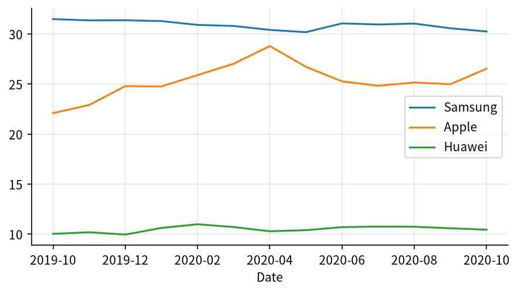
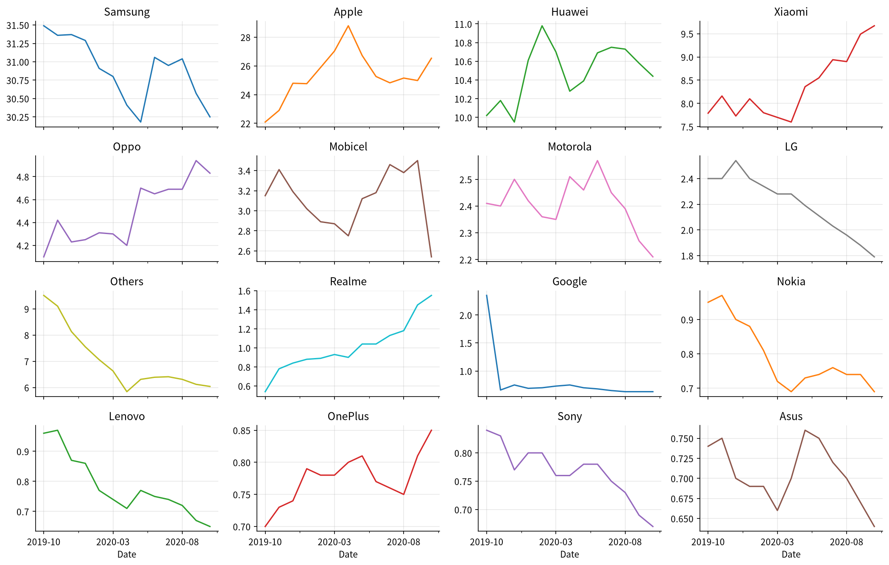
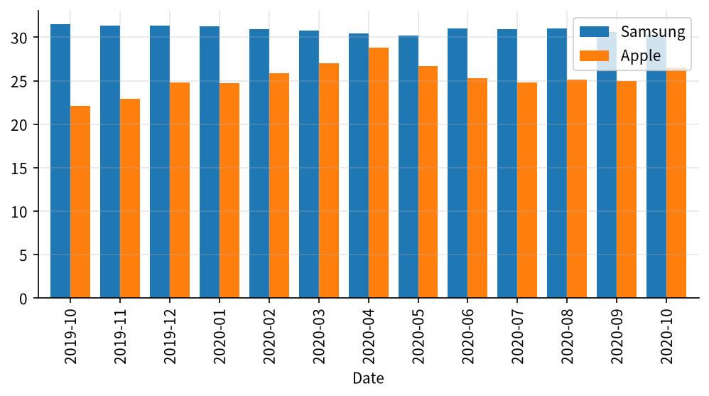
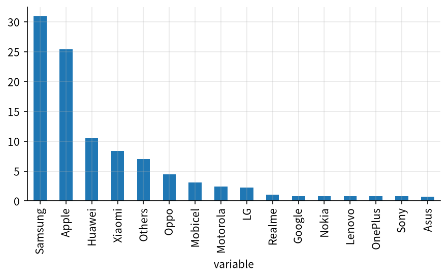
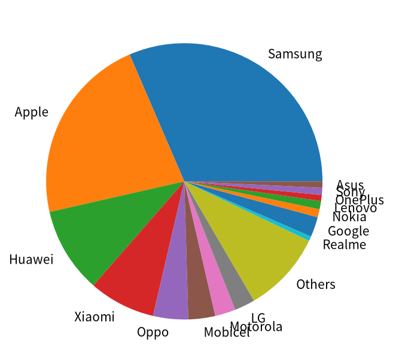
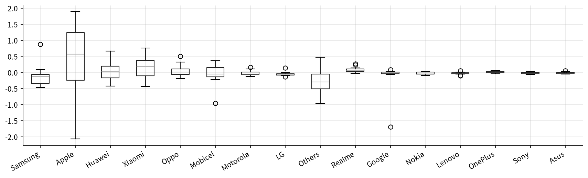
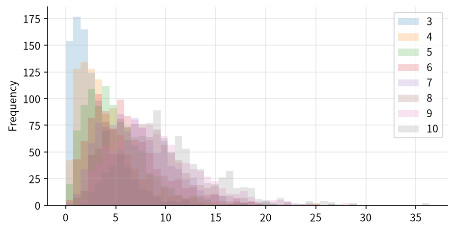
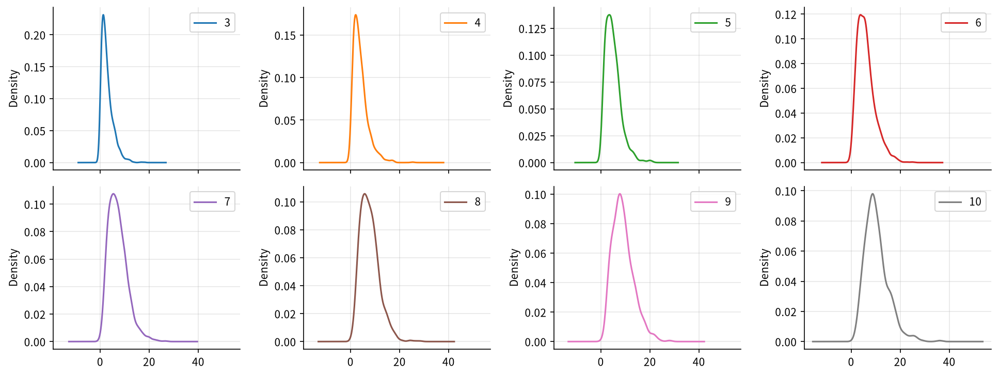
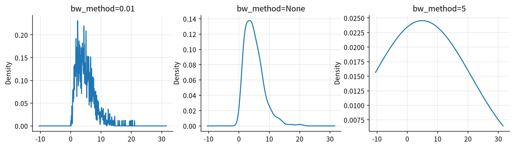
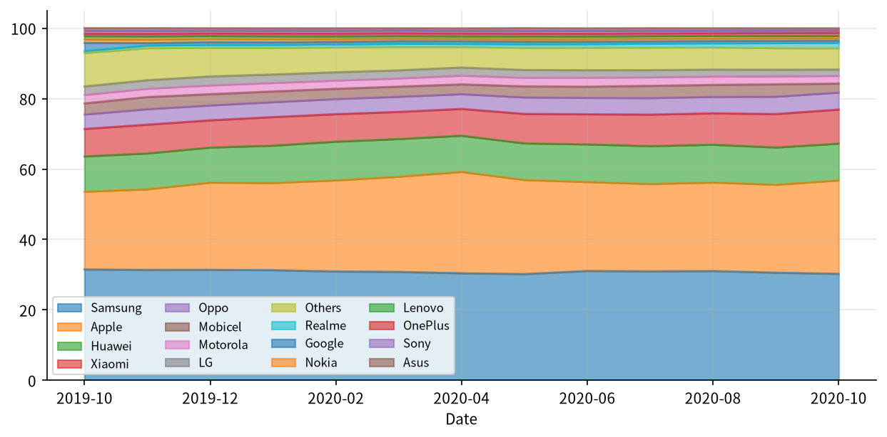

지금까지는 matplotlib, seaborn, plotnine에 데이터를 넘겨 그렸다. 판다스 데이터프레임에는 그 자체로 `.plot` 메서드가 있어서, 표를 다듬은 뒤 **이어서 바로** 그릴 수 있다. 그리는 엔진(백엔드)은 기본이 matplotlib이고, `backend='plotly'`로 바꾸면 같은 코드로 인터랙티브 그림이 나온다.

```python
import numpy as np
import pandas as pd
import plotly.express as px
```

예제 자료는 2019년 10월부터 2020년 10월까지 13개월 동안 제조사 16곳(기타 포함)의 휴대폰 시장점유율(%)이다.

```python
df = pd.read_csv('https://raw.githubusercontent.com/kalilurrahman/datasets/ad7de70470f22a68308a91d05759eb3b2c312d4a/mobilephonemktshare2020.csv')
df.iloc[:3, :6]
```

```
      Date  Samsung  Apple  Huawei  Xiaomi  Oppo
0  2019-10    31.49  22.09   10.02    7.79  4.10
1  2019-11    31.36  22.90   10.18    8.16  4.42
2  2019-12    31.37  24.79    9.95    7.73  4.23
```

## 1. 판다스의 plot 메서드

`df.plot.종류(...)` 또는 `df.plot(kind='종류', ...)`로 그린다. `x`에 열 이름을, `y`에 열 이름이나 그 리스트를 준다. `y`를 생략하면 숫자 열을 모두 그린다.

### line

```python
df.plot.line(x='Date', y=['Samsung', 'Apple', 'Huawei'])
```



자주 쓰는 인자는 matplotlib과 이름이 같다.

| 인자 | 하는 일 |
|---|---|
| `figsize=(w, h)` | 그림 크기 |
| `subplots=True`, `layout=(행, 열)` | 열마다 칸을 나눔 |
| `alpha`, `fontsize`, `legend=False` | 투명도, 글자 크기, 범례 숨기기 |
| `title` | 제목 (subplots이면 칸별 제목 리스트) |

```python
df.plot.line(x='Date', subplots=True, layout=(4, 4), figsize=(14, 9), legend=False, title=list(df.columns[1:]))
```



`subplots=True`는 matplotlib의 Axes 배열을 돌려주므로 [3편](/posts/dv-03-matplotlib-figure-axes)의 방법대로 칸마다 고칠 수 있다.

### bar

```python
df.plot.bar(x='Date', y=['Samsung', 'Apple'], width=0.8)
```



시간에 따른 변화는 사실 라인플랏이 더 잘 보여준다([6편](/posts/dv-06-good-visualization)). 바플랏은 비교에 쓴다. 제조사별 13개월 평균 점유율을 비교해 보자. 표를 tidy하게 편 뒤 그룹별로 평균을 내고, 정렬해서 그린다. 메서드를 이어 쓰면 중간 변수가 필요 없다.

```python
(df.melt(id_vars='Date')
   .groupby('variable').agg({'value': 'mean'})
   .sort_values('value', ascending=False)
   .plot.bar(legend=False))
```



삼성 30.9%, 애플 25.4%, 화웨이 10.5%, 샤오미 8.4% 순이다. 점유율(비율)을 시간에 대해 평균 내는 것이 통계적으로 의미 있는 값은 아니지만, 시각화 연습으로 충분하다.

### pie

```python
df.set_index('Date').T.plot.pie(y='2019-10', legend=False)
```



파이차트는 **행이 범주**(제조사)이고 열이 한 시점이어야 하므로 표를 전치(`.T`)했다. 하지만 [6편](/posts/dv-06-good-visualization)에서 보았듯 각도나 넓이로 크기를 비교하는 것은 어렵다. 숫자 비교는 바플랏, 시간 변화는 라인플랏이 낫다.

### box

월별 점유율의 **변화량**(이번 달 − 지난달)을 `diff()`로 구해 제조사별 분포를 본다.

```python
df.set_index('Date').diff().dropna().boxplot(figsize=(14, 4))
```



애플의 변화량이 가장 넓게 퍼져 있다(표준편차 1.26%p, 다음인 구글은 0.49%p). 점유율 1위인 삼성은 오히려 한 달 변화가 1.35%p 범위 안에 머문다.

### hist와 kde

정규분포를 제곱해서 $k$개씩 더하면 자유도 $k$인 카이제곱분포가 된다. $k = 3, \dots, 10$에 대해 1000개씩 만들어 열 8개짜리 표로 둔다.

```python
np.random.seed(43052)
arr = [3, 4, 5, 6, 7, 8, 9, 10]
chi = pd.DataFrame({k: (np.random.normal(size=(1000, k))**2).sum(axis=1) for k in arr})
chi.plot.hist(alpha=0.2, bins=50)
```



여덟 개를 겹치면 구분이 어렵다. 칸을 나누고, 히스토그램 대신 밀도곡선(KDE)으로 그린다.

```python
chi.plot.kde(subplots=True, layout=(2, 4), figsize=(13, 5))
```



자유도가 커질수록 분포가 오른쪽으로 옮겨 가고(평균 = 자유도, 표본평균은 2.89, 4.06, ..., 10.34) 대칭에 가까워진다. `bw_method`로 띠너비를 정한다([5편](/posts/dv-05-kde-qqplot)).



### area

점유율처럼 합이 100인 구성비의 시간 변화는 영역 그림이 잘 맞는다. 영역은 기본으로 쌓인다(`stacked=True`).

```python
df.set_index('Date').plot.area(alpha=0.6)
```



맨 아래의 삼성은 30% 근처에서 거의 그대로이고, 그 위의 애플이 2020년 4월에 커졌다가 줄었다가 다시 커진다. 쌓은 그림은 **맨 아래 범주만** 기준선이 평평해서 읽기 쉽고, 위로 갈수록 각 범주의 두께 변화를 읽기 어렵다. 주된 시각화 방법은 아니다.

## 2. backend='plotly'

같은 코드에 `backend='plotly'`만 더하면 plotly 그림이 된다. 마우스를 올리면 값이 보이고, 범례를 클릭하면 범주를 숨길 수 있다.

```python
(df.melt(id_vars='Date').groupby('variable').agg({'value': 'mean'})
   .sort_values('value', ascending=False).plot.bar(backend='plotly'))
```

<iframe src="/charts/dv/dv11-avg.html" width="100%" height="400px" frameborder="0" scrolling="no"></iframe>

앞의 영역 그림도 `backend='plotly'`만 더하면 된다. 범례를 클릭해 일부 제조사를 끄고 나머지 점유율만 겹쳐 볼 수 있다.

```python
df.set_index('Date').plot.area(backend='plotly')
```

<iframe src="/charts/dv/dv11-area.html" width="100%" height="450px" frameborder="0" scrolling="no"></iframe>

plotly 백엔드는 plotly express의 인자를 그대로 받는다. 그래서 tidy한 표만 있으면 `color`, `facet_col`, `facet_row`, `text` 같은 맵핑을 쓸 수 있다. matplotlib 백엔드로는 하기 어려운 일이다.

```python
td = df.melt(id_vars='Date').query("variable in ['Samsung', 'Apple', 'Huawei']")
td.plot.bar(x='Date', y='value', color='variable', backend='plotly', barmode='group', text='value')
```

<iframe src="/charts/dv/dv11-group.html" width="100%" height="440px" frameborder="0" scrolling="no"></iframe>

```python
td.plot.bar(x='Date', y='value', color='variable', backend='plotly', facet_col='variable')
```

<iframe src="/charts/dv/dv11-facet.html" width="100%" height="400px" frameborder="0" scrolling="no"></iframe>

박스플랏도 tidy한 표로 그리면 제조사를 색으로 구분할 수 있고, 범례를 눌러 보고 싶은 회사만 남길 수 있다.

```python
df.set_index('Date').diff().dropna().melt().plot.box(backend='plotly', x='variable', y='value', color='variable')
```

<iframe src="/charts/dv/dv11-box.html" width="100%" height="440px" frameborder="0" scrolling="no"></iframe>

### tips: 변수가 많을 때

plotly에 들어 있는 `tips` 자료는 식당 손님 244명의 계산 금액, 팁, 성별, 흡연 여부, 요일, 시간(점심/저녁), 인원이다. 이미 tidy하다.

```python
tips = px.data.tips()
```

"팁은 언제 더 많이 받는가"를 차례로 물어보며 맵핑을 하나씩 늘린다.

| 질문 | 추가하는 인자 |
|---|---|
| 팁의 분포는? | `y='tip'` |
| 점심과 저녁이 다른가? | `x='time'` |
| 성별로 다른가? | `color='sex'` |
| 요일별로는? | `facet_col='day'` |
| 흡연 여부로는? | `facet_row='smoker'` |

```python
tips.plot.box(backend='plotly', y='tip', x='time', color='sex',
              facet_col='day', facet_row='smoker', points='all')
```

<iframe src="/charts/dv/dv11-tips.html" width="100%" height="620px" frameborder="0" scrolling="no"></iframe>

`points='all'`은 상자 옆에 모든 관측값을 점으로 찍는다. 이상치만 점으로 보이던 박스플랏보다 자료가 풍부하게 보이고, 그룹마다 표본이 몇 개인지도 드러난다. 저녁의 팁 중앙값은 3.00달러, 점심은 2.25달러다. 점심은 목요일과 금요일에만 있고, 토·일요일에는 저녁만 있다는 것도 칸이 비어 있는 데서 바로 보인다.

히스토그램도 같은 방식이다.

```python
tips.plot.hist(backend='plotly', x='tip', color='sex', facet_col='sex', facet_row='time')
```

<iframe src="/charts/dv/dv11-tipshist.html" width="100%" height="520px" frameborder="0" scrolling="no"></iframe>

변수 다섯 개를 한 그림에 담는 코드가 한 줄이다. **표를 tidy하게 만들어 두면 생각하는 대로 바로 그릴 수 있다.**

## 3. 비교

| | matplotlib 백엔드 (기본) | plotly 백엔드 |
|---|---|---|
| 결과 | 정지 그림 (Axes) | 인터랙티브 그림 (웹) |
| 넓은 표 | 열마다 선/막대를 그림 | 가능하지만 맵핑이 제한적 |
| 긴 표 (tidy) | `color` 같은 맵핑 없음 | `color`, `facet_col`, `facet_row`, `text` |
| 세부 조정 | matplotlib으로 | `fig.update_layout` 등 |
| 쓰는 곳 | 보고서, 논문 | 탐색, 웹 게시 |

## 정리

- `df.plot.line/bar/pie/box/hist/kde/area`: 표를 다듬은 뒤 이어서 바로 그린다.
- 넓은 표는 matplotlib 백엔드로 열마다, 긴 표(tidy)는 plotly 백엔드로 맵핑을 늘려 그린다.
- 파이와 쌓은 영역은 비교에 약하다. 비교는 막대, 변화는 선.

## 참고자료

- 최규빈, 「데이터시각화」 강의노트 12, 13주차 (전북대학교, 2021)
- [pandas: Chart visualization](https://pandas.pydata.org/docs/user_guide/visualization.html)
- [plotly express](https://plotly.com/python/plotly-express/)
