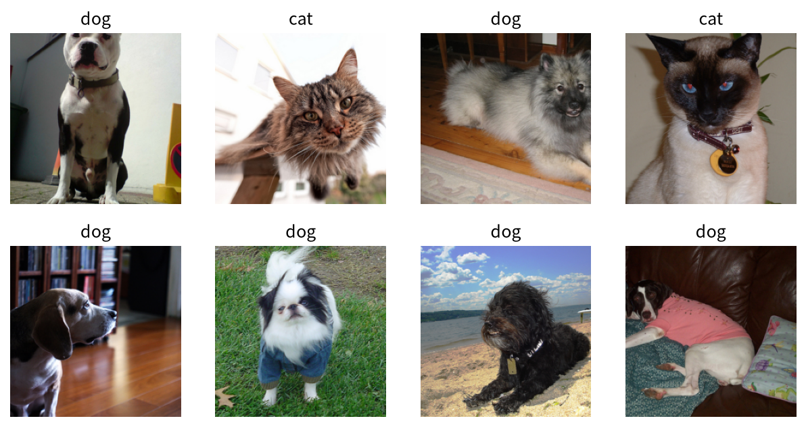

최규빈 교수님 딥러닝 강의(2022)와 Howard·Gugger의 *Deep Learning for Coders*를 바탕으로 정리한 시리즈다. 딥러닝은 입력 $X$에서 출력 $y$로 가는 함수를 **여러 층의 단순한 함수를 겹쳐서** 근사하고, 그 안의 수많은 가중치를 **경사하강법**으로 찾는 방법이다. 통계 모형과 하는 일은 같고, 모형이 훨씬 유연하다는 점과 답을 공식이 아닌 반복 계산으로 찾는다는 점이 다르다.

이 글은 시리즈 전체에서 반복되는 틀을 먼저 정리한다.

## 학습의 네 가지 재료

어떤 딥러닝 분석이든 다음 네 가지로 이루어진다.

| 재료 | 뜻 | 선형회귀에서는 | 다룰 글 |
|---|---|---|---|
| 자료 | 관측된 $(X, y)$ 쌍 | $(x_i, y_i)$, $i = 1, \dots, n$ | |
| 모형 | 가중치 $\theta$를 가진 함수 $f_\theta$ | $\beta_0 + \beta_1 x$ | [4](/posts/dl-04-mlp-universal), [7](/posts/dl-07-cnn), [9](/posts/dl-09-embedding-recsys)~[12편](/posts/dl-12-gan) |
| 손실 | $y$와 $f_\theta(X)$가 얼마나 다른가 | 잔차제곱합 | [3편](/posts/dl-03-output-loss) |
| 최적화 | 손실을 줄이는 $\theta$를 찾는 방법 | 정규방정식 $(X^TX)^{-1}X^Ty$ | [2](/posts/dl-02-gradient-descent), [5](/posts/dl-05-backprop-vanishing), [6편](/posts/dl-06-minibatch-overfitting) |

선형회귀는 모형이 단순해서 손실을 최소로 하는 $\theta$를 공식으로 바로 구한다. 신경망은 모형이 복잡해서 공식이 없다. 대신 손실을 $\theta$로 미분하고, 손실이 줄어드는 방향으로 $\theta$를 조금씩 옮기는 것을 반복한다. 이 반복이 **학습**이다.

같은 일을 두 분야가 다른 말로 부른다.

| 통계학 | 딥러닝 |
|---|---|
| 설명변수, 반응변수 | 입력(feature), 타깃(label) |
| 모수 $\beta$ | 가중치(weight), 편향(bias) |
| 모형을 적합한다, 모수를 추정한다 | 네트워크를 학습시킨다 |
| 음의 로그가능도, 잔차제곱합 | 손실(loss) |
| 적합값 $\hat y$ | 출력, 예측 |
| 범주형 변수의 가변수 | 원핫 인코딩 |

## 자료의 모양과 신경망

$(X, y)$가 무엇이냐에 따라 모형의 구조가 달라진다. 특히 $X$ 안에 순서나 공간 구조가 있는지가 중요하다.

| $X$ | $y$ | 주로 쓰는 신경망 | $X$의 구조 | 예 |
|---|---|---|---|---|
| 몇 개의 수치 변수 | 수치·범주 | 다층 신경망(MLP) | 없음 | 회귀, 분류 |
| 이미지 | 범주 | 합성곱신경망(CNN) | 공간 (가까운 픽셀끼리 관련) | 개·고양이 분류 |
| (사용자, 아이템) 번호 | 평점 | 임베딩 | 없음 (번호에 크기 의미 없음) | 영화 추천 |
| 앞의 단어들 | 다음 단어, 범주 | 순환신경망(RNN, LSTM) | 순서 | 텍스트 생성, 감성 분류 |
| 잡음 | 이미지 | 생성모형(GAN) | | 가짜 손글씨 생성 |

구조가 있는 자료에 구조를 반영한 모형을 쓰면 같은 성능을 훨씬 적은 가중치로 얻는다. 합성곱신경망이 이미지에서, 순환신경망이 문장에서 쓰이는 이유다.

## 적합값, 예측값, 검증 자료

학습된 모형 $f_{\hat\theta}$에 $X$를 넣어 얻은 $\hat y$는 $X$가 어디서 왔는지에 따라 성격이 다르다.

| | $X$가 학습 자료 | $X$가 새 자료 |
|---|---|---|
| 이름 | 적합값 | 예측값 |
| 손실 계산 | 가능 | $y$를 모르므로 불가능 |
| 학습이 줄이는 것 | 이쪽 | 아니다 |

학습은 왼쪽의 손실을 줄이지만, 우리가 원하는 것은 오른쪽에서 잘 맞히는 것이다. 가중치가 많은 신경망은 학습 자료를 통째로 외워 왼쪽 손실을 0에 가깝게 만들 수 있고, 그러면 오른쪽에서 오히려 나빠진다(**과적합**, 6편). 그래서 자료의 일부를 **검증 자료**로 떼어 두고 학습에 쓰지 않는다. 학습 중에 검증 자료의 손실을 같이 보면 "처음 보는 자료에서도 잘 맞히는가"를 확인할 수 있다.

손실과 별개로 사람이 읽기 위한 **평가지표**(정확도, 오분류율 등)도 따로 둔다. 오분류율은 직관적이지만 가중치를 조금 바꿔도 값이 그대로인 경우가 많아(계단 모양), 미분해서 방향을 찾는 학습에는 쓸 수 없다. 학습은 매끄러운 손실로 하고, 보고는 평가지표로 한다.

## 예제: fastai의 네 단계

fastai는 PyTorch 위에 얹은 고수준 라이브러리로, 위의 재료를 네 단계의 함수로 묶어 두었다. 원리는 다음 글부터 직접 구현하고, 여기서는 서로 다른 세 문제가 같은 틀로 풀린다는 것만 확인한다. 실행은 Apple Silicon Mac(MPS)에서 했다.


### 이미지 분류: 개와 고양이

Oxford-IIIT Pet 자료(37개 품종, 7,390장)는 파일 이름이 대문자로 시작하면 고양이, 소문자면 개다.

```python
from fastai.vision.all import *

path = untar_data(URLs.PETS)/'images'
files = get_image_files(path)
label_func = lambda fname: 'cat' if fname[0].isupper() else 'dog'

dls = ImageDataLoaders.from_name_func(path, files, label_func, item_tfms=Resize(224))  # 1. 자료
lrnr = vision_learner(dls, resnet34, metrics=error_rate)                               # 2. 학습기
lrnr.fine_tune(1)                                                                      # 3. 학습
lrnr.predict(files[0])                                                                 # 4. 예측
```

1. `dls`는 이미지($X$)와 파일 이름에서 만든 라벨($y$)을 묶고, 모든 이미지를 224×224로 맞추고, 무작위로 학습 80%와 검증 20%로 나눈다.
2. `lrnr`(학습기)는 자료, 모형, 평가지표를 묶은 객체다. `resnet34`는 34층 합성곱신경망으로, ImageNet(1,000개 범주, 100만 장 이상)으로 **이미 학습된** 가중치를 가지고 온다.
3. `fine_tune(1)`은 새로 붙인 마지막 층만 먼저 1 에폭 학습한 뒤, 전체를 1 에폭 더 조정한다([8편](/posts/dl-08-transfer-cam)).
4. `predict`는 이미지 한 장의 라벨과 범주별 확률을 돌려준다. `('cat', tensor(0), tensor([1.0000e+00, 4.8751e-07]))`는 고양이일 확률이 거의 1이라는 뜻이다.



| 단계 | train_loss | valid_loss | error_rate |
|---|---|---|---|
| 마지막 층만 | 0.1544 | 0.0186 | 0.0047 |
| 전체 조정 | 0.0509 | 0.0189 | 0.0068 |

에폭(epoch)은 학습 자료 전체를 한 번 훑는 단위다. 한 에폭 남짓으로 검증 1,478장 중 10장만 틀렸다. 처음부터 학습했다면 불가능한 결과이고, 사전학습된 가중치 덕분이다.

손실이 가장 큰 순서로 보면 모형이 무엇을 어려워하는지 알 수 있다.

```python
interp = Interpretation.from_learner(lrnr)
interp.plot_top_losses(8)        # 제목: 예측/실제/손실/확률
```


손실이 크다는 것은 틀렸을 뿐 아니라 확신하며 틀렸다는 뜻이다. 사람 품에 안긴 강아지, 검은 고양이, 웅크린 개처럼 얼굴이 잘 보이지 않는 사진이 대부분이다.

### 추천: 커피와 홍차

사용자 100명이 커피 10종, 홍차 10종 중 일부에 평점을 남긴 가상 자료다(1–50번은 커피파, 51–100번은 홍차파). $X$는 (사용자, 아이템) 번호 쌍, $y$는 평점이고, 추천은 아직 평점이 없는 쌍을 예측하는 문제다.

```python
from fastai.collab import *
dls = CollabDataLoaders.from_df(df)              # df: user, item, rating
lrnr = collab_learner(dls, y_range=(0, 5))
lrnr.fit(30)                                      # 사전학습 모형이 없으므로 처음부터 학습
lrnr.model(torch.tensor([[1, 2]]))                # 1번 사용자의 2번 아이템(커피2) 평점
```

| 사용자 | 커피2 | 홍차2 |
|---|---|---|
| 1번 (커피파) | 4.03 | 0.81 |
| 60번 (홍차파) | 1.06 | 3.98 |

검증 손실(MSE)은 30 에폭 후 0.050이다. 모형은 사용자마다, 아이템마다 숫자 몇 개짜리 벡터를 두고 그 내적으로 평점을 예측한다. 학습이 끝나면 이 벡터의 한 성분이 "커피 취향 대 홍차 취향"을 나타내게 된다([9편](/posts/dl-09-embedding-recsys)).

### 텍스트: 다음 글자 맞히기

`h e l l o . h e l l o ! h e l l o ? h e l l o !! h e l l o ??`를 20,000번 반복한 자료로 **언어모형**, 즉 앞의 글자들을 보고 다음 글자를 예측하는 모형을 학습한다. $y$는 따로 없고 $X$를 한 칸 민 것이 $y$다.

```python
from fastai.text.all import *
dls = TextDataLoaders.from_df(df, text_col='text', is_lm=True)
lrnr = language_model_learner(dls, AWD_LSTM)
lrnr.fit(4)
lrnr.predict('h e', n_words=30)
```

| 학습량 | valid_loss | 생성 결과 |
|---|---|---|
| 1 에폭 | 0.90 | `h e e l L O o L ? o ? O ? e l o o ! ? ? o L l o ! o ?` |
| 4 에폭 | 0.24 | `h e l l o ? ? h e l l o . h h e l l o ! h e l l o ? h e l l` |

4 에폭 후에는 `hello` 다음에 부호가 오는 구조를 배웠지만, 부호의 순서(`.` → `!` → `?` → `!!` → `??`)는 아직 틀린다. 지금이 몇 번째 `hello`인지 기억해야 맞힐 수 있기 때문이다. 앞의 문맥을 얼마나 오래 기억하는가가 순환신경망([10](/posts/dl-10-rnn), [11편](/posts/dl-11-lstm))의 주제다.

### 세 예제의 비교

| 단계 | 이미지 분류 | 추천 | 텍스트 생성 | R의 회귀 |
|---|---|---|---|---|
| 1. 자료 | `ImageDataLoaders` | `CollabDataLoaders` | `TextDataLoaders` | `data.frame()` |
| 2. 학습기 | `vision_learner` | `collab_learner` | `language_model_learner` | (없음) |
| 3. 학습 | `fine_tune` | `fit` | `fit` | `lm(y ~ x)` |
| 4. 예측 | `predict` | `model` | `predict` | `predict()` |

R의 `lm()`은 모형 정하기와 학습을 한 줄에 합친다. 모형이 정해져 있고 답이 공식으로 나오기 때문이다. 딥러닝은 어떤 네트워크를 쓸지 고르는 것 자체가 분석의 큰 부분이고 학습이 반복 계산이라 두 단계를 나눈다. `fine_tune`과 `fit`의 차이는 사전학습된 가중치에서 출발하는가 아닌가다.

## 시리즈 구성

| 편 | 주제 | 재료 |
|---|---|---|
| 2 | 경사하강법 | 최적화 |
| 3 | 출력층과 손실함수 | 손실 |
| 4 | 다층 신경망과 보편근사 | 모형 |
| 5 | 역전파와 기울기 소실 | 최적화 |
| 6 | 미니배치, 과적합, 드롭아웃 | 최적화, 자료 |
| 7 | 합성곱신경망 | 모형 (이미지) |
| 8 | 전이학습과 CAM | 모형 재사용, 해석 |
| 9 | 임베딩과 추천시스템 | 모형 (범주) |
| 10 | 순환신경망 | 모형 (순서) |
| 11 | LSTM | 모형 (순서) |
| 12 | 생성모형: GAN | 모형과 손실 |

## 요약

- 딥러닝 분석은 **자료, 모형, 손실, 최적화**로 이루어진다. 선형회귀와 같은 틀이고, 모형이 유연하고 최적화가 반복 계산이라는 점이 다르다.
- 자료에 공간이나 순서 구조가 있으면 그것을 반영한 신경망(CNN, RNN)을 쓴다.
- 학습은 학습 자료의 손실을 줄이고, 성능은 학습에 쓰지 않은 검증 자료로 판단한다. 학습은 손실로, 보고는 평가지표로 한다.
- fastai는 이 틀을 자료(`dls`) → 학습기(`lrnr`) → 학습(`fit`, `fine_tune`) → 예측의 네 단계 함수로 묶어 두었다.

## 참고자료

- 최규빈, 「딥러닝」 강의노트 (2022), <https://guebin.github.io/DL2022/>
- Howard, J. and Gugger, S. (2020). *Deep Learning for Coders with fastai and PyTorch*, Chapter 1. O'Reilly.
- Goodfellow, I., Bengio, Y. and Courville, A. (2016). *Deep Learning*, Chapter 5. MIT Press.
- Parkhi, O. M., Vedaldi, A., Zisserman, A. and Jawahar, C. V. (2012). Cats and dogs. *CVPR*.
