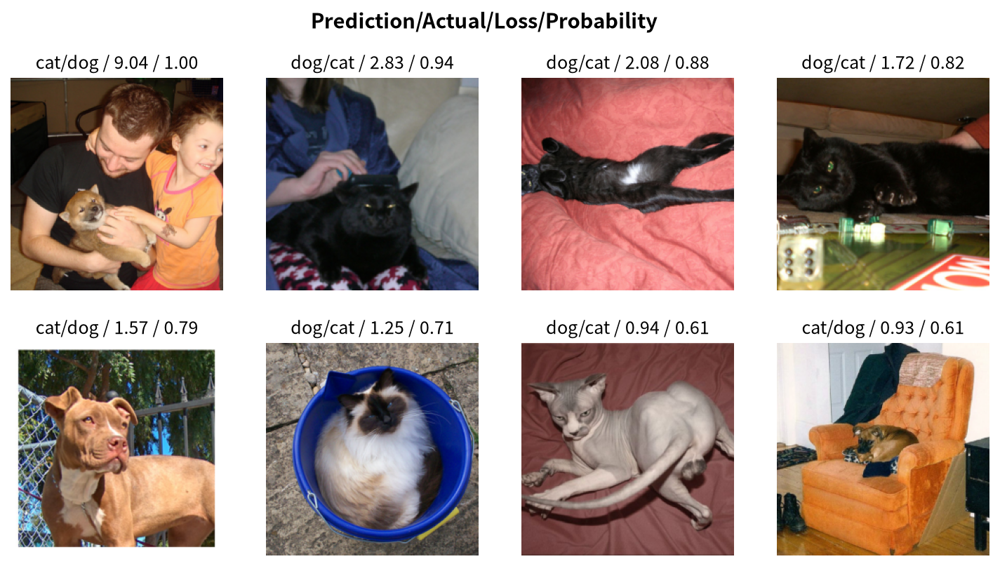
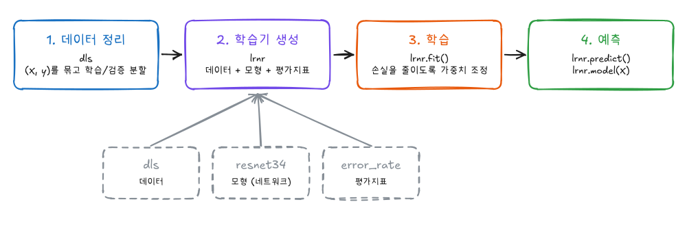

이 시리즈는 2022년 2학기 딥러닝 강의 노트를 다시 정리한 것이다. 강의는 독특한 순서로 진행됐다. 첫 3주 동안은 원리 설명 없이 fastai로 이미지 분류, 추천시스템, 텍스트 생성을 먼저 **돌려 보고**, 4주차부터 회귀분석으로 돌아가 그 안에서 무슨 일이 일어나는지를 하나씩 뜯어보았다. 무엇을 만들 수 있는지 먼저 보고 나서 원리를 배우면, 원리를 배울 때 "이게 어디에 쓰이는지"를 계속 떠올릴 수 있다.

이 글은 그 첫 3주를 정리한다. 목표는 하나다. 이미지, 추천, 텍스트라는 서로 다른 세 문제가 **같은 4단계**로 풀린다는 것을 확인하는 것이다.

| 범위 | 내용 | 시리즈 글 |
|---|---|---|
| 딥러닝의 기초 | 경사하강법, 손실함수, DNN, 보편근사정리, 역전파 | 2–6편 |
| 이미지 분석 | CNN, 다중클래스 분류, 전이학습, CAM | 7–9편 |
| 순환신경망 | RNN, LSTM, 텍스트 생성과 분류 | 10–13편 |
| 추천시스템, 생성모형 | 임베딩 기반 추천, GAN | 14–15편 |

## 0. 도구: PyTorch와 fastai

강의에서 쓰는 도구는 두 층으로 되어 있다.

- **PyTorch**는 텐서(다차원 배열) 계산, 자동미분, 신경망 부품, GPU 계산을 제공하는 라이브러리다. 2편부터는 주로 이것을 직접 쓴다.
- **fastai**는 PyTorch 위에 얹은 고수준 라이브러리다. 자료 불러오기, 전처리, 학습 반복, 결과 확인처럼 매번 쓰는 코드를 함수 몇 개로 묶어 두었다. 이 글에서 쓴다.

비유하면 PyTorch는 부품과 공구, fastai는 그 부품으로 미리 조립해 둔 완제품이다. 완제품으로 먼저 결과를 보고, 다음 글부터 부품 단위로 다시 조립한다.

코드는 강의와 같이 fastai를 쓰되 현재 버전에 맞게 고쳤다(예: `cnn_learner` → `vision_learner`). 실행은 Apple Silicon Mac의 MPS(애플 GPU)에서 했고, 시간은 이 기기 기준이다.

## 1. 이미지 분류: 개와 고양이

### 1단계: 데이터 정리

Oxford-IIIT Pet 자료는 37개 품종의 개와 고양이 사진 7,390장이다. 라벨 파일이 따로 없는 대신 파일 이름에 규칙이 있다. **고양이 품종은 대문자로, 개 품종은 소문자로 시작한다**(`Egyptian_Mau_167.jpg`는 고양이, `leonberger_6.jpg`는 개). 강의 노트는 이것을 "천재적인 저장 방식"이라고 불렀다. 이 규칙을 함수로 만들면 파일 이름만으로 라벨을 만들 수 있다.

```python
from fastai.vision.all import *

path = untar_data(URLs.PETS)/'images'      # 자료를 내려받아 압축을 풀고, 그 폴더 경로를 돌려줌
files = get_image_files(path)              # 폴더 안의 이미지 파일 목록 (7,390개)
label_func = lambda fname: 'cat' if fname[0].isupper() else 'dog'   # 파일 이름 -> 라벨
dls = ImageDataLoaders.from_name_func(path, files, label_func, item_tfms=Resize(224))
```

마지막 줄이 하는 일을 풀어 쓰면 다음과 같다.

1. `files`의 각 파일을 읽어 $X$(이미지)를 만든다.
2. 파일 이름을 `label_func`에 넣어 $y$(`'cat'` 또는 `'dog'`)를 만든다.
3. `item_tfms=Resize(224)`로 모든 이미지를 224×224로 맞춘다. 원본 사진은 크기가 제각각인데, 신경망은 여러 장을 한 덩어리(배치)로 묶어 계산하므로 크기가 같아야 한다.
4. 자료를 무작위로 **학습용 80%, 검증용 20%** 로 나눈다. 검증용은 학습에 쓰지 않고, 학습한 모형이 처음 보는 사진에서도 잘 맞히는지 확인하는 데만 쓴다.

이 모든 것이 담긴 객체가 `dls`(data loaders)다. `dls.show_batch()`로 학습 자료를 확인할 수 있다.


### 2단계: 학습기 생성

```python
lrnr = vision_learner(dls, resnet34, metrics=error_rate)
```

학습기(`lrnr`, learner)는 학습에 필요한 세 가지를 묶은 객체다.

| 재료 | 여기서는 | 역할 |
|---|---|---|
| 데이터 | `dls` | 무엇으로 학습하는가 |
| 모형 | `resnet34` | 어떤 네트워크로 $X \to y$를 계산하는가 |
| 평가지표 | `error_rate` | 결과를 사람이 읽을 수 있는 기준으로 보고 |

`resnet34`는 34개 층으로 된 합성곱신경망(CNN)으로, 이미지 분류에서 널리 쓰이는 구조다. 중요한 점은 이 네트워크가 **이미 학습된 상태**로 온다는 것이다. ImageNet이라는 100만 장 이상, 1,000개 범주의 사진 자료로 미리 학습되어 있어서, 선·모서리·질감·눈·털 같은 일반적인 시각 특징을 이미 알고 있다. 우리는 그 위에 "개냐 고양이냐"만 새로 가르치면 된다. CNN의 구조는 7편, 남이 학습한 네트워크를 가져다 쓰는 방법(전이학습)은 9편에서 직접 구현한다.

학습기는 정보(데이터, 모형, 지표)와 동작(학습, 예측, 결과 확인)을 함께 가진 객체다. 강의는 이것을 "명사와 동사를 함께 가진 썸띵"이라고 설명했다. `lrnr.model`처럼 명사로 쓰면 정보를 꺼내고, `lrnr.fine_tune()`처럼 동사로 쓰면 동작을 실행한다.

### 3단계: 학습

```python
lrnr.fine_tune(1)
```

| 단계 | epoch | train_loss | valid_loss | error_rate | 시간 |
|---|---|---|---|---|---|
| 마지막 층만 학습 | 0 | 0.1544 | 0.0186 | 0.0047 | 1:16 |
| 전체 미세조정 | 0 | 0.0509 | 0.0189 | 0.0068 | 1:38 |

결과표의 각 열은 다음 뜻이다.

- **epoch**: 학습 자료 전체를 몇 번째로 보고 있는가. 0번째, 즉 한 바퀴다.
- **train_loss / valid_loss**: 학습 자료와 검증 자료에서의 **손실**. 손실은 모형이 얼마나 틀렸는지를 나타내는 숫자로, 학습은 이 값을 줄이는 과정이다. 분류에서는 교차엔트로피를 쓰는데, 3편과 8편에서 자세히 다룬다.
- **error_rate**: 검증 자료에서 틀린 비율. 사람이 읽기 위한 **평가지표**다.

손실과 평가지표를 따로 두는 이유가 있다. 오분류율은 사람에게 직관적이지만 "맞았다/틀렸다"로만 세기 때문에 가중치를 조금 바꿔도 값이 변하지 않는 경우가 많다. 학습은 가중치를 조금씩 바꿨을 때 결과가 매끄럽게 변하는 값이 필요하고, 그것이 손실이다. 학습은 손실로 하고, 보고는 지표로 한다.

표가 두 줄인 이유는 `fine_tune`이 두 단계로 동작하기 때문이다. 먼저 사전학습된 부분은 고정(freeze)하고, 새로 붙인 마지막 층만 1 에폭 학습한다. 마지막 층은 아무것도 모르는 상태에서 시작하므로, 이 상태로 전체를 건드리면 큰 오차가 앞쪽의 잘 학습된 층까지 흔들기 때문이다. 그다음 고정을 풀고(unfreeze) 전체를 작은 학습률로 1 에폭 더 조정한다. 인자 `1`은 두 번째 단계의 에폭 수다.

검증용 1,478장 중 10장만 틀렸다(0.68%). 한 바퀴 학습으로 이 정도가 나오는 것은 사전학습 덕분이다.

### 4단계: 예측

```python
lrnr.predict(files[0])      # ('cat', tensor(0), tensor([1.0000e+00, 4.8751e-07]))
X, y = dls.one_batch()
lrnr.model(X[0:1])          # tensor([[-9.5485, 14.0800]])
```

예측 방법은 두 가지다.

- **`lrnr.predict()`** 는 파일 경로나 이미지를 받는다. 1단계와 같은 전처리(크기 조정 등)를 알아서 한 뒤, `(라벨, 라벨 번호, 각 범주의 확률)`을 돌려준다. 위의 결과는 "고양이(0번 범주)이고, 고양이일 확률 1.0000, 개일 확률 $4.9 \times 10^{-7}$"이라는 뜻이다.
- **`lrnr.model(X)`** 는 전처리가 끝난 `(장 수, 3, 224, 224)` 모양의 텐서를 받아 네트워크의 날것의 출력을 돌려준다. 3은 RGB 채널 수다. 출력 $(-9.55,\ 14.08)$은 확률이 아니라 범주별 점수인데, 소프트맥스 함수를 씌우면 확률이 된다(8편). 점수가 큰 두 번째 범주, 즉 개로 예측한 것이다.

강의에서는 인터넷에서 내려받은 사진과 강의에서 준비한 강아지 사진으로도 예측해 보았다. 학습 자료에 없던 사진에서도 대부분 맞혔다.

### 오답 분석

틀린 것들을 보면 모형이 무엇을 어려워하는지 알 수 있다.

```python
interp = Interpretation.from_learner(lrnr)   # 오답을 분석하는 객체
interp.plot_top_losses(8)                    # 손실이 가장 큰 순서로 8장
```



제목은 `예측/실제/손실/확률` 순서다. 손실이 크다는 것은 틀렸을 뿐 아니라 **확신하며 틀렸다**는 뜻이다. 첫 장은 사람 품에 안긴 강아지를 고양이로 확신했다(손실 9.04). 검은 고양이를 개로 본 경우가 여럿이고, 마지막 장은 의자 위에서 웅크린 개다. 얼굴이 잘 보이지 않거나 털 색이 특징을 가리는 사진들이다. 손실이 큰 순서로 보는 방법은 라벨이 잘못 붙은 자료나 애매한 사진을 찾는 데도 쓸 수 있다.

## 2. 추천시스템: 커피와 홍차

### 자료

강의용으로 만든 가상 자료다. 유저 100명이 커피 10종, 홍차 10종 중 일부를 마시고 평점을 남겼다. 1–50번 유저는 커피를, 51–100번 유저는 홍차를 좋아한다. 좋아하는 쪽에는 4점 근처, 아닌 쪽에는 1점 근처를 준다.

유저를 행, 아이템을 열로 놓은 표(넓은 형식)로 보면 빈칸이 많다. 모든 유저가 모든 음료를 마셔 보지는 않았기 때문이다. **추천은 이 빈칸의 평점을 예측하는 문제다.** 1번 유저가 커피2를 마신 적이 없지만 높게 줄 것으로 예측되면 커피2를 추천한다.

분석에는 한 행이 "누가, 무엇에, 몇 점을 줬는가"인 긴 형식(1,000행)을 쓴다.

| user | item | rating | item_name |
|---|---|---|---|
| 1 | 15 | 1.08 | 홍차5 |
| 1 | 1 | 4.15 | 커피1 |
| 1 | 11 | 1.14 | 홍차1 |
| ⋮ | ⋮ | ⋮ | ⋮ |

이 형식에서 $X$는 `(user, item)` 번호 쌍, $y$는 평점이다.

### 4단계

```python
from fastai.collab import *
df = pd.read_csv('https://raw.githubusercontent.com/guebin/DL2022/main/posts/I.%20Overview/2022-09-08-rcmd_anal.csv')

dls = CollabDataLoaders.from_df(df)              # 1단계: X = (user, item), y = rating
lrnr = collab_learner(dls, y_range=(0, 5))        # 2단계: 예측을 0~5 범위로 제한
lrnr.fit(30)                                      # 3단계: 30 에폭 학습
lrnr.model(torch.tensor([[1, 2]]))                # 4단계: 1번 유저가 2번 아이템에 줄 평점
```

이미지와 달리 사전학습된 모형이 없으므로 `fine_tune` 대신 처음부터 학습하는 `fit`을 쓴다. `y_range=(0, 5)`는 예측값이 평점 범위를 벗어나지 않게 출력 끝에 시그모이드를 씌워 0~5로 눌러 준다.

손실(MSE)은 학습 전 2.28에서 30 에폭 후 0.050까지 떨어졌다. 평균적으로 $\sqrt{0.05} \approx 0.22$점 정도 틀린다는 뜻이다. 강의처럼 10 에폭에서 멈추면 아직 1.20이어서, 강의 노트의 "총 30번 정도 해야 적합이 잘 된다"는 메모와 맞는다.

예측은 `(user, item)` 쌍을 텐서로 넣는다. 표에 없던 조합도 예측할 수 있다는 것이 핵심이다.

| 유저 | 커피2 (item 2) | 홍차2 (item 12) |
|---|---|---|
| 1번 (커피파) | 4.03 | 0.81 |
| 60번 (홍차파) | 1.06 | 3.98 |

모형은 "1번은 커피파"라는 사실을 누구에게도 듣지 않았다. 어떻게 알아냈을까? `collab_learner`는 유저마다, 아이템마다 몇 개의 숫자로 된 벡터(**임베딩**)를 하나씩 배정하고, 두 벡터의 내적으로 평점을 예측한다. 처음에는 임의의 값이지만, 학습하면서 커피에 높은 점수를 준 유저들의 벡터는 커피 벡터와 같은 방향으로, 홍차 벡터와는 반대 방향으로 움직인다. 결국 벡터의 어느 한 성분이 "커피 취향 대 홍차 취향"을 나타내게 된다. 이것을 직접 구현하는 것이 14편이다.

## 3. 텍스트: 다음 글자 맞히기

### 언어모형

`h e l l o . h e l l o ! h e l l o ? h e l l o !! h e l l o ??`를 20,000번 반복한 자료로 **언어모형**을 학습한다. 언어모형은 앞의 글자(또는 단어)들을 보고 다음 글자를 예측하는 모형이다. 문장을 생성하는 모든 모형의 기본 형태다.

언어모형에서는 $y$가 따로 없다. 문장 자체가 $X$이고, $X$를 한 칸 민 것이 $y$다.

| | | | | | | |
|---|---|---|---|---|---|---|
| $X$ | h | e | l | l | o | . |
| $y$ | e | l | l | o | . | h |

"h 다음은 e", "h e 다음은 l", "h e l 다음은 l"… 처럼 자료 하나에서 예측 문제를 글자 수만큼 만들어 낸다. `is_lm=True`(is language model)가 이렇게 $y$를 만들라는 뜻이다.

```python
from fastai.text.all import *
df = pd.DataFrame({'text': ['h e l l o . h e l l o ! h e l l o ? h e l l o !! h e l l o ??']*20000})

dls = TextDataLoaders.from_df(df, text_col='text', is_lm=True)   # 1단계
lrnr = language_model_learner(dls, AWD_LSTM)                      # 2단계
lrnr.fit(1)                                                       # 3단계
lrnr.predict('h e', n_words=30)                                   # 4단계: 'h e' 뒤로 30개 생성
```

1단계에서 fastai는 문장을 토큰(여기서는 공백으로 나뉜 글자)으로 쪼개고 번호를 매긴다. 이때 문장의 시작을 표시하는 특수 토큰 `xxbos`(beginning of sentence)를 붙인다. `!!`는 `! !` 두 토큰으로 나뉜다. 2단계의 `AWD_LSTM`은 순환신경망의 일종인 LSTM에 과적합 방지 장치를 더한 구조로, 위키피디아 문장으로 사전학습되어 있다.

4단계는 'h e'를 넣어 다음 토큰을 예측하고, 그 예측을 다시 입력에 붙여 다음 토큰을 예측하는 것을 30번 반복한다.

### 결과

이 기기에서는 1 에폭 후 검증 손실이 0.90으로 강의(0.25)보다 덜 학습되어, 3 에폭을 더 돌렸다. 학습 순서에 들어가는 무작위성 때문에 같은 코드도 기기와 버전에 따라 이 정도 차이가 날 수 있다.

| 학습량 | valid_loss | `predict('h e', n_words=30)` |
|---|---|---|
| 1 에폭 | 0.90 | `h e e l L O o L ? o ? O ? e l o o ! ? ? o L l o ! o ?` |
| 4 에폭 | 0.24 | `h e l l o ? ? h e l l o . h h e l l o ! h e l l o ? h e l l` |

1 에폭에서는 쓰이는 글자 종류는 맞혔지만 순서가 엉망이다(대문자가 섞인 것은 fastai가 대문자를 `xxmaj`, `xxup` 같은 표시 토큰으로 바꿔 다루는데, 모형이 이 표시 토큰을 잘못 생성했기 때문이다). 4 에폭 후에는 `hello` 뒤에 문장부호가 오고 다시 `hello`가 오는 구조를 대부분 배웠다. 다만 부호의 순서(`.` → `!` → `?` → `!!` → `??`)는 아직 완벽하지 않다. 다섯 번째 `hello` 뒤에 무엇이 올지 알려면 앞에서 몇 번째 `hello`였는지를 기억해야 하기 때문이다. 앞의 문맥을 얼마나 오래 기억할 수 있는가가 순환신경망 파트(10–13편)의 주제다.

## 4. 공통 구조

### 4단계

세 분석의 코드를 나란히 놓으면 단계가 같다.



| 단계 | 이미지 분류 | 추천시스템 | 텍스트 생성 | 회귀분석 (R) |
|---|---|---|---|---|
| 1. 데이터 정리 | `ImageDataLoaders` | `CollabDataLoaders` | `TextDataLoaders` | `data.frame()` |
| 2. 학습기 생성 | `vision_learner()` | `collab_learner()` | `language_model_learner()` | 없음 |
| 3. 학습 | `lrnr.fine_tune()` | `lrnr.fit()` | `lrnr.fit()` | `lm(y ~ x, df)` |
| 4. 예측 | `lrnr.predict()`, `lrnr.model(X)` | `lrnr.model(X)` | `lrnr.predict()` | `predict(fit, newdf)` |

R의 회귀분석과 비교하면, R에서는 2단계(모형 정하기)와 3단계(학습)가 `lm()` 한 줄에 합쳐져 있다. 회귀는 모형이 선형식으로 정해져 있고 답을 공식으로 구할 수 있기 때문이다. 딥러닝에서는 어떤 네트워크를 쓸지 고르는 것 자체가 분석의 큰 부분이고, 학습도 반복 계산이라 시간이 걸리므로 두 단계를 나눈다.

강의 3주차에서는 같은 틀로 GAN(가짜 손글씨 숫자 만들기)도 돌려 보았다. 생성모형은 "예측" 단계가 따로 없고 두 네트워크가 경쟁하는 구조라 마지막 15편에서 따로 다룬다.

### 자료의 모양

세 문제를 자료의 모양으로 보면 모두 $(X, y)$ 쌍이다. 무엇이 $X$이고 무엇이 $y$인지, 그리고 순서가 중요한지에 따라 쓰는 신경망이 달라진다.

| $X$ (설명변수) | $y$ (반응변수) | 주로 쓰는 신경망 | 순서가 중요한가 | 예 |
|---|---|---|---|---|
| 이미지 | 범주 | 합성곱신경망 (CNN) | 아니오 | 개·고양이 분류 |
| (유저, 아이템) | 평점 | 추천시스템 (임베딩) | 아니오 | 영화 추천 |
| 과거부터 오늘까지의 값 | 내일의 값 | 순환신경망 (RNN) | 예 | 주가 예측 |
| 처음 $m$개의 단어 | 다음 단어 | 순환신경망 | 예 | 텍스트 생성, 챗봇 |
| 처음 $m$개의 단어 | 범주 | 순환신경망 | 예 | 리뷰 감성 분류 |

### 학습과 예측

**학습**은 주어진 $(X, y)$로부터 $X$에서 $y$로 가는 규칙을 찾는 것이다. 강의는 이 규칙을 여러 이름으로 불렀다. 규칙, 원리, 맵핑, 함수 $f$, 모형 $model$, 네트워크 $net$. 무엇으로 부르든 $y \approx f(X)$가 되게 하는 $f$를 찾는다는 뜻은 같다. 통계학에서는 "함수를 추정한다", 딥러닝에서는 "네트워크를 학습시킨다"고 말하는 차이뿐이다. **예측**은 찾은 규칙을 $X$에 적용해 $\hat y = net(X)$를 구하는 것이다.

$\hat y$는 $X$가 어디서 왔는지에 따라 성격이 다르다.

| | $X$가 학습 자료에 있음 | $X$가 새 자료 |
|---|---|---|
| 이름 | 적합값 (fitted value) | 예측값 (predicted value with new data) |
| 손실 $y$ vs $\hat y$ | 계산할 수 있음 | $y$를 모르므로 계산할 수 없음 |

학습은 왼쪽 칸의 손실을 줄이는 과정이지만, 우리가 정말 원하는 것은 오른쪽 칸에서 잘 맞히는 것이다. 학습 자료를 통째로 외워 버리면 왼쪽 손실은 0이 되어도 오른쪽에서는 엉망일 수 있다. 이것이 과적합이다. 그래서 자료의 일부를 검증용으로 떼어 두고, 그 자료를 "새 자료"인 척 써서 `valid_loss`를 본다. 결과표에 손실이 두 개 나오는 이유가 이것이다(5편).

## 정리

- fastai의 분석은 **데이터 정리(`dls`) → 학습기 생성(`lrnr`) → 학습(`fit`, `fine_tune`) → 예측(`predict`, `model`)** 의 4단계다. 문제의 종류가 바뀌어도 각 단계의 함수만 바뀐다.
- 학습기는 데이터, 모형, 평가지표를 묶은 객체다. 학습은 손실로 하고, 결과는 평가지표로 읽는다.
- 사전학습된 모형이 있으면 `fine_tune`으로 끝부분만 먼저 학습한 뒤 전체를 미세조정한다. 없으면 `fit`으로 처음부터 학습한다.
- `lrnr.predict()`는 원자료를 받아 라벨과 확률까지, `lrnr.model(X)`는 전처리된 텐서를 받아 네트워크 출력만 돌려준다.
- 학습은 학습 자료의 손실을 줄이는 것이고, 성능은 학습에 쓰지 않은 검증 자료에서 판단한다.

다음 글부터는 fastai가 감춰 둔 2단계와 3단계, 즉 "모형을 어떻게 만들고 어떻게 학습시키는가"를 가장 단순한 회귀모형에서부터 직접 구현한다.

## 참고자료

- 최규빈, 「딥러닝」 강의노트 (2022), 01wk-1–03wk-1: Introduction, Overview (1)–(4), <https://guebin.github.io/DL2022/>
- Howard, J. and Gugger, S. (2020). *Deep Learning for Coders with fastai and PyTorch*, Chapter 1. O'Reilly.
- He, K., Zhang, X., Ren, S. and Sun, J. (2016). Deep residual learning for image recognition. *CVPR*.
- Parkhi, O. M., Vedaldi, A., Zisserman, A. and Jawahar, C. V. (2012). Cats and dogs. *CVPR*.
- fastai documentation, <https://docs.fast.ai/>
