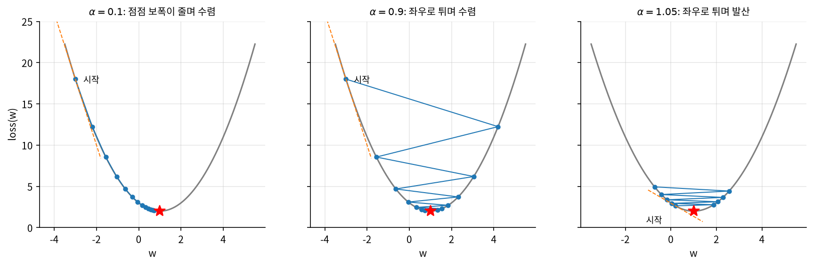
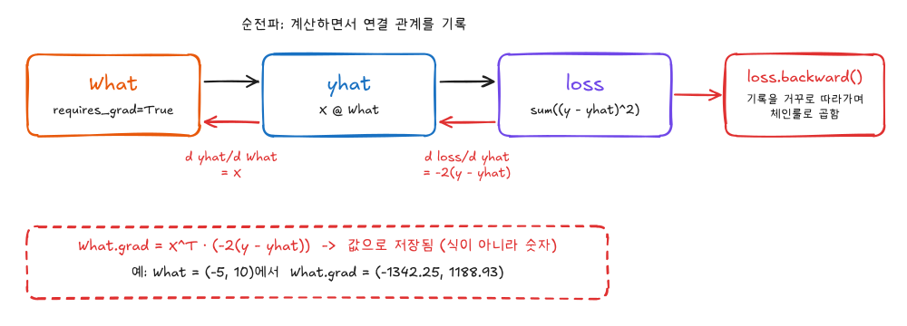
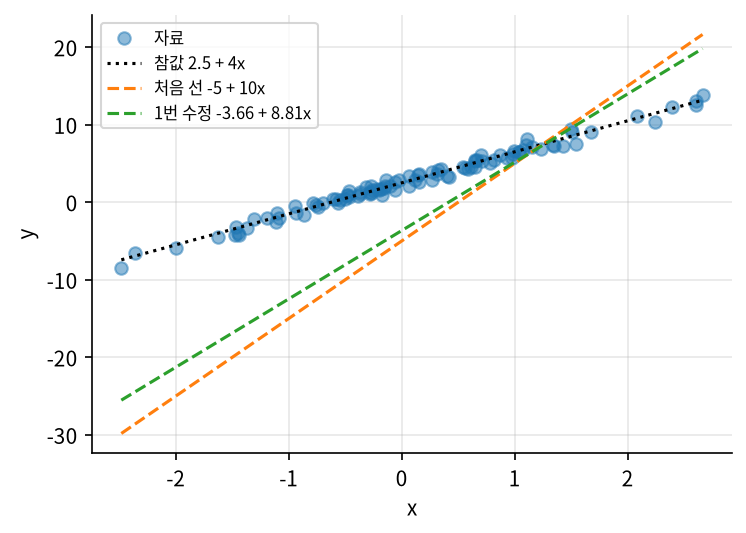
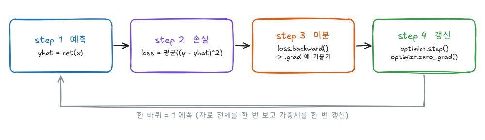
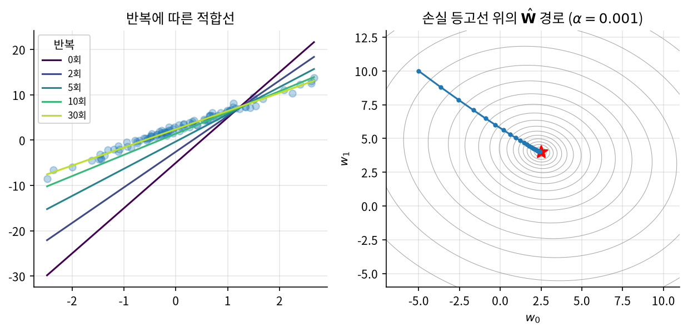
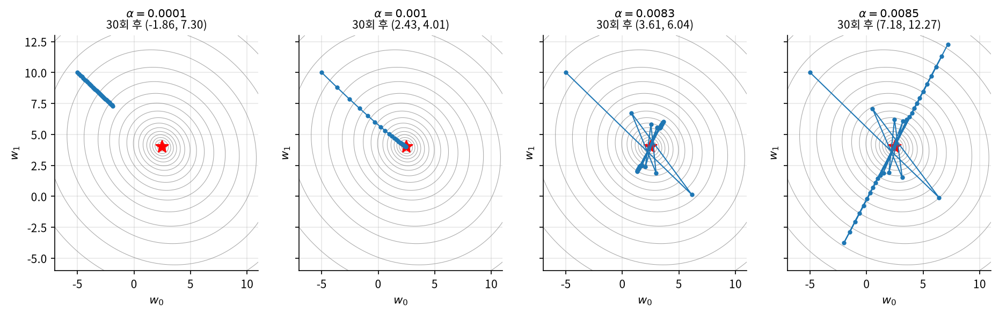

[앞 글](/posts/dl-01-overview)에서는 fastai가 학습을 대신 해 주었다. `lrnr.fit()` 한 줄 안에서 무슨 일이 일어나는지는 감춰져 있었다. 이 글부터는 그 안을 연다.

출발점은 가장 단순한 모형인 단순회귀다. 회귀분석 시간에는 $\hat{\mathbf W} = (\mathbf X^\top \mathbf X)^{-1}\mathbf X^\top \mathbf y$라는 공식으로 답을 한 번에 구했다. 여기서는 일부러 그 공식을 쓰지 않고, **아무 값에서나 시작해 조금씩 고쳐 가는 반복 계산**으로 같은 답을 찾는다. 이유는 단순하다. 신경망에는 이런 닫힌 해가 없다. 층이 쌓이고 비선형 함수가 끼어들면 손실을 최소화하는 가중치를 식으로 풀 수 없고, 반복 계산만이 유일한 방법이 된다. 회귀는 답을 알고 있으니 반복 계산이 제대로 동작하는지 확인하기 좋은 연습 문제다.

이 글에서 만드는 네 단계(예측 → 손실 → 미분 → 갱신)는 앞으로 나올 모든 신경망의 학습에서 그대로 쓰인다.

## 1. 회귀모형에서 학습이란

모형은 다음과 같다.

$$
y_i = w_0 + w_1 x_i + \epsilon_i, \qquad i = 1, \dots, 100
$$

100개의 식을 한꺼번에 다루기 위해 행렬로 쓴다.

$$
\underbrace{\begin{bmatrix} y_1 \\ y_2 \\ \vdots \\ y_n \end{bmatrix}}_{\mathbf y}
= \underbrace{\begin{bmatrix} 1 & x_1 \\ 1 & x_2 \\ \vdots & \vdots \\ 1 & x_n \end{bmatrix}}_{\mathbf X}
\underbrace{\begin{bmatrix} w_0 \\ w_1 \end{bmatrix}}_{\mathbf W}
+ \underbrace{\begin{bmatrix} \epsilon_1 \\ \epsilon_2 \\ \vdots \\ \epsilon_n \end{bmatrix}}_{\boldsymbol\epsilon}
$$

$\mathbf X$의 첫 열이 모두 1인 것은 절편 $w_0$를 곱하기 위해서다. $\mathbf X\mathbf W$의 $i$번째 원소를 계산하면 $1 \cdot w_0 + x_i \cdot w_1$이 되어 원래 식과 같아진다.

강의 자료는 참값 $\mathbf W = (2.5,\ 4)$, $\epsilon_i \sim N(0, 0.5^2)$로 만든 점 100개다.

```python
import torch, pandas as pd
df = pd.read_csv("https://raw.githubusercontent.com/guebin/DL2022/main/posts/II.%20DNN/2022-09-22-regression.csv")
x = torch.tensor(df.x).float().reshape(100, 1)      # (100, 1) 열벡터
y = torch.tensor(df.y).float().reshape(100, 1)
X = torch.concat([torch.ones(100, 1), x], axis=1)   # (100, 2): [1, x_i]
```

**학습**은 점들만 보고 $\hat{\mathbf W} = (\hat w_0, \hat w_1)$을 참값 $(2.5,\ 4)$에 가깝게 찾는 것이다. 그림으로 말하면 점들을 잘 지나는 직선 하나를 찾는 것이다. 강의는 이것을 세 단계 전략으로 나눴다.

1. **아무 선이나 긋는다.** 여기서는 $\hat{\mathbf W} = (-5,\ 10)$, 즉 $\hat y = -5 + 10x$로 시작한다. 이 값에 특별한 이유는 없다.
2. **그 선을 조금 더 나은 선으로 고친다.**
3. **2를 반복한다.**

1은 쉽다. 문제는 2다. "더 나은 선"이 무엇인지 컴퓨터가 알 수 있게 정의해야 하고, 어느 방향으로 얼마나 고칠지도 정해야 한다. 앞의 것을 정하는 것이 손실함수, 뒤의 것을 정하는 것이 경사하강법이다.

## 2. 손실함수: 선이 얼마나 나쁜지를 숫자로

선이 점들에서 얼마나 떨어져 있는지를 하나의 숫자로 요약한다. 가장 흔한 선택은 오차제곱합(SSE)이다.

$$
\text{loss}(\hat w_0, \hat w_1) = \sum_{i=1}^n (y_i - \hat y_i)^2 = \sum_{i=1}^n \big(y_i - (\hat w_0 + \hat w_1 x_i)\big)^2
$$

행렬로 쓰면 $(\mathbf y - \mathbf X\hat{\mathbf W})^\top(\mathbf y - \mathbf X\hat{\mathbf W})$이다. 오차를 그냥 더하지 않고 제곱하는 이유는 두 가지다. 위로 벗어난 오차와 아래로 벗어난 오차가 서로 상쇄되지 않게 하고, 크게 벗어난 점에 더 큰 벌점을 주기 위해서다.

여기서 중요한 관점의 전환이 있다. **자료 $(x_i, y_i)$는 이미 주어져 고정되어 있으므로, 손실은 $(\hat w_0, \hat w_1)$만의 함수다.** 처음 선 $(-5, 10)$을 넣으면 손실은 8587.69이고, 다른 값을 넣으면 다른 숫자가 나온다. 그러면 "점들을 잘 지나는 선을 찾자"는 막연한 문제가

> $\text{loss}(w_0, w_1)$를 최소로 만드는 $(w_0, w_1)$을 찾아라

라는 수학 문제가 된다. $\text{loss}(w) = w^2 - 2w + 3$을 최소화하는 $w$를 찾는 문제와 본질적으로 같다. 변수가 두 개라는 것만 다르다. 앞으로 "파라미터를 학습한다", "선을 업데이트한다", "손실을 최소화한다"는 모두 같은 말이다.

## 3. 경사하강법

### 1차원에서의 직관

변수가 하나인 $\text{loss}(w) = w^2 - 2w + 3$으로 먼저 생각한다. 최소점은 $w = 1$이지만, 이것을 모른다고 하고 $w = -3$에서 출발한다. 우리가 아는 것은 **지금 서 있는 곳의 기울기**뿐이다.

- 기울기가 **음수**면 오른쪽으로 갈수록 내려간다. 그러니 오른쪽으로 간다.
- 기울기가 **양수**면 왼쪽으로 갈수록 내려간다. 그러니 왼쪽으로 간다.
- 즉 **기울기의 부호와 반대 방향으로** 움직인다.
- 기울기의 **절댓값이 크면** 최소점에서 멀다는 신호이므로 많이 움직이고, 작으면 조금 움직인다.

이것을 식 하나로 쓰면 다음과 같다.

$$
w \leftarrow w - \alpha \cdot \text{loss}'(w)
$$

마이너스가 "반대 방향"을, $\text{loss}'(w)$의 크기가 "기울기에 비례한 보폭"을 담당한다. $\alpha$는 **학습률**로, 보폭 전체에 곱하는 배율이다. 강의의 비유로는 다리의 길이다.

이 예제에서 $\text{loss}'(w) = 2w - 2$이므로 $w = -3$에서의 기울기는 $-8$이다. $\alpha = 0.1$이면 $w \leftarrow -3 - 0.1 \times (-8) = -2.2$로 오른쪽으로 0.8만큼 간다. 다음 위치 $-2.2$에서 기울기는 $-6.4$라서 0.64만큼 간다. 최소점에 가까워질수록 기울기가 작아지므로 보폭이 저절로 줄어든다.



학습률을 바꾸면 거동이 달라진다. 갱신식을 최소점 $w^* = 1$로부터의 거리로 다시 쓰면

$$
w - 1 \;\leftarrow\; (w - 1) - \alpha\,(2w - 2) = (1 - 2\alpha)(w - 1)
$$

이다. 한 번 갱신할 때마다 최소점까지의 거리가 $(1 - 2\alpha)$배가 된다.

| $\alpha$ | 배율 $1 - 2\alpha$ | 거동 |
|---|---|---|
| 0.1 | 0.8 | 같은 쪽에서 매번 20%씩 다가감 |
| 0.9 | −0.8 | 최소점을 넘어 반대편으로 튀지만, 거리는 줄어듦 |
| 1.05 | −1.1 | 반대편으로 튈 때마다 거리가 10%씩 늘어남 (발산) |

$|1 - 2\alpha| < 1$, 즉 $\alpha < 1$이어야 수렴한다. 이 "배율" 관점은 뒤의 학습률 절에서 2차원으로 그대로 확장된다.

### 2차원으로

손실이 $(w_0, w_1)$ 두 변수의 함수가 되면 기울기도 두 개다. 각 변수 방향의 편미분을 모은 벡터를 **기울기 벡터**(gradient)라고 한다.

$$
\frac{\partial}{\partial \mathbf W}\text{loss}(w_0, w_1) =
\begin{bmatrix} \dfrac{\partial}{\partial w_0}\text{loss}(w_0, w_1) \\[2ex] \dfrac{\partial}{\partial w_1}\text{loss}(w_0, w_1) \end{bmatrix}
$$

갱신식은 1차원과 똑같은 모양이다. 각 좌표를 자기 편미분의 반대 방향으로 움직인다.

$$
\hat{\mathbf W} \leftarrow \hat{\mathbf W} - \alpha \frac{\partial}{\partial \hat{\mathbf W}} \text{loss}(\hat w_0, \hat w_1)
$$

기울기 벡터는 손실이 가장 가파르게 **증가**하는 방향을 가리키므로, 그 반대 방향은 가장 가파르게 **감소**하는 방향이다. 이름이 경사"하강"법인 이유다.

남은 문제는 편미분을 어떻게 계산하느냐다. 단순회귀에서는 손으로 풀 수 있지만, 층이 수십 개인 신경망에서 손으로 미분하는 것은 불가능하다. 이것을 대신해 주는 것이 파이토치의 **자동미분**이다.

## 4. 파이토치의 자동미분

### `requires_grad`와 `backward()`

미분하고 싶은 텐서를 만들 때 `requires_grad=True`를 붙인다. 이 표시가 붙은 텐서로 계산을 하면, 파이토치는 결과값과 함께 **어떤 연산을 거쳐 그 값이 나왔는지**를 기록해 둔다. 이 기록을 계산 그래프라고 한다. 출력에 붙는 `grad_fn=<SumBackward0>` 같은 꼬리표가 그 기록이다.

```python
What = torch.tensor([[-5.0], [10.0]], requires_grad=True)
yhat = X @ What                        # grad_fn=<MmBackward0>: 행렬곱으로 만들어졌다는 기록
loss = torch.sum((y - yhat)**2)        # tensor(8587.6875, grad_fn=<SumBackward0>)
loss.backward()                        # loss를 requires_grad=True인 텐서들로 미분
What.grad                              # tensor([[-1342.2524], [1188.9305]])
```

`loss.backward()`는 "loss를 미분하라"는 명령이다. 무엇으로 미분하는가? 계산 그래프를 거슬러 올라가 만나는 `requires_grad=True` 텐서, 여기서는 `What`이다. 결과는 `What.grad`에 저장된다.



주의할 점은 `What.grad`에 담기는 것이 **도함수의 식이 아니라 숫자**라는 것이다. 현재 위치 $(-5, 10)$을 대입한 기울기 값 $(-1342.25,\ 1188.93)$이 들어 있다. "$(−5, 10)$에서 $w_0$ 방향으로는 손실이 가파르게 내려가고(음수), $w_1$ 방향으로는 올라간다(양수)"는 뜻이다. 그러니 $w_0$는 늘리고 $w_1$은 줄여야 한다. 그림에서 처음 선 $-5 + 10x$가 너무 낮고 너무 가팔랐다는 것과 맞는다.

### 손계산으로 확인

`backward()`가 정말 맞게 계산했는지 두 가지 방법으로 확인한다.

첫째, 행렬 미분 공식이다. 손실을 전개하면 $\mathbf y^\top\mathbf y - 2\mathbf W^\top\mathbf X^\top\mathbf y + \mathbf W^\top\mathbf X^\top\mathbf X\mathbf W$이고, 이것을 $\mathbf W$로 미분하면

$$
\frac{\partial}{\partial \mathbf W}\text{loss} = -2\mathbf X^\top \mathbf y + 2\mathbf X^\top \mathbf X \mathbf W = -2\mathbf X^\top(\mathbf y - \mathbf X\mathbf W)
$$

이다. 마지막 형태는 그림의 체인룰과 같다. $\partial \text{loss}/\partial \hat{\mathbf y} = -2(\mathbf y - \hat{\mathbf y})$에 $\hat{\mathbf y} = \mathbf X\mathbf W$의 미분인 $\mathbf X^\top$을 곱한 것이다.

둘째, 미분의 정의를 그대로 쓰는 수치 미분이다. $w_0$를 아주 조금($h = 0.001$) 바꿨을 때 손실이 얼마나 변하는지 잰다.

$$
\frac{\partial}{\partial w_0}\text{loss} \approx \frac{\text{loss}(w_0 + h, w_1) - \text{loss}(w_0, w_1)}{h}
$$

| 방법 | $\partial/\partial w_0$ | $\partial/\partial w_1$ |
|---|---|---|
| `loss.backward()` | −1342.2524 | 1188.9305 |
| 공식 $-2\mathbf X^\top(\mathbf y - \mathbf X\mathbf W)$ | −1342.2523 | 1188.9307 |
| 수치 미분 ($h = 0.001$) | −1341.80 | 1190.43 |

공식과는 float32 반올림 수준까지 같고, 수치 미분과도 거의 같다. 수치 미분의 작은 차이는 $h$가 0이 아니라서 생기는 근사 오차다.

### 한 번 갱신

$\alpha = 0.001$로 한 번 갱신하면

$$
\begin{bmatrix} -5 \\ 10 \end{bmatrix} - 0.001 \times \begin{bmatrix} -1342.25 \\ 1188.93 \end{bmatrix} = \begin{bmatrix} -3.66 \\ 8.81 \end{bmatrix}
$$

이 된다. 절편은 올라가고 기울기는 줄었다. 그림으로 보면 한 번만 고쳐도 선이 점들 쪽으로 다가간다.



## 5. 반복: 학습

이제 2단계를 반복하면 된다. 반복 한 번에 하는 일을 정리하면 네 단계다.



```python
What = torch.tensor([[-5.0], [10.0]], requires_grad=True)
alpha = 0.001
for epoch in range(30):
    yhat = X @ What                            # step 1: 현재 가중치로 예측
    loss = torch.sum((y - yhat)**2)            # step 2: 예측이 얼마나 틀렸는지
    loss.backward()                            # step 3: 기울기 계산 → What.grad
    What.data = What.data - alpha * What.grad  # step 4: 기울기 반대로 이동
    What.grad = None                           #         다음 반복을 위해 기울기 지우기
```

자료 전체를 한 번 보고 가중치를 한 번 갱신하는 것을 **1 에폭**(epoch)이라고 한다. 위 코드는 30 에폭을 학습한다. 지금은 자료 전체로 한 번에 기울기를 계산하므로 반복 1회 = 1 에폭이지만, 5편에서 자료를 쪼개 쓰는 미니배치를 배우면 둘이 달라진다.

30 에폭 후 결과는 $\hat{\mathbf W} = (2.4290,\ 4.0144)$로, 참값 $(2.5,\ 4)$에 가깝다.



왼쪽 그림은 선이 점점 점들에 맞춰지는 과정이다. 오른쪽 그림은 같은 과정을 $(w_0, w_1)$ 평면에서 본 것이다. 회색 타원은 손실이 같은 점들을 이은 등고선이고, 파란 점들은 매 에폭의 $\hat{\mathbf W}$다. 처음에는 기울기가 커서 성큼성큼 움직이다가, 최소점에 가까워질수록 보폭이 줄어든다. 1차원 예제와 같은 모습이다.

정확히 말하면 경사하강법이 다가가는 곳은 참값 $(2.5,\ 4)$가 아니라 **손실의 최소점**이다. 이 자료에서 손실의 최소점은 최소제곱추정값 $(\mathbf X^\top \mathbf X)^{-1}\mathbf X^\top \mathbf y = (2.4459,\ 4.0043)$이고, 오차 $\epsilon_i$ 때문에 참값과 조금 다르다. 30 에폭 후의 $(2.4290,\ 4.0144)$는 이 최소점으로 다가가는 중이다. 같은 문제를 반복 계산과 공식이라는 두 길로 풀어 같은 답에 도착하는 것이다.

### 코드에서 헷갈리는 두 곳

**`What.grad = None`을 빼면 어떻게 되는가.** 파이토치는 `backward()`를 부를 때마다 새 기울기를 `.grad`에 **더한다**. 덮어쓰지 않는다. 지우지 않으면 두 번째 에폭의 `.grad`에는 첫 번째와 두 번째 기울기의 합이, 세 번째에는 세 개의 합이 들어간다. 실제보다 점점 큰 보폭으로 움직이게 되어 학습이 망가진다. 누적하는 이유는 여러 손실의 기울기를 합쳐야 하는 경우(예: 메모리가 부족해 배치를 나눠 계산할 때)에 편하기 때문이다. 그래서 매 반복마다 직접 지워야 한다.

**왜 `What = What - alpha * What.grad`로 쓰지 않는가.** 이렇게 쓰면 오른쪽의 계산 결과가 새 텐서가 되고, 이 텐서는 "`What`에서 빼기 연산으로 만들어졌다"는 기록을 단 **중간 계산값**이 된다. 직접 만든 텐서가 아니므로 다음 `backward()`에서 `.grad`가 채워지지 않는다. `.data`는 텐서의 값만 꺼낸 것이라, `What.data = ...`는 계산 그래프를 건드리지 않고 숫자만 바꾼다. 요즘 파이토치에서는 같은 의도를 `with torch.no_grad(): What -= alpha * What.grad`로 쓴다. "이 블록 안의 계산은 기록하지 마라"는 뜻이다.

## 6. 학습률

$\alpha$를 바꿔 가며 30 에폭씩 학습했다.



| $\alpha$ | 30회 후 $\hat{\mathbf W}$ | 30회 후 손실 | 거동 |
|---|---|---|---|
| 0.0001 | (−1.86, 7.30) | 2882.2 | 방향은 맞지만 너무 느림 |
| 0.001 | (2.43, 4.01) | 26.4 | 수렴 |
| 0.0083 | (3.61, 6.04) | 674.4 | 최소점 주위를 진동하며 조금씩 멀어짐 |
| 0.0085 | (7.18, 12.27) | 9768.1 | 진동하며 발산 |
| 0.01 | (32503, 56730) | $2.5 \times 10^{11}$ | 폭발 |

$\alpha$가 너무 작으면 비효율적이고, 너무 크면 최소점을 넘어 반대편으로 튀면서 오히려 멀어진다. 강의 노트는 너무 큰 학습률을 "다른 의미에서 비효율적이고, 위험하다"고 표현했다.

0.0083과 0.0085처럼 비슷한 값에서 거동이 갈리는 것은 우연이 아니다. 1차원 예제에서 쓴 "배율" 계산을 2차원으로 확장하면 경계를 정확히 구할 수 있다.

최소점을 $\mathbf W^*$, 현재 위치의 오차를 $\mathbf e_t = \hat{\mathbf W}_t - \mathbf W^*$라 하자. 최소점에서는 기울기가 0이므로 $\mathbf X^\top \mathbf y = \mathbf X^\top \mathbf X \mathbf W^*$이고, 이것을 기울기 식에 넣으면 기울기가 $2\mathbf X^\top \mathbf X\,\mathbf e_t$가 된다. 따라서

$$
\mathbf e_{t+1} = \mathbf e_t - \alpha \cdot 2\mathbf X^\top \mathbf X\,\mathbf e_t = (\mathbf I - 2\alpha \mathbf X^\top \mathbf X)\,\mathbf e_t
$$

이다. 1차원에서는 배율이 숫자 $(1 - 2\alpha)$였는데, 2차원에서는 행렬 $(\mathbf I - 2\alpha\mathbf X^\top\mathbf X)$가 된다. 행렬을 곱하는 것은 방향마다 다른 배율을 곱하는 것이고, 그 "방향"이 $\mathbf X^\top \mathbf X$의 고유벡터, 배율이 $1 - 2\alpha\lambda$다($\lambda$는 고유값). 그림에서 등고선 타원의 두 축이 바로 이 고유벡터 방향이다.

모든 방향에서 오차가 줄어야 수렴하므로 모든 고유값에 대해 $|1 - 2\alpha\lambda| < 1$이어야 하고, 가장 큰 고유값이 가장 먼저 이 조건을 깬다. 정리하면

$$
\alpha < \frac{1}{\lambda_{\max}(\mathbf X^\top \mathbf X)}
$$

이다. 이 자료에서 $\mathbf X^\top \mathbf X$의 고유값은 92.98과 121.39이므로 경계는 $1/121.39 = 0.00824$다.

| $\alpha$ | 큰 고유값 방향 배율 $|1 - 2\alpha \cdot 121.39|$ | 해석 |
|---|---|---|
| 0.0001 | 0.976 | 30회 후에도 오차가 $0.976^{30} \approx 0.48$배 남음 (느림) |
| 0.001 | 0.757 | 30회 후 오차가 $0.757^{30} \approx 0.0002$배 (수렴) |
| 0.0083 | 1.015 | 경계를 아주 조금 넘음. 천천히 발산 |
| 0.0085 | 1.064 | 발산 |
| 0.01 | 1.428 | 빠르게 발산 |

그림 세 번째와 네 번째 칸에서 경로가 한 방향(왼쪽 아래–오른쪽 위 대각선)으로 지그재그를 그리며 퍼져 나가는 것이 보인다. 그 방향이 고유값 121.39에 해당하는 고유벡터 방향이다. 다른 방향(고유값 92.98, 배율 $|1 - 2 \times 0.0085 \times 92.98| = 0.58$)으로는 여전히 수렴하고 있어서, 한 방향으로만 발산하는 모양이 된다.

실제 신경망에서는 손실이 이차식이 아니라 이런 계산을 할 수 없다. 그래도 "곡률이 큰 방향이 학습률의 상한을 정한다"는 결론은 그대로 유지되고, 학습률을 몇 가지 바꿔 가며 손실이 줄어드는지 확인하는 것이 일반적인 방법이다.

## 7. SSE와 MSE

손실을 합 대신 평균으로 정의할 수도 있다.

$$
\text{MSE} = \frac{1}{n}\sum_{i=1}^n (y_i - \hat y_i)^2
$$

MSE는 SSE를 $n$으로 나눈 것이므로, 기울기도 SSE 기울기의 $1/n$이다. 따라서 **MSE에 학습률 $\alpha$를 쓰는 것은 SSE에 $\alpha/n$을 쓰는 것과 정확히 같다.** 실제로 MSE에 $\alpha = 0.1$을 쓰면 SSE에 $\alpha = 0.001$을 쓴 것과 소수점 넷째 자리까지 같은 $(2.4290,\ 4.0144)$가 나온다($n = 100$이므로 $0.1/100 = 0.001$).

SSE를 쓰면 자료가 늘어날수록 손실과 기울기가 커지므로 학습률을 줄여야 한다. 위 수렴 조건에서도 $\mathbf X^\top \mathbf X$의 고유값은 $n$에 비례해 커진다. MSE를 쓰면 이런 조정이 필요 없어서, 이후로는 MSE를 쓴다.

## 8. 파이토치의 도구로 다시 쓰기

지금까지는 모든 것을 손으로 썼다. 파이토치에는 step 1(예측)과 step 4(갱신)를 대신해 주는 도구가 있다. 도구를 쓰기 전에, 오류가 가장 많이 나는 텐서의 모양과 자료형을 짚고 간다.

### 텐서의 모양과 자료형

`torch.tensor`는 `np.array`와 거의 같게 쓸 수 있다. 다만 신경망 코드에서 나는 오류는 대부분 모양(shape)과 자료형(dtype)에서 나온다.

| 선언 | shape | 해석 |
|---|---|---|
| `torch.tensor([1, 2, 3])` | `(3,)` | 길이 3인 벡터. 행렬곱의 앞에 오면 행벡터, 뒤에 오면 열벡터처럼 동작 |
| `torch.tensor([[1], [2], [3]])` | `(3, 1)` | 열벡터 (3행 1열) |
| `torch.tensor([[1, 2, 3]])` | `(1, 3)` | 행벡터 (1행 3열) |

$2 \times 2$ 행렬 `A`와 곱해 보면 차이가 드러난다. `(1, 2)` 행벡터는 `b @ A`만, `(2, 1)` 열벡터는 `A @ b`만 계산되고, `(2,)` 벡터는 양쪽 다 계산된다. 이 유연함이 편리하지만, 모양을 착각해도 오류 없이 엉뚱한 결과가 나올 수 있다. 신경망에서는 자료를 항상 `(n, 특성 수)`의 2차원으로 맞춰 두는 것이 안전하다. 앞에서 `x`를 `.reshape(100, 1)`로 바꾼 이유다.

자료형은 `float32`로 맞춘다. 정수로 만든 텐서는 `int64`가 되는데, `float32` 텐서와 행렬곱하면 `expected scalar type Float but found Long` 오류가 난다. 가중치는 항상 실수이므로 자료도 처음부터 `.float()`로 바꿔 두는 것이 편하다.

### step 1: `torch.nn.Linear`

$\hat{\mathbf y} = \hat w_0 + \hat w_1 \mathbf x$ 같은 선형변환은 신경망의 기본 부품이다. 파이토치는 이것을 `torch.nn.Linear`로 제공한다. 입력 특성 수와 출력 특성 수를 정하면 가중치와 편향을 임의의 값으로 만들어 준다.

```python
torch.manual_seed(43052)
net = torch.nn.Linear(in_features=1, out_features=1, bias=True)
net.weight      # Parameter containing: tensor([[-0.3467]], requires_grad=True)  ← w1
net.bias        # Parameter containing: tensor([-0.8470], requires_grad=True)    ← w0
net(x)          # = -0.8470 + (-0.3467) * x,  shape (100, 1)
```

`net.weight`와 `net.bias`는 처음부터 `requires_grad=True`가 붙어 있다. 학습할 파라미터라는 뜻이다. `Linear`가 실제로 계산하는 식은 $\hat{\mathbf y} = \mathbf x\,\mathbf W^\top + \mathbf b$이고, 그래서 `weight`의 모양이 `(출력 수, 입력 수)`다. 지금은 둘 다 1이라 차이가 없지만, 4편에서 입력과 출력이 여러 개가 되면 이 모양을 읽을 줄 알아야 한다.

절편을 $\mathbf X$의 1열로 처리했던 앞의 방식도 그대로 쓸 수 있다.

| 네트워크 | 입력 | 파라미터 | 식 |
|---|---|---|---|
| `Linear(1, 1, bias=True)` | `x` (100, 1) | `weight` (1, 1), `bias` (1,) | $\hat{\mathbf y} = \hat b + \hat w\,\mathbf x$ |
| `Linear(2, 1, bias=False)` | `X` (100, 2) | `weight` (1, 2) | $\hat{\mathbf y} = \mathbf X \hat{\mathbf W}$ |

보통은 첫 번째 방식을 쓴다. 두 번째 방식은 `bias=False`를 깜빡하기 쉬운데, 그러면 $\mathbf X$의 1열이 절편 역할을 하는데도 편향 $\hat b$가 하나 더 붙어 $\mathbf X\hat{\mathbf W} + \hat b$가 된다. 오류는 나지 않지만 같은 역할의 파라미터가 둘이 된다.

흔한 오류가 하나 더 있다. `x`를 `(100,)` 모양으로 넣으면 `mat1 and mat2 shapes cannot be multiplied (1x100 and 1x1)` 오류가 난다. `Linear`는 입력의 **마지막 차원**을 특성 수로 본다. `(100,)`이면 "특성이 100개인 관측치 하나"로 해석해서 `in_features=1`과 맞지 않는다. 관측치 100개, 특성 1개라는 뜻이 되려면 `(100, 1)`이어야 한다.

### step 4: 옵티마이저

갱신(`What.data = What.data - alpha * What.grad`)과 기울기 지우기(`What.grad = None`)도 파이토치의 옵티마이저가 대신한다.

```python
net = torch.nn.Linear(1, 1)
net.weight.data = torch.tensor([[10.0]])      # 앞과 같은 출발점 (-5, 10)
net.bias.data = torch.tensor([-5.0])
optimizr = torch.optim.SGD(net.parameters(), lr=0.1)   # 무엇을, 어떤 학습률로 갱신할지

for epoch in range(30):
    yhat = net(x)                         # step 1: 예측
    loss = torch.mean((y - yhat)**2)      # step 2: 손실 (MSE)
    loss.backward()                       # step 3: 미분
    optimizr.step()                       # step 4: 갱신 — 모든 파라미터에 대해 p ← p - lr * p.grad
    optimizr.zero_grad()                  #         기울기 지우기
```

결과는 손으로 쓴 것과 같은 $(2.4290,\ 4.0144)$다. 첫 에폭만 떼어 보면, `backward()` 후 `net.bias.grad`는 $-13.42$, `net.weight.grad`는 $11.89$이고(SSE 기울기를 100으로 나눈 값), `step()` 후에는 bias가 $-3.66$, weight가 $8.81$이 된다. 앞에서 손으로 한 번 갱신한 결과와 같다.

`zero_grad()`는 `.grad`를 지운다. 강의 당시 버전에서는 0으로 채웠고, 파이토치 2.0부터는 기본값이 `None`으로 지우는 것으로 바뀌었다. 어느 쪽이든 다음 `backward()`가 새 기울기를 넣으므로 결과는 같다.

`SGD`라는 이름은 확률적 경사하강법(stochastic gradient descent)에서 왔다. 지금은 자료 전체로 기울기를 계산하므로 확률적인 요소가 없는 그냥 경사하강법이다. 5편에서 미니배치를 쓰면 이름 그대로가 된다. 3편에서는 SGD 대신 Adam이라는 옵티마이저도 써 본다.

### `net.parameters()`는 무엇인가

`torch.optim.SGD`의 첫 인자는 "갱신할 텐서들을 차례로 꺼낼 수 있는 객체(iterable)"다. `net.parameters()`는 네트워크 안의 학습할 파라미터를 하나씩 꺼내 주는 제너레이터다. `Linear(1, 1)`이면 `weight`, `bias` 순으로 두 개를 꺼낸다. 즉 `torch.optim.SGD([net.weight, net.bias], lr=0.1)`과 같다.

그래서 신경망이 아닌 텐서도 리스트로 묶어 넘기면 옵티마이저가 그대로 갱신한다.

```python
What = torch.tensor([[-5.0], [10.0]], requires_grad=True)
optimizr = torch.optim.SGD([What], lr=0.1)       # net.parameters() 자리에 리스트
for epoch in range(30):
    loss = torch.mean((y - X @ What)**2)
    loss.backward()
    optimizr.step(); optimizr.zero_grad()
```

옵티마이저는 "어떤 텐서를 어떤 규칙으로 고칠지"만 알면 되고, 그 텐서가 신경망 안에 있는지는 상관하지 않는다.

## 정리

| 단계 | 하는 일 | 직접 구현 | 파이토치 도구 |
|---|---|---|---|
| step 1 | 현재 가중치로 예측 | `X @ What` | `net = torch.nn.Linear(1, 1)`, `net(x)` |
| step 2 | 예측이 틀린 정도를 숫자로 | `torch.sum((y - yhat)**2)` | `torch.mean(...)`, `torch.nn.MSELoss()` |
| step 3 | 손실의 기울기 계산 | `loss.backward()` | 같음 |
| step 4 | 기울기 반대로 이동, 기울기 지우기 | `What.data -= alpha * What.grad`, `What.grad = None` | `optimizr.step()`, `optimizr.zero_grad()` |

- 학습은 손실을 파라미터의 함수로 보고 그 최소점을 찾는 것이다. 경사하강법은 기울기의 반대 방향으로 기울기에 비례한 보폭만큼 반복해서 움직인다.
- `loss.backward()`는 계산 그래프를 거꾸로 따라가며 체인룰로 기울기를 계산하고, 그 **값**을 `.grad`에 **누적**한다. 그래서 매 반복마다 지워야 한다.
- 경사하강법이 찾는 것은 손실의 최소점이다. 회귀에서는 최소제곱추정값과 같다.
- 이차 손실에서 수렴 조건은 $\alpha < 1/\lambda_{\max}(\mathbf X^\top \mathbf X)$(SSE 기준)이다. 경계를 넘으면 곡률이 가장 큰 방향으로 진동하며 발산한다.
- MSE의 학습률 $\alpha$는 SSE의 $\alpha/n$과 같다. MSE는 자료 크기에 따라 학습률을 바꿀 필요가 없다.

이 네 단계는 네트워크가 아무리 커져도 바뀌지 않는다. 다음 글에서는 $y$가 0과 1인 분류 문제로 넘어간다. 바뀌는 곳은 step 1의 모형(끝에 시그모이드가 붙음)과 step 2의 손실 두 곳뿐인데, 손실을 무엇으로 고르느냐에 따라 학습이 되기도 하고 멈추기도 한다.

## 참고자료

- 최규빈, 「딥러닝」 강의노트 (2022), 03wk-2 · 04wk-1 · 04wk-2: 딥러닝의 기초 (1)–(3), <https://guebin.github.io/DL2022/>
- Goodfellow, I., Bengio, Y. and Courville, A. (2016). *Deep Learning*, Sections 4.3 (Gradient-Based Optimization), 6.5 (Back-Propagation). MIT Press.
- PyTorch documentation, Autograd mechanics; `torch.nn.Linear`; `torch.optim.SGD`, <https://pytorch.org/docs/stable/>
