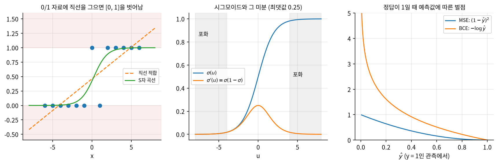
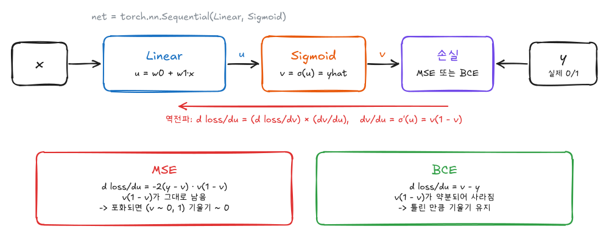
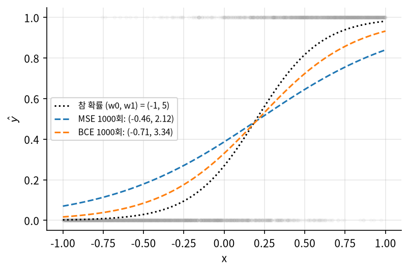
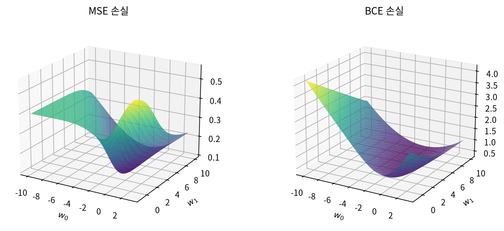
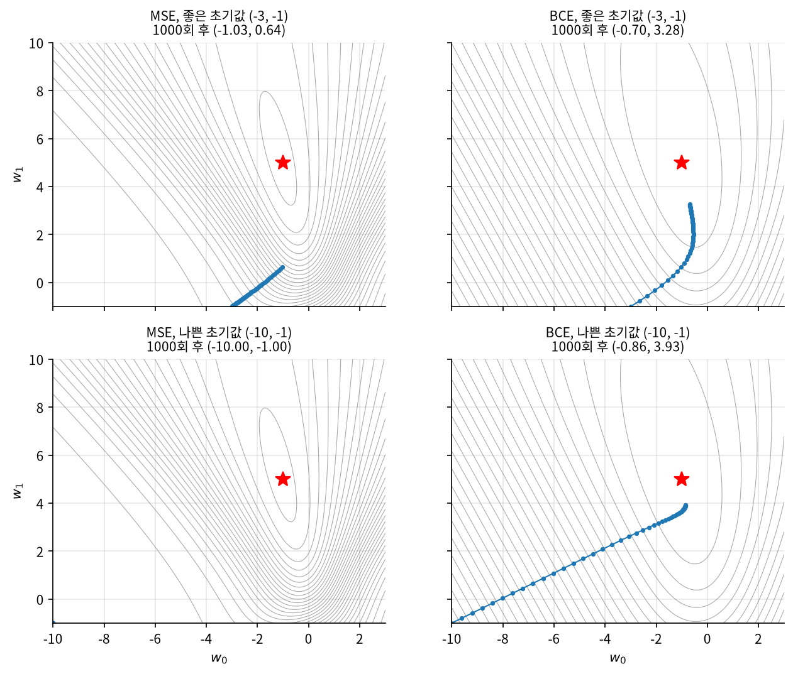

[앞 글](/posts/dl-02-regression-gd)에서 만든 학습의 네 단계(예측 → 손실 → 미분 → 갱신)를 $y$가 0 또는 1인 문제에 적용한다. 합격/불합격, 클릭/미클릭, 개/고양이처럼 답이 둘 중 하나인 문제다.

바뀌는 곳은 두 군데다. step 1의 모형 끝에 **시그모이드**가 붙고, step 2의 손실이 MSE에서 **BCE**로 바뀐다. 첫 번째는 자연스럽다. 예측값이 확률이어야 하니 0과 1 사이로 눌러 주는 함수가 필요하다. 두 번째는 덜 자명하다. MSE로도 학습은 되는 것처럼 보이는데 왜 굳이 다른 손실을 쓰는가? 이 글의 중심은 이 질문이다. 같은 모형, 같은 옵티마이저, 같은 출발점인데 손실만 MSE로 두면 학습이 1,000번 동안 한 걸음도 움직이지 않는 경우가 있다.

## 1. 0과 1을 예측하는 문제

현실에는 $x$가 커질수록 "성공" 확률이 올라가는 자료가 많다. 공부 시간이 늘수록 합격할 확률이, 약의 투여량이 늘수록 반응할 확률이 올라간다. 강의의 첫 예시는 이런 모양이다.

| $x$ | −6 | −5 | −4 | −3 | −2 | −1 | 0 | 1 | 2 | 3 | 4 | 5 | 6 |
|---|---|---|---|---|---|---|---|---|---|---|---|---|---|
| $y$ | 0 | 0 | 0 | 0 | 0 | 0 | 1 | 0 | 1 | 1 | 1 | 1 | 1 |

$x$가 작으면 대부분 0, 크면 대부분 1이고, 가운데에서 섞인다. 이 자료에 앞 글처럼 직선을 맞추면 어떻게 될까?



왼쪽 그림의 주황 점선이 최소제곱 직선이다. 두 가지 문제가 있다.

- **범위를 벗어난다.** $x = -6$에서 $-0.20$, $x = 6$에서 $1.12$를 예측한다. 확률로 읽을 수 없는 값이다.
- **모양이 맞지 않는다.** 실제 관계는 양 끝에서 평평하고(이미 거의 0이거나 거의 1) 가운데에서만 가파르게 변하는 S자인데, 직선은 어디서나 같은 속도로 올라간다.

필요한 것은 실수 전체를 받아 $(0, 1)$ 사이 값을 내놓는, S자 모양의 함수다.

## 2. 로지스틱 모형

### 시그모이드 함수

그런 함수가 시그모이드(로지스틱 함수)다.

$$
\sigma(u) = \frac{e^u}{1 + e^u} = \frac{1}{1 + e^{-u}}
$$

가운데 그림의 파란 곡선이다. 성질을 정리하면 다음과 같다.

| 성질 | 내용 |
|---|---|
| 범위 | $u \to -\infty$이면 0, $u \to \infty$이면 1. 그 사이의 모든 값을 지나며 0과 1에는 닿지 않는다 |
| 중심 | $\sigma(0) = 0.5$ |
| 대칭 | $1 - \sigma(u) = \sigma(-u)$ |
| 미분 | $\sigma'(u) = \sigma(u)\big(1 - \sigma(u)\big)$. $u = 0$에서 최댓값 0.25 |
| 포화 | $|u|$가 크면($|u| > 4$ 정도) 출력이 0이나 1에 붙어 거의 변하지 않고, 미분이 0에 가까워진다 |

미분 공식은 직접 미분해 보면 나온다. $\sigma(u) = (1 + e^{-u})^{-1}$이므로

$$
\sigma'(u) = \frac{e^{-u}}{(1 + e^{-u})^2} = \frac{1}{1 + e^{-u}} \cdot \frac{e^{-u}}{1 + e^{-u}} = \sigma(u)\big(1 - \sigma(u)\big)
$$

이다. 마지막 성질인 **포화**를 기억해 두자. 이 글의 결론이 여기서 나온다. 가운데 그림의 회색 영역이 포화 구간이고, 주황 곡선(미분)이 거기서 바닥에 붙어 있다.

### 모형

선형식 $w_0 + w_1 x$를 시그모이드에 넣어 확률을 만든다.

$$
y_i \sim \text{Ber}(\pi_i), \qquad \pi_i = \sigma(w_0 + w_1 x_i) = \frac{\exp(w_0 + w_1 x_i)}{1 + \exp(w_0 + w_1 x_i)}
$$

$y_i$는 성공 확률이 $\pi_i$인 베르누이 확률변수이고, $\pi_i$는 $x_i$에 따라 S자로 변한다. 적합값 $\hat y_i = \sigma(\hat w_0 + \hat w_1 x_i)$는 $y_i$ 자체(0 또는 1)가 아니라 **$P(y_i = 1)$의 추정값**이다. 0.5를 기준으로 자르면 분류가 된다.

파라미터의 의미는 시그모이드를 거꾸로 풀면 보인다. $\pi = \sigma(u)$를 $u$에 대해 풀면

$$
\log\frac{\pi}{1 - \pi} = w_0 + w_1 x
$$

이다. 왼쪽은 **로그 오즈**(log-odds)다. 확률은 S자로 변하지만 로그 오즈는 $x$의 선형함수라는 것이 로지스틱 회귀의 핵심 가정이다. 따라서

- $w_1$의 **부호**는 방향을 정한다. 양수면 $x$가 커질수록 확률이 올라간다.
- $w_1$의 **크기**는 가파름을 정한다. 클수록 S자가 급격하게 꺾인다.
- 확률이 정확히 0.5가 되는 지점은 $w_0 + w_1 x = 0$, 즉 $x = -w_0/w_1$이다.

### 예제 자료

강의는 참값 $(w_0, w_1) = (-1, 5)$에서 자료 2,000개를 뽑았다. $x \in [-1, 1]$이고, 확률이 0.5가 되는 곳은 $x = 1/5 = 0.2$다.

```python
torch.manual_seed(43052)
x = torch.linspace(-1, 1, 2000).reshape(2000, 1)   # 입력 2,000개, (n, 1) 모양
u = -1 + 5*x                                        # 선형식
v = torch.exp(u) / (1 + torch.exp(u))               # 참 확률 π_i
y = torch.bernoulli(v)                              # 확률 v로 1, 아니면 0
```

`torch.bernoulli(v)`는 각 원소마다 확률 `v`로 1, 나머지는 0을 뽑는다. 뽑힌 $y$의 39.75%가 1이다. 목표는 $(x, y)$만 보고 빨간 곡선 $v$를 되찾는 것, 즉 $(\hat w_0, \hat w_1)$을 $(-1, 5)$에 가깝게 학습하는 것이다.

## 3. BCE 손실

### 최대가능도에서 나오는 손실

회귀에서는 손실로 오차제곱합을 썼다. 분류에서 쓰는 손실은 BCE(binary cross entropy)다.

$$
\text{BCE} = -\frac{1}{n}\sum_{i=1}^n \Big( y_i \log \hat y_i + (1 - y_i)\log(1 - \hat y_i) \Big)
$$

강의 노트는 이 식을 "외우세요"라고 적었지만, 출처를 알면 외울 필요가 없다. 모형이 $y_i \sim \text{Ber}(\hat y_i)$라고 했으니 관측값 하나의 확률은

$$
P(y_i) = \begin{cases} \hat y_i & y_i = 1 \\ 1 - \hat y_i & y_i = 0 \end{cases} \;=\; \hat y_i^{\,y_i}(1 - \hat y_i)^{1 - y_i}
$$

이다. 지수 표기는 $y_i$가 1이면 앞 항만, 0이면 뒤 항만 남기는 장치다. 관측값들이 독립이면 자료 전체의 가능도는 곱이다.

$$
L(\hat w_0, \hat w_1) = \prod_{i=1}^n \hat y_i^{\,y_i}(1 - \hat y_i)^{1 - y_i}
$$

이 가능도를 최대화하는 것이 최대가능도추정이다. 곱은 다루기 어려우니 로그를 씌워 합으로 바꾸고($\log$는 증가함수라 최대점이 그대로다), 최소화 문제로 바꾸려고 부호를 뒤집고, 자료 크기에 따라 바뀌지 않게 $n$으로 나누면 BCE가 된다.

$$
\text{BCE} = -\frac{1}{n}\log L
$$

즉 **BCE를 최소화하는 것은 최대가능도추정과 같다.** 회귀에서 MSE를 최소화하는 것이 정규분포 오차를 가정한 최대가능도추정이었던 것과 같은 관계다. 회귀분석 시간에 배운 로지스틱 회귀의 추정량(뉴턴-랩슨으로 구하던 것)이 바로 이 BCE의 최소점이다.

### 관측값 하나로 보기

BCE를 관측값 하나씩 보면 의미가 더 분명해진다.

- 정답이 $y_i = 1$이면 벌점은 $-\log \hat y_i$다. $\hat y_i$가 1에 가까우면 0, 0에 가까우면 무한대로 커진다.
- 정답이 $y_i = 0$이면 벌점은 $-\log(1 - \hat y_i)$다. 위와 좌우가 바뀐 모양이다.

정답이 1인 관측에서 두 손실의 벌점을 비교한 것이 맨 위 그림의 오른쪽이다. 숫자로 보면 다음과 같다.

| 예측 $\hat y$ (정답 1) | 0.9 | 0.5 | 0.1 | 0.01 |
|---|---|---|---|---|
| MSE 벌점 $(1 - \hat y)^2$ | 0.01 | 0.25 | 0.81 | 0.98 |
| BCE 벌점 $-\log \hat y$ | 0.11 | 0.69 | 2.30 | 4.61 |

MSE의 벌점은 아무리 틀려도 1을 넘지 않는다. "1일 확률이 1%"라고 확신하며 틀린 것과 "10%"라고 틀린 것의 차이가 0.98과 0.81로 거의 없다. BCE는 확신하며 틀릴수록 벌점이 끝없이 커진다. 이 차이가 5절에서 학습 속도의 차이로, 6절에서 기울기의 차이로 나타난다.

## 4. 네트워크로 쓰기

$x \to u = \hat w_0 + \hat w_1 x \to v = \sigma(u) = \hat y$는 선형변환 뒤에 시그모이드를 이은 것이다. 파이토치에서는 두 부품을 각각 만들고 `torch.nn.Sequential`로 직렬 연결한다.

```python
torch.manual_seed(43052)
l1 = torch.nn.Linear(in_features=1, out_features=1)   # x -> u  (가중치는 임의로 초기화)
a1 = torch.nn.Sigmoid()                               # u -> v  (학습할 파라미터 없음)
net = torch.nn.Sequential(l1, a1)                     # x -> v = yhat
```

`Sequential`은 받은 입력을 첫 부품에 넣고, 그 출력을 다음 부품에 넣는 것을 차례로 반복한다. `net(x)`는 `a1(l1(x))`와 같다. 이 시드에서 `l1`의 초기값은 $(\hat w_0, \hat w_1) = (-0.85, -0.35)$다. 기울기가 음수라 처음 곡선은 참 곡선과 반대로 내려가는 모양이다.



학습 코드는 앞 글과 거의 같다.

```python
optimizr = torch.optim.SGD(net.parameters(), lr=0.05)
for epoch in range(1000):
    yhat = net(x)                                                       # step 1
    loss = -torch.mean(y*torch.log(yhat) + (1-y)*torch.log(1-yhat))     # step 2: BCE
    loss.backward()                                                     # step 3
    optimizr.step()                                                     # step 4
    optimizr.zero_grad()
```

바뀐 것은 `net`의 정의와 `loss` 한 줄뿐이다. BCE는 `torch.nn.BCELoss()`로도 쓸 수 있고 값은 같다(예측 $(0.9, 0.2)$, 정답 $(1, 0)$에서 둘 다 0.1643). 다만 직접 쓴 식은 $\hat y$가 정확히 0이나 1이 되면 $\log 0 = -\infty$가 되어 계산이 깨진다. 시그모이드와 BCE를 한 번에 계산해 이 문제를 피하는 `BCEWithLogitsLoss`는 CNN을 다루는 7편에서 쓴다.

## 5. MSE와 BCE의 비교

### 같은 설정, 다른 결과

강의에서는 처음에 MSE로 학습했다. 회귀에서 쓰던 손실이고, 예측값이 확률이니 $y$와의 제곱 차이를 줄여도 될 것 같다. 같은 초기값 $(-0.85, -0.35)$, 같은 옵티마이저(SGD, lr = 0.05)로 1,000 에폭씩 학습했다.



| 손실 | 1,000 에폭 후 $(\hat w_0, \hat w_1)$ | 참값 |
|---|---|---|
| MSE | (−0.46, 2.12) | (−1, 5) |
| BCE | (−0.71, 3.34) | (−1, 5) |

둘 다 참값에 아직 닿지 않았지만 BCE가 훨씬 많이 왔다. 그림에서도 BCE 곡선(주황 점선)이 참 곡선에 더 가깝다. 이유를 보려면 손실을 $(w_0, w_1)$의 함수로 그려 봐야 한다.

### 손실면의 모양



- **MSE 손실은 볼록(convex)하지 않다.** 최소점 주변은 골짜기지만, $w_0$가 아주 작은 쪽(왼쪽 앞)은 거의 평평한 고원이다.
- **BCE 손실은 볼록하다.** 그릇 모양이라 어디서 시작하든 아래로만 내려가면 최소점에 닿고, 최소점에서 멀수록 경사가 가파르다.

볼록하다는 것은 곡면 위의 어떤 두 점을 이어도 그 선분이 곡면 위에 있다는 뜻이다. 볼록한 함수에는 국소 최소점이 전역 최소점 하나뿐이고, 평평한 고원도 없다. 경사하강법에 가장 좋은 모양이다.

MSE에 고원이 생기는 이유는 직관적으로도 알 수 있다. $w_0 = -10$ 근처에서는 $u = w_0 + w_1 x$가 모든 $x$에서 아주 작은 음수이므로 모든 예측이 거의 0이다. 여기서 $w_0$를 $-10$에서 $-9$로 바꿔도 예측은 여전히 거의 0이라 MSE는 거의 변하지 않는다. 손실이 변하지 않으니 기울기가 0에 가깝고, 경사하강법은 움직이지 못한다. BCE도 예측은 거의 변하지 않지만, $-\log \hat y$는 $\hat y$가 0에 가까울수록 **로그 스케일로** 반응하므로 $\hat y$가 $10^{-5}$에서 $10^{-4}$로 바뀌는 것도 큰 변화로 잡아낸다.

두 손실의 최소점은 거의 같다. 격자에서 찾으면 MSE는 $(-1.02,\ 4.78)$, BCE는 $(-1.02,\ 4.86)$이다. 문제는 **어디에 도착하느냐가 아니라 거기까지 갈 수 있느냐**다.

### 초기값에 따른 경로

강의는 좋은 초기값 $(-3, -1)$과 나쁜 초기값 $(-10, -1)$에서 두 손실의 학습 과정을 애니메이션으로 비교했다. 여기서는 등고선 위의 경로로 다시 그렸다. 점은 20 에폭마다 찍었다.



| 손실 | 옵티마이저 | 좋은 초기값 $(-3, -1)$ | 나쁜 초기값 $(-10, -1)$ |
|---|---|---|---|
| MSE | SGD | (−1.03, 0.64) | **(−10.00, −1.00)** |
| BCE | SGD | (−0.70, 3.28) | (−0.86, 3.93) |
| MSE | Adam | (−1.03, 4.84) | (−1.03, 4.84) |
| BCE | Adam | (−1.01, 4.84) | (−1.01, 4.85) |

- **좋은 초기값, MSE (왼쪽 위):** 움직이긴 하지만 $w_1$이 0.64로 참값 5와 거리가 멀다. 골짜기 바닥이 길고 완만해서 느리다.
- **좋은 초기값, BCE (오른쪽 위):** 등고선에 수직으로, 즉 가장 가파른 방향으로 최소점을 향해 간다.
- **나쁜 초기값, MSE (왼쪽 아래):** 1,000 에폭 동안 **한 걸음도 움직이지 않았다.** 출발점이 고원 위라 기울기가 사실상 0이다.
- **나쁜 초기값, BCE (오른쪽 아래):** 같은 위치에서 곧장 최소점 쪽으로 내려온다. 멀리 있을수록 경사가 가파르기 때문에 오히려 빠르게 움직인다.

### Adam

표의 아래 두 줄은 강의 숙제였던 Adam 옵티마이저의 결과다. 네 경우 모두 1,000 에폭 안에 최소점 근처에 도착했다. MSE + 나쁜 초기값도 마찬가지다.

Adam은 기울기를 그대로 쓰지 않는다. 파라미터마다 최근 기울기의 평균 $m$과 최근 기울기 제곱의 평균 $s$를 지수가중으로 추적하고, 보폭을

$$
\Delta w = -\alpha \frac{m}{\sqrt{s} + \varepsilon}
$$

로 정한다. 기울기가 일정하게 $g$이면 $m \approx g$, $\sqrt{s} \approx |g|$이므로 보폭은 $\alpha \cdot g/|g| = \pm\alpha$, 즉 **기울기의 크기와 상관없이 학습률만큼** 움직인다. 기울기가 $10^{-5}$이든 $10$이든 방향만 맞으면 같은 보폭이다. 그래서 MSE의 고원에서도 기울기의 부호만 보고 빠져나온다.

손실의 모양이 나쁠 때 옵티마이저로 어느 정도 보완할 수 있다는 뜻이다. 하지만 처음부터 모양이 좋은 손실을 쓰는 것이 우선이고, 실무에서는 BCE와 Adam을 함께 쓰는 것이 기본이다.

## 6. MSE가 멈추는 이유

손실면의 그림이 "무엇이" 다른지 보여 줬다면, 미분은 "왜" 다른지 보여 준다. 위의 네트워크 그림에서 역전파를 따라가 보자.

$u_i = \hat w_0 + \hat w_1 x_i$, $v_i = \sigma(u_i)$라 하자. 손실을 $u_i$로 미분하는 것은 체인룰에 따라 두 조각의 곱이다.

$$
\frac{\partial\,\text{loss}}{\partial u_i} = \frac{\partial\,\text{loss}}{\partial v_i} \cdot \frac{\partial v_i}{\partial u_i}, \qquad \frac{\partial v_i}{\partial u_i} = \sigma'(u_i) = v_i(1 - v_i)
$$

두 번째 조각은 손실과 상관없이 시그모이드에서 나온다. 차이는 첫 번째 조각에서 생긴다.

**MSE.** $\text{loss} = \frac1n\sum (y_i - v_i)^2$이므로

$$
\frac{\partial\,\text{MSE}}{\partial v_i} = -\frac{2}{n}(y_i - v_i)
\quad\Rightarrow\quad
\frac{\partial\,\text{MSE}}{\partial u_i} = -\frac{2}{n}(y_i - v_i)\,v_i(1 - v_i)
$$

**BCE.** $\text{loss} = -\frac1n\sum \big(y_i\log v_i + (1 - y_i)\log(1 - v_i)\big)$이므로

$$
\frac{\partial\,\text{BCE}}{\partial v_i} = -\frac1n\left(\frac{y_i}{v_i} - \frac{1 - y_i}{1 - v_i}\right) = \frac{1}{n}\cdot\frac{v_i - y_i}{v_i(1 - v_i)}
$$

$$
\Rightarrow\quad \frac{\partial\,\text{BCE}}{\partial u_i} = \frac{1}{n}\cdot\frac{v_i - y_i}{v_i(1 - v_i)} \cdot v_i(1 - v_i) = \frac{1}{n}(v_i - y_i)
$$

BCE에서는 로그의 미분에서 나온 분모 $v_i(1 - v_i)$가 시그모이드의 미분 $v_i(1 - v_i)$와 **정확히 약분**되어, 오차 $v_i - y_i$만 남는다. 틀린 만큼 고친다는, 회귀의 MSE와 같은 깔끔한 형태다. MSE에는 $\sigma'(u_i) = v_i(1 - v_i)$가 그대로 곱해져 남는다.

이 차이가 언제 치명적인가? 시그모이드가 포화되었을 때다. 나쁜 초기값 $(-10, -1)$에서는 모든 $x \in [-1, 1]$에 대해 $u_i \le -9$이므로 $v_i < 0.0002$이고, $v_i(1 - v_i)$도 0.0002보다 작다. MSE의 기울기는 오차에 이 작은 수를 곱한 것이라 사라진다. 이 위치에서 실제로 기울기를 재면 다음과 같다.

| 손실 | $\partial / \partial \hat w_0$ | $\partial / \partial \hat w_1$ |
|---|---|---|
| MSE | $-2.3 \times 10^{-5}$ | $-8.8 \times 10^{-6}$ |
| BCE | $-0.397$ | $-0.207$ |

예측이 완전히 틀렸는데도(모든 $\hat y \approx 0$인데 실제 $y$의 40%가 1) MSE의 기울기는 BCE의 1만분의 1 수준이다. 학습률 0.05를 곱하면 한 에폭에 $10^{-6}$ 정도 움직이므로, 1,000 에폭이 지나도 $-10.00$에서 벗어나지 못한 것이 설명된다. BCE의 $\partial/\partial \hat w_0 = -0.397$은 식 그대로 $\frac1n\sum(v_i - y_i) \approx 0 - 0.3975$다.

정리하면, 틀린 정도가 클수록 크게 고쳐야 하는데 MSE는 시그모이드가 포화된 곳에서 오히려 신호를 잃는다. 시그모이드 뒤에는 BCE를 쓰는 이유가 이것이다. "포화된 활성화함수가 기울기를 죽인다"는 이 현상은 층이 깊어지면 시그모이드가 여러 번 곱해지면서 더 심해지는데, 6편의 기울기 소멸에서 다시 나온다.

## 정리

| | MSE | BCE |
|---|---|---|
| 식 | $\frac1n\sum (y_i - \hat y_i)^2$ | $-\frac1n\sum \big(y_i\log\hat y_i + (1-y_i)\log(1-\hat y_i)\big)$ |
| 통계적 의미 | 정규 오차의 최대가능도 | 베르누이의 최대가능도 |
| 확신하며 틀릴 때 벌점 | 최대 1 | 무한대로 커짐 |
| 시그모이드 뒤에서 손실면 | 볼록하지 않음, 평평한 고원 | 볼록 |
| $\partial / \partial u_i$ | $-\frac2n (y_i - v_i)\,v_i(1-v_i)$ | $\frac1n (v_i - y_i)$ |
| 포화 영역 ($v \approx 0$ 또는 $1$) | 기울기 ≈ 0, 학습 정지 | 오차만큼 기울기 유지 |
| 파이토치 | `torch.nn.MSELoss()` | `torch.nn.BCELoss()` |

- 0/1 자료에는 직선 대신 시그모이드로 확률을 모형화한다. 로지스틱 회귀는 로그 오즈가 $x$의 선형함수라는 모형이다.
- BCE는 베르누이 가능도에 $-\log$를 씌워 평균 낸 것이다. 최소화하면 최대가능도추정이 된다.
- 회귀는 `Linear` + MSE, 이진 분류는 `Linear` + `Sigmoid` + BCE가 기본 짝이다.
- 두 손실의 최소점은 비슷해도 학습 경로가 다르다. 손실함수는 "무엇을 최소화할지"뿐 아니라 "얼마나 잘 내려갈 수 있는지"도 정한다.
- Adam은 기울기의 크기 대신 부호에 가깝게 반응해서 평평한 곳에서도 움직인다.

로지스틱 회귀의 한계는 $x$와 $\hat y$의 관계가 S자 곡선 하나로 고정된다는 것이다. 확률이 올라갔다가 다시 내려가는 관계는 표현할 수 없다. 다음 글에서는 그런 자료를 만나고, 층을 하나 더 쌓아 꺾인 관계를 만드는 것으로 해결한다. 이것이 깊은 신경망의 출발점이다.

## 참고자료

- 최규빈, 「딥러닝」 강의노트 (2022), 04wk-2 · 05wk-1: 딥러닝의 기초 (3)–(4), <https://guebin.github.io/DL2022/>
- Kingma, D. P. and Ba, J. (2015). Adam: A method for stochastic optimization. *ICLR*.
- Goodfellow, I., Bengio, Y. and Courville, A. (2016). *Deep Learning*, Sections 6.2.2 (Output Units), 8.5.3 (Adam). MIT Press.
- Agresti, A. (2013). *Categorical Data Analysis* (3rd ed.), Chapter 5. Wiley.
