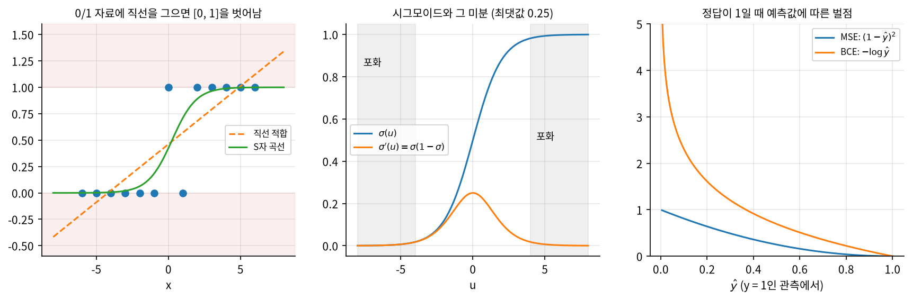
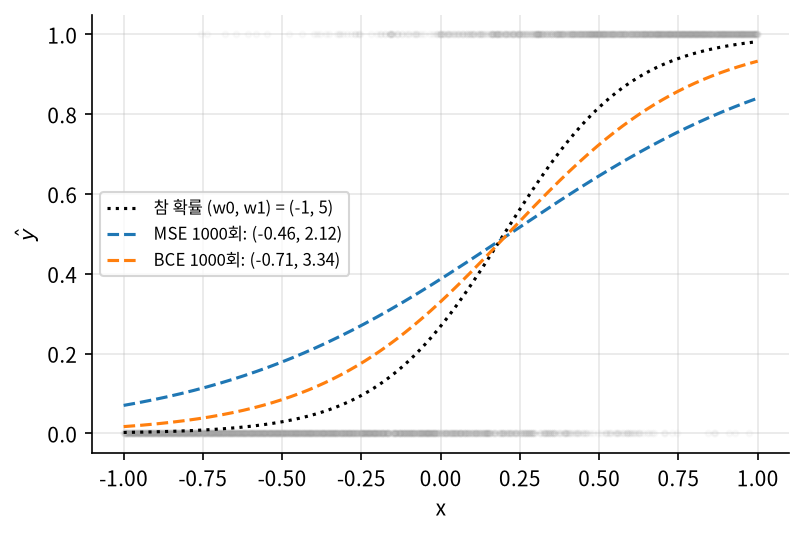
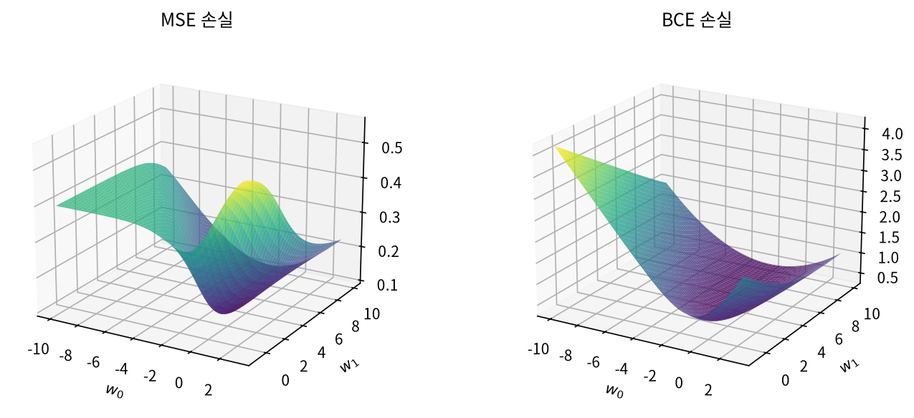
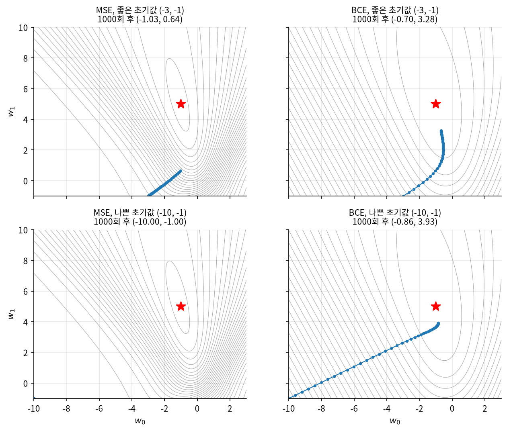
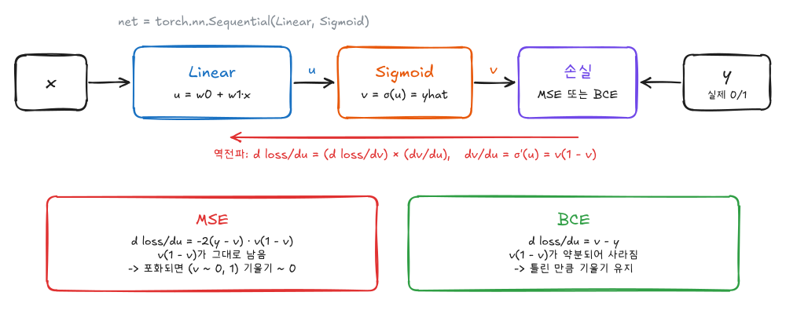
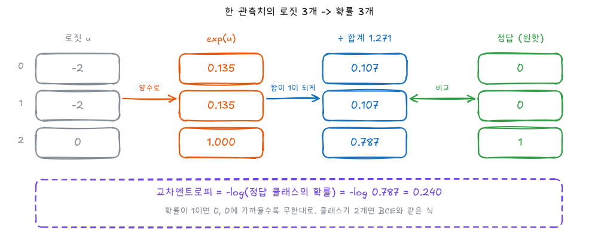
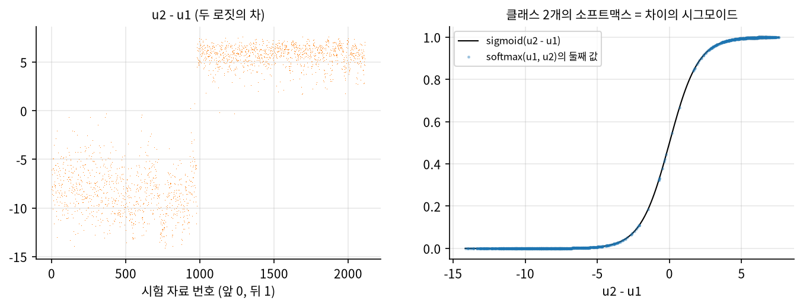
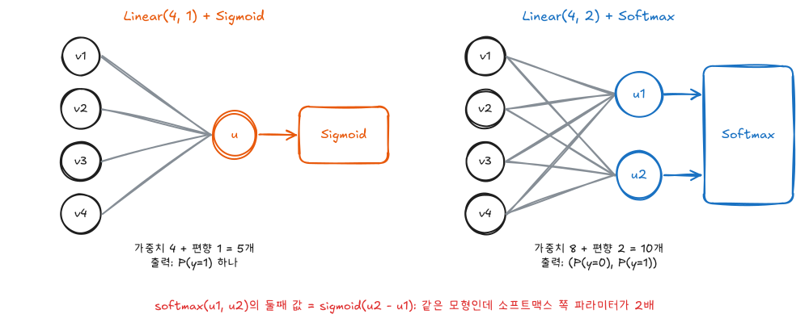

신경망의 마지막 층과 손실은 반응변수 $y$의 분포에서 정해진다. $y$가 연속이면 정규분포를 가정하고 출력을 그대로 쓰며 손실은 MSE, $y$가 0/1이면 베르누이 분포를 가정하고 시그모이드와 BCE, $y$가 $k$개 범주 중 하나면 범주형 분포를 가정하고 소프트맥스와 교차엔트로피를 쓴다. 세 손실 모두 **음의 로그가능도**이고, 일반화선형모형([생명과학통계 - 포아송 회귀와 일반화선형모형](/posts/biostat-poisson-glm))에서 반응변수의 분포에 따라 연결함수를 고르는 것과 같은 구조다.

## 분포, 출력층, 손실

| $y$ | 분포 가정 | 마지막 활성화 (연결함수의 역) | 손실 = 음의 로그가능도 / $n$ | 파이토치 |
|---|---|---|---|---|
| 3.45, 4.43, … | 정규 $N(\mu, \sigma^2)$ | 없음 (항등) | MSE | `MSELoss` |
| 0 또는 1 | 베르누이 $\text{Ber}(\pi)$ | 시그모이드 | BCE | `BCEWithLogitsLoss` |
| $k$개 범주 중 하나 | 범주형 (시행 1번인 다항) | 소프트맥스 | 교차엔트로피 | `CrossEntropyLoss` |

마지막 `Linear`까지가 GLM의 선형예측자 $\eta = \mathbf x^\top\boldsymbol\beta$에 해당하고, 은닉층은 이 $\mathbf x$를 자료에서 학습한 특징으로 바꿔 주는 부분이다. 은닉층이 없으면 둘째 줄은 로지스틱 회귀, 셋째 줄은 다항 로지스틱 회귀 그 자체다.

정규분포에서 MSE가 나오는 것은 간단하다. 분산이 같은 정규분포의 로그가능도는 $-\frac{1}{2\sigma^2}\sum(y_i - \mu_i)^2 + \text{상수}$이므로, 이것을 최대화하는 것은 오차제곱합을 최소화하는 것과 같다. 나머지 두 줄은 아래에서 유도한다.

## 이진 반응: 시그모이드와 BCE

### 시그모이드

0/1 자료에 직선을 맞추면 예측이 $[0, 1]$을 벗어나고, 양 끝에서 평평하고 가운데에서 가파른 실제 모양도 표현하지 못한다. 실수 전체를 받아 $(0, 1)$로 보내는 S자 함수가 시그모이드다.

$$
\sigma(u) = \frac{1}{1 + e^{-u}}, \qquad \sigma'(u) = \sigma(u)\big(1 - \sigma(u)\big)
$$



| 성질 | 내용 |
|---|---|
| 범위 | $(0, 1)$, $\sigma(0) = 0.5$ |
| 대칭 | $1 - \sigma(u) = \sigma(-u)$ |
| 역함수 | $\sigma^{-1}(\pi) = \log\frac{\pi}{1-\pi}$ (로짓) |
| 포화 | $\lvert u\rvert > 4$ 정도면 출력이 0이나 1에 붙고 미분이 0에 가까워진다 |

모형 $y_i \sim \text{Ber}(\pi_i)$, $\pi_i = \sigma(w_0 + w_1 x_i)$는 로그 오즈 $\log\frac{\pi}{1-\pi}$가 $x$의 선형함수라는 로지스틱 회귀다([데이터 마이닝 - 로지스틱 회귀](/posts/dm-logistic-regression)). 파이토치로는 `Linear` 뒤에 `Sigmoid`를 잇는다.

```python
net = torch.nn.Sequential(
    torch.nn.Linear(in_features=1, out_features=1),   # u = w0 + w1 x
    torch.nn.Sigmoid(),                               # v = σ(u) = P(y=1)
)
```

### BCE는 베르누이의 음의 로그가능도

관측값 하나의 확률은 $\hat y_i^{\,y_i}(1 - \hat y_i)^{1 - y_i}$이다($y_i = 1$이면 앞 항, 0이면 뒤 항만 남는다). 독립인 $n$개의 가능도에 로그를 씌우고 부호를 바꿔 평균 내면

$$
\text{BCE} = -\frac1n\log\prod_{i=1}^n \hat y_i^{\,y_i}(1 - \hat y_i)^{1 - y_i} = -\frac{1}{n}\sum_{i=1}^n \Big( y_i \log \hat y_i + (1 - y_i)\log(1 - \hat y_i) \Big)
$$

이다. BCE를 최소화하는 것은 로지스틱 회귀의 최대가능도추정이다. 관측값 하나로 보면 정답이 1일 때 벌점은 $-\log\hat y_i$로, 확신하며 틀릴수록 끝없이 커진다.

| 예측 $\hat y$ (정답 1) | 0.9 | 0.5 | 0.1 | 0.01 |
|---|---|---|---|---|
| MSE 벌점 $(1 - \hat y)^2$ | 0.01 | 0.25 | 0.81 | 0.98 |
| BCE 벌점 $-\log \hat y$ | 0.11 | 0.69 | 2.30 | 4.61 |

## 시그모이드 뒤에 MSE를 쓰면

### 예제: 같은 모형, 손실만 다르게

참값 $(w_0, w_1) = (-1, 5)$인 로지스틱 모형에서 $x \in [-1, 1]$의 자료 2,000개를 만들고(1의 비율 39.75%), 같은 초기값 $(-0.85, -0.35)$와 같은 옵티마이저(SGD, lr = 0.05)로 1,000 에폭씩 학습했다(강의 예제).

```python
for epoch in range(1000):
    yhat = net(x)
    loss = torch.mean((y - yhat)**2)                                      # MSE
    # loss = -torch.mean(y*torch.log(yhat) + (1-y)*torch.log(1-yhat))   # BCE
    loss.backward(); optimizr.step(); optimizr.zero_grad()
```



| 손실 | 1,000 에폭 후 $(\hat w_0, \hat w_1)$ |
|---|---|
| MSE | (−0.46, 2.12) |
| BCE | (−0.71, 3.34) |
| 참값 | (−1, 5) |

### 손실면



두 손실의 최소점은 거의 같다(격자에서 MSE $(-1.02, 4.78)$, BCE $(-1.02, 4.86)$). 다른 것은 모양이다. BCE는 그릇 모양의 볼록함수이고, MSE는 볼록하지 않으며 $w_0$가 아주 작은 쪽에 평평한 고원이 있다. $w_0 = -10$ 근처에서는 모든 예측이 거의 0이라, $w_0$를 바꿔도 MSE가 거의 변하지 않기 때문이다. BCE는 $-\log\hat y$가 $\hat y = 10^{-5}$와 $10^{-4}$의 차이도 크게 잡아낸다.



| 손실 | 옵티마이저 | 초기값 $(-3, -1)$ | 초기값 $(-10, -1)$ |
|---|---|---|---|
| MSE | SGD | (−1.03, 0.64) | **(−10.00, −1.00)** |
| BCE | SGD | (−0.70, 3.28) | (−0.86, 3.93) |
| MSE | Adam | (−1.03, 4.84) | (−1.03, 4.84) |
| BCE | Adam | (−1.01, 4.84) | (−1.01, 4.85) |

고원 위에서 출발한 MSE + SGD는 1,000 에폭 동안 한 걸음도 움직이지 못했다. Adam은 파라미터마다 최근 기울기의 평균 $m$과 제곱 평균 $s$를 추적해 보폭을 $-\alpha\, m/(\sqrt s + \varepsilon)$로 정하므로, 기울기의 크기와 상관없이 부호만 맞으면 학습률만큼 움직인다. 그래서 고원에서도 빠져나온다. 손실의 모양이 나쁠 때 옵티마이저가 어느 정도 보완하지만, 처음부터 모양이 좋은 손실을 쓰는 것이 우선이다.

### 기울기로 보기



$u_i = w_0 + w_1 x_i$, $v_i = \sigma(u_i)$라 하면 체인룰로 $\frac{\partial\,\text{loss}}{\partial u_i} = \frac{\partial\,\text{loss}}{\partial v_i}\,v_i(1 - v_i)$이다.

$$
\text{MSE:}\quad \frac{\partial}{\partial u_i} = -\frac{2}{n}(y_i - v_i)\,v_i(1 - v_i)
$$

$$
\text{BCE:}\quad \frac{\partial}{\partial u_i} = \frac{1}{n}\cdot\frac{v_i - y_i}{v_i(1 - v_i)} \cdot v_i(1 - v_i) = \frac{1}{n}(v_i - y_i)
$$

BCE에서는 로그의 미분에서 나온 분모가 시그모이드의 미분과 정확히 약분되어 오차만 남는다. MSE에는 $v_i(1 - v_i)$가 남아서, 시그모이드가 포화된 곳($v \approx 0$ 또는 1)에서 기울기가 사라진다. 초기값 $(-10, -1)$에서 실제로 재면 다음과 같다.

| 손실 | $\partial / \partial w_0$ | $\partial / \partial w_1$ |
|---|---|---|
| MSE | $-2.3 \times 10^{-5}$ | $-8.8 \times 10^{-6}$ |
| BCE | $-0.397$ | $-0.207$ |

모든 예측이 0인데 실제로는 40%가 1인, 완전히 틀린 상태에서 MSE의 기울기는 BCE의 1만분의 1이다. 포화된 활성화가 기울기를 죽이는 이 현상은 층이 깊어지면 더 심해진다([5편](/posts/dl-05-backprop-vanishing)).

## 범주 반응: 소프트맥스와 교차엔트로피

### 소프트맥스

클래스가 $k$개면 마지막 층을 `Linear(?, k)`로 두어 관측치마다 점수(로짓) $\mathbf u = (u_1, \dots, u_k)$를 내고, 소프트맥스로 확률을 만든다.

$$
\text{softmax}(\mathbf u)_j = \frac{e^{u_j}}{\sum_{m=1}^k e^{u_m}}
$$

$e^u$로 양수로 만들고 합으로 나눠 합이 1이 되게 하는 두 단계다.



- **이동 불변:** 모든 로짓에 같은 수를 더해도 결과가 같다($e^c$가 분자, 분모에서 약분). 로짓의 절대 크기는 의미가 없고 차이만 의미가 있다. 로짓 (0, 0, 2)와 (2, 2, 4)는 같은 확률 (0.107, 0.107, 0.787)을 준다.
- **부드러운 최대:** 가장 큰 로짓에 확률이 몰리고, 차이가 클수록 원핫에 가까워진다. 확률의 순서는 로짓의 순서와 같으므로 예측 클래스는 `net(X).argmax(dim=1)`로 충분하다.
- **축 지정:** 소프트맥스는 관측치 하나 안에서(행마다) 계산해야 한다. `torch.nn.Softmax(dim=1)`이다. `dim=0`이면 관측치들끼리 정규화해 버려 의미 없는 값이 나온다.

### 교차엔트로피는 범주형 분포의 음의 로그가능도

정답을 원핫 벡터 $\mathbf y_i$로 쓰면 관측치 하나의 확률은 $\prod_j p_{ij}^{y_{ij}}$이고, 원핫이라 정답 클래스의 확률만 남는다. BCE와 같은 방식으로

$$
\text{CE} = -\frac1n\sum_{i=1}^n\sum_{j=1}^k y_{ij}\log p_{ij} = -\frac1n\sum_{i=1}^n \log p_{i,\,c_i}
$$

이다($c_i$는 관측치 $i$의 정답 클래스). 정답 클래스의 예측 확률에 $-\log$를 씌운 평균이고, $k = 2$이면 BCE와 같은 식이 된다.

```python
logits = torch.tensor([[-2.0, -2.0, 0.0], [3.14, 3.14, 3.14], [0.0, 0.0, 2.0],
                       [2.0, 2.0, 4.0], [0.0, 0.0, 0.0]])
y = torch.tensor([2, 1, 2, 2, 0])                    # 정답 클래스 번호
torch.nn.CrossEntropyLoss()(logits, y)               # 0.5832
```

관측치별 벌점은 $-\log 0.787 = 0.240$이 세 개, $-\log(1/3) = 1.099$가 두 개로, 평균이 0.583이다. `CrossEntropyLoss`에 **로짓을 그대로** 넣었는데 소프트맥스를 거친 값이 나왔다. 손실 안에 소프트맥스가 들어 있으므로 네트워크 끝에 `Softmax`를 또 넣으면 안 된다.

### 기울기: 예측 확률 − 정답

정답 클래스 $c$인 관측치 하나의 손실은 $\ell = -u_c + \log\sum_m e^{u_m}$이고,

$$
\frac{\partial \ell}{\partial u_j} = -\mathbb 1[j = c] + \frac{e^{u_j}}{\sum_m e^{u_m}} = p_j - y_j
$$

이다. 시그모이드 + BCE의 $v - y$와 같은 형태로, 소프트맥스의 미분이 따로 남아 기울기를 죽이지 않는다. 위 예의 첫 행만 따로 떼어(`logits[:1], y[:1]` 또는 `reduction='sum'`) `backward()`로 구한 기울기는 $(0.107, 0.107, -0.213)$으로 $\mathbf p - \mathbf y$와 같다(위 코드처럼 5행 전체에 기본 `CrossEntropyLoss()`(`reduction='mean'`)를 적용하면 행 수 5로 나눈 $(0.0213, 0.0213, -0.0426)$이 나온다).

$\log\sum_m e^{u_m}$은 최댓값 $M$을 빼서 $M + \log\sum_m e^{u_m - M}$으로 계산하면 넘치지 않는다(log-sum-exp). 로짓이 (1000, 0, 0)이고 정답이 클래스 1이어도 `CrossEntropyLoss`는 정확히 1000을 돌려준다. 소프트맥스를 먼저 계산했다면 확률이 0이 되어 $\log 0$을 만났을 것이다.

시그모이드와 BCE를 합친 `BCEWithLogitsLoss`도 같은 이유로 쓴다. $\log\sigma(u) = -\log(1 + e^{-u})$, $\log(1 - \sigma(u)) = -u - \log(1 + e^{-u})$를 BCE에 넣으면

$$
\ell(u, y) = \log(1 + e^{-u}) + (1 - y)\,u
$$

이고, $\log(1 + e^{-u}) = \max(-u, 0) + \log(1 + e^{-|u|})$로 계산하면 어디에서도 넘치거나 $\log 0$을 만나지 않는다.

| 로짓 $u$ | $y$ | 참 손실 | `BCELoss(sigmoid(u))` | 그 기울기 | `BCEWithLogitsLoss(u)` | 그 기울기 |
|---|---|---|---|---|---|---|
| 30 | 0 | 30 | 100 (잘림) | 0 | 30 | 1 |
| −200 | 1 | 200 | 100 (잘림) | 0 | 200 | −1 |
| 2 | 1 | 0.127 | 0.127 | −0.119 | 0.127 | −0.119 |

float32에서 $\sigma(30)$은 정확히 1.0으로 반올림되므로 `BCELoss`는 $\log$를 −100에서 자를 뿐 아니라 기울기가 0이 된다. 가장 확신하며 틀린 관측치에서 아무것도 배우지 못한다. `BCEWithLogitsLoss`는 정확한 손실과 $\sigma(u) - y$의 기울기를 그대로 준다.

### 클래스가 둘이면 소프트맥스 = 시그모이드

$$
\text{softmax}(u_1, u_2)_2 = \frac{e^{u_2}}{e^{u_1} + e^{u_2}} = \frac{1}{1 + e^{-(u_2 - u_1)}} = \sigma(u_2 - u_1)
$$



숫자 0과 1을 `Linear(?, 2)` + `CrossEntropyLoss`로 학습한 CNN([7편](/posts/dl-07-cnn))의 시험 자료 출력으로 확인하면, 소프트맥스 둘째 값과 $\sigma(u_2 - u_1)$의 차이는 최대 $3 \times 10^{-8}$이다.



두 모형이 표현하는 확률은 같지만 소프트맥스 쪽은 파라미터가 두 배이고, $u_2 - u_1$만 의미가 있으므로 절반은 군더더기다. 클래스가 둘이면 시그모이드 + BCE, 셋 이상이면 소프트맥스 + 교차엔트로피를 쓴다.

## 파이토치에서

| | 회귀 | 이진 분류 | 다중 분류 |
|---|---|---|---|
| 마지막 층 | `Linear(?, 1)` | `Linear(?, 1)` | `Linear(?, k)` |
| 네트워크 끝 활성화 | 없음 | 없음 (손실에 포함) | 없음 (손실에 포함) |
| 손실 | `MSELoss()` | `BCEWithLogitsLoss()` | `CrossEntropyLoss()` |
| $y$의 모양 | (n, 1) 실수 | (n, 1) 실수 0./1. | (n,) 정수 또는 (n, k) 원핫 실수 |
| 확률 얻기 | | `torch.sigmoid(net(X))` | `torch.softmax(net(X), dim=1)` |

평가지표 함수도 $y$와 출력의 모양에 대한 가정을 가진다. 예를 들어 fastai의 `accuracy`는 출력이 (n, k) 로짓이라고 보고 `argmax(dim=-1)`로 예측을 정한다. 시그모이드 출력 (n, 1)에 쓰면 열이 하나뿐이라 argmax가 항상 0이 되어, 숫자 0/1 분류에서 정확도가 클래스 0의 비율(0.4634)에 그대로 멈춘다. 지표가 이상하면 지표 함수의 가정부터 확인한다.

## 요약

| | MSE | BCE | 교차엔트로피 |
|---|---|---|---|
| $y$의 분포 | 정규 | 베르누이 | 범주형 |
| 마지막 활성화 | 없음 | 시그모이드 | 소프트맥스 |
| 관측치 하나의 손실 | $(y - \hat y)^2$ | $-y\log\hat y - (1-y)\log(1-\hat y)$ | $-\log p_{c}$ |
| 로짓 $u$에 대한 기울기 | $-2(y - u)$ | $v - y$ | $\mathbf p - \mathbf y$ |

- 마지막 활성화와 손실은 반응변수의 분포에서 고른다. 세 손실 모두 음의 로그가능도이므로 최소화는 최대가능도추정이다.
- 분포에 맞는 짝을 쓰면 로짓에 대한 기울기가 "예측 − 정답"의 깔끔한 형태가 된다. 시그모이드 뒤에 MSE를 쓰면 포화 영역에서 기울기가 사라져 학습이 멈춘다.
- 파이토치에서는 시그모이드와 소프트맥스를 손실 안에 넣는다(`BCEWithLogitsLoss`, `CrossEntropyLoss`). 수치적으로 안전하고, 네트워크는 `Linear`에서 끝난다.
- 클래스가 둘이면 소프트맥스는 로짓 차이의 시그모이드와 같다.

## 참고자료

- 최규빈, 「딥러닝」 강의노트 (2022), <https://guebin.github.io/DL2022/>
- Goodfellow, I., Bengio, Y. and Courville, A. (2016). *Deep Learning*, Section 6.2 (Gradient-Based Learning, Output Units). MIT Press.
- McCullagh, P. and Nelder, J. A. (1989). *Generalized Linear Models* (2nd ed.). Chapman & Hall.
- Agresti, A. (2013). *Categorical Data Analysis* (3rd ed.), Chapters 5, 8. Wiley.
- Kingma, D. P. and Ba, J. (2015). Adam: A method for stochastic optimization. *ICLR*.
