[앞 글](/posts/dl-03-logistic-bce)의 로지스틱 회귀는 `Linear` 하나 뒤에 `Sigmoid`를 붙인 네트워크였다. 이 모형은 $x$가 커질수록 확률이 계속 올라가거나 계속 내려가는 관계만 표현한다. 시그모이드 앞의 $u = w_0 + w_1 x$가 직선이라 방향을 한 번도 바꾸지 못하기 때문이다.

이 글에서는 방향이 바뀌는 자료를 만나고, 층을 하나 더 쌓아 해결한다. 해결법은 생각보다 단순하다. 선형변환 두 개 사이에 **ReLU**라는 꺾는 함수를 끼우면 된다. 이 "선형 → 비선형 → 선형"이 깊은 신경망(DNN)의 기본 단위다. 그리고 이 단순한 구조가 이론적으로 어떤 연속함수든 흉내 낼 수 있다는 결과, 시벤코 정리(보편근사정리)까지 그림으로 따라간다.

## 1. 로지스틱 회귀가 못 맞추는 자료

강의는 신문기사 하나로 시작한다. "스펙이 높으면 오히려 중소기업이 뽑지 않는다"는 내용이다. 스펙이 낮을 때는 스펙이 오를수록 합격 확률이 오르지만, 어느 수준을 넘으면 "뽑아 봤자 금방 그만둔다"는 이유로 다시 내려간다. 이 이야기를 본뜬 가짜 자료가 다음 그림의 회색 점이다. $x$는 스펙, $y$는 합격(1)/불합격(0)이고, 파란 선이 자료를 만든 참 확률이다.

참 확률은 $x = 0$까지 가파르게 올라가 거의 1이 되었다가, 그 뒤로 0.5까지 천천히 내려온다. 자료를 만든 식은 다음과 같다.

$$
P(y = 1 \mid x) = \sigma(u), \qquad u = \begin{cases} 15x + 5 & x < 0 \\ -5x + 5 & x \ge 0 \end{cases}
$$

시그모이드 앞의 $u$가 $x = 0$에서 꺾인 꺾은선이다. 여기에 앞 글의 로지스틱 회귀를 Adam으로 6,000번 학습시키면 주황 점선이 된다.

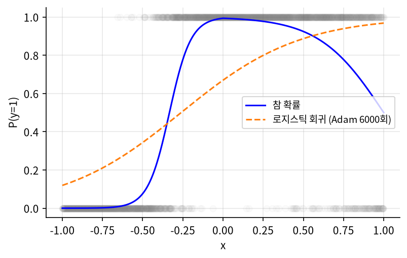

학습은 제대로 끝났다. BCE는 0.94에서 0.48로 내려갔고, 추정값 $(\hat w_0, \hat w_1) = (0.70, 2.70)$은 이 모형 안에서 가장 나은 답이다. 문제는 모형 쪽에 있다. $\hat y = \sigma(w_0 + w_1 x)$는 $w_1 > 0$이면 항상 증가하고 $w_1 < 0$이면 항상 감소한다. 올라갔다 내려가는 곡선은 $w_0, w_1$을 어떻게 골라도 나오지 않는다. 에폭을 6억 번 돌려도 마찬가지다.

이런 상황을 **모형의 표현력이 부족하다**고 말한다. 학습(최적화)이 잘못된 것이 아니라, 모형이 그릴 수 있는 곡선의 집합에 정답이 들어 있지 않은 것이다. 최적화는 그 집합 안에서 가장 가까운 것을 찾아 줄 뿐이다.

## 2. 시그모이드 앞을 꺾자

해결의 실마리는 시그모이드가 순서를 보존한다는 데 있다. $\sigma$는 증가함수이므로 $u$가 올라가면 $\sigma(u)$도 올라가고, $u$가 내려가면 $\sigma(u)$도 내려간다. 따라서 $\hat y$의 모양은 $u$의 모양이 정한다. 아래 그림은 네 가지 $u$(위)와 각각의 $\sigma(u)$(아래)다.

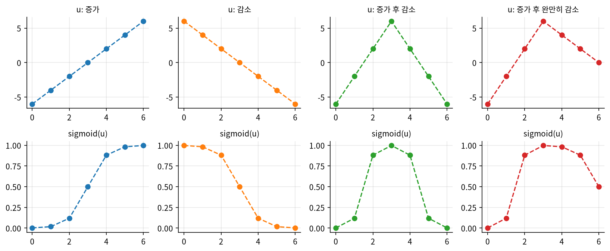

앞의 두 개(증가, 감소)는 로지스틱 회귀로 만들 수 있다. 우리에게 필요한 것은 네 번째처럼 **$u$가 꺾인 모양**이다. 즉 목표는 다음 벡터를 만드는 것이다(강의에서 쓴 목표값이다. 참 $u$와 기울기는 다르지만 모양은 같다).

$$
u_i = \begin{cases} 9x_i + 4.5 & x_i < 0 \\ -4.5x_i + 4.5 & x_i \ge 0 \end{cases}
$$

파이썬으로는 `[9*xi+4.5 if xi<0 else -4.5*xi+4.5 for xi in x]`처럼 if 문 한 줄로 만들 수 있다. 하지만 이렇게 만들면 꺾이는 위치(0)와 기울기(9, −4.5)를 사람이 정해야 한다. 우리가 원하는 것은 이 숫자들을 **학습할 수 있는 가중치로 표현하는 것**이다. 그래야 앞 글처럼 경사하강법으로 자료에 맞출 수 있다.

## 3. ReLU로 꺾은선 만들기

### ReLU 함수

ReLU(rectified linear unit)는 음수를 0으로 바꾸고 양수는 그대로 두는 함수다.

$$
\text{relu}(x) = \max(0, x)
$$

그래프는 $x < 0$에서 0으로 평평하고, $x > 0$에서 기울기 1인 직선이다. 즉 원점에서 한 번 꺾인 함수다. 이 꺾임 하나가 재료의 전부다. 이걸 여러 개 만들어 더하면 꺾임이 여러 개인 꺾은선이 된다.

### 선형변환 → ReLU → 선형변환

목표인 꺾은선을 세 단계로 만든다.

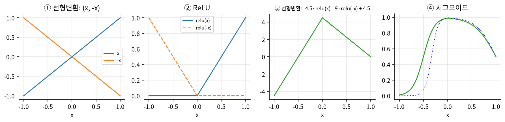

1. **선형변환 1.** $x$ 하나를 받아 두 값 $x$와 $-x$를 만든다. 입력 1개에서 출력 2개로 가는 선형변환이다.
2. **ReLU.** 각각에 ReLU를 씌운다. $\text{relu}(x)$는 오른쪽 절반만 살아 있는 꺾은선이고, $\text{relu}(-x)$는 왼쪽 절반만 살아 있는 꺾은선이다. 둘 다 원점에서 꺾인다.
3. **선형변환 2.** 두 꺾은선을 가중합한다.

$$
u = -4.5\cdot\text{relu}(x) - 9\cdot\text{relu}(-x) + 4.5
$$

$x > 0$이면 $\text{relu}(-x) = 0$이라 $u = -4.5x + 4.5$이고, $x < 0$이면 $\text{relu}(x) = 0$, $\text{relu}(-x) = -x$라 $u = 9x + 4.5$다. 목표 그대로다. 마지막으로 시그모이드를 씌우면(4번째 그림) 올라갔다 내려가는 확률 곡선이 된다. 점선으로 겹친 참 확률과 모양이 같다.

이 계산을 노드와 화살표로 그리면 다음과 같다.

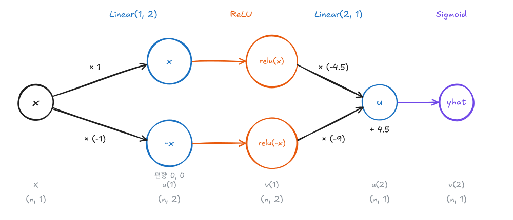

### 파이토치로 옮기기

그림의 각 단계는 파이토치 층 하나에 대응한다. 먼저 층을 만들고, 가중치를 그림의 값으로 덮어써 보자.

```python
import torch

l1 = torch.nn.Linear(in_features=1, out_features=2)   # x -> (x, -x)
a1 = torch.nn.ReLU()
l2 = torch.nn.Linear(in_features=2, out_features=1)   # 두 꺾은선의 가중합
a2 = torch.nn.Sigmoid()
net = torch.nn.Sequential(l1, a1, l2, a2)

l1.weight.data = torch.tensor([[1.0], [-1.0]])   # shape (2, 1)
l1.bias.data   = torch.tensor([0.0, 0.0])
l2.weight.data = torch.tensor([[-4.5, -9.0]])    # shape (1, 2)
l2.bias.data   = torch.tensor([4.5])
```

- `Linear(1, 2)`의 `weight`는 shape이 (2, 1)이다. [2편](/posts/dl-02-regression-gd)에서 본 것처럼 파이토치는 가중치를 (출력 수, 입력 수)로 저장한다. 첫 행 `[1.0]`이 첫 출력 $x$를, 둘째 행 `[-1.0]`이 둘째 출력 $-x$를 만든다.
- `Linear(2, 1)`의 `weight`는 (1, 2)이고, 두 입력에 곱할 −4.5와 −9가 한 행에 들어 있다.
- `Sequential`은 넣은 순서대로 함수를 합성한다. `net(x)`는 `a2(l2(a1(l1(x))))`와 같다.

중간 결과를 하나씩 찍어 보면 그림의 각 단계가 나온다. `l1(x)`는 (2000, 2) 텐서로 두 열이 $x$와 $-x$이고, `a1(l1(x))`는 두 열에 ReLU가 씌워진 것이며, `l2(a1(l1(x)))`는 꺾은선 $u$, `net(x)`는 최종 확률이다. 손으로 정한 가중치만으로 로지스틱 회귀가 못 그리던 곡선을 그렸다.

## 4. 행렬로 쓰기와 shape 따라가기

같은 계산을 행렬로 쓰면 앞으로 나올 큰 네트워크도 같은 틀로 읽을 수 있다. 관측치 $n$개를 세로로 쌓은 $\mathbf X$에서 출발한다.

$$
\underset{(n,1)}{\mathbf X} = \begin{bmatrix} x_1 \\ \vdots \\ x_n \end{bmatrix}
$$

**첫 선형변환.** $\mathbf W^{(1)} = \begin{bmatrix} 1 & -1 \end{bmatrix}$ (shape (1, 2)), $\mathbf b^{(1)} = \begin{bmatrix} 0 & 0 \end{bmatrix}$이면

$$
\mathbf u^{(1)} = \mathbf X \mathbf W^{(1)} + \mathbf b^{(1)} = \begin{bmatrix} x_1 & -x_1 \\ \vdots & \vdots \\ x_n & -x_n \end{bmatrix}
$$

이다. 행렬곱의 규칙상 (n, 1) × (1, 2) = (n, 2)다. 편향 $\mathbf b^{(1)}$은 (1, 2)인데 모든 행에 똑같이 더해진다. 이렇게 모양이 다른 텐서끼리 자동으로 늘려 더하는 것을 **브로드캐스팅**이라고 한다. 수식의 $\mathbf W^{(1)}$은 파이토치 `l1.weight`의 전치다. 파이토치 안에서는 `X @ l1.weight.T + l1.bias`가 계산된다.

**ReLU.** 원소마다 따로 적용되므로 shape이 바뀌지 않는다.

$$
\mathbf v^{(1)} = \text{relu}(\mathbf u^{(1)}) = \begin{bmatrix} \text{relu}(x_1) & \text{relu}(-x_1) \\ \vdots & \vdots \\ \text{relu}(x_n) & \text{relu}(-x_n) \end{bmatrix}
$$

**둘째 선형변환.** $\mathbf W^{(2)} = \begin{bmatrix} -4.5 \\ -9 \end{bmatrix}$ (shape (2, 1)), $b^{(2)} = 4.5$이면 (n, 2) × (2, 1) = (n, 1)이다.

$$
\mathbf u^{(2)} = \mathbf v^{(1)} \mathbf W^{(2)} + b^{(2)}, \qquad u^{(2)}_i = -4.5\,\text{relu}(x_i) - 9\,\text{relu}(-x_i) + 4.5
$$

**시그모이드.** $\hat{\mathbf y} = \mathbf v^{(2)} = \sigma(\mathbf u^{(2)})$, shape (n, 1).

한 줄로 합치면 네트워크 전체는 함수 합성이다.

$$
\text{net}(\mathbf X) = (a_2 \circ l_2 \circ a_1 \circ l_1)(\mathbf X) = \sigma\Big(\text{relu}\big(\mathbf X\mathbf W^{(1)} + \mathbf b^{(1)}\big)\mathbf W^{(2)} + b^{(2)}\Big)
$$

수식이 길어 보이지만, 실제로 코드를 짤 때 챙길 것은 shape뿐인 경우가 많다. 강의는 shape만 따로 적는 표기를 쓴다.

$$
\underset{(n,1)}{\mathbf X} \overset{l_1}{\to} \underset{(n,2)}{\mathbf u^{(1)}} \overset{a_1}{\to} \underset{(n,2)}{\mathbf v^{(1)}} \overset{l_2}{\to} \underset{(n,1)}{\mathbf u^{(2)}} \overset{a_2}{\to} \underset{(n,1)}{\mathbf v^{(2)}} = \underset{(n,1)}{\hat{\mathbf y}}
$$

이 표기만 있으면 코드가 바로 나온다. 선형변환 화살표마다 `Linear(앞 열 수, 뒤 열 수)`를, 활성화 화살표마다 해당 함수를 놓으면 된다. 반대로 남이 만든 네트워크를 볼 때도 각 층의 출력 shape을 따라가면 무엇을 하는지 읽힌다.

| 기호 | 뜻 | 만드는 층 | 이 예의 shape |
|---|---|---|---|
| $\mathbf u^{(k)}$ | $k$번째 선형변환의 출력 | `Linear` | (n, 2), (n, 1) |
| $\mathbf v^{(k)}$ | $k$번째 활성화의 출력 | `ReLU`, `Sigmoid` | (n, 2), (n, 1) |
| $\mathbf W^{(k)}$ | $k$번째 가중치 | `Linear.weight`의 전치 | (1, 2), (2, 1) |
| $\mathbf b^{(k)}$ | $k$번째 편향 | `Linear.bias` | (2,), (1,) |

## 5. 가중치를 학습시키기

손으로 가중치를 정할 수 있다는 것은 "이 구조에 정답이 들어 있다"는 뜻이다. 이제 가중치를 무작위로 시작해서 경사하강법이 그 근처를 찾아가는지 본다. 학습 코드는 앞 글과 똑같다. 네트워크 정의만 바뀐다.

```python
torch.manual_seed(43052)
net = torch.nn.Sequential(
    torch.nn.Linear(in_features=1, out_features=2),  # u1 = l1(x): (n,1) -> (n,2)
    torch.nn.ReLU(),                                 # v1 = a1(u1): (n,2) -> (n,2)
    torch.nn.Linear(in_features=2, out_features=1),  # u2 = l2(v1): (n,2) -> (n,1)
    torch.nn.Sigmoid(),                              # v2 = a2(u2): (n,1) -> (n,1)
)
loss_fn = torch.nn.BCELoss()
optimizr = torch.optim.Adam(net.parameters())        # 학습률은 기본값 0.001

for epoc in range(6000):
    yhat = net(x)                 # step 1: 예측
    loss = loss_fn(yhat, y)       # step 2: 손실
    loss.backward()               # step 3: 미분
    optimizr.step()               # step 4: 갱신
    optimizr.zero_grad()
```

`net.parameters()`에는 이제 텐서 네 개(`l1.weight`, `l1.bias`, `l2.weight`, `l2.bias`)가 들어 있고, 모두 합쳐 학습할 숫자는 $2 + 2 + 2 + 1 = 7$개다. `loss.backward()`는 이 7개 모두에 대한 기울기를 한 번에 계산한다. 층이 늘어도 학습 코드를 고칠 필요가 없는 이유가 자동미분에 있다.

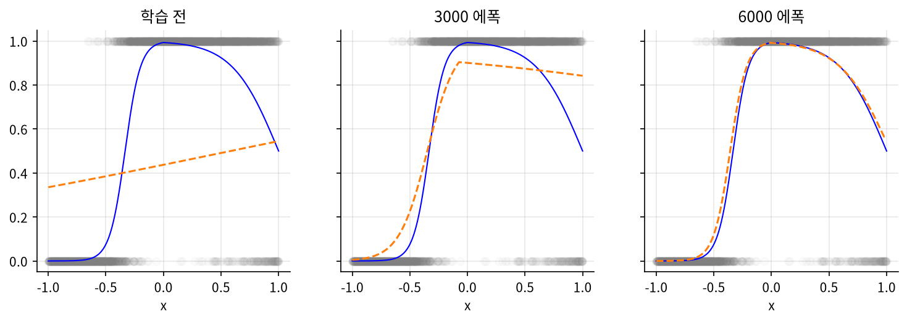

BCE는 학습 전 0.667에서 3,000 에폭 후 0.315, 6,000 에폭 후 0.267로 내려갔다. 로지스틱 회귀가 도달한 0.476보다 훨씬 낮다. 그림에서도 6,000 에폭의 주황 점선이 참 확률과 거의 겹친다.

학습된 가중치를 읽어 보면 네트워크가 무엇을 만들었는지 알 수 있다.

| 층 | 학습된 값 |
|---|---|
| `l1.weight` | $(-1.616,\ -4.329)$ |
| `l1.bias` | $(1.579,\ -0.062)$ |
| `l2.weight` | $(2.859,\ -4.315)$ |
| `l2.bias` | $0.262$ |

은닉 노드 두 개가 각각 꺾은선 하나를 맡는다.

- 노드 1: $\text{relu}(-1.616x + 1.579)$. $-1.616x + 1.579 > 0$, 즉 $x < 0.98$에서 살아 있다. 자료 범위($-1 \le x \le 1$)에서는 사실상 항상 켜져 있는 직선이다.
- 노드 2: $\text{relu}(-4.329x - 0.062)$. $x < -0.014$에서만 켜진다. **꺾이는 점이 $x \approx 0$**이다.

출력 $u$는 $2.859 \times (\text{노드 1}) - 4.315 \times (\text{노드 2}) + 0.262$다. 이걸 구간별로 풀면

- $x > 0$: 노드 2가 꺼져 있으므로 $u = 2.859(-1.616x + 1.579) + 0.262 = -4.62x + 4.78$
- $x < 0$: 노드 2가 더해져 기울기가 $-4.62 + 4.315 \times 4.329 = 14.06$, 즉 $u \approx 14.06x + 4.78$

이다. 자료를 만든 참값($x < 0$에서 $15x + 5$, $x \ge 0$에서 $-5x + 5$)과 비슷하다. 사람이 꺾이는 위치와 기울기를 알려 주지 않았는데, 경사하강법이 자료만 보고 그 숫자를 찾아낸 것이다. 노드 하나가 "직선"을, 다른 하나가 "꺾임"을 맡도록 역할이 나뉜 것도 흥미롭다. 3절에서 사람이 만든 해($x$와 $-x$를 하나씩 맡긴 것)와는 다른 방식인데, 같은 꺾은선을 만드는 가중치 조합은 여러 개다.

## 6. 꺾은선으로 생각보다 많은 것을 할 수 있다

"선형 → ReLU → 선형"이 만드는 것은 꺾은선뿐이다. 그러면 꺾은선으로 표현되는 관계에만 쓸 수 있을까? 은닉 노드 수를 늘려 꺾이는 점을 많이 허락하면 사정이 달라진다. 강의의 세 예제를 같은 방식으로 학습시켰다.

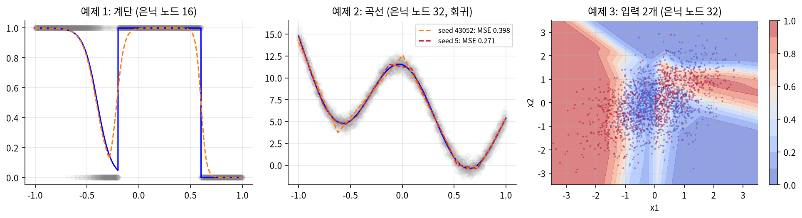

**예제 1: 계단이 있는 확률 (왼쪽).** 참 확률은 $x = -0.2$와 $x = 0.6$에서 뚝 끊어진다. 시그모이드 앞의 $u$가 계단 함수라는 뜻이고, 계단은 연속인 꺾은선으로 정확히 만들 수 없다. 그런데 은닉 노드를 16개로 늘리고(`Linear(1, 16)` → `ReLU` → `Linear(16, 1)` → `Sigmoid`) 6,000 에폭 학습하면 주황 점선처럼 거의 맞춘다. 꺾이는 점 두 개를 가까이 붙이면 아주 가파른 경사, 즉 "거의 계단"을 만들 수 있기 때문이다.

**예제 2: 곡선 회귀 (가운데).** $y = 2.5 + 4e^{-x} + 5\cos 5x + \varepsilon$인 회귀 문제다. 출력이 확률이 아니므로 마지막 `Sigmoid`를 빼고 손실도 `MSELoss`로 바꾼다. 은닉 노드 32개짜리 네트워크는 곡선을 짧은 선분 32개 이하로 이어 붙여 흉내 낸다. 짧은 선분을 많이 쓰면 곡선과 구별하기 어려워진다.

가운데 그림에는 선이 두 개 있다. 구조와 학습 방법은 같고 **초기값(시드)만 다르다**. 시드 5에서 시작한 빨간 점선은 MSE 0.271로 참 곡선에 붙었다. 잡음의 분산이 $0.5^2 = 0.25$이니 거의 최선이다. 시드 43052에서 시작한 주황 점선은 2만 에폭을 돌려도 0.398에 머물고, $x = -0.6$과 $x = 0$ 근처가 각진 채로 남았다. 에폭을 늘려도 좋아지지 않는 이 상태가 **국소 최소점**(local minimum)이다. 앞 글의 로지스틱 회귀 + BCE와 달리 손실면이 볼록하지 않아서, 출발점에 따라 다른 골짜기에 빠질 수 있다. 은닉층이 들어간 네트워크의 손실면은 일반적으로 볼록하지 않다.

**예제 3: 입력이 두 개 (오른쪽).** $\mathbf X$가 (n, 2)인 분류 문제다. 바뀌는 곳은 첫 층의 입력 수 하나다(`Linear(2, 32)`). 입력이 둘이면 ReLU 하나는 평면을 직선으로 나눠 한쪽을 0으로 누르는 "꺾인 평면"이 된다. 이런 꺾인 평면 32개를 더하면 그림처럼 경계가 여러 번 꺾인 영역을 만들 수 있다. 배경색이 네트워크가 예측한 확률이고, 점의 색이 실제 $y$다. 자료를 만든 규칙은 $x_1$의 구간에 따라 네 가지 식을 쓰는 복잡한 것인데, 네트워크는 규칙을 모른 채 3,000 에폭 만에 정확도 73%로 경계를 대략 잡았다.

세 예제에서 바꾼 것은 은닉 노드 수, 마지막 활성화와 손실(분류인지 회귀인지), 입력 수뿐이다. 학습 코드는 하나도 바뀌지 않았다.

## 7. 신경망을 그림으로: 층, 은닉층, 노드

지금까지 만든 네트워크를 그림으로 그리는 방법과 용어를 정리하자. 교재마다 그리는 방식이 조금씩 다르지만, 다음 그림이 가장 흔한 형태다. 784개 픽셀을 받아 숫자 이미지를 분류하는 다음 글의 네트워크 `Linear(784, 32)` → `ReLU` → `Linear(32, 1)` → `Sigmoid`를 그렸다.

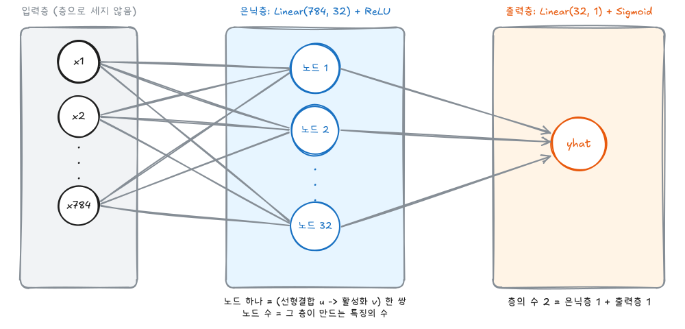

| 용어 | 뜻 | 위 그림에서 |
|---|---|---|
| **층**(layer) | "선형변환 + 활성화"를 한 묶음으로 본 것. 학습할 가중치가 있는 층만 센다 | 2개 |
| **입력층** | 입력 $\mathbf X$ 자체. 가중치가 없어서 보통 층 수에 넣지 않는다 | $x_1, \dots, x_{784}$ |
| **출력층** | 마지막 층. 활성화는 문제에 맞춘다(분류는 시그모이드, 회귀는 없음) | `Linear(32, 1)` + `Sigmoid` |
| **은닉층**(hidden layer) | 입력층과 출력층 사이의 층. 값이 자료에 직접 드러나지 않아서 "숨은" 층 | `Linear(784, 32)` + `ReLU` |
| **노드**(node, 뉴런) | 층 안에서 $u \to v$ 한 쌍. 노드 수 = 그 층이 만드는 특징(열)의 수 | 은닉 노드 32개 |
| **활성화함수** | 층 끝의 비선형 함수 | ReLU, 시그모이드 |

선 하나가 가중치 하나다. 입력 784개와 은닉 노드 32개가 모두 이어져 있으므로 첫 층에 가중치가 $784 \times 32 = 25{,}088$개, 편향이 32개 있다. 이렇게 앞 층의 모든 노드가 다음 층의 모든 노드와 연결된 층을 **완전연결층**(fully connected layer, dense layer)이라고 한다. 파이토치의 `Linear`가 바로 이것이다.

층 수를 셀 때 헷갈리는 이유는 문헌이 "입력층", "활성화층" 같은 말을 자유롭게 쓰기 때문이다. 정석은 **학습할 파라미터가 몇 겹 있는가**로 세는 것이다. 이 기준으로는 층 수 = 은닉층 수 + 1(출력층)이다. 앞 절의 꺾은선 네트워크도 층 2개, 은닉층 1개다. "깊은" 신경망은 은닉층이 여러 개라는 뜻이다.

강의가 강조한 것은 용어를 외우는 것보다 **다이어그램을 보고 대응하는 파이토치 코드를 쓸 수 있는 능력**이다. 원의 개수를 세어 `Linear`의 입출력 수를 정하고, 각 층의 활성화를 확인하면 된다.

## 8. 시벤코 정리

### 정리의 내용

6절의 예제들은 "노드를 충분히 늘리면 웬만한 모양은 다 맞춘다"는 인상을 준다. 이 인상을 정리한 것이 보편근사정리(universal approximation theorem)이고, 처음 증명한 사람의 이름을 따서 시벤코 정리라고도 부른다(Cybenko, 1989).

> 은닉층이 **하나**인 "선형 → 시그모이드 → 선형" 네트워크로, 유계인 영역 위의 **어떤 연속함수든 원하는 정확도로** 근사할 수 있다. 단, 은닉 노드 수를 충분히 크게 하고 가중치를 잘 고른다면.

조금 더 정확히 쓰면 다음과 같다. $[0,1]^p$ 위의 연속함수 $f$와 아무리 작은 $\varepsilon > 0$이 주어져도, 노드 수 $m$과 가중치 $\mathbf w_j, b_j, c_j$를 골라

$$
g(\mathbf x) = \sum_{j=1}^m c_j\,\sigma(\mathbf w_j^\top \mathbf x + b_j)
$$

가 모든 $\mathbf x$에서 $|f(\mathbf x) - g(\mathbf x)| < \varepsilon$을 만족하게 할 수 있다. $g$는 정확히 `Linear(p, m)` → `Sigmoid` → `Linear(m, 1)`이다. 이후 활성화함수가 다항식만 아니면 같은 결과가 성립한다는 것이 알려져서(Leshno et al., 1993), 요즘 많이 쓰는 ReLU에도 적용된다.

즉 우리는 다음 무기를 가진 셈이다. **(n, p) 입력에서 (n, 1) 출력으로 가는 관계가 연속이기만 하면, "선형 → 활성화 → 선형" 네트워크로 근사할 수 있다.**

### 그림으로 보는 증명

엄밀한 증명은 함수해석학이 필요하지만, 핵심 아이디어는 그림으로 따라갈 수 있다. 전략은 "혹(bump)"을 만드는 것이다.

**1단계: 시그모이드 두 개로 혹 하나.** 은닉 노드 2개짜리 네트워크에 가중치를 다음처럼 준다.

```python
l1 = torch.nn.Linear(1, 2); a1 = torch.nn.Sigmoid(); l2 = torch.nn.Linear(2, 1)
l1.weight.data = torch.tensor([[-5.0], [5.0]]); l1.bias.data = torch.tensor([10.0, 10.0])
l2.weight.data = torch.tensor([[1.0, 1.0]]);    l2.bias.data = torch.tensor([-1.0])
```

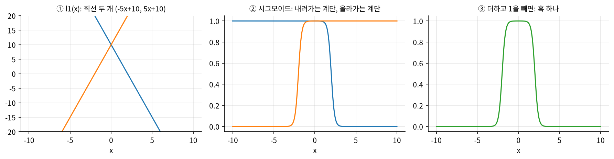

- ① `l1`은 직선 두 개 $-5x + 10$과 $5x + 10$을 만든다.
- ② 시그모이드를 씌우면 $\sigma(-5x + 10)$은 $x = 2$ 근처에서 1에서 0으로 내려가는 계단, $\sigma(5x + 10)$은 $x = -2$ 근처에서 0에서 1로 올라가는 계단이 된다. 기울기 5가 클수록 계단이 가팔라진다.
- ③ 둘을 더하면 $-2 < x < 2$에서는 $1 + 1 = 2$, 바깥에서는 $0 + 1 = 1$이다. 1을 빼면 $(-2, 2)$에서만 1이고 나머지는 0인 **혹**이 된다.

**2단계: 혹의 위치와 높이는 가중치로 조절된다.** `l1.bias`를 바꾸면 계단의 위치가 옮겨져 혹이 이동하고, `l2.weight`를 바꾸면 혹의 높이가 바뀐다. 은닉 노드를 4개로 늘려 혹 두 개를 한 네트워크에 담을 수도 있다.

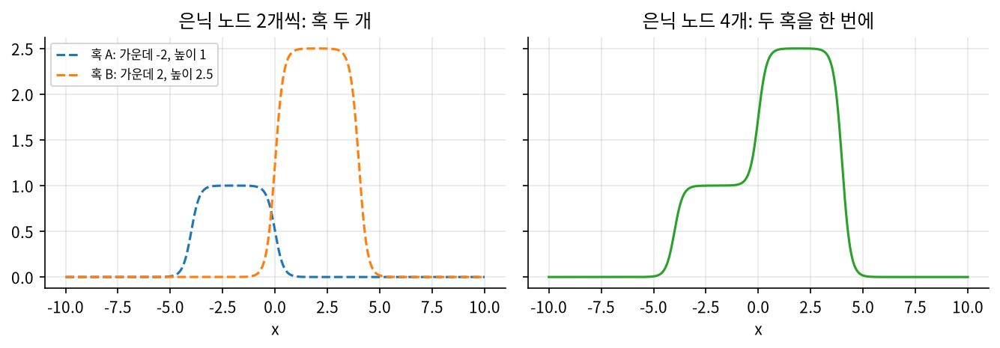

**3단계: 혹을 많이 쌓으면 어떤 곡선이든.** 이제 그림은 명확하다. 연속함수 $f$의 그래프를 폭이 좁은 막대들로 잘게 자르고(적분을 배울 때 넓이를 직사각형으로 근사하던 것과 같다), 막대 하나마다 혹 하나를 대응시켜 높이를 $f$의 값으로 맞춘 뒤 모두 더한다. 막대를 좁게 할수록 혹의 합은 $f$에 가까워진다. 혹 하나에 시그모이드 노드 2개가 들고, 계단을 가파르게 하려면 가중치를 크게 하면 된다. 노드 수만 넉넉하면 원하는 정확도를 얻는다. 이것이 정리의 직관이다.

강의는 이 아이디어를 직접 실험한다. 혹 하나를 활성화함수로 쓰는 층을 만든다.

```python
h = lambda x: torch.sigmoid(200*(x+0.5)) + torch.sigmoid(-200*(x-0.5)) - 1.0

class MyActivation(torch.nn.Module):   # 사용자 정의 활성화함수
    def forward(self, input):
        return h(input)
```

$h$는 $(-0.5, 0.5)$에서만 1인 아주 가파른 혹이다. `torch.nn.Module`을 상속하고 `forward`에 계산을 적으면 `ReLU()`처럼 `Sequential`에 넣을 수 있는 층이 된다. $h$ 하나는 시그모이드 두 개의 합이므로, $h$ 노드 $m$개짜리 네트워크와 같은 일을 하는 시그모이드 노드 $2m$개짜리 네트워크가 항상 있다. 따라서 이 실험은 시벤코 정리의 네트워크와 본질적으로 같다.

`Linear(1, m)` → `MyActivation()` → `Linear(m, 1)`에 **무작위 가중치**를 넣어 그려 보면 노드 수에 따라 만들 수 있는 함수가 어떻게 달라지는지 보인다.

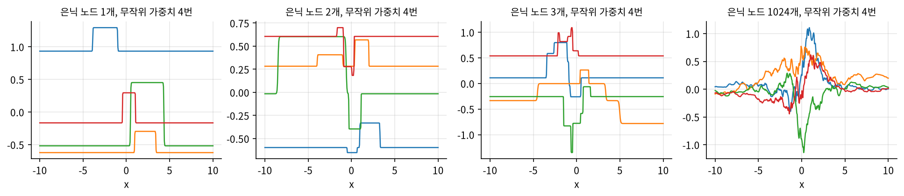

노드가 하나면 혹 하나, 둘이나 셋이면 혹 몇 개가 겹친 계단이다. 1024개가 되면 무작위로 뽑았을 뿐인데도 복잡한 곡선이 나온다. 가중치를 무작위가 아니라 학습으로 정하면 원하는 곡선에 맞출 수 있다. 노드 2048개로 학습한 결과가 다음 그림이다.

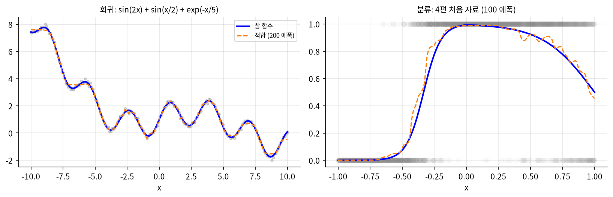

왼쪽은 꽤 복잡한 곡선 $\sin 2x + \sin(x/2) + e^{-x/5}$인데 200 에폭 만에 MSE 0.014(잡음 분산 0.01)까지 내려가 거의 그대로 따라간다. 오른쪽은 이 글 처음의 자료다. ReLU 노드 2개로 6,000 에폭 걸린 것을 100 에폭 만에 비슷하게 맞췄다. 다만 오른쪽 곡선은 군데군데 작게 출렁인다. 참 확률에는 없는 출렁임이다. 이 이야기는 다음 글로 이어진다.

## 9. 정리가 말해 주지 않는 것

시벤코 정리를 처음 들으면 오히려 의문이 생긴다. 강의도 세 가지 의문을 짚는다.

**의문 1: 1989년에 이미 증명되었다면, 왜 그때 모든 문제가 풀리지 않았나?** 정리는 좋은 가중치가 **존재한다**고만 말한다. 그 가중치를 **찾는 법**(최적화), 찾는 데 드는 **계산량**, 유한한 자료로 찾았을 때 새 자료에도 맞는지(**일반화**)에 대해서는 아무 말도 하지 않는다. 6절 예제 2의 국소 최소점이 첫째 문제의 예다. 노드 2048개짜리 네트워크는 계산이 무거워 GPU가 필요하다. 그리고 바로 위 그림의 출렁임은 네트워크가 잡음까지 따라 그리기 시작했다는 신호, 즉 **과적합**이다. 표현력이 무한하다는 것은 잡음도 얼마든지 외울 수 있다는 뜻이기도 하다. 다음 글은 이 세 문제(큰 자료, GPU, 과적합)를 다룬다.

**의문 2: 정리는 시그모이드로 증명했는데 요즘은 왜 ReLU를 쓰나?** 표현력만 보면 둘 다 보편근사가 성립하니 차이가 없다. 차이는 학습에 있다. 앞 글에서 시그모이드가 포화되면 미분이 0에 가까워져 학습이 멈추는 것을 보았다. 층이 깊어지면 이 작은 미분이 층마다 곱해져 앞쪽 층에는 기울기가 거의 전달되지 않는다. ReLU는 양수 쪽 미분이 항상 1이라 이 문제가 덜하고, 계산도 단순하다. 6편의 기울기 소멸에서 자세히 다룬다.

**의문 3: 은닉층 하나로 충분하다면 왜 깊게 쌓나?** 하나로 "가능하다"는 것과 "효율적이다"는 것은 다르다. 혹을 쌓는 방식은 입력이 $p$차원이면 공간을 칸으로 나누어야 하므로 필요한 노드 수가 차원에 따라 기하급수적으로 늘어난다. 반면 층을 쌓으면 앞 층이 만든 특징을 뒤 층이 재료로 다시 쓸 수 있어서, 같은 함수를 훨씬 적은 파라미터로 표현할 수 있는 경우가 많다. 이미지에서 "선 → 모서리 → 눈·코 → 얼굴"처럼 단계적으로 특징을 쌓는 것이 그런 예이고, 7편의 CNN과 9편의 CAM에서 이 구조를 직접 들여다본다.

## 정리

| 질문 | 답 |
|---|---|
| 로지스틱 회귀의 한계는? | 시그모이드 앞의 $u$가 직선이라 확률이 한 방향으로만 변한다 (표현력 부족) |
| 어떻게 해결하나? | $u$를 꺾인 함수로 만든다: 선형변환 → ReLU → 선형변환 |
| ReLU의 역할은? | $\max(0, x)$로 원점에서 한 번 꺾는다. 노드마다 꺾임 하나를 맡는다 |
| 꺾이는 위치와 기울기는 누가 정하나? | 가중치. 경사하강법이 자료에 맞게 찾는다 |
| 꺾은선만으로 충분한가? | 노드를 늘리면 계단, 곡선, 2차원 경계까지 근사한다 |
| 층·은닉층·노드는? | 층 = 선형+활성화 한 묶음, 은닉층 = 입출력 사이 층, 노드 = 층 안의 특징 하나 |
| 시벤코 정리는? | 은닉층 하나로 어떤 연속함수든 근사 가능. 단 가중치를 찾는 법과 일반화는 보장하지 않는다 |

- 깊은 신경망의 기본 단위는 "선형 → 비선형"이다. 비선형 활성화가 없으면 선형변환을 몇 번 쌓아도 하나의 선형변환과 같다.
- 코드를 짤 때는 $\mathbf X \to \mathbf u^{(1)} \to \mathbf v^{(1)} \to \cdots \to \hat{\mathbf y}$의 shape을 먼저 적는다. `Linear(in, out)`의 in과 out이 거기서 바로 나온다.
- 회귀는 마지막 활성화 없이 MSE, 이진 분류는 마지막에 시그모이드를 두고 BCE를 쓴다.
- 은닉층이 있는 네트워크의 손실면은 볼록하지 않다. 같은 구조라도 초기값에 따라 국소 최소점에 머물 수 있다.
- 표현력이 크다는 것은 잡음까지 맞출 수 있다는 뜻이기도 하다.

다음 글에서는 장난감 자료를 떠나 실제 크기의 자료인 MNIST 손글씨 숫자를 다룬다. 이미지를 네트워크에 넣는 방법, 계산을 GPU로 옮기는 방법, 자료를 조금씩 나누어 학습하는 미니배치, 그리고 위 그림의 출렁임으로 예고된 과적합과 그 대책을 차례로 본다.

## 참고자료

- 최규빈, 「딥러닝」 강의노트 (2022), 05wk-2 · 06wk-1 · 06wk-2: 딥러닝의 기초 (5)–(7), <https://guebin.github.io/DL2022/>
- Cybenko, G. (1989). Approximation by superpositions of a sigmoidal function. *Mathematics of Control, Signals and Systems*, 2(4), 303–314.
- Leshno, M., Lin, V. Y., Pinkus, A. and Schocken, S. (1993). Multilayer feedforward networks with a nonpolynomial activation function can approximate any function. *Neural Networks*, 6(6), 861–867.
- Nielsen, M. (2015). *Neural Networks and Deep Learning*, Chapter 4: A visual proof that neural nets can compute any function. <http://neuralnetworksanddeeplearning.com/chap4.html>
- Goodfellow, I., Bengio, Y. and Courville, A. (2016). *Deep Learning*, Section 6.4 (Architecture Design). MIT Press.
