다층 신경망(multilayer perceptron, MLP)은 선형변환과 비선형 활성화를 번갈아 쌓은 모형이다. 활성화가 없으면 선형변환을 몇 번 쌓아도 하나의 선형변환과 같으므로, 표현력은 전부 활성화에서 나온다. 가장 많이 쓰는 활성화인 ReLU $\max(0, x)$는 스플라인의 절단 거듭제곱 기저 $(x - \xi)_+$와 같은 함수다([데이터 마이닝 - 선형을 넘어서: 스플라인과 GAM](/posts/dm-nonlinear)). 그래서 은닉층 하나짜리 ReLU 신경망은 **매듭의 위치까지 자료에서 학습하는 1차 스플라인**이다.

## 표현력: 로지스틱 회귀가 그리지 못하는 곡선

로지스틱 회귀 $\hat y = \sigma(w_0 + w_1 x)$는 $w_1$의 부호에 따라 항상 증가하거나 항상 감소한다. 시그모이드는 증가함수라 $\hat y$의 모양은 앞의 $u = w_0 + w_1 x$가 정하는데, $u$가 직선이기 때문이다. 확률이 올라갔다 내려가는 관계는 $w_0, w_1$을 어떻게 골라도 나오지 않는다.

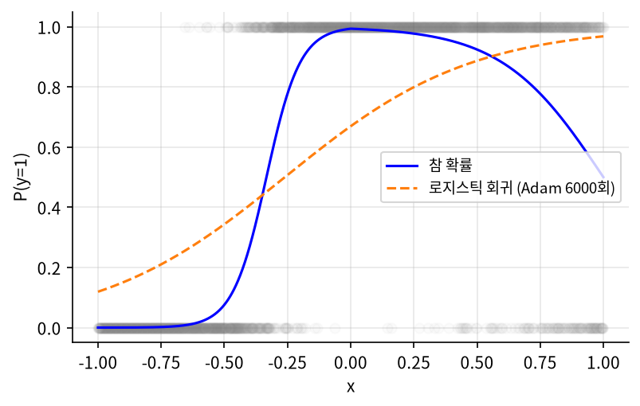

위 자료는 "스펙이 너무 높으면 오히려 불합격"이라는 이야기를 본뜬 가짜 자료다(강의 예제). 참 확률은 $\sigma(u)$이고 $u$가 $x = 0$에서 꺾인다.

$$
u = \begin{cases} 15x + 5 & x < 0 \\ -5x + 5 & x \ge 0 \end{cases}
$$

로지스틱 회귀는 BCE를 0.48까지 줄이고 멈춘다. 학습이 잘못된 것이 아니라 모형이 그릴 수 있는 곡선의 집합에 정답이 없는 것이다. 이것을 **표현력이 부족하다**고 한다. 필요한 것은 $u$를 꺾는 방법이다.

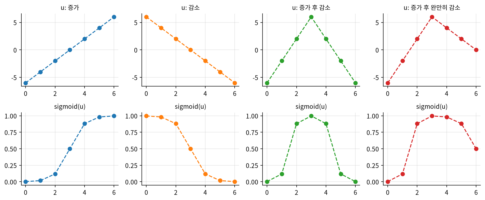

## ReLU로 꺾은선 만들기

### 선형 → ReLU → 선형

$x$ 하나에서 $x$와 $-x$를 만들고(선형변환), 각각에 ReLU를 씌운 뒤(꺾기), 둘을 가중합한다(선형변환).

$$
u = -4.5\cdot\text{relu}(x) - 9\cdot\text{relu}(-x) + 4.5
$$

$x > 0$이면 $u = -4.5x + 4.5$, $x < 0$이면 $u = 9x + 4.5$로, $x = 0$에서 꺾인 꺾은선이다.

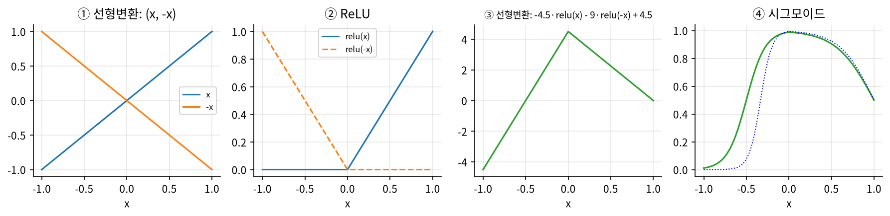

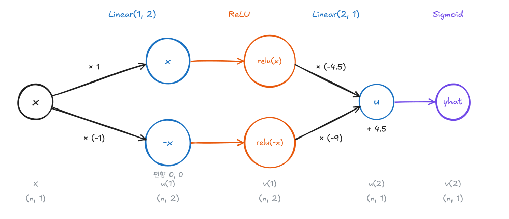

```python
net = torch.nn.Sequential(
    torch.nn.Linear(in_features=1, out_features=2),   # x -> (x, -x)
    torch.nn.ReLU(),
    torch.nn.Linear(in_features=2, out_features=1),   # 두 꺾은선의 가중합
    torch.nn.Sigmoid(),
)
net[0].weight.data = torch.tensor([[1.0], [-1.0]]); net[0].bias.data = torch.tensor([0.0, 0.0])
net[2].weight.data = torch.tensor([[-4.5, -9.0]]);  net[2].bias.data = torch.tensor([4.5])
```

`Linear(1, 2)`의 `weight`가 (2, 1)인 것은 파이토치가 가중치를 (출력 수, 입력 수)로 저장하기 때문이다. `Sequential`은 넣은 순서대로 함수를 합성해서 `net(x)`는 `net[3](net[2](net[1](net[0](x))))`다.

### 스플라인과의 관계

은닉 노드가 $m$개인 ReLU 네트워크의 출력은

$$
u(x) = b + \sum_{j=1}^{m} c_j\,\text{relu}(a_j x + d_j) = b + \sum_{j=1}^m c_j |a_j|\,\big(s_j(x - \xi_j)\big)_+, \qquad \xi_j = -\frac{d_j}{a_j},\ s_j = \text{sign}(a_j)
$$

이다. $s_j = 1$이면 매듭 오른쪽, $-1$이면 왼쪽에서 살아 있는 기저다. 노드마다 매듭 $\xi_j$에서 꺾이는 기저함수 하나이고, 이것을 더한 것이 1차 스플라인이다.

| | 1차 회귀 스플라인 | ReLU 은닉층 1개 신경망 |
|---|---|---|
| 기저 | $(x - \xi_k)_+$ | $\text{relu}(a_j x + d_j)$ |
| 매듭 위치 | 사람이 정함 (또는 분위수) | 학습 ($\xi_j = -d_j/a_j$) |
| 추정 | 최소제곱, 닫힌 해 | 경사하강법, 반복 계산 |
| 손실면 | 볼록 | 볼록하지 않음 (국소 최소점) |
| 입력이 여러 개일 때 | 텐서곱, GAM | 기저가 $\text{relu}(\mathbf a^\top\mathbf x + d)$, 즉 꺾인 평면 |

매듭을 학습하는 대가로 닫힌 해와 볼록성을 잃는다. 대신 입력이 여러 개일 때 기저가 임의 방향의 꺾인 평면이 되어, 변수끼리의 상호작용을 따로 지정하지 않아도 잡아낸다.

### 학습시키기

가중치를 무작위로 시작해 BCE + Adam으로 6,000 에폭 학습한다.

```python
torch.manual_seed(43052)
net = torch.nn.Sequential(torch.nn.Linear(1, 2), torch.nn.ReLU(),
                          torch.nn.Linear(2, 1), torch.nn.Sigmoid())
loss_fn = torch.nn.BCELoss()
optimizr = torch.optim.Adam(net.parameters())
for epoch in range(6000):
    loss = loss_fn(net(x), y)
    loss.backward(); optimizr.step(); optimizr.zero_grad()
```

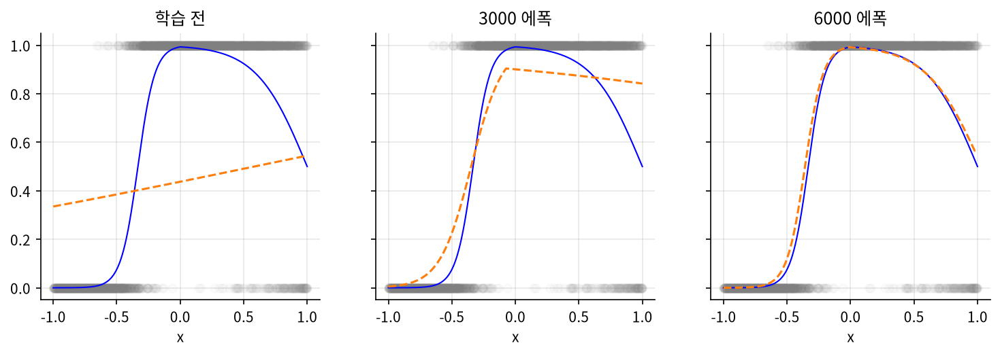

BCE는 0.667에서 0.267로 내려가 로지스틱 회귀(0.476)보다 훨씬 낮다. 학습된 가중치는 다음과 같다.

| 층 | 학습된 값 |
|---|---|
| `net[0].weight`, `net[0].bias` | $(-1.616, -4.329)$, $(1.579, -0.062)$ |
| `net[2].weight`, `net[2].bias` | $(2.859, -4.315)$, $0.262$ |

노드 1의 매듭은 $x = 1.579/1.616 = 0.98$로 자료 범위 끝이라 사실상 직선이고, 노드 2의 매듭은 $x = -0.062/4.329 = -0.014$다. 구간별로 풀면 $x > 0$에서 $u = -4.62x + 4.78$, $x < 0$에서 $u = 14.06x + 5.04$로, 참값($-5x + 5$, $15x + 5$)과 비슷하다. 매듭 위치를 알려 주지 않았는데 자료에서 찾았다.

## 행렬 표기와 shape

관측치 $n$개를 행으로 쌓은 $\mathbf X$ (n, 1)에서 출발하면 네트워크는 함수 합성이다.

$$
\hat{\mathbf y} = \sigma\Big(\text{relu}\big(\mathbf X\mathbf W^{(1)} + \mathbf b^{(1)}\big)\mathbf W^{(2)} + b^{(2)}\Big)
$$

$\mathbf W^{(1)}$은 (1, 2), $\mathbf W^{(2)}$는 (2, 1)이고 파이토치 `weight`의 전치다. 편향은 모든 행에 똑같이 더해진다(브로드캐스팅). 코드를 짤 때는 shape만 따라가면 충분한 경우가 많다.

$$
\underset{(n,1)}{\mathbf X} \overset{l_1}{\to} \underset{(n,2)}{\mathbf u^{(1)}} \overset{\text{relu}}{\to} \underset{(n,2)}{\mathbf v^{(1)}} \overset{l_2}{\to} \underset{(n,1)}{\mathbf u^{(2)}} \overset{\sigma}{\to} \underset{(n,1)}{\hat{\mathbf y}}
$$

선형변환 화살표마다 `Linear(앞 열 수, 뒤 열 수)`, 활성화 화살표마다 해당 함수를 놓으면 코드가 된다.

## 층, 은닉층, 노드

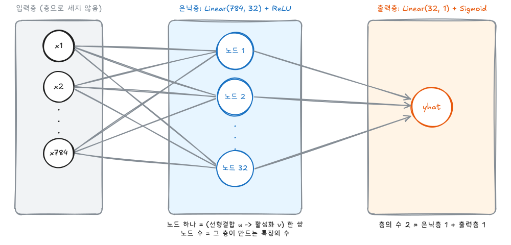

| 용어 | 뜻 | 위 그림에서 |
|---|---|---|
| 층 | 선형변환 + 활성화 한 묶음. 학습할 가중치가 있는 것만 센다 | 2개 |
| 입력층 | $\mathbf X$ 자체. 가중치가 없어 층 수에 넣지 않는다 | $x_1, \dots, x_{784}$ |
| 은닉층 | 입력과 출력 사이의 층 | `Linear(784, 32)` + `ReLU` |
| 출력층 | 마지막 층. 활성화는 반응변수의 분포로 정한다([3편](/posts/dl-03-output-loss)) | `Linear(32, 1)` + `Sigmoid` |
| 노드 | 층 안의 $u \to v$ 한 쌍. 그 층이 만드는 특징 하나 | 은닉 노드 32개 |
| 완전연결층 | 앞 층의 모든 노드와 연결된 층. `Linear` | 선 하나가 가중치 하나 |

층 수 = 은닉층 수 + 1이다. "깊은" 신경망은 은닉층이 여러 개라는 뜻이다. 위 그림의 첫 층에는 가중치가 $784 \times 32 = 25{,}088$개, 편향이 32개 있다.

## 보편근사정리

### 내용

> 은닉층이 하나인 "선형 → 시그모이드 → 선형" 네트워크로, 유계인 영역 위의 어떤 연속함수든 원하는 정확도로 근사할 수 있다. 은닉 노드 수를 충분히 크게 하고 가중치를 잘 고른다면 (Cybenko, 1989).

$[0,1]^p$ 위의 연속함수 $f$와 $\varepsilon > 0$이 주어지면 $m$과 가중치를 골라

$$
g(\mathbf x) = \sum_{j=1}^m c_j\,\sigma(\mathbf w_j^\top \mathbf x + b_j), \qquad \sup_{\mathbf x}|f(\mathbf x) - g(\mathbf x)| < \varepsilon
$$

를 만들 수 있다. 활성화가 다항식만 아니면 같은 결과가 성립하므로(Leshno et al., 1993) ReLU에도 적용된다.

### 혹을 쌓는 증명

시그모이드 두 개로 혹 하나를 만든다. `Linear(1, 2)`의 가중치를 $(-5, 5)$, 편향을 $(10, 10)$으로 두면 $\sigma(-5x + 10)$은 $x = 2$에서 내려가는 계단, $\sigma(5x + 10)$은 $x = -2$에서 올라가는 계단이다. 둘을 더하고 1을 빼면 $(-2, 2)$에서만 1인 혹이 된다.

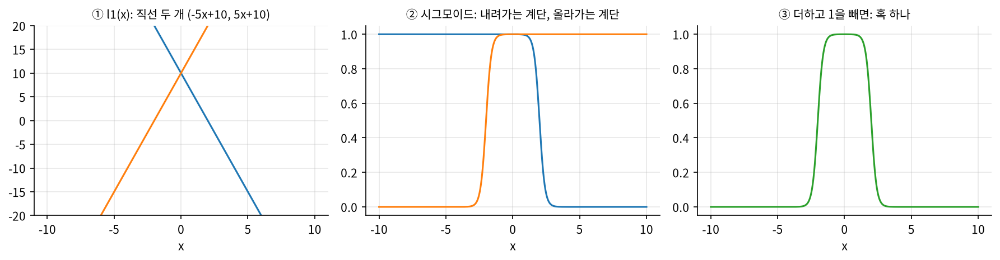

편향을 바꾸면 혹이 이동하고, 다음 층의 가중치를 바꾸면 높이가 바뀌며, 첫 층의 가중치를 키우면 계단이 가팔라진다. 노드 4개면 혹 두 개를 담는다.

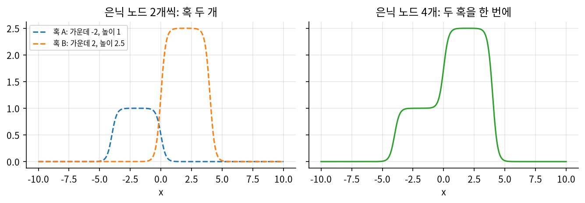

연속함수의 그래프를 폭이 좁은 막대로 자르고, 막대마다 혹 하나를 그 높이로 놓아 더하면 된다. 막대를 좁게 할수록 혹의 합은 $f$에 가까워진다. 리만 합으로 넓이를 근사하는 것과 같은 아이디어다.

같은 아이디어로 혹 하나를 활성화함수로 쓰는 층을 만들어 실험할 수 있다.

```python
h = lambda x: torch.sigmoid(200*(x+0.5)) + torch.sigmoid(-200*(x-0.5)) - 1.0   # (-0.5, 0.5)의 혹
class MyActivation(torch.nn.Module):
    def forward(self, input):
        return h(input)
```

`torch.nn.Module`을 상속하고 `forward`에 계산을 적으면 `Sequential`에 넣을 수 있는 층이 된다. `Linear(1, m)` → `MyActivation()` → `Linear(m, 1)`에 무작위 가중치를 넣으면 노드 수에 따라 만들 수 있는 함수가 달라진다.

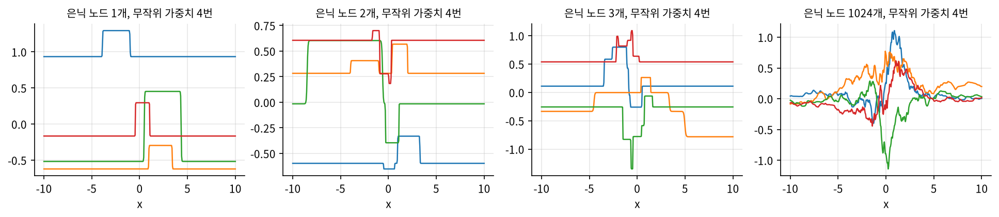

가중치를 학습으로 정하면 원하는 곡선에 맞출 수 있다. 노드 2,048개로 학습한 결과다.

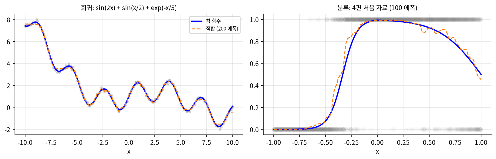

왼쪽 $\sin 2x + \sin(x/2) + e^{-x/5}$는 200 에폭에 MSE 0.014(잡음 분산 0.01)로 거의 그대로 따라간다. 오른쪽은 처음의 0/1 자료로, 참 확률에 없는 작은 출렁임이 보인다.

## 예제: 노드 수와 국소 최소점

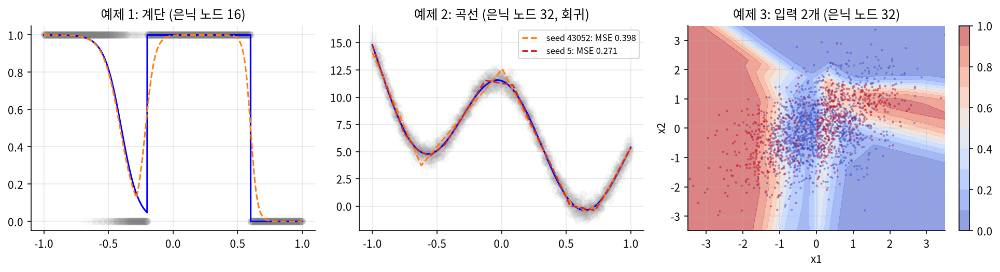

| 예제 | 네트워크 | 결과 |
|---|---|---|
| 계단 모양 확률 ($x = -0.2, 0.6$에서 끊어짐) | `Linear(1,16)`-ReLU-`Linear(16,1)`-Sigmoid, BCE | 매듭 두 개를 붙여 거의 계단을 만든다 |
| 곡선 회귀 $2.5 + 4e^{-x} + 5\cos 5x + \varepsilon$ | `Linear(1,32)`-ReLU-`Linear(32,1)`, MSE | 시드 5: MSE 0.271 (잡음 분산 0.25). 시드 43052: 2만 에폭 후에도 0.398 |
| 입력 2개 분류 | `Linear(2,32)`-ReLU-`Linear(32,1)`-Sigmoid | 꺾인 평면 32개로 여러 번 꺾인 경계, 정확도 73% |

가운데 예제는 구조와 학습 방법이 같고 초기값만 다른데, 한쪽은 2만 에폭을 돌려도 각진 곳이 남는다. 은닉층이 있는 네트워크의 손실면은 볼록하지 않아서 출발점에 따라 다른 골짜기(**국소 최소점**)에 머물 수 있다. 스플라인처럼 매듭을 고정하면 볼록한 최소제곱 문제가 되지만, 매듭까지 학습하면 이 성질을 잃는다.

## 정리가 보장하지 않는 것

| 질문 | 답 |
|---|---|
| 1989년에 증명됐는데 왜 그때 모든 문제가 풀리지 않았나? | 좋은 가중치가 **존재한다**는 것뿐이다. 찾는 법(최적화), 계산량, 새 자료에서의 성능(일반화)은 말하지 않는다. 위의 국소 최소점과 출렁임(과적합)이 그 예다 ([5](/posts/dl-05-backprop-vanishing), [6편](/posts/dl-06-minibatch-overfitting)) |
| 정리는 시그모이드로 증명했는데 왜 ReLU를 쓰나? | 표현력은 같다. 차이는 학습에 있다. 시그모이드는 포화되면 미분이 0에 가까워지고, 층마다 곱해지면 기울기가 사라진다 (5편) |
| 은닉층 하나로 충분한데 왜 깊게 쌓나? | 가능하다는 것과 효율적이라는 것은 다르다. 혹을 쌓는 방식은 입력 차원에 따라 노드 수가 기하급수로 늘지만, 층을 쌓으면 앞 층의 특징을 뒤 층이 재료로 다시 써서 같은 함수를 훨씬 적은 파라미터로 표현한다 ([7](/posts/dl-07-cnn), [8편](/posts/dl-08-transfer-cam)) |

## 요약

- 다층 신경망은 선형변환과 비선형 활성화를 번갈아 쌓은 모형이다. 활성화가 없으면 하나의 선형변환과 같다.
- ReLU 은닉층 하나짜리 네트워크는 매듭을 학습하는 1차 스플라인이다. 노드 하나가 꺾임 하나를 맡는다.
- 코드를 짤 때는 $\mathbf X \to \mathbf u^{(1)} \to \mathbf v^{(1)} \to \cdots \to \hat{\mathbf y}$의 shape부터 적는다.
- 보편근사정리: 은닉층 하나로 어떤 연속함수든 근사할 수 있다. 시그모이드 두 개로 만든 혹을 쌓는 그림으로 이해할 수 있다.
- 정리는 존재만 보장한다. 최적화(국소 최소점), 학습(기울기 소실), 일반화(과적합)는 별개의 문제다.

## 참고자료

- 최규빈, 「딥러닝」 강의노트 (2022), <https://guebin.github.io/DL2022/>
- Cybenko, G. (1989). Approximation by superpositions of a sigmoidal function. *Mathematics of Control, Signals and Systems*, 2(4), 303–314.
- Leshno, M., Lin, V. Y., Pinkus, A. and Schocken, S. (1993). Multilayer feedforward networks with a nonpolynomial activation function can approximate any function. *Neural Networks*, 6(6), 861–867.
- Nielsen, M. (2015). *Neural Networks and Deep Learning*, Chapter 4. <http://neuralnetworksanddeeplearning.com/chap4.html>
- Hastie, T., Tibshirani, R. and Friedman, J. (2009). *The Elements of Statistical Learning* (2nd ed.), Sections 5.2, 11.3. Springer.
