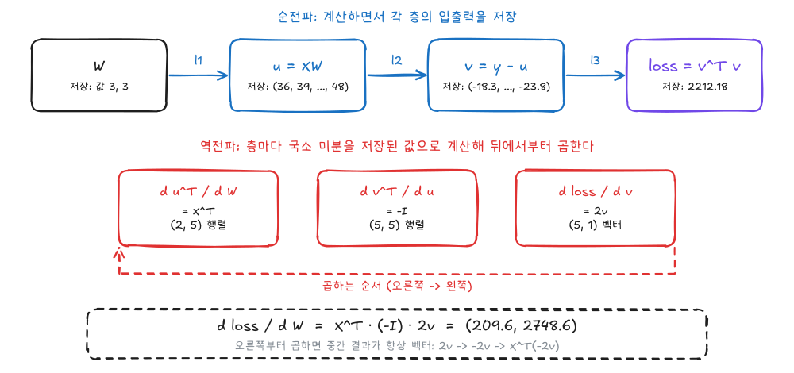
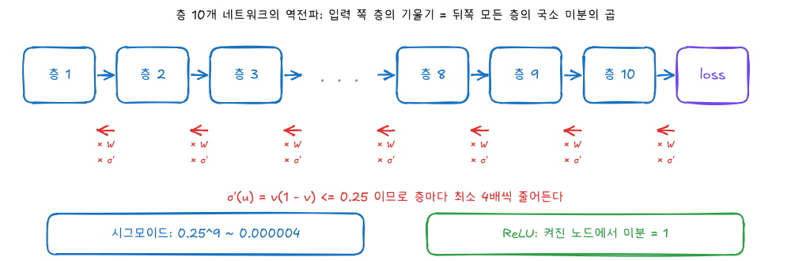
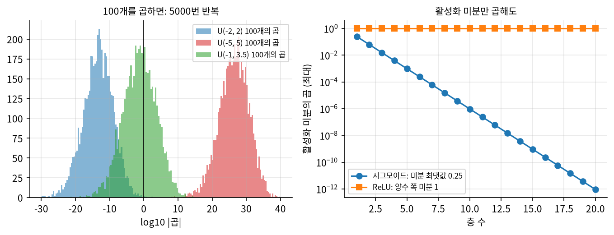
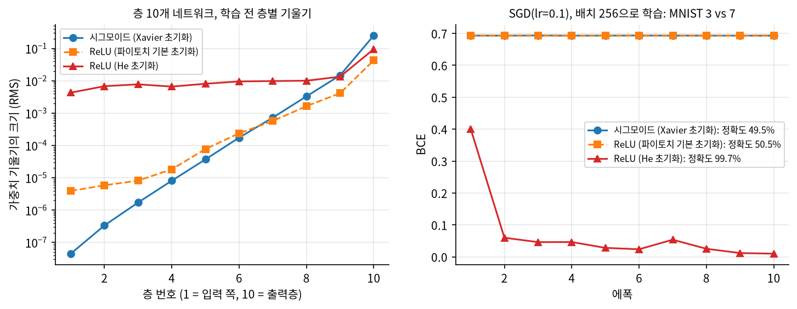

역전파(backpropagation)는 신경망의 손실을 가중치로 미분하는 알고리즘이다. 체인룰로 미분을 층별 국소 미분의 곱으로 나누고, 순전파 때 저장해 둔 중간값으로 각 국소 미분을 계산한 뒤, **손실 쪽에서부터** 곱해 나간다. `loss.backward()`가 하는 일이 이것이다. 그런데 입력 쪽 층의 기울기가 여러 수의 곱이라는 바로 그 구조 때문에, 층이 깊어지면 기울기가 0으로 사라지거나(**기울기 소실**) 폭발한다.

## 벡터 미분

스칼라 손실을 벡터 $\mathbf W$로 미분한 $\frac{\partial}{\partial \mathbf W}\text{loss}$는 각 원소로 편미분한 값을 $\mathbf W$와 같은 모양으로 늘어놓은 것으로 정의한다. 그래야 $\mathbf W \leftarrow \mathbf W - \alpha\frac{\partial}{\partial \mathbf W}\text{loss}$를 그대로 쓸 수 있다.

| 식 (스칼라) | $\mathbf W$로 미분 | 스칼라에서 |
|---|---|---|
| $\mathbf a^\top\mathbf W$, $\mathbf W^\top\mathbf a$ | $\mathbf a$ | $(aw)' = a$ |
| $\mathbf W^\top\mathbf A\mathbf W$ | $(\mathbf A + \mathbf A^\top)\mathbf W$, 대칭이면 $2\mathbf A\mathbf W$ | $(aw^2)' = 2aw$ |

회귀의 SSE $(\mathbf y - \mathbf X\mathbf W)^\top(\mathbf y - \mathbf X\mathbf W) = \mathbf y^\top\mathbf y - 2\mathbf W^\top\mathbf X^\top\mathbf y + \mathbf W^\top\mathbf X^\top\mathbf X\mathbf W$에 적용하면 $-2\mathbf X^\top\mathbf y + 2\mathbf X^\top\mathbf X\mathbf W$이다. 0으로 놓으면 정규방정식이다. 식을 펼치는 이 방법은 층이 쌓인 신경망에서는 쓸 수 없다.

## 체인룰

손실이 계산되는 과정을 단계로 나눈다.

$$
\mathbf W \overset{l_1}{\to} \mathbf u = \mathbf X\mathbf W \overset{l_2}{\to} \mathbf v = \mathbf y - \mathbf u \overset{l_3}{\to} \text{loss} = \mathbf v^\top\mathbf v
$$

| 단계별 미분 | 값 | 모양 |
|---|---|---|
| $\partial\,\text{loss}/\partial \mathbf v$ | $2\mathbf v$ | (n, 1) |
| $\partial \mathbf v^\top/\partial \mathbf u$ | $-\mathbf I$ | (n, n) |
| $\partial \mathbf u^\top/\partial \mathbf W$ | $\mathbf X^\top$ | (2, n) |

벡터를 벡터로 미분한 $\partial \mathbf v^\top/\partial \mathbf u$는 $v_j$ 각각을 $\mathbf u$로 미분한 세로 벡터를 옆으로 늘어놓은 행렬이다. 다변수 체인룰에 따라

$$
\frac{\partial\,\text{loss}}{\partial \mathbf W} = \frac{\partial \mathbf u^\top}{\partial \mathbf W}\,\frac{\partial \mathbf v^\top}{\partial \mathbf u}\,\frac{\partial\,\text{loss}}{\partial \mathbf v} = \mathbf X^\top(-\mathbf I)(2\mathbf v) = -2\mathbf X^\top(\mathbf y - \mathbf X\mathbf W)
$$

로 펼친 결과와 같다. 미분을 세로로 세우기로 했으므로 입력 쪽 미분이 왼쪽에 온다. 모양은 (2, n)(n, n)(n, 1) = (2, 1)이다.

**예제.** 관측치 5개, $x = (11, \dots, 15)$, $y = (17.7, 18.5, 21.2, 23.6, 24.2)$, $\mathbf W = (3, 3)$에서(강의 예제)

```python
u = X @ W                        # (36, 39, 42, 45, 48)
v = y - u                        # (-18.3, -20.5, -20.8, -21.4, -23.8)
X.T @ -torch.eye(5) @ (2*v)      # (209.6, 2748.6)
torch.autograd.functional.jacobian(lambda u: y - u, u)   # 대각선이 -1인 (5, 5)
```

`W.requires_grad_()` 후 `loss.backward()`로 구한 `W.grad`도 $(209.6, 2748.6)$이다. `jacobian`은 결과를 (출력 수, 입력 수)로 돌려주는 야코비 행렬로, 이 글의 $\partial \mathbf u^\top/\partial \mathbf W$의 전치다.

## 역전파

### 알고리즘

단계별 미분 $2\mathbf v$, $-\mathbf I$, $\mathbf X^\top$은 모두 그 단계의 입력·출력 값으로 정해진다. 층의 종류(선형변환, ReLU, 시그모이드 …)는 몇 가지뿐이므로 "입출력 값 → 국소 미분" 규칙을 층마다 미리 정해 둘 수 있다. 예를 들어 시그모이드는 "출력이 $v$면 국소 미분은 $v(1-v)$", `Linear`는 "가중치 미분은 입력의 전치를 곱한다"이다.

1. **순전파**: 입력에서 손실까지 계산하며 각 층의 입출력 값을 저장한다.
2. **국소 미분**: 층마다 규칙과 저장된 값으로 국소 미분을 계산한다.
3. **역방향 곱**: 손실 쪽에서 입력 쪽으로 국소 미분을 곱해 나간다.



곱셈은 결합법칙이 성립하지만 계산량이 다르다. 손실은 스칼라이므로 맨 뒤 미분은 벡터이고, 뒤에서부터 곱하면 중간 결과가 늘 벡터라 "벡터 × 행렬"만 하면 된다. 앞에서부터 곱하면 "행렬 × 행렬"이 된다. 실제로는 $-\mathbf I$ 같은 행렬을 만들지도 않고 "기울기에 −1을 곱해 넘긴다"는 규칙만 쓴다. 그래서 파라미터가 수백만 개여도 기울기 전체를 순전파와 비슷한 비용으로 얻는다. 이 방식을 일반적으로 역방향 자동미분이라 하고, 신경망의 역전파는 그 특수한 경우다.

### 손으로 구현하기

$\mathbf u_1 = \mathbf X\mathbf W_1 + \mathbf b_1$, $\mathbf v_1 = \sigma(\mathbf u_1)$, $\mathbf u_2 = \mathbf v_1\mathbf W_2 + \mathbf b_2$, $L = \frac1n\sum(y_i - u_{2,i})^2$에서 뒤부터 기울기 $\boldsymbol\delta$를 적으면 다음과 같다.

| 순서 | 계산 | 쓰인 규칙 |
|---|---|---|
| 1 | $\boldsymbol\delta_2 = \frac2n(\mathbf u_2 - \mathbf y)$ | MSE의 국소 미분 |
| 2 | $\partial L/\partial \mathbf W_2 = \mathbf v_1^\top\boldsymbol\delta_2$, $\partial L/\partial \mathbf b_2 = \sum_i\delta_{2,i}$ | `Linear`: 입력의 전치를 곱하고, 편향은 관측치에 대해 더한다 |
| 3 | $\partial L/\partial \mathbf v_1 = \boldsymbol\delta_2\mathbf W_2^\top$ | `Linear`: 입력 쪽으로는 가중치의 전치를 곱한다 |
| 4 | $\boldsymbol\delta_1 = \partial L/\partial \mathbf v_1 \odot \mathbf v_1 \odot (1 - \mathbf v_1)$ | 시그모이드 ($\odot$: 원소끼리 곱) |
| 5 | $\partial L/\partial \mathbf W_1 = \mathbf X^\top\boldsymbol\delta_1$, $\partial L/\partial \mathbf b_1 = \sum_i\boldsymbol\delta_{1,i}$ | `Linear` |

```python
torch.manual_seed(1)
n = 6; X = torch.randn(n, 3); y = torch.randn(n, 1)
W1 = torch.randn(3, 4, requires_grad=True); b1 = torch.zeros(4, requires_grad=True)
W2 = torch.randn(4, 1, requires_grad=True); b2 = torch.zeros(1, requires_grad=True)

u1 = X @ W1 + b1; v1 = torch.sigmoid(u1); u2 = v1 @ W2 + b2     # 순전파, 중간값 저장
L = torch.mean((y - u2)**2)
L.backward()                                                    # 자동미분

with torch.no_grad():                                           # 손 역전파
    d2 = 2 * (u2 - y) / n
    gW2 = v1.T @ d2; gb2 = d2.sum(0)
    d1 = (d2 @ W2.T) * v1 * (1 - v1)
    gW1 = X.T @ d1;  gb1 = d1.sum(0)

torch.allclose(gW1, W1.grad), torch.allclose(gW2, W2.grad)     # (True, True)
```

네 파라미터 모두 자동미분과 $10^{-7}$ 이내로 같다. 순전파 때 저장한 `v1`이 4단계와 2단계에 모두 쓰였다.

### 메모리

역전파를 위해 순전파의 중간값을 모두 저장하므로, 학습은 예측보다 메모리를 훨씬 많이 쓴다. 중간값의 크기는 배치 크기에 비례해서, GPU 메모리가 배치 크기의 상한을 정한다([6편](/posts/dl-06-minibatch-overfitting)). 예측만 할 때는 `with torch.no_grad():` 안에서 계산하면 기록을 남기지 않아 메모리와 시간이 절약된다.

## 기울기 소실

### 많이 곱하면 생기는 일

입력 쪽 층의 기울기는 손실에서 그 층까지 모든 국소 미분(활성화 미분과 가중치)의 곱이다.



무작위 수 100개의 곱을 5,000번 반복해 보면 곱이 1 근처에 머무는 경우가 드물다.



| 분포 | 절댓값의 기하평균 | 100개 곱의 중앙값 | 결과 |
|---|---|---|---|
| $U(-2, 2)$ | 약 0.74 | $10^{-13.2}$ | 97.7%가 $10^{-5}$ 미만 (소실) |
| $U(-5, 5)$ | 약 1.84 | $10^{26.6}$ | 100%가 $10^{5}$ 초과 (폭발) |
| $U(-1, 3.5)$ | 1 근처 | $10^{-1.2}$ | 어떤 때는 소실, 어떤 때는 폭발 |

곱의 로그는 로그의 합이므로, $\log|\text{곱}|$은 대략 $100 \times E\log|X|$ 근처에 모인다. 기하평균이 1보다 조금만 작아도 층 수만큼 거듭되면 0으로 간다. 시그모이드는 미분의 최댓값이 0.25라서 층을 하나 지날 때마다 기울기가 4배 이상 줄어든다. ReLU의 미분은 켜진 노드에서 정확히 1이다.

### 예제: 은닉층 9개 네트워크

은닉층 9개(노드 32개)짜리 네트워크로 MNIST 3과 7을 구분한다. 활성화와 초기화만 바꾸고, 기울기 크기가 학습 속도에 그대로 반영되도록 SGD(학습률 0.1, 배치 256)를 쓴다.



| 설정 | 층 1 기울기 | 층 10 기울기 | 10 에폭 후 BCE | 정확도 |
|---|---|---|---|---|
| 시그모이드 (Xavier 초기화) | $4.5 \times 10^{-8}$ | 0.25 | 0.693 | 49.5% |
| ReLU (파이토치 기본 초기화) | $3.9 \times 10^{-6}$ | 0.043 | 0.693 | 50.5% |
| ReLU (He 초기화) | $4.3 \times 10^{-3}$ | 0.095 | 0.010 | 99.7% |

- **시그모이드:** 첫 층의 기울기가 출력층보다 일곱 자릿수 작다. BCE 0.693 $= \log 2$는 모든 이미지에 0.5를 예측할 때의 값으로, 아무것도 배우지 못했다는 뜻이다. 은닉층이 하나뿐인 시그모이드 네트워크는 같은 조건에서 98.0%까지 간다. 시그모이드가 아니라 시그모이드를 깊게 쌓은 것이 문제다.
- **ReLU, 기본 초기화:** 활성화 미분이 1이어도 가중치가 곱해진다. 파이토치 `Linear`의 기본 초기화는 가중치 분산이 $\frac{1}{3 \cdot \text{입력 수}}$이고, ReLU는 음수 절반을 0으로 만들어 제곱 평균을 절반으로 줄인다. 층마다 신호 분산이 $\text{입력 수} \times \frac{1}{3\cdot\text{입력 수}} \times \frac12 = \frac16$배가 되어 순전파 신호도 기울기도 줄어든다.
- **ReLU, He 초기화:** 분산을 $\frac{2}{\text{입력 수}}$로 두면 배율이 1이 되어 신호 크기가 유지된다(He et al., 2015).

```python
for m in net:
    if isinstance(m, torch.nn.Linear):
        torch.nn.init.kaiming_normal_(m.weight, nonlinearity='relu')
        torch.nn.init.zeros_(m.bias)
```

기울기 소실은 활성화함수 하나의 문제가 아니다. 곱에 들어가는 활성화 미분과 가중치가 모두 1 근처에 있어야 한다. 시그모이드는 미분이 구조적으로 0.25 이하라 초기화로도 막을 수 없고, ReLU는 적절한 초기화와 함께 쓰면 곱을 1 근처로 유지할 수 있다.

## 해결책

| 방법 | 아이디어 | 비고 |
|---|---|---|
| ReLU 계열 활성화 | 켜진 노드의 미분이 1 | He 초기화와 짝 |
| 초기화 (Xavier, He) | 층마다 신호의 분산이 유지되도록 가중치 분산을 정한다 | 시그모이드·tanh는 Xavier, ReLU는 He |
| 잔차 연결 | 출력을 $\mathbf x + f(\mathbf x)$로. 미분이 $1 + f'(\mathbf x)$라 1이 남는다 | ResNet ([8편](/posts/dl-08-transfer-cam)), LSTM의 셀 상태 ([11편](/posts/dl-11-lstm)) |
| 배치 정규화 | 미니배치마다 노드 값을 평균 0, 분산 1로 맞추고 학습 가능한 배율·이동을 곱한다 | 원래 목적은 입력 분포 변화 완화. 신호 크기를 맞춰 소실·폭발도 막는다 |
| 기울기 자르기 | 기울기 노름이 정한 값보다 크면 크기만 줄인다 | 폭발 대책. RNN에서 흔하다 |
| 층별 사전학습 | 층을 하나씩 따로 학습해 쌓는다 | 2006년 무렵의 방법. 지금은 거의 쓰지 않는다 |

```python
loss.backward()
torch.nn.utils.clip_grad_norm_(net.parameters(), max_norm=1.0)   # 기울기 자르기
optimizr.step()
```

## 요약

| 질문 | 답 |
|---|---|
| 역전파는? | 순전파 때 중간값 저장 → 층별 국소 미분 → 손실 쪽부터 곱하기 |
| 왜 뒤에서부터? | 손실이 스칼라라 맨 뒤 미분이 벡터. 중간 결과가 늘 벡터라 싸다 |
| 학습에 메모리가 더 드는 이유는? | 역전파에 쓸 중간값을 저장하기 때문 |
| 기울기 소실은? | 층별 미분의 곱이 층 수만큼 거듭되며 0으로 가는 현상. 1보다 크면 폭발 |
| 시그모이드의 문제는? | 미분 ≤ 0.25. 층마다 4배 이상 줄어든다 |
| 해결책은? | ReLU + He 초기화, 잔차 연결, 배치 정규화, 기울기 자르기(폭발) |

- `loss.backward()`는 층마다 정해진 미분 규칙을 저장된 값으로 계산해 곱하는 절차다. 손으로 짠 역전파와 결과가 같다.
- 깊은 네트워크가 학습되려면 신호와 기울기가 층을 지나며 적당한 크기로 유지되어야 한다. 활성화, 초기화, 구조를 그 기준으로 고른다.

## 참고자료

- 최규빈, 「딥러닝」 강의노트 (2022), <https://guebin.github.io/DL2022/>
- Rumelhart, D. E., Hinton, G. E. and Williams, R. J. (1986). Learning representations by back-propagating errors. *Nature*, 323, 533–536.
- Glorot, X. and Bengio, Y. (2010). Understanding the difficulty of training deep feedforward neural networks. *AISTATS*.
- He, K., Zhang, X., Ren, S. and Sun, J. (2015). Delving deep into rectifiers. *ICCV*.
- Ioffe, S. and Szegedy, C. (2015). Batch normalization. *ICML*.
- Goodfellow, I., Bengio, Y. and Courville, A. (2016). *Deep Learning*, Sections 6.5, 8.2.5. MIT Press.
- Petersen, K. B. and Pedersen, M. S. (2012). *The Matrix Cookbook*.
