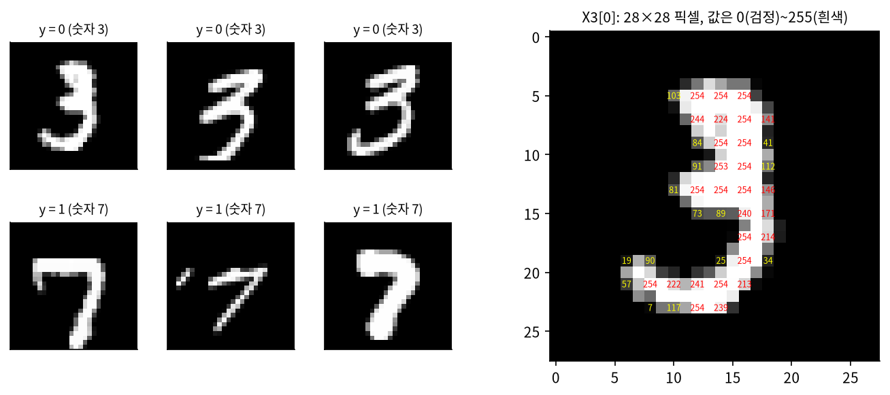
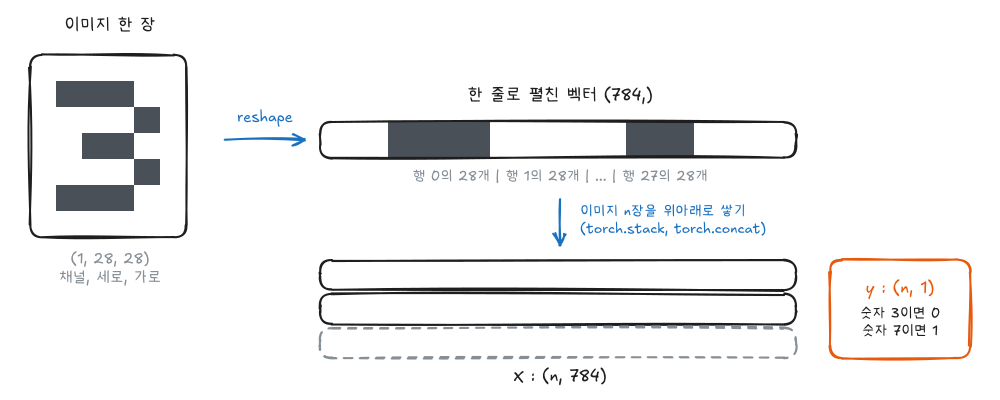
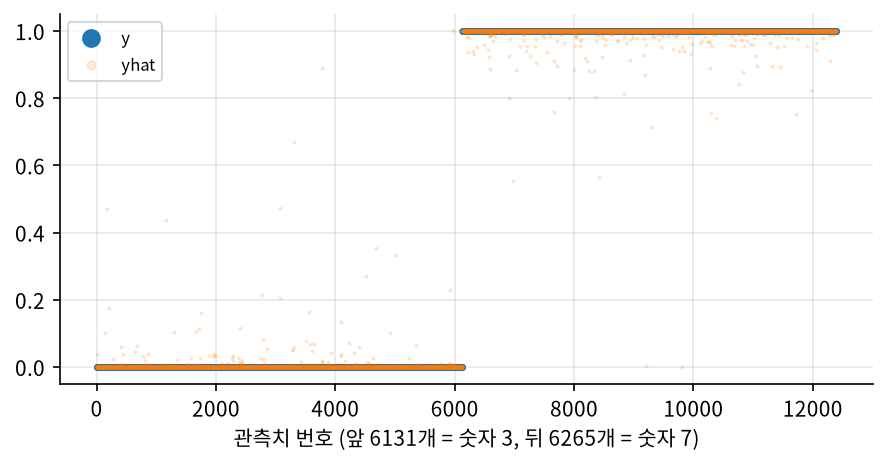
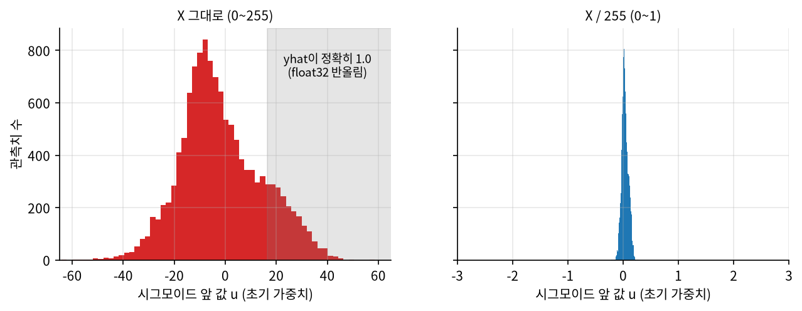
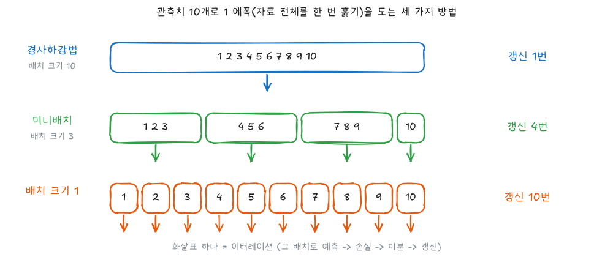
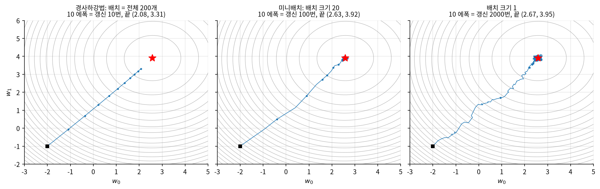
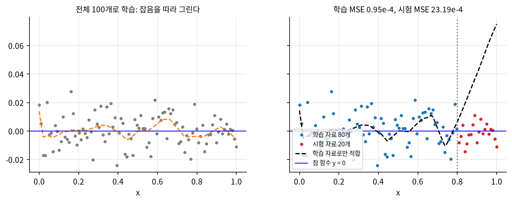
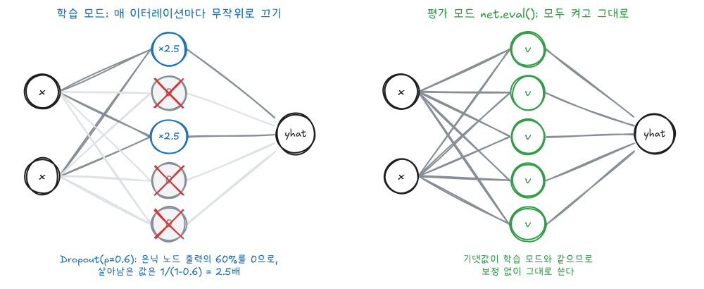
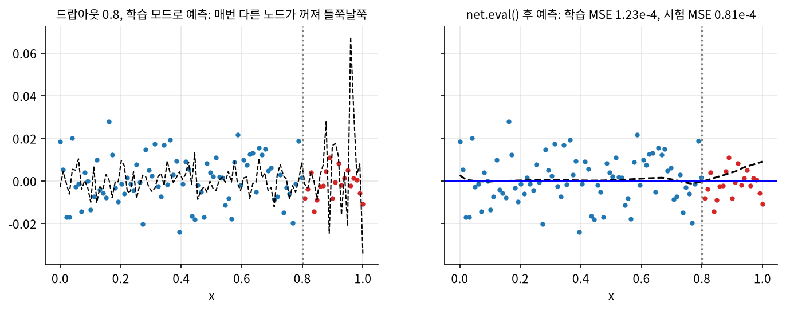

[앞 글](/posts/dl-04-dnn-universal)에서 "선형 → ReLU → 선형" 네트워크가 꺾은선을 넘어 어떤 연속함수든 근사할 수 있다는 것을 보았다. 그리고 그 정리가 말해 주지 않는 것으로 세 가지를 남겼다. 실제 크기의 자료를 다룰 수 있는가, 계산이 감당되는가, 학습 자료에만 맞고 새 자료에서는 틀리지 않는가.

이 글은 그 셋을 차례로 다룬다. 먼저 장난감 자료 대신 손글씨 숫자 이미지(MNIST)를 신경망에 넣는다. 이 과정에서 입력의 크기를 맞추지 않으면 학습이 통째로 무너지는 현상을 만난다. 다음으로 계산을 GPU로 옮기는 방법과, GPU 메모리에 자료가 다 들어가지 않을 때 쓰는 **미니배치** 학습을 본다. 마지막으로 표현력이 큰 네트워크가 잡음까지 외우는 **과적합**과, 그 대책인 **드랍아웃**을 본다.

## 1. 이미지를 텐서로 만들기

### MNIST 자료

MNIST는 0부터 9까지 손으로 쓴 숫자 이미지 7만 장을 모은 자료다. 한 장은 가로세로 28픽셀의 흑백 이미지다. 딥러닝의 "Hello, World"로 불릴 만큼 많이 쓰인다. 이 글에서는 숫자 3과 7만 골라 "이 이미지는 3인가 7인가"를 맞히는 이진 분류부터 시작한다. 앞 글까지와 같은 시그모이드 + BCE 틀을 그대로 쓸 수 있기 때문이다.

fastai의 `untar_data`가 자료를 내려받아 압축을 풀고 경로를 돌려준다.

```python
import torch, torchvision
from fastai.data.all import untar_data, URLs

path = untar_data(URLs.MNIST)
path.ls()                    # [training, testing] 두 폴더
(path/'training/3').ls()     # 숫자 3 이미지 파일 6131개의 경로
```

`path`는 단순한 문자열이 아니라 파이썬 `pathlib.Path` 객체다(fastai가 `.ls()` 기능을 덧붙였다). `path/'training'`처럼 `/` 연산자로 하위 경로를 만들 수 있어서 폴더 구조를 따라 내려가기 편하다. 폴더 구조는 `training/숫자/파일.png`, `testing/숫자/파일.png`다. 폴더 이름이 곧 정답(레이블)이다.

### 한 장 읽기

`torchvision.io.read_image`는 이미지 파일을 텐서로 읽는다.

```python
img = torchvision.io.read_image(str((path/'training/3').ls()[0]))
img.shape     # torch.Size([1, 28, 28])
img.dtype     # torch.uint8 (0~255 정수)
```

shape (1, 28, 28)은 (채널, 세로, 가로)다. 흑백이라 채널이 1개이고, 컬러 이미지라면 빨강·초록·파랑 세 채널이라 (3, 높이, 너비)가 된다. 각 원소는 픽셀의 밝기로, 0이 검정, 255가 흰색이다. `plt.imshow(img.reshape(28, 28), cmap='gray')`로 그리면 숫자가 보인다.



오른쪽 그림이 이미지의 실체다. 사람 눈에는 "3"이지만 컴퓨터에게는 784개의 숫자일 뿐이다. 획이 지나가는 픽셀은 254 같은 큰 값이고, 배경은 0이다.

### 펼치고 쌓기

지금까지 배운 네트워크는 (n, p) 모양의 입력, 즉 관측치마다 특징 $p$개가 한 줄로 놓인 자료만 받는다. (1, 28, 28) 모양을 그대로 다루는 방법(합성곱)은 7편에서 배운다. 여기서는 가장 단순하게 28 × 28 격자를 **한 줄로 펼쳐** 784개 특징을 가진 벡터로 본다.



```python
threes = (path/'training/3').ls()
sevens = (path/'training/7').ls()
X3 = torch.stack([torchvision.io.read_image(str(f)) for f in threes])   # (6131, 1, 28, 28)
X7 = torch.stack([torchvision.io.read_image(str(f)) for f in sevens])   # (6265, 1, 28, 28)

X = torch.concat([X3, X7]).reshape(-1, 1*28*28).float()    # (12396, 784)
y = torch.tensor([0.0]*len(X3) + [1.0]*len(X7)).reshape(-1, 1)   # (12396, 1)
```

- `torch.stack`은 같은 모양의 텐서 여러 개를 **새 축**을 만들며 쌓는다. (1, 28, 28) 6131개가 (6131, 1, 28, 28) 하나가 된다.
- `torch.concat`은 **기존 축**을 따라 잇는다. 3 묶음과 7 묶음을 첫 축으로 이어 (12396, 1, 28, 28)을 만든다.
- `reshape(-1, 784)`는 관측치 축은 그대로 두고 나머지를 한 줄로 편다. `-1`은 "나머지 크기에 맞춰 알아서 정하라"는 뜻이다. 행 0의 28픽셀, 행 1의 28픽셀, … 순서로 이어 붙는다.
- `.float()`은 정수(uint8)를 실수로 바꾼다. `Linear`의 가중치가 실수라서 곱하려면 자료형을 맞춰야 한다.
- 레이블은 앞 6131개가 3(y = 0), 뒤 6265개가 7(y = 1)이다.

펼치면서 잃는 것이 있다. 픽셀 (5, 10)과 (5, 11)이 옆자리라는 정보, 즉 **공간 구조**다. 네트워크 입장에서 784개 특징은 순서 없는 숫자 784개이고, 픽셀을 모든 이미지에서 같은 규칙으로 섞어 놓아도 학습 결과는 본질적으로 같다. 그래도 3과 7 구분에는 충분하다는 것을 곧 확인한다. 공간 구조를 살리는 방법이 7편의 CNN이다.

## 2. 숫자 3과 7 구분하기

네트워크는 앞 글의 틀 그대로다. 입력이 784개라는 것만 다르다.

$$
\underset{(n,784)}{\mathbf X} \overset{l_1}{\to} \underset{(n,30)}{\mathbf u^{(1)}} \overset{\text{relu}}{\to} \underset{(n,30)}{\mathbf v^{(1)}} \overset{l_2}{\to} \underset{(n,1)}{\mathbf u^{(2)}} \overset{\text{sig}}{\to} \underset{(n,1)}{\hat{\mathbf y}}
$$

```python
torch.manual_seed(43052)
net = torch.nn.Sequential(
    torch.nn.Linear(in_features=784, out_features=30),
    torch.nn.ReLU(),
    torch.nn.Linear(in_features=30, out_features=1),
    torch.nn.Sigmoid(),
)
loss_fn = torch.nn.BCELoss()
optimizr = torch.optim.Adam(net.parameters())

for epoc in range(200):
    yhat = net(X)
    loss = loss_fn(yhat, y)
    loss.backward()
    optimizr.step()
    optimizr.zero_grad()
```

첫 층 가중치만 $784 \times 30 = 23{,}520$개, 전체 파라미터는 23,581개다. 앞 글의 7개와 비교하면 큰 네트워크지만 코드는 똑같다.



| 에폭 | 1 | 10 | 50 | 200 |
|---|---|---|---|---|
| BCE | 18.76 | 0.657 | 0.227 | 0.0114 |
| 정확도 | 20.3% | 97.6% | 99.1% | 99.96% |

정확도(accuracy)는 예측 확률이 0.5보다 크면 7, 아니면 3으로 판정했을 때 맞힌 비율이다.

$$
\text{accuracy} = \frac1n\sum_{i=1}^n I(\tilde y_i = y_i), \qquad \tilde y_i = \begin{cases} 1 & \hat y_i > 0.5 \\ 0 & \hat y_i \le 0.5 \end{cases}
$$

코드로는 `((yhat > 0.5) == y).float().mean()` 한 줄이다. `yhat > 0.5`가 참/거짓 텐서를 만들고, `== y`가 정답과 비교한 참/거짓을 만들고, 평균을 내면 참의 비율이 된다.

학습 자료 12,396장에서 99.96%를 맞혔다. 학습에 쓰지 않은 `testing` 폴더의 3과 7(2,038장)에 적용해도 98.7%다. 픽셀을 한 줄로 편 단순한 네트워크로도 이 정도가 된다.

첫 에폭의 BCE가 18.76으로 유난히 크다는 점이 눈에 띈다. 앞 글들에서 학습 전 BCE는 1 근처였다. 이 숫자가 다음 절의 실마리다.

## 3. 입력의 크기를 맞추는 이유

### 숙제에서 생긴 일

강의 숙제는 같은 일을 숫자 0과 1로 해 보는 것이었다. 은닉 노드 64개, Adam(학습률 0.002), 200 에폭. 그리고 한 가지를 바꾸었다. `torch.nn.BCELoss()` 대신 BCE 식을 직접 썼다.

```python
loss_fn1 = torch.nn.BCELoss()
loss_fn2 = lambda yhat, y: -torch.mean(y*torch.log(yhat) + (1-y)*torch.log(1-yhat))
```

수학적으로는 같은 함수다. 그런데 결과가 전혀 다르다(숫자 0과 1, 학습 자료 12,665장).

| 입력 | 손실 | 200 에폭 후 손실 | 정확도 |
|---|---|---|---|
| X 그대로 (0~255) | `BCELoss()` | 0.117 | 99.88% |
| X 그대로 (0~255) | 직접 쓴 식 | nan | 46.8% |
| X / 255 (0~1) | `BCELoss()` | 0.0016 | 99.95% |
| X / 255 (0~1) | 직접 쓴 식 | 0.0016 | 99.95% |

직접 쓴 식에 0~255 입력을 넣으면 손실이 nan(not a number, 계산 불가)이 되고, 모든 예측이 nan이 된다. 정확도 46.8%는 nan을 0.5와 비교하면 항상 거짓이라 모두 0으로 판정되어, 숫자 0의 비율(5,923/12,665)만큼 맞힌 것이다. 학습이 완전히 실패했다.

### 원인 1: 시그모이드가 정확히 1이 된다

학습 전 네트워크(시드 9)로 원인을 추적해 보자. 전체 손실을 두 함수로 계산하면 `BCELoss()`는 22.49, 직접 쓴 식은 nan이다. 관측치를 하나씩 계산하면 범인이 나온다. 첫 번째 관측치는 숫자 0($y = 0$)인데 예측이 $\hat y = 1.0$이다. 0.9999가 아니라 정확히 1.0이다. 이 관측치의 손실은

$$
-\big(0 \cdot \log 1.0 + 1 \cdot \log(1 - 1.0)\big) = -\log 0 = \infty
$$

이다. 확신하며 틀릴 때 벌점이 무한대로 커지는 BCE의 성질(3편)이 실제로 무한대가 된 것이다.

왜 정확히 1.0이 나왔을까? 시그모이드 앞의 값을 보면 $u^{(2)} = 26.87$이다. $\sigma(26.87) = 1 - 2 \times 10^{-12}$인데, 파이토치가 기본으로 쓰는 32비트 실수(float32)는 1 근처에서 약 $6 \times 10^{-8}$보다 작은 차이를 표현하지 못한다. 그래서 $u$가 17 정도를 넘으면 $\sigma(u)$는 1.0으로 반올림된다.

그리고 $u^{(2)}$가 이렇게 큰 이유가 입력의 크기다. 픽셀값이 0~255이면 첫 층의 선형결합 $\sum_j w_j x_j$는 수백 개 항이 최대 255배로 더해져 큰 값이 되기 쉽다. 가중치 초기값은 입력이 대략 0~1 크기라고 가정하고 정해지기 때문에(`Linear(784, 64)`는 각 가중치를 $\pm 1/\sqrt{784} \approx \pm 0.036$ 범위에서 뽑는다) 입력이 255배 크면 출력도 255배 가까이 커진다.



입력을 그대로 쓰면 $u$가 −60부터 60까지 퍼지고, 관측치의 15%가 회색 영역($u > 17$)에 들어가 $\hat y$가 정확히 1.0이 된다. 그중 $y = 0$인 것은 손실이 무한대다. 입력을 255로 나누면 $u$는 0 근처(−0.06~0.15)에 모이고, 시그모이드 출력은 0.5 근처의 "아직 모르겠다"에서 출발한다. 같은 관측치의 $u^{(2)}$가 26.87에서 0.137로 바뀐다.

### 원인 2: 무한대가 nan으로 번진다

전체 손실이 inf가 아니라 nan인 이유도 있다. $y = 1$인데 $\hat y = 1.0$인 관측치에서는 정답을 맞혔는데도 식의 둘째 항이 $(1 - 1) \cdot \log(1 - 1.0) = 0 \times (-\infty)$가 된다. 이것은 수학적으로 정의되지 않아 nan이 나온다. 그리고 nan은 무엇과 더해도 nan이다. 손실이 nan이면 기울기도 nan이 되고, `optimizr.step()`이 nan을 가중치에 더하는 순간 모든 가중치가 nan이 되어 다시는 회복하지 못한다.

### BCELoss는 왜 버텼나

`torch.nn.BCELoss()`는 $\log$ 값이 $-100$보다 작아지지 않도록 잘라 낸다(clamp). 무한대 벌점 대신 100을 주는 것이다. 실제로 확신하며 틀린 관측치 하나에 `BCELoss()`를 적용하면 정확히 100이 나온다. 강의의 표현대로 "엄밀한 정의는 아니지만 $\infty = 100$으로 생각하는 것이 오히려 효율적"이다. 100은 충분히 큰 벌점이라 틀린 것을 고치는 방향은 유지되고, 계산은 망가지지 않는다. 2절의 3과 7 학습이 0~255 입력으로도 성공하고 첫 손실이 18.76이었던 것이 이 덕분이다. 확신하며 틀린 관측치들이 각각 100점씩 벌점을 받아 평균이 커졌다.

### 교훈

- **입력의 크기를 맞춘다.** 이미지는 255로 나누어 0~1로, 일반 자료는 평균 0, 표준편차 1로 표준화하는 것이 기본이다. 가중치 초기화와 학습률의 기본값이 모두 이 크기를 가정한다.
- **손실은 라이브러리 함수를 쓴다.** `BCELoss()`처럼 수치적으로 위험한 부분을 처리해 둔 경우가 많다. 더 나은 방법은 시그모이드와 BCE를 한 번에 계산하는 `BCEWithLogitsLoss()`인데, 7편에서 다룬다.
- **nan이 나오면 첫 번째 nan을 추적한다.** 대개 $\log 0$, $0/0$, $\infty - \infty$ 중 하나다.

## 4. GPU로 계산하기

### 장치(device)

지금까지 모든 계산은 CPU에서 했다. 파이토치 텐서와 네트워크는 각각 어느 장치의 메모리에 있는지 기억하고, 계산은 그 장치에서 일어난다. GPU로 옮기는 방법은 `.to()` 한 번이다.

```python
x_cpu = torch.tensor([0.0, 0.1, 0.2]).reshape(-1, 1)
net_cpu = torch.nn.Linear(1, 1)

x_gpu = x_cpu.to("cuda:0")                    # NVIDIA GPU 0번으로 복사
net_gpu = torch.nn.Linear(1, 1).to("cuda:0")  # 네트워크의 모든 파라미터를 GPU로
```

`"cuda:0"`은 NVIDIA GPU의 0번 장치다. 애플 실리콘 맥에서는 `"mps"`를 쓰고, 어느 쪽이든 쓸 수 있는 장치를 고르는 관용구가 `device = "cuda" if torch.cuda.is_available() else "cpu"`다. 옮긴 텐서를 출력하면 `device='cuda:0'`이 붙어 표시된다.

규칙은 하나다. **계산에 참여하는 텐서는 모두 같은 장치에 있어야 한다.** `net_cpu(x_gpu)`나 `net_gpu(x_cpu)`를 실행하면 "Expected all tensors to be on the same device" 오류가 난다. 손실 계산에서 `y`만 CPU에 남겨 둔 경우도 마찬가지다. GPU 학습에서 가장 흔한 오류이므로, 오류가 나면 각 텐서의 `.device`부터 확인한다.

### GPU가 빨라지는 조건

강의는 은닉 노드 수를 바꿔 가며 같은 학습(자료 100개, 1,000 에폭)의 시간을 쟀다. 강의노트의 측정값(NVIDIA GPU)과, 같은 코드를 이 글을 쓴 맥(M1 Pro, CPU 대 MPS)에서 잰 값을 함께 적는다.

| 은닉 노드 수 | 강의 CPU | 강의 GPU | 이 기기 CPU | 이 기기 MPS |
|---|---|---|---|---|
| 512 | 0.34초 | 0.52초 | 0.39초 | 0.62초 |
| 20,480 | 2.64초 | 0.52초 | 2.62초 | 1.49초 |
| 204,800 | 59.7초 | 1.40초 | 21.6초 | 13.8초 |

네트워크가 작으면 오히려 CPU가 빠르다. 강의의 설명은 이렇다. CPU는 **적지만 똑똑한** 코어를 가지고 있고, GPU는 **단순하지만 수천 개**의 코어를 가지고 있다. 큰 행렬곱은 서로 독립인 곱셈과 덧셈 수백만 개로 쪼갤 수 있어서 코어 수가 많은 GPU가 압도적으로 유리하다. 반면 계산이 작으면 GPU에 일을 넘기고 결과를 받는 고정 비용이 계산 자체보다 커진다. 강의 GPU의 시간이 512에서 20,480까지 거의 그대로인 것은 그 구간에서 실제 계산이 아니라 고정 비용이 시간을 정한다는 뜻이다.

맥의 MPS는 차이가 덜 극적이다. 맥은 CPU와 GPU가 메모리를 공유하고, 애플 CPU 자체도 행렬 연산 가속기를 갖고 있어서 CPU 쪽 시간이 강의보다 짧다. 딥러닝 전용 NVIDIA GPU와 직접 비교할 수는 없지만, "작으면 CPU, 크면 GPU"라는 경향은 같다.

## 5. 미니배치: 자료를 나누어 학습하기

### GPU 메모리에 다 들어가지 않는다면

GPU를 쓰려면 자료와 네트워크를 GPU 메모리에 올려야 한다. 그런데 GPU 메모리는 많아야 수십 GB다. 자료가 그보다 크면 `X.to("cuda:0")`부터 실패한다. 이미지 수백만 장, 문장 수억 개는 흔한 크기다.

강의는 여기서 질문을 던진다. 경사를 계산하는 데 자료 전체가 꼭 필요할까? $y = 2x + \varepsilon$에서 뽑은 10만 개 점과, 그중 100개마다 하나씩 뽑은 1,000개 점을 그려 보면 둘 다 기울기 2인 직선을 똑같이 잘 보여 준다. 일부만 보고 계산한 기울기도 방향은 대체로 맞다.

그렇다면 이런 알고리즘이 가능하다. 자료를 반으로 나누어 짝수 번째 관측치만 GPU에 올려 예측·손실·미분·갱신을 한 번 하고, 내린 뒤 홀수 번째를 올려 다시 한 번 하고, 이를 반복한다. GPU에는 항상 자료의 절반만 올라가 있다. 이것을 일반화한 것이 미니배치 학습이다.

### 세 가지 방법

관측치가 10개라고 하자. 기울기를 계산할 때 몇 개를 쓰느냐에 따라 세 가지 방법이 있다.



1. **전체를 쓴다.** 손실 $\sum_{i=1}^{10}(y_i - \hat y_i)^2$로 기울기를 계산하고 한 번 갱신한다. 1 에폭에 갱신 1번. 지금까지 해 온 방식이다.
2. **하나씩 쓴다.** $(y_1 - \hat y_1)^2$로 갱신, $(y_2 - \hat y_2)^2$로 갱신, …, $(y_{10} - \hat y_{10})^2$로 갱신. 1 에폭에 갱신 10번.
3. **$m$개씩 쓴다.** $m = 3$이면 1~3번, 4~6번, 7~9번, 10번 관측치로 각각 갱신. 1 에폭에 갱신 4번. 마지막 묶음은 남은 1개뿐이다.

용어는 시대에 따라 조금 다르게 쓰였다.

| 방법 | 예전 용어 | 요즘 용어 |
|---|---|---|
| 1. 전체 | (배치) 경사하강법 | 경사하강법 (gradient descent) |
| 2. 하나씩 | 확률적 경사하강법 (SGD) | 배치 크기 1인 SGD |
| 3. $m$개씩 | 미니배치 경사하강법 | 확률적 경사하강법 (SGD) |

요즘 "SGD"라고 하면 보통 3번을 뜻한다. 파이토치의 `torch.optim.SGD`라는 이름도 이 관례를 따른다. 사실 `SGD` 옵티마이저 자체는 받은 기울기로 한 걸음 가는 일만 하고, 그 기울기를 자료 전체로 계산했는지 일부로 계산했는지는 학습 코드가 정한다. 이 글에서는 혼동을 피하려고 "미니배치"라고 쓴다. 이때 나오는 단어 셋을 정리하면 다음과 같다.

| 용어 | 뜻 | 10개를 3개씩 나누면 |
|---|---|---|
| 배치(batch), 미니배치 | 한 번의 갱신에 쓰는 관측치 묶음 | (1,2,3), (4,5,6), (7,8,9), (10) |
| 배치 크기(batch size) | 묶음 하나의 관측치 수 | 3 |
| 이터레이션(iteration) | 배치 하나로 예측 → 손실 → 미분 → 갱신을 한 번 하는 것 | 1 에폭에 4번 |
| 에폭(epoch) | 모든 관측치를 한 번씩 다 쓰는 것 | 이터레이션 4번 |

### 왜 일부만 써도 되는가

미니배치로 계산한 기울기는 전체 기울기의 **불편추정량**이다. 전체 손실이 관측치별 손실의 평균 $L(\mathbf w) = \frac1n \sum_i \ell_i(\mathbf w)$이고, 배치 $B$를 무작위로 뽑으면

$$
E\left[\frac{1}{|B|}\sum_{i \in B} \nabla \ell_i(\mathbf w)\right] = \frac1n \sum_{i=1}^n \nabla \ell_i(\mathbf w) = \nabla L(\mathbf w)
$$

이다. 평균적으로는 맞는 방향이고, 배치마다 잡음이 섞일 뿐이다. 표본평균이 모평균의 불편추정량인 것과 같은 이야기다. 배치가 클수록 잡음(분산)이 줄어 전체 기울기에 가까워지고, 작을수록 한 번의 계산이 싸지는 대신 방향이 흔들린다.

단순회귀에서 세 방법의 경로를 그려 보면 이 차이가 보인다. 같은 출발점(검은 네모)에서 10 에폭씩 학습했다.



- **경사하강법 (왼쪽).** 경로가 매끄럽고 곧다. 하지만 10 에폭이면 갱신이 10번뿐이라 아직 최소점(빨간 별)에 못 미쳤다.
- **배치 크기 20 (가운데).** 같은 10 에폭 동안 갱신을 100번 한다. 경로가 약간 흔들리지만 최소점에 도착했다.
- **배치 크기 1 (오른쪽).** 갱신 2,000번. 관측치 하나가 정하는 방향은 잡음이 커서 경로가 지그재그다. 이 그림에서는 학습률을 0.01로 낮췄는데(나머지는 0.1), 같은 학습률이면 너무 크게 흔들리기 때문이다. 최소점에 도착한 뒤에도 가만히 있지 못하고 주변을 맴돈다.

미니배치는 둘 사이의 타협이다. 같은 양의 자료를 보는 동안(같은 에폭) 경사하강법보다 훨씬 많이 갱신하고, 배치 크기 1보다는 덜 흔들린다. 그리고 한 번에 배치 하나만 GPU에 올리면 되므로 메모리 문제도 해결된다. 배치 안의 관측치들은 행렬곱 한 번으로 동시에 계산되므로 GPU의 병렬성도 살릴 수 있다. 실무에서 배치 크기는 보통 32~512 사이에서 GPU 메모리가 허락하는 만큼 정한다.

### Dataset과 DataLoader

자료를 배치로 나누는 일은 파이토치의 두 도구가 맡는다.

```python
x = torch.tensor(range(10)).float()
y = torch.tensor([1.0]*5 + [0.0]*5)

ds = torch.utils.data.TensorDataset(x, y)
dl = torch.utils.data.DataLoader(ds, batch_size=3)

for xx, yy in dl:
    print(xx, yy)
```

```text
tensor([0., 1., 2.]) tensor([1., 1., 1.])
tensor([3., 4., 5.]) tensor([1., 1., 0.])
tensor([6., 7., 8.]) tensor([0., 0., 0.])
tensor([9.]) tensor([0.])
```

- `TensorDataset(x, y)`는 $x$와 $y$를 관측치 단위로 짝지어 묶는다. `ds[3]`은 `(x[3], y[3])`이다. 이렇게 "i번째 관측치를 달라"에 답할 수 있는 객체를 데이터셋(Dataset)이라고 한다.
- `DataLoader(ds, batch_size=3)`은 데이터셋에서 3개씩 꺼내 쌓아 주는 반복자다. `for` 문에 넣으면 배치를 하나씩 내놓고, 다 내놓으면 끝난다. 즉 `for` 한 바퀴가 1 에폭이다.
- `shuffle=True`를 주면 에폭마다 순서를 섞는다. 위 예에서 섞으면 (6, 7, 1), (4, 2, 0), (9, 8, 3), (5)처럼 나온다. 자료가 3 다음에 7 순서로 정렬되어 있으면, 섞지 않은 배치는 앞쪽이 모두 3, 뒤쪽이 모두 7이 되어 배치 기울기가 한쪽으로 치우친다. 학습할 때는 섞는 것이 기본이다.

1편에서 본 fastai의 `dls`(DataLoaders)도 이 `DataLoader` 위에 만들어진 것이다.

### MNIST를 미니배치로

숫자 0과 1 자료(12,665장, 255로 나눈 것)를 배치 크기 2,048로 학습해 보자. $12665 / 2048 = 6.18$이므로 1 에폭은 배치 7개(2,048개짜리 6개 + 377개짜리 1개)다.

```python
ds = torch.utils.data.TensorDataset(X, y)
dl = torch.utils.data.DataLoader(ds, batch_size=2048)

for epoc in range(10):
    for xx, yy in dl:              # 1 에폭 = 이터레이션 7번
        # GPU를 쓴다면 여기서 xx, yy = xx.to(device), yy.to(device)
        loss = loss_fn(net(xx), yy)
        loss.backward()
        optimizr.step()
        optimizr.zero_grad()
```

학습 코드는 `for` 문이 한 겹 늘어난 것뿐이다. 바깥은 에폭, 안쪽은 이터레이션이다. GPU를 쓴다면 네트워크는 처음에 한 번 GPU로 옮겨 두고, 배치는 `for` 문 안에서 그때그때 옮긴다. GPU에는 한 번에 배치 하나만 올라간다.

같은 네트워크(은닉 노드 32개, Adam)를 두 방식으로 학습한 결과다.

| 방식 | 에폭 | 갱신 횟수 | 학습 자료 BCE | 정확도 |
|---|---|---|---|---|
| 전체 (경사하강법) | 10 | 10 | 0.359 | |
| 전체 (경사하강법) | 70 | 70 | 0.019 | 99.81% |
| 미니배치 (2,048) | 10 | 70 | 0.067 | 99.50% |

두 방향으로 비교할 수 있다.

- **같은 에폭(같은 계산량)으로 보면** 미니배치가 훨씬 낫다. 자료를 10번 훑는 동안 전체 방식은 10번, 미니배치는 70번 갱신했다. BCE가 0.359 대 0.067이다.
- **같은 갱신 횟수로 보면** 전체 방식이 조금 낫다. 70번 갱신 후 0.019 대 0.067이다. 전체로 계산한 기울기가 더 정확하기 때문이다. 하지만 전체 방식의 갱신 한 번은 미니배치 갱신 7번만큼 계산한다.

실제 문제에서 한정된 것은 계산 시간과 메모리이므로, 미니배치가 표준이 되었다.

## 6. 과적합

### 잡음까지 외우는 네트워크

앞 글에서 은닉 노드를 많이 두면 네트워크가 거의 무엇이든 맞출 수 있다는 것을 보았다. 그런데 "무엇이든"에는 맞추지 말아야 할 것도 들어 있다. 자료를 다음처럼 만들어 보자.

$$
y_i = 0 \times x_i + \varepsilon_i, \qquad \varepsilon_i \sim N(0, 0.01^2), \quad i = 1, \dots, 100
$$

$y$는 순수한 잡음이다. $x$와 아무 관계가 없으므로 최선의 예측은 $\hat y = 0$이다. 여기에 은닉 노드 512개짜리 네트워크(`Linear(1, 512)` → `ReLU` → `Linear(512, 1)`)를 1,000 에폭 학습시킨다.



왼쪽 그림의 주황 점선은 0 근처의 평평한 선이 아니라 점들을 따라 오르내린다. 네트워크가 잡음의 우연한 패턴을 "규칙"으로 학습한 것이다.

강의의 정의를 빌리면, 자료를 "자료 = 참 관계(underlying) + 오차"로 볼 때 우리가 적합해야 할 것은 참 관계인데, **오차항까지 적합하는 현상**이 과적합(overfitting)이다. 통계학의 언어로는 분산이 너무 큰 추정량이다. 자료가 조금만 달라져도 적합선이 크게 바뀐다.

### 학습 자료와 시험 자료로 나누어 확인하기

과적합의 증거는 **학습에 쓰지 않은 자료**에서 드러난다. 앞 80개(학습 자료)로만 학습하고, 뒤 20개(시험 자료)로 성능을 잰다.

```python
xtr, ytr = x[:80], y[:80]      # 학습 자료
xtest, ytest = x[80:], y[80:]  # 시험 자료: 학습 중에는 절대 보지 않는다

for epoc in range(1000):
    loss = loss_fn(net(xtr), ytr)
    loss.backward()
    optimizr.step()
    optimizr.zero_grad()
```

오른쪽 그림이 결과다. 학습 구간($x < 0.8$)에서는 점을 그럴듯하게 따라가지만, 시험 구간에서는 위로 크게 벗어난다.

| | 학습 MSE | 시험 MSE |
|---|---|---|
| 네트워크 (512 노드) | $0.95 \times 10^{-4}$ | $23.19 \times 10^{-4}$ |
| 항상 0으로 예측 | $1.28 \times 10^{-4}$ | $0.43 \times 10^{-4}$ |

네트워크는 학습 자료에서는 "항상 0"보다 잘 맞추지만, 시험 자료에서는 50배 넘게 틀린다. 학습 자료의 잡음을 외웠을 뿐 일반화할 규칙은 배우지 못했다. 이렇게 **학습 오차는 작은데 시험 오차가 큰 것**이 과적합의 전형적인 증상이다. 학습 손실만 보면 과적합을 알아챌 수 없다. 그래서 1편의 fastai도 자료를 학습용과 검증용으로 나누어 두 손실을 따로 보여 주었다.

## 7. 드랍아웃

### 드랍아웃 층이 하는 일

과적합 대책은 여러 가지(자료 늘리기, 네트워크 줄이기, 가중치에 벌점 주기, 일찍 멈추기 등)가 있는데, 강의가 소개하는 것은 신경망에 특화된 **드랍아웃**(dropout)이다. 층 하나를 끼워 넣기만 하면 된다.

```python
torch.manual_seed(43052)
d = torch.nn.Dropout(p=0.5)
x = torch.arange(1., 11.)    # [1, 2, ..., 10]
d(x)   # tensor([ 0.,  4.,  0.,  8.,  0.,  0., 14.,  0., 18.,  0.])
d(x)   # tensor([ 0.,  0.,  6.,  8.,  0., 12.,  0., 16.,  0., 20.])
```

`Dropout(p)`는 두 가지 일을 한다.

1. 입력의 각 원소를 확률 $p$로 **0으로 만든다.** 어느 원소가 꺼질지는 호출할 때마다 새로 뽑는다. 위에서 같은 입력에 두 번 적용했더니 꺼진 위치가 다르다.
2. 살아남은 원소를 $\frac{1}{1-p}$배 **키운다.** $p = 0.5$면 2배다(위에서 2가 4로, 7이 14로). 이렇게 하면 출력의 기댓값이 입력과 같다: $E[\text{출력}] = (1-p) \cdot \frac{x}{1-p} + p \cdot 0 = x$.

네트워크에서는 보통 은닉층의 활성화 뒤에 둔다. 그러면 매 이터레이션마다 은닉 노드의 일부가 무작위로 꺼진 상태로 예측과 갱신이 일어난다.



### 학습 모드와 평가 모드

드랍아웃은 학습할 때만 켜야 한다. 예측할 때까지 노드를 무작위로 끄면 같은 입력에 매번 다른 답이 나온다. 파이토치 네트워크에는 이를 위한 스위치가 있다.

```python
net.training   # True: 학습 모드 (기본값)
net.eval()     # 평가 모드로 전환 -> Dropout이 아무것도 하지 않음
net.train()    # 다시 학습 모드로
```

평가 모드의 드랍아웃은 입력을 그대로 내보낸다. 학습 중에 살아남은 값을 $\frac{1}{1-p}$배 해 두었기 때문에, 평가 때 모든 노드를 켜도 기댓값이 맞아서 따로 보정할 필요가 없다. 위 예의 `d.eval()` 뒤에 `d(x)`를 하면 `[1, 2, ..., 10]`이 그대로 나온다.

### 결과

6절의 과적합 실험에서 ReLU 뒤에 `Dropout(0.8)`을 넣고 같은 조건으로 학습했다.

```python
net = torch.nn.Sequential(
    torch.nn.Linear(1, 512),
    torch.nn.ReLU(),
    torch.nn.Dropout(0.8),     # 은닉 노드 512개 중 매번 80%를 끈다
    torch.nn.Linear(512, 1),
)
```



왼쪽은 학습이 끝난 뒤 `net.eval()`을 잊고 예측한 것이다. 예측할 때마다 다른 노드가 꺼지므로 선이 잡음처럼 들쭉날쭉하다. 흔한 실수다. 오른쪽은 `net.eval()` 후의 예측이다.

| | 학습 MSE | 시험 MSE |
|---|---|---|
| 드랍아웃 없음 | $0.95 \times 10^{-4}$ | $23.19 \times 10^{-4}$ |
| `Dropout(0.8)`, 평가 모드 | $1.23 \times 10^{-4}$ | $0.81 \times 10^{-4}$ |

학습 MSE는 조금 나빠졌지만(잡음을 덜 외웠다), 시험 MSE는 30분의 1로 줄었다. 적합선이 거의 평평해져서 "규칙이 없다"는 사실에 가까워졌다.

### 왜 효과가 있는가

강의는 직관을 이렇게 설명한다. 매 이터레이션마다 학습에 참여하는 노드가 무작위로 바뀌므로, **모든 노드가 골고루 학습**된다. 특정 노드 몇 개가 특정 관측치를 외우는 역할을 맡기 어렵고, 한두 노드의 특화된 능력보다 전체의 평균적인 능력이 좋아진다.

조금 더 풀어 보면 두 가지 관점이 있다.

- **공모 방지.** 드랍아웃이 없으면 노드들이 서로의 출력에 맞춰 함께 움직이며 잡음 패턴을 정교하게 만들 수 있다. 노드 A가 만든 출렁임을 노드 B가 미세 조정하는 식이다. 짝이 언제 꺼질지 모르면 이런 공모가 불가능하고, 각 노드는 혼자서도 쓸모 있는, 즉 자료 전반에 통하는 특징을 배워야 한다.
- **앙상블.** 매 이터레이션은 노드 일부를 지운 서로 다른 작은 네트워크를 학습하는 셈이다. 노드 512개면 그런 부분 네트워크가 $2^{512}$가지다. 평가 모드에서 모든 노드를 켜고 쓰는 것은 이 수많은 네트워크의 예측을 근사적으로 평균 내는 효과가 있다. 여러 모형의 평균이 개별 모형보다 분산이 작은 것은 통계학의 배깅과 같은 원리다.

이 예의 $p = 0.8$은 강한 편이다. 실무에서는 은닉층에 0.2~0.5 정도를 많이 쓴다. 드랍아웃이 강할수록 과적합은 줄지만 학습이 느려지고, 너무 강하면 참 관계까지 학습하지 못한다(과소적합).

## 정리

| 주제 | 핵심 |
|---|---|
| 이미지 입력 | (1, 28, 28) 픽셀 텐서를 `reshape(-1, 784)`로 펼쳐 (n, 784) 행렬로. 공간 구조는 잃는다 |
| 입력 크기 | 0~255를 그대로 넣으면 $u$가 커져 $\hat y$가 정확히 0이나 1이 되고, $\log 0$으로 손실이 무한대·nan이 된다. 255로 나눈다 |
| `BCELoss()` | $\log$를 −100에서 잘라 무한대 대신 100의 벌점. 직접 쓴 식보다 안전하다 |
| GPU | `.to(device)`로 텐서와 네트워크를 옮긴다. 계산에 참여하는 텐서는 모두 같은 장치에. 계산이 클 때만 빠르다 |
| 미니배치 | 배치 기울기는 전체 기울기의 불편추정량. 같은 계산량으로 더 많이 갱신하고, 메모리 문제도 해결 |
| 용어 | 배치 = 한 번 갱신에 쓰는 묶음, 이터레이션 = 갱신 한 번, 에폭 = 자료 전체 한 바퀴 |
| `DataLoader` | 배치로 나누고 섞어 주는 반복자. `for` 한 바퀴가 1 에폭 |
| 과적합 | 오차까지 적합하는 현상. 학습 오차는 작은데 시험 오차가 크다 |
| 드랍아웃 | 학습 중 노드를 확률 $p$로 끄고 나머지를 $1/(1-p)$배. 예측 전 `net.eval()` |

학습 코드의 틀은 이제 다음과 같다.

```python
net = net.to(device)
for epoc in range(n_epochs):
    net.train()
    for xx, yy in dl:                          # 미니배치
        xx, yy = xx.to(device), yy.to(device)  # 배치만 GPU로
        loss = loss_fn(net(xx), yy)
        loss.backward()
        optimizr.step()
        optimizr.zero_grad()
net.eval()                                     # 예측 전에 평가 모드로
```

지금까지 `loss.backward()`가 기울기를 계산해 준다는 것을 믿고 썼다. 층이 깊어질수록 그 기울기가 어떻게 계산되는지 알아야 설명되는 현상들이 생긴다. 앞 글의 "왜 ReLU를 쓰나"가 그 예다. 다음 글에서는 역전파가 체인룰을 어떻게 계산하는지 손으로 따라가고, 기울기가 층을 거치며 사라지는 기울기 소멸 문제를 본다.

## 참고자료

- 최규빈, 「딥러닝」 강의노트 (2022), 06wk-1 · 06wk-2 · 07wk-1: 딥러닝의 기초 (6)–(8), <https://guebin.github.io/DL2022/>
- LeCun, Y., Bottou, L., Bengio, Y. and Haffner, P. (1998). Gradient-based learning applied to document recognition. *Proceedings of the IEEE*, 86(11), 2278–2324.
- Srivastava, N., Hinton, G., Krizhevsky, A., Sutskever, I. and Salakhutdinov, R. (2014). Dropout: A simple way to prevent neural networks from overfitting. *Journal of Machine Learning Research*, 15, 1929–1958.
- Goodfellow, I., Bengio, Y. and Courville, A. (2016). *Deep Learning*, Sections 7.12 (Dropout), 8.1.3 (Batch and Minibatch Algorithms), Algorithm 8.1. MIT Press.
- PyTorch 문서, `torch.utils.data` · `torch.nn.BCELoss` · `torch.nn.Dropout`, <https://pytorch.org/docs/stable/>
