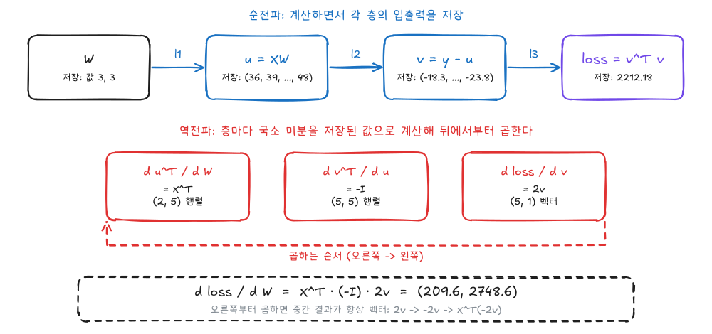
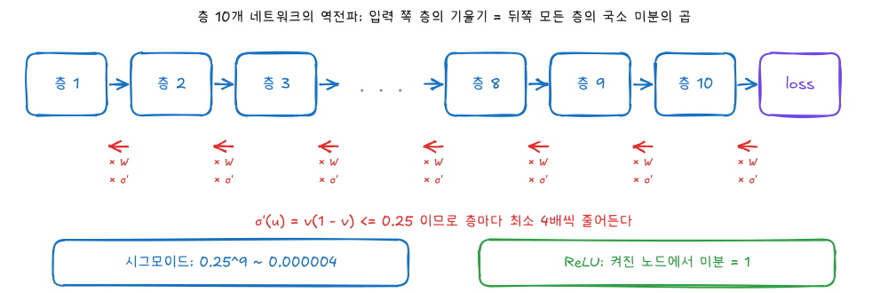
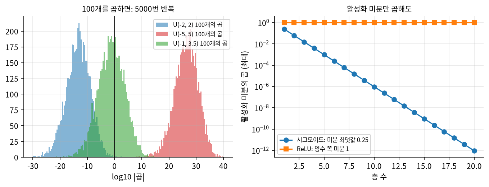
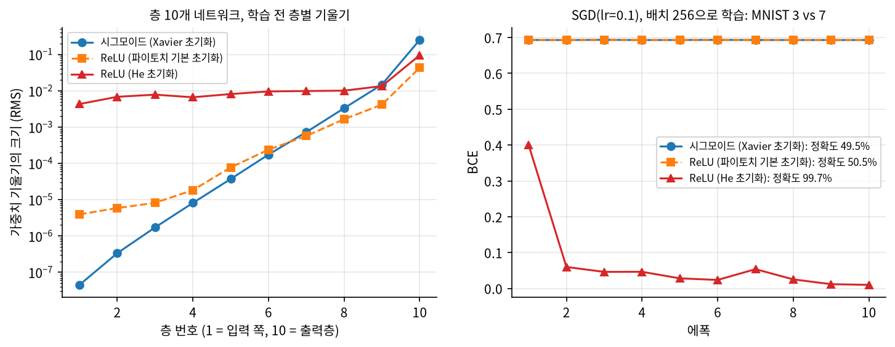

지금까지 학습 코드의 step 3은 언제나 `loss.backward()` 한 줄이었다. [2편](/posts/dl-02-regression-gd)에서 이 한 줄이 계산 기록을 거꾸로 따라가며 체인룰로 기울기를 구한다고만 짧게 말하고 넘어갔다. 층이 한두 개일 때는 그 정도로 충분했다. 그런데 [4편](/posts/dl-04-dnn-universal)의 "요즘은 왜 시그모이드 대신 ReLU를 쓰나"라는 질문에 답하려면 그 안을 들여다봐야 한다.

이 글은 두 부분이다. 앞부분에서는 기울기가 실제로 어떻게 계산되는지, 즉 **역전파**(backpropagation)를 손으로 따라간다. 벡터로 미분하는 법을 정리하고, 체인룰로 미분을 층별로 쪼개고, 그것을 계산 순서로 정리하면 역전파가 된다는 것을 본다. 뒷부분에서는 그 계산 방식 때문에 생기는 문제, **기울기 소멸**(vanishing gradient)을 본다. 역전파는 층별 미분을 곱하는 것이고, 작은 수를 여러 번 곱하면 0이 된다. 이 단순한 사실이 깊은 네트워크를 오랫동안 학습시키지 못하게 막았다.

## 1. 벡터로 미분하기

### 손실을 펼쳐서 미분하기

출발점은 2편의 회귀다. $\mathbf X$는 (n, 2) 설계행렬(첫 열이 1), $\mathbf W$는 (2, 1) 가중치, 손실은 SSE다.

$$
\text{loss} = (\mathbf y - \mathbf X\mathbf W)^\top(\mathbf y - \mathbf X\mathbf W)
$$

이걸 $\mathbf W$로 미분하는 첫 번째 방법은 식을 펼치는 것이다.

$$
\text{loss} = \mathbf y^\top\mathbf y - \mathbf y^\top\mathbf X\mathbf W - \mathbf W^\top\mathbf X^\top\mathbf y + \mathbf W^\top\mathbf X^\top\mathbf X\mathbf W
$$

각 항을 미분하려면 벡터 미분 공식이 필요하다. 여기서 $\frac{\partial}{\partial \mathbf W}(\text{스칼라})$는 스칼라를 $\mathbf W$의 각 원소로 편미분한 값을 $\mathbf W$와 같은 모양(세로 벡터)으로 늘어놓은 것으로 정의한다. 이렇게 정의하면 경사하강법 $\mathbf W \leftarrow \mathbf W - \alpha \frac{\partial}{\partial \mathbf W}\text{loss}$를 그대로 쓸 수 있다.

| 식 (스칼라) | $\mathbf W$로 미분 | 비고 |
|---|---|---|
| $\mathbf a^\top\mathbf W$ 또는 $\mathbf W^\top\mathbf a$ | $\mathbf a$ | 1차식: 계수 벡터가 나온다 |
| $\mathbf W^\top\mathbf A\mathbf W$ | $(\mathbf A + \mathbf A^\top)\mathbf W$ | $\mathbf A$가 대칭이면 $2\mathbf A\mathbf W$ |
| $\mathbf W^\top\mathbf W$ | $2\mathbf W$ | $\mathbf A = \mathbf I$인 경우 |

스칼라 미분 $\frac{d}{dw}(aw) = a$, $\frac{d}{dw}(aw^2) = 2aw$와 모양이 같다. 둘째 항 $\mathbf y^\top\mathbf X\mathbf W$는 $\mathbf a = \mathbf X^\top\mathbf y$인 1차식이고, 셋째 항도 같은 값이다(스칼라는 전치해도 같다). 넷째 항은 $\mathbf A = \mathbf X^\top\mathbf X$(대칭)인 2차식이다. 따라서

$$
\frac{\partial}{\partial \mathbf W}\text{loss} = -2\mathbf X^\top\mathbf y + 2\mathbf X^\top\mathbf X\mathbf W
$$

이다. 이 식을 0으로 놓으면 정규방정식 $\mathbf X^\top\mathbf X\mathbf W = \mathbf X^\top\mathbf y$가 나온다.

이 방법은 회귀에서는 잘 통하지만, 네트워크가 `Linear` → `ReLU` → `Linear` → `Sigmoid`처럼 길어지면 식을 펼치는 것 자체가 불가능해진다. 다른 방법이 필요하다.

## 2. 체인룰: 어려운 미분 하나를 쉬운 미분 여러 개로

### 손실을 단계로 쪼개기

두 번째 방법은 손실이 계산되는 과정을 단계로 나누는 것이다. 손실은 사실 다음 변환을 차례로 거쳐 나온다.

$$
\mathbf W \overset{l_1}{\to} \mathbf u = \mathbf X\mathbf W \overset{l_2}{\to} \mathbf v = \mathbf y - \mathbf u \overset{l_3}{\to} \text{loss} = \mathbf v^\top\mathbf v
$$

$\mathbf u$와 $\mathbf v$는 둘 다 (n, 1)이다. $\frac{\partial}{\partial \mathbf W}\mathbf v^\top\mathbf v$를 한 번에 구하기는 어렵지만, 단계별 미분은 각각 쉽다.

| 단계별 미분 | 값 | 모양 |
|---|---|---|
| $\frac{\partial}{\partial \mathbf v}\text{loss} = \frac{\partial}{\partial \mathbf v}\mathbf v^\top\mathbf v$ | $2\mathbf v$ | (n, 1) |
| $\frac{\partial}{\partial \mathbf u}\mathbf v^\top$ | $-\mathbf I$ | (n, n) |
| $\frac{\partial}{\partial \mathbf W}\mathbf u^\top$ | $\mathbf X^\top$ | (2, n) |

둘째와 셋째 줄은 벡터를 벡터로 미분한 것이다. $\frac{\partial}{\partial \mathbf u}\mathbf v^\top$는 $\mathbf v^\top = (v_1, \dots, v_n)$의 각 원소를 $\mathbf u$로 미분한 세로 벡터 $n$개를 옆으로 늘어놓은 행렬이다. $v_j = y_j - u_j$는 $u_j$에만 의존하고 그 미분이 $-1$이므로, 대각선이 $-1$이고 나머지가 0인 $-\mathbf I$가 된다. 마찬가지로 $u_j = \mathbf x_j^\top\mathbf W$를 $\mathbf W$로 미분하면 $\mathbf x_j$($\mathbf X$의 $j$번째 행을 세운 것)이고, 이것을 $j = 1, \dots, n$에 대해 늘어놓으면 $\mathbf X^\top$이다.

### 곱하면 원래 미분이 된다

이제 강의의 질문이다. 세 미분을 곱하면 원래 원하던 미분이 될까?

$$
\frac{\partial \mathbf u^\top}{\partial \mathbf W}\,\frac{\partial \mathbf v^\top}{\partial \mathbf u}\,\frac{\partial\,\text{loss}}{\partial \mathbf v} \overset{?}{=} \frac{\partial\,\text{loss}}{\partial \mathbf W}
$$

분수처럼 약분하는 것은 "선을 넘는" 일이지만, 이것이 성립한다는 정리가 있다. 그것이 다변수 **체인룰**(연쇄법칙)이다. 스칼라에서 $\frac{dz}{dx} = \frac{dz}{dy}\frac{dy}{dx}$였던 것의 벡터판이다. 순서가 스칼라 때와 거꾸로(입력 쪽 미분이 왼쪽) 적힌 것은 위에서 미분 결과를 세로로 세우기로 약속했기 때문이다. 모양을 확인하면 (2, n) × (n, n) × (n, 1) = (2, 1)로 $\mathbf W$와 같다.

계산해 보면

$$
\frac{\partial}{\partial \mathbf W}\text{loss} = \mathbf X^\top(-\mathbf I)(2\mathbf v) = -2\mathbf X^\top(\mathbf y - \mathbf X\mathbf W) = -2\mathbf X^\top\mathbf y + 2\mathbf X^\top\mathbf X\mathbf W
$$

로 1절의 결과와 정확히 같다. 식을 펼치지 않고, 쉬운 미분 세 개의 곱으로 얻었다.

### 숫자로 확인하기

강의는 2021년 빅데이터분석 중간고사 문제로 확인한다. 관측치 5개, $\hat{\mathbf W} = (3, 3)$에서의 미분값을 구하는 문제다.

```python
X = torch.vstack([torch.ones(5), torch.tensor([11., 12., 13., 14., 15.])]).T   # (5, 2)
y = torch.tensor([17.7, 18.5, 21.2, 23.6, 24.2])
W = torch.tensor([3.0, 3.0])

u = X @ W        # (36, 39, 42, 45, 48)
v = y - u        # (-18.3, -20.5, -20.8, -21.4, -23.8)
loss = v @ v     # 2212.18

X.T @ -torch.eye(5) @ (2*v)   # tensor([ 209.6000, 2748.6001])
```

`requires_grad=True`로 두고 `loss.backward()`를 부르면 `W.grad`에 똑같이 `(209.6, 2748.6)`이 나온다. 단계별 미분도 각각 확인할 수 있다. 파이토치의 `backward()`는 스칼라에 대해서만 부를 수 있어서, 강의는 $v_1, \dots, v_5$ 각각에 대해 `backward()`를 불러 결과를 행렬의 열에 하나씩 채우는 방식으로 $\frac{\partial}{\partial \mathbf u}\mathbf v^\top$를 만들었다. 결과는 이론대로 $-\mathbf I$다. 요즘은 이 반복을 대신 해 주는 함수가 있다.

```python
torch.autograd.functional.jacobian(lambda u: y - u, u)   # 대각선이 -1인 (5, 5) 행렬
torch.autograd.functional.jacobian(lambda W: X @ W, W)   # X와 같은 (5, 2) 행렬
```

`jacobian`은 미분 결과를 (출력 수, 입력 수) 모양으로 돌려준다. 이것을 야코비 행렬이라고 하는데, 이 글에서 쓴 $\frac{\partial \mathbf u^\top}{\partial \mathbf W}$의 전치다. 둘째 결과가 $\mathbf X^\top$이 아니라 $\mathbf X$로 나온 이유다. 표기 관례만 다를 뿐 같은 내용이다.

## 3. 역전파: 체인룰을 계산 순서로

### 무엇을 저장해야 하나

체인룰로 미분을 계산하는 절차를 정리하면 이렇다.

1. $2\mathbf v$를 계산하고,
2. 그 앞에 $-\mathbf I$를 곱하고,
3. 그 앞에 $\mathbf X^\top$을 곱한다.

강의는 여기서 물음을 던진다. 1단계의 $\mathbf v$는 어디서 알지? $\mathbf v = \mathbf y - \mathbf X\mathbf W$는 손실을 구하려고 이미 계산한 값이다. step 2(손실 계산)에서 손실만 남기고 버리지 말고 **중간 결과를 다 저장해 두면** 미분 계산에 그대로 쓸 수 있다.

더 일반적으로 보면, 단계별 미분 $2\mathbf v$, $-\mathbf I$, $\mathbf X^\top$은 모두 그 단계의 입력이나 출력의 함수다. $2\mathbf v$는 $l_3$의 입력 $\mathbf v$로, $-\mathbf I$는 $l_2$의 모양으로, $\mathbf X^\top$은 $l_1$이 곱한 행렬로 정해진다. 그리고 각 층이 무엇인지 알면 "입출력 값에서 단계별 미분을 만드는 규칙"은 미리 정해 둘 수 있다. 우리가 쓰는 층은 선형변환, ReLU, 시그모이드 같은 몇 가지뿐이기 때문이다. 예를 들어 시그모이드 층은 "출력이 $v$이면 국소 미분은 $v(1 - v)$"라는 규칙을, `Linear` 층은 "가중치 미분은 입력의 전치를 곱한다"는 규칙을 갖고 있다.

### 역전파 알고리즘

그래서 역전파는 다음 세 단계다.

1. **순전파**: 입력에서 손실까지 계산하면서 각 층의 입출력 값을 모두 저장한다. (`yhat = net(X)`, `loss = loss_fn(yhat, y)`)
2. **국소 미분**: 각 층의 규칙과 저장된 값으로 층별 미분을 계산한다.
3. **역방향 곱**: 손실 쪽에서 시작해 입력 쪽으로 거슬러 올라가며 층별 미분을 곱한다. (2와 3이 `loss.backward()`)



이름이 "역"전파인 것은 3단계의 방향 때문이다. 미분 신호가 손실에서 출발해 네트워크를 거꾸로 거슬러 올라간다. "오차역전파"라고도 부르는데, 손실 쪽의 오차($2\mathbf v$)가 입력 쪽으로 전해진다는 뜻이다.

### 왜 뒤에서부터 곱하나

곱셈은 결합법칙이 성립하니 $\mathbf X^\top(-\mathbf I)(2\mathbf v)$를 앞에서부터 계산하든 뒤에서부터 계산하든 답은 같다. 그런데 계산량이 다르다.

- **뒤에서부터**: $(-\mathbf I)(2\mathbf v)$는 (n, 1) 벡터이고, 다시 $\mathbf X^\top$을 곱해도 (2, 1) 벡터다. 중간 결과가 항상 벡터다.
- **앞에서부터**: $\mathbf X^\top(-\mathbf I)$는 (2, n) 행렬이다. 층이 많으면 행렬 × 행렬을 계속 계산해야 한다.

손실은 스칼라 하나이므로 맨 뒤의 미분은 항상 벡터다. 거기서 출발하면 모든 단계가 "벡터 × 행렬"이 되어 싸다. 실제로는 $-\mathbf I$ 같은 (n, n) 행렬을 만들지도 않는다. "$\mathbf v = \mathbf y - \mathbf u$이면 $\mathbf u$ 쪽으로 넘길 기울기는 $\mathbf v$ 쪽 기울기에 −1을 곱한 것"이라는 규칙만 적용한다. 이 덕분에 파라미터가 수백만 개여도 기울기 전체를 순전파와 비슷한 비용으로 한 번에 얻는다. 역방향으로 체인룰을 계산하는 이 방식을 일반적으로 **역방향 자동미분**(reverse-mode automatic differentiation)이라고 하고, 신경망의 역전파는 그 특수한 경우다.

### 신경망에서 손으로 해 보기

`Linear` → `Sigmoid` → `Linear` 네트워크에 MSE 손실을 붙여 역전파를 손으로 써 보자.

$$
\mathbf u_1 = \mathbf X\mathbf W_1 + \mathbf b_1, \quad \mathbf v_1 = \sigma(\mathbf u_1), \quad \mathbf u_2 = \mathbf v_1\mathbf W_2 + \mathbf b_2, \quad L = \frac1n\sum_i (y_i - u_{2,i})^2
$$

뒤에서부터 각 단계의 기울기를 $\boldsymbol\delta$로 적는다.

1. $\boldsymbol\delta_2 = \frac{\partial L}{\partial \mathbf u_2} = \frac2n(\mathbf u_2 - \mathbf y)$ : 손실의 국소 미분
2. $\frac{\partial L}{\partial \mathbf W_2} = \mathbf v_1^\top\boldsymbol\delta_2$, $\frac{\partial L}{\partial \mathbf b_2} = \sum_i \delta_{2,i}$ : `Linear`의 규칙 (입력의 전치를 곱한다, 편향은 관측치에 대해 더한다)
3. $\frac{\partial L}{\partial \mathbf v_1} = \boldsymbol\delta_2\mathbf W_2^\top$ : `Linear`가 입력 쪽으로 넘기는 기울기 (가중치의 전치를 곱한다)
4. $\boldsymbol\delta_1 = \frac{\partial L}{\partial \mathbf u_1} = \frac{\partial L}{\partial \mathbf v_1} \odot \mathbf v_1 \odot (1 - \mathbf v_1)$ : 시그모이드의 규칙 ($\odot$는 원소끼리 곱)
5. $\frac{\partial L}{\partial \mathbf W_1} = \mathbf X^\top\boldsymbol\delta_1$, $\frac{\partial L}{\partial \mathbf b_1} = \sum_i \boldsymbol\delta_{1,i}$ : 다시 `Linear`의 규칙

```python
torch.manual_seed(1)
n = 6; X = torch.randn(n, 3); y = torch.randn(n, 1)
W1 = torch.randn(3, 4, requires_grad=True); b1 = torch.zeros(4, requires_grad=True)
W2 = torch.randn(4, 1, requires_grad=True); b2 = torch.zeros(1, requires_grad=True)

# 순전파: 중간값 u1, v1, u2를 변수로 남겨 둔다
u1 = X @ W1 + b1; v1 = torch.sigmoid(u1); u2 = v1 @ W2 + b2
L = torch.mean((y - u2)**2)
L.backward()                                  # 자동미분

with torch.no_grad():                         # 손 역전파
    d2 = 2 * (u2 - y) / n                     # 1
    gW2 = v1.T @ d2; gb2 = d2.sum(0)          # 2
    d1 = (d2 @ W2.T) * v1 * (1 - v1)          # 3, 4
    gW1 = X.T @ d1;  gb1 = d1.sum(0)          # 5

torch.allclose(gW1, W1.grad), torch.allclose(gW2, W2.grad)   # (True, True)
```

네 파라미터 모두 자동미분 결과와 $10^{-7}$ 이내로 같다. `loss.backward()`가 하는 일이 정확히 이것이다. 순전파 때 저장한 `v1`이 4단계의 시그모이드 미분과 2단계의 `Linear` 미분에 모두 쓰였다는 점을 눈여겨보자.

### GPU 메모리와 역전파

1단계에서 중간값을 모두 저장한다는 것은 메모리를 쓴다는 뜻이다. 네트워크를 GPU에서 학습하면 이 값들은 GPU 메모리에 저장된다. 강의가 정리한 한 이터레이션의 흐름은 다음과 같다.

| 단계 | 코드 | GPU 메모리에서 일어나는 일 |
|---|---|---|
| 준비 | `net.to("cuda:0")` | 파라미터를 올린다 |
| 순전파 | `net(X)` | 층마다 중간 결과를 저장한다 (역전파 대비) |
| 손실 | `loss_fn(yhat, y)` | 손실까지 저장 |
| 역전파 | `loss.backward()` | 저장된 값으로 기울기를 계산하고, 다 쓴 중간값은 해제 |
| 다음 이터레이션 | | 새 중간 결과를 다시 저장 |

학습 때 필요한 GPU 메모리가 예측 때보다 훨씬 큰 이유가 이것이다. 배치를 크게 하면 중간값도 배치 크기에 비례해 커지므로, 5편에서 본 "GPU 메모리에 맞게 배치 크기를 정한다"는 말은 사실 이 중간값까지 포함한 이야기다. 반대로 이미 학습한 네트워크로 예측만 할 때는 역전파가 필요 없으므로 중간값을 저장할 이유가 없다. `with torch.no_grad():` 안에서 예측하면 파이토치가 기록을 하지 않아 메모리와 시간이 절약된다.

## 4. 기울기 소멸

### 고요 속의 외침

강의는 한 예능 프로그램의 게임으로 기울기 소멸을 설명한다. 시끄러운 헤드폰을 쓴 사람들이 줄지어 서서 앞사람의 입 모양만 보고 단어를 전달하는 게임이다. 중간에 한 명만 잘못 알아들어도 끝사람에게는 전혀 다른 말이 도착한다.

역전파가 이와 같다. 입력 쪽 층의 기울기는 손실에서 그 층까지 사이의 **모든 층의 국소 미분을 곱한 것**이다. 층이 많을수록 곱하는 수가 많아진다.



### 많이 곱하면 생기는 일

강의의 실험은 단순하다. $-2$와 $2$ 사이의 무작위 수 100개를 곱한다. 0 근처의 수를 계속 곱하면 어떻게 될까? 이 실험을 5,000번 반복해 곱의 크기를 로그 척도로 그렸다.



| 분포 | 100개 곱의 중앙값 | $10^{-5}$보다 작음 | $10^{5}$보다 큼 |
|---|---|---|---|
| $U(-2, 2)$ | $10^{-13.2}$ | 97.7% | 0% |
| $U(-5, 5)$ | $10^{26.6}$ | 0% | 100% |
| $U(-1, 3.5)$ | $10^{-1.2}$ | 21.9% | 9.7% |

- $U(-2, 2)$에서 뽑은 수는 절댓값의 기하평균이 1보다 작다(약 0.74). 100번 곱하면 거의 항상 0으로 사라진다. **기울기 소멸**이다.
- $U(-5, 5)$는 기하평균이 1보다 커서(약 1.84) 곱이 폭발한다. **기울기 폭발**(exploding gradient)이다.
- $U(-1, 3.5)$는 그 중간이라 어떤 때는 사라지고 어떤 때는 폭발한다. 강의 표현으로 "도깨비"다.

강의의 말대로 "사실 안정적인 기울기가 나올 것이라고 생각하는 것 자체가 이상하다." 수십 개의 수를 곱한 결과가 1 근처에 머물려면 곱하는 수들이 정교하게 1 근처에 있어야 한다.

### 시그모이드가 특히 나쁜 이유

국소 미분 중 활성화함수의 몫만 따로 보자. 3편에서 본 대로 시그모이드의 미분은 $\sigma'(u) = \sigma(u)(1 - \sigma(u))$이고, 최댓값이 $u = 0$에서 0.25다. 즉 시그모이드 층을 하나 지날 때마다 기울기가 **최소 4배씩** 줄어든다. 포화 구간에 있으면 훨씬 더 줄어든다. 위 그림의 오른쪽처럼 은닉층이 9개면 활성화 미분의 곱만 최대 $0.25^9 \approx 4 \times 10^{-6}$이다. 반면 ReLU의 미분은 켜진 노드($u > 0$)에서 정확히 1이어서, 활성화함수 쪽에서는 기울기를 줄이지 않는다.

### 실제 네트워크에서 확인하기

은닉층 9개(층 10개, 은닉 노드 32개)짜리 네트워크로 MNIST 3과 7 구분을 학습시켜 보자. 활성화와 초기화만 바꾸고, 기울기의 크기가 그대로 학습 속도에 반영되도록 Adam 대신 SGD(학습률 0.1, 배치 256)를 쓴다. 학습 전 층별 기울기 크기(왼쪽)와 학습 곡선(오른쪽)이다.



| 설정 | 층 1 기울기 | 층 10 기울기 | 10 에폭 후 BCE | 정확도 |
|---|---|---|---|---|
| 시그모이드 (Xavier 초기화) | $4.5 \times 10^{-8}$ | 0.25 | 0.693 | 49.5% |
| ReLU (파이토치 기본 초기화) | $3.9 \times 10^{-6}$ | 0.043 | 0.693 | 50.5% |
| ReLU (He 초기화) | $4.3 \times 10^{-3}$ | 0.095 | 0.010 | 99.7% |

**시그모이드.** 출력층의 기울기는 0.25인데 입력층으로 갈수록 층마다 대략 4~5배씩 줄어 첫 층에서는 $4.5 \times 10^{-8}$이다. 일곱 자릿수 차이다. 학습률 0.1을 곱해도 첫 층 가중치는 거의 움직이지 않는다. 첫 층이 의미 있는 특징을 만들지 못하면 뒤 층도 배울 것이 없다. BCE가 0.693에서 꼼짝하지 않는데, 0.693은 $\log 2$로 모든 이미지에 0.5를 예측할 때의 BCE다. 네트워크가 아무것도 배우지 못했다는 뜻이다. 비교를 위해 은닉층이 하나뿐인 시그모이드 네트워크를 같은 조건으로 학습시키면 정확도 98.0%까지 간다. 시그모이드 자체가 아니라 **시그모이드를 깊게 쌓은 것**이 문제다.

**ReLU, 기본 초기화.** 의외로 이것도 실패한다. 활성화 미분이 1이어도 기울기에는 가중치 $\mathbf W$도 곱해지기 때문이다. 파이토치 `Linear`의 기본 초기화는 가중치 분산을 $\frac{1}{3 \cdot \text{입력 수}}$로 둔다. 그리고 ReLU는 음수 절반을 0으로 만들어 신호의 제곱 평균을 절반으로 줄인다. 그래서 층을 하나 지날 때마다 신호의 분산이 대략 $\text{입력 수} \times \frac{1}{3 \cdot \text{입력 수}} \times \frac12 = \frac16$배가 된다. 순전파의 신호도, 역전파의 기울기도 층마다 줄어든다.

**ReLU, He 초기화.** 가중치 분산을 $\frac{2}{\text{입력 수}}$로 두면 위의 배율이 $\text{입력 수} \times \frac{2}{\text{입력 수}} \times \frac12 = 1$이 되어 신호 크기가 층을 지나도 유지된다(He et al., 2015). 실제로 모든 층의 기울기가 $10^{-3}$에서 $10^{-1}$ 사이에 모여 있고, 첫 에폭부터 학습이 된다.

```python
for m in net:
    if isinstance(m, torch.nn.Linear):
        torch.nn.init.kaiming_normal_(m.weight, nonlinearity='relu')   # He 초기화
        torch.nn.init.zeros_(m.bias)
```

교훈은 기울기 소멸이 활성화함수 하나의 문제가 아니라는 것이다. 역전파의 곱에 들어가는 모든 것(활성화 미분, 가중치의 크기)이 1 근처에 있어야 깊은 네트워크가 학습된다. 4편의 "요즘은 왜 ReLU를 쓰나"에 대한 답이 여기에 있다. 시그모이드는 활성화 미분이 구조적으로 0.25 이하라서 어떻게 초기화해도 층마다 기울기가 줄어드는데, ReLU는 적절한 초기화와 함께 쓰면 그 곱을 1 근처로 유지할 수 있다.

## 5. 해결책들

기울기 소멸과 폭발에 대해 지금까지 나온 대책을 강의 순서대로 정리한다.

| 방법 | 아이디어 | 비고 |
|---|---|---|
| 층별 사전학습 | 층을 하나씩 따로 학습시켜 쌓는다 | 2006년 무렵 딥러닝을 다시 유행시킨 방법. 지금은 거의 쓰지 않는다 |
| 기울기 자르기 | 기울기가 너무 크면 크기를 잘라 쓴다 | 기울기 **폭발** 대책. RNN 학습에서 흔하다 |
| 빠른 하드웨어 | GPU로 더 오래, 더 많이 학습한다 | 근본 해결은 아니다. 조금 더 깊은 모형을 학습할 수 있는 정도 |
| 구조 변경 | 기울기가 곱셈을 우회하는 통로를 만든다 | ResNet의 잔차 연결, LSTM의 셀 상태 |
| 다른 활성화함수 | 미분이 0.25보다 큰 함수 | ReLU와 그 변형. 앞 절의 초기화와 짝 |
| 배치 정규화 | 층마다 신호의 평균과 분산을 맞춘다 | 원래 목적은 다른 것이었지만 기울기 소멸에도 효과가 있다 |
| 기울기를 안 쓰기 | 베이지안 최적화 등 | GPU를 살리기 어렵고 느리다 |

몇 가지를 조금 더 설명한다.

**기울기 자르기.** 기울기 벡터의 크기(노름)가 정한 값보다 크면 방향은 유지하고 크기만 줄인다. 한 번의 갱신이 폭발적으로 커지는 것을 막는다. 파이토치에서는 `loss.backward()`와 `optimizr.step()` 사이에 한 줄을 넣는다.

```python
loss.backward()
torch.nn.utils.clip_grad_norm_(net.parameters(), max_norm=1.0)
optimizr.step()
```

**잔차 연결.** 층의 출력을 $f(\mathbf x)$ 대신 $\mathbf x + f(\mathbf x)$로 두는 것이다. 미분하면 $1 + f'(\mathbf x)$가 되어, $f'$이 작아도 1이 남는다. 기울기가 층을 건너뛰어 흐르는 고속도로가 생기는 셈이고, 수백 층짜리 네트워크도 학습할 수 있게 되었다. 9편에서 쓰는 ResNet이 이 구조다. 12편의 LSTM도 같은 발상으로 순환신경망의 기울기 소멸을 완화한다.

**배치 정규화.** 미니배치마다 각 노드의 값을 평균 0, 분산 1로 맞추고 학습 가능한 배율과 이동을 다시 곱하는 층이다(`torch.nn.BatchNorm1d`). 원 논문(Ioffe and Szegedy, 2015)의 목적은 층의 입력 분포가 학습 중에 계속 바뀌는 문제를 줄이는 것이었고, 기울기 소멸 이야기는 없었다. 그런데 신호의 크기를 층마다 맞춰 주니 결과적으로 기울기가 사라지거나 폭발하는 것도 막아서, 지금은 해결책 목록에 빠지지 않는다. 강의의 표현으로 "어쩌다 보니 되는 것"이다. 원 논문은 과적합을 줄이는 효과도 언급했다.

## 정리

| 질문 | 답 |
|---|---|
| 벡터 미분은? | 스칼라를 $\mathbf W$로 미분해 $\mathbf W$ 모양으로 늘어놓는다. $\mathbf a^\top\mathbf W \to \mathbf a$, $\mathbf W^\top\mathbf A\mathbf W \to 2\mathbf A\mathbf W$ (대칭) |
| 체인룰은? | 어려운 미분 하나를 층별 쉬운 미분의 곱으로: $\frac{\partial \mathbf u^\top}{\partial \mathbf W}\frac{\partial \mathbf v^\top}{\partial \mathbf u}\frac{\partial\,\text{loss}}{\partial \mathbf v}$ |
| 역전파는? | 순전파 때 중간값 저장 → 층별 국소 미분 → 손실 쪽부터 곱하기 |
| 왜 뒤에서부터? | 손실이 스칼라라 맨 뒤 미분이 벡터. 뒤에서 곱하면 중간 결과가 늘 벡터라 싸다 |
| 학습에 메모리가 더 드는 이유는? | 역전파에 쓸 중간값을 저장하기 때문. 예측만 할 때는 `torch.no_grad()` |
| 기울기 소멸은? | 층별 미분의 곱이 층 수만큼 거듭되며 0으로 가는 현상. 1보다 크면 폭발 |
| 시그모이드의 문제는? | 미분 ≤ 0.25. 층마다 4배 이상 줄어든다 |
| 해결책은? | ReLU + He 초기화, 잔차 연결, 배치 정규화, 기울기 자르기(폭발) |

- `loss.backward()`는 마법이 아니라 층마다 정해진 미분 규칙을 저장된 값으로 계산해 곱하는 절차다. 직접 짠 역전파와 결과가 같다.
- 깊은 네트워크에서 입력 쪽 층의 기울기는 수많은 수의 곱이다. 그 곱이 1 근처에 머물도록 활성화함수, 초기화, 구조를 고르는 것이 깊은 네트워크 설계의 핵심 중 하나다.
- 5편의 "입력 크기를 맞춘다"와 이 글의 "초기화로 신호 크기를 유지한다"는 같은 이야기다. 신경망은 신호가 층을 지나며 적당한 크기로 유지될 때 잘 학습된다.

다음 글에서는 다시 이미지로 돌아간다. 5편에서 784개 픽셀을 한 줄로 펴면서 버렸던 공간 구조를 살리는 네트워크, 합성곱 신경망(CNN)을 다룬다.

## 참고자료

- 최규빈, 「딥러닝」 강의노트 (2022), Extra-1: 딥러닝의 기초 (9) 벡터미분, 역전파와 기울기 소멸, <https://guebin.github.io/DL2022/>
- Rumelhart, D. E., Hinton, G. E. and Williams, R. J. (1986). Learning representations by back-propagating errors. *Nature*, 323, 533–536.
- Glorot, X. and Bengio, Y. (2010). Understanding the difficulty of training deep feedforward neural networks. *AISTATS*.
- He, K., Zhang, X., Ren, S. and Sun, J. (2015). Delving deep into rectifiers: Surpassing human-level performance on ImageNet classification. *ICCV*.
- Ioffe, S. and Szegedy, C. (2015). Batch normalization: Accelerating deep network training by reducing internal covariate shift. *ICML*. <https://arxiv.org/abs/1502.03167>
- Goodfellow, I., Bengio, Y. and Courville, A. (2016). *Deep Learning*, Sections 6.5 (Back-Propagation), 8.2.5 (Exploding Gradients), 10.7. MIT Press.
- Petersen, K. B. and Pedersen, M. S. (2012). *The Matrix Cookbook*. <https://www.math.uwaterloo.ca/~hwolkowi/matrixcookbook.pdf>
