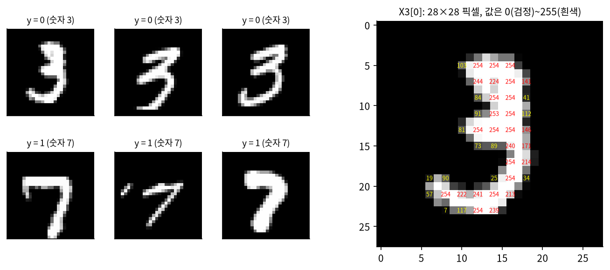
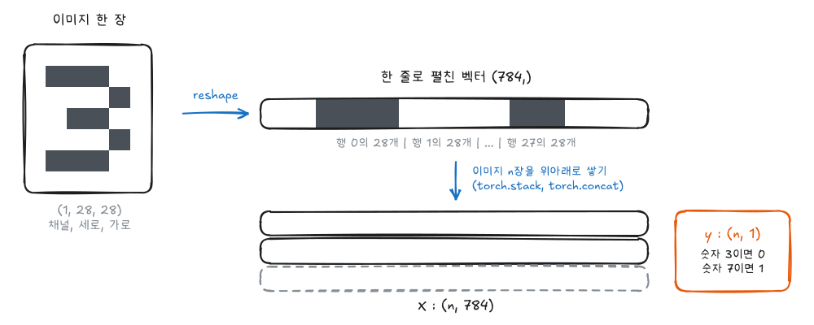
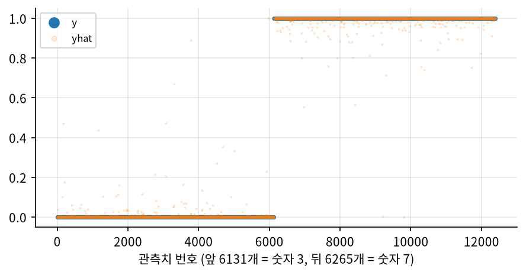
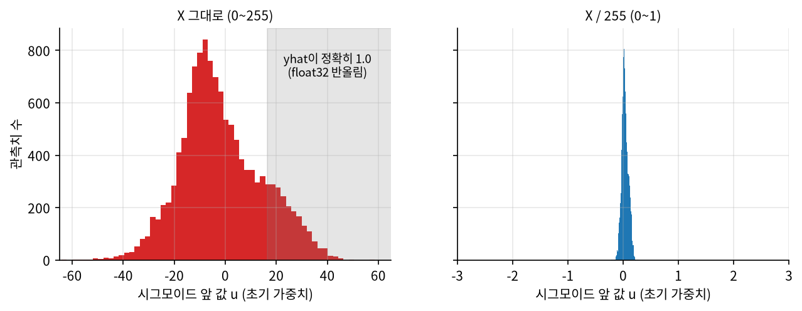
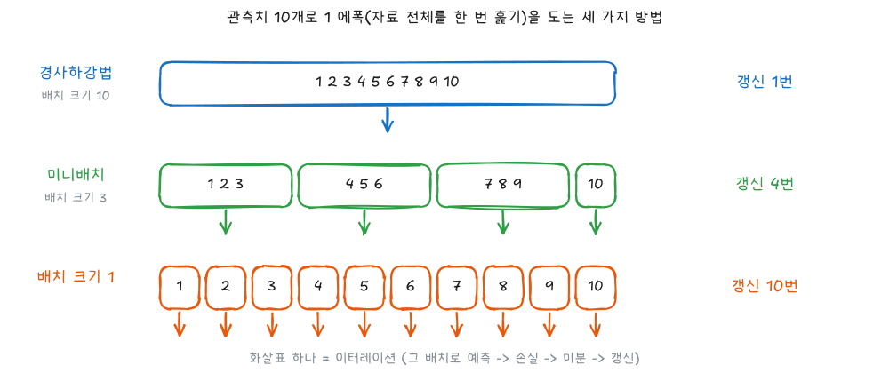
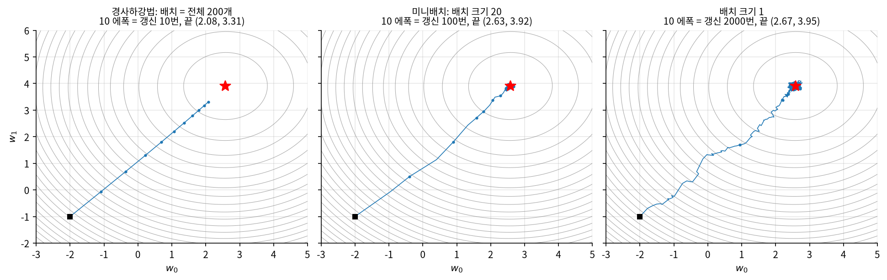
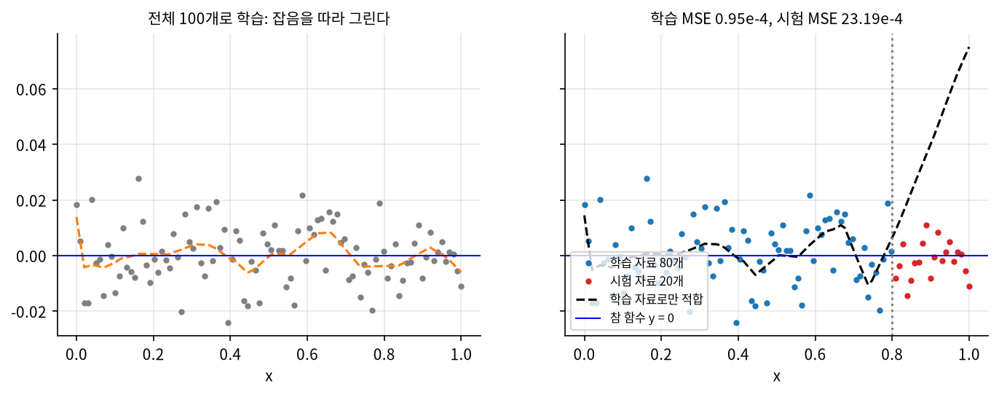
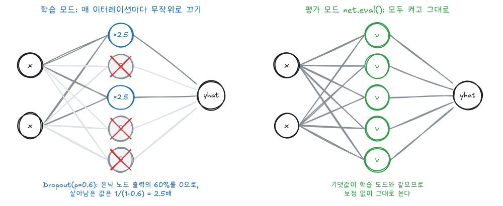
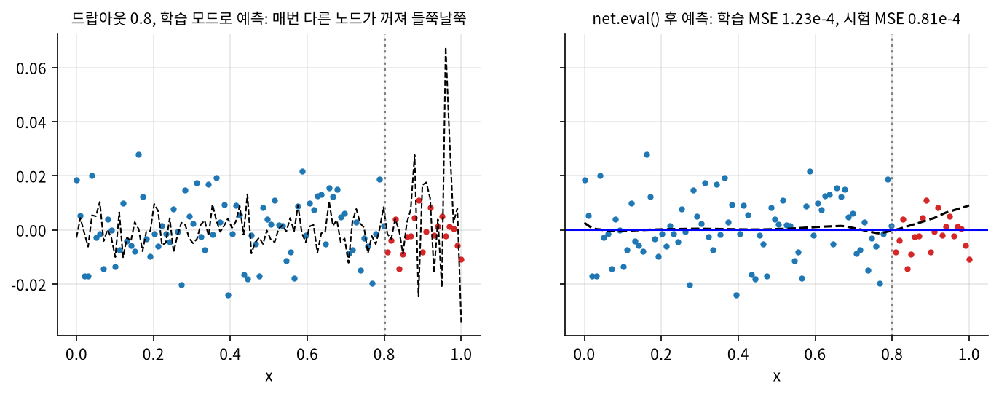

자료가 커지면 학습 방법이 세 군데에서 달라진다. 입력의 크기를 맞춰야 계산이 무너지지 않고, 자료를 한 번에 메모리에 올릴 수 없으니 일부(**미니배치**)로 기울기를 계산하며, 표현력이 큰 네트워크가 잡음까지 외우는 **과적합**을 막아야 한다. 과적합 대책 중 신경망에 특화된 것이 **드롭아웃**이다. 과적합과 학습·시험 자료의 분리는 [데이터 마이닝 - 리샘플링: 교차검증과 부트스트랩](/posts/dm-resampling)과 같은 이야기다.

## 예제 자료: MNIST

MNIST는 0부터 9까지 손글씨 숫자 7만 장(학습 6만, 시험 1만)이고, 한 장은 28×28 흑백 이미지다. 픽셀값은 0(검정)~255(흰색) 정수다.



지금까지의 네트워크는 (n, p) 입력만 받으므로 28×28 격자를 한 줄로 펼쳐 784차원 벡터로 본다. 옆 픽셀이라는 공간 구조는 잃는데, 이것을 살리는 방법이 합성곱신경망([7편](/posts/dl-07-cnn))이다.



```python
X3 = torch.stack([torchvision.io.read_image(str(f)) for f in (path/'training/3').ls()])  # (6131, 1, 28, 28)
X7 = torch.stack([torchvision.io.read_image(str(f)) for f in (path/'training/7').ls()])  # (6265, 1, 28, 28)
X = torch.concat([X3, X7]).reshape(-1, 784).float() / 255     # (12396, 784), 0~1
y = torch.tensor([0.0]*len(X3) + [1.0]*len(X7)).reshape(-1, 1)
```

`stack`은 새 축을 만들며 쌓고, `concat`은 기존 축을 따라 잇는다. `reshape(-1, 784)`의 `-1`은 나머지에 맞춰 정하라는 뜻이다.

`Linear(784, 30)` → ReLU → `Linear(30, 1)` → Sigmoid(파라미터 23,581개)를 BCE + Adam으로 전체 자료에 200 에폭 학습하면 BCE가 18.76에서 0.0114로 내려가고 학습 정확도 99.96%, 학습에 쓰지 않은 시험 자료(2,038장)에서 98.7%다. 펼친 픽셀만으로도 3과 7은 잘 구분된다.



## 입력의 크기

### 0~255를 그대로 넣으면

숫자 0과 1(12,665장)을 은닉 노드 64개 네트워크로 학습할 때, 입력과 손실 구현만 바꿔 보았다.

```python
loss_fn1 = torch.nn.BCELoss()
loss_fn2 = lambda yhat, y: -torch.mean(y*torch.log(yhat) + (1-y)*torch.log(1-yhat))
```

| 입력 | 손실 | 200 에폭 후 손실 | 정확도 |
|---|---|---|---|
| 0~255 | `BCELoss()` | 0.117 | 99.88% |
| 0~255 | 직접 쓴 식 | nan | 46.8% |
| 0~1 | 둘 다 | 0.0016 | 99.95% |



원인은 세 단계로 이어진다.

1. 가중치 초기값은 입력이 0~1 크기라고 가정한다(`Linear(784, 64)`는 $\pm 1/\sqrt{784}$ 범위). 입력이 255배면 시그모이드 앞 값 $u$가 −60~60으로 퍼진다.
2. float32는 1 근처에서 약 $6 \times 10^{-8}$보다 작은 차이를 표현하지 못해, $u > 17$이면 $\sigma(u)$가 정확히 1.0이 된다. 학습 전에 관측치의 15%가 그렇다.
3. 그중 $y = 0$인 관측치는 $-\log(1 - 1.0) = \infty$, $y = 1$인 관측치는 $0 \times \log 0 = $ nan이다. nan은 기울기와 가중치로 번져 회복되지 않는다. 정확도 46.8%는 모든 예측이 nan이라 전부 0으로 판정되어 숫자 0의 비율만큼 맞힌 것이다.

`BCELoss()`는 $\log$를 −100에서 잘라 무한대 대신 100의 벌점을 주므로 버텼다. 하지만 근본 해결은 입력의 크기를 맞추는 것이다. 이미지는 255로 나누고, 일반 자료는 평균 0, 표준편차 1로 표준화한다. 손실은 시그모이드와 BCE를 한 번에 계산하는 `BCEWithLogitsLoss()`가 가장 안전하다([3편](/posts/dl-03-output-loss)).

## 미니배치 확률적 경사하강법

### 세 가지 방법

| 방법 | 한 번 갱신에 쓰는 관측치 | 1 에폭의 갱신 수 ($n = 10$) | 요즘 이름 |
|---|---|---|---|
| 전체 | $n$개 | 1 | 경사하강법 |
| 하나씩 | 1개 | 10 | 배치 크기 1인 SGD |
| $m$개씩 | $m$개 | $\lceil n/m \rceil$ ($m = 3$이면 4) | (미니배치) SGD |



| 용어 | 뜻 |
|---|---|
| 배치(미니배치) | 한 번의 갱신에 쓰는 관측치 묶음 |
| 배치 크기 | 묶음 하나의 관측치 수 |
| 이터레이션 | 배치 하나로 예측 → 손실 → 미분 → 갱신을 한 번 |
| 에폭 | 모든 관측치를 한 번씩 다 쓰는 것 |

`torch.optim.SGD`는 받은 기울기로 한 걸음 갈 뿐이고, 그 기울기를 전체로 계산했는지 일부로 계산했는지는 학습 코드가 정한다.

### 일부만 써도 되는 이유

손실이 관측치별 손실의 평균 $L(\mathbf w) = \frac1n\sum_i \ell_i(\mathbf w)$이고 배치 $B$를 무작위로 뽑으면

$$
E\left[\frac{1}{|B|}\sum_{i \in B} \nabla \ell_i(\mathbf w)\right] = \nabla L(\mathbf w)
$$

이다. 배치 기울기는 전체 기울기의 **불편추정량**이고, 배치가 클수록 분산이 작다. 표본평균과 모평균의 관계와 같다.



같은 10 에폭 동안 경사하강법은 갱신 10번으로 곧지만 최소점에 못 미치고, 배치 크기 20은 100번 갱신해 도착하며, 배치 크기 1은 2,000번 갱신하지만 잡음이 커서 학습률을 낮춰도 최소점 주위를 맴돈다. 미니배치는 같은 계산량으로 더 많이 갱신하면서 덜 흔들리는 타협이고, 배치 하나만 메모리(GPU)에 올리면 되며, 배치 안의 계산은 행렬곱 한 번으로 병렬 처리된다.

### Dataset과 DataLoader

```python
ds = torch.utils.data.TensorDataset(X, y)                         # ds[i] = (X[i], y[i])
dl = torch.utils.data.DataLoader(ds, batch_size=2048, shuffle=True)

for epoch in range(10):
    for xx, yy in dl:                       # for 한 바퀴 = 1 에폭
        loss = loss_fn(net(xx), yy)
        loss.backward(); optimizr.step(); optimizr.zero_grad()
```

`shuffle=True`는 에폭마다 순서를 섞는다. 자료가 3 다음 7 순서로 정렬되어 있으면 섞지 않은 배치는 한 클래스로 치우친다.

**예제.** 숫자 0과 1(12,665장)을 은닉 노드 32개, Adam으로 학습한 결과다. 배치 크기 2,048이면 1 에폭에 배치 7개다.

| 방식 | 에폭 | 갱신 횟수 | 학습 BCE | 정확도 |
|---|---|---|---|---|
| 경사하강법 | 10 | 10 | 0.359 | |
| 경사하강법 | 70 | 70 | 0.019 | 99.81% |
| 미니배치 (2,048) | 10 | 70 | 0.067 | 99.50% |

같은 계산량(10 에폭)이면 미니배치가 훨씬 낫고, 같은 갱신 횟수(70번)면 정확한 기울기를 쓰는 경사하강법이 조금 낫다. 실제로 한정된 것은 계산 시간과 메모리이므로 미니배치가 표준이다.

### GPU

텐서와 네트워크는 `.to(device)`로 GPU에 옮긴다(`"cuda"`, 맥은 `"mps"`). 계산에 참여하는 텐서는 모두 같은 장치에 있어야 하고, 어긋나면 "Expected all tensors to be on the same device" 오류가 난다. 네트워크는 처음에 한 번 옮기고, 배치는 `for` 문 안에서 옮긴다.

| 은닉 노드 수 (자료 100개, 1,000 에폭) | 강의노트 CPU | 강의노트 GPU | 이 기기 CPU | 이 기기 MPS |
|---|---|---|---|---|
| 512 | 0.34초 | 0.52초 | 0.39초 | 0.62초 |
| 20,480 | 2.64초 | 0.52초 | 2.62초 | 1.49초 |
| 204,800 | 59.7초 | 1.40초 | 21.6초 | 13.8초 |

GPU는 단순한 코어 수천 개로 큰 행렬곱을 병렬 처리한다. 계산이 작으면 일을 넘기고 받는 고정 비용이 더 커서 CPU가 빠르다.

## 과적합

### 잡음까지 외우기

$y_i = 0 \cdot x_i + \varepsilon_i$, $\varepsilon_i \sim N(0, 0.01^2)$인 순수 잡음 100개에 은닉 노드 512개 네트워크를 1,000 에폭 학습한다. 최선의 예측은 $\hat y = 0$이다. 앞 80개로 학습하고 뒤 20개로 시험한다.



| | 학습 MSE | 시험 MSE |
|---|---|---|
| 네트워크 (512 노드) | $0.95 \times 10^{-4}$ | $23.19 \times 10^{-4}$ |
| 항상 0으로 예측 | $1.28 \times 10^{-4}$ | $0.43 \times 10^{-4}$ |

자료를 "참 관계 + 오차"로 볼 때 오차까지 적합하는 것이 **과적합**이다. 학습 오차는 작은데 시험 오차가 크다. 통계학의 말로는 분산이 너무 큰 추정량이다. 학습 손실만 보면 알아챌 수 없으므로, 학습에 쓰지 않은 검증 자료의 손실을 함께 본다.

### 대책

| 대책 | 방법 | 통계학에서 |
|---|---|---|
| 자료 늘리기 | 자료 수집, 데이터 증강(회전·자르기 등) | |
| 모형 줄이기 | 노드·층 수를 줄인다 | 변수 선택 |
| 가중치 감쇠 | 손실에 $\frac{\lambda}{2}\lVert\mathbf w\rVert^2$을 더한다(`Adam(..., weight_decay=λ)` 대응) | 릿지 회귀 |
| 조기 종료 | 검증 손실이 오르기 시작하면 멈춘다 | |
| 드롭아웃 | 학습 중 노드를 무작위로 끈다 | 배깅과 비슷한 앙상블 효과 |

가중치 감쇠는 [데이터 마이닝 - 변수선택과 정규화: Ridge, Lasso, PCR](/posts/dm-regularization)의 릿지 벌점과 같다.

## 드롭아웃

### 동작

```python
torch.manual_seed(43052)
d = torch.nn.Dropout(p=0.5)
x = torch.arange(1., 11.)
d(x)   # tensor([ 0.,  4.,  0.,  8.,  0.,  0., 14.,  0., 18.,  0.])
d(x)   # tensor([ 0.,  0.,  6.,  8.,  0., 12.,  0., 16.,  0., 20.])
```

1. 원소마다 확률 $p$로 0을 만든다. 호출할 때마다 새로 뽑는다.
2. 살아남은 원소를 $\frac{1}{1-p}$배 키운다. 출력의 기댓값이 입력과 같아진다: $(1-p)\cdot\frac{x}{1-p} = x$.

보통 은닉층의 활성화 뒤에 둔다. 예측할 때는 꺼야 하므로 `net.eval()`로 평가 모드로 바꾸면 드롭아웃이 입력을 그대로 내보낸다. 학습 중에 $\frac{1}{1-p}$배를 해 두었으므로 따로 보정할 필요가 없다. `net.train()`으로 다시 학습 모드가 된다.



### 예제: 잡음 자료에 드롭아웃

```python
net = torch.nn.Sequential(
    torch.nn.Linear(1, 512), torch.nn.ReLU(),
    torch.nn.Dropout(0.8),               # 매번 80%를 끈다
    torch.nn.Linear(512, 1),
)
```



| | 학습 MSE | 시험 MSE |
|---|---|---|
| 드롭아웃 없음 | $0.95 \times 10^{-4}$ | $23.19 \times 10^{-4}$ |
| `Dropout(0.8)`, 평가 모드 | $1.23 \times 10^{-4}$ | $0.81 \times 10^{-4}$ |

왼쪽은 `net.eval()`을 잊고 예측한 흔한 실수다. 평가 모드에서는 시험 MSE가 30분의 1로 줄었다.

### 왜 효과가 있는가

- **공모 방지:** 짝이 언제 꺼질지 모르므로 여러 노드가 함께 잡음 패턴을 정교하게 맞추기 어렵다. 각 노드가 혼자서도 쓸모 있는, 자료 전반에 통하는 특징을 배운다.
- **앙상블:** 매 이터레이션은 노드 일부를 지운 서로 다른 부분 네트워크를 학습하고(노드 512개면 $2^{512}$가지), 평가 모드는 그 예측을 근사적으로 평균 낸다. 여러 모형의 평균이 분산을 줄이는 것은 배깅과 같은 원리다([데이터 마이닝 - 앙상블](/posts/dm-ensemble)).

$p = 0.8$은 강한 편이고, 은닉층에는 보통 0.2~0.5를 쓴다. 너무 강하면 참 관계까지 학습하지 못한다(과소적합).

## 요약

| 주제 | 핵심 |
|---|---|
| 입력 크기 | 0~255를 그대로 넣으면 시그모이드가 정확히 0이나 1이 되어 손실이 nan. 255로 나누거나 표준화한다 |
| 미니배치 | 배치 기울기는 전체 기울기의 불편추정량. 같은 계산량으로 더 많이 갱신하고 메모리 문제도 해결 |
| `DataLoader` | 배치로 나누고 섞는 반복자. `for` 한 바퀴가 1 에폭 |
| GPU | `.to(device)`. 텐서는 모두 같은 장치에. 계산이 클 때만 빠르다 |
| 과적합 | 오차까지 적합. 학습 오차는 작고 시험 오차가 크다 |
| 드롭아웃 | 학습 중 노드를 확률 $p$로 끄고 나머지를 $1/(1-p)$배. 예측 전 `net.eval()` |

```python
net = net.to(device)
for epoch in range(n_epochs):
    net.train()
    for xx, yy in dl:
        xx, yy = xx.to(device), yy.to(device)
        loss = loss_fn(net(xx), yy)
        loss.backward(); optimizr.step(); optimizr.zero_grad()
net.eval()
```

## 참고자료

- 최규빈, 「딥러닝」 강의노트 (2022), <https://guebin.github.io/DL2022/>
- LeCun, Y., Bottou, L., Bengio, Y. and Haffner, P. (1998). Gradient-based learning applied to document recognition. *Proceedings of the IEEE*, 86(11), 2278–2324.
- Srivastava, N., Hinton, G., Krizhevsky, A., Sutskever, I. and Salakhutdinov, R. (2014). Dropout: A simple way to prevent neural networks from overfitting. *JMLR*, 15, 1929–1958.
- Goodfellow, I., Bengio, Y. and Courville, A. (2016). *Deep Learning*, Sections 7.1, 7.8, 7.12, 8.1.3. MIT Press.
