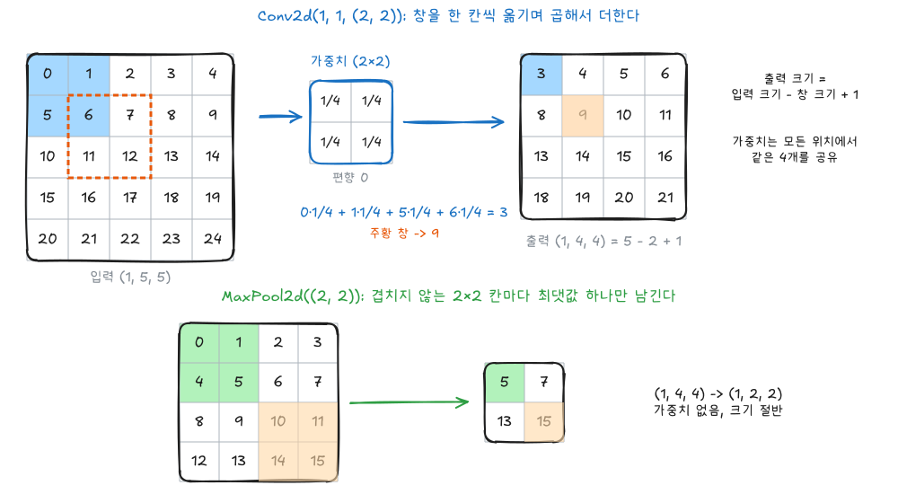
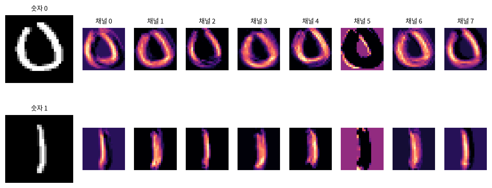

[5편](/posts/dl-05-mnist-minibatch)에서는 28 × 28 이미지를 784개짜리 한 줄로 펴서 신경망에 넣었다. 잘 되긴 했지만 찜찜한 점이 있었다. 펴는 순간 "이 픽셀과 저 픽셀이 옆자리"라는 정보가 사라진다. 네트워크는 784개 숫자를 순서 없는 특징으로 받을 뿐이다. 강의의 표현대로라면, 회귀분석 기반으로 만들어진 모형의 틀에 이미지를 억지로 끼워 맞춘 셈이다. 관측치 하나의 모양은 784가 아니라 1 × (28 × 28)이어야 맞다.

이 글은 이미지를 2차원 그대로 다루는 **합성곱 신경망**(convolutional neural network, CNN)을 다룬다. 새로운 층 두 개, 합성곱(`Conv2d`)과 맥스풀링(`MaxPool2d`)이 등장한다. 먼저 작은 숫자 행렬로 각 층이 무엇을 계산하는지 확인하고, MNIST 숫자 0과 1을 구분하는 CNN을 만들어 CPU와 GPU에서 학습한다. 마지막으로 시그모이드와 BCE를 한 번에 계산하는 `BCEWithLogitsLoss`를 본다. 5편에서 "더 나은 방법"이라고 미뤄 둔 그것이다.

## 1. 새로운 아키텍처의 아이디어

4편 이후의 네트워크를 각 층의 역할로 다시 읽어 보자.

$$
\underset{(n,784)}{\mathbf X} \overset{l_1}{\to} \underset{(n,30)}{\mathbf u^{(1)}} \overset{\text{relu}}{\to} \underset{(n,30)}{\mathbf v^{(1)}} \overset{l_2}{\to} \underset{(n,1)}{\mathbf u^{(2)}} \overset{\text{sig}}{\to} \underset{(n,1)}{\hat{\mathbf y}}
$$

| 층 | 역할 |
|---|---|
| $l_1$ (선형) | 특징을 **뻥튀기**한다. 입력에서 새로운 특징을 여러 개 만든다 |
| relu | 뻥튀기된 특징에 비선형을 더해 표현력을 키운다 |
| $l_2$ (선형) | 특징을 **요약**한다. 많은 특징을 몇 개로 줄인다 |

CNN은 같은 세 역할을 2차원 버전으로 바꾼 것이다.

| 층 | 역할 |
|---|---|
| conv (합성곱) | 2차원 특징을 뻥튀기한다. $l_1$의 2차원 버전 |
| relu | 같다. 원소마다 적용 |
| pooling (풀링) | 2차원 자료를 요약한다 |

## 2. 합성곱 층

### 계산 방법: 창을 옮기며 곱해서 더하기

`torch.nn.Conv2d(1, 1, (2, 2))`는 입력 채널 1개, 출력 채널 1개, 창(window, 커널이라고도 한다) 크기 2 × 2인 합성곱 층이다. 계산부터 보자.

```python
torch.manual_seed(43052)
_conv = torch.nn.Conv2d(1, 1, (2, 2))
_conv.weight.data   # tensor([[[[-0.1733, -0.4235], [ 0.1802,  0.4668]]]])
_conv.bias.data     # tensor([0.2037])

_X = torch.arange(0, 4).reshape(1, 2, 2).float()   # [[0, 1], [2, 3]]
_conv(_X)           # tensor([[[1.5410]]])
```

$(-0.1733)(0) + (-0.4235)(1) + (0.1802)(2) + (0.4668)(3) + 0.2037 = 1.541$이다. 입력 2 × 2와 가중치 2 × 2를 **같은 자리끼리 곱해서 모두 더하고** 편향을 더한 것이다. `Linear`가 입력과 가중치를 곱해 더하는 것과 같은데, 그 일을 2차원 창 안에서 한다.

가중치를 모두 1/4로 두면 이 층은 평균을 계산한다. 입력이 2 × 2보다 크면 창을 한 칸씩 옮기며 같은 계산을 반복한다.



```python
_conv.weight.data = torch.tensor([[[[1/4, 1/4], [1/4, 1/4]]]])
_conv.bias.data = torch.tensor([0.0])
_conv(torch.arange(0, 25).float().reshape(1, 5, 5))
# tensor([[[ 3.,  4.,  5.,  6.],
#          [ 8.,  9., 10., 11.],
#          [13., 14., 15., 16.],
#          [18., 19., 20., 21.]]])
```

5 × 5 입력에 2 × 2 창을 놓을 수 있는 위치는 가로 4곳, 세로 4곳이다. 그래서 출력은 4 × 4이고, 각 원소는 그 위치의 2 × 2 평균이다. 시계열의 이동평균을 2차원으로 한 것이라 볼 수 있다. 창을 3 × 3으로 키우고 가중치를 1/9로 두면 3 × 3 출력이 나오고, 가운데 값은 $(1 + 2 + 3 + 6 + 7 + 8 + 11 + 12 + 13)/9 = 7$이다.

일반적으로 입력 크기가 $H$, 창 크기가 $k$이면 출력 크기는 $H - k + 1$이다. 창을 한 번에 $s$칸씩 옮기고(stride) 테두리에 0을 $p$겹 덧대면(padding) $\lfloor (H + 2p - k)/s \rfloor + 1$이 된다. 이 글에서는 기본값 $s = 1$, $p = 0$만 쓴다.

### 필터는 무엇을 감지하나

창의 가중치를 **필터**라고도 부른다. 가중치에 따라 합성곱은 이미지에서 서로 다른 것을 감지한다. 손으로 만든 3 × 3 필터 세 개를 숫자 7에 적용해 보자.


- **세로 경계** $\begin{bmatrix} 1 & 0 & -1 \\ 1 & 0 & -1 \\ 1 & 0 & -1 \end{bmatrix}$: 왼쪽이 밝고 오른쪽이 어두우면 양수, 반대면 음수다. 7의 비스듬한 획 양쪽 가장자리가 빨강과 파랑으로 드러난다.
- **가로 경계** (위 필터를 눕힌 것): 7의 윗변에서 강하게 반응한다.
- **평균**: 모든 가중치가 1/9이라 이미지가 흐려진다.

CNN은 이런 필터를 사람이 정하지 않고 **학습한다.** 가중치가 학습 가능한 파라미터이므로, 분류에 유용한 패턴을 감지하는 필터가 경사하강법으로 만들어진다.

### 가중치 공유와 지역성

`Linear`와 비교하면 합성곱의 특징이 두 가지 보인다.

- **지역성.** 출력 하나는 입력의 작은 창(여기서는 2 × 2나 5 × 5)만 본다. 이미지에서 의미 있는 패턴(획, 모서리)은 대개 가까운 픽셀들로 이루어지기 때문이다. `Linear`의 출력 하나는 입력 784개를 모두 본다.
- **가중치 공유.** 창이 어느 위치에 있든 같은 가중치를 쓴다. 왼쪽 위의 가로 획을 감지하는 필터가 오른쪽 아래의 가로 획도 감지한다. 고양이가 사진 어디에 있든 고양이인 것처럼, 패턴의 의미는 위치와 상관없다는 가정이다.

그 결과 파라미터가 크게 줄어든다. 28 × 28 입력에서 16채널 24 × 24 출력(9,216개 값)을 만드는 층을 생각해 보자. `Linear(784, 9216)`이면 가중치가 $784 \times 9{,}216 \approx 720$만 개다. `Conv2d(1, 16, (5, 5))`는 같은 모양의 출력을 가중치 $16 \times 5 \times 5 = 400$개와 편향 16개로 만든다.

### 채널: 특징 뻥튀기

`Conv2d(in, out, k)`의 첫 두 인자는 채널 수다. 출력 채널이 여러 개면 필터가 그 수만큼 있고, 필터마다 출력 이미지(특징맵) 하나를 만든다.

```python
_X = torch.tensor([1.0, 1.0, 1.0, 1.0]).reshape(1, 2, 2)
_conv = torch.nn.Conv2d(1, 8, (2, 2))
_conv.weight.data.shape    # torch.Size([8, 1, 2, 2]) : (출력 채널, 입력 채널, 세로, 가로)
_conv(_X).reshape(-1)      # 값 8개
```

입력이 모두 1이므로 출력 채널 $k$의 값은 $k$번째 필터의 가중치 합 + 편향이다. 실제로 `torch.sum(_conv.weight.data, axis=(2, 3)).reshape(-1) + _conv.bias.data`와 같다. 입력 하나에서 서로 다른 특징 8개를 만들었다. 이것이 "특징 뻥튀기"다. 입력 채널이 여러 개면(예: 컬러 이미지의 RGB 3채널) 필터 하나가 (입력 채널, 세로, 가로) 모양이고, 모든 입력 채널에 걸쳐 곱해 더한다.

## 3. ReLU와 맥스풀링

**ReLU**는 2차원에서도 원소마다 $\max(0, x)$를 적용할 뿐이다. 음수인 칸이 0이 되고 shape은 그대로다.

**맥스풀링**(`MaxPool2d((2, 2))`)은 입력을 겹치지 않는 2 × 2 칸으로 나누고 각 칸에서 최댓값 하나만 남긴다. 위 그림의 아래쪽이 그 예다.

```python
_maxpooling = torch.nn.MaxPool2d((2, 2))
_maxpooling(torch.arange(16).float().reshape(1, 4, 4))   # [[ 5.,  7.], [13., 15.]]
_maxpooling(torch.arange(25).float().reshape(1, 5, 5))   # [[ 6.,  8.], [16., 18.]]
```

5 × 5 입력에서는 마지막 행과 열이 2 × 2 칸을 채우지 못해 버려지고 2 × 2가 나온다. 맥스풀링에는 학습할 가중치가 없다.

맥스풀링은 두 가지 일을 한다. 첫째, 크기를 가로세로 절반으로 줄여 **요약**한다. 뒤따르는 층의 계산량과 파라미터가 줄어든다. 둘째, 2 × 2 칸 안에서 "이 특징이 어딘가에 강하게 있었다"는 사실만 남기고 정확한 위치는 버린다. 그래서 획이 한두 픽셀 옮겨져도 출력이 크게 바뀌지 않는다. 이를 작은 이동에 대한 **불변성**이라고 한다.

## 4. CNN 구현 (CPU)

### 층을 하나씩 쌓으며 shape 따라가기

MNIST 숫자 0과 1을 구분한다. 학습 자료 12,665장, 시험 자료 2,115장이다. 이번에는 펴지 않고 (n, 1, 28, 28) 그대로 둔다.

```python
X = torch.concat([X0, X1]) / 255                       # (12665, 1, 28, 28)
y = torch.tensor([0.0]*len(X0) + [1.0]*len(X1)).reshape(-1, 1)
```

층을 하나씩 붙이며 출력 shape을 확인하는 것이 CNN을 설계하는 가장 확실한 방법이다.

| 층 | 출력 shape | 설명 |
|---|---|---|
| 입력 | (n, 1, 28, 28) | |
| `Conv2d(1, 16, (5, 5))` | (n, 16, 24, 24) | 필터 16개, $28 - 5 + 1 = 24$ |
| `ReLU()` | (n, 16, 24, 24) | 그대로 |
| `MaxPool2d((2, 2))` | (n, 16, 12, 12) | 가로세로 절반 |
| `Flatten()` | (n, 2304) | $16 \times 12 \times 12 = 2304$ |
| `Linear(2304, 1)` | (n, 1) | |
| `Sigmoid()` | (n, 1) | 확률 |

`Flatten`은 관측치 축(첫 축)은 두고 나머지를 한 줄로 편다. `reshape(-1, 2304)`와 같은 일을 층으로 만든 것이라 `Sequential`에 넣을 수 있다. 결국 CNN은 앞쪽에서 2차원 구조를 살려 특징을 뽑고, 그 특징을 펴서 마지막에 로지스틱 회귀를 하는 구조다.


```python
net = torch.nn.Sequential(
    torch.nn.Conv2d(1, 16, (5, 5)),   # 2d: 합성곱(선형변환), 특징 뻥튀기
    torch.nn.ReLU(),                  # 2d: 비선형변환
    torch.nn.MaxPool2d((2, 2)),       # 2d: 요약
    torch.nn.Flatten(),               # 2d -> 1d
    torch.nn.Linear(2304, 1),         # 1d: 선형변환
    torch.nn.Sigmoid(),               # 1d: 확률로
)
loss_fn = torch.nn.BCELoss()
optimizr = torch.optim.Adam(net.parameters())

for epoc in range(100):
    yhat = net(X)
    loss = loss_fn(yhat, y)
    loss.backward()
    optimizr.step()
    optimizr.zero_grad()
```

파라미터는 합성곱 416개(가중치 400 + 편향 16)와 선형 2,305개를 합쳐 2,721개다. 5편의 MLP(23,581개)의 9분의 1이다.


전체 자료를 한 번에 넣어 100 에폭 학습하는 데 이 기기(M1 Pro) CPU로 102초가 걸렸다(강의노트의 측정값은 51초). 학습 자료 정확도 99.79%, 시험 자료 정확도 99.95%로, 시험 자료 2,115장 중 하나만 틀렸다. 0과 1은 쉬운 문제이긴 하지만, 파라미터가 9분의 1인 네트워크로 이만큼 맞힌다.

### 학습된 필터가 보는 것

첫 층의 필터 16개는 학습으로 만들어졌다. 숫자 0과 1 하나씩을 넣고 합성곱 + ReLU 뒤의 특징맵(채널 0~7)을 그려 보면 필터마다 반응하는 부분이 다르다.



어떤 채널은 획의 왼쪽 가장자리에, 어떤 채널은 오른쪽이나 아래쪽에 밝게 반응한다. 채널 5는 반대로 배경에서 켜지고 획에서 꺼진다. 앞에서 손으로 만든 경계 필터와 비슷한 일을 하는 필터들이 학습으로 생긴 것이다. 실제 필터의 가중치(5 × 5)는 다음과 같다. 빨강이 양수, 파랑이 음수다.


뒤의 `Linear(2304, 1)`은 이 특징맵들을 보고 "0의 둥근 획 특징이 많으면 0, 세로 획 특징이 많으면 1"처럼 판단한다. 층이 더 깊은 CNN에서는 앞 층이 이런 단순한 경계를, 뒤 층이 그것을 조합한 모서리·원·부품 같은 복잡한 패턴을 감지한다고 알려져 있다. 4편 끝에서 말한 "층을 쌓으면 앞 층의 특징을 재료로 쓸 수 있다"는 것이 이것이다. 9편에서는 이 특징맵을 이용해 네트워크가 이미지의 어디를 보고 판단했는지 시각화한다.

## 5. CNN 구현 (GPU): fastai Learner로

### DataLoaders와 Learner

GPU로 옮겨 미니배치로 학습해 보자. 5편의 학습 틀을 직접 써도 되지만, 강의는 여기서 1편의 fastai를 다시 불러온다. 파이토치로 만든 데이터로더와 네트워크를 fastai에 넘기면 장치 이동, 미니배치 반복, 검증 손실 계산을 대신 해 준다.

```python
from fastai.vision.all import DataLoaders, Learner

# 1. dls: 학습용과 검증용 DataLoader를 묶는다
ds1 = torch.utils.data.TensorDataset(X, y)
ds2 = torch.utils.data.TensorDataset(XX, yy)          # 시험 자료를 검증용으로
dl1 = torch.utils.data.DataLoader(ds1, batch_size=1266)   # 1 에폭 = 배치 10개
dl2 = torch.utils.data.DataLoader(ds2, batch_size=2115)
dls = DataLoaders(dl1, dl2)

# 2. lrnr: 데이터 + 네트워크 + 손실함수 (옵티마이저는 기본값 Adam)
lrnr = Learner(dls, net, loss_fn)

# 3. 학습
lrnr.fit(10)
```

1편에서 본 4단계(dls → lrnr → fit → predict)를 이번에는 재료를 직접 만들어 조립했다. `Learner`가 GPU를 감지해 네트워크와 배치를 옮긴다(이 기기에서는 `mps`).

| 에폭 | 0 | 1 | 2 | 3 | 4 | 5 | 6 | 7 | 8 | 9 |
|---|---|---|---|---|---|---|---|---|---|---|
| train_loss | 0.909 | 0.672 | 0.526 | 0.416 | 0.326 | 0.255 | 0.202 | 0.161 | 0.130 | 0.106 |
| valid_loss | 0.603 | 0.395 | 0.248 | 0.134 | 0.072 | 0.044 | 0.030 | 0.023 | 0.018 | 0.015 |

10 에폭이 이 기기에서 3~5초 걸렸다. 갱신 횟수는 에폭당 10번, 모두 100번으로 CPU 실험과 같은데 시간은 20~30분의 1이다. 미니배치와 GPU의 효과다. 시험 자료 정확도는 99.72%다.

`train_loss`가 `valid_loss`보다 큰 것이 이상해 보일 수 있다. `train_loss`는 에폭 동안 배치마다 잰 손실의 평균이라 에폭 초반의 나쁜 값이 섞이고, `valid_loss`는 에폭이 끝난 뒤의 네트워크로 잰 값이기 때문이다. 학습이 빠르게 진행되는 초반에는 흔한 모습이다.

### lrnr.model은 net 그 자체

```python
lrnr.model is net    # True
```

`Learner`는 네트워크를 복사하지 않고 그대로 들고 있다. `lrnr.fit()`이 바꾼 가중치가 곧 `net`의 가중치다. 학습 뒤 `net`은 GPU에 있으므로, CPU에 있는 자료로 예측하려면 `net.to("cpu")`로 되돌려야 한다. 5편의 "같은 장치" 규칙이다.

## 6. BCEWithLogitsLoss

### 시그모이드를 손실 안으로

강의의 마지막 주제는 `torch.nn.BCEWithLogitsLoss()`다. 이름 그대로 시그모이드와 BCE를 합친 손실이다. 쓰는 법은 간단하다. 네트워크 끝의 `Sigmoid()`를 빼고, 손실만 바꾼다.

```python
net = torch.nn.Sequential(
    torch.nn.Conv2d(1, 16, (5, 5)), torch.nn.ReLU(), torch.nn.MaxPool2d((2, 2)),
    torch.nn.Flatten(), torch.nn.Linear(2304, 1),
    # torch.nn.Sigmoid()   <- 뺀다
)
loss_fn = torch.nn.BCEWithLogitsLoss()   # 안에서 시그모이드를 적용하고 BCE를 계산
```

이제 `net(X)`의 출력은 확률이 아니라 시그모이드 앞의 값 $u$다. 이 값을 **로짓**(logit)이라고 한다. 3편에서 본 로그 오즈 $\log\frac{p}{1-p}$가 바로 $u$다. 이 기기에서 시험 자료의 로짓은 −12.4부터 6.9까지 퍼져 있었다. 확률이 필요하면 예측할 때 `torch.sigmoid(net(X))`로 직접 씌운다.

같은 시드로 학습하면 학습 곡선은 앞의 `Sigmoid` + `BCELoss`와 소수점 넷째 자리까지 같다. 수학적으로 같은 함수이고, 이 문제에서는 수치 문제가 생길 만큼 극단적인 값이 나오지 않았기 때문이다. 그러면 왜 굳이 바꿀까?

### 왜 수치적으로 더 안전한가

5편에서 본 문제를 떠올리자. $u$가 17 정도를 넘으면 float32에서 $\sigma(u)$가 정확히 1.0이 되고, $y = 0$이면 $\log(1 - 1.0) = \log 0$이 된다. `BCELoss()`는 이것을 $-100$에서 잘라 버티지만, 잘라 낸 값은 정확하지 않고 **기울기도 사라진다.**

`BCEWithLogitsLoss`는 $\sigma(u)$를 계산하지 않고 로짓에서 바로 손실을 계산한다. $\sigma(u) = \frac{1}{1 + e^{-u}}$를 BCE에 넣고 정리하면

$$
\log\sigma(u) = -\log(1 + e^{-u}), \qquad \log(1 - \sigma(u)) = -u - \log(1 + e^{-u})
$$

이므로

$$
\ell(u, y) = -y\log\sigma(u) - (1-y)\log(1 - \sigma(u)) = \log(1 + e^{-u}) + (1 - y)\,u
$$

이다. $\log(1 + e^{-u})$는 $u$가 큰 음수일 때 $e^{-u}$가 넘칠 수 있으므로, 실제 구현은 $\log(1 + e^{-u}) = \max(-u, 0) + \log(1 + e^{-|u|})$로 바꿔 계산한다. $e^{-|u|}$는 항상 1 이하라 넘치지 않는다. 어디에도 0의 로그를 취하는 곳이 없다.

미분도 깔끔하다. 3편에서 본 대로 시그모이드 + BCE의 미분은 $\frac{\partial \ell}{\partial u} = \sigma(u) - y$다. 예측이 틀린 만큼 기울기가 나온다.

숫자로 비교해 보자.

| 로짓 $u$ | $y$ | 참 손실 | `BCELoss(sigmoid(u))` | 그 기울기 | `BCEWithLogitsLoss(u)` | 그 기울기 |
|---|---|---|---|---|---|---|
| 30 | 0 | 30 | 100 (잘림) | 0 | 30 | 1 |
| −200 | 1 | 200 | 100 (잘림) | 0 | 200 | −1 |
| 2 | 1 | 0.127 | 0.127 | −0.119 | 0.127 | −0.119 |

확신하며 틀린 첫 두 경우에 `BCELoss`는 손실을 100으로 잘라 낼 뿐 아니라 기울기가 **0**이다. $\sigma(u)$가 정확히 1.0(또는 0.0)으로 반올림된 순간 $u$에 대한 미분 정보가 사라지기 때문이다. 가장 크게 틀린 관측치에서 아무것도 배우지 못한다. 3편에서 본 "MSE가 포화 영역에서 학습을 멈추는" 현상과 같은 모양의 문제가 수치 오차로 생긴 것이다. `BCEWithLogitsLoss`는 정확한 손실과 함께 $\sigma(u) - y = \pm 1$이라는, 틀린 만큼의 기울기를 그대로 준다. 평범한 경우(세 번째 줄)에는 둘이 같다.

그래서 이진 분류에서는 네트워크 끝에 `Sigmoid`를 두지 않고 `BCEWithLogitsLoss`를 쓰는 것이 표준이다. 다음 글의 다중 분류에서도 같은 원칙이 이어진다.

## 정리

| 층 | 하는 일 | shape 변화 (이 글의 예) | 파라미터 |
|---|---|---|---|
| `Conv2d(in, out, k)` | 창을 옮기며 곱해 더하기. 필터마다 특징맵 하나 | (1, 28, 28) → (16, 24, 24) | $\text{out} \times \text{in} \times k^2 + \text{out}$ |
| `ReLU()` | 원소마다 $\max(0, x)$ | 그대로 | 없음 |
| `MaxPool2d(k)` | $k \times k$ 칸마다 최댓값 | (16, 24, 24) → (16, 12, 12) | 없음 |
| `Flatten()` | 관측치 축을 빼고 한 줄로 | → (2304,) | 없음 |

- 합성곱은 `Linear`의 2차원 버전이다. 작은 창만 보고(지역성), 모든 위치에서 같은 가중치를 쓴다(가중치 공유). 그래서 파라미터가 훨씬 적다.
- 필터는 경계 같은 패턴을 감지하며, CNN은 이 필터를 학습한다.
- 맥스풀링은 크기를 줄여 요약하고, 작은 위치 이동에 둔감하게 만든다.
- CNN = (합성곱 → ReLU → 풀링)으로 특징을 뽑고, 펴서 `Linear`로 분류한다.
- 설계할 때는 층마다 출력 shape을 찍어 보며 `Flatten` 뒤의 크기를 확인한다.
- fastai의 `DataLoaders`와 `Learner`에 파이토치 데이터로더와 네트워크를 넘기면 GPU 학습을 대신 해 준다. `lrnr.model`은 원래 `net`과 같은 객체다.
- 이진 분류는 네트워크 끝의 `Sigmoid`를 빼고 `BCEWithLogitsLoss`를 쓴다. 확신하며 틀린 관측치에서도 정확한 손실과 기울기를 준다.

지금까지는 0/1 두 가지만 구분했다. 다음 글에서는 클래스가 셋 이상일 때 무엇이 바뀌는지, 시그모이드가 소프트맥스로, BCE가 교차엔트로피로 일반화되는 과정을 본다.

## 참고자료

- 최규빈, 「딥러닝」 강의노트 (2022), 07wk-2: 이미지분석 (1), <https://guebin.github.io/DL2022/>
- LeCun, Y., Bottou, L., Bengio, Y. and Haffner, P. (1998). Gradient-based learning applied to document recognition. *Proceedings of the IEEE*, 86(11), 2278–2324.
- Goodfellow, I., Bengio, Y. and Courville, A. (2016). *Deep Learning*, Chapter 9 (Convolutional Networks). MIT Press.
- Dumoulin, V. and Visin, F. (2016). A guide to convolution arithmetic for deep learning. <https://arxiv.org/abs/1603.07285>
- PyTorch 문서, `torch.nn.Conv2d` · `torch.nn.MaxPool2d` · `torch.nn.BCEWithLogitsLoss`, <https://pytorch.org/docs/stable/>
