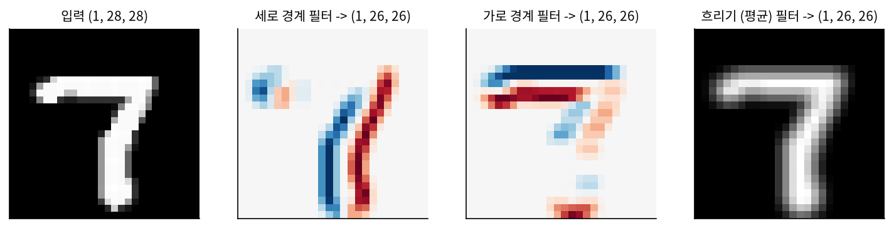
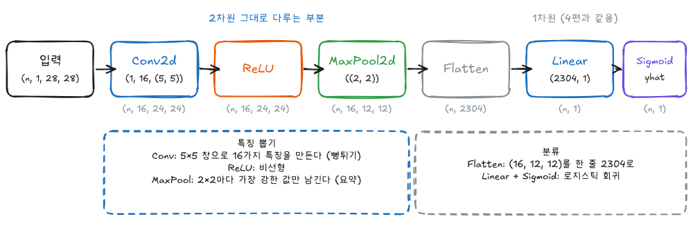
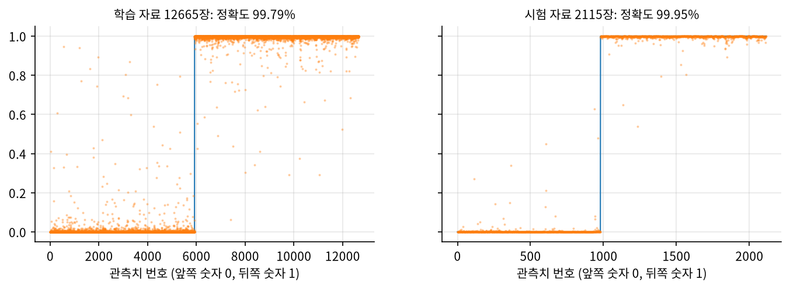
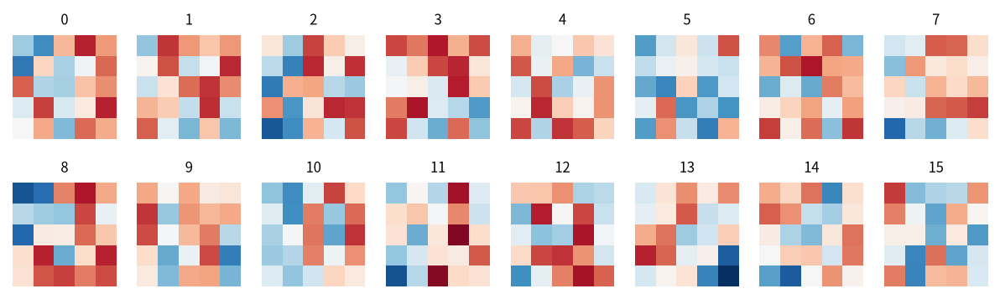
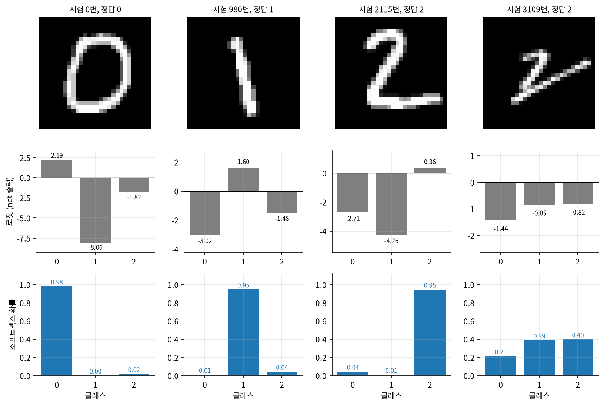
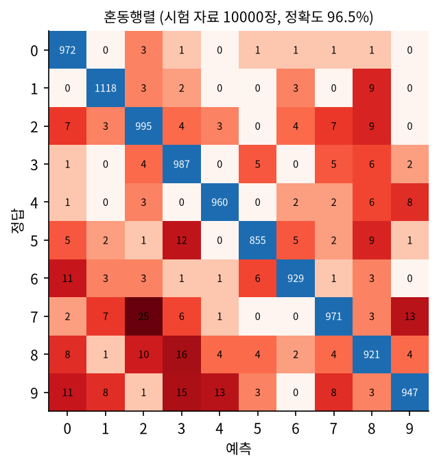

합성곱신경망(convolutional neural network, CNN)은 이미지처럼 공간 구조가 있는 자료에 쓰는 신경망이다. [6편](/posts/dl-06-minibatch-overfitting)처럼 28×28 이미지를 784개짜리 한 줄로 펴면 "이 픽셀과 저 픽셀이 옆자리"라는 정보가 사라진다. 합성곱 층은 작은 창을 이미지 위에서 옮기며 **같은 가중치**로 가중합을 계산한다. 시계열의 이동평균([시계열 분석 - 평활법](/posts/ts-03-smoothing))을 2차원으로 옮기고, 그 가중치를 자료에서 학습하는 것이다.

## 합성곱

### 창을 옮기며 곱해서 더하기

입력 $\mathbf X$ ($H \times W$)와 $k \times k$ 가중치 $\mathbf K$(필터, 커널)에 대해 합성곱의 출력은

$$
Z_{ij} = \sum_{a=0}^{k-1}\sum_{b=0}^{k-1} K_{ab}\,X_{i+a,\,j+b} + b_0
$$

이다. 창 안의 입력과 가중치를 같은 자리끼리 곱해 모두 더하고 편향을 더한다. 창이 놓일 수 있는 위치마다 이것을 반복한다.


```python
conv = torch.nn.Conv2d(in_channels=1, out_channels=1, kernel_size=(2, 2))
conv.weight.data = torch.full((1, 1, 2, 2), 1/4)       # 네 칸 평균
conv.bias.data = torch.tensor([0.0])
conv(torch.arange(25.).reshape(1, 5, 5))
# tensor([[[ 3.,  4.,  5.,  6.],
#          [ 8.,  9., 10., 11.],
#          [13., 14., 15., 16.],
#          [18., 19., 20., 21.]]])
```

가중치가 모두 $1/k^2$이면 2차원 이동평균이다. 출력의 크기는 창이 놓일 수 있는 위치의 수다.

| 설정 | 출력 크기 | 예 ($H = 28$, $k = 5$) |
|---|---|---|
| 기본 | $H - k + 1$ | 24 |
| 보폭(stride) $s$, 테두리 덧대기(padding) $p$ | $\lfloor (H + 2p - k)/s \rfloor + 1$ | $s = 1, p = 2$이면 28 |

### 필터가 감지하는 것

가중치에 따라 합성곱은 이미지에서 서로 다른 것을 감지한다. 손으로 만든 3×3 필터를 숫자 7에 적용해 보았다.



| 필터 | 가중치 | 반응 |
|---|---|---|
| 세로 경계 | $\begin{bmatrix} 1 & 0 & -1 \\ 1 & 0 & -1 \\ 1 & 0 & -1 \end{bmatrix}$ | 왼쪽이 밝고 오른쪽이 어두우면 양수. 7의 비스듬한 획 양쪽 |
| 가로 경계 | 위 필터의 전치 | 7의 윗변 |
| 평균 | 모두 $1/9$ | 흐리게 (평활) |

CNN은 이런 필터를 사람이 정하지 않고 **학습한다.** 필터의 가중치가 파라미터이므로, 분류에 유용한 패턴을 감지하는 필터가 경사하강법으로 만들어진다.

### `Linear`와 비교

| | `Linear` | `Conv2d` |
|---|---|---|
| 출력 하나가 보는 입력 | 전부 (784개) | $k \times k$ 창 (지역성) |
| 위치마다 가중치 | 다르다 | 같다 (가중치 공유) |
| 담긴 가정 | 없음 | 의미 있는 패턴은 가까운 픽셀로 이루어지고, 그 의미는 위치와 무관하다 |
| 28×28 → 16×24×24의 파라미터 | $784 \times 9{,}216 \approx 723$만 | $16 \times 5 \times 5 + 16 = 416$ |

가중치 공유는 시계열의 정상성 가정과 닮았다. 정상 시계열에서 자기상관이 시점이 아니라 시차에만 의존하듯, 합성곱은 "가로 획을 알아보는 방법"이 이미지의 위치에 의존하지 않는다고 가정한다. 가정이 맞는 자료에서는 같은 표현력을 수만 분의 일의 파라미터로 얻는다.

### 채널

`Conv2d(in, out, k)`의 앞 두 인자는 채널 수다. 필터가 `out`개 있고 필터마다 출력 이미지(특징맵) 하나를 만든다. 입력 채널이 여러 개면(컬러 이미지의 RGB 3채널, 앞 층의 특징맵 16개 등) 필터 하나가 (in, k, k) 모양이고 모든 입력 채널에 걸쳐 곱해 더한다.

```python
conv = torch.nn.Conv2d(1, 8, (2, 2))
conv.weight.shape              # (8, 1, 2, 2): (출력 채널, 입력 채널, 세로, 가로)
conv(torch.ones(1, 2, 2)).shape   # (8, 1, 1): 필터 8개가 특징 8개를 만든다
```

파라미터 수는 $\text{out} \times \text{in} \times k^2 + \text{out}$이다. `Linear`가 입력 특징으로 새 특징 여러 개를 만들듯, 합성곱은 입력 특징맵으로 새 특징맵 여러 개를 만든다.

## 맥스풀링

`MaxPool2d((2, 2))`는 입력을 겹치지 않는 2×2 칸으로 나누고 칸마다 최댓값만 남긴다(위 그림 아래쪽).

```python
pool = torch.nn.MaxPool2d((2, 2))
pool(torch.arange(16.).reshape(1, 4, 4))   # [[ 5.,  7.], [13., 15.]]
pool(torch.arange(25.).reshape(1, 5, 5))   # [[ 6.,  8.], [16., 18.]]  남는 행·열은 버린다
```

| 역할 | 내용 |
|---|---|
| 요약 | 가로세로를 절반으로 줄여 뒤 층의 계산량과 파라미터를 줄인다 |
| 작은 이동에 둔감 | 칸 안에서 "이 특징이 어딘가 강하게 있었다"만 남기고 정확한 위치는 버린다. 획이 한 픽셀 옮겨져도 출력이 거의 같다 |
| 파라미터 | 없다 |

## 구조: 특징 뽑기 + 분류

CNN은 앞쪽에서 (합성곱 → ReLU → 풀링)으로 2차원 특징을 뽑고, 그것을 펴서 `Linear`로 분류한다. [4편](/posts/dl-04-mlp-universal)의 MLP에서 "선형변환이 특징을 만들고, 활성화가 꺾고, 마지막 선형변환이 요약한다"던 역할을 2차원으로 옮긴 것이다.



| 층 | 출력 shape | 파라미터 |
|---|---|---|
| 입력 | (n, 1, 28, 28) | |
| `Conv2d(1, 16, (5, 5))` | (n, 16, 24, 24) | 416 |
| `ReLU()` | (n, 16, 24, 24) | |
| `MaxPool2d((2, 2))` | (n, 16, 12, 12) | |
| `Flatten()` | (n, 2304) | |
| `Linear(2304, k)` | (n, k) | $2305k$ |

`Flatten`은 관측치 축은 두고 나머지를 한 줄로 편다. 마지막 `Linear`의 입력 크기($16 \times 12 \times 12 = 2304$)는 층마다 출력 shape을 따라가며 정한다. 실제로 만들 때도 층을 하나씩 붙이고 `net(X[:1]).shape`을 찍어 보는 것이 가장 확실하다. 마지막 층의 출력 수 $k$와 손실은 [3편](/posts/dl-03-output-loss)대로 반응변수에 따라 고른다.

```python
features = torch.nn.Sequential(                 # 특징 뽑기: (n,1,28,28) -> (n,2304)
    torch.nn.Conv2d(1, 16, (5, 5)), torch.nn.ReLU(),
    torch.nn.MaxPool2d((2, 2)), torch.nn.Flatten(),
)
net = torch.nn.Sequential(features, torch.nn.Linear(2304, k))   # 분류
```

`Sequential` 안에 `Sequential`을 넣어 특징 뽑기 부분을 따로 묶어 두면, 그 부분만 떼어 다른 문제에 쓰기 쉽다([8편](/posts/dl-08-transfer-cam)의 전이학습).

## 예제: MNIST

### 0과 1: 학습된 필터

숫자 0과 1(학습 12,665장, 시험 2,115장)을 $k = 1$, `BCEWithLogitsLoss`로 전체 배치 100 에폭 학습했다. 파라미터는 2,721개로, 6편의 784-30-1 MLP(23,581개)의 9분의 1이다.



학습 정확도 99.79%, 시험 정확도 99.95%(2,115장 중 1장 오답)다. 첫 층의 필터 16개가 무엇을 보는지는 숫자 하나를 넣고 합성곱 + ReLU 뒤의 특징맵을 그리면 알 수 있다.




어떤 채널은 획의 왼쪽 가장자리에, 어떤 채널은 오른쪽이나 아래쪽에 반응하고, 채널 5는 반대로 배경에서 켜진다. 손으로 만든 경계 필터와 비슷한 것이 학습으로 생겼다. 층이 깊은 CNN에서는 앞 층이 이런 경계를, 뒤 층이 그것을 조합한 모서리·원·부품을 감지한다. 4편 끝에서 말한 "층을 쌓으면 앞 층의 특징을 재료로 다시 쓴다"가 이것이다.

### 0, 1, 2: 로짓과 소프트맥스

클래스가 셋이면 마지막 층을 `Linear(2304, 3)`, 손실을 `CrossEntropyLoss`로 바꾸고, 정답은 정수 클래스 번호 (n,)로 둔다(3편). 학습 18,623장, 시험 3,147장, 10 에폭 후 시험 정확도는 98.22%다.

시험 자료의 출력 (3147, 3)을 정답별로 평균 내면 다음과 같다.

| 정답 | 열 0 | 열 1 | 열 2 |
|---|---|---|---|
| 0 | **1.85** | −7.62 | −2.03 |
| 1 | −3.55 | **2.33** | −1.29 |
| 2 | −3.04 | −4.52 | **1.14** |

정답 열의 로짓이 가장 크다. 로짓은 음수도 있고 합이 1도 아니므로, 확률이 필요하면 `torch.softmax(net(X), dim=1)`을 씌운다.



앞의 세 장은 정답 확률이 0.95 이상이다. 맨 오른쪽은 시험 자료 중 네트워크가 가장 자신 없어 한 이미지(3109번)로, 흘려 쓴 2의 로짓이 (−1.44, −0.85, −0.82)로 비슷해 확률이 (0.21, 0.39, 0.40)이다. 1과 2 사이에서 망설이다 겨우 맞혔다. 소프트맥스는 로짓의 차이만 보므로 세 값이 모두 음수여도 상관없다.

### 0~9: 혼동행렬

같은 구조에 `Linear(2304, 10)`으로 숫자 10개를 모두 구분한다. 학습 60,000장, 시험 10,000장, 배치 2,048, 10 에폭(MPS로 13초)에 시험 정확도 96.55%다. 클래스가 많으면 정확도 하나보다 **혼동행렬**(행: 정답, 열: 예측)을 본다.



| 관찰 | 내용 |
|---|---|
| 가장 많은 오답 | 7 → 2 (25장). 7의 아랫부분을 꺾어 쓰면 2와 닮는다 |
| 다음 오답 | 8 → 3 (16장), 9 → 3 (15장), 9 → 4, 7 → 9 (각 13장) |
| 클래스별 정확도 | 0이 99.2%로 가장 높고 9가 93.9%로 가장 낮다 |

모양이 닮은 숫자끼리 틀린다. 합성곱 층 하나짜리 작은 네트워크라 이 정도이고, 층을 더 쌓으면 MNIST에서 99% 이상이 나온다.

## fastai `Learner`로 학습하기

학습 루프(6편)를 매번 쓰는 대신, 파이토치 데이터로더와 네트워크를 fastai에 넘기면 장치 이동, 미니배치 반복, 검증 손실과 지표 계산을 대신 해 준다. [1편](/posts/dl-01-overview)의 네 단계를 재료부터 직접 조립하는 셈이다.

```python
from fastai.vision.all import DataLoaders, Learner, accuracy

dl_train = torch.utils.data.DataLoader(torch.utils.data.TensorDataset(X, y), batch_size=2048, shuffle=True)
dl_valid = torch.utils.data.DataLoader(torch.utils.data.TensorDataset(XX, yy), batch_size=2048)
dls = DataLoaders(dl_train, dl_valid)                                   # 1. 자료
lrnr = Learner(dls, net, torch.nn.CrossEntropyLoss(), metrics=accuracy) # 2. 학습기 (옵티마이저 기본값 Adam)
lrnr.fit(10)                                                            # 3. 학습
```

| 주의할 점 | 내용 |
|---|---|
| `lrnr.model is net` | `True`. 복사본이 아니므로 학습 뒤 `net`은 GPU에 있다. CPU 자료로 예측하려면 `net.to("cpu")` |
| `train_loss` > `valid_loss` | `train_loss`는 에폭 동안 배치 손실의 평균이라 에폭 초반의 나쁜 값이 섞인다. 학습 초반에는 흔하다 |
| 지표의 가정 | `accuracy`는 (n, k) 로짓의 argmax를 쓴다. (n, 1) 출력에는 맞지 않는다(3편) |

## 요약

| 층 | 하는 일 | 파라미터 |
|---|---|---|
| `Conv2d(in, out, k)` | 창을 옮기며 가중합. 필터마다 특징맵 하나 | $\text{out} \times \text{in} \times k^2 + \text{out}$ |
| `ReLU()` | 원소마다 $\max(0, x)$ | 없음 |
| `MaxPool2d(k)` | $k \times k$ 칸마다 최댓값 | 없음 |
| `Flatten()` | 관측치 축을 빼고 한 줄로 | 없음 |

- 합성곱은 가중치를 학습하는 2차원 이동평균이다. 지역성과 가중치 공유라는 가정 덕에 `Linear`보다 파라미터가 훨씬 적다.
- 학습된 첫 층 필터는 경계 같은 단순한 패턴을 감지한다. 깊은 층은 그것을 조합한다.
- CNN = (합성곱 → ReLU → 풀링)으로 특징 뽑기 + 펴서 `Linear`로 분류. 마지막 층과 손실은 반응변수에 맞춘다.
- 여러 클래스 분류는 로짓의 argmax로 예측하고, 확률은 소프트맥스로, 오류의 구조는 혼동행렬로 본다.

## 참고자료

- 최규빈, 「딥러닝」 강의노트 (2022), <https://guebin.github.io/DL2022/>
- LeCun, Y., Bottou, L., Bengio, Y. and Haffner, P. (1998). Gradient-based learning applied to document recognition. *Proceedings of the IEEE*, 86(11), 2278–2324.
- Goodfellow, I., Bengio, Y. and Courville, A. (2016). *Deep Learning*, Chapter 9. MIT Press.
- Dumoulin, V. and Visin, F. (2016). A guide to convolution arithmetic for deep learning. <https://arxiv.org/abs/1603.07285>
