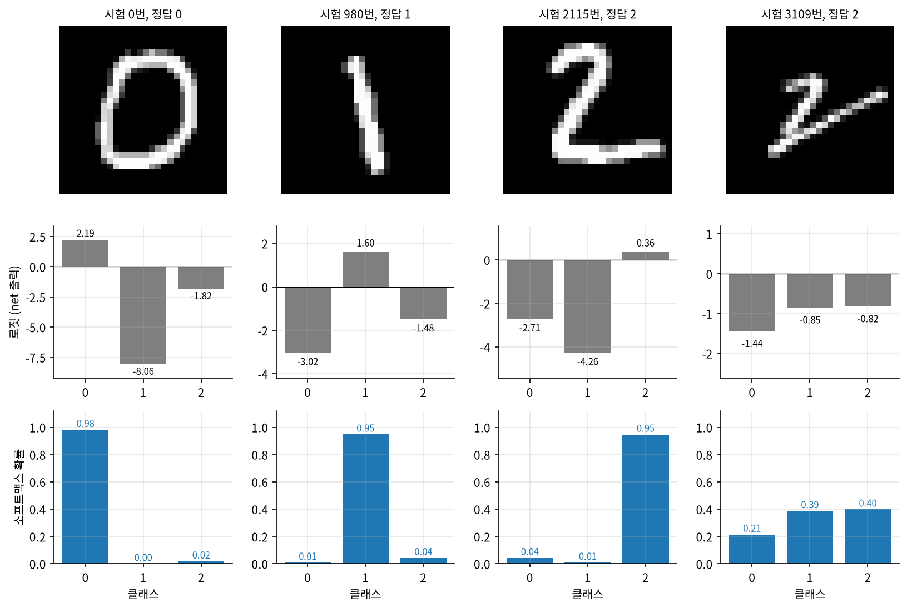
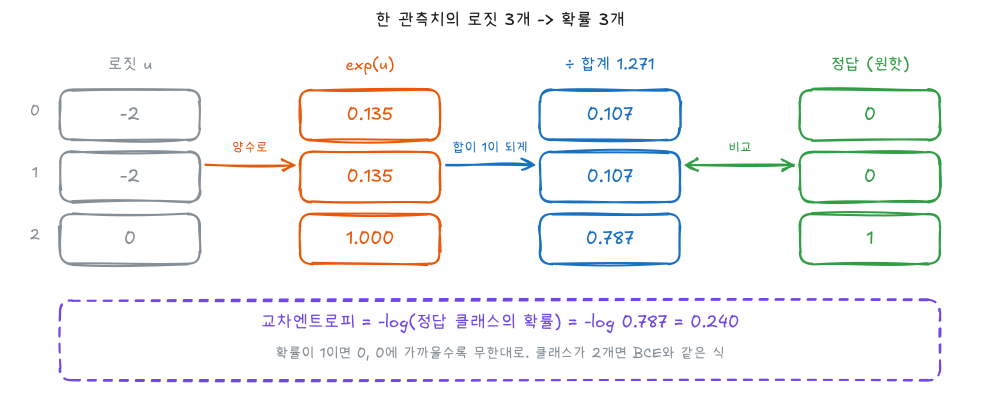
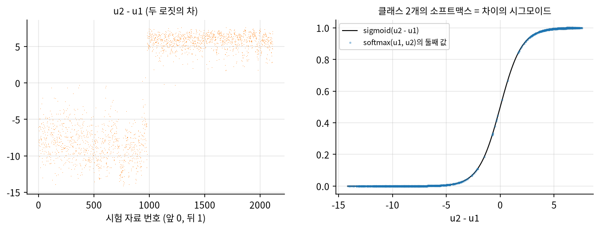
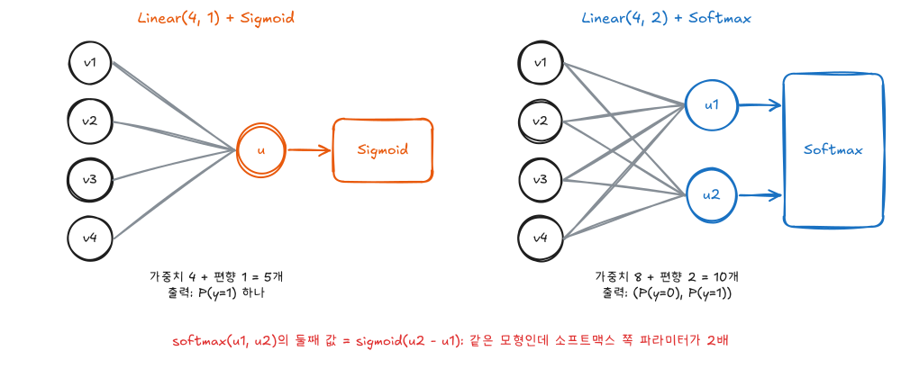
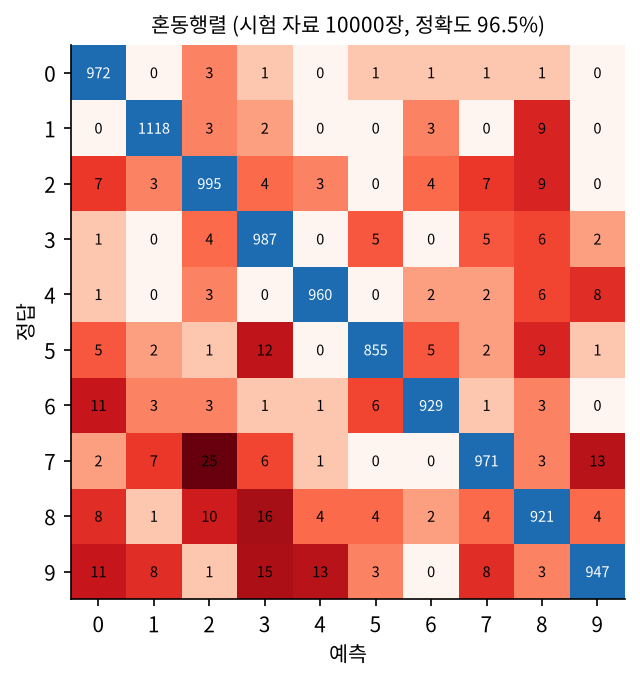

[앞 글](/posts/dl-07-cnn)까지 다룬 분류는 모두 이진 분류였다. 3인가 7인가, 0인가 1인가. 출력은 확률 하나였고, 시그모이드와 BCE가 짝이었다. 그런데 실제 문제는 대개 클래스가 여러 개다. 숫자는 0부터 9까지 10개이고, 1편의 반려동물 사진은 품종이 37개다.

이 글은 클래스가 $k$개일 때 무엇이 바뀌는지 본다. 결론은 짧다. 시그모이드가 **소프트맥스**로, BCE가 **교차엔트로피**로 일반화된다. 그 결론을 먼저 적고, 숫자 0, 1, 2를 구분하는 CNN으로 실습한 뒤, 두 함수를 손으로 계산하고 유도한다. 이어서 클래스가 2개일 때 시그모이드와 소프트맥스가 사실상 같은 모형이라는 것을 확인하고, fastai의 평가지표를 쓸 때 정답의 모양을 잘못 맞추면 어떤 일이 생기는지 본다.

## 1. 결론부터

강의는 이 부분을 "그냥 외우세요"라고 시작한다. 이유는 뒤에서 하나씩 확인한다.

**일반적인 개념**

| | 이진 분류 ($k = 2$) | 다중 분류 ($k$개) |
|---|---|---|
| 마지막 선형변환 | `Linear(?, 1)` | `Linear(?, k)` |
| 마지막 활성화 | 시그모이드 | 소프트맥스 |
| 손실 | BCE | 교차엔트로피(cross entropy) |

**파이토치에 한정된 것**

| | 이진 분류 | 다중 분류 |
|---|---|---|
| 손실 함수 | `BCEWithLogitsLoss()` | `CrossEntropyLoss()` |
| 네트워크 끝 활성화 | 없음 (손실에 포함) | 없음 (손실에 포함) |
| 정답 $y$의 모양 | (n, 1) 실수 0/1 | (n,) 정수 0, 1, …, k−1 또는 (n, k) 원핫 실수 |

7편에서 `BCEWithLogitsLoss`가 시그모이드를 안에 품고 있었던 것처럼, `CrossEntropyLoss`도 소프트맥스를 안에 품고 있다. 그래서 네트워크는 마지막 `Linear`에서 끝나고, 그 출력(로짓)을 그대로 손실에 넘긴다.

## 2. 실습: 숫자 0, 1, 2 구분하기

### 자료와 네트워크

MNIST에서 숫자 0, 1, 2를 가져온다. 학습 자료 18,623장, 시험 자료 3,147장이다.

```python
X = torch.concat([X0, X1, X2]) / 255                          # (18623, 1, 28, 28)
y = torch.tensor([0]*len(X0) + [1]*len(X1) + [2]*len(X2))     # (18623,) 정수
```

정답 $y$가 이진 분류 때와 다르다. `.reshape(-1, 1)`을 하지 않은 길이 $n$의 벡터이고, 값은 실수 0.0/1.0이 아니라 정수 0, 1, 2다. `torch.tensor([0, 1, 2])`처럼 정수로 만들면 자료형이 `int64`가 된다. 이 숫자는 크기가 아니라 **클래스 번호**라는 뜻이다.

네트워크는 7편의 CNN에서 마지막 층의 출력 수만 3으로 바꾼다. 강의는 특징을 뽑는 부분을 `net1`으로 따로 묶어 두고 그 뒤에 `Linear`를 붙인다.

```python
net1 = torch.nn.Sequential(          # 특징 뽑기: (n, 1, 28, 28) -> (n, 2304)
    torch.nn.Conv2d(1, 16, (5, 5)),
    torch.nn.ReLU(),
    torch.nn.MaxPool2d((2, 2)),
    torch.nn.Flatten(),
)
net = torch.nn.Sequential(
    net1,
    torch.nn.Linear(2304, 3),        # 클래스 3개 -> 출력 3개. 소프트맥스는 넣지 않는다
)
loss_fn = torch.nn.CrossEntropyLoss()

dl1 = torch.utils.data.DataLoader(torch.utils.data.TensorDataset(X, y), batch_size=1862)
dl2 = torch.utils.data.DataLoader(torch.utils.data.TensorDataset(XX, yy), batch_size=3147)
lrnr = Learner(DataLoaders(dl1, dl2), net, loss_fn)
lrnr.fit(10)
```

`Sequential` 안에 `Sequential`을 넣을 수 있다. 이렇게 묶어 두면 나중에 "특징 뽑기 부분만 가져다 쓰기" 같은 일이 쉬워지는데, 다음 글의 전이학습과 CAM이 바로 그런 작업이다.

| 에폭 | 0 | 2 | 4 | 6 | 8 | 9 |
|---|---|---|---|---|---|---|
| train_loss | 1.953 | 1.082 | 0.790 | 0.541 | 0.379 | 0.319 |
| valid_loss | 1.122 | 0.663 | 0.307 | 0.164 | 0.107 | 0.092 |

10 에폭 후 시험 자료 정확도는 98.2%다.

### 네트워크의 출력 읽기

학습된 네트워크에 시험 자료를 넣으면 (3147, 3) 행렬이 나온다. 관측치마다 숫자 3개다. 정답별로 평균을 내 보자.

| 정답 | 열 0 평균 | 열 1 평균 | 열 2 평균 |
|---|---|---|---|
| 0 | **1.85** | −7.62 | −2.03 |
| 1 | −3.55 | **2.33** | −1.29 |
| 2 | −3.04 | −4.52 | **1.14** |

정답이 0인 이미지에서는 열 0이, 1인 이미지에서는 열 1이, 2인 이미지에서는 열 2가 가장 크다. 즉 **가장 큰 값이 있는 열이 예측 클래스**다. 이 숫자들은 아직 확률이 아니다. 음수도 있고 더해서 1이 되지도 않는다. 이것을 확률로 바꾸는 것이 소프트맥스다.



앞의 세 이미지는 정답 클래스의 로짓이 다른 둘보다 확실히 커서 확률이 0.95 이상이다. 맨 오른쪽은 시험 자료 중 네트워크가 가장 자신 없어 한 이미지다. 흘려 쓴 2인데 로짓 세 개가 −1.44, −0.85, −0.82로 비슷하고, 확률도 0.21, 0.39, 0.40으로 2와 1 사이에서 망설인다. 겨우 맞혔다.

## 3. 소프트맥스

### 정의와 손계산

로짓 $\mathbf u = (u_1, \dots, u_k)$를 확률로 바꾸는 소프트맥스는 다음과 같다.

$$
\text{softmax}(\mathbf u)_j = \frac{e^{u_j}}{\sum_{m=1}^k e^{u_m}}, \qquad j = 1, \dots, k
$$

두 단계로 읽으면 쉽다. 먼저 $e^{u}$로 모든 값을 양수로 만들고, 그 합으로 나누어 합이 1이 되게 한다.



강의의 예로 확인해 보자. 관측치 5개, 클래스 3개인 로짓이다.

```python
_netout = torch.tensor([[-2.0, -2.0, 0.0],
                        [3.14, 3.14, 3.14],
                        [0.0,  0.0,  2.0],
                        [2.0,  2.0,  4.0],
                        [0.0,  0.0,  0.0]])
torch.nn.Softmax(dim=1)(_netout)
# tensor([[0.1065, 0.1065, 0.7870],
#         [0.3333, 0.3333, 0.3333],
#         [0.1065, 0.1065, 0.7870],
#         [0.1065, 0.1065, 0.7870],
#         [0.3333, 0.3333, 0.3333]])
```

첫 행은 $e^{-2} = 0.1353$, $e^{0} = 1$이므로 $0.1353 / (0.1353 + 0.1353 + 1) = 0.1065$, $1 / 1.2706 = 0.7870$이다.

**`dim`을 꼭 지정한다.** 소프트맥스는 **한 관측치 안에서**, 즉 행마다(`dim=1`) 계산해야 한다. `dim=0`으로 하면 열마다, 즉 관측치들끼리 정규화해 버려서 첫 행이 (0.0041, 0.0041, 0.0115)처럼 의미 없는 값이 된다. 인자를 빼면 파이토치가 대개 맞게 추측하지만 경고를 낸다.

### 성질 두 가지

**이동 불변.** 모든 로짓에 같은 수 $c$를 더해도 결과가 같다.

$$
\frac{e^{u_j + c}}{\sum_m e^{u_m + c}} = \frac{e^c e^{u_j}}{e^c \sum_m e^{u_m}} = \frac{e^{u_j}}{\sum_m e^{u_m}}
$$

그래서 위 예의 둘째 행(3.14, 3.14, 3.14)과 다섯째 행(0, 0, 0)은 같은 (1/3, 1/3, 1/3)이고, 셋째 행(0, 0, 2)과 넷째 행(2, 2, 4)도 같다. 로짓의 절대적인 크기는 의미가 없고 **차이만** 의미가 있다. 이 성질은 계산에도 쓰인다. 로짓이 1000이면 $e^{1000}$이 넘치지만, 최댓값을 빼고 계산하면 안전하다.

**부드러운 최대.** 소프트맥스는 가장 큰 로짓에 대부분의 확률을 몰아준다. 로짓 차이가 클수록 "최댓값 위치만 1, 나머지 0"인 원핫 벡터에 가까워진다. 최댓값을 고르는 함수(argmax)를 미분 가능하게 부드럽게 만든 것이라 소프트(soft) 맥스라고 부른다. 확률의 대소 순서는 로짓의 순서와 같으므로, 예측 클래스만 필요하면 소프트맥스 없이 `net(X).argmax(dim=1)`로 충분하다.

## 4. 교차엔트로피

### 정의와 손계산

정답을 원핫 벡터 $\mathbf y_i = (y_{i1}, \dots, y_{ik})$로 쓰자. 정답이 클래스 2(세 번째)면 $(0, 0, 1)$이다. 예측 확률을 $\mathbf p_i = \text{softmax}(\mathbf u_i)$라 하면 교차엔트로피 손실은

$$
\text{CE} = -\frac1n\sum_{i=1}^n\sum_{j=1}^k y_{ij}\log p_{ij}
$$

이다. 원핫이라 안쪽 합에서 0이 아닌 항은 정답 클래스 하나뿐이므로, 결국 관측치마다 **정답 클래스의 예측 확률에 $-\log$를 씌운 것**의 평균이다.

$$
\text{CE} = -\frac1n\sum_{i=1}^n \log p_{i,\,c_i} \qquad (c_i = \text{관측치 } i\text{의 정답 클래스})
$$

정답 확률이 1이면 벌점 0, 0에 가까울수록 벌점이 무한대로 커진다. 3편에서 본 BCE의 벌점과 같은 모양이다.

```python
_y_onehot = torch.tensor([[0, 0, 1], [0, 1, 0], [0, 0, 1], [0, 0, 1], [1, 0, 0]]) * 1.0
loss_fn = torch.nn.CrossEntropyLoss()
loss_fn(_netout, _y_onehot)                                          # 0.5832
-torch.sum(torch.log(torch.nn.Softmax(dim=1)(_netout)) * _y_onehot) / 5   # 0.5832

_y = torch.tensor([2, 1, 2, 2, 0])     # 같은 정답을 클래스 번호로
loss_fn(_netout, _y)                   # 0.5832
```

관측치별 벌점은 $-\log 0.787 = 0.240$(정답 2, 확률 0.787)이 세 개, $-\log(1/3) = 1.099$(확률이 셋 다 1/3)가 두 개다. 평균이 $(3 \times 0.240 + 2 \times 1.099)/5 = 0.583$이다.

여기서 확인할 것이 두 가지다.

- `CrossEntropyLoss`에 **로짓을 그대로** 넣었는데 소프트맥스를 거친 손계산과 같다. 즉 이 손실 안에 소프트맥스가 들어 있다. 강의의 말대로 이름을 `CEWithSoftmaxLoss`라고 했으면 더 정확했을 것이다. 네트워크 끝에 `Softmax`를 또 넣으면 소프트맥스를 두 번 하게 되어 학습이 이상해진다.
- 정답은 원핫 (n, k) 실수로 줘도, 클래스 번호 (n,) 정수로 줘도 된다. 결과가 같다.

### 가능도에서 유도하기

BCE가 베르누이 분포의 가능도에서 나왔듯이(3편), 교차엔트로피는 클래스가 $k$개인 범주형 분포(시행 1번인 다항분포)의 가능도에서 나온다. 관측치 $i$가 클래스 $j$일 확률이 $p_{ij}$라면 그 관측치의 확률은 $\prod_j p_{ij}^{y_{ij}}$다. 원핫이라 정답 클래스의 확률만 남는다. 독립인 $n$개의 가능도에 로그를 씌우고 부호를 바꿔 평균 내면

$$
-\frac1n\log\prod_{i=1}^n\prod_{j=1}^k p_{ij}^{y_{ij}} = -\frac1n\sum_{i=1}^n\sum_{j=1}^k y_{ij}\log p_{ij}
$$

로 정확히 교차엔트로피다. 교차엔트로피를 최소화하는 것은 최대가능도추정이다. $k = 2$이면 $y_{i1} = 1 - y_{i2}$, $p_{i1} = 1 - p_{i2}$이므로 BCE와 같은 식이 된다.

"교차엔트로피"라는 이름은 정보이론에서 왔다. 두 분포 $\mathbf y$와 $\mathbf p$에 대해 $-\sum_j y_j\log p_j$를 $\mathbf y$에 대한 $\mathbf p$의 교차엔트로피라고 한다. $\mathbf p$가 $\mathbf y$와 같을 때 가장 작다.

### 기울기: 예측 확률 − 정답

교차엔트로피 + 소프트맥스를 로짓으로 미분해 보자. 관측치 하나, 정답 클래스 $c$에 대해

$$
\ell = -\log\frac{e^{u_c}}{\sum_m e^{u_m}} = -u_c + \log\sum_m e^{u_m}
$$

이고, $u_j$로 미분하면

$$
\frac{\partial \ell}{\partial u_j} = -\mathbb 1[j = c] + \frac{e^{u_j}}{\sum_m e^{u_m}} = p_j - y_j
$$

이다. **예측 확률에서 원핫 정답을 뺀 것**이다. 시그모이드 + BCE의 $\sigma(u) - y$(3편)와 같은 형태다. 정답 클래스의 로짓은 $p_c - 1 < 0$이라 올라가는 방향으로, 나머지는 $p_j > 0$이라 내려가는 방향으로 밀린다. 틀린 만큼 기울기가 나오고, 소프트맥스의 미분이 따로 남아 기울기를 죽이는 일이 없다. 실제로 위 예에서 `loss.backward()`로 구한 기울기는 첫 행이 (0.107, 0.107, −0.213)으로 $\mathbf p - \mathbf y$와 같다.

손실을 $-u_c + \log\sum_m e^{u_m}$ 꼴로 계산하면 수치적으로도 안전하다. $\log\sum_m e^{u_m}$은 최댓값 $M = \max_m u_m$을 빼서 $M + \log\sum_m e^{u_m - M}$으로 계산하면 넘치지 않는다(log-sum-exp 기법). 로짓이 (1000, 0, 0)이고 정답이 클래스 1인 극단적인 경우에도 `CrossEntropyLoss`는 정확히 1000을 돌려준다. 소프트맥스를 먼저 계산했다면 확률이 정확히 0이 되어 $\log 0$을 만났을 것이다. 7편의 `BCEWithLogitsLoss`와 같은 이유로 소프트맥스가 손실 안에 들어 있는 것이다.

## 5. 이진 분류에서 소프트맥스 vs 시그모이드

### $k = 2$로 두면 이진 분류도 된다

다중 분류 틀로 이진 분류를 풀 수도 있다. 숫자 0과 1을 `Linear(2304, 2)` + `CrossEntropyLoss`로 학습하면 시험 정확도 99.81%로 잘 된다. 정답은 `torch.nn.functional.one_hot(y).float()`로 원핫 (n, 2)를 만들어 넣었다.

이때 두 로짓 $(u_1, u_2)$의 소프트맥스를 풀어 보면

$$
\text{softmax}(u_1, u_2)_2 = \frac{e^{u_2}}{e^{u_1} + e^{u_2}} = \frac{1}{1 + e^{-(u_2 - u_1)}} = \sigma(u_2 - u_1)
$$

이다. 클래스가 2개인 소프트맥스는 **두 로짓의 차이에 시그모이드를 씌운 것**과 같다. 실제로 학습된 네트워크에서 둘의 차이는 최대 $3 \times 10^{-8}$(부동소수점 오차)이었다.



### 같은 모형, 다른 비용



이진 분류는 성공 확률과 실패 확률을 추정하는 문제인데, 실패 확률 = 1 − 성공 확률이므로 하나만 추정하면 된다. 시그모이드는 성공 확률 하나를, 소프트맥스는 둘 다를 추정한다. 두 모형이 표현하는 확률은 같지만 소프트맥스 쪽은 파라미터가 두 배다. 사실 소프트맥스에서는 $u_2 - u_1$만 의미가 있으므로(이동 불변) 파라미터 절반은 군더더기다.

정리하면 다음과 같다.

- 소프트맥스는 시그모이드의 확장이다. 시그모이드는 $k$개 클래스로 확장할 수 없지만 소프트맥스는 된다.
- 클래스가 2개면 (시그모이드, BCE), 3개 이상이면 (소프트맥스, 교차엔트로피)를 쓴다.
- 2개일 때 (소프트맥스, 교차엔트로피)를 써도 큰일은 아니다. 강의의 비유로 "흑백 이미지를 컬러 잉크로 출력하는 느낌"이다. 결과는 같고 조금 낭비일 뿐이다.

### 분포 가정과 마지막 층

지금까지의 짝을 통계 모형의 관점에서 한 표로 모을 수 있다.

| $y$ | 분포 가정 | 마지막 층의 활성화 | 손실 (= −로그가능도) |
|---|---|---|---|
| 3.45, 4.43, … (연속) | 정규분포 | 없음 (항등) | MSE |
| 0 또는 1 | 베르누이 | 시그모이드 | BCE |
| [1,0,0], [0,1,0], [0,0,1] | 범주형 (다항, 시행 1번) | 소프트맥스 | 교차엔트로피 |

일반화선형모형(GLM)에서 반응변수의 분포에 맞춰 연결함수를 고르는 것과 같은 구조다. 마지막 `Linear`까지가 선형예측자이고, 활성화가 연결함수의 역함수, 손실이 음의 로그가능도다. 은닉층이 없으면 셋째 줄은 통계학의 다항 로지스틱 회귀 그 자체다.

## 6. fastai 평가지표

### 사용자 정의 평가지표

손실은 학습을 위한 것이고, 사람이 읽기 좋은 성능 지표는 따로 본다(1편에서 손실과 평가지표를 구분했다). `Learner`의 `metrics` 인자에 함수를 넘기면 에폭마다 검증 자료로 계산해 보여 준다. 함수는 (예측, 정답)을 받아 숫자를 돌려주면 된다.

```python
def acc(yhat, y):
    return ((yhat > 0.5) == y).float().mean()

def err(yhat, y):
    return 1 - ((yhat > 0.5) == y).float().mean()

lrnr = Learner(dls, net, loss_fn, metrics=[acc, err])   # net 끝은 Sigmoid, 손실은 BCELoss
```

숫자 0과 1을 7편의 시그모이드 CNN으로 학습하면 `acc`가 첫 에폭 0.463에서 바로 0.995 근처로 올라 10 에폭에 0.997이 된다.

### fastai 내장 지표를 잘못 쓰면

fastai에는 `accuracy`와 `error_rate`가 이미 있다. 같은 네트워크에 이것을 넘기면 이상한 일이 생긴다.

| 에폭 | 0 | 1 | 2 | … | 9 |
|---|---|---|---|---|---|
| valid_loss | 0.603 | 0.396 | 0.248 | … | 0.015 |
| accuracy | 0.4634 | 0.4634 | 0.4634 | … | 0.4634 |

손실은 잘 줄어드는데 정확도가 46.34%에서 꼼짝하지 않는다. 예측을 그려 보면 잘 맞히고 있다. 원인은 `accuracy`의 소스 코드에 있다.

```python
def accuracy(inp, targ, axis=-1):
    pred, targ = flatten_check(inp.argmax(dim=axis), targ)
    return (pred == targ).float().mean()
```

`accuracy`는 예측이 (n, k) 로짓이라고 **가정하고** 마지막 축의 argmax로 예측 클래스를 정한다. 그런데 우리 네트워크의 출력은 (n, 1)이다. 열이 하나뿐이니 argmax는 언제나 0이고, 모든 이미지를 숫자 0으로 판정한다. 시험 자료에서 숫자 0의 비율이 $980 / 2115 = 0.4634$다. 지표 함수가 기대하는 모양과 실제 모양이 어긋난 것이다.

### 올바른 사용

fastai 내장 지표는 다중 분류 틀을 가정한다. 그 틀에 맞추면 된다.

**방법 1: 정답을 정수 클래스 번호로.** $y$를 (n,) 모양의 `int64`로, 네트워크 끝을 `Linear(2304, 2)`로, 손실을 `CrossEntropyLoss()`로 둔다. 그러면 `accuracy`가 정상적으로 계산되어 10 에폭 후 0.998이 된다.

```python
ds1 = torch.utils.data.TensorDataset(X, y.to(torch.int64).reshape(-1))
lrnr = Learner(dls, net, torch.nn.CrossEntropyLoss(), metrics=[accuracy, error_rate])
```

**방법 2: 정답을 원핫으로.** $y$를 (n, 2) 원핫 실수로 두고, 지표로 `accuracy_multi`를 쓴다. 강의에서는 10 에폭 후 0.998, 이 기기에서도 0.998이었다. 다만 `accuracy_multi`는 원래 한 이미지에 여러 레이블이 붙을 수 있는 문제(다중 레이블)를 위한 지표라서, 로짓 각각에 시그모이드를 씌워 0.5와 비교한 뒤 $n \times k$개 원소 전체에서 맞힌 비율을 낸다. 이 예처럼 클래스가 2개이고 잘 학습된 경우에는 보통의 정확도와 거의 같지만, 정의가 다르다는 점은 알아 두자.

교훈은 평가지표 함수도 입력의 모양에 대한 가정을 갖고 있다는 것이다. 지표가 이상하면 손실이나 예측보다 먼저 지표 함수가 무엇을 가정하는지 확인한다.

## 7. 10개 숫자 전부

마지막으로 같은 CNN(`Linear(2304, 10)`)으로 0부터 9까지 10개 클래스를 모두 구분해 보자. 학습 자료 60,000장, 시험 자료 10,000장, 배치 2,048(섞기), 10 에폭이다. 이 기기 GPU로 13초가 걸렸고, 시험 정확도는 96.6%다.

여러 클래스의 결과는 **혼동행렬**(confusion matrix)로 보면 좋다. 행이 정답, 열이 예측이고, 칸의 숫자는 그 조합의 이미지 수다. 대각선(파랑)이 맞힌 것이고 나머지(빨강, 진할수록 많음)가 틀린 것이다.



전체 정확도 하나로는 보이지 않던 것이 보인다.

- 가장 많이 틀린 조합은 7을 2로 본 것(25장)이다. 7의 아래쪽에 가로획을 긋거나 꺾어 쓰면 2와 비슷해진다.
- 9를 3이나 4로(15장, 13장), 8을 3으로(16장), 7을 9로(13장) 본 경우도 많다. 모양이 닮은 숫자끼리다.
- 클래스별 정확도는 0(99.2%)과 1(98.5%)이 가장 높고, 9(93.9%), 7(94.5%), 8(94.6%)이 가장 낮다.

합성곱 층 하나짜리 작은 CNN이라 이 정도이고, 층을 더 쌓으면 MNIST에서 99% 이상이 나온다. 다음 글에서는 층이 수십 개인 남의 네트워크를 가져다 쓰는 방법을 본다.

## 정리

| 질문 | 답 |
|---|---|
| 클래스가 $k$개면 무엇이 바뀌나? | 마지막 층 `Linear(?, k)`, 활성화 소프트맥스, 손실 교차엔트로피 |
| 파이토치에서는? | 네트워크는 `Linear`에서 끝내고 `CrossEntropyLoss()`에 로짓을 넘긴다. 정답은 (n,) 정수 또는 (n, k) 원핫 |
| 소프트맥스는? | $e^{u_j} / \sum_m e^{u_m}$. 행마다(`dim=1`). 로짓의 차이만 의미 있다 |
| 교차엔트로피는? | 정답 클래스 확률의 $-\log$ 평균. 범주형 분포의 음의 로그가능도 |
| 기울기는? | $\mathbf p - \mathbf y$ (예측 확률 − 원핫 정답) |
| 예측 클래스는? | `net(X).argmax(dim=1)`. 확률이 필요하면 `torch.softmax(net(X), dim=1)` |
| $k = 2$에서 둘의 관계는? | $\text{softmax}(u_1, u_2)_2 = \sigma(u_2 - u_1)$. 같은 모형, 소프트맥스 쪽이 파라미터 2배 |
| fastai `accuracy`의 함정은? | (n, k) 로짓을 가정하고 argmax를 한다. (n, 1) 출력에 쓰면 항상 클래스 0 |

- 회귀, 이진 분류, 다중 분류는 반응변수의 분포(정규, 베르누이, 범주형)에 따라 마지막 활성화와 손실을 고른다는 점에서 하나의 틀이다.
- 소프트맥스와 시그모이드는 손실 함수 안에 넣어 두는 것이 파이토치의 관례다. 수치적으로 안전하고 기울기가 깔끔하다.
- 정확도 하나보다 혼동행렬이 더 많은 것을 알려 준다.

## 참고자료

- 최규빈, 「딥러닝」 강의노트 (2022), 08wk-1: 이미지분석 (2), <https://guebin.github.io/DL2022/>
- Goodfellow, I., Bengio, Y. and Courville, A. (2016). *Deep Learning*, Section 6.2.2.3 (Softmax Units for Multinoulli Output Distributions). MIT Press.
- Agresti, A. (2013). *Categorical Data Analysis* (3rd ed.), Chapter 8 (Multicategory Logit Models). Wiley.
- PyTorch 문서, `torch.nn.CrossEntropyLoss` · `torch.nn.Softmax`, <https://pytorch.org/docs/stable/>
- fastai 문서, Metrics, <https://docs.fast.ai/metrics.html>
