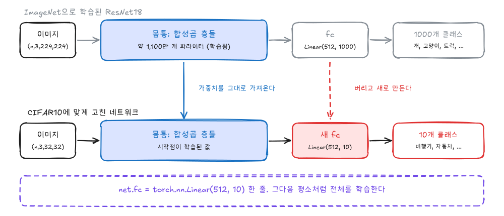
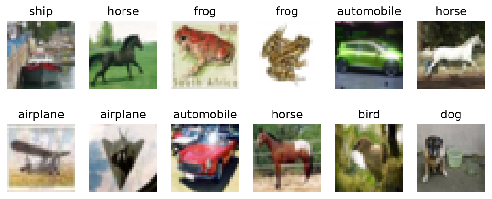
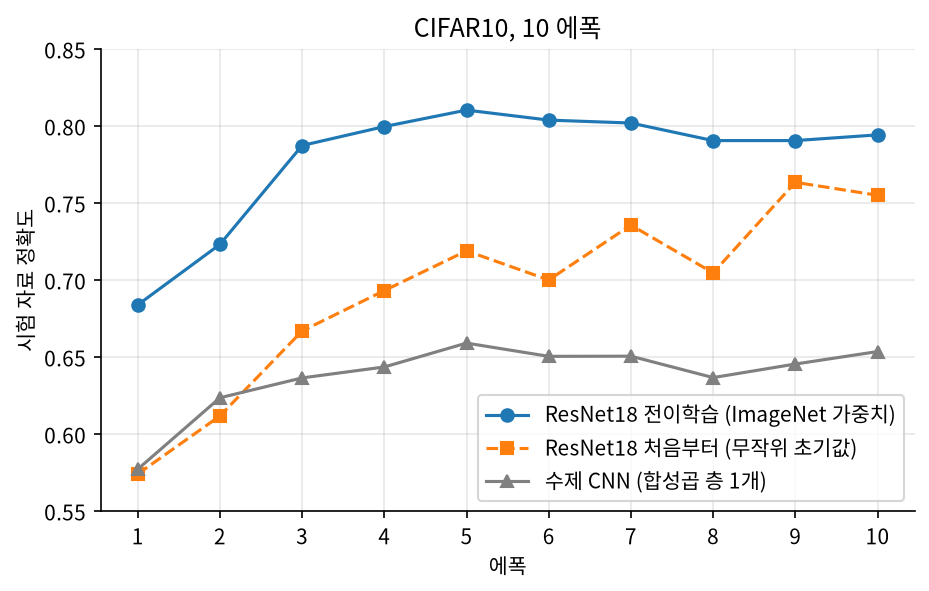
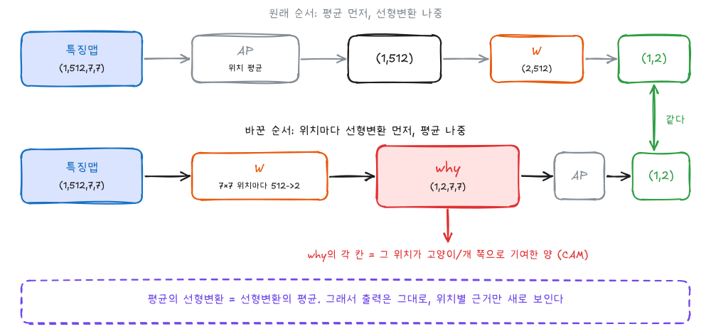
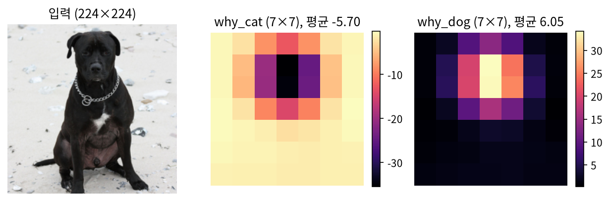
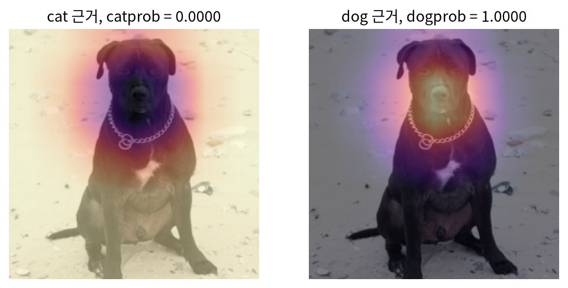
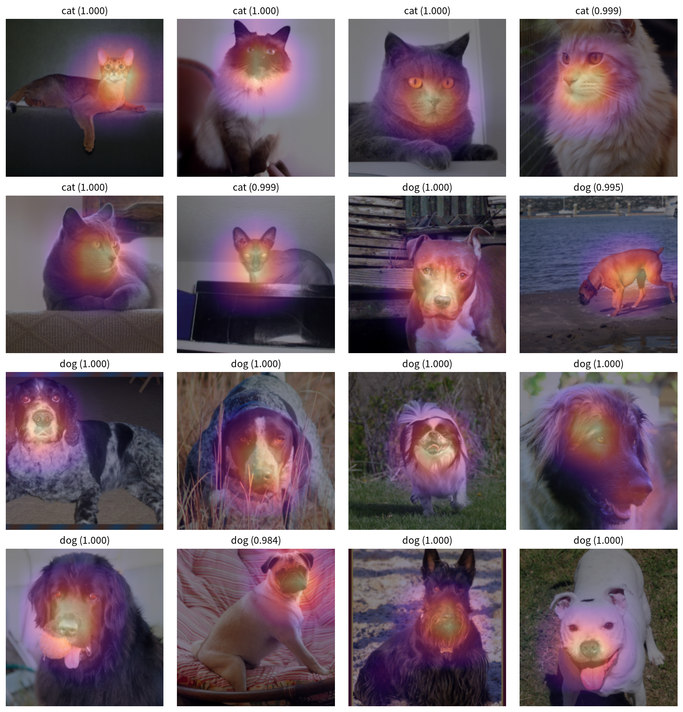

CNN은 앞쪽의 **몸통**(합성곱 층들, 이미지를 특징 벡터로 요약)과 뒤쪽의 **머리**(특징으로 분류)로 나뉜다([7편](/posts/dl-07-cnn)). **전이학습**(transfer learning)은 큰 자료로 학습된 네트워크의 몸통을 가져오고 머리만 새 문제에 맞게 바꿔 학습하는 방법이다. 주성분회귀가 $X$를 주성분으로 요약한 뒤 그 위에서 회귀하듯([데이터 마이닝 - 변수선택과 정규화: Ridge, Lasso, PCR](/posts/dm-regularization)), 몸통이 만든 요약 위에서 머리만 맞춘다. 다만 그 요약을 우리 자료가 아니라 훨씬 큰 남의 자료로 배워 왔다는 점이 다르다.

**CAM**(class activation map)은 머리가 "전역 평균 풀링 → 선형변환 하나"일 때, 로짓을 이미지 위치별 기여도의 평균으로 분해해 네트워크가 어디를 보고 판단했는지 그리는 방법이다.

## 전이학습

### 몸통과 머리

ResNet18은 ImageNet(1,000개 클래스, 약 120만 장)으로 학습된 18층 CNN이다. 층을 깊게 쌓아도 학습되도록 잔차 연결 $\mathbf x + f(\mathbf x)$를 쓴다([5편](/posts/dl-05-backprop-vanishing)의 기울기 소실 대책).

```python
net = torchvision.models.resnet18(weights=torchvision.models.ResNet18_Weights.IMAGENET1K_V1)
net.fc                                        # Linear(512, 1000): 머리
net.fc = torch.nn.Linear(512, 10)             # 몸통은 그대로, 머리만 새 문제에 맞게
```



몸통은 이미지를 512개 숫자로 요약하는 법을 이미 알고 있다. 7편에서 본 것처럼 앞쪽 층은 경계·색·질감을, 뒤쪽 층은 눈·바퀴·털 같은 부품을 감지하는데, 이런 특징은 ImageNet의 개를 구분할 때나 다른 자료의 개를 구분할 때나 쓸모가 있다. 새로 배울 것은 그 512개 숫자를 새 클래스로 잇는 머리뿐이다.

| | 처음부터 학습 | 전이학습 |
|---|---|---|
| 몸통의 출발점 | 무작위 | 사전학습된 가중치 |
| 머리의 출발점 | 무작위 | 무작위 (새로 만든다) |
| 필요한 자료 | 많다 | 적어도 된다 |
| 잘 되는 조건 | | 원래 자료와 새 자료가 비슷한 종류의 특징을 쓸 때 |

### 미세조정의 두 단계

무작위로 시작한 머리는 처음에 엉뚱한 기울기를 낸다. 그것이 몸통까지 흘러가면 잘 학습된 가중치를 망칠 수 있다. 그래서 보통 두 단계로 학습한다. fastai의 `fine_tune`이 이렇게 한다.

1. 몸통을 **얼리고**(`requires_grad = False`) 머리만 학습한다.
2. 몸통을 **풀고** 전체를 학습한다. 앞쪽 층일수록 학습률을 작게 준다(앞쪽의 일반적인 특징은 조금만 고친다).

```python
lrnr = vision_learner(dls, resnet34, metrics=accuracy)   # 사전학습 몸통 + 새 머리
lrnr.fine_tune(1)                                        # 1단계 1 에폭 + 2단계 1 에폭
```

[1편](/posts/dl-01-overview)에서 고양이와 개를 한 에폭 남짓으로 99% 넘게 구분한 것이 이것이었다.

### 예제: CIFAR10

CIFAR10은 32×32 컬러 이미지 6만 장(학습 5만, 시험 1만), 10개 클래스(비행기, 자동차, 새, 고양이, 사슴, 개, 개구리, 말, 배, 트럭)다. 배치 하나는 (64, 3, 32, 32)다.



세 네트워크를 같은 조건(Adam, 10 에폭)으로 비교했다. 수제 CNN은 7편 구조를 컬러에 맞춘 `Conv2d(3, 128, 5)` → ReLU → `MaxPool2d(2)` → `Flatten` → `Linear(25088, 10)`이다. 사전학습의 효과와 ResNet 구조 자체의 효과를 나누려고 같은 ResNet18을 무작위 초기값에서 학습한 경우도 넣었다.



| 네트워크 | 파라미터 | 1 에폭 후 | 10 에폭 후 (최고) | 에폭당 시간 |
|---|---|---|---|---|
| 수제 CNN | 260,618 | 57.7% | 65.4% (65.9%) | 약 30초 |
| ResNet18, 처음부터 | 11,181,642 | 57.4% | 75.5% (76.4%) | 약 54초 |
| ResNet18, 전이학습 | 11,181,642 | **68.4%** | **79.4% (81.1%)** | 약 54초 |

- **구조의 효과:** 처음부터 학습해도 ResNet18이 수제 CNN보다 10%p 높다.
- **사전학습의 효과:** 같은 ResNet18이라도 ImageNet 가중치에서 출발하면 첫 에폭부터 11%p 앞서고 끝까지 4%p 앞선다. CIFAR10을 위해 학습한 몸통이 아닌데도 그렇다.
- **과적합:** 수제 CNN은 5 에폭 이후, 전이학습도 5 에폭 이후 검증 손실이 오른다(0.61 → 0.76). 실제로는 학습률을 줄이거나 데이터 증강을 함께 쓴다([6편](/posts/dl-06-minibatch-overfitting)).

ResNet은 224×224 입력을 기준으로 설계되어, 32×32를 넣으면 몸통 끝 특징맵이 1×1까지 줄어든다. 이미지를 키워 넣으면 정확도가 더 오른다.

## CAM

### 평균과 선형변환의 순서 바꾸기

몸통 끝의 특징맵을 $f_k(i,j)$($k$: 채널, $(i,j)$: 위치, 위치 수 $HW$)라 하자. 머리가 **전역 평균 풀링**(채널마다 공간 전체의 평균) 뒤에 편향 없는 `Linear` 하나라면, 클래스 $c$의 로짓은

$$
\hat y_c = \sum_k w_{c,k}\underbrace{\left(\frac{1}{HW}\sum_{i,j} f_k(i,j)\right)}_{\text{채널 }k\text{의 평균}}
= \frac{1}{HW}\sum_{i,j}\underbrace{\left(\sum_k w_{c,k}\, f_k(i,j)\right)}_{=:\ M_c(i,j)}
$$

이다. 두 합의 순서를 바꾼 것뿐이다. $M_c(i,j)$가 **클래스 활성화 지도**(CAM)로, 위치 $(i,j)$의 특징을 클래스 $c$의 가중치로 결합한 값이다. 로짓은 정확히 이 지도의 평균이므로, $M_c$가 큰 위치가 "클래스 $c$"라는 판단을 만든 곳이다.



선형회귀에서 $\hat y = \sum_k \beta_k x_k$를 항별로 쪼개 각 변수의 기여를 읽는 것과 같은 일을, 변수 대신 위치에 대해 하는 것이다.

| 조건 | 이유 |
|---|---|
| 풀링이 평균 | 평균은 선형이라 선형변환과 순서를 바꿀 수 있다. 최댓값 풀링은 안 된다 |
| 풀링과 출력 사이에 `Linear` 하나 | 중간에 ReLU 같은 비선형이 끼면 교환이 깨진다 |
| `bias=False` | 필수는 아니다. 편향은 모든 칸에 같은 상수를 더할 뿐이다. 없으면 "로짓 = 지도의 평균"이 정확히 성립한다 |

fastai가 붙이는 기본 머리는 평균 풀링과 최댓값 풀링을 이어 붙이고 은닉층이 하나 더 있어 이 조건을 만족하지 않는다. 그래서 CAM을 쓰려면 머리를 바꾸고 다시 학습해야 한다.

### 구현

```python
net1 = lrnr.model[0]                              # 몸통: (n,3,224,224) -> (n,512,7,7)
net2 = torch.nn.Sequential(
    torch.nn.AdaptiveAvgPool2d(output_size=1),    # 전역 평균 풀링: (n,512,7,7) -> (n,512,1,1)
    torch.nn.Flatten(),                           # (n,512)
    torch.nn.Linear(512, 2, bias=False),          # (n,2)
)
net = torch.nn.Sequential(net1, net2)
lrnr2 = Learner(dls, net, metrics=accuracy)
lrnr2.fine_tune(3)

W = net2[2].weight                                # (2, 512)
why = torch.einsum('cb,abij->acij', W, net1(x))   # (1,2,7,7): M_c(i,j)
```

`einsum`은 첨자로 텐서 곱을 적는 함수로, 화살표 오른쪽에 없는 첨자를 따라 곱해서 더한다. `'ij,jk->ik'`는 행렬곱, `'ij->ji'`는 전치다. `'cb,abij->acij'`에서는 채널 `b`가 사라지므로 $\text{why}_{a,c,i,j} = \sum_b W_{c,b}\,f_{a,b,i,j}$, 위 식의 $M_c(i,j)$ 그대로다.

### 예제: 고양이와 개

Oxford-IIIT Pet(7,390장, 파일 이름이 대문자면 고양이)을 224×224로 맞추고 ResNet34로 전이학습했다. fastai 기본 머리로는 검증 정확도가 98.99% → 99.32%(`fine_tune(1)`)다. 몸통은 이미지를 512채널 7×7 특징맵으로 바꾸고(파라미터 21,284,672개), 기본 머리는 528,384개다.

머리를 위의 `net2`로 바꾸면 정확도는 다음과 같다.

| 단계 | 머리만 | 전체 1 | 전체 2 | 전체 3 |
|---|---|---|---|---|
| valid_loss | 0.836 | 0.203 | 0.100 | 0.064 |
| accuracy | 72.6% | 91.4% | 96.6% | **97.6%** |

99.3%에서 97.6%로(검증 1,478장 중 36장 오답) 조금 손해를 보는 대신 판단 근거의 지도를 얻는다.

**강의 예제.** 바닷가에 앉은 검은 개(`staffordshire_bull_terrier_106.jpg`)의 로짓은 $(-5.70, 6.05)$, 개일 확률 0.99999다. 개 클래스의 지도 `why[0, 1]`을 반올림하면 다음과 같다.

```
[[ 1,  2,  9, 14,  9,  2,  1],
 [ 1,  5, 20, 34, 24,  5,  1],
 [ 1,  6, 20, 34, 26,  6,  1],
 [ 0,  2, 10, 16, 11,  3,  0],
 [ 1,  1,  2,  3,  3,  2,  1],
 [ 1,  1,  1,  2,  2,  2,  1],
 [ 1,  2,  2,  2,  2,  2,  2]]
```

평균은 6.05로 개의 로짓과 같고, `net2[0](why)`로 평균을 내면 `net(x)`와 정확히 같은 $(-5.70, 6.05)$가 나온다. 49칸이 고르게 6쯤인 것이 아니라 대부분 0~3이고, 위쪽 가운데 몇 칸(최대 34, 위치 (1, 3))이 평균을 끌어올린다. 고양이 지도는 같은 자리에 큰 음수가 있어 로짓을 −5.70으로 끌어내린다.



7×7 지도를 224×224로 늘리고(`extent=(0, 223, 223, 0)`), 칸 사이를 보간해(`interpolation='bilinear'`) 반투명하게 겹치면 위치가 보인다.

```python
ax.imshow(img)                                                    # 정규화를 되돌린 원래 이미지
ax.imshow(why[0, 1].detach().cpu(), cmap='magma', alpha=0.5,
          extent=(0, 223, 223, 0), interpolation='bilinear')
```



네트워크는 개의 **얼굴**을 보고 판단했다. 몸통, 목걸이, 모래는 거의 기여하지 않았다. 여러 이미지에 예측 클래스의 지도를 그려 보아도 마찬가지다.



| 관찰 | 내용 |
|---|---|
| 근거의 위치 | 16장 모두 맞혔고, 대부분 얼굴, 특히 눈과 코 주변이 가장 밝다. "얼굴을 보라"고 가르친 적 없이 정답 레이블만으로 배웠다 |
| 얼굴이 안 보일 때 | 물가를 걷는 복서처럼 몸통 전체가 근거가 된다 |
| 배경 | 모래, 물, 풀은 근거가 되지 않았다 |

### 쓰임새와 한계

정확도가 높아도 근거가 엉뚱하면 믿을 수 없다. 늑대 사진에 눈 배경이 많아 네트워크가 동물 대신 눈을 보고 늑대라고 판단한다면, 눈 위의 개도 늑대라고 할 것이다. CAM은 이런 지름길 학습을 찾아내는 도구다.

| 한계 | 내용 |
|---|---|
| 구조 제약 | 머리가 "전역 평균 풀링 → `Linear`"여야 해서 머리를 바꾸고 재학습해야 하고, 정확도를 조금 잃는다 |
| 해상도 | 몸통 끝 특징맵의 크기(여기서는 7×7)로 정해진다. 입력을 키우면 지도도 커진다(512×512 입력이면 16×16) |
| 대안 | Grad-CAM은 마지막 합성곱 층의 기울기를 채널 가중치로 써서 구조를 고치지 않고 비슷한 지도를 만든다 |

## 요약

| 질문 | 답 |
|---|---|
| 전이학습은? | 사전학습된 몸통을 가져오고 머리만 새로 만들어 학습한다 |
| 왜 통하나? | 앞쪽 층이 배운 경계·질감·부품 같은 특징은 다른 이미지 문제에도 쓸모 있다 |
| 미세조정은? | 몸통을 얼리고 머리만 학습한 뒤, 풀어서 전체를 작은 학습률로 학습한다 (`fine_tune`) |
| CIFAR10 결과는? | 수제 CNN 65%, ResNet18 처음부터 76%, 전이학습 79~81% (10 에폭) |
| CAM은? | $M_c(i,j) = \sum_k w_{c,k} f_k(i,j)$. 로짓 = 지도의 평균 |
| 조건은? | 머리가 전역 평균 풀링 → `Linear` 하나 |
| 무엇을 알 수 있나? | 판단 근거의 위치. 고양이/개는 주로 얼굴 |

## 참고자료

- 최규빈, 「딥러닝」 강의노트 (2022), <https://guebin.github.io/DL2022/>
- He, K., Zhang, X., Ren, S. and Sun, J. (2016). Deep residual learning for image recognition. *CVPR*, 770–778.
- Zhou, B., Khosla, A., Lapedriza, A., Oliva, A. and Torralba, A. (2016). Learning deep features for discriminative localization. *CVPR*, 2921–2929.
- Selvaraju, R. R. et al. (2017). Grad-CAM: Visual explanations from deep networks via gradient-based localization. *ICCV*, 618–626.
- Krizhevsky, A. (2009). *Learning Multiple Layers of Features from Tiny Images*. Technical report, University of Toronto.
- Howard, J. and Gugger, S. (2020). *Deep Learning for Coders with fastai and PyTorch*, Chapters 1, 5. O'Reilly.
