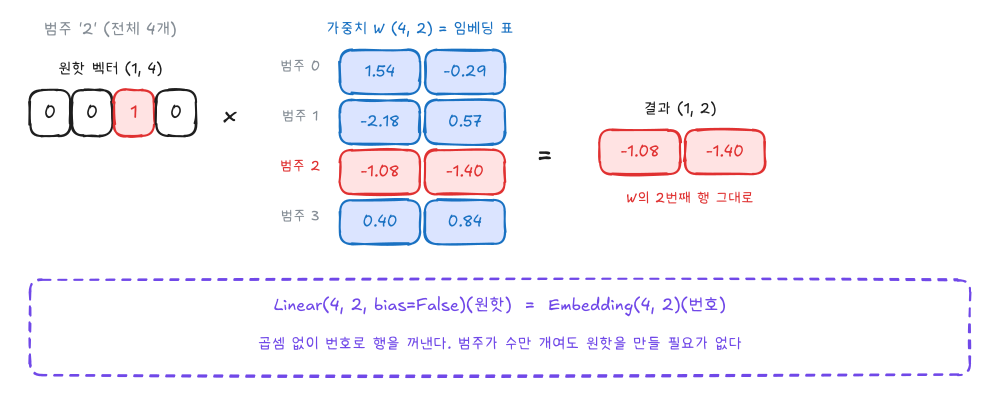
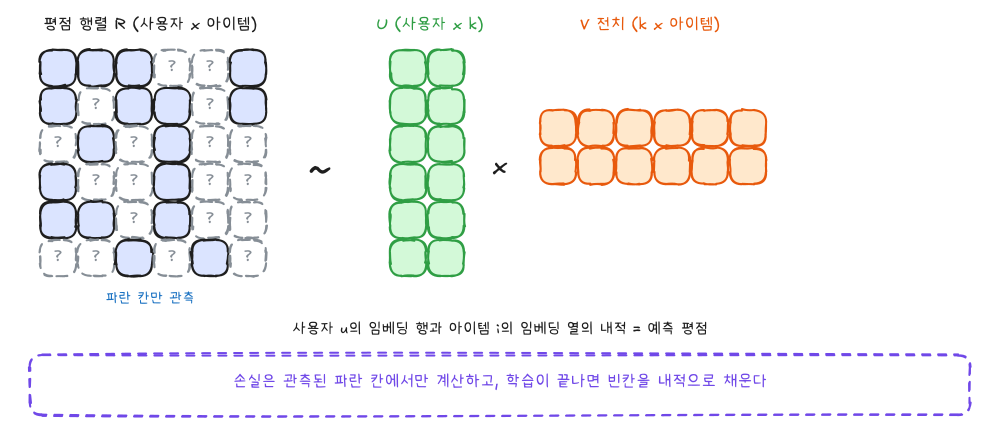
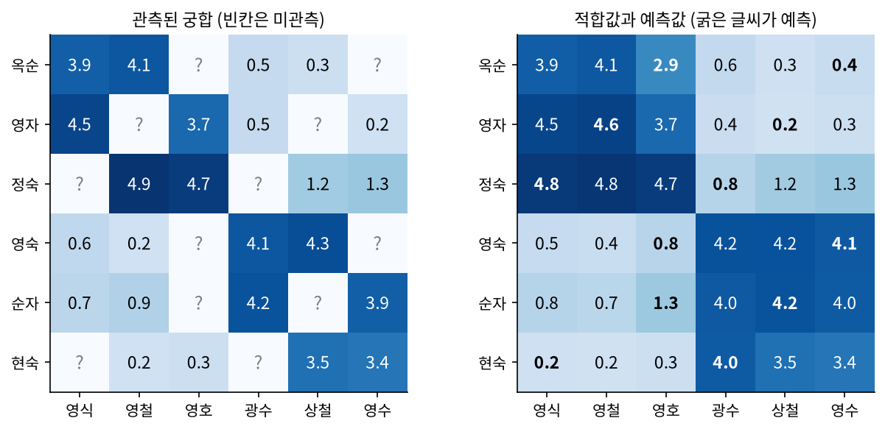
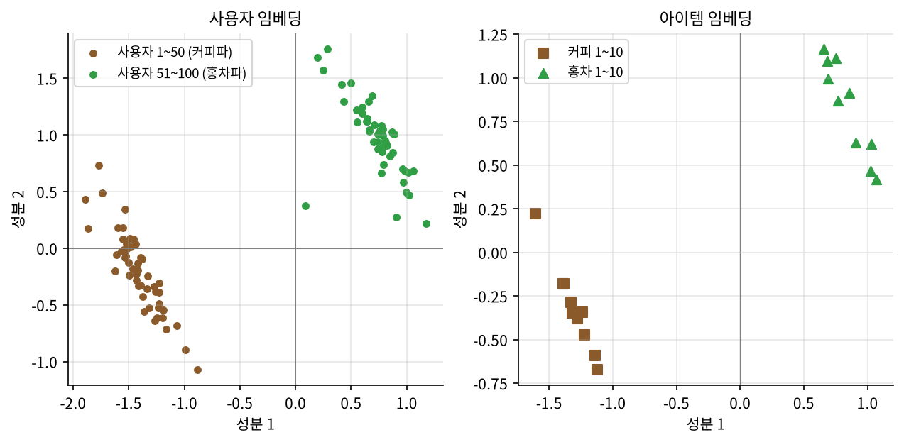
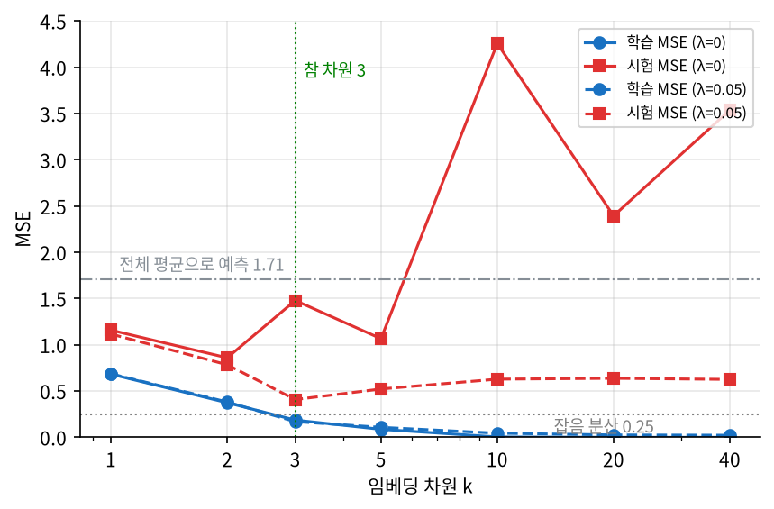

임베딩(embedding)은 범주형 변수의 각 범주에 길이 $k$인 실수 벡터를 하나씩 배정하고, 그 벡터를 가중치로 학습하는 방법이다. 회귀에서 범주형 변수는 가변수(원핫)로 넣는데, 범주가 수만 개면 열이 수만 개가 되고 범주끼리 얼마나 비슷한지도 알 수 없다. 임베딩은 범주를 $k$차원 공간의 점으로 보내, 비슷한 범주가 가까운 점이 되도록 자료에서 배운다. 추천시스템의 행렬분해는 사용자와 아이템을 각각 임베딩하고 그 내적으로 평점을 예측하는 모형으로, 평점 행렬의 저차원 근사([선형대수 - 특잇값 분해와 주성분분석](/posts/la-svd))를 관측된 칸만으로 구하는 것이다.

## 임베딩 층

### 원핫 × 가중치 = 행 꺼내기

범주가 $m$개인 변수의 원핫 벡터 $\mathbf e_j$($j$번째만 1)에 $m \times k$ 가중치 $\mathbf W$를 곱하면 $\mathbf e_j^\top\mathbf W$는 $\mathbf W$의 $j$번째 행이다. 곱셈이 행 하나를 고르는 일로 바뀐다.



```python
torch.manual_seed(0)
emb = torch.nn.Embedding(num_embeddings=4, embedding_dim=2)   # W: (4, 2)
idx = torch.tensor([2, 0, 2])                                 # 범주 번호
emb(idx)
# tensor([[-1.0845, -1.3986],
#         [ 1.5410, -0.2934],
#         [-1.0845, -1.3986]])
torch.nn.functional.one_hot(idx, 4).float() @ emb.weight      # 같은 값
```

`Embedding`은 원핫을 만들지 않고 번호로 행을 꺼내므로 범주가 많아도 메모리와 계산이 들지 않는다. 기울기도 꺼낸 행에만 생긴다.

| | 가변수 회귀 | 임베딩 |
|---|---|---|
| 범주 $j$의 표현 | 원핫 $\mathbf e_j$ (길이 $m$) | $\mathbf w_j$ (길이 $k \ll m$) |
| 범주끼리의 거리 | 모두 같다 | 학습된다. 비슷한 범주는 가깝다 |
| 파라미터 | 범주마다 계수 하나 | 범주마다 $k$개 |
| 쓰는 곳 | | 추천(사용자, 아이템), 단어([10](/posts/dl-10-rnn), [11편](/posts/dl-11-lstm)), 고유번호가 많은 표 자료 |

단어도 범주다. 어휘가 3만 개인 문장 모형의 첫 층은 거의 언제나 임베딩이고, 학습된 단어 벡터에서 뜻이 비슷한 단어가 가까이 모이는 것이 같은 원리다.

## 행렬분해 추천 모형

### 모형

사용자 $u$가 아이템 $i$에 준 평점 $r_{ui}$를 사용자 임베딩 $\mathbf p_u \in \mathbb R^k$와 아이템 임베딩 $\mathbf q_i \in \mathbb R^k$로

$$
\hat r_{ui} = \mu + b_u + b_i + \mathbf p_u^\top\mathbf q_i
$$

로 예측한다. $\mu$는 전체 평균, $b_u$는 사용자의 후한 정도, $b_i$는 아이템의 인기다. 평점의 범위가 $[0, 5]$로 정해져 있으면 $5\,\sigma(\cdot)$를 씌워 범위 안에 가둘 수 있다(fastai의 `y_range`).



편향을 빼면 평점 행렬 $\mathbf R$ ($n_u \times n_i$)을 $\mathbf P\mathbf Q^\top$ ($n_u \times k$ 곱하기 $k \times n_i$)으로 근사하는 것이다. 모든 칸이 관측되어 있다면 최적의 계수-$k$ 근사는 절단 특잇값 분해로 바로 구해진다(에카르트–영 정리). 추천 자료는 대부분의 칸이 비어 있어서 SVD를 쓸 수 없고, 대신 **관측된 칸에서만** 손실을 계산해 경사하강법으로 푼다.

$$
L = \frac{1}{|\Omega|}\sum_{(u,i) \in \Omega}\big(r_{ui} - \hat r_{ui}\big)^2 + \lambda\left(\sum_u \lVert\mathbf p_u\rVert^2 + \sum_i \lVert\mathbf q_i\rVert^2\right)
$$

$\Omega$는 관측된 (사용자, 아이템) 쌍의 집합이다. 빈칸을 예측하는 근거는 "평점 행렬은 저차원 구조를 가진다", 즉 사람들의 취향과 아이템의 성격이 소수의 숨은 요인으로 설명된다는 가정이다.

```python
class MF(torch.nn.Module):
    def __init__(self, n_users, n_items, k):
        super().__init__()
        self.P = torch.nn.Embedding(n_users, k)    # 사용자 임베딩
        self.Q = torch.nn.Embedding(n_items, k)    # 아이템 임베딩
        self.bu = torch.nn.Embedding(n_users, 1)
        self.bi = torch.nn.Embedding(n_items, 1)
        self.mu = torch.nn.Parameter(torch.zeros(1))
    def forward(self, u, i):                       # u, i: (n,) 번호
        dot = (self.P(u) * self.Q(i)).sum(dim=1)   # 행마다 내적
        return dot + self.bu(u).squeeze(1) + self.bi(i).squeeze(1) + self.mu
```

자료는 관측된 칸만 (사용자 번호, 아이템 번호, 평점)의 긴 형식으로 둔다. 관측치 하나가 행렬의 한 칸이다. fastai의 `collab_learner`가 만드는 `EmbeddingDotBias`도 이 구조다.

| 통계 모형과 비교 | 내용 |
|---|---|
| 이원분산분석 | $\mu + b_u + b_i$까지는 사용자와 아이템의 주효과 모형이다 |
| 상호작용 | $\mathbf p_u^\top\mathbf q_i$가 사용자×아이템 상호작용을 계수 $k$로 제한해 표현한다. 포화 상호작용은 칸마다 모수가 하나라 빈칸을 예측할 수 없다 |
| 주성분분석 | 편향을 빼고 완전 자료에서 $\lambda = 0$이면 최적의 $\mathbf P\mathbf Q^\top$이 절단 SVD와 같다 |
| 릿지 | $\lambda$ 벌점은 임베딩에 대한 릿지 벌점이다 |

### 강의 예제: 궁합 행렬

여성 6명과 남성 6명의 궁합 점수(0~5) 중 24칸이 관측된 가상 자료다. 앞 세 명끼리, 뒤 세 명끼리 잘 맞도록 만들어져 있다. $k = 2$, 편향 없이 $5\,\sigma(\mathbf p_u^\top\mathbf q_i)$로 Adam 5,000 에폭을 학습했다.



| 여성 | 학습된 $\mathbf p_u$ | 남성 | 학습된 $\mathbf q_i$ |
|---|---|---|---|
| 옥순 | (−1.56, 0.11) | 영식 | (−0.75, 1.47) |
| 영자 | (−1.72, 0.57) | 영철 | (−0.84, 1.61) |
| 정숙 | (−0.51, 1.85) | 영호 | (−0.13, 1.46) |
| 영숙 | (0.86, −1.08) | 광수 | (1.30, −0.52) |
| 순자 | (0.84, −0.68) | 상철 | (1.85, −0.13) |
| 현숙 | (0.33, −1.84) | 영수 | (1.55, −0.13) |

같은 무리끼리는 내적이 양수, 다른 무리끼리는 음수가 되도록 두 무리가 반대 방향에 놓였다. 빈칸 예측은 정숙–영식 4.8, 현숙–광수 4.0처럼 같은 무리면 높고, 현숙–영식 0.25처럼 다른 무리면 낮다. 옥순–영호는 2.9로 애매하게 남았는데, 옥순의 임베딩은 첫 성분 쪽, 영호는 둘째 성분 쪽에 있어 내적이 작기 때문이다. 관측 24개로는 둘을 같은 방향에 놓을 근거가 부족했다. 각 성분에 이름을 붙인 적은 없다. 임베딩의 축은 평점을 설명하도록 학습될 뿐이고, 해석은 학습 뒤에 붙인다. 회전 $\mathbf P\mathbf A$, $\mathbf Q\mathbf A^{-\top}$에 대해 내적이 변하지 않으므로 축 자체는 유일하지 않다.

### 예제: 커피와 홍차

사용자 100명, 아이템 20개(커피 10, 홍차 10), 관측 1,000개의 가상 자료다([1편](/posts/dl-01-overview)). 1~50번은 커피에, 51~100번은 홍차에 4점 정도, 반대쪽에 1점 정도를 주었다. 800개로 학습하고($k = 2$, 편향 포함, Adam 500 에폭) 200개로 검증했다.



사용자와 아이템이 각각 두 덩어리로 갈렸고, 커피파 사용자와 커피 아이템이 같은 쪽에 있다. 커피 아이템의 평균 위치는 대략 (−1.3, −0.3), 홍차는 (0.8, 0.8)이다. 학습 MSE는 0.022, 검증 MSE는 0.204로, 관측 1,000개로 파라미터 $(100 + 20)(2 + 1) + 1 = 361$개를 맞추다 보니 이미 학습 쪽에 붙어 있다.

## 임베딩 차원과 과적합

### 예제: 모의 자료

참 구조를 아는 자료로 $k$와 $\lambda$의 영향을 보았다. 사용자 400명, 아이템 300개, 참 차원 3인 평점 $r_{ui} = 3 + b_u + b_i + \mathbf p_u^\top\mathbf q_i/\sqrt3 + \varepsilon$, $\varepsilon \sim N(0, 0.5^2)$에서 칸의 8%(9,689개)만 관측했다. 80%로 학습하고 20%로 시험했다(Adam, 1,500 에폭, 전체 배치).



| $k$ | 1 | 2 | 3 | 5 | 10 | 20 | 40 |
|---|---|---|---|---|---|---|---|
| 시험 MSE, $\lambda = 0$ | 1.16 | 0.86 | 1.48 | 1.07 | 4.26 | 2.40 | 3.54 |
| 시험 MSE, $\lambda = 0.05$ | 1.12 | 0.78 | **0.41** | 0.52 | 0.63 | 0.64 | 0.63 |
| 학습 MSE, $\lambda = 0.05$ | 0.69 | 0.38 | 0.17 | 0.11 | 0.05 | 0.03 | 0.02 |

전체 평균으로 예측하면 시험 MSE가 1.71이고, 잡음 분산은 0.25다.

- 사용자 한 명당 학습 평점이 평균 19개뿐이라, 벌점 없이 $k$를 키우면 사용자마다 $k$개의 임베딩이 그 몇 개의 평점을 외운다. $k = 10$에서 학습 MSE 0.004, 시험 MSE 4.26으로 전체 평균보다 나쁘다.
- 벌점을 주면 시험 MSE가 참 차원 $k = 3$에서 가장 작고(0.41), $k$를 40까지 키워도 0.63에 머문다. 벌점이 쓸모없는 차원을 0 쪽으로 눌러 사실상의 차원을 줄인다. 릿지가 계수를 줄여 분산을 낮추는 것과 같다([데이터 마이닝 - 변수선택과 정규화: Ridge, Lasso, PCR](/posts/dm-regularization)).
- $k$와 $\lambda$는 검증 자료로 고른다([데이터 마이닝 - 리샘플링: 교차검증과 부트스트랩](/posts/dm-resampling)).

### 실제 추천에서 더 고려할 것

| 문제 | 내용 |
|---|---|
| 콜드 스타트 | 평점이 없는 새 사용자·아이템은 임베딩을 학습할 수 없다. 나이, 장르 같은 부가 정보를 함께 쓴다 |
| 결측의 비무작위성 | 사람들은 좋아할 것 같은 아이템만 평가한다. 관측된 칸이 무작위 표본이 아니다 |
| 암묵적 피드백 | 평점 대신 클릭·구매 여부(0/1)를 쓰면 손실을 BCE로 바꾼다([3편](/posts/dl-03-output-loss)) |
| 평가 | 평점의 MSE보다 상위 몇 개 추천의 적중률이 실제 목적에 가깝다 |

## 요약

| 질문 | 답 |
|---|---|
| 임베딩은? | 범주마다 학습되는 길이 $k$ 벡터. 원핫 × 가중치 행렬과 같고, 번호로 행을 꺼낸다 |
| 행렬분해 모형은? | $\hat r_{ui} = \mu + b_u + b_i + \mathbf p_u^\top\mathbf q_i$ |
| 손실은? | 관측된 칸에서만 MSE + 임베딩 릿지 벌점 |
| SVD와의 관계는? | 완전 자료의 계수-$k$ 근사가 절단 SVD. 결측이 많아 경사하강법으로 푼다 |
| 빈칸을 예측하는 근거는? | 평점 행렬이 저차원 구조를 가진다는 가정 |
| 학습된 임베딩은? | 비슷한 사용자·아이템이 가까이 모인다. 축의 뜻은 학습 뒤에 해석하고, 회전에 대해 유일하지 않다 |
| $k$가 크면? | 사용자당 자료가 적으면 과적합. 벌점과 검증 자료로 조절한다 |

## 참고자료

- 최규빈, 「딥러닝」 강의노트 (2022), <https://guebin.github.io/DL2022/>
- Koren, Y., Bell, R. and Volinsky, C. (2009). Matrix factorization techniques for recommender systems. *Computer*, 42(8), 30–37.
- Eckart, C. and Young, G. (1936). The approximation of one matrix by another of lower rank. *Psychometrika*, 1(3), 211–218.
- Howard, J. and Gugger, S. (2020). *Deep Learning for Coders with fastai and PyTorch*, Chapter 8. O'Reilly.
- Mikolov, T., Sutskever, I., Chen, K., Corrado, G. and Dean, J. (2013). Distributed representations of words and phrases and their compositionality. *NeurIPS*.
