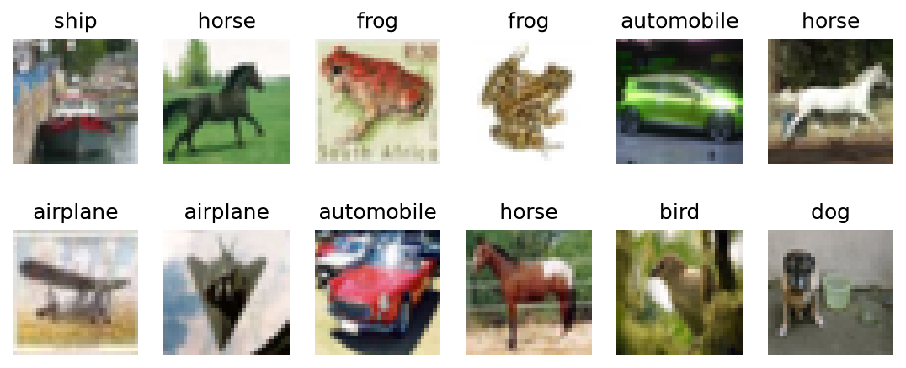
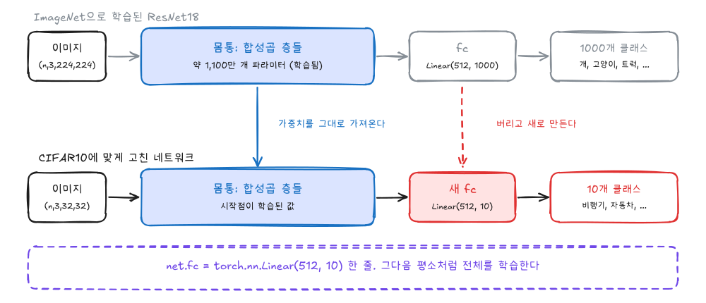
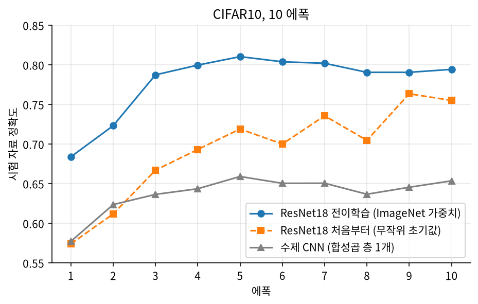
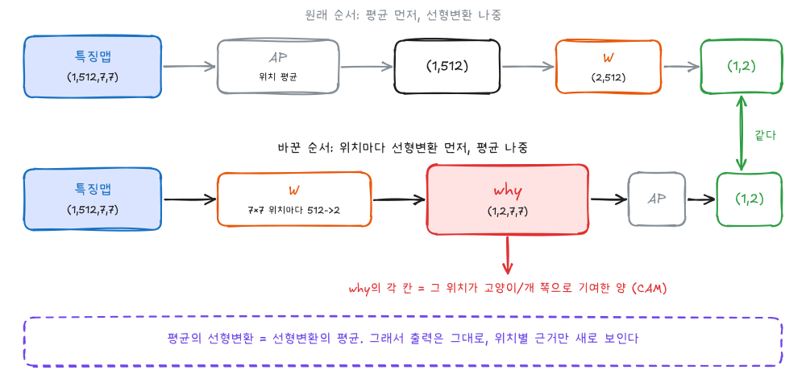
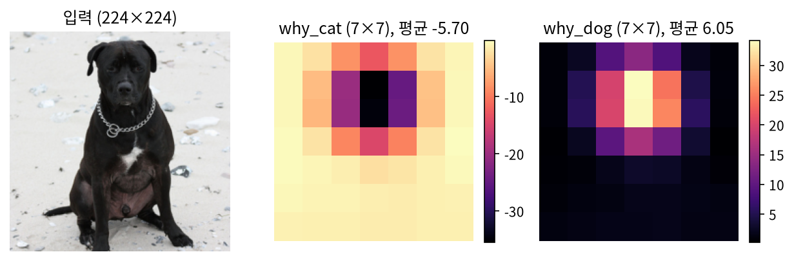
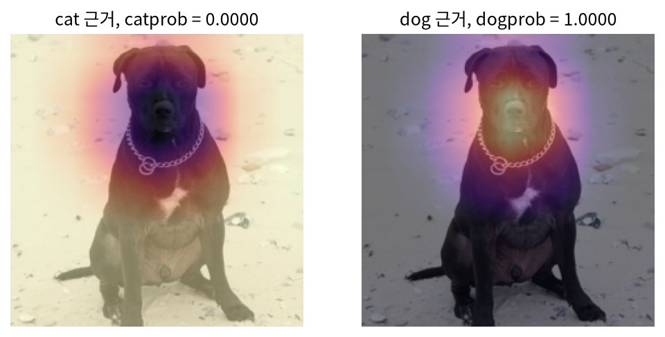
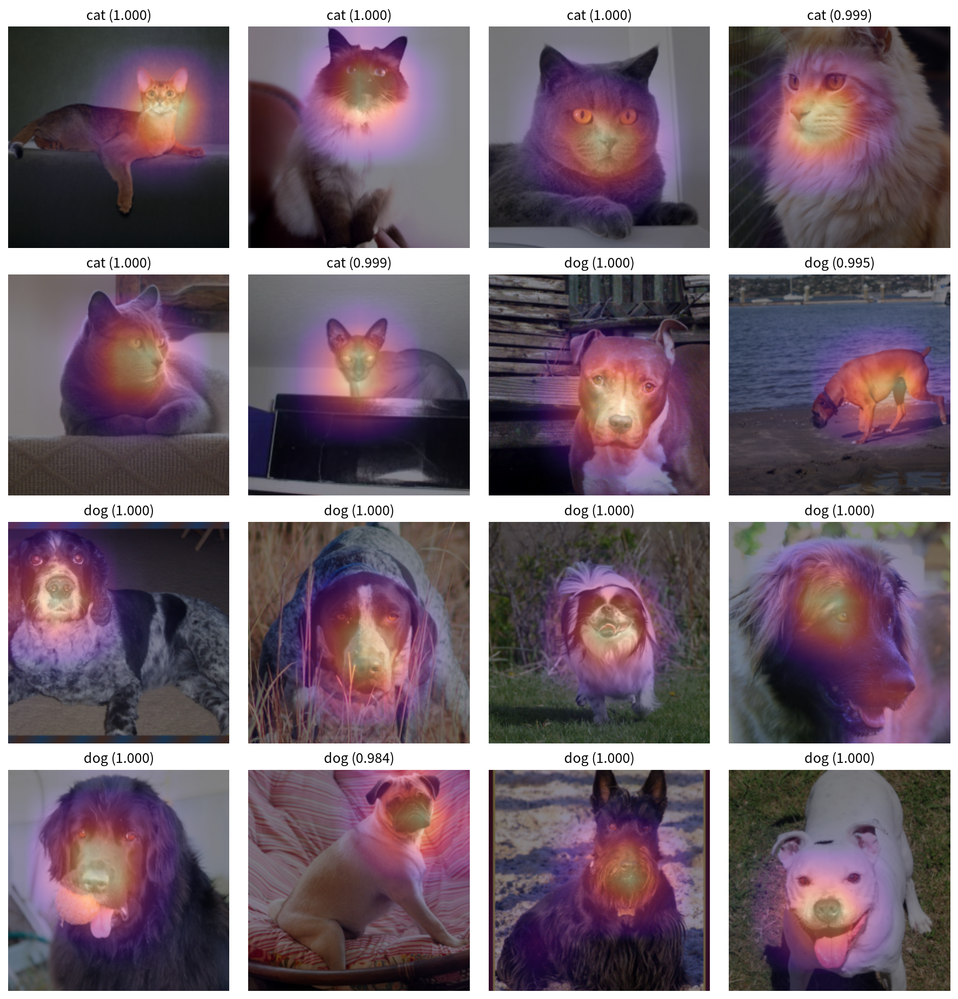

[앞 글](/posts/dl-08-softmax-ce)까지 우리는 네트워크를 직접 설계했다. 합성곱 층 하나, 풀링, `Linear` 하나. MNIST처럼 흑백에 단순한 이미지에서는 이것으로 충분했다. 그런데 컬러 사진이 되면 사정이 다르다. 이 글은 두 가지를 다룬다.

1. **전이학습(transfer learning)**: 남이 큰 자료로 오래 학습시켜 둔 네트워크를 가져와 끝부분만 바꿔 쓴다. 1편에서 fastai로 고양이와 개를 99% 넘게 구분했던 것이 사실 이것이었다.
2. **CAM(class activation map)**: 네트워크가 "개"라고 판단했을 때 이미지의 어느 부분이 그 판단에 기여했는지를 지도로 그린다. 신경망을 블랙박스로 두지 않고 판단 근거를 보는 설명 가능한 인공지능(XAI)의 대표적인 방법이다.

두 주제는 이어져 있다. CAM은 학습된 네트워크를 몸통과 머리로 나누고, 머리를 살짝 고쳐 다시 학습한 뒤, 그 머리의 계산 순서를 바꾸는 방식으로 구현한다. 전이학습에서 익힌 "네트워크 분해하고 고치기"가 그대로 쓰인다.

## 1. CIFAR10: 직접 만든 CNN의 한계

### 자료

CIFAR10은 32×32 컬러 이미지 60,000장(학습 50,000, 시험 10,000)으로, 비행기, 자동차, 새, 고양이, 사슴, 개, 개구리, 말, 배, 트럭의 10개 클래스가 있다.

```python
path = untar_data(URLs.CIFAR)
dls = ImageDataLoaders.from_folder(path, train='train', valid='test')
_X, _y = dls.one_batch()
_X.shape, _y.shape     # (torch.Size([64, 3, 32, 32]), torch.Size([64]))
```

`from_folder`는 폴더 이름(airplane, cat, …)을 클래스로 삼는다. 배치 하나는 (64, 3, 32, 32)로, 채널이 3개(RGB)라는 점이 MNIST와 다르다. 정답은 (64,) 모양의 정수 클래스 번호다. 8편에서 본 다중 분류 형식이다.



32×32라 사람이 봐도 알아보기 쉽지 않다. 같은 "고양이"라도 자세, 배경, 색이 제각각이다.

### 수제 네트워크

7편의 CNN을 컬러 입력에 맞게 고쳐 쓴다.

```python
net1 = torch.nn.Sequential(
    torch.nn.Conv2d(3, 128, (5, 5)),   # 입력 채널 3(RGB), 필터 128개: (3,32,32) -> (128,28,28)
    torch.nn.ReLU(),
    torch.nn.MaxPool2d((2, 2)),        # (128,28,28) -> (128,14,14)
    torch.nn.Flatten(),                # -> 128*14*14 = 25088
)
net = torch.nn.Sequential(net1, torch.nn.Linear(25088, 10))
lrnr = Learner(dls, net, torch.nn.CrossEntropyLoss(), metrics=accuracy)
lrnr.fit(10)
```

파라미터는 26만 개다. 10 에폭 학습한 결과는 다음과 같다(에폭당 약 30초).

| 에폭 | 1 | 3 | 5 | 7 | 10 |
|---|---|---|---|---|---|
| train_loss | 1.236 | 0.982 | 0.841 | 0.747 | 0.580 |
| valid_loss | 1.208 | 1.065 | **1.018** | 1.071 | 1.133 |
| accuracy | 0.577 | 0.637 | **0.659** | 0.651 | 0.654 |

정확도는 66% 근처에서 멈춘다. 강의에서도 65%였고 "70을 넘기 힘들다"고 했다. 학습 손실은 계속 줄지만 검증 손실은 5 에폭 이후 오히려 오른다. 5편에서 본 과적합이다. 층을 더 쌓고, 드롭아웃을 넣고, 학습률을 조정하면 더 올라가겠지만 그 설계를 밑바닥부터 하는 것은 쉽지 않다.

## 2. 전이학습: 남이 만든 네트워크 가져오기

### ResNet18

ResNet은 2015년에 나온 CNN 구조로, 층을 수십~수백 개 쌓아도 학습이 되게 만든 것이 핵심이다(6편의 기울기 소실 문제를 "잔차 연결"로 우회한다). ResNet18은 그중 층이 18개인 작은 버전이다. torchvision에는 ImageNet(1000개 클래스, 이미지 약 120만 장)으로 학습된 가중치가 들어 있다.

```python
net = torchvision.models.resnet18(weights=torchvision.models.resnet.ResNet18_Weights.IMAGENET1K_V1)
net.fc     # Linear(in_features=512, out_features=1000, bias=True)
```

`net`을 출력해 보면 합성곱, 배치정규화, ReLU, 풀링이 층층이 쌓인 긴 목록이 나오고, 맨 끝이 `fc`라는 이름의 `Linear(512, 1000)`이다. ImageNet의 1000개 클래스를 구분하는 머리다. 그 앞까지는 이미지를 512개 숫자로 요약하는 몸통이다. 파라미터는 모두 1,169만 개다.

### 머리만 바꾸기

CIFAR10은 클래스가 10개이므로 머리를 바꾼다.

```python
net.fc = torch.nn.Linear(in_features=512, out_features=10)    # 몸통은 그대로, 머리만 새로
lrnr = Learner(dls, net, torch.nn.CrossEntropyLoss(), metrics=accuracy)
lrnr.fit(10)
```



이것이 전이학습의 전부다. 몸통의 가중치는 ImageNet에서 학습된 값에서 출발하고, 새로 만든 `fc`만 무작위 초기값이다. 그다음 평소처럼 전체를 학습한다.

왜 이것이 통할까? 7편에서 합성곱 필터가 경계를 감지하는 것을 보았다. 큰 CNN의 앞쪽 층은 경계, 색, 질감 같은 낮은 수준의 특징을, 뒤쪽 층은 눈, 바퀴, 털 같은 높은 수준의 특징을 감지하도록 학습된다. 이런 특징은 ImageNet의 개를 구분할 때나 CIFAR10의 개를 구분할 때나 쓸모가 있다. 몸통은 "이미지를 잘 요약하는 법"을 이미 알고 있고, 우리는 그 요약(512개 숫자)을 10개 클래스로 연결하는 법만 새로 배우면 된다.

### 결과 비교

몸통을 가져온 효과인지, ResNet 구조 자체의 효과인지 구분하려고 같은 ResNet18을 무작위 초기값에서 처음부터 학습한 경우도 함께 돌렸다. 강의에는 없는 비교다.



| 네트워크 | 파라미터 | 1 에폭 후 | 10 에폭 후 (최고) | 에폭당 시간 |
|---|---|---|---|---|
| 수제 CNN | 26만 | 57.7% | 65.4% (65.9%) | 약 30초 |
| ResNet18, 처음부터 | 1,118만 | 57.4% | 75.5% (76.4%) | 약 54초 |
| ResNet18, 전이학습 | 1,118만 | **68.4%** | **79.4% (81.1%)** | 약 54초 |

강의 결과(80.2%)와 거의 같다. 읽을 거리가 세 가지다.

- **구조의 효과**: 같은 10 에폭에서 ResNet18은 처음부터 학습해도 수제 CNN보다 10%p 높다. 잘 설계된 구조 자체가 가치가 있다.
- **사전학습의 효과**: 같은 ResNet18이라도 ImageNet 가중치에서 출발하면 첫 에폭부터 11%p 앞서고, 끝까지 4%p 정도 앞선다. CIFAR10을 위해 만든 네트워크가 아닌데도 그렇다.
- 전이학습도 5 에폭 이후에는 검증 손실이 0.61에서 0.76으로 오르며 과적합된다. 실제로는 여기서 학습률을 줄이거나 데이터 증강을 쓴다.

강의의 결론대로, 일반 사용자가 밑바닥부터 설계하는 것보다 전이학습을 쓰는 것이 효율적인 경우가 많다.

한 가지 짚어 둘 점이 있다. ResNet은 224×224 입력을 기준으로 만들어져서, 32×32 이미지를 넣으면 몸통 끝의 특징맵이 1×1까지 줄어든다. 이미지를 키워서 넣으면 정확도가 더 올라간다. 아래 CAM 절에서는 이 특징맵의 크기가 중요해진다.

### fastai로 하는 전이학습

1편의 코드를 다시 보자.

```python
lrnr = vision_learner(dls, resnet34, metrics=accuracy)
lrnr.fine_tune(1)
```

이것이 전이학습이었다. `vision_learner`는 ImageNet으로 학습된 ResNet34를 내려받아 몸통만 남기고, 클래스 수에 맞는 머리를 새로 붙인다. `fine_tune(1)`은 두 단계로 학습한다.

1. 몸통을 **얼리고**(가중치를 고정하고) 새 머리만 1 에폭 학습한다. 무작위로 시작한 머리가 엉뚱한 기울기를 몸통에 흘려보내 학습된 가중치를 망치지 않게 하려는 것이다.
2. 몸통을 **풀고** 전체를 지정한 에폭 수(여기서는 1)만큼 학습한다. 이때 앞쪽 층일수록 학습률을 작게 준다.

그래서 `fine_tune(1)`을 실행하면 결과 표가 두 개 나온다.

## 3. CAM 준비: 몸통과 머리 나누기

### 자료와 네트워크

1편의 고양이/개 자료(Oxford-IIIT Pet, 7,390장)로 돌아간다. 파일 이름이 대문자로 시작하면 고양이, 소문자면 개다.

```python
path = untar_data(URLs.PETS)/'images'
files = get_image_files(path)
def label_func(fname):
    return 'cat' if fname[0].isupper() else 'dog'
dls = ImageDataLoaders.from_name_func(path, files, label_func, item_tfms=Resize(224))
lrnr = vision_learner(dls, resnet34, metrics=accuracy)
lrnr.fine_tune(1)
```

강의는 `Resize(512)`를 썼다. 이 기기(M1 Pro)에서 512로 하면 에폭당 35~60분이 걸려서 224로 줄였다. 224에서는 에폭당 1분 남짓이다. 이 선택은 아래 CAM의 해상도에 영향을 준다(강의 16×16, 이 글 7×7).

검증 정확도는 첫 단계(머리만)에서 98.99%, 둘째 단계(전체)에서 99.32%다.

### 모형 분해

`vision_learner`가 만든 모형은 `Sequential(몸통, 머리)`이다.

```python
net1 = lrnr.model[0]    # 몸통: ResNet34의 합성곱 부분
net2 = lrnr.model[1]    # 머리: fastai가 붙인 분류기
```

배치 하나를 흘려 보며 모양을 확인하자.

| 단계 | 층 | 출력 shape |
|---|---|---|
| 몸통 | `net1` | (64, 512, 7, 7) |
| 머리 0 | `AdaptiveConcatPool2d` | (64, 1024, 1, 1) |
| 머리 1 | `Flatten` | (64, 1024) |
| 머리 2~7 | `BatchNorm1d`, `Dropout`, `Linear(1024, 512)`, `ReLU`, … | (64, 512) |
| 머리 8 | `Linear(512, 2)` | (64, 2) |

몸통은 224×224 이미지를 **512개 채널의 7×7 특징맵**으로 바꾼다. 7×7의 각 칸은 원래 이미지의 32×32 영역쯤에 대응한다. 파라미터는 몸통 2,128만 개, 머리 53만 개다.

fastai의 머리는 꽤 복잡하다. `AdaptiveConcatPool2d`는 평균 풀링과 맥스 풀링을 둘 다 해서 이어 붙이고(512 + 512 = 1024), 그 뒤에 은닉층이 하나 더 있다.

### 머리를 단순하게 고치기

강의는 여기서 머리를 다음과 같이 바꾸고 다시 학습한다. "왜?"는 다음 절에서 답이 나온다.

```python
net2 = torch.nn.Sequential(
    torch.nn.AdaptiveAvgPool2d(output_size=1),   # (n,512,7,7) -> (n,512,1,1)
    torch.nn.Flatten(),                          # (n,512,1,1) -> (n,512)
    torch.nn.Linear(512, 2, bias=False),         # (n,512)     -> (n,2)
)
net = torch.nn.Sequential(net1, net2)
lrnr2 = Learner(dls, net, metrics=accuracy)      # 손실을 안 줘도 dls를 보고 CrossEntropy로 잡는다
lrnr2.fine_tune(3)
```

**`AdaptiveAvgPool2d(output_size=1)`**(줄여서 AP)은 채널마다 공간 전체의 평균을 낸다. 출력 크기를 1×1로 맞추도록 창 크기를 알아서 정하기 때문에 "adaptive"다. 전역 평균 풀링(global average pooling)이라고도 한다.

```python
ap = torch.nn.AdaptiveAvgPool2d(output_size=1)
X = torch.arange(48).reshape(1, 3, 4, 4) * 1.0   # 채널 3개, 각 4×4: 0~15, 16~31, 32~47
ap(X)    # [[[[7.5]], [[23.5]], [[39.5]]]]  각 채널의 평균
```

새 머리는 "채널별 평균을 내고, 512개 평균을 선형결합해 로짓 2개를 만든다"가 전부다. 은닉층도 없고 편향도 없다.

| 에폭 | 머리만 (몸통 고정) | 1 | 2 | 3 |
|---|---|---|---|---|
| valid_loss | 0.836 | 0.203 | 0.100 | 0.064 |
| accuracy | 0.726 | 0.914 | 0.966 | **0.976** |

머리를 단순하게 바꾸었더니 99.3%에서 97.6%로 조금 떨어졌다(검증 1,478장 중 36장 틀림). 강의도 98.4%로 떨어졌다. 강의의 말대로 "그래도 쓸 만하다". 이 대가로 얻는 것이 판단 근거의 지도다.

## 4. 순서를 바꾸면 보이는 것

### 이미지 하나로 따라가기

이미지 하나를 고정하고 계산 과정을 보자. 강의와 같은 `staffordshire_bull_terrier_106.jpg`(바닷가에 앉은 검은 개)를 쓴다.

```python
ximg = PILImage.create(path/'staffordshire_bull_terrier_106.jpg')
x = first(dls.test_dl([ximg]))[0]    # 학습 때와 같은 전처리(크기 조정, 정규화)를 거친 (1,3,224,224)
net(x)          # [[-5.7045,  6.0471]]
dls.vocab       # ['cat', 'dog']
```

`dls.test_dl`은 새 이미지에 학습 자료와 같은 변환을 적용해 주는 데이터로더다. 출력의 둘째 값이 크면 개다. 소프트맥스를 씌우면 개일 확률이 0.99999다.

현재 계산 순서는 다음과 같다.

$$
\underset{(1,3,224,224)}{\mathbf x} \xrightarrow{\text{net1}} \underset{(1,512,7,7)}{\tilde{\mathbf x}} \xrightarrow{\text{AP}} \underset{(1,512,1,1)}{\cdot} \xrightarrow{\text{flatten}} \underset{(1,512)}{\cdot} \xrightarrow{\text{linear}} \underset{(1,2)}{\hat{\mathbf y}} = [-5.70,\ 6.05]
$$

강의는 이 순서를 바꿔서 계산해 보자고 한다. 평균을 먼저 내지 말고, **7×7의 각 위치에서 512 → 2 선형변환을 먼저** 하고, 평균은 나중에 내는 것이다.

$$
\underset{(1,3,224,224)}{\mathbf x} \xrightarrow{\text{net1}} \underset{(1,512,7,7)}{\tilde{\mathbf x}} \xrightarrow{\text{linear}} \underset{(1,2,7,7)}{\textbf{why}} \xrightarrow{\text{AP}} \underset{(1,2,1,1)}{\cdot} \xrightarrow{\text{flatten}} \underset{(1,2)}{\hat{\mathbf y}}
$$



### 왜 출력이 같은가

평균은 선형 연산이므로 선형변환과 순서를 바꿀 수 있다. 수식으로 쓰자. 특징맵을 $f_{k}(i,j)$($k$는 채널 1~512, $(i,j)$는 7×7 위치), 마지막 `Linear`의 가중치를 $w_{c,k}$($c$는 클래스)라 하면 클래스 $c$의 로짓은

$$
\hat y_c = \sum_{k=1}^{512} w_{c,k}\underbrace{\left(\frac{1}{49}\sum_{i,j} f_k(i,j)\right)}_{\text{AP: 채널 }k\text{의 평균}}
= \frac{1}{49}\sum_{i,j}\underbrace{\left(\sum_{k=1}^{512} w_{c,k} f_k(i,j)\right)}_{=:\ M_c(i,j)}
$$

이다. 두 합의 순서를 바꾼 것뿐이다. 오른쪽 괄호 안의 $M_c(i,j)$가 **클래스 활성화 지도(CAM)**다. 위치 $(i,j)$의 512개 특징을 클래스 $c$의 가중치로 결합한 값이고, 로짓은 정확히 이 지도의 평균이다.

숫자로도 확인할 수 있다.

```python
_x = torch.tensor([1, 2, 3.14, 4]).reshape(4, 1)
_l1 = torch.nn.Linear(1, 1, bias=False)
_l1(_x).mean()                    # 선형변환 -> 평균: 1.3062
_l1(_x.mean().reshape(1, 1))      # 평균 -> 선형변환: 1.3062
```

이제 머리를 고친 이유가 분명해진다. 이 교환은 **AP 바로 뒤에 선형변환 하나만** 있을 때 성립한다. fastai의 원래 머리처럼 중간에 ReLU 같은 비선형 함수가 끼면 순서를 바꿀 수 없다. 맥스 풀링도 선형이 아니라 안 된다. `bias=False`는 필수는 아니지만, 편향이 있으면 모든 칸에 같은 상수가 더해질 뿐이라 지도의 모양은 같고, 없애면 "로짓 = 지도의 평균"이 깔끔하게 성립한다.

### einsum으로 구현하기

"7×7 위치마다 512 → 2 선형변환"은 `torch.einsum`으로 한 줄에 쓸 수 있다. einsum은 첨자 표기로 텐서 곱을 적는 함수다. 먼저 익숙한 연산으로 감을 잡자.

```python
tsr = torch.arange(12).reshape(4, 3)
torch.einsum('ij->ji', tsr)                  # 전치: (4,3) -> (3,4)

tsr1 = torch.arange(12).reshape(4, 3).float()
tsr2 = torch.arange(15).reshape(3, 5).float()
torch.einsum('ij,jk->ik', tsr1, tsr2)        # 행렬곱 tsr1 @ tsr2와 같다
```

규칙은 간단하다. 화살표 왼쪽에는 입력 텐서들의 축 이름을, 오른쪽에는 출력의 축 이름을 쓴다. **오른쪽에 없는 첨자는 그 축을 따라 곱해서 더한다.** `'ij,jk->ik'`에서 `j`가 오른쪽에 없으므로 $\sum_j a_{ij}b_{jk}$, 즉 행렬곱이다. 이미지를 그릴 때 (1, 3, 224, 224)를 (224, 224, 3)으로 바꾸는 `torch.einsum('ocij->ijc', x)`처럼 축 순서를 바꾸는 데도 쓴다.

CAM은 이렇다.

```python
W = net2[2].weight                                  # (2, 512): 클래스 c, 채널 b
why = torch.einsum('cb,abij->acij', W, net1(x))     # (2,512) × (1,512,7,7) -> (1,2,7,7)
net2[0](why)                                        # AP: [[[[-5.7045]], [[6.0471]]]]
net(x)                                              # [[-5.7045,  6.0471]]  같다
```

`'cb,abij->acij'`에서 `b`(채널)가 오른쪽에 없으므로 $\text{why}_{a,c,i,j} = \sum_b W_{c,b}\,\tilde x_{a,b,i,j}$이다. 위 식의 $M_c(i,j)$ 그대로다. 그리고 why에 AP를 씌우면 원래 출력과 정확히 같다.

## 5. why 들여다보기

### 숫자로

개 클래스의 지도 `why[0, 1]`을 반올림해서 보자.

```
[[ 1,  2,  9, 14,  9,  2,  1],
 [ 1,  5, 20, 34, 24,  5,  1],
 [ 1,  6, 20, 34, 26,  6,  1],
 [ 0,  2, 10, 16, 11,  3,  0],
 [ 1,  1,  2,  3,  3,  2,  1],
 [ 1,  1,  1,  2,  2,  2,  1],
 [ 1,  2,  2,  2,  2,  2,  2]]
```

평균은 6.05로 개의 로짓과 같다. 그런데 49칸이 고르게 6쯤인 것이 아니다. 대부분은 0~3이고, 위쪽 가운데 몇 칸만 20~34로 크다. **그 몇 칸이 평균을 끌어올려 "개"라는 판단을 만들었다.** 그 위치가 이미지에서 어디인지 보면 네트워크가 무엇을 보고 개라고 했는지 알 수 있다.

고양이 지도 `why[0, 0]`은 거의 부호만 반대다. 같은 위치에 −34 같은 큰 음수가 있고, 그것이 평균을 −5.70으로 끌어내린다. "이 부분을 보니 고양이가 아니다"라는 근거다.

### 그림으로



색은 `magma` 컬러맵으로, 검정 < 보라 < 빨강 < 노랑 순으로 값이 크다. 가운데 그림의 검은 부분이 "고양이가 아니다"의 근거, 오른쪽 그림의 노란 부분이 "개다"의 근거다. 둘 다 위쪽 가운데, 개의 머리 위치다.

7×7은 너무 거칠어서 원래 이미지에 겹쳐 보기 어렵다. `imshow`에 `extent=(0, 223, 223, 0)`을 주면 지도를 224×224 크기로 늘려 그리고, `interpolation='bilinear'`는 칸 사이를 부드럽게 보간한다. `alpha=0.5`로 반투명하게 이미지 위에 겹친다.

```python
fig, ax = plt.subplots(1, 2)
ax[0].imshow(torch.einsum('ocij->ijc', dls.decode((x,))[0]).cpu())     # 정규화를 되돌린 원래 이미지
ax[0].imshow(why_cat.cpu().detach(), cmap='magma', alpha=0.5,
             extent=(0, 223, 223, 0), interpolation='bilinear')
```



네트워크는 개의 **얼굴**을 보고 개라고 판단했다. 목걸이나 몸통, 배경의 모래는 거의 기여하지 않았다. 사람이 고양이와 개를 구분할 때 보는 곳과 같다.

## 6. 여러 이미지의 CAM

예측한 클래스의 지도를 여러 이미지에 그려 보자. 정렬한 파일 목록에서 461장 간격으로 16장을 골랐다(앞 6장은 고양이, 나머지는 개). 학습 자료와 검증 자료가 섞여 있다.

```python
for ax_, f in zip(axes.flat, sample_files):
    x, = first(dls.test_dl([PILImage.create(f)]))
    why = torch.einsum('cb,abij->acij', net2[2].weight, net1(x))
    prob = torch.softmax(net(x), dim=1)[0]
    c = prob.argmax()                          # 예측 클래스의 지도를 그린다
    ax_.imshow(img(x))
    ax_.imshow(why[0, c].cpu().detach(), cmap='magma', alpha=0.5,
               extent=(0, 223, 223, 0), interpolation='bilinear')
    ax_.set_title(f"{dls.vocab[c]} ({prob[c]:.3f})")
```



16장 모두 맞혔고, 관찰할 점이 몇 가지 있다.

- 고양이든 개든 **얼굴, 특히 눈과 코 주변**이 가장 밝다. 고양이와 개를 가르는 특징이 얼굴에 몰려 있다는 것을 네트워크가 스스로 배웠다. 우리는 "얼굴을 보라"고 가르친 적이 없다. 정답 레이블만 주었다.
- 물가를 걷는 복서(둘째 줄 오른쪽)처럼 얼굴이 잘 보이지 않으면 몸통 전체가 근거가 된다.
- 16장 모두 배경(모래, 물, 풀, 쿠션)은 근거가 되지 않았다. 네트워크가 동물 자체를 보고 판단했다는 뜻이다.

이런 확인이 CAM의 실용적인 쓰임새다. 정확도가 높아도 근거가 엉뚱하면 믿을 수 없다. 예를 들어 늑대 사진에 눈 배경이 많아서 네트워크가 동물 대신 "눈"을 보고 늑대라고 판단한다면, 정확도는 높아도 눈 위의 개를 늑대라고 할 것이다. CAM은 이런 지름길 학습을 찾아내는 도구가 된다.

CAM의 한계도 분명하다. 마지막이 "전역 평균 풀링 → 선형변환 하나"인 구조에서만 쓸 수 있어서 이를 위해 머리를 고치고 재학습해야 했고, 정확도도 조금 손해를 봤다. 지도의 해상도는 몸통 끝 특징맵의 크기(여기서는 7×7)로 정해진다. 이후 나온 Grad-CAM은 마지막 합성곱 층의 기울기를 가중치로 써서, 구조를 고치지 않고도 같은 종류의 지도를 만든다.

## 정리

| 질문 | 답 |
|---|---|
| 전이학습이란? | 큰 자료로 학습된 네트워크의 몸통을 가져오고 머리(마지막 층)만 새 문제에 맞게 바꿔 학습하는 것 |
| 파이토치로는? | `net = resnet18(weights=...)`, `net.fc = Linear(512, k)` 후 평소처럼 학습 |
| fastai로는? | `vision_learner(dls, resnet34)` + `fine_tune`. 몸통을 얼리고 머리만 학습한 뒤 전체를 학습한다 |
| 왜 통하나? | 앞쪽 층이 배운 경계·질감·모양 같은 특징은 다른 이미지 문제에도 쓸모 있다 |
| CIFAR10 결과는? | 수제 CNN 65%, ResNet18 처음부터 76%, 전이학습 79~81% (10 에폭) |
| AP(전역 평균 풀링)는? | 채널마다 공간 전체의 평균. (n, c, h, w) → (n, c, 1, 1) |
| CAM은? | 위치마다 특징을 클래스 가중치로 결합한 지도 $M_c(i,j) = \sum_k w_{c,k} f_k(i,j)$ |
| 왜 출력이 같은가? | 평균과 선형변환은 순서를 바꿔도 같다. 로짓 = CAM의 평균 |
| 조건은? | 머리가 "AP → `Linear` 하나"여야 한다. 그래서 fastai의 머리를 바꾸고 재학습했다 |
| 무엇을 알 수 있나? | 네트워크가 이미지의 어디를 보고 판단했는지. 고양이/개는 주로 얼굴 |

- 직접 설계한 작은 CNN보다 남이 잘 만들어 학습해 둔 네트워크를 가져다 고쳐 쓰는 편이 대개 빠르고 정확하다.
- 네트워크를 `Sequential` 단위로 나누고, 중간 출력의 shape를 하나씩 찍어 보면 큰 모형도 다룰 수 있다.
- CAM은 별도의 학습 없이 "평균과 선형변환의 순서 바꾸기"라는 대수적 성질만으로 판단 근거를 보여 준다.

지금까지는 이미지였다. 다음 글부터는 순서가 있는 자료, 즉 글자나 시계열을 다룬다. 앞 글자를 보고 다음 글자를 맞히는 문제를 지금까지의 신경망으로 풀어 보고, 어디서 막히는지 확인한다.

## 참고자료

- 최규빈, 「딥러닝」 강의노트 (2022), 08wk-2: 이미지분석 (3), <https://guebin.github.io/DL2022/>
- Zhou, B., Khosla, A., Lapedriza, A., Oliva, A. and Torralba, A. (2016). Learning Deep Features for Discriminative Localization. *CVPR*, 2921–2929.
- He, K., Zhang, X., Ren, S. and Sun, J. (2016). Deep Residual Learning for Image Recognition. *CVPR*, 770–778.
- Selvaraju, R. R. et al. (2017). Grad-CAM: Visual Explanations from Deep Networks via Gradient-based Localization. *ICCV*, 618–626.
- Krizhevsky, A. (2009). *Learning Multiple Layers of Features from Tiny Images* (CIFAR-10). Technical report, University of Toronto.
- Howard, J. and Gugger, S. (2020). *Deep Learning for Coders with fastai and PyTorch*, Chapter 1, 5. O'Reilly.
