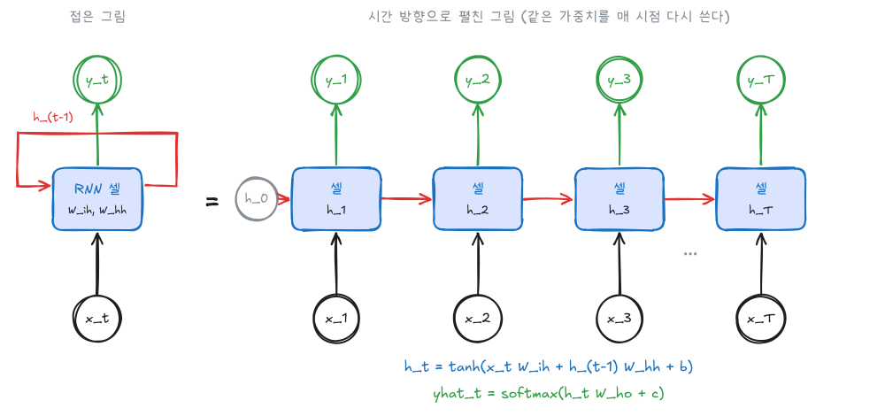
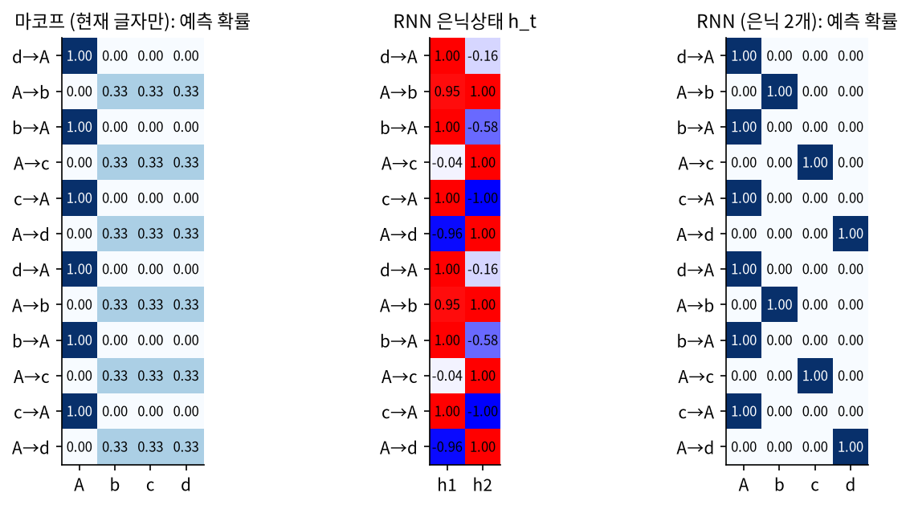
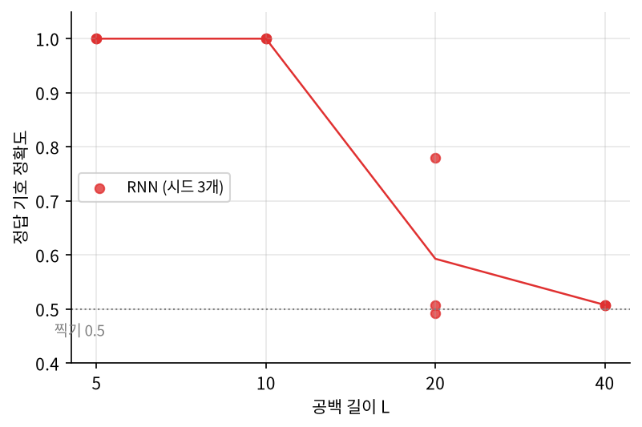
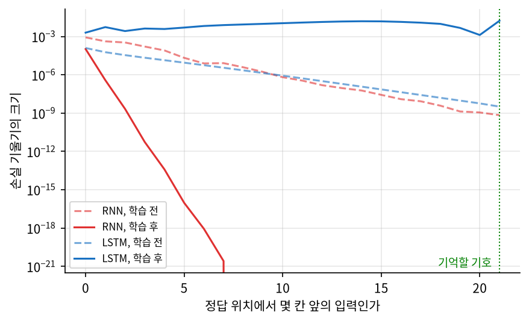

순환신경망(recurrent neural network, RNN)은 순서가 있는 자료 $\mathbf x_1, \mathbf x_2, \dots, \mathbf x_T$에서 지금까지의 입력을 요약하는 **은닉상태** $\mathbf h_t$를 두고, 새 입력이 들어올 때마다 같은 규칙으로 갱신하는 신경망이다.

$$
\mathbf h_t = \tanh\big(\mathbf x_t\mathbf W_{ih} + \mathbf h_{t-1}\mathbf W_{hh} + \mathbf b\big), \qquad \hat{\mathbf y}_t = \text{softmax}\big(\mathbf h_t\mathbf W_{ho} + \mathbf c\big)
$$

ARMA 모형이 과거 값과 과거 오차의 선형결합으로 현재를 설명하듯([시계열 분석 - AR, MA, ARMA 모형](/posts/ts-06-arma)), RNN은 과거 전체를 고정된 길이의 벡터 $\mathbf h_{t-1}$에 담아 다음을 예측한다. 차이는 그 요약 규칙이 비선형이고 자료에서 학습된다는 점이다.

## 순서가 있는 자료

### 다음 글자 예측

글자열 `AbAcAdAbAcAd…`에서 각 시점의 글자를 보고 다음 글자를 맞히는 문제를 생각한다. 입력은 $t$번째 글자의 원핫 벡터, 정답은 $t+1$번째 글자다. 문장에서 다음 단어를 맞히는 언어모형도 같은 형태다.

| | 입력 $\mathbf x_t$ | 정답 $y_t$ |
|---|---|---|
| 자료 | $t$번째 글자 | $t+1$번째 글자 |
| 모양 | (T, 범주 수) 원핫 | (T,) 정수 |
| 손실 | | 시점마다 교차엔트로피를 평균 ([3편](/posts/dl-03-output-loss)) |

### 현재만 보는 모형은 마코프체인

지금까지의 신경망에 현재 글자 하나만 넣으면 $P(x_{t+1} \mid x_t)$, 즉 **1차 마코프체인**의 전이확률을 추정하는 것이다([확률과정론 - 마코프체인과 정상분포](/posts/sp-04-markov-chain-stationary)). `AbAcAd`에서 `A` 다음은 b, c, d가 번갈아 오므로 현재 글자만으로는 셋 중 무엇인지 알 수 없다.

```python
mk = torch.nn.Linear(4, 4)          # 원핫 -> 로짓: 전이확률 행렬을 추정
# 학습 후 P(다음 | A) = (0.001, 0.333, 0.333, 0.333)
```

학습된 교차엔트로피는 0.551로, 이론값 $\frac12\log 3 = 0.549$(시점의 절반인 `A` 다음에서 셋 중 하나를 찍는 손실)와 같다. 모형이 아무리 커져도 입력이 현재 글자 하나뿐이면 이보다 내려갈 수 없다.

| 과거를 쓰는 방법 | 내용 | 한계 |
|---|---|---|
| 고정 창 | 최근 $p$개 글자를 이어 붙여 입력 (AR($p$), $n$-gram) | 창 밖은 못 보고, 창이 길어지면 입력 차원이 커진다 |
| 상태 | 과거를 요약한 $\mathbf h_{t-1}$을 들고 다닌다 (RNN, 상태공간모형) | 요약 규칙을 학습해야 하고, 오래된 정보가 흐려진다 |

## RNN의 구조

### 시간을 따라 펼치기



펼친 그림은 층이 $T$개인 깊은 신경망이다. 다른 점은 모든 층이 **같은 가중치** $\mathbf W_{ih}, \mathbf W_{hh}$를 쓴다는 것이다. 합성곱이 공간의 모든 위치에서 같은 필터를 쓰듯([7편](/posts/dl-07-cnn)), RNN은 시간의 모든 위치에서 같은 갱신 규칙을 쓴다. 그래서 길이가 다른 순서열에도 같은 모형을 쓸 수 있고, 파라미터 수는 $T$와 무관하다.

| 기호 | 모양 | 뜻 |
|---|---|---|
| $\mathbf x_t$ | (1, 입력 수) | 현재 입력 |
| $\mathbf h_{t-1}, \mathbf h_t$ | (1, 은닉 수) | 이전·현재 은닉상태. $\mathbf h_0 = \mathbf 0$ |
| $\mathbf W_{ih}$ | (입력 수, 은닉 수) | 입력 → 은닉 |
| $\mathbf W_{hh}$ | (은닉 수, 은닉 수) | 이전 은닉 → 현재 은닉 |
| $\mathbf W_{ho}$ | (은닉 수, 출력 수) | 은닉 → 출력. `Linear`로 따로 둔다 |

### 구현

셀을 직접 반복하면 식 그대로다.

```python
cell = torch.nn.RNNCell(input_size=4, hidden_size=2)
out = torch.nn.Linear(2, 4)
h = torch.zeros(1, 2)                       # h_0
loss = 0
for t in range(T):
    h = cell(x[[t]], h)                     # h_t = tanh(x_t W_ih + h_(t-1) W_hh + b)
    loss = loss + loss_fn(out(h), y[[t]])
```

`torch.nn.RNN`은 이 반복을 안에서 해 주고 모든 시점의 은닉상태를 돌려준다.

```python
rnn = torch.nn.RNN(input_size=4, hidden_size=2)
hidden, h_T = rnn(x, torch.zeros(1, 2))     # x: (T, 4) -> hidden: (T, 2), h_T: (1, 2)
loss = loss_fn(out(hidden), y)
```

순서열 여러 개를 배치로 넣으려면 `x`를 (T, N, 입력 수)로 쌓는다. 시점 방향 계산은 앞 시점이 끝나야 다음을 할 수 있어 병렬화되지 않으므로, GPU의 이점은 배치 크기와 은닉 수가 클 때 주로 나온다.

### 강의 예제: AbAcAd

`AbAcAd`를 100번 이은 599개 시점을 은닉 노드 2개짜리 `RNN(4, 2)` + `Linear(2, 4)`로 학습했다(Adam, 학습률 0.05).

| 에폭 | 500 | 1,000 | 2,000 | 3,000 |
|---|---|---|---|---|
| 교차엔트로피 | 0.238 | 0.238 | 0.0020 | 0.0007 |

손실이 0.238에서 1,000 에폭 넘게 머물다가 갑자기 떨어진다. 0.238은 `A` 다음 셋 중 하나는 맞히고 둘을 헷갈리는 상태에 해당하는 값으로, 은닉상태에 "직전 소문자"를 담는 방법을 찾기 전까지의 고원이다. 3,000 에폭 후에는 모든 시점을 맞힌다.



| 직전 두 글자 | $\mathbf h_t$ | 예측 |
|---|---|---|
| d, A | (0.95, 1.00) | b |
| b, A | (−0.04, 1.00) | c |
| c, A | (−0.96, 1.00) | d |
| A, b / A, c / A, d | (1.00, −0.58) / (1.00, −1.00) / (1.00, −0.16) | A |

소문자를 읽을 때 $h_2$에 b, c, d가 서로 다른 값(−0.58, −1.00, −0.16)으로 새겨지고, 다음 시점에 `A`를 읽으면 그 값이 $\mathbf W_{hh}$를 거쳐 $h_1$의 세 값(0.95, −0.04, −0.96)으로 옮겨 간다. 출력층은 $h_1$만 보고 b, c, d를 고른다. 은닉 노드 두 개로 "직전 소문자"라는 한 단계 과거를 기억하는 상태 기계를 만든 것이다.

## 시간을 거스르는 역전파

### 기울기의 곱

펼친 그림은 깊은 신경망이므로 역전파도 같다([5편](/posts/dl-05-backprop-vanishing)). 시점 $T$의 손실이 $k$칸 앞의 은닉상태에 주는 기울기는 체인룰로

$$
\frac{\partial \ell_T}{\partial \mathbf h_{T-k}} = \frac{\partial \ell_T}{\partial \mathbf h_T}\prod_{s=T-k+1}^{T}\frac{\partial \mathbf h_s}{\partial \mathbf h_{s-1}}, \qquad \frac{\partial \mathbf h_s}{\partial \mathbf h_{s-1}} = \mathbf W_{hh}^\top\,\text{diag}\big(1 - \mathbf h_s^2\big)
$$

로, 같은 꼴의 행렬이 $k$번 곱해진다. 이것을 BPTT(backpropagation through time)라 한다. tanh의 미분 $1 - h^2$는 1 이하이고, $\mathbf W_{hh}$의 크기가 1보다 작으면 곱이 $k$에 따라 기하급수로 줄고(기울기 소실), 크면 폭발한다. 5편의 깊은 층에서와 같은 현상인데, 여기서는 층 수가 순서열 길이만큼이고 모든 층의 가중치가 같아서 더 심하다. 같은 행렬을 $k$번 곱하면 크기가 대략 가장 큰 고유값의 $k$제곱으로 움직이기 때문이다([선형대수 - 고유값, 대각화와 이차형식](/posts/la-eigen)).

### 예제: 기억해야 할 거리 늘리기

거리에 따른 어려움을 재기 위해 다음 과제를 만들었다.

- 블록 하나는 `a` 또는 `b`(동전 던지기), 빈칸 `-` $L$개, 끝 표시 `|`, 그리고 처음 기호의 대문자(`A` 또는 `B`)다. 예: `a - - - … - | A`.
- 블록 6개를 이어 붙인 순서열 64개로 다음 기호 예측을 학습하고, `|` 다음의 정답 기호를 맞히는 정확도를 새 순서열 256개로 잰다. 정답은 $L+1$칸 앞의 기호로만 정해지므로, 기억하지 못하면 정확도는 0.5다.
- 은닉 노드 16개, 전체 배치로 1,500 에폭, 기울기 노름 1로 자르기, 학습률 0.01과 0.03 중 나은 쪽, 시드 3개.



| $L$ | 5 | 10 | 20 | 40 |
|---|---|---|---|---|
| 정확도 (시드 3개) | 1.00, 1.00, 1.00 | 1.00, 1.00, 1.00 | 0.51, 0.49, 0.78 | 0.51, 0.51, 0.51 |

$L = 10$까지는 다 풀지만 20부터 무너진다. $L = 20$에서 6번의 학습 중 2번은 도중에 한때 100%에 닿았다가 끝까지 유지하지 못했다.

학습된 네트워크에서 정답 위치의 손실을 각 시점의 입력으로 미분한 크기를 재면 원인이 보인다.



학습 전 RNN에서도 21칸 앞의 기울기는 바로 앞의 $10^{-6}$배다. 21칸 앞의 기호를 쓰면 손실이 줄어든다는 신호가 처음부터 거의 오지 않으니, 그 기호를 기억하도록 가중치가 바뀌지 않는다. $L = 20$으로 학습한 RNN은 은닉상태가 tanh의 포화 영역에 붙어 기울기가 7칸 만에 정확히 0이 되었다. 같은 그림의 파란 선(LSTM)은 다음 글에서 다룬다.

### 실제로 쓸 때

| 문제 | 대책 |
|---|---|
| 기울기 폭발 | 기울기 노름 자르기 (`clip_grad_norm_`, 5편) |
| 긴 순서열의 메모리·시간 | 일정 길이로 잘라 그 안에서만 역전파한다(truncated BPTT). 은닉상태는 다음 조각으로 넘기되 `detach()`로 계산 그래프를 끊는다 |
| 기울기 소실 | 구조를 바꾼다: LSTM, GRU ([11편](/posts/dl-11-lstm)) |
| 미래 문맥도 필요할 때 | 양방향 RNN: 앞→뒤, 뒤→앞 두 RNN의 은닉상태를 잇는다(분류, 태깅. 생성에는 못 쓴다) |

| 입출력 형태 | 예 | 쓰는 은닉상태 |
|---|---|---|
| 다대다 (시점마다 출력) | 다음 글자 예측, 품사 태깅 | 모든 $\mathbf h_t$ |
| 다대일 | 문장 감성 분류 | 마지막 $\mathbf h_T$ |
| 생성 | 텍스트 생성 | 예측한 글자를 다음 입력으로 다시 넣는다 |

## 요약

| 질문 | 답 |
|---|---|
| RNN은? | $\mathbf h_t = \tanh(\mathbf x_t\mathbf W_{ih} + \mathbf h_{t-1}\mathbf W_{hh} + \mathbf b)$. 과거를 고정 길이 벡터로 요약해 들고 다닌다 |
| 현재만 보는 모형과의 차이는? | 현재만 보면 1차 마코프체인. RNN은 은닉상태로 더 먼 과거를 쓴다 |
| 가중치 공유는? | 모든 시점에서 같은 $\mathbf W$. 합성곱의 공간 공유와 같은 생각 |
| 학습은? | 시간을 따라 펼친 깊은 네트워크의 역전파(BPTT) |
| 약점은? | 같은 행렬이 거리만큼 곱해져 기울기가 기하급수로 사라진다. 이 예에서는 공백 20칸부터 실패 |

## 참고자료

- 최규빈, 「딥러닝」 강의노트 (2022), <https://guebin.github.io/DL2022/>
- Elman, J. L. (1990). Finding structure in time. *Cognitive Science*, 14(2), 179–211.
- Bengio, Y., Simard, P. and Frasconi, P. (1994). Learning long-term dependencies with gradient descent is difficult. *IEEE Transactions on Neural Networks*, 5(2), 157–166.
- Pascanu, R., Mikolov, T. and Bengio, Y. (2013). On the difficulty of training recurrent neural networks. *ICML*.
- Goodfellow, I., Bengio, Y. and Courville, A. (2016). *Deep Learning*, Chapter 10. MIT Press.
