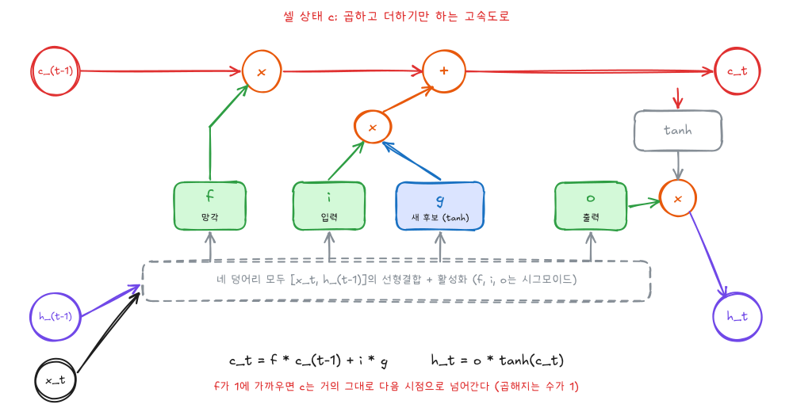
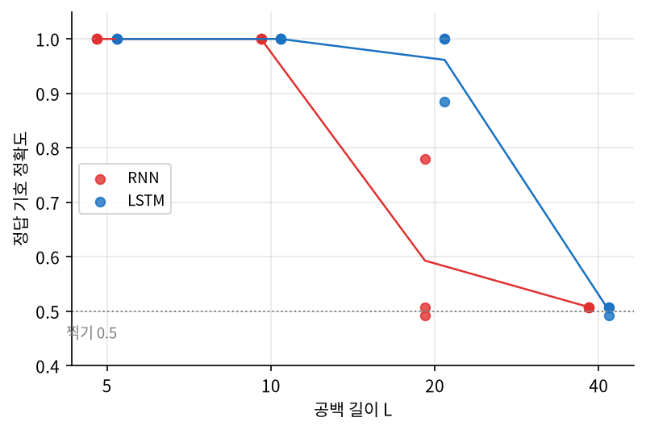
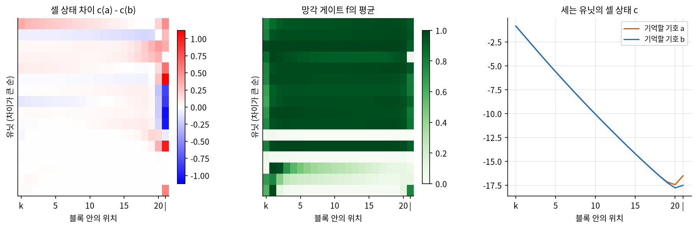

LSTM(long short-term memory, Hochreiter and Schmidhuber, 1997)은 RNN의 은닉상태 $\mathbf h_t$ 옆에 **셀 상태** $\mathbf c_t$를 하나 더 두는 순환신경망이다. 셀 상태는 행렬곱과 tanh를 거치지 않고 원소별 곱과 덧셈으로만 다음 시점에 이어지며, 무엇을 지우고(망각 게이트) 무엇을 새로 쓸지(입력 게이트)를 0~1 사이의 게이트가 정한다. [10편](/posts/dl-10-rnn)에서 RNN의 기울기가 거리에 따라 기하급수로 사라진 것은 같은 행렬이 매 시점 곱해졌기 때문인데, 셀 상태를 따라가는 기울기는 망각 게이트 값의 곱이라 게이트가 1 근처면 멀리까지 유지된다.

## 구조

### 식

$$
\begin{aligned}
\mathbf i_t &= \sigma(\mathbf x_t\mathbf W_{ii} + \mathbf h_{t-1}\mathbf W_{hi} + \mathbf b_i) & \text{입력 게이트} \\
\mathbf f_t &= \sigma(\mathbf x_t\mathbf W_{if} + \mathbf h_{t-1}\mathbf W_{hf} + \mathbf b_f) & \text{망각 게이트} \\
\mathbf g_t &= \tanh(\mathbf x_t\mathbf W_{ig} + \mathbf h_{t-1}\mathbf W_{hg} + \mathbf b_g) & \text{새로 쓸 후보} \\
\mathbf o_t &= \sigma(\mathbf x_t\mathbf W_{io} + \mathbf h_{t-1}\mathbf W_{ho} + \mathbf b_o) & \text{출력 게이트} \\
\mathbf c_t &= \mathbf f_t \odot \mathbf c_{t-1} + \mathbf i_t \odot \mathbf g_t \\
\mathbf h_t &= \mathbf o_t \odot \tanh(\mathbf c_t)
\end{aligned}
$$

$\odot$는 원소별 곱이다. $\mathbf g_t$는 RNN의 은닉상태 갱신식과 같은 꼴이다. LSTM은 그것을 바로 $\mathbf h_t$로 쓰지 않고, 셀 상태에 게이트를 거쳐 더한다.



| 게이트 | 값 | 0에 가까우면 | 1에 가까우면 |
|---|---|---|---|
| 망각 $\mathbf f_t$ | $\sigma(\cdot)$ | 이전 셀 상태를 지운다 | 그대로 둔다 |
| 입력 $\mathbf i_t$ | $\sigma(\cdot)$ | 새 후보를 쓰지 않는다 | 새 후보를 더한다 |
| 출력 $\mathbf o_t$ | $\sigma(\cdot)$ | 셀 상태를 밖으로 내보내지 않는다 | 내보낸다 |

게이트 값도 $\mathbf x_t$와 $\mathbf h_{t-1}$에서 계산되므로, 언제 지우고 언제 쓸지를 입력에 따라 정한다. 네 덩어리가 각각 RNN 한 개 분량의 가중치를 가지므로 파라미터는 같은 은닉 수의 RNN의 4배다. 파이토치는 네 덩어리를 $(\mathbf i, \mathbf f, \mathbf g, \mathbf o)$ 순서로 이어 붙인 `weight_ih_l0` (4H, 입력 수), `weight_hh_l0` (4H, H)에 저장한다.

### 기울기가 살아남는 이유

셀 상태에서 한 시점 앞의 셀 상태로 가는 직접 경로의 미분은

$$
\frac{\partial \mathbf c_t}{\partial \mathbf c_{t-1}} = \text{diag}(\mathbf f_t)
$$

이다(게이트를 통한 간접 경로는 따로 있다). $k$칸 앞까지는 $\prod_s \text{diag}(\mathbf f_s)$, 즉 원소마다 망각 게이트 값의 곱이다. RNN의 $\prod_s \mathbf W_{hh}^\top\text{diag}(1 - \mathbf h_s^2)$와 비교하면

| | RNN | LSTM 셀 상태 |
|---|---|---|
| 한 칸마다 곱해지는 것 | $\mathbf W_{hh}^\top\text{diag}(1 - \mathbf h_s^2)$ | $\text{diag}(\mathbf f_s)$ |
| 1 근처로 유지하려면 | 행렬과 tanh 미분이 함께 맞아야 한다 | 게이트를 1 근처로 열어 두면 된다 |
| 누가 정하나 | 고정된 가중치 | 입력에 따라 시점마다 학습된 게이트 |

$\mathbf f = 1$, $\mathbf i = 0$이면 $\mathbf c_t = \mathbf c_{t-1}$이라 정보도 기울기도 손실 없이 지나간다. [5편](/posts/dl-05-backprop-vanishing)의 잔차 연결 $\mathbf x + f(\mathbf x)$가 미분에 1을 남겨 깊은 층에 기울기를 전한 것과 같은 생각을 시간 방향에 적용한 것이다. 망각 게이트의 편향을 1 정도로 초기화해 처음부터 기억하는 쪽으로 출발시키는 것도 흔히 쓰는 요령이다.

### 구현

```python
lstm = torch.nn.LSTM(input_size=6, hidden_size=16)
hidden, (h_T, c_T) = lstm(x)          # x: (T, N, 6), 초기 (h_0, c_0)는 생략하면 0
out = torch.nn.Linear(16, 6)(hidden)  # 시점마다 출력
```

`RNN`과 달리 상태가 $(\mathbf h, \mathbf c)$ 두 개다. 위 식대로 시점마다 직접 계산한 $\mathbf h_t$는 `torch.nn.LSTM`의 출력과 $10^{-5}$ 이내로 같다.

```python
Wi, Wh = lstm.weight_ih_l0, lstm.weight_hh_l0
b = lstm.bias_ih_l0 + lstm.bias_hh_l0
for t in range(T):
    i, f, g, o = (x[t] @ Wi.T + h @ Wh.T + b).chunk(4, dim=1)
    i, f, g, o = torch.sigmoid(i), torch.sigmoid(f), torch.tanh(g), torch.sigmoid(o)
    c = f * c + i * g
    h = o * torch.tanh(c)
```

## 예제: 기억해야 할 거리

10편의 과제(`a` 또는 `b`, 빈칸 $L$개, `|`, 그리고 처음 기호의 대문자)를 같은 조건(은닉 16개, 1,500 에폭, 학습률 0.01과 0.03 중 나은 쪽, 시드 3개)으로 LSTM에도 학습시켰다.



| $L$ | 5 | 10 | 20 | 40 |
|---|---|---|---|---|
| RNN | 1.00, 1.00, 1.00 | 1.00, 1.00, 1.00 | 0.51, 0.49, 0.78 | 0.51, 0.51, 0.51 |
| LSTM | 1.00, 1.00, 1.00 | 1.00, 1.00, 1.00 | 0.89, 1.00, 1.00 | 0.51, 0.49, 0.51 |

- $L = 20$에서 LSTM은 학습 6번(학습률 2개 × 시드 3개)이 모두 도중에 100%에 닿았고, 시드 2개는 끝까지 유지했다. RNN은 6번 중 2번만 한때 닿았다가 잃었다. 둘 다 한 번 푼 것을 잃기도 한다는 점에서, 긴 기억은 LSTM에서도 불안정하다.
- $L = 40$은 둘 다 1,500 에폭 안에 풀지 못했다. LSTM은 기억할 수 있는 거리를 늘려 줄 뿐, 아무리 먼 것도 저절로 배우지는 않는다. 학습 초기에는 LSTM도 기울기가 거리에 따라 사라지기 때문이다(10편 그림의 파란 점선: 학습 전 21칸 앞의 기울기가 바로 앞의 $3 \times 10^{-5}$배). 기억하는 방법을 한 번 찾으면 기울기가 21칸 앞까지 거의 줄지 않는다(파란 실선).

### 학습된 LSTM 들여다보기

$L = 20$에서 100%를 맞힌 LSTM에 새 순서열 256개를 넣고, 시점마다 셀 상태와 게이트를 기록했다. 왼쪽은 처음 기호가 `a`인 순서열과 `b`인 순서열의 셀 상태 평균의 차이, 가운데는 망각 게이트의 평균이다. 유닛은 공백 한가운데에서 차이가 큰 순으로 늘어놓았다.



- **기억하는 유닛:** 처음 기호에 따른 셀 상태의 차이가 공백 20칸 동안 같은 부호로 유지된다. 차이가 가장 큰 네 유닛의 망각 게이트는 공백 동안 평균 0.96, 0.97, 1.00, 0.93이다(전체 유닛 평균은 0.71). 지우지 않고 들고 가는 것이다. 차이는 작게 유지되다가 `|`를 읽는 순간 크게 벌어져 출력으로 나간다.
- **세는 유닛:** 오른쪽 유닛은 처음 기호와 상관없이 셀 상태가 한 칸에 약 0.8씩 일정하게 내려간다. 다음 기호가 `-`인지 `|`인지 맞히려면 공백을 몇 칸 지났는지 알아야 하는데, 이 유닛이 그것을 센다. 망각 게이트를 1 근처로 두고 매번 같은 양을 더하면 셀 상태는 카운터가 된다.

정답 기호를 맞히는 데 필요한 "무엇이었나"와 "언제 끝나나"라는 두 가지 정보를 서로 다른 유닛이 나누어 맡았다. 둘 다 "망각 게이트 ≈ 1"이라는 같은 장치를 쓴다.

### 강의 예제: abcabC

`abcabC`를 100번 이은 자료에서 `b` 다음이 `c`인지 `C`인지는 세 칸 앞의 글자까지 봐야 알 수 있다. 은닉 노드 3개, Adam(학습률 0.1), 3,000 에폭으로 시드 10개씩 학습해 `b` 다음 글자의 정확도를 쟀다.

| 모형 | `b` 다음을 모두 맞힌 시드 | 나머지 |
|---|---|---|
| RNN (은닉 3) | 3 / 10 | 7개 모두 정확도 0.5 근처 (c와 C를 찍는다) |
| LSTM (은닉 3) | 8 / 10 | 2개는 정확도 0.5 근처 |

은닉 노드가 3개뿐이면 RNN은 대부분 `c`와 `C`를 구분하지 못한 채 손실 0.231(`b` 다음에서 찍는 손실 $\frac{\log 2}{3}$)에 머문다. 같은 크기의 LSTM은 셀 상태를 따로 가지고 있어 이 정도 거리의 기억을 훨씬 자주 만들어 낸다. 다만 LSTM도 10번 중 2번은 같은 고원에 머물렀으니, 구조가 성공을 보장하지는 않는다.

## LSTM의 변형

| 모형 | 차이 | 비고 |
|---|---|---|
| GRU | 셀 상태와 은닉상태를 합치고, 게이트를 갱신·초기화 두 개로 줄였다 | 파라미터가 LSTM의 3/4. 성능은 문제에 따라 비슷하다 |
| 다층 LSTM | 아래층의 $\mathbf h_t$를 위층의 입력으로 (`num_layers`) | 층 사이에 드롭아웃 (`dropout`) |
| 양방향 LSTM | 앞→뒤, 뒤→앞 두 LSTM의 은닉상태를 잇는다 (`bidirectional=True`) | 분류·태깅용 |
| 트랜스포머 | 순환 없이 모든 시점을 서로 직접 참조(어텐션)한다 | 거리에 따른 기울기 소실이 없고 병렬화된다. 현재 언어모형의 표준 |

## 요약

| 질문 | 답 |
|---|---|
| LSTM은? | 셀 상태 $\mathbf c_t = \mathbf f_t \odot \mathbf c_{t-1} + \mathbf i_t \odot \mathbf g_t$를 두고, $\mathbf h_t = \mathbf o_t \odot \tanh(\mathbf c_t)$로 내보낸다 |
| 게이트는? | $\mathbf x_t$, $\mathbf h_{t-1}$에서 계산한 0~1 값. 지울지(f), 쓸지(i), 내보낼지(o)를 원소마다 정한다 |
| 왜 오래 기억하나? | 셀 상태를 따라가는 기울기가 망각 게이트 값의 곱이라, 게이트가 1 근처면 줄지 않는다. 시간 방향의 잔차 연결 |
| 대가는? | 파라미터가 RNN의 4배 |
| 한계는? | 학습 초기에는 LSTM도 기울기가 거리에 따라 줄어든다. 이 예에서는 공백 20칸까지 풀고 40칸은 못 풀었다 |
| 학습된 LSTM은? | 일부 유닛은 망각 게이트를 1 근처로 두고 기호를 들고 가고, 다른 유닛은 같은 장치로 칸 수를 센다 |

## 참고자료

- 최규빈, 「딥러닝」 강의노트 (2022), <https://guebin.github.io/DL2022/>
- Hochreiter, S. and Schmidhuber, J. (1997). Long short-term memory. *Neural Computation*, 9(8), 1735–1780.
- Gers, F. A., Schmidhuber, J. and Cummins, F. (2000). Learning to forget: Continual prediction with LSTM. *Neural Computation*, 12(10), 2451–2471.
- Cho, K. et al. (2014). Learning phrase representations using RNN encoder-decoder for statistical machine translation. *EMNLP*.
- Jozefowicz, R., Zaremba, W. and Sutskever, I. (2015). An empirical exploration of recurrent network architectures. *ICML*.
- Olah, C. (2015). Understanding LSTM networks. <https://colah.github.io/posts/2015-08-Understanding-LSTMs/>
