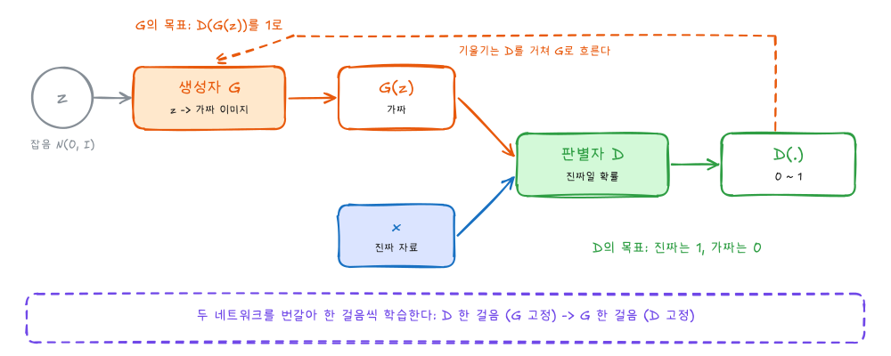
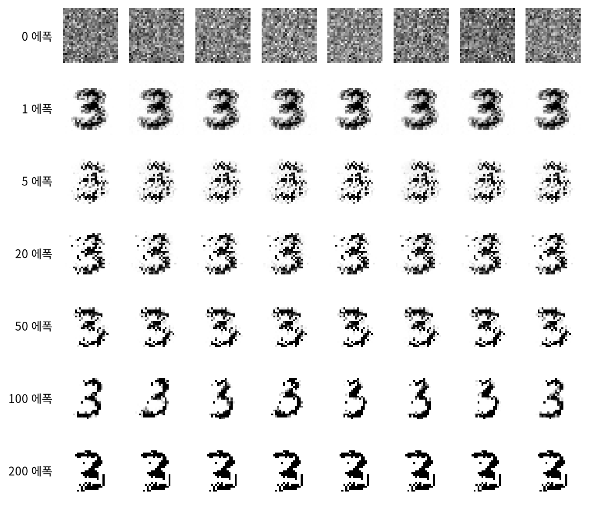
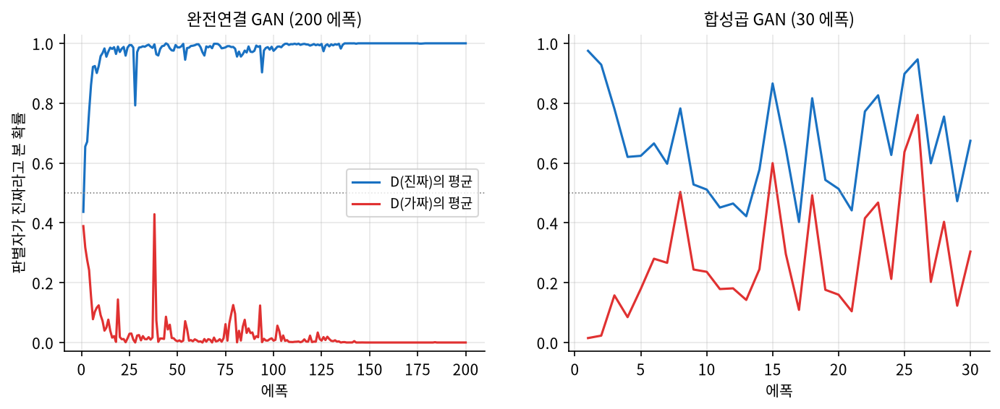
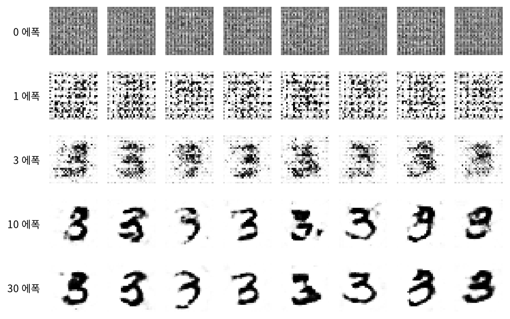

생성모형(generative model)은 자료의 분포 $p(\mathbf x)$를 배워서 그 분포에서 새 표본을 뽑는 모형이다. 지금까지의 분류 모형은 $p(y \mid \mathbf x)$만 배웠다. **GAN**(generative adversarial network, Goodfellow et al., 2014)은 밀도함수를 직접 쓰지 않고, 잡음 $\mathbf z$를 표본 $G(\mathbf z)$로 바꾸는 **생성자** $G$와 진짜 자료와 $G$의 표본을 가르는 **판별자** $D$를 서로 경쟁시켜 $G(\mathbf z)$의 분포가 자료의 분포에 가까워지게 한다. 판별자는 진짜(1)와 가짜(0)를 맞히는 이진 분류기, 즉 로지스틱 회귀의 확장이다([데이터 마이닝 - 로지스틱 회귀](/posts/dm-logistic-regression)).

## 생성모형

### 판별 모형과 생성 모형

| | 판별 모형 | 생성 모형 |
|---|---|---|
| 배우는 것 | $p(y \mid \mathbf x)$ | $p(\mathbf x)$ 또는 $p(\mathbf x, y)$ |
| 예 | 로지스틱 회귀, 지금까지의 신경망 | LDA, 나이브 베이즈, 혼합모형, GAN |
| 할 수 있는 일 | 분류, 예측 | 표본 생성, 밀도 평가, 결측 보완, 분류($p(y \mid \mathbf x) \propto p(\mathbf x, y)$) |

$p(\mathbf x, y)$를 알면 $p(y \mid \mathbf x)$를 구할 수 있지만 반대는 안 되므로, 생성 쪽이 더 많은 것을 배워야 하는 어려운 문제다. LDA가 각 클래스의 분포를 정규분포로 가정해 분류하는 것처럼([데이터 마이닝 - 분류, LDA/QDA와 KNN](/posts/dm-classification)), 통계학의 생성 모형은 보통 밀도함수의 모양을 가정하고 최대가능도로 추정한다. 이미지처럼 784차원이 넘는 자료에서는 쓸 만한 밀도함수 꼴을 정하기 어렵다.

### 암묵적 모형

GAN의 생성자는 밀도함수 대신 **표본을 만드는 절차**를 학습한다.

$$
\mathbf z \sim N(\mathbf 0, \mathbf I), \qquad \mathbf x = G_\theta(\mathbf z)
$$

$G_\theta$가 신경망이면 $\mathbf x$의 분포 $q_\theta$는 복잡한 모양이 될 수 있지만, 그 밀도함수를 식으로 쓸 수는 없다. 균등분포 난수에 역누적분포함수를 씌워 원하는 분포의 난수를 만드는 것과 같은 일을 다차원에서, 변환까지 학습해서 한다. 밀도가 없으니 가능도를 쓸 수 없고, 대신 "진짜와 구별되지 않는가"를 판별자로 잰다.

## 목적함수

### 최소최대 문제



$$
\min_G \max_D\; V(D, G) = E_{\mathbf x \sim p}\big[\log D(\mathbf x)\big] + E_{\mathbf z}\big[\log\big(1 - D(G(\mathbf z))\big)\big]
$$

$\max_D$ 부분은 진짜에 라벨 1, 가짜에 라벨 0을 붙인 자료에서 BCE를 최소화하는 것, 즉 판별자를 분류기로 학습하는 것이다. $\min_G$는 그 분류기가 틀리도록 $G$를 고친다.

### 최적 판별자는 밀도의 비

$G$를 고정하고 생성 분포를 $q$라 하면 $V = \int \big[p(\mathbf x)\log D(\mathbf x) + q(\mathbf x)\log(1 - D(\mathbf x))\big]d\mathbf x$이다. 점마다 $a\log D + b\log(1-D)$를 $D$로 미분해 0으로 놓으면 $a/D = b/(1-D)$, 따라서

$$
D^*(\mathbf x) = \frac{p(\mathbf x)}{p(\mathbf x) + q(\mathbf x)}
$$

이다. 진짜 자료가 더 많이 사는 곳일수록 1에 가깝고, $q = p$이면 어디서나 $1/2$이다. 바꿔 쓰면 $D^*/(1 - D^*) = p/q$, 즉 분류기의 오즈가 두 밀도의 비다. 분류기로 밀도비를 추정하는 방법이 GAN의 판별자다.

$D^*$를 넣으면

$$
V(D^*, G) = E_p\Big[\log\frac{p}{p+q}\Big] + E_q\Big[\log\frac{q}{p+q}\Big] = -\log 4 + 2\,\text{JS}(p \,\|\, q)
$$

이다. $\text{JS}(p\|q) = \frac12\text{KL}(p\|m) + \frac12\text{KL}(q\|m)$, $m = \frac{p+q}{2}$는 젠슨–섀넌 발산으로, 0 이상이고 $p = q$일 때만 0이다. 판별자가 최적이라면 생성자는 $p$와 $q$의 JS 발산을 줄이는 것이고, 최솟값 $-\log 4$는 $q = p$에서 얻는다.

### 비포화 생성자 손실

학습 초반 $G$의 표본은 엉터리라 $D(G(\mathbf z)) \approx 0$이다. 판별자의 로짓을 $u$, $D = \sigma(u)$라 하면

| 생성자 손실 | $u$로 미분 | $D \approx 0$일 때 |
|---|---|---|
| 원래 식 $\log(1 - \sigma(u))$ (최소화) | $-\sigma(u)$ | 0에 가깝다. 학습이 안 된다 |
| 비포화 $-\log\sigma(u)$ (최소화) | $-(1 - \sigma(u))$ | $-1$에 가깝다 |

[3편](/posts/dl-03-output-loss)에서 시그모이드 뒤에 MSE를 쓰면 포화 영역에서 기울기가 사라졌던 것과 같은 문제다. 그래서 실제로는 "가짜에 라벨 1을 붙인 BCE"로 생성자를 학습한다. 두 손실의 최적점은 같다.

```python
bce = torch.nn.BCEWithLogitsLoss()            # D는 로짓을 낸다
for xr in dl:
    n = len(xr)
    xf = G(torch.randn(n, Z))
    # 1. 판별자: 진짜 1, 가짜 0 (G는 고정)
    loss_D = bce(D(xr), torch.ones(n, 1)) + bce(D(xf.detach()), torch.zeros(n, 1))
    loss_D.backward(); opt_D.step(); opt_D.zero_grad()
    # 2. 생성자: 가짜를 1이라고 믿게 (비포화 손실)
    loss_G = bce(D(xf), torch.ones(n, 1))
    loss_G.backward(); opt_G.step(); opt_G.zero_grad(); D.zero_grad()
```

`xf.detach()`는 판별자를 학습할 때 기울기가 생성자로 흘러가지 않게 끊는다. 생성자 단계에서는 기울기가 $D$를 거쳐 $G$로 흐르지만 $D$는 갱신하지 않으므로, 쌓인 $D$의 기울기를 지운다.

## 예제: 1차원 혼합정규분포

$p = \frac12 N(-2, 0.5^2) + \frac12 N(2, 0.5^2)$에서 표본을 만드는 법을 배운다. $G$와 $D$는 은닉층 2개(노드 32개)짜리 MLP, $\mathbf z$는 4차원, 배치 512, Adam(학습률 $10^{-3}$, $\beta_1 = 0.5$)으로 판별자와 생성자를 한 걸음씩 번갈아 6,000번 갱신했다.


| 단계 | 0보다 작은 표본 비율 | 왼쪽 봉우리 평균 (표준편차) | 오른쪽 봉우리 평균 (표준편차) |
|---|---|---|---|
| 0 | 1.7% | | 0.13 (0.06) |
| 300 | 55.2% | −1.66 (0.59) | 2.79 (1.76) |
| 1,000 | 49.3% | −2.09 (0.49) | 1.87 (0.46) |
| 3,000 | 49.6% | −1.63 (0.23) | 1.90 (0.51) |
| 6,000 | 50.2% | −2.58 (0.46) | 1.86 (0.37) |
| 참값 | 50% | −2 (0.5) | 2 (0.5) |

- **판별자는 밀도비를 따라간다.** 아래 줄에서 판별자는 생성 표본이 모자란 곳(참 밀도가 높은데 주황이 낮은 곳)에서 0.5보다 크고, 표본이 몰린 0 근처에서 작다. 이론의 $D^* = p/(p+q)$와 방향이 같다. 판별자를 한 걸음씩만 갱신하므로 $D^*$에 도달하지는 않는다.
- **생성자는 그 신호를 따라 옮겨 간다.** 1,000 단계에서 두 봉우리의 평균과 표준편차가 참값에 가깝다.
- **수렴하지 않고 출렁인다.** 3,000 단계에서는 왼쪽 봉우리가 표준편차 0.23으로 좁아졌고, 6,000 단계에서는 −2.58로 밀렸다. 두 네트워크가 서로의 목표를 바꾸며 움직이므로 손실이 줄어드는 방향으로 단조롭게 가는 보통의 학습과 다르다. 판별자 손실은 처음부터 끝까지 $2\log 2 \approx 1.39$ 근처에 머물러, 손실 값으로는 진행 상황을 알 수 없다.

## 예제: MNIST 숫자 3

### 강의 예제: 완전연결 GAN과 모드 붕괴

숫자 3 이미지 6,131장을 784차원으로 펴서 완전연결 생성자(잡음 64 → 256 → 512 → 784, 시그모이드)와 판별자(784 → 512 → 256 → 1)로 학습했다. 강의와 같은 완전연결 구조에 노드 수만 키운 것이고, 파라미터는 생성자 550,416개, 판별자 533,505개다. 배치 128, Adam(학습률 $2 \times 10^{-4}$, $\beta_1 = 0.5$)으로 200 에폭을 돌렸다. 각 줄은 같은 잡음 8개를 넣은 결과다.



잡음이 달라도 8장이 거의 같은 이미지다. 생성자가 판별자를 속이기 쉬운 한두 가지 출력만 내고 자료의 다양성을 버리는 현상을 **모드 붕괴**(mode collapse)라 한다. 판별자가 그 출력을 가짜로 알아채면 생성자는 다른 한 가지로 옮겨 갈 뿐이다.



왼쪽 그림처럼 판별자가 진짜와 가짜를 완벽하게 가르면($D(\text{진짜}) = 1.000$, $D(\text{가짜}) = 0.000$) 생성자 손실이 10 이상으로 커지고, 판별자가 포화되어 생성자에게 쓸모 있는 방향을 알려 주지 못한다. 판별자에 드롭아웃과 라벨 평활화(진짜 라벨을 0.9로)를 넣어 보아도 100 에폭에 가짜에 대한 출력이 다시 0으로 붙었고 출력도 한 가지로 무너졌다.

### 합성곱 GAN

생성자를 전치합성곱(`ConvTranspose2d`, 합성곱의 반대로 크기를 키운다)으로, 판별자를 합성곱으로 바꾸고 배치 정규화를 넣었다. 7×7 특징맵에서 시작해 14×14, 28×28로 키운다(DCGAN, Radford et al., 2016). 픽셀은 $[-1, 1]$로 맞추고 생성자 끝은 tanh다.

```python
G = torch.nn.Sequential(
    torch.nn.Linear(64, 128*7*7), torch.nn.Unflatten(1, (128, 7, 7)),
    torch.nn.BatchNorm2d(128), torch.nn.ReLU(),
    torch.nn.ConvTranspose2d(128, 64, 4, stride=2, padding=1),    # 7 -> 14
    torch.nn.BatchNorm2d(64), torch.nn.ReLU(),
    torch.nn.ConvTranspose2d(64, 1, 4, stride=2, padding=1),      # 14 -> 28
    torch.nn.Tanh(),
)
D = torch.nn.Sequential(
    torch.nn.Conv2d(1, 64, 4, stride=2, padding=1), torch.nn.LeakyReLU(0.2),                              # 28 -> 14
    torch.nn.Conv2d(64, 128, 4, stride=2, padding=1), torch.nn.BatchNorm2d(128), torch.nn.LeakyReLU(0.2), # 14 -> 7
    torch.nn.Flatten(), torch.nn.Linear(128*7*7, 1),
)
```

파라미터는 생성자 540,225개, 판별자 138,817개로, 판별자가 완전연결 판별자의 4분의 1이다. 같은 학습 설정으로 30 에폭(MPS, 58초)을 돌렸다.



10 에폭부터 여덟 장이 획 굵기, 기울기, 아래 고리 모양이 서로 다른 3이다. 판별자의 출력(앞 그림의 오른쪽)은 진짜와 가짜 모두 0.5 근처를 오르내리며 어느 쪽도 이기지 않는다. 합성곱 구조가 이미지의 공간 구조라는 가정을 넣어 주어([7편](/posts/dl-07-cnn)) 생성자는 그럴듯한 획을 만들기 쉬워지고, 판별자는 지나치게 강해지지 않는다.

### GAN 학습이 어려운 이유

| 문제 | 내용 | 대책의 예 |
|---|---|---|
| 모드 붕괴 | 생성자가 몇 가지 출력만 낸다 | 미니배치 판별, 다른 발산(WGAN) |
| 판별자 압승 | $D$가 포화되어 생성자에게 기울기가 가지 않는다 | 비포화 손실, 판별자 약화, 구조 개선 |
| 진동 | 최소최대 문제라 손실이 단조 감소하지 않는다 | 작은 학습률, $\beta_1 = 0.5$ |
| 평가 | 손실이 성능을 말해 주지 않는다 | 표본을 직접 보기, FID 같은 분포 거리 |

## 시리즈 정리

| 편 | 주제 | 핵심 |
|---|---|---|
| 1 | 개요 | 자료·모형·손실·최적화의 네 가지 재료 |
| 2 | 경사하강법과 자동미분 | 손실의 기울기 반대 방향으로 반복 갱신. `backward()` |
| 3 | 출력층과 손실함수 | 반응변수의 분포 → 마지막 활성화와 음의 로그가능도 |
| 4 | 다층 신경망과 보편근사 | ReLU 신경망 = 매듭을 학습하는 스플라인 |
| 5 | 역전파와 기울기 소실 | 국소 미분의 곱. 깊으면 사라지거나 폭발 |
| 6 | 미니배치, 과적합, 드롭아웃 | 기울기의 불편추정, 분산을 줄이는 정규화 |
| 7 | 합성곱신경망 | 가중치를 학습하는 2차원 이동평균 |
| 8 | 전이학습과 CAM | 남이 학습한 몸통 재사용, 로짓의 위치별 분해 |
| 9 | 임베딩과 추천시스템 | 범주의 학습되는 벡터, 관측된 칸만으로 하는 저차원 근사 |
| 10 | 순환신경망 | 과거를 요약하는 상태를 시점마다 갱신 |
| 11 | LSTM | 더하기로 이어지는 셀 상태로 긴 기억 |
| 12 | 생성모형: GAN | 분류기로 밀도비를 재며 생성자를 학습 |

통계 모형과 같은 틀(분포 가정 → 가능도 → 최적화) 위에서, 신경망은 모형의 모양을 자료의 구조(공간, 순서, 범주)에 맞추고 그 안의 수많은 가중치를 경사하강법으로 찾는다. 유연함의 대가인 과적합과 최적화의 어려움을 다루는 방법이 이 시리즈의 나머지 절반이었다.

## 요약

| 질문 | 답 |
|---|---|
| GAN은? | 잡음 → 표본인 생성자와 진짜/가짜 분류기인 판별자를 번갈아 학습하는 암묵적 생성모형 |
| 판별자의 최적해는? | $D^* = p/(p+q)$. 오즈가 밀도비 |
| 그때 생성자가 줄이는 것은? | $2\,\text{JS}(p\|q) - \log 4$. $q = p$에서 최소 |
| 생성자 손실은? | 비포화형 $-\log D(G(\mathbf z))$. 가짜에 라벨 1을 붙인 BCE |
| 학습의 특징은? | 손실이 진행을 말해 주지 않고, 출렁이며, 모드 붕괴와 판별자 압승이 흔하다 |
| 이미지에서는? | 합성곱 생성자·판별자(DCGAN)가 완전연결보다 훨씬 안정적이다 |

## 참고자료

- 최규빈, 「딥러닝」 강의노트 (2022), <https://guebin.github.io/DL2022/>
- Goodfellow, I., Pouget-Abadie, J., Mirza, M., Xu, B., Warde-Farley, D., Ozair, S., Courville, A. and Bengio, Y. (2014). Generative adversarial nets. *NeurIPS*.
- Radford, A., Metz, L. and Chintala, S. (2016). Unsupervised representation learning with deep convolutional generative adversarial networks. *ICLR*.
- Arjovsky, M., Chintala, S. and Bottou, L. (2017). Wasserstein generative adversarial networks. *ICML*.
- Goodfellow, I. (2016). NIPS 2016 tutorial: Generative adversarial networks. <https://arxiv.org/abs/1701.00160>
- Sugiyama, M., Suzuki, T. and Kanamori, T. (2012). *Density Ratio Estimation in Machine Learning*. Cambridge University Press.
