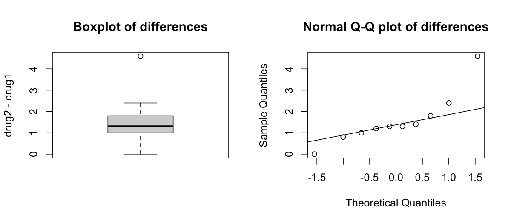

학부 실험계획법 강의 자료를 바탕으로 정리한 시리즈다. 수업은 R로 실습했고, 예제 자료는 강의 교재의 예제를 그대로 옮겨 R로 다시 분석했다. 각 글의 분산분석표는 교재의 결과와 일치하는지 확인했다.

실험계획법은 분산분석(ANOVA)을 중심으로 돌아가는데, 분산분석은 결국 두 집단의 t검정을 여러 집단으로 확장한 것이다. 그래서 1장은 t검정과 그 가정의 검토를 복습하고, 실험계획법의 기본 용어와 원리를 정리한다.

## 1. 확률표본과 표본분포

모집단 $N(\mu, \sigma^2)$에서 크기 $n$인 확률표본 $Y_1, \dots, Y_n$을 뽑으면

$$
\bar Y \sim N\!\left(\mu, \frac{\sigma^2}{n}\right), \qquad
\frac{(n-1)S^2}{\sigma^2} \sim \chi^2_{n-1}, \qquad
\frac{\bar Y - \mu}{S/\sqrt n} \sim t_{n-1}
$$

이고 $\bar Y$와 $S^2$은 서로 독립이다. 두 독립 표본의 분산비는

$$
\frac{S_1^2/\sigma_1^2}{S_2^2/\sigma_2^2} \sim F_{n_1 - 1,\ n_2 - 1}
$$

을 따른다. 분산분석의 F검정은 이 분포에서 나온다.

모집단이 정규분포가 아니어도 $n$이 크면 중심극한정리에 의해 $\bar Y$는 근사적으로 정규분포를 따른다. 그리고 $E(\bar Y) = \mu$, $E(S^2) = \sigma^2$이므로 $\bar Y$와 $S^2$은 각각 $\mu$, $\sigma^2$의 불편추정량이다. 표준오차는 $S/\sqrt n$으로, 표본평균의 표준편차를 추정한 값이다.

## 2. 한 모집단의 평균에 관한 추론

$$
H_0: \mu = \mu_0, \qquad T = \frac{\bar Y - \mu_0}{S/\sqrt n} \sim t_{n-1}\ (H_0 \text{ 하에서})
$$

$100(1-\alpha)\%$ 신뢰구간은 $\bar Y \pm t_{\alpha/2}(n-1)\,S/\sqrt n$이다. 양측검정에서 신뢰구간이 $\mu_0$를 포함하지 않는 것과 $H_0$를 기각하는 것은 같은 판단이다.

대립가설이 $H_1: \mu \ne \mu_0$이면 양측검정이고, $H_1: \mu > \mu_0$처럼 한쪽 방향에만 관심이 있으면 단측검정이다. 같은 $T$에서 단측 p값은 양측 p값의 절반이다.

R의 `sleep` 자료에서 첫 번째 약(`group == 1`)을 복용한 10명의 수면시간 증가량이 0과 다른지 검정한다.

```r
x1 <- sleep$extra[sleep$group == 1]
t.test(x1, mu = 0)
```

| 표본평균 | 검정통계량 | 자유도 | p값 | 95% 신뢰구간 |
|---|---|---|---|---|
| 0.75 | $t = 1.33$ | 9 | 0.218 | $(-0.53, 2.03)$ |

p값이 0.05보다 크고 신뢰구간이 0을 포함하므로 같은 결론이다. 이 자료에서는 첫 번째 약만으로는 수면시간이 늘어난다고 말하기 어렵다.

## 3. 독립인 두 모집단의 평균 비교

### 등분산을 가정하는 경우

$$
T = \frac{\bar Y_1 - \bar Y_2}{S_p\sqrt{1/n_1 + 1/n_2}} \sim t_{n_1 + n_2 - 2},
\qquad S_p^2 = \frac{(n_1 - 1)S_1^2 + (n_2 - 1)S_2^2}{n_1 + n_2 - 2}
$$

합동분산 $S_p^2$는 두 표본의 분산을 자유도로 가중평균한 것이다. 일원배치법의 오차평균제곱 $MSE$는 이것을 여러 집단으로 일반화한 것이다.

### 등분산을 가정하지 않는 경우 (Welch)

$$
T = \frac{\bar Y_1 - \bar Y_2}{\sqrt{S_1^2/n_1 + S_2^2/n_2}}
$$

는 근사적으로 자유도

$$
\nu = \frac{(S_1^2/n_1 + S_2^2/n_2)^2}{\frac{(S_1^2/n_1)^2}{n_1 - 1} + \frac{(S_2^2/n_2)^2}{n_2 - 1}}
$$

인 t분포를 따른다(Satterthwaite 근사). 4장의 근사 F검정에서 같은 근사가 다시 나온다.

두 방법의 선택은 다음과 같다. R의 `t.test()`는 기본값이 Welch(`var.equal = FALSE`)이고, 합동 t검정은 `var.equal = TRUE`를 지정해야 한다.

| | 합동 t검정 | Welch t검정 |
|---|---|---|
| 전제 | $\sigma_1^2 = \sigma_2^2$ | 등분산을 가정하지 않음 |
| 자유도 | $n_1 + n_2 - 2$ | $\nu$ (표본에서 계산, 정수가 아님) |
| 분산분석과의 관계 | $MSE$로 일반화됨 | 일반화는 Welch ANOVA |

등분산 검정으로 두 방법 중 하나를 고르는 2단계 절차는 쓰지 않는다. 검정 결과로 방법을 정하면 최종 검정의 제1종 오류율이 달라지므로, 등분산이라고 믿을 사전 근거(같은 장비, 같은 공정)가 없으면 Welch를 쓴다. 자세한 논의는 [생명과학통계의 평균 비교](/posts/biostat-mean-comparison)에 있다. 분산분석은 이 시리즈에서 등분산을 가정하고 진행하며, 그 가정은 5절의 방법으로 확인한다.

## 4. 독립이 아닌 두 모집단: 대응비교

같은 실험단위에서 두 번 측정하면(처리 전후, 좌우 등) 두 측정값은 독립이 아니다. 차이 $D_i = Y_{1i} - Y_{2i}$를 하나의 표본으로 보고 한 모집단 t검정을 한다.

$$
T = \frac{\bar D}{S_D/\sqrt n} \sim t_{n-1}
$$

실험단위 간의 차이가 차이값에서 상쇄되므로 독립표본 검정보다 검출력이 크다. 대응비교는 블록 크기가 2인 [확률화블록계획법](/posts/doe-05-block-latin)과 같은 구조다.

R의 `sleep` 자료(10명이 두 수면제를 모두 복용한 뒤 늘어난 수면시간)로 비교한다.

```r
library(tidyverse)

sleep_wide <- sleep |>
  pivot_wider(names_from = group, values_from = extra, names_prefix = "drug")

# 같은 사람에게 두 약을 모두 투여했으므로 대응비교
t.test(sleep_wide$drug2, sleep_wide$drug1, paired = TRUE)

# (잘못된 분석) 독립표본으로 보면
t.test(extra ~ group, data = sleep, var.equal = TRUE)
```

| 분석 | 검정통계량 | 자유도 | p값 |
|---|---|---|---|
| 대응비교 | $t = 4.06$ | 9 | 0.003 |
| 독립 두 표본 (잘못된 분석) | $t = -1.86$ | 18 | 0.079 |

평균 차이는 1.58로 같지만 대응비교에서는 사람 간 변동이 빠져 표준오차가 작아진다. 같은 자료를 어떤 실험 구조로 보느냐에 따라 결론이 달라진다. 실험을 어떻게 했는지가 분석 방법을 정한다는 점이 실험계획법 전체를 관통한다.

## 5. 분포에 대한 가정의 검토

t검정과 분산분석은 **정규성, 등분산성, 독립성**을 가정한다.

| 가정 | 검토 방법 | R |
|---|---|---|
| 정규성 | 정규확률그림(Q-Q plot), Shapiro-Wilk 검정 | `qqnorm()`, `shapiro.test()` |
| 등분산성 | Bartlett 검정(정규성에 민감), Levene 검정(강건) | `bartlett.test()`, 잔차 절댓값의 분산분석 |
| 독립성 | 실험순서에 따른 잔차 그림 | `plot(resid)` |

독립성은 검정보다 **확률화**로 보장한다. 정규성이 크게 깨지면 비모수 방법(순위합 검정, [Kruskal-Wallis 검정](/posts/doe-02-one-way))을 쓰거나 자료를 변환한다.

대응비교에서는 두 측정값이 아니라 **차이** $D_i$가 정규분포를 따라야 한다. 4절의 `sleep` 자료로 확인한다.

```r base w=8 h=3.5
d <- sleep_wide$drug2 - sleep_wide$drug1
par(mfrow = c(1, 2))
boxplot(d, main = "Boxplot of differences", ylab = "drug2 - drug1")
qqnorm(d, main = "Normal Q-Q plot of differences"); qqline(d)
shapiro.test(d)
```



Shapiro-Wilk 검정은 $W = 0.830$, $p = 0.033$이다. 상자그림과 Q-Q 그림에서 차이가 4.6인 한 명이 나머지와 떨어져 있고, 이 점이 정규성 기각의 원인이다. 표본이 10명뿐이라 검정이 0.05 근처에서 갈리므로, 정규성이 애매할 때는 비모수 검정이나 변환 결과도 함께 본다.

이상치가 보이면 제거 여부를 먼저 따진다. 측정 단위나 기록의 착오처럼 확실한 원인이 있으면 바로잡고, 원인을 모르면 이상치를 포함한 분석과 뺀 분석을 모두 보고하는 것이 안전하다.

## 6. 실험계획법의 용어

| 용어 | 뜻 | 예 |
|---|---|---|
| 특성값(반응) | 실험에서 측정하는 결과 | 강도, 수율, 밀도 |
| 인자(요인) | 특성값에 영향을 준다고 보고 실험에서 변화시키는 변수 | 온도, 첨가제 |
| 수준 | 인자가 취하는 값 | 730°C, 740°C, … |
| 처리(처리조합) | 인자 수준의 조합 | $A_1B_2$ |
| 실험단위 | 처리를 적용하는 대상 | 시편, 사과나무, 환자 |
| 모수인자 | 수준을 실험자가 정한 인자. 수준별 **평균**이 관심 | 반응온도, 비료 종류 |
| 변량인자 | 수준이 모집단에서 랜덤하게 뽑힌 인자. **산포**가 관심 | 실험일, 작업자, 원료 로트 |
| 블록인자 | 관심은 없지만 영향을 주는 장애인자를 묶은 것 | 토지 구획, 배치 |

모든 인자가 모수인자이면 **모수모형**, 모두 변량인자이면 **변량모형**, 섞여 있으면 **혼합모형**이라 한다. 어떤 모형이냐에 따라 F검정의 분모가 달라진다. 이는 [다원배치법과 EMS](/posts/doe-04-multi-way-ems)에서 다룬다.

## 7. 실험계획법의 기본원리

| 원리 | 내용 | 대표 계획 |
|---|---|---|
| 확률화 | 실험순서와 처리 배정을 랜덤하게 정해 통제하지 못한 인자의 영향을 오차에 고르게 퍼뜨린다 | 완전확률화계획(일원배치법) |
| 반복 | 같은 처리를 여러 번 실험해 오차분산을 추정하고 검출력을 높인다 | 반복이 있는 이원배치법 |
| 블록화(국소관리) | 실험 전체를 동질적인 블록으로 나누고 블록 안에서만 확률화한다. 블록 간 변동을 오차에서 뺀다 | 난괴법, 라틴방격법, 분할법 |
| 교락 | 검출할 필요가 없는 고차 교호작용을 블록 효과와 섞어 블록 크기를 줄인다 | 교락법 |
| 직교화 | 인자들의 효과를 서로 독립적으로 추정할 수 있게 배치한다 | 직교배열표, 일부실시법 |

처치를 연구자가 배정하는 **실험연구**와 이미 있는 자료를 관찰하는 **관찰연구**는 확률화 여부로 갈린다. 확률화한 실험에서는 처치 차이를 인과적 효과로 해석할 수 있지만, 관찰연구에서는 처치와 함께 달라진 다른 요인(교란)과 구분되지 않는다.

앞의 세 가지는 Fisher가 제시한 기본원리다. 확률화는 독립성 가정의 근거가 되고, 반복은 오차 추정을 가능하게 하며, 블록화는 오차를 줄인다.

R로 15회 실험의 순서를 확률화하는 것은 한 줄이다.

```r
# 5개 온도 수준을 3회씩, 실험순서를 랜덤하게 정한다
design <- tibble(온도 = rep(c(730, 740, 750, 760, 770), each = 3)) |>
  mutate(실험순서 = sample(n()))
arrange(design, 실험순서)
```

## 8. 실험의 진행 순서

1. 실험 목적 설정: 무엇을 최적화하거나 비교하려는가
2. 특성값 선정: 측정 가능하고 목적을 반영하는 값
3. 인자와 수준 선택: 기술적 지식, 예비실험, 관심 영역
4. 실험계획 선택: 인자 수, 블록 제약, 실험 가능 횟수에 따라
5. 실험 실시: 확률화한 순서대로, 조건을 기록
6. 자료 분석: 분산분석, 가정 검토, 다중비교
7. 결론과 확인실험: 최적조건에서 재현되는지 확인

## 9. 시리즈에서 다루는 실험계획의 비교

실험계획은 오차를 줄이는 방법(블록화, 국소관리)과, 정해진 실험 횟수로 무엇을 추정하는지에 따라 나뉜다.

| 계획 | 편 | 확률화의 제약 | 통제하는 변동 | 추정 대상 | 실험 횟수 |
|---|---|---|---|---|---|
| 완전확률화 (일원·다원배치) | [2](/posts/doe-02-one-way)~[4편](/posts/doe-04-multi-way-ems) | 없음 | 없음 | 주효과, 교호작용 | 수준 조합 × 반복 |
| 확률화블록 | [5편](/posts/doe-05-block-latin) | 블록 안에서만 | 한 방향의 이질성 | 처리효과 | 처리 수 × 블록 수 |
| 라틴방격 | [5편](/posts/doe-05-block-latin) | 행과 열 안에서 | 두 방향의 이질성 | 처리효과 (교호작용 없음 가정) | $p^2$ |
| $2^n$ 요인실험 | [6편](/posts/doe-06-two-level-factorial) | 없음 | 없음 | 모든 효과 (선형) | $2^n$ |
| 교락법 | [7편](/posts/doe-07-confounding-fractional) | 블록 안에서만 | 블록 간 차이 | 고차 교호작용을 희생 | $2^n$ |
| 일부실시법 | [7편](/posts/doe-07-confounding-fractional) | 없음 | 없음 | 별명 관계를 감수하고 주효과·저차 교호작용 | $2^{n-p}$ |
| $3^n$ 요인실험 | [8편](/posts/doe-08-three-level-factorial) | 없음 | 없음 | 곡률(2차 효과)까지 | $3^n$ |
| 지분·분할법 | [9편](/posts/doe-09-nested-split-plot) | 단계적 | 큰 단위와 작은 단위의 오차를 분리 | 분산성분, 바꾸기 어려운 인자 | 단계별 |
| 반응표면·혼합물 | [10편](/posts/doe-10-rsm-mixture) | 없음 | 없음 | 2차 반응곡면, 최적점 | 설계에 따라 |

위 표는 오차를 줄이는 쪽과 실험 횟수를 줄이는 쪽의 두 방향으로 읽을 수 있다. 블록화, 라틴방격, 분할법은 오차분산을 분리해 같은 횟수로 더 정밀한 비교를 하려는 설계이고, 교락법과 일부실시법은 일부 효과의 추정을 포기하고 횟수를 줄이려는 설계다. 확률화에 제약을 둘수록 분석 모형에도 그 제약이 반영되어야 한다는 점은 모든 계획에 공통이다.

## 정리

| 개념 | 핵심 |
|---|---|
| t검정 | 한 표본, 독립 두 표본(합동분산/Welch), 대응비교 |
| 합동분산 | 두 집단 분산의 자유도 가중평균, ANOVA의 MSE로 일반화 |
| 가정 | 정규성, 등분산성, 독립성(확률화로 보장) |
| 모수·변량인자 | 평균에 관심 vs 산포에 관심 |
| 기본원리 | 확률화, 반복, 블록화 + 교락, 직교화 |
