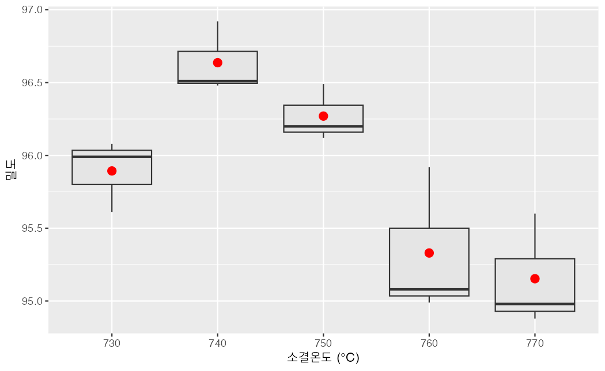
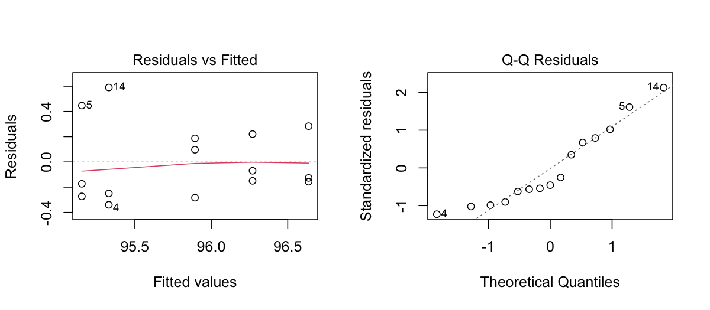

관심 있는 인자가 하나인 실험이다. 실험 전체를 완전확률화하므로 **완전확률화계획법**이라고도 한다. 분산이 같은 두 집단의 t검정을 세 집단 이상으로 확장한 것으로 볼 수 있다.

## 1. 예제와 모형

인조다이아몬드 합금 소결시편의 밀도를 소결온도 5수준에서 3회씩, 15회 실험 전체를 완전확률화해 측정했다.

| 반복 | 730°C | 740°C | 750°C | 760°C | 770°C |
|---|---|---|---|---|---|
| 1 | 96.08 | 96.51 | 96.12 | 94.99 | 95.60 |
| 2 | 95.61 | 96.48 | 96.49 | 95.08 | 94.88 |
| 3 | 95.99 | 96.92 | 96.20 | 95.92 | 94.98 |

인자 $A$의 수준이 $l$개, 반복이 $m$회이면

$$
y_{ij} = \mu + a_i + e_{ij}, \qquad \sum_{i=1}^{l} a_i = 0, \qquad e_{ij} \overset{iid}{\sim} N(0, \sigma_E^2)
$$

$\mu$는 총평균, $a_i = \mu_i - \mu$는 $i$수준의 효과다. 가설은

$$
H_0: a_1 = a_2 = \cdots = a_l = 0 \quad (\mu_1 = \cdots = \mu_l), \qquad H_1: \text{적어도 하나는 0이 아니다}
$$

## 2. 변동의 분해

각 관측값의 편차를 둘로 나눈다.

$$
y_{ij} - \bar y_{..} = (\bar y_{i.} - \bar y_{..}) + (y_{ij} - \bar y_{i.})
$$

양변을 제곱해 더하면 교차항이 0이 되어

$$
\underbrace{\sum_i\sum_j (y_{ij} - \bar y_{..})^2}_{SS_T} = \underbrace{m\sum_i (\bar y_{i.} - \bar y_{..})^2}_{SS_A} + \underbrace{\sum_i\sum_j (y_{ij} - \bar y_{i.})^2}_{SS_E}
$$

이다. 자유도도 $lm - 1 = (l - 1) + l(m - 1)$로 나뉜다. 계산할 때는 수정항 $CT = T_{..}^2/(lm)$을 써서

$$
SS_T = \sum\sum y_{ij}^2 - CT, \qquad SS_A = \frac{1}{m}\sum_i T_{i.}^2 - CT, \qquad SS_E = SS_T - SS_A
$$

로 구한다($T$는 합계).

## 3. F검정의 원리

평균제곱의 기댓값은

$$
E(MS_E) = \sigma_E^2, \qquad E(MS_A) = \sigma_E^2 + \frac{m\sum a_i^2}{l - 1}
$$

이다. $H_0$이 참이면 두 평균제곱이 모두 $\sigma_E^2$을 추정하고, 거짓이면 $MS_A$가 더 커진다. 그래서

$$
F_0 = \frac{MS_A}{MS_E} \sim F_{l-1,\ l(m-1)} \quad (H_0 \text{ 하에서})
$$

가 클 때 $H_0$을 기각한다. $SS_A/\sigma_E^2 \sim \chi^2_{l-1}$과 $SS_E/\sigma_E^2 \sim \chi^2_{l(m-1)}$이 독립(Cochran 정리)이라는 것이 근거다.

```r
library(tidyverse)

density <- tibble(
  온도 = factor(rep(c(730, 740, 750, 760, 770), times = 3)),
  밀도 = c(96.08, 96.51, 96.12, 94.99, 95.60,
           95.61, 96.48, 96.49, 95.08, 94.88,
           95.99, 96.92, 96.20, 95.92, 94.98)
)

fit <- aov(밀도 ~ 온도, data = density)
summary(fit)
```

| 요인 | 제곱합 | 자유도 | 평균제곱 | F | p값 |
|---|---|---|---|---|---|
| 온도 | 4.658 | 4 | 1.164 | 10.11 | 0.002 |
| 오차 | 1.152 | 10 | 0.115 | | |
| 계 | 5.810 | 14 | | | |

p값이 0.002로 소결온도에 따라 밀도가 다르다. 결정계수 $R^2 = SS_A/SS_T = 0.80$으로 밀도 변동의 80%를 온도가 설명한다.

```r
ggplot(density, aes(온도, 밀도)) +
  geom_boxplot(fill = "grey90") +
  stat_summary(fun = mean, geom = "point", color = "red", size = 3) +
  labs(x = "소결온도 (°C)", y = "밀도")
```



740°C에서 가장 높고, 760°C 이상에서 크게 떨어진다.

## 4. 가정의 검토

```r
# 정규성: 잔차의 Q-Q 그림과 Shapiro-Wilk 검정
shapiro.test(residuals(fit))

# 등분산성: Bartlett 검정과 Levene 검정(잔차 절댓값의 분산분석)
bartlett.test(밀도 ~ 온도, data = density)
density$abs_res <- abs(residuals(fit))
anova(lm(abs_res ~ 온도, data = density))
```

```r base w=8 h=3.5
par(mfrow = c(1, 2))
plot(fit, which = 1:2)
```



| 검정 | 통계량 | p값 | 판단 |
|---|---|---|---|
| Shapiro-Wilk (잔차) | $W = 0.907$ | 0.12 | 정규성 만족 |
| Bartlett | $K^2 = 2.11$ | 0.72 | 등분산 |
| Levene | $F = 2.139$ | 0.15 | 등분산 |

Levene 검정 결과는 교재의 SPSS 결과(2.139, 0.150)와 같다. `car::leveneTest()`의 기본값은 중앙값 기준이라 값이 조금 다르다.

## 5. 수준별 모평균의 추론

$i$수준 모평균 $\mu_i = \mu + a_i$의 $100(1-\alpha)\%$ 신뢰구간은

$$
\bar y_{i.} \pm t_{\alpha/2}(l(m-1))\sqrt{\frac{MS_E}{m}}
$$

이다. 예제에서 $t_{0.025}(10)\sqrt{0.115/3} = 0.437$이므로 최적인 740°C의 평균 밀도는 $96.637 \pm 0.437$, 즉 $(96.20, 97.07)$이다.

두 수준의 차이 $\mu_i - \mu_{i'}$의 신뢰구간은

$$
(\bar y_{i.} - \bar y_{i'.}) \pm t_{\alpha/2}(l(m-1))\sqrt{\frac{2MS_E}{m}}
$$

이다. 이 구간의 반폭이 **최소유의차**(LSD)이고, 예제에서 0.617이다.

## 6. 다중비교

수준이 5개면 쌍 비교가 10번이다. 각 비교를 유의수준 5%로 하면 적어도 하나를 잘못 기각할 확률(실험별 오류율)이 5%보다 훨씬 커진다. 다중비교는 이를 통제한다.

| 방법 | 기준 | 특징 |
|---|---|---|
| LSD | $t_{\alpha/2}\sqrt{2MS_E/m}$ | 비교별 오류율만 통제. F검정이 유의할 때만 사용(Fisher의 보호된 LSD) |
| Bonferroni | $t_{\alpha/(2k)}\sqrt{2MS_E/m}$, $k$는 비교 횟수 | 비교 수가 적을 때 적합, 보수적 |
| Tukey HSD | $q_\alpha(l, \nu)\sqrt{MS_E/m}$ | 모든 쌍 비교에서 실험별 오류율을 정확히 $\alpha$로 통제 |
| Scheffé | $\sqrt{(l-1)F_\alpha}\sqrt{MS_E\sum c_i^2/m}$ | 모든 대비(contrast)에 대해 통제, 가장 보수적 |
| Duncan | 단계별 범위 검정 | 검출력은 높지만 실험별 오류율 통제가 약함 |
| Dunnett (교재 밖) | 대조군과 각 처리의 비교 $l-1$개 | 대조군이 있는 실험. R의 `multcomp::glht(..., mcp(온도 = "Dunnett"))` |

교재 본문은 LSD로 진행하고 나머지 방법은 이름만 소개한다. 비교 수가 많거나 결과를 보고 비교를 정하는 경우에는 LSD를 쓰지 않는다. 다중비교의 이론은 [다중검정](/posts/dm-multiple-testing)에서, 임상 사례는 [생명과학통계의 평균 비교](/posts/biostat-mean-comparison)에서 다룬다.

```r
TukeyHSD(fit)
pairwise.t.test(density$밀도, density$온도, p.adjust.method = "bonferroni")
```

Tukey의 기준값은 $q_{0.05}(5, 10)\sqrt{0.115/3} = 4.654 \times 0.196 = 0.912$다. 이보다 차이가 큰 쌍만 유의하다.

| 비교 | 평균 차이 | Tukey 조정 p값 |
|---|---|---|
| 740 − 770 | 1.483 | 0.002 |
| 740 − 760 | 1.307 | 0.006 |
| 750 − 770 | 1.117 | 0.016 |
| 750 − 760 | 0.940 | 0.043 |
| 나머지 6쌍 | 0.92 미만 | > 0.12 |

평균을 크기순으로 놓고 유의차가 없는 수준끼리 묶으면

$$
\underline{740 \quad 750 \quad 730} \qquad 760 \quad 770 \qquad (\text{730, 760, 770도 서로 유의차 없음})
$$

740°C와 750°C가 밀도를 높이는 조건이다.

### 대비

미리 계획한 비교는 대비 $L = \sum c_i \mu_i$ ($\sum c_i = 0$)로 표현한다. 예를 들어 "750°C 이하 평균 vs 760°C 이상 평균"은

$$
L = \tfrac13(\mu_1 + \mu_2 + \mu_3) - \tfrac12(\mu_4 + \mu_5), \qquad SS_L = \frac{(\sum c_i \bar y_{i.})^2}{\sum c_i^2/m}
$$

이고 자유도 1인 제곱합이다. 검정은 $F = SS_L/MS_E \sim F_{1,\ l(m-1)}$이다. 서로 직교하는($\sum c_i c_i' = 0$) 대비 $l - 1$개의 제곱합을 더하면 $SS_A$가 된다.

```r
ybar <- tapply(density$밀도, density$온도, mean)
cc <- c(1/3, 1/3, 1/3, -1/2, -1/2)
L <- sum(cc * ybar)
SS_L <- L^2 / (sum(cc^2) / 3)
F0 <- SS_L / (sum(residuals(fit)^2) / 10)
c(L = L, SS_L = SS_L, F = F0, p = pf(F0, 1, 10, lower.tail = FALSE))
```

$\hat L = 1.025$, $SS_L = 3.782$, $F = 32.8$, $p = 0.0002$로, 750°C 이하와 760°C 이상의 평균 밀도가 다르다. 이 대비 하나가 $SS_A = 4.658$의 81%를 설명한다. 이 대비는 자료를 본 뒤가 아니라 **미리** 정한 것이어야 한다. 자료를 보고 정한 대비는 Scheffé 기준으로 판단한다.

온도처럼 수준이 등간격인 양적 인자는 직교다항식 대비로 1차, 2차 추세를 분해할 수 있다.

```r
# 직교다항식 대비로 온도 효과를 1차~4차 추세로 분해
density$온도_poly <- density$온도
contrasts(density$온도_poly) <- contr.poly(5)
summary(aov(밀도 ~ 온도_poly, data = density),
        split = list(온도_poly = list(linear = 1, quadratic = 2, cubic = 3, quartic = 4)))
```

## 7. 반복수가 같지 않은 경우

생타이어 원주 길이 4수준에서 타이어 불균형(torque)을 측정했는데, 예상치 못한 문제로 반복수가 5, 6, 5, 3이 되었다.

| 3260mm | 3265mm | 3270mm | 3275mm |
|---|---|---|---|
| 49, 73, 58, 38, 42 | 31, 40, 43, 44, 34, 20 | 46, 41, 58, 31, 65 | 45, 73, 76 |

제곱합은 $m$을 $m_i$로 바꾸면 된다.

$$
SS_A = \sum_i m_i(\bar y_{i.} - \bar y_{..})^2, \qquad \nu_E = \sum_i (m_i - 1)
$$

```r
tire <- tibble(
  길이 = factor(rep(c(3260, 3265, 3270, 3275), times = c(5, 6, 5, 3))),
  torque = c(49, 73, 58, 38, 42, 31, 40, 43, 44, 34, 20, 46, 41, 58, 31, 65, 45, 73, 76)
)
summary(aov(torque ~ 길이, data = tire))
TukeyHSD(aov(torque ~ 길이, data = tire))   # 반복수가 다르면 Tukey-Kramer
```

| 요인 | 제곱합 | 자유도 | 평균제곱 | F | p값 |
|---|---|---|---|---|---|
| 길이 | 1874.9 | 3 | 625.0 | 3.74 | 0.035 |
| 오차 | 2508.8 | 15 | 167.3 | | |

신뢰구간과 다중비교는 $m$ 대신 $m_i$를 쓴다(Tukey-Kramer). 반복수가 다르면 등분산 가정이 깨졌을 때 F검정이 더 민감해지므로 가능하면 반복수를 같게 계획한다.

## 8. 비모수적 분석: Kruskal-Wallis 검정

정규성이 의심되면 전체 자료의 순위 $R_{ij}$로 검정한다.

$$
H = \frac{12}{N(N + 1)}\sum_i \frac{R_{i.}^2}{m_i} - 3(N + 1) \;\approx\; \chi^2_{l-1}
$$

```r
kruskal.test(밀도 ~ 온도, data = density)
kruskal.test(torque ~ 길이, data = tire)
```

밀도 자료는 $H = 12.43$, $p = 0.014$로 분산분석과 같은 결론이다. 타이어 자료는 $H = 7.65$, $p = 0.054$로 분산분석($p = 0.035$)보다 약간 보수적이다. 정규성이 성립할 때 비모수 검정은 검출력이 조금 낮다.

## 9. 변량모형

인자의 수준이 랜덤하게 뽑혔다면(예: 여러 원료 로트 중 5개) 관심은 수준별 평균이 아니라 **로트 간 산포**다.

$$
y_{ij} = \mu + a_i + e_{ij}, \qquad a_i \sim N(0, \sigma_A^2), \qquad e_{ij} \sim N(0, \sigma_E^2)
$$

$$
H_0: \sigma_A^2 = 0, \qquad E(MS_A) = \sigma_E^2 + m\sigma_A^2
$$

F 통계량은 모수모형과 같지만 해석이 다르다. 분산성분은 평균제곱의 기댓값을 이용해 추정한다.

$$
\hat\sigma_E^2 = MS_E, \qquad \hat\sigma_A^2 = \frac{MS_A - MS_E}{m}
$$

밀도 자료의 온도가 랜덤하게 뽑힌 수준이라고 가정하고 계산하면 다음과 같다.

```r
tab <- summary(fit)[[1]]
MS_A <- tab[1, "Mean Sq"]; MS_E <- tab[2, "Mean Sq"]
s2_A <- (MS_A - MS_E) / 3
c(sigma2_A = s2_A, sigma2_E = MS_E, 급내상관 = s2_A / (s2_A + MS_E))
```

$\hat\sigma_A^2 = (1.164 - 0.115)/3 = 0.350$이고, 전체 분산 중 수준 간 분산의 비율(급내상관)은 $0.350/(0.350 + 0.115) = 0.75$다. 이 자료의 온도는 실험자가 정한 수준이므로 실제 분석은 모수모형이고, 위 계산은 두 모형의 차이를 보이기 위한 것이다. $\hat\sigma_A^2$은 $MS_A < MS_E$이면 음수가 될 수 있으며, 이때는 0으로 두거나 모형을 다시 검토한다.

| | 모수모형 | 변량모형 |
|---|---|---|
| 수준 | 실험자가 정함 | 모집단에서 랜덤하게 뽑힘 |
| 관심 | 수준별 평균 $\mu_i$, 차이 | 분산성분 $\sigma_A^2$ |
| 가정 | $\sum a_i = 0$ | $a_i \sim N(0, \sigma_A^2)$ |
| $E(MS_A)$ | $\sigma_E^2 + m\sum a_i^2/(l-1)$ | $\sigma_E^2 + m\sigma_A^2$ |
| 후속 분석 | 다중비교, 대비 | 분산성분 추정 |
| 결론의 범위 | 실험한 수준 | 수준의 모집단 전체 |

## 정리

| 개념 | 식 / 내용 | 예제 |
|---|---|---|
| 모형 | $y_{ij} = \mu + a_i + e_{ij}$ | 소결온도 5수준, 반복 3 |
| 변동 분해 | $SS_T = SS_A + SS_E$ | 5.810 = 4.658 + 1.152 |
| F검정 | $MS_A/MS_E$ | $F = 10.11$, $p = 0.002$ |
| 신뢰구간 | $\bar y_{i.} \pm t\sqrt{MS_E/m}$ | 740°C: (96.20, 97.07) |
| Tukey HSD | $q_\alpha(l, \nu)\sqrt{MS_E/m}$ | 0.912 |
| 반복수 불균형 | $m \to m_i$ | 타이어 $p = 0.035$ |
| Kruskal-Wallis | 순위 기반 | $H = 12.43$ |
| 변량모형 | $\hat\sigma_A^2 = (MS_A - MS_E)/m$ | 0.350 |
