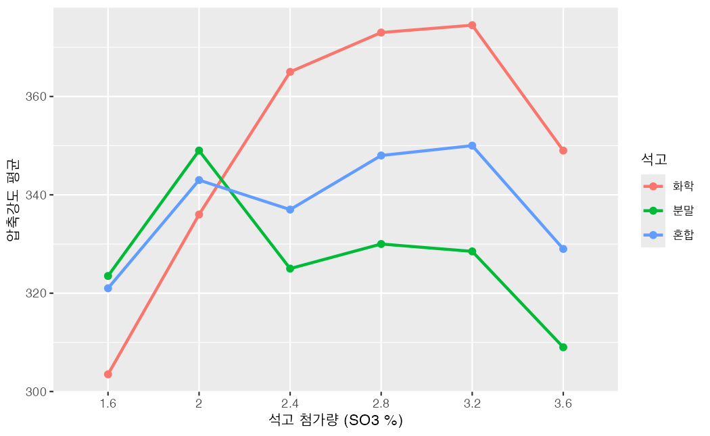

관심 인자가 두 개인 실험이다. 두 인자의 모든 수준조합을 실험 전체에 대해 완전확률화한다. 반복이 없으면 교호작용을 검출할 수 없고, 반복이 있어야 교호작용을 오차와 분리할 수 있다.

## 1. 반복이 없는 이원배치법

반도체 소결시편의 밀도를 최대로 하는 조건을 찾기 위해 소결온도($A$) 3수준과 Sb 함량($B$) 4수준의 12조합을 1회씩 완전확률화해 실험했다.

| 온도 \ Sb(mole%) | 0.1 | 0.2 | 0.3 | 0.4 |
|---|---|---|---|---|
| 1250°C | 47.14 | 48.33 | 43.57 | 38.57 |
| 1300°C | 52.26 | 53.57 | 48.87 | 45.28 |
| 1350°C | 54.05 | 54.88 | 51.43 | 48.69 |

$$
y_{ij} = \mu + a_i + b_j + e_{ij}, \qquad \sum a_i = \sum b_j = 0, \qquad e_{ij} \sim N(0, \sigma_E^2)
$$

각 셀에 관측값이 하나뿐이라 교호작용 $(ab)_{ij}$와 오차를 구분할 수 없다. 교호작용이 없다고 가정하고 나머지를 오차로 쓴다.

$$
SS_T = SS_A + SS_B + SS_E, \qquad SS_A = m\sum_i(\bar y_{i.} - \bar y_{..})^2, \quad SS_B = l\sum_j(\bar y_{.j} - \bar y_{..})^2
$$

$$
SS_E = \sum\sum(y_{ij} - \bar y_{i.} - \bar y_{.j} + \bar y_{..})^2, \qquad \nu_E = (l - 1)(m - 1)
$$

```r
library(tidyverse)

semi <- expand_grid(온도 = c(1250, 1300, 1350), Sb = c(0.1, 0.2, 0.3, 0.4)) |>
  mutate(밀도 = c(47.14, 48.33, 43.57, 38.57,
                  52.26, 53.57, 48.87, 45.28,
                  54.05, 54.88, 51.43, 48.69),
         across(c(온도, Sb), factor))

fit1 <- aov(밀도 ~ 온도 + Sb, data = semi)
summary(fit1)
```

| 요인 | 제곱합 | 자유도 | 평균제곱 | F | p값 |
|---|---|---|---|---|---|
| 온도 | 130.930 | 2 | 65.465 | 98.66 | < 0.001 |
| Sb 함량 | 118.559 | 3 | 39.520 | 59.56 | < 0.001 |
| 오차 | 3.981 | 6 | 0.664 | | |
| 계 | 253.470 | 11 | | | |

두 인자 모두 매우 유의하다. 온도가 높을수록, Sb 함량이 0.2 이하일수록 밀도가 높다.

### 최적조건의 추정

교호작용이 없는 가법모형에서 $A_iB_j$의 모평균은

$$
\hat\mu(A_iB_j) = \bar y_{i.} + \bar y_{.j} - \bar y_{..}
$$

로 추정한다. 최적조건 1350°C, Sb 0.2에서 $52.263 + 52.260 - 48.887 = 55.64$다. 이 추정량의 분산은 $\sigma_E^2/n_e$인데, **유효반복수** $n_e$는

$$
n_e = \frac{\text{총 실험횟수}}{1 + (\text{추정에 쓴 효과들의 자유도 합})} = \frac{lm}{1 + (l - 1) + (m - 1)} = \frac{12}{6} = 2
$$

이다(Taguchi의 공식). 95% 신뢰구간은

$$
55.64 \pm t_{0.025}(6)\sqrt{\frac{MS_E}{n_e}} = 55.64 \pm 2.447\sqrt{0.664/2} = 55.64 \pm 1.41
$$

### Tukey의 비가법성 검정

반복이 없어도 교호작용이 $(ab)_{ij} = \lambda a_i b_j$ 꼴이라고 가정하면 자유도 1을 써서 검정할 수 있다.

$$
SS_N = \frac{\left(\sum\sum \hat a_i \hat b_j y_{ij}\right)^2}{\sum \hat a_i^2 \sum \hat b_j^2}, \qquad F = \frac{SS_N}{(SS_E - SS_N)/(\nu_E - 1)}
$$

```r
semi <- semi |>
  mutate(a = ave(밀도, 온도) - mean(밀도),
         b = ave(밀도, Sb) - mean(밀도))
anova(lm(밀도 ~ 온도 + Sb + I(a * b), data = semi))
```

예제에서는 $SS_N = 3.38$, $F = 28.1$, $p = 0.003$이다. 오차제곱합 3.98의 대부분이 이 한 자유도에 몰려 있다. 표를 보면 온도가 낮을 때 Sb 함량을 0.2에서 0.4로 늘릴 때 밀도 하락이 더 크다(1250°C에서 9.8, 1350°C에서 6.2 하락). 교호작용이 있을 가능성이 있으므로 이런 실험은 반복을 두어 확인하는 것이 좋다.

## 2. 교호작용의 이해

**교호작용**은 한 인자의 효과가 다른 인자의 수준에 따라 달라지는 것이다. 인자 $A$의 수준별로 $B$에 따른 평균을 이은 **교호작용도**(선도표)에서

- 선들이 평행하면 교호작용이 없다(가법적).
- 선들이 평행하지 않거나 교차하면 교호작용이 있다.

교호작용이 크면 주효과만 보고 최적조건을 정하면 안 된다. 각 수준조합의 평균을 직접 비교해야 한다. 특히 선이 교차하는 질적 교호작용에서는 주효과의 해석 자체가 의미가 없다.

## 3. 반복이 있는 이원배치법

시멘트 강도를 높이기 위해 석고 종류($A$: 화학, 분말, 혼합) 3수준과 석고 첨가량($B$: SO₃ 1.6~3.6%) 6수준의 18조합을 2회씩, 36회 실험을 완전확률화해 압축강도(kg/cm²)를 측정했다.

| 석고 \ 첨가량 | 1.6 | 2.0 | 2.4 | 2.8 | 3.2 | 3.6 |
|---|---|---|---|---|---|---|
| 화학 | 305, 302 | 335, 337 | 366, 364 | 372, 374 | 376, 373 | 348, 350 |
| 분말 | 322, 325 | 350, 348 | 326, 324 | 330, 330 | 327, 330 | 310, 308 |
| 혼합 | 320, 322 | 342, 344 | 338, 336 | 348, 348 | 350, 350 | 330, 328 |

$$
y_{ijk} = \mu + a_i + b_j + (ab)_{ij} + e_{ijk}, \qquad k = 1, \dots, r
$$

$$
SS_T = SS_A + SS_B + SS_{A \times B} + SS_E, \qquad SS_{A\times B} = SS_{AB} - SS_A - SS_B
$$

$SS_{AB} = r\sum\sum(\bar y_{ij.} - \bar y_{...})^2$는 셀 평균 사이의 제곱합이고, 오차는 셀 안의 변동 $SS_E = \sum\sum\sum(y_{ijk} - \bar y_{ij.})^2$이다. 자유도는 $lmr - 1 = (l-1) + (m-1) + (l-1)(m-1) + lm(r-1)$이다.

```r
cement <- expand_grid(석고 = c("화학", "분말", "혼합"),
                      첨가량 = c(1.6, 2.0, 2.4, 2.8, 3.2, 3.6),
                      반복 = 1:2) |>
  mutate(강도 = c(305, 302, 335, 337, 366, 364, 372, 374, 376, 373, 348, 350,
                  322, 325, 350, 348, 326, 324, 330, 330, 327, 330, 310, 308,
                  320, 322, 342, 344, 338, 336, 348, 348, 350, 350, 330, 328),
         석고 = factor(석고, levels = c("화학", "분말", "혼합")),
         첨가량 = factor(첨가량))

fit2 <- aov(강도 ~ 석고 * 첨가량, data = cement)
summary(fit2)
```

| 요인 | 제곱합 | 자유도 | 평균제곱 | F | p값 |
|---|---|---|---|---|---|
| 석고 종류 | 3088.2 | 2 | 1544.1 | 694.8 | < 0.001 |
| 첨가량 | 5548.9 | 5 | 1109.8 | 499.4 | < 0.001 |
| 교호작용 | 4825.8 | 10 | 482.6 | 217.2 | < 0.001 |
| 오차 | 40.0 | 18 | 2.22 | | |
| 계 | 13502.9 | 35 | | | |

교호작용이 매우 유의하다.

```r
cement |>
  group_by(석고, 첨가량) |>
  summarise(평균 = mean(강도), .groups = "drop") |>
  ggplot(aes(첨가량, 평균, color = 석고, group = 석고)) +
  geom_line(linewidth = 1) + geom_point(size = 2) +
  labs(x = "석고 첨가량 (SO3 %)", y = "압축강도 평균")
```



화학석고는 첨가량이 늘수록 강도가 크게 올라 3.2%에서 최대이고, 분말석고는 2.0%에서 최대였다가 떨어진다. 첨가량의 효과가 석고 종류에 따라 다르므로 주효과로 최적조건을 정하면 안 된다.

### 최적조건

교호작용이 유의하면 셀 평균으로 추정한다.

$$
\hat\mu(A_iB_j) = \bar y_{ij.}, \qquad \bar y_{ij.} \pm t_{\alpha/2}(lm(r - 1))\sqrt{\frac{MS_E}{r}}
$$

최적조건은 화학석고, 첨가량 3.2%로 평균 374.5다. 95% 신뢰구간은 $374.5 \pm 2.101\sqrt{2.22/2} = 374.5 \pm 2.2$이다. 2.8%(373.0)와는 차이가 작아 비용을 고려해 고를 수 있다.

### 평균제곱의 기댓값 (모수모형)

| 요인 | $E(MS)$ |
|---|---|
| $A$ | $\sigma_E^2 + mr\sum a_i^2/(l-1)$ |
| $B$ | $\sigma_E^2 + lr\sum b_j^2/(m-1)$ |
| $A\times B$ | $\sigma_E^2 + r\sum\sum(ab)_{ij}^2/((l-1)(m-1))$ |
| $E$ | $\sigma_E^2$ |

모든 효과의 F검정 분모가 $MS_E$다. 인자 중 하나라도 변량인자이면 분모가 달라진다. [다원배치법](/posts/doe-04-multi-way-ems)에서 다룬다.

## 4. 오차항에의 풀링

유의하지 않은 교호작용을 오차항에 합치는 것을 **풀링**이라 한다. 풀링하면 오차 자유도가 늘어 다른 효과의 검출력이 올라간다.

$$
MS_E' = \frac{SS_E + SS_{A\times B}}{\nu_E + \nu_{A\times B}}
$$

풀링 기준으로 흔히 쓰는 규칙:

- 교호작용의 F값이 2 미만이거나 p값이 0.2 이상일 때(유의수준을 높게 잡아 제2종 오류를 줄임)
- 기술적으로 교호작용이 없다고 볼 근거가 있을 때
- 주효과는 유의하지 않아도 풀링하지 않는다(실험 목적의 인자이므로)

풀링은 남용하면 오차분산을 과소추정하게 되므로 실험 전에 기준을 정해 두는 것이 원칙이다.

```r
# 예: 교호작용이 유의하지 않았다면 주효과 모형으로 다시 적합
summary(aov(강도 ~ 석고 + 첨가량, data = cement))
```

시멘트 예제는 교호작용이 매우 유의하므로 풀링하면 안 된다. 위 코드로 주효과 모형을 적합하면 교호작용 제곱합이 오차에 섞여 $MS_E$가 2.2에서 173.8로 커지는 것을 볼 수 있다.

## 정리

| 구분 | 반복 없음 | 반복 있음 |
|---|---|---|
| 모형 | $\mu + a_i + b_j + e_{ij}$ | $\mu + a_i + b_j + (ab)_{ij} + e_{ijk}$ |
| 오차 자유도 | $(l-1)(m-1)$ | $lm(r - 1)$ |
| 교호작용 | 검출 불가 (Tukey 1자유도 검정만 가능) | 검출 가능 |
| 최적조건 추정 | $\bar y_{i.} + \bar y_{.j} - \bar y_{..}$, $n_e = lm/(l + m - 1)$ | 교호작용 유의 시 $\bar y_{ij.}$ |
| 예제 결과 | 1350°C, Sb 0.2: 55.64 ± 1.41 | 화학석고 3.2%: 374.5 ± 2.2 |
