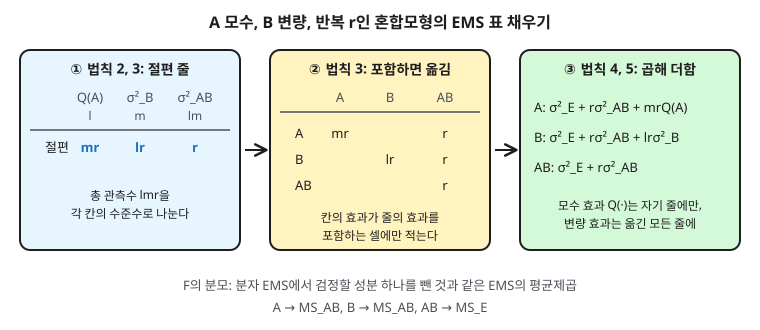
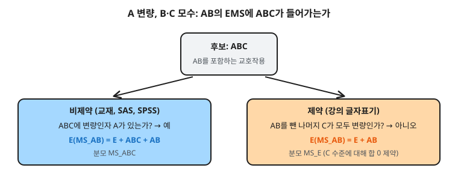
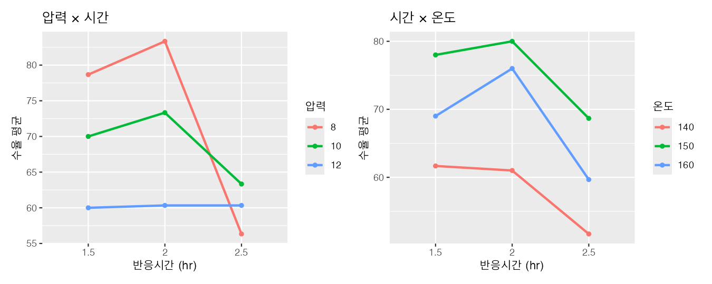

인자가 셋 이상인 요인배치 실험을 다룬다. 핵심은 **어떤 평균제곱으로 나누어 F검정을 하느냐**다. 모수모형에서는 항상 $MS_E$로 나누지만, 변량인자가 섞이면 분모가 바뀐다. 그 분모를 정하는 도구가 평균제곱의 기댓값(EMS)이다.

## 1. 분산분석의 원리

F검정의 분자와 분모는 $H_0$ 하에서 **같은 기댓값**을 가져야 한다. 분자 $MS$의 기댓값에서 검정하려는 효과 하나만 뺀 것과 기댓값이 같은 평균제곱이 분모가 된다.

반복이 있는 이원배치법($A$: $l$수준, $B$: $m$수준, 반복 $r$)에서 세 가지 모형을 비교하면

| 요인 | 모수모형 | 혼합모형 ($A$ 모수, $B$ 변량, 비제약) | 변량모형 |
|---|---|---|---|
| $A$ | $\sigma_E^2 + mr\,Q(A)$ | $\sigma_E^2 + r\sigma_{A\times B}^2 + mr\,Q(A)$ | $\sigma_E^2 + r\sigma_{A\times B}^2 + mr\sigma_A^2$ |
| $B$ | $\sigma_E^2 + lr\,Q(B)$ | $\sigma_E^2 + r\sigma_{A\times B}^2 + lr\sigma_B^2$ | $\sigma_E^2 + r\sigma_{A\times B}^2 + lr\sigma_B^2$ |
| $A\times B$ | $\sigma_E^2 + r\,Q(A\times B)$ | $\sigma_E^2 + r\sigma_{A\times B}^2$ | $\sigma_E^2 + r\sigma_{A\times B}^2$ |
| $E$ | $\sigma_E^2$ | $\sigma_E^2$ | $\sigma_E^2$ |

$Q(A) = \sum a_i^2/(l-1)$은 모수효과의 크기다. 혼합모형과 변량모형에서 $A$의 검정 분모는 $MS_E$가 아니라 $MS_{A\times B}$다. 변량인자 $B$의 수준이 바뀌면 $A$의 효과도 그 교호작용만큼 흔들리기 때문이다. 이것을 무시하고 $MS_E$로 나누면 $A$의 효과를 과대평가한다.

## 2. EMS를 구하는 법칙

교재는 혼합모형의 교호작용에 합이 0이라는 제약을 두지 않는 방식(SAS, SPSS의 기본값)을 따른다.

**법칙 1.** 교호작용에 변량인자가 하나라도 들어 있으면 그 교호작용은 변량효과다.

**법칙 2.** 표의 첫 칸에 모형의 각 항, 첫 줄에 오차를 제외한 효과와 그 수준수(교호작용은 수준수의 곱)를 적는다.

**법칙 3.** 반복수 줄(계수)에는 총 관측수를 첫 줄의 수준수로 나눈 값을 적는다. 각 줄과 칸에서 같은 인자가 하나 이상 겹치고, 칸의 효과가 줄의 효과를 포함하면(칸의 인자 수 ≥ 줄의 인자 수) 그 셀에 반복수 줄의 숫자를 적는다.

**법칙 4.** 줄별로 셀의 숫자와 칸 효과의 분산을 곱해 더하고 $\sigma_E^2$을 더한다. 혼합모형에서는 모수인자와 모수인자들만의 교호작용의 분산을 $Q(\cdot)$로 바꾼다. 모수모형에서는 모든 효과가 $Q(\cdot)$이고, 효과 $X$의 EMS는 인자 수와 관계없이 $\sigma_E^2 + urQ(X)$다($u$는 $X$에 없는 인자들의 수준수 곱).

**법칙 5.** $X$가 모수인자들만의 효과이면 $Q(X)$는 $E(MS_X)$에만 들어가고, $X$에 들어 있는 인자로 만든 하위 효과 $Y$의 $E(MS_Y)$에는 들어가지 않는다. 예를 들어 $A$, $B$가 모수이면 $Q(A\times B)$는 $E(MS_A)$, $E(MS_B)$에 없다. 그래서 표에서 모수 효과의 칸은 자기 줄에만 숫자를 남긴다.

**법칙 6.** 반복이 없으면($r = 1$) 최고차 교호작용의 줄과 칸을 지우고, 그 성분을 EMS에서 뺀다. 최고차 교호작용은 오차와 구분되지 않으므로 "$E$" 안에 들어 있다고 본다.

**법칙 7.** 모수모형에서는 모든 효과를 $F = MS_X/MS_E$로 검정한다. 그 밖의 모형은 EMS의 비가 검정할 성분 하나만 남기도록 분모를 고른다.

법칙 5의 근거(교재 부록 4A)는 모수 효과의 합 0 제약이다. $A$, $B$ 모수, $C$ 변량인 반복 없는 삼원배치법에서 $\sum_j (ab)_{ij} = 0$이므로 $\bar y_{i..} = \mu + a_i + \bar c + \overline{(ac)}_{i.} + \overline{(bc)} + \bar e_{i..}$에는 $(ab)_{ij}$가 아예 남지 않는다. 이를 제곱해 기댓값을 내면 $E(MS_A) = \sigma_E^2 + m\sigma_{A\times C}^2 + mnQ(A)$로 $Q(A\times B)$가 없다. 변량 교호작용 $(ac)_{ik}$에는 이런 제약이 없어서 그 분산이 남는다. 이것이 아래의 비제약 모형이다.



$A$, $B$가 모두 변량이고 반복이 $r$이면

| 요인 | $A$ ($l$) | $B$ ($m$) | $A\times B$ ($lm$) | $E(MS)$ |
|---|---|---|---|---|
| 반복수 | $mr$ | $lr$ | $r$ | |
| $A$ | $mr$ | | $r$ | $\sigma_E^2 + r\sigma_{A\times B}^2 + mr\sigma_A^2$ |
| $B$ | | $lr$ | $r$ | $\sigma_E^2 + r\sigma_{A\times B}^2 + lr\sigma_B^2$ |
| $A\times B$ | | | $r$ | $\sigma_E^2 + r\sigma_{A\times B}^2$ |

### 글자표기 EMS: 비제약 모형과 제약 모형

계수를 빼고 어떤 성분이 들어가는지만 빠르게 적는 방법이다. 혼합모형의 EMS는 교호작용에 어떤 가정을 두느냐에 따라 두 가지가 있다.

- **비제약 모형(교재, SAS, SPSS의 기본):** 효과 $X$의 EMS에는 $E$, $X$ 자신, 그리고 $X$를 포함하는 교호작용 중 **변량인자가 하나라도 들어 있는 것**이 모두 들어간다. 위의 법칙 1~4와 같은 결과다.
- **제약 모형(강의의 글자표기):** 모수인자를 포함하는 교호작용 효과는 그 모수인자의 수준에 대해 합이 0이라고 둔다. 그래서 $X$를 포함하는 교호작용 중 **$X$를 뺀 나머지 인자가 모두 변량인 것**만 들어간다.



$A$ 변량, $B$·$C$ 모수, 반복이 있는 삼원배치법에서 두 모형을 비교하면 다음과 같다.

| 효과 | 비제약 EMS | F 분모 | 제약 EMS | F 분모 |
|---|---|---|---|---|
| $A$ | $E + ABC + AB + AC + A$ | 근사 F ($AB + AC - ABC$) | $E + A$ | $E$ |
| $B$ | $E + ABC + AB + B$ | $AB$ | $E + AB + B$ | $AB$ |
| $C$ | $E + ABC + AC + C$ | $AC$ | $E + AC + C$ | $AC$ |
| $AB$ | $E + ABC + AB$ | $ABC$ | $E + AB$ | $E$ |
| $AC$ | $E + ABC + AC$ | $ABC$ | $E + AC$ | $E$ |
| $BC$ | $E + ABC + BC$ | $ABC$ | $E + ABC + BC$ | $ABC$ |
| $ABC$ | $E + ABC$ | $E$ | $E + ABC$ | $E$ |

모수인자의 검정 분모는 두 모형이 같고, 변량효과(변량인자와 그것을 포함한 교호작용) 중 일부의 분모가 달라진다. 이원배치 혼합모형($A$ 모수, $B$ 변량)에서도 비제약은 $E(MS_B)=\sigma_E^2+r\sigma_{A\times B}^2+lr\sigma_B^2$(1절 표)로 분모가 $MS_{A\times B}$지만, 제약은 $\sigma_E^2+lr\sigma_B^2$로 분모가 $MS_E$다. 예를 들어 제약 모형에서 $AB$의 EMS에 $ABC$가 빠지는 것은 $AB$를 뺀 나머지 인자 $C$가 모수이기 때문이다. 이 글은 교재를 따라 **비제약 모형을 기준으로 한다.** 두 규칙 모두 요인이 서로 교차하는 요인배치에만 쓴다. [지분실험](/posts/doe-09-nested-split-plot)에는 적용하지 않는다.

### 분산성분의 추정

EMS를 연립방정식으로 풀어 분산성분을 추정한다. 변량 이원배치법에서

$$
\hat\sigma_E^2 = MS_E, \quad \hat\sigma_{A\times B}^2 = \frac{MS_{A\times B} - MS_E}{r}, \quad \hat\sigma_A^2 = \frac{MS_A - MS_{A\times B}}{mr}
$$

추정값이 음수가 나오면 0으로 놓고, 그 성분이 무시할 만하다고 해석한다.

## 3. 자유도와 제곱합의 계산법칙

- 주효과의 자유도는 (수준수 − 1), 교호작용의 자유도는 관련 주효과 자유도의 곱이다.
- 교호작용 제곱합은 그 인자들의 수준조합 평균으로 구한 제곱합에서 하위 효과의 제곱합을 모두 뺀다.

$$
SS_{A\times B\times C} = SS_{ABC} - SS_A - SS_B - SS_C - SS_{A\times B} - SS_{A\times C} - SS_{B\times C}
$$

## 4. 반복이 없는 삼원배치법 (모수모형)

합성반응의 수율을 높이기 위해 반응압력($A$), 반응시간($B$), 반응온도($C$)를 각각 3수준으로 하여 27회 실험을 완전확률화했다.

| | | 압력 8 | 압력 10 | 압력 12 |
|---|---|---|---|---|
| 시간 1.5 | 140°C | 74 | 61 | 50 |
| | 150°C | 86 | 78 | 70 |
| | 160°C | 76 | 71 | 60 |
| 시간 2.0 | 140°C | 72 | 62 | 49 |
| | 150°C | 91 | 81 | 68 |
| | 160°C | 87 | 77 | 64 |
| 시간 2.5 | 140°C | 48 | 55 | 52 |
| | 150°C | 65 | 72 | 69 |
| | 160°C | 56 | 63 | 60 |

반복이 없으므로 3인자 교호작용을 오차로 쓴다.

$$
y_{ijk} = \mu + a_i + b_j + c_k + (ab)_{ij} + (ac)_{ik} + (bc)_{jk} + e_{ijk}
$$

```r
library(tidyverse)

synth <- expand_grid(시간 = c(1.5, 2.0, 2.5), 온도 = c(140, 150, 160), 압력 = c(8, 10, 12)) |>
  mutate(수율 = c(74, 61, 50, 86, 78, 70, 76, 71, 60,
                  72, 62, 49, 91, 81, 68, 87, 77, 64,
                  48, 55, 52, 65, 72, 69, 56, 63, 60),
         across(c(시간, 온도, 압력), factor))

fit_full <- aov(수율 ~ (압력 + 시간 + 온도)^2, data = synth)
summary(fit_full)
```

| 요인 | 제곱합 | 자유도 | 평균제곱 | F | p값 |
|---|---|---|---|---|---|
| $A$ 압력 | 743.63 | 2 | 371.81 | 164.6 | < 0.001 |
| $B$ 시간 | 753.41 | 2 | 376.70 | 166.7 | < 0.001 |
| $C$ 온도 | 1380.96 | 2 | 690.48 | 305.6 | < 0.001 |
| $A\times B$ | 651.93 | 4 | 162.98 | 72.1 | < 0.001 |
| $A\times C$ | 9.04 | 4 | 2.26 | 1.00 | 0.461 |
| $B\times C$ | 56.59 | 4 | 14.15 | 6.26 | 0.014 |
| 오차 | 18.07 | 8 | 2.26 | | |

$A\times C$는 F값 1.0, p값 0.461로 유의하지 않아 교재는 이를 풀링한다(풀링 기준은 [이원배치법](/posts/doe-03-two-way)). 풀링하면 오차 자유도가 12로 늘고 $B\times C$의 p값이 0.006으로 작아진다.

```r
fit_pool <- aov(수율 ~ 압력 + 시간 + 온도 + 압력:시간 + 시간:온도, data = synth)
summary(fit_pool)
```

남은 두 교호작용을 도표로 보면 다음과 같다.

```r w=9 h=3.6
library(patchwork)
p_ab <- synth |> group_by(압력, 시간) |> summarise(평균 = mean(수율), .groups = "drop") |>
  ggplot(aes(시간, 평균, color = 압력, group = 압력)) + geom_line(linewidth = 1) + geom_point() +
  labs(title = "압력 × 시간", x = "반응시간 (hr)", y = "수율 평균")
p_bc <- synth |> group_by(시간, 온도) |> summarise(평균 = mean(수율), .groups = "drop") |>
  ggplot(aes(시간, 평균, color = 온도, group = 온도)) + geom_line(linewidth = 1) + geom_point() +
  labs(title = "시간 × 온도", x = "반응시간 (hr)", y = "수율 평균")
p_ab + p_bc
```



압력 × 시간은 교차형이다. 압력 8은 시간 2.0까지 가장 높다가 2.5에서 가장 낮아지고, 압력 12는 시간에 거의 영향을 받지 않는다. 시간 × 온도는 순서형이다. 150°C가 언제나 가장 높고 모든 온도에서 2.5시간에 수율이 떨어지지만, 140°C만 1.5에서 2.0시간으로 갈 때 오르지 않는다. 그래서 $F$값(6.26)이 $A\times B$(72.1)보다 훨씬 작다.

### 최적조건

남은 모형에 $A\times B$와 $B\times C$가 있으므로 최적조건의 모평균은

$$
\hat\mu(A_iB_jC_k) = \bar y_{ij.} + \bar y_{.jk} - \bar y_{.j.}
$$

로 추정한다. 27개 조합 중 최대는 압력 8, 시간 2.0, 온도 150°C로 91.0이다. 유효반복수는 $n_e = 27/(1 + 2 + 2 + 2 + 4 + 4) = 1.8$이므로 95% 신뢰구간은

$$
91.0 \pm t_{0.025}(12)\sqrt{2.259/1.8} = 91.0 \pm 2.44
$$

```r
grid <- distinct(synth, 압력, 시간, 온도)
grid$예측 <- predict(fit_pool, newdata = grid)
slice_max(grid, 예측, n = 3)
```

## 5. 4인자 이상: 반복 없는 $2^4$ 실험

반응온도, 산첨가량, 산의 강도, 반응시간을 모두 2수준으로 한 16회 실험(이사틴 생성량)처럼 인자가 많아지면 실험횟수가 빠르게 늘어난다. 반복이 없으면 최고차 교호작용을 오차로 써야 하는데, 이 예에서는 오차 자유도가 1뿐이라 검출력이 매우 낮다(교재 결과에서 주효과 $A$의 p값도 0.044). 이 문제는 유의하지 않은 고차 교호작용을 풀링하거나, [2수준 요인실험](/posts/doe-06-two-level-factorial)의 방법(정규확률그림, 일부실시법)으로 해결한다.

교재는 3인자 교호작용 전체와 p값이 0.25 이상인 $A\times B$, $B\times C$, $C\times D$를 풀링한 뒤, 다시 p값이 0.25를 넘은 $B\times D$도 풀링했다. 남은 모형으로 다시 적합하면 다음과 같다.

```r
isatin <- expand_grid(C = 1:2, D = 1:2, A = 1:2, B = 1:2) |>
  mutate(생성량 = c(6.08, 6.31, 6.79, 6.77,
                    6.53, 6.12, 6.73, 6.49,
                    6.04, 6.09, 6.68, 6.38,
                    6.43, 6.36, 6.08, 6.23),
         across(c(A, B, C, D), factor))

fit_is <- aov(생성량 ~ A + B + C + D + A:C + A:D, data = isatin)
summary(fit_is)

# 최적조건 A2 C1 D1: ȳ(A2 D1) + ȳ(C1) - ȳ, 1/n_e = 1/4 + 1/8 - 1/16
mse_is <- deviance(fit_is) / df.residual(fit_is)
est <- with(isatin, mean(생성량[A == 2 & D == 1]) + mean(생성량[C == 1]) - mean(생성량))
half <- qt(0.975, df.residual(fit_is)) * sqrt(mse_is / (16 / 5))
c(추정 = est, 반폭 = half)
```

오차 자유도가 9로 늘어 $A$($p = 0.006$), $C$($p = 0.036$), $A\times D$($p = 0.010$)가 유의해진다. 최적조건 $A_2C_1D_1$의 추정값은 6.751, 95% 신뢰구간은 $6.751 \pm 0.196$이다. 단계적으로 풀링하면 처음 표에서 유의하지 않던 효과가 유의해지는데, 이 결론은 풀링 기준에 의존한다는 점을 함께 적어야 한다.

> **주의** 교재는 점추정 `est`에서는 유의하지 않은 $B$와 $A\times C$를 빼고 $A, C, D, A\times D$만으로 계산하면서도, 분산분석과 신뢰구간에는 $B$와 $A\times C$를 모형에 남긴 `fit_is`의 $MS_E = 0.0241$(자유도 9)을 썼다. $B$와 $A\times C$까지 오차에 풀링하면($df = 11$, $MS_E = 0.0313$) $C$의 p값은 $0.054$로 커지고 구간은 $6.751 \pm 0.218$로 넓어진다(점추정값은 같다).

## 6. 혼합모형과 근사 F검정

배터리 방전량을 높이기 위해 혼합비율($A$, 모수, 3수준), 접합제($B$, 모수, 니켈·구리)를 정하고, 대학원생 10명 중 랜덤하게 뽑은 작업자 3명($C$, 변량)이 각 조합의 시편을 1개씩 만들었다.

| 작업자 | $A_1$ 니켈 | $A_1$ 구리 | $A_2$ 니켈 | $A_2$ 구리 | $A_3$ 니켈 | $A_3$ 구리 |
|---|---|---|---|---|---|---|
| 1 | 34 | 25 | 27 | 19 | 19 | 9 |
| 2 | 27 | 19 | 20 | 13 | 14 | 8 |
| 3 | 23 | 18 | 17 | 12 | 12 | 6 |

비제약 모형의 글자표기 EMS ($C$ 변량, $A$·$B$ 모수, 3인자 교호작용은 오차):

| 효과 | EMS | F 분모 |
|---|---|---|
| $A$ | $E + AC + A$ | $AC$ |
| $B$ | $E + BC + B$ | $BC$ |
| $C$ | $E + AC + BC + C$ | ? |
| $AB$ | $E + AB$ | $E$ |
| $AC$ | $E + AC$ | $E$ |
| $BC$ | $E + BC$ | $E$ |

$C$의 EMS에서 $C$를 뺀 $E + AC + BC$와 기댓값이 같은 평균제곱이 하나도 없다. 이럴 때는 평균제곱을 조합해 분모를 만든다. 제약 모형이라면 $C$의 EMS가 $E + C$여서 분모가 $MS_E$가 되고 근사 F검정이 필요 없다.

$$
F = \frac{MS_C}{MS_{A\times C} + MS_{B\times C} - MS_E}
$$

분모의 자유도는 **Satterthwaite 근사**로 구한다.

$$
\nu = \frac{(MS_{A\times C} + MS_{B\times C} - MS_E)^2}{\frac{MS_{A\times C}^2}{\nu_{AC}} + \frac{MS_{B\times C}^2}{\nu_{BC}} + \frac{MS_E^2}{\nu_E}}
$$

일반적으로 평균제곱의 선형결합 $MS = \sum a_i MS_i$의 자유도는 $\nu^* = (\sum a_i MS_i)^2 / \sum (a_i MS_i)^2/\nu_i$다. 뺄셈이 들어간 분모는 음수가 될 수 있으므로, 교재는 세 인자가 모두 변량인 경우 $F = (MS_A + MS_{A\times B\times C})/(MS_{A\times B} + MS_{A\times C})$처럼 분자와 분모를 모두 더하기로 맞추는 방법도 소개한다. 이때는 분자 자유도도 Satterthwaite로 구한다.

```r
battery <- expand_grid(작업자 = 1:3, 비율 = 1:3, 접합제 = c("니켈", "구리")) |>
  mutate(방전량 = c(34, 25, 27, 19, 19, 9,
                    27, 19, 20, 13, 14, 8,
                    23, 18, 17, 12, 12, 6),
         across(c(작업자, 비율, 접합제), factor))

fit_b <- aov(방전량 ~ (비율 + 접합제 + 작업자)^2, data = battery)
tab <- summary(fit_b)[[1]]
# 행 순서: 비율, 접합제, 작업자, 비율:접합제, 비율:작업자, 접합제:작업자, 잔차
MS <- setNames(tab$`Mean Sq`, c("A", "B", "C", "AB", "AC", "BC", "E"))
DF <- setNames(tab$Df, names(MS))
round(MS, 3)

# 모수인자는 해당 교호작용으로 나눈다
F_A <- MS["A"] / MS["AC"]
F_B <- MS["B"] / MS["BC"]

# 변량인자 C: 근사 F검정
den <- MS["AC"] + MS["BC"] - MS["E"]
nu <- den^2 / (MS["AC"]^2 / DF["AC"] + MS["BC"]^2 / DF["BC"] + MS["E"]^2 / DF["E"])
F_C <- MS["C"] / den
c(F_A = F_A, F_B = F_B, F_C = F_C, nu = nu)
pf(c(F_A, F_B, F_C), c(DF["A"], DF["B"], DF["C"]), c(DF["AC"], DF["BC"], nu), lower.tail = FALSE)
```

| 효과 | 평균제곱 | 분모 | F | p값 |
|---|---|---|---|---|
| $A$ 혼합비율 | 253.56 | $MS_{A\times C} = 2.972$ (자유도 4) | 85.31 | < 0.001 |
| $B$ 접합제 | 227.56 | $MS_{B\times C} = 5.056$ (자유도 2) | 45.01 | 0.022 |
| $C$ 작업자 | 89.39 | $2.972 + 5.056 - 0.472 = 7.556$ (자유도 3.80) | 11.83 | 0.023 |
| $A\times B$ | 0.222 | $MS_E = 0.472$ | 0.47 | 0.655 |
| $A\times C$ | 2.972 | $MS_E$ | 6.29 | 0.051 |
| $B\times C$ | 5.056 | $MS_E$ | 10.71 | 0.025 |

`summary(aov())`는 모든 효과를 $MS_E$로 나누므로 혼합모형에서는 위처럼 분모를 직접 지정해야 한다. 혼합비율 1과 니켈 접합제가 방전량이 가장 크고, 작업자 간 산포도 유의하다. 작업자의 분산성분은 $(89.39 - 7.556)/6 = 13.6$으로 오차분산 0.47보다 훨씬 크다. 작업 표준화가 필요하다는 뜻이다.

### 풀링 후 분산성분과 모수인자의 구간

교재는 $p = 0.655$인 $A\times B$를 오차에 풀링해 다시 분석한다. 그러면 $MS_E$가 바뀌고, EMS 연립방정식에서 분산성분을 구한다.

$$
\hat\sigma_{A\times C}^2 = \frac{MS_{A\times C} - MS_E}{m}, \quad \hat\sigma_{B\times C}^2 = \frac{MS_{B\times C} - MS_E}{l}, \quad \hat\sigma_C^2 = \frac{MS_C - MS_{A\times C} - MS_{B\times C} + MS_E}{lm}
$$

```r
fit_b2 <- aov(방전량 ~ 비율 + 접합제 + 작업자 + 비율:작업자 + 접합제:작업자, data = battery)
tab2 <- summary(fit_b2)[[1]]
MS2 <- setNames(tab2$`Mean Sq`, c("A", "B", "C", "AC", "BC", "E"))

den2 <- MS2["AC"] + MS2["BC"] - MS2["E"]
c(MSE = MS2[["E"]],
  F_C = MS2[["C"]] / den2[[1]],
  s2_AC = (MS2[["AC"]] - MS2[["E"]]) / 2,
  s2_BC = (MS2[["BC"]] - MS2[["E"]]) / 3,
  s2_C = (MS2[["C"]] - MS2[["AC"]] - MS2[["BC"]] + MS2[["E"]]) / 6)
```

풀링 후 $MS_E = 0.389$(자유도 6), 작업자의 근사 F는 11.70이다. 분산성분은 $\hat\sigma_{A\times C}^2 = 1.29$, $\hat\sigma_{B\times C}^2 = 1.56$, $\hat\sigma_C^2 = (89.389 - 2.972 - 5.056 + 0.389)/6 = 13.63$이다. 풀링 전 값 13.64와 거의 같다.

> **주의** 교재는 $\hat\sigma_C^2 = 14.488$로 적었는데, 분자에 $MS_{A\times C}$, $MS_{B\times C}$ 대신 분산성분 추정값 1.292, 1.556을 넣은 계산이다. $MS_{A\times C} - MS_E = m\hat\sigma_{A\times C}^2$이므로 계수 $m$, $l$을 곱해야 한다.

모수인자의 수준 평균에도 변량 성분이 들어간다. $\bar y_{i..} = \mu + a_i + \bar c + \overline{(ac)}_{i.} + \overline{(bc)} + \bar e_{i..}$이므로

$$
\mathrm{Var}(\bar y_{i..}) = \frac{\sigma_C^2}{n} + \frac{\sigma_{A\times C}^2}{n} + \frac{\sigma_{B\times C}^2}{mn} + \frac{\sigma_E^2}{mn}
$$

이고, 구간은 $\bar y_{i..} \pm t_{\alpha/2}(\nu^*)\sqrt{\widehat{\mathrm{Var}}}$로 구한다. 자유도 $\nu^*$는 이 분산을 평균제곱의 선형결합으로 쓴 뒤 Satterthwaite로 구한다. 변량인자의 수준이 3명뿐이라 모수모형처럼 $MS_E/(mn)$을 쓰면 구간이 지나치게 좁아진다.

`lme4::lmer()`로 작업자를 랜덤효과로 넣어 적합하면 분산성분을 REML로 추정할 수 있다. 균형자료에서 EMS 추정값이 모두 양수이면 두 방법의 결과가 같다(이 글에서는 실행하지 않았다).

## 정리

| 개념 | 핵심 |
|---|---|
| F검정의 분모 | 분자 EMS에서 검정 효과를 뺀 것과 같은 EMS를 가진 평균제곱 |
| 혼합모형 | 모수인자 $A$의 분모는 $MS_{A\times B}$ ($B$ 변량) |
| 글자표기 EMS | $E$ + 자신 + 상위 교호작용. 비제약(교재)은 변량인자를 포함한 것 모두, 제약(강의)은 나머지가 모두 변량인 것만 |
| 두 모형의 차이 | 모수인자의 분모는 같고, 변량효과 일부의 분모가 달라진다 |
| 법칙 5 | 모수 교호작용 $Q(X)$는 하위 효과의 EMS에 들어가지 않는다 |
| 분산성분 | EMS 연립방정식, 음수면 0 |
| 근사 F검정 | 분모를 평균제곱의 조합으로, 자유도는 Satterthwaite |
| 삼원배치 예제 | $A\times C$ 풀링, 최적 압력 8·시간 2.0·온도 150: 91.0 ± 2.44 |
| 사원배치 예제 | 단계적 풀링 후 $A$, $C$, $A\times D$ 유의, 최적 $A_2C_1D_1$: 6.751 ± 0.196 |
| 혼합모형 예제 | 작업자 $F = 11.83$ (자유도 2, 3.80), $\hat\sigma_C^2 \approx 13.6$ |
