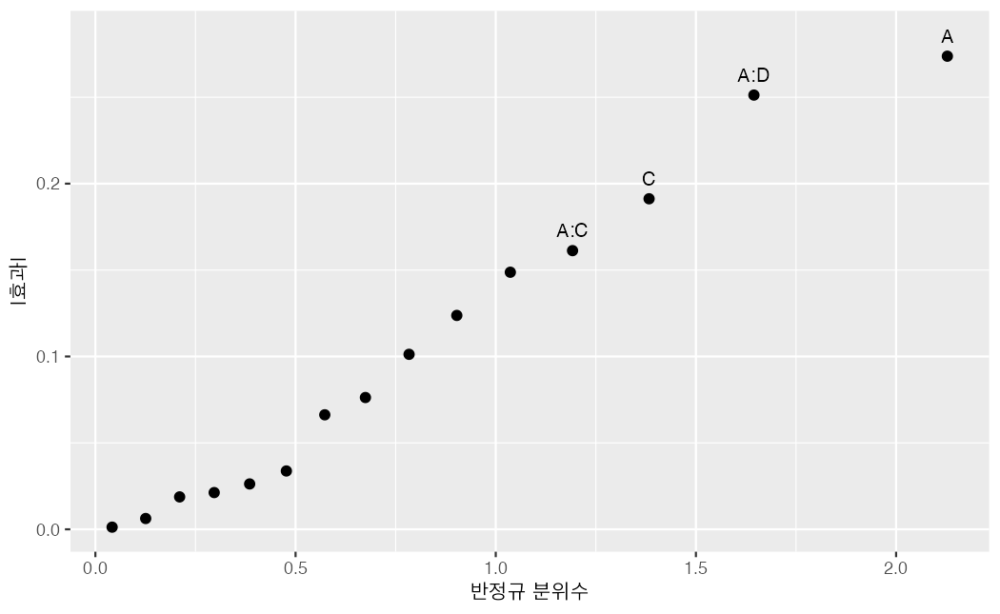
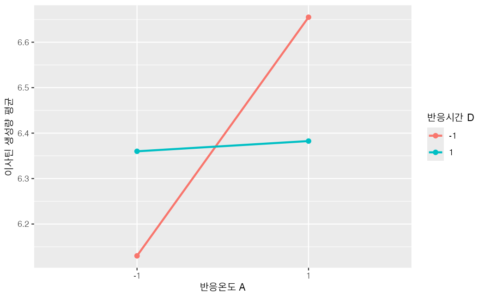

인자가 많을 때 각 인자를 2수준(낮음/높음)으로만 실험하면, 어떤 인자와 교호작용이 중요한지 적은 실험으로 걸러낼 수 있다. $n$개 인자를 2수준으로 하는 실험을 $2^n$ 요인실험이라 한다. 이후 [교락법과 일부실시법](/posts/doe-07-confounding-fractional)의 출발점이다.

## 1. 요인실험의 개념

모든 인자의 모든 수준조합을 실험하는 것을 **요인실험**이라 한다. 한 번에 한 인자씩 바꾸는 방법(OFAT)과 비교하면

- 같은 실험 횟수로 각 주효과를 더 정밀하게 추정한다(모든 관측값이 모든 주효과 추정에 쓰임).
- 교호작용을 추정할 수 있다. OFAT는 교호작용이 있으면 최적조건을 놓친다.

## 2. 표기법

인자는 대문자 $A, B, C$, 수준은 0(낮음)과 1(높음), 또는 −1과 +1로 쓴다. 처리조합은 **높은 수준인 인자의 소문자**로 쓰고, 모두 낮은 수준이면 $(1)$이다. 같은 기호가 그 조합의 관측값 합계도 나타낸다.


$2^3$이면 8개 조합이 정육면체의 꼭짓점이다. 표준순서는 $(1), a, b, ab, c, ac, bc, abc$다.

## 3. 대비와 효과

$2^2$에서 $A$의 주효과는 $A$가 높을 때와 낮을 때의 평균 차이다.

$$
A = \frac{1}{2r}\big[(a + ab) - ((1) + b)\big] = \frac{1}{2r}(a - 1)(b + 1)
$$

교호작용 $AB$는 $B$가 높을 때의 $A$ 효과와 낮을 때의 $A$ 효과 차이의 절반이다.

$$
AB = \frac{1}{2r}\big[(ab - b) - (a - (1))\big] = \frac{1}{2r}(a - 1)(b - 1)
$$

일반적으로 $2^n$에서 효과 $X$의 **대비**는 $X$에 포함된 인자는 $(x - 1)$, 포함되지 않은 인자는 $(x + 1)$로 놓고 곱을 전개한 것이다. $2^3$에서 $AC$의 대비는 $(a - 1)(b + 1)(c - 1)$이다.

$$
\text{효과} = \frac{\text{대비}}{r\,2^{n-1}}, \qquad SS = \frac{(\text{대비})^2}{r\,2^n}
$$

모든 효과의 자유도는 1이다. 효과 $X$로 쓰면 제곱합은 $SS_X = r\,2^{n-2}X^2$이다. 효과 $X$의 부호는 문자 수로 읽을 수 있다. $X$가 $m$개의 문자로 이루어졌을 때, 처리조합에 든 $X$의 문자 수가 $m$과 홀짝이 같으면 $+$, 다르면 $-$다. 예를 들어 $AC$($m=2$)는 $a$, $c$가 짝수 개(0개 또는 2개) 든 자료의 평균에서 홀수 개 든 자료의 평균을 뺀 값이고, $A$나 $ABC$는 홀수 개 든 쪽이 $+$다.

### 부호표

| 처리 | $I$ | $A$ | $B$ | $AB$ | $C$ | $AC$ | $BC$ | $ABC$ |
|---|---|---|---|---|---|---|---|---|
| $(1)$ | + | − | − | + | − | + | + | − |
| $a$ | + | + | − | − | − | − | + | + |
| $b$ | + | − | + | − | − | + | − | + |
| $ab$ | + | + | + | + | − | − | − | − |
| $c$ | + | − | − | + | + | − | − | + |
| $ac$ | + | + | − | − | + | + | − | − |
| $bc$ | + | − | + | − | + | − | + | − |
| $abc$ | + | + | + | + | + | + | + | + |

교호작용 열은 주효과 열의 곱이다. 모든 열이 서로 직교하므로(내적 0) 각 효과를 다른 효과와 독립적으로 추정한다. 이것이 직교화의 원리다.

### 회귀모형과의 관계

$x_A, x_B, x_C \in \{-1, +1\}$로 코딩하면

$$
y = \beta_0 + \beta_A x_A + \beta_B x_B + \beta_{AB}x_Ax_B + \cdots + e
$$

이고 회귀계수는 효과의 절반이다($\beta_A = A/2$). $x$가 −1에서 +1로 2만큼 바뀔 때 반응이 효과만큼 변하기 때문이다. R에서는 `lm()`으로 효과를 바로 구한다.

### 예제: 반복이 없는 $2^3$ 실험

온도($A$: 180, 200°C), 압력($B$: 70, 80), 촉매량($C$: 2, 3%)에 따른 수율을 8회 실험한 자료다. 표준순서는 $(1), a, b, ab, c, ac, bc, abc$이다.

| 처리 | $(1)$ | $a$ | $b$ | $ab$ | $c$ | $ac$ | $bc$ | $abc$ |
|---|---|---|---|---|---|---|---|---|
| 수율 | 70 | 82 | 64 | 78 | 62 | 93 | 55 | 90 |

```r
library(tidyverse)

yield <- expand_grid(C = c(-1, 1), B = c(-1, 1), A = c(-1, 1)) |>
  mutate(y = c(70, 82, 64, 78, 62, 93, 55, 90))      # 표준순서: A가 가장 빨리 변한다

X <- model.matrix(~ A * B * C, data = yield)         # 부호표 (열이 서로 직교)
contrast <- drop(t(X) %*% yield$y)[-1]                # 대비 = 부호표의 열과 y의 내적
effect <- contrast / 4                                # 효과 = 대비 / (r 2^(n-1))
ss <- contrast^2 / 8                                  # 제곱합 = 대비^2 / (r 2^n)
round(cbind(대비 = contrast, 효과 = effect, 제곱합 = ss), 3)
```

$A$의 효과는 $85.75 - 62.75 = 23$, $AC$의 효과는 10이고 제곱합은 각각 $2\times 23^2 = 1058$, $2\times 10^2 = 200$이다. 가장 큰 효과는 $A$(23), 그다음이 $AC$(10), $B$(−5)이며, 나머지 4개의 효과는 절댓값이 1.5 이하다. 반복이 없어 오차 제곱합이 없으므로, 작은 효과($ABC$, $AB$, $BC$)를 오차에 풀링해 분산분석을 한다.

```r
anova(lm(y ~ A + B + C + A:C, data = yield))
```

풀링한 오차의 제곱합은 5, 자유도 3($MS_E = 1.667$)이다. $A$($F$ = 634.8, $p$ < 0.001), $B$($F$ = 30.0, $p$ = 0.012), $A\times C$($F$ = 120.0, $p$ = 0.002)가 유의하고, $C$의 주효과는 유의하지 않다($F$ = 2.7, $p$ = 0.199). 그런데 $A\times C$가 유의하므로 $C$의 주효과만 따로 해석하면 안 된다. 촉매량이 2%일 때는 온도를 높이면 수율이 70에서 82로 오르지만, 3%일 때는 62에서 93으로 훨씬 크게 오른다.

### Yates 알고리즘

표준순서로 놓은 합계에 "인접한 두 값의 합, 그다음 차"를 $n$번 반복하면 대비가 차례로 나온다. 손계산 시절의 방법이지만, 효과 계산이 대비의 반복이라는 구조를 잘 보여준다. 위 예제에 적용하면 부호표로 구한 대비와 같은 값이 나온다.

```r
yates <- function(y, n) {
  for (i in seq_len(n)) {
    odd <- y[seq(1, length(y), 2)]; even <- y[seq(2, length(y), 2)]
    y <- c(odd + even, even - odd)                 # 인접한 값의 합, 그다음 차
  }
  y
}
res <- yates(yield$y, 3)
names(res) <- c("합계", "A", "B", "AB", "C", "AC", "BC", "ABC")
res
all.equal(unname(res[-1]), unname(contrast))
```

세 번 반복한 결과 첫 값은 전체 합계 594이고, 나머지 7개가 표준순서의 대비 $A, B, AB, C, AC, BC, ABC$이다. 부호표로 구한 `contrast`와 일치한다(`all.equal`이 `TRUE`).

## 4. 예제: 반복이 없는 $2^4$ 실험

[4장](/posts/doe-04-multi-way-ems)의 이사틴 자료와 같은 실험이다. 이사틴 생성량(g/100g)에 반응온도($A$), 산첨가량($B$), 산의 강도($C$), 반응시간($D$)이 주는 영향을 알아보기 위해 각 인자를 2수준으로 한 16회 실험을 랜덤한 순서로 했다.

| | $A_1B_1$ | $A_1B_2$ | $A_2B_1$ | $A_2B_2$ |
|---|---|---|---|---|
| $C_1D_1$ | 6.08 | 6.31 | 6.79 | 6.77 |
| $C_1D_2$ | 6.53 | 6.12 | 6.73 | 6.49 |
| $C_2D_1$ | 6.04 | 6.09 | 6.68 | 6.38 |
| $C_2D_2$ | 6.43 | 6.36 | 6.08 | 6.23 |

```r
library(tidyverse)

isatin <- expand_grid(C = c(-1, 1), D = c(-1, 1), A = c(-1, 1), B = c(-1, 1)) |>
  mutate(y = c(6.08, 6.31, 6.79, 6.77,
               6.53, 6.12, 6.73, 6.49,
               6.04, 6.09, 6.68, 6.38,
               6.43, 6.36, 6.08, 6.23))

fit_full <- lm(y ~ A * B * C * D, data = isatin)
effects <- 2 * coef(fit_full)[-1]          # 효과 = 회귀계수 × 2
sort(round(effects, 4))
```

| 효과 | 추정값 | 제곱합 |
|---|---|---|
| $A$ | 0.274 | 0.2998 |
| $AD$ | −0.251 | 0.2525 |
| $C$ | −0.191 | 0.1463 |
| $AC$ | −0.161 | 0.1040 |
| $BCD$ | 0.149 | 0.0885 |
| $ABD$ | 0.124 | 0.0613 |
| $ACD$ | −0.101 | 0.0410 |
| 나머지 8개 | 절댓값 0.08 미만 | |

반복이 없고 모든 효과를 모형에 넣으면 오차 자유도가 0이다. 유의한 효과를 고르는 방법은 세 가지다.

### (1) 정규확률그림 (Daniel)

효과가 없다면 추정된 효과들은 평균 0인 정규분포에서 나온 값처럼 보인다. 효과의 절댓값을 반정규확률그림에 찍으면 직선에서 크게 벗어난 점이 실제 효과다.

```r
eff_df <- tibble(효과 = names(effects), 값 = abs(effects)) |>
  arrange(값) |>
  mutate(분위수 = qnorm(0.5 + 0.5 * (row_number() - 0.5) / n()))

ggplot(eff_df, aes(분위수, 값, label = 효과)) +
  geom_point(size = 2) +
  geom_text(data = slice_max(eff_df, 값, n = 4), nudge_y = 0.012, size = 3.5) +
  labs(x = "반정규 분위수", y = "|효과|")
```



$A$, $AD$, $C$, $AC$가 위쪽으로 떨어져 있지만 나머지와의 간격이 크지 않다.

### (2) Lenth 방법

효과 대부분이 0이라는 가정에서, 효과 절댓값의 중앙값으로 잡음의 크기를 추정한다.

$$
s_0 = 1.5\,\text{median}\lvert c_j\rvert, \qquad PSE = 1.5\,\text{median}_{\lvert c_j\rvert < 2.5s_0}\lvert c_j\rvert, \qquad ME = t_{0.025}(m/3)\cdot PSE
$$

```r
abs_e <- abs(effects)
s0 <- 1.5 * median(abs_e)
pse <- 1.5 * median(abs_e[abs_e < 2.5 * s0])
me <- qt(0.975, length(effects) / 3) * pse
c(PSE = pse, ME = me)
```

$PSE = 0.114$, $ME = 0.294$로 어느 효과도 경계를 넘지 않는다. 가장 큰 $A$(0.274)도 경계 근처다. 16회 실험에서 효과들이 비슷한 크기로 퍼져 있어 확실히 큰 효과가 없다는 뜻이다.

### (3) 고차 교호작용을 오차로 풀링

3인자 이상 교호작용은 무시할 수 있다는 **효과 희소성** 원칙에 따라 이들을 오차로 쓴다.

```r
fit_2way <- lm(y ~ (A + B + C + D)^2, data = isatin)
anova(fit_2way)
```

오차는 3인자·4인자 교호작용 5개로 $SS_E = 0.192$, 자유도 5, $MS_E = 0.0385$이다.

| 효과 | F | p값 |
|---|---|---|
| $A$ | 7.79 | 0.038 |
| $AD$ | 6.56 | 0.051 |
| $C$ | 3.80 | 0.109 |
| $AC$ | 2.70 | 0.161 |

반응온도 $A$만 5%에서 유의하고 $A\times D$가 경계에 있다. 그런데 $BCD$, $ABD$처럼 오차로 넣은 3인자 교호작용이 꽤 커서 $MS_E$가 부풀었을 가능성이 있다. 이런 실험은 반복이나 중심점 추가로 오차를 따로 추정하는 것이 좋다.

교재(예제 4.3)는 이 자료를 단계적으로 풀링한다. 3인자 교호작용 전체와 유의확률이 0.25 이상인 2인자 교호작용($AB$, $BC$, $CD$, 그다음 $BD$)을 오차로 보내면 오차 자유도가 9가 된다.

```r
fit_step <- lm(y ~ A + B + C + D + A:C + A:D, data = isatin)
anova(fit_step)
```

오차는 $SS_E = 0.217$, 자유도 9, $MS_E = 0.0241$이다. $A$($F$ = 12.42, $p$ = 0.006), $C$($F$ = 6.06, $p$ = 0.036), $A\times D$($F$ = 10.46, $p$ = 0.010)가 유의하고 $A\times C$($F$ = 4.31, $p$ = 0.068)가 경계에 있다. 같은 자료인데 고차 교호작용 5개만 오차로 보낼 때는 $A$만 유의했다. 풀링할 효과를 데이터를 보고 고르면 $MS_E$가 작아져 유의한 효과가 늘어나므로, 단계적 풀링의 $p$값은 낙관적일 수 있다.

```r
isatin |>
  group_by(A, D) |>
  summarise(평균 = mean(y), .groups = "drop") |>
  ggplot(aes(factor(A), 평균, color = factor(D), group = D)) +
  geom_line(linewidth = 1) + geom_point(size = 2) +
  labs(x = "반응온도 A", y = "이사틴 생성량 평균", color = "반응시간 D")
```



반응시간이 짧을 때($D = -1$) 온도를 높이면 생성량이 크게 늘지만, 반응시간이 길면 온도 효과가 거의 없다. 생성량을 높이려면 높은 온도에 짧은 반응시간을 쓴다.

## 5. 중심점과 곡률

> 이 절은 교재 6장에 없는 내용이며, 2수준 실험의 표준적인 확장이다.

2수준 실험은 반응이 선형이라고 가정한다. 양적 인자이면 모든 인자를 중간값으로 둔 **중심점**을 몇 번 반복해 추가한다.

- 중심점의 반복($n_C$회)으로 순수오차를 추정할 수 있다(자유도 $n_C - 1$).
- 꼭짓점 평균과 중심점 평균의 차이로 곡률을 검정한다. 곡률이 유의하면 [반응표면분석](/posts/doe-10-rsm-mixture)으로 넘어간다.

$$
SS_{\text{곡률}} = \frac{n_F n_C(\bar y_F - \bar y_C)^2}{n_F + n_C}, \qquad F = \frac{SS_{\text{곡률}}/1}{MS_{\text{순수오차}}}
$$

$n_F$는 꼭짓점 실험 수, $\bar y_F$와 $\bar y_C$는 꼭짓점과 중심점의 평균이다. 곡률의 자유도는 1이다. 곡률이 유의하면 어느 인자가 굽은지는 이 검정으로 알 수 없고, 별 모양의 축점을 더해야 한다.

## 6. 비교

### 반복이 없을 때 효과를 고르는 세 방법

| 구분 | 정규확률그림 (Daniel) | Lenth 방법 | 고차 교호작용 풀링 |
|---|---|---|---|
| 판정 방식 | 직선에서 벗어난 점을 눈으로 고른다 | $\lvert c_j\rvert > ME$이면 유의 | 오차를 만들어 $F$ 검정 |
| 전제 | 대부분의 효과가 0 | 대부분의 효과가 0 | 고차 교호작용이 0 |
| 객관성 | 낮음 (그림 판단) | 높음 (기준값이 있음) | 높음 (전제가 틀리면 편향) |
| 위험 | 큰 효과가 많으면 직선 기울기가 바뀜 | 효과가 많으면 $PSE$가 부풀음 | 오차에 큰 효과가 섞이면 $MS_E$ 과대 |
| 이 예제의 결론 | $A$, $AD$, $C$, $AC$가 위쪽이나 간격이 작음 | 모두 $ME$ = 0.294 이하 | $A$만 유의, $AD$ 경계 (교재식 풀링은 $A$, $C$, $AD$) |

세 방법의 결론이 다른 것은 이 자료에 확실히 큰 효과가 없기 때문이다. 이런 때는 세 방법 중 하나를 골라 유의하다고 말하기보다, 반복이나 중심점으로 오차를 따로 추정하는 후속 실험이 필요하다고 해석한다.

### 요인실험과 한 번에 한 인자씩 실험하는 방법

요인실험의 장점은 한 번에 한 인자씩 바꾸는 방법(OFAT, one-factor-at-a-time)과 비교하면 분명해진다. 세 인자를 실험 8회로 연구한다고 하자.

| 구분 | OFAT | $2^3$ 요인실험 |
|---|---|---|
| 실험 | 기준점 $(-,-,-)$ 2회, 각 인자만 $+$로 바꾼 점 2회씩 | 8개 조합 각 1회 |
| 주효과 추정 | 기준점 대비 차이 (2개 평균 − 2개 평균) | 4개 평균 − 4개 평균 |
| 주효과 추정량의 분산 | $\sigma^2$ | $\sigma^2/2$ |
| 교호작용 | 추정 불가 | 모두 추정 |
| 추정하는 것 | 다른 인자가 $-$일 때의 조건부 효과 | 다른 인자 수준에 대해 평균한 효과 |

같은 8회라도 요인실험은 8개 관측값을 모두 $A$ 효과 추정에 쓰므로 분산이 OFAT의 절반이다. 더 큰 문제는 OFAT가 $B$, $C$를 $-$에 고정한 조건부 효과만 추정한다는 점이다. 참 모형이 $y = 10 + 1.0A + 0.5B + 0.5C + 0.8AB$이면 $A$의 주효과는 2.0이지만, OFAT가 추정하는 것은 $B = -1$에서의 효과 $2(1.0 - 0.8) = 0.4$다. 교호작용이 있으면 OFAT는 잘못된 결론으로 이어지고, 요인실험은 교호작용까지 같은 정밀도로 추정한다.

## 정리

| 개념 | 식 / 내용 |
|---|---|
| 표기 | 높은 수준 인자의 소문자, 모두 낮으면 $(1)$ |
| 대비 | 포함 인자는 $(x - 1)$, 아니면 $(x + 1)$의 곱 |
| 효과 / 제곱합 | 대비$/(r2^{n-1})$, 대비$^2/(r2^n)$ |
| 회귀계수 | 효과의 절반 (±1 코딩) |
| 반복 없는 실험 | 정규확률그림, Lenth PSE, 고차 교호작용 풀링 (효과 희소성이 전제) |
| $2^3$ 예제 | $A = 23$, $AC = 10$, $SS_A = 1058$, $SS_{AC} = 200$ |
| $2^4$ 예제 | 반응온도 $A$ 유의, $A\times D$ 경계 |
