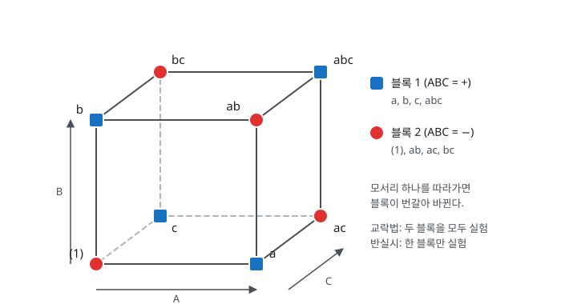
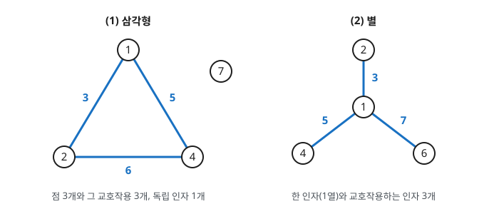

[2ⁿ 요인실험](/posts/doe-06-two-level-factorial)은 인자가 늘면 실험횟수가 $2^n$으로 늘어난다. 두 가지 문제가 생긴다.

1. 실험 전체를 같은 조건에서 할 수 없다 → **교락법**: 블록으로 나누고, 중요하지 않은 고차 교호작용을 블록 효과와 섞는다.
2. 실험 횟수 자체가 감당이 안 된다 → **일부실시법**: 일부 처리조합만 실험하고, 고차 교호작용은 무시한다.

두 방법 모두 "고차 교호작용은 무시할 수 있다"는 효과 희소성에 기대어, 정보를 버릴 곳을 계획적으로 고른다.

## 1. 교락법의 개념

$2^3$ 실험 8회를 하루에 4회씩 이틀에 나누어 해야 한다고 하자. 날짜 효과가 있으면 어떤 효과와 섞인다. $ABC$ 부호가 +인 조합을 하루, −인 조합을 다른 날 하면

| 블록 1 ($ABC = +$) | 블록 2 ($ABC = -$) |
|---|---|
| $a, b, c, abc$ | $(1), ab, ac, bc$ |



$ABC$의 대비는 (블록 1 합 − 블록 2 합)과 같아져 날짜 효과와 구분할 수 없다. 이것을 **$ABC$를 블록과 교락시킨다**고 하고, $ABC$를 **정의대비**라 한다. 나머지 효과의 대비는 각 블록에 + 2개, − 2개씩 들어가 블록 효과가 상쇄된다. 블록 1에 날짜 효과 $\delta$를 더해 보면

$$
A = \tfrac14\{(a+\delta) + ab + ac + (abc+\delta)\} - \tfrac14\{(1) + (b+\delta) + (c+\delta) + bc\}
$$

에서 $\delta$가 지워진다. 그림에서 모서리 하나를 따라가면 블록이 번갈아 바뀌는 것도 같은 뜻이다.

### 블록 나누기: 합동식

$x_i \in \{0, 1\}$을 인자 $i$의 수준이라 할 때, 정의대비 $A^{\alpha_1}B^{\alpha_2}\cdots$에 대해

$$
L = \alpha_1 x_1 + \alpha_2 x_2 + \cdots + \alpha_n x_n \pmod 2
$$

가 같은 처리조합끼리 한 블록이다. 정의대비에 없는 인자는 계산에서 빠진다. 예를 들어 $I = ABC$일 때 $bd$는 $L = 0 + 1 + 0 = 1$, $abce$는 $L = 1 + 1 + 1 = 1 \pmod 2$로 같은 블록이다. $L = 0$인 블록(주블록)에는 항상 $(1)$이 들어간다.

## 2. 단독교락과 2중교락

**단독교락**: 정의대비 1개로 블록 2개를 만든다. 최고차 교호작용을 정의대비로 고르는 것이 보통이다. 실험은 두 블록 중 하나를 임의로 골라 그 안에서 완전확률화로 실험한 뒤 다음 블록으로 넘어간다.

**2중교락**: 정의대비 2개로 블록 4개를 만든다. 이때 두 정의대비의 **일반화 교호작용**(곱, 지수는 mod 2)도 자동으로 블록과 교락된다.

$$
ABC \times BCD = AB^2C^2D = AD
$$

$I = ABC = BCD = AD$로 블록을 나누면 블록 자유도 3이 $ABC$, $BCD$, $AD$로 채워진다. 정의대비를 고를 때는 일반화 교호작용까지 확인해 중요한 효과(주효과, 관심 있는 2인자 교호작용)가 교락되지 않게 해야 한다. 위 계획은 2인자 교호작용 $AD$를 잃는다. $2^5$에서 $ABCD$와 $ABCE$를 고르면 $ABCD \times ABCE = DE$가 교락되어 손해가 더 분명하다. $2^5$에서는 3문자 조합 두 개를 한 문자만 겹치게 고르면($ABC$, $CDE$) 일반화 교호작용이 4문자($ABDE$)가 되어 2인자 교호작용을 모두 지킬 수 있다.

$2^n$을 $2^p$개 블록으로 나누면 $2^p - 1$개 효과가 블록과 교락된다.

### 예제: $2^4$ 2중교락

화합물 순도에 촉매제 농도($A$), 수산화나트륨 농도($B$), 젓는 속도($C$), 온도($D$)가 주는 영향을 알아보기 위해 $I = ABC = BCD = AD$로 16회를 4블록으로 나누어 실험했다.

| 블록 1 | 블록 2 | 블록 3 | 블록 4 |
|---|---|---|---|
| $(1)$ 99.62 | $ab$ 99.70 | $a$ 99.60 | $b$ 99.73 |
| $bc$ 99.70 | $ac$ 99.44 | $abc$ 99.68 | $c$ 99.42 |
| $abd$ 99.50 | $d$ 99.41 | $bd$ 99.47 | $ad$ 99.38 |
| $acd$ 99.25 | $bcd$ 99.47 | $cd$ 99.21 | $abcd$ 99.46 |

```r
library(tidyverse)

tc <- c("(1)", "bc", "abd", "acd",  "ab", "ac", "d", "bcd",
        "a", "abc", "bd", "cd",     "b", "c", "ad", "abcd")
purity <- tibble(처리 = tc, 블록 = factor(rep(1:4, each = 4)),
                 순도 = c(99.62, 99.70, 99.50, 99.25,  99.70, 99.44, 99.41, 99.47,
                          99.60, 99.68, 99.47, 99.21,  99.73, 99.42, 99.38, 99.46)) |>
  mutate(A = if_else(str_detect(처리, "a"), 1, -1),
         B = if_else(str_detect(처리, "b"), 1, -1),
         C = if_else(str_detect(처리, "c"), 1, -1),
         D = if_else(str_detect(처리, "d"), 1, -1))

# 정의대비 확인: 블록마다 ABC, BCD 부호가 일정하다
purity |> mutate(ABC = A * B * C, BCD = B * C * D, AD = A * D) |>
  distinct(블록, ABC, BCD, AD)

# AD는 블록과 교락되어 있으므로 모형에서 뺀다
fit <- aov(순도 ~ 블록 + (A + B + C + D)^2 - A:D,
           data = mutate(purity, across(A:D, factor)))
summary(fit)

# 블록 제곱합 = ABC, BCD, AD의 제곱합
ss <- function(x) sum(x * purity$순도)^2 / 16
with(purity, c(ABC = ss(A * B * C), BCD = ss(B * C * D), AD = ss(A * D)))
```

| 요인 | 제곱합 | 자유도 | F | p값 |
|---|---|---|---|---|
| 블록 ($ABC$, $BCD$, $AD$) | 0.00165 | 3 | 2.54 | 0.232 |
| $A$ | 0.00003 | 1 | 0.12 | 0.756 |
| $B$ | 0.11902 | 1 | 549.3 | < 0.001 |
| $C$ | 0.03803 | 1 | 175.5 | < 0.001 |
| $D$ | 0.18923 | 1 | 873.3 | < 0.001 |
| $B\times C$ | 0.02250 | 1 | 103.8 | 0.002 |
| 나머지 2인자 교호작용 4개 | 각 0.0004 이하 | | | |
| 오차 ($ABD$, $ACD$, $ABCD$) | 0.00065 | 3 | | |

블록 제곱합 0.00165는 $ABC$, $BCD$, $AD$ 세 효과의 제곱합 0.001225, 0.000025, 0.000400을 더한 값과 같다. 순도는 $B$, $C$, $D$와 $B\times C$의 영향을 받는다.

> **주의**: 교재는 이 관계를 $SS_{BL} = SS_{A\times B\times C} + SS_{B\times C\times D} + SS_{B\times D}$로 적었다(본문과 연습문제 6.2). 블록과 교락된 것은 $AD$이고 $B\times D$는 분산분석표에 따로 추정되어 있으므로 $SS_{A\times D}$가 맞다. 이 자료에서는 두 제곱합이 모두 0.0004라서 숫자는 우연히 맞는다. 또 교재 자료표는 블록 1을 $ABC(+)$, $BCD(+)$로 표시했지만 블록 1에는 $(1)$이 있으므로 교재 자신의 정의(문자가 홀수 개면 +)로는 $ABC(-)$, $BCD(-)$다. 네 블록의 부호 표시가 모두 뒤집혀 있다.

유의하지 않은 블록과 교호작용을 오차에 풀링하면 최적조건은 $B$와 $C$의 2원표, $D$의 1원표에서 찾는다.

```r
pooled <- lm(순도 ~ A + B * C + D, data = purity)
mse <- deviance(pooled) / df.residual(pooled)

m <- function(...) mean(filter(purity, ...)$순도)
est <- m(B == 1, C == -1) + m(D == -1) - mean(purity$순도)
n_e <- 1 / (1/4 + 1/8 - 1/16)          # 4, 8, 16개 평균의 결합
c(추정 = est, 반폭 = qt(0.975, 10) * sqrt(mse / n_e))
```

최적조건 $B_1C_0D_0$(수산화나트륨 농도 높게, 젓는 속도 느리게, 온도 낮게)에서 순도 추정값은 99.709, 95% 신뢰구간의 반폭은 0.0226이다. 교재 값(99.708 ± 0.02263)과 반올림 범위에서 일치한다. 유효반복수는 $1/n_e = 1/4 + 1/8 - 1/16 = 5/16$이다.

### 부분교락

반복이 있을 때 반복마다 다른 효과를 교락시키면, 각 효과를 일부 반복에서는 추정할 수 있다. 예를 들어 반복 1에서 $ABC$, 반복 2에서 $AB$를 교락시키면 $ABC$는 반복 2에서, $AB$는 반복 1에서 정보를 얻는다(정보량은 절반).

## 3. 일부실시법

$2^n$ 중 $2^{n-p}$개 처리조합만 실험한다. $1/2^p$ 실시법이라 한다. 교락법으로 나눈 블록 중 하나만 실험하는 것과 같다.

### $2^{n-1}$: 반실시

앞 그림의 블록 1만 실험하면 $2^{3-1}$이다. 이때

$$
A = \tfrac12\{a + abc\} - \tfrac12\{b + c\} = BC
$$

처럼 $A$와 $BC$가 같은 식으로 추정되어 구분되지 않는다. 이런 효과 쌍을 서로의 **별명**(alias)이라 한다. 별명은 정의관계에 효과를 곱하고 $A^2 = B^2 = \cdots = 1$로 두면 얻는다. 정의관계 $I = ABCD$로 $2^4$의 절반을 고르면

$$
A \cdot I = A \cdot ABCD = A^2BCD = BCD \quad\Rightarrow\quad A = BCD
$$

블록 2만 실험하면 별명의 부호만 바뀌어($A = -BC$) 정의관계를 $I = -ABC$로 쓴다.

| 정의관계 | 별명 관계 | 해상도 |
|---|---|---|
| $I = ABC$ ($2^{3-1}$) | $A = BC$, $B = AC$, $C = AB$ | III |
| $I = ABCD$ ($2^{4-1}$) | $A = BCD$, …, $AB = CD$, $AC = BD$, $AD = BC$ | IV |
| $I = ABCDE$ ($2^{5-1}$) | 주효과 = 4인자, 2인자 = 3인자 교호작용 | V |

**해상도**(분해능, resolution)는 정의관계에서 가장 짧은 단어의 길이다. 교재에는 없는 용어지만 교재의 결론("정의대비의 문자수를 가능한 한 많게")을 한 숫자로 나타낸다.

| 해상도 | 의미 |
|---|---|
| III | 주효과가 2인자 교호작용과 별명. 주효과만 선별할 때 |
| IV | 주효과는 3인자 이상과만 별명, 2인자 교호작용끼리 별명 |
| V | 주효과와 2인자 교호작용이 모두 깨끗하게 추정됨 |

### 예제: 별명이 실제로 무엇을 섞는가

[2ⁿ 요인실험](/posts/doe-06-two-level-factorial)의 이사틴 $2^4$ 자료에서 $ABCD = +1$인 8회만 했다고 하자.

```r
isatin <- expand_grid(C = c(-1, 1), D = c(-1, 1), A = c(-1, 1), B = c(-1, 1)) |>
  mutate(y = c(6.08, 6.31, 6.79, 6.77, 6.53, 6.12, 6.73, 6.49,
               6.04, 6.09, 6.68, 6.38, 6.43, 6.36, 6.08, 6.23))

half <- filter(isatin, A * B * C * D == 1)
full_eff <- 2 * coef(lm(y ~ A * B * C * D, data = isatin))[-1]
half_eff <- 2 * coef(lm(y ~ A + B + C + D + A:B + A:C + A:D, data = half))[-1]
half_eff
full_eff[c("A", "B:C:D", "A:D", "B:C")]
```

| 반실시 추정 | 값 | 전체 실험 (주효과/교호작용) | 별명 성분 |
|---|---|---|---|
| $\hat A$ ($= A + BCD$) | 0.423 | $A = 0.274$ | $BCD = 0.149$ |
| $\widehat{AD}$ ($= AD + BC$) | −0.218 | $AD = -0.251$ | $BC = 0.034$ |

반실시의 $A$ 추정값은 실제로 $A$와 $BCD$의 합이다. 3인자 교호작용이 작다는 가정이 틀리면 주효과를 과대평가한다. 별명 구조를 이해하고 결과를 해석해야 하는 이유다.

### $2^{n-2}$ 이상

정의대비 2개 $I = P = Q$를 고르면 일반화 교호작용 $PQ$도 정의관계에 들어간다($I = P = Q = PQ$). 각 효과의 별명은 3개가 된다. 교재의 $2^{5-2}$는 앞의 2중교락 $I = ABC = CDE = ABDE$에서 블록 하나만 실험한 것이다.

| 효과 | 별명 |
|---|---|
| $A$ | $BC = ACDE = BDE$ |
| $B$ | $AC = BCDE = ADE$ |
| $C$ | $AB = DE = ABCDE$ |
| $D$ | $ABCD = CE = ABE$ |
| $E$ | $ABCE = CD = ABD$ |
| $AD$ | $BCD = ACE = BE$ |
| $AE$ | $BCE = ACD = BD$ |

8회 실험의 자유도 7에 2인자 이하 별명 묶음이 7개이므로, 주효과 5개를 검출하면 남는 두 묶음($AD$, $AE$)이 오차가 된다. 해상도 III이다. 2인자 교호작용을 두 개 이상 보려면 $2^{5-1}$로 늘려야 한다.

해상도를 최대로 하려면 정의관계의 가장 짧은 단어가 가장 길게 되도록 고른다. 예를 들어 $2^{6-2}$에서 $I = ABCE = BCDF = ADEF$는 해상도 IV다.

```r
# 2^(6-2) 설계를 직접 만들기: E = ABC, F = BCD
expand_grid(A = c(-1, 1), B = c(-1, 1), C = c(-1, 1), D = c(-1, 1)) |>
  mutate(E = A * B * C, F = B * C * D)
```

`FrF2` 패키지를 쓰면 해상도가 최대인 설계와 별명 구조를 자동으로 구할 수 있다.

## 4. 직교배열표에 의한 배치

직교배열표 $L_{2^k}(2^{2^k - 1})$은 $2^k$회 실험에 2수준 열이 $2^k - 1$개 있는 표다. 열의 수가 실험의 총자유도와 같다. $L_8(2^7)$은 8회로 최대 7개의 효과(인자와 교호작용)를 배치한다.

| 실험 | 1 | 2 | 3 | 4 | 5 | 6 | 7 |
|---|---|---|---|---|---|---|---|
| 1 | 0 | 0 | 0 | 0 | 0 | 0 | 0 |
| 2 | 0 | 0 | 0 | 1 | 1 | 1 | 1 |
| 3 | 0 | 1 | 1 | 0 | 0 | 1 | 1 |
| 4 | 0 | 1 | 1 | 1 | 1 | 0 | 0 |
| 5 | 1 | 0 | 1 | 0 | 1 | 0 | 1 |
| 6 | 1 | 0 | 1 | 1 | 0 | 1 | 0 |
| 7 | 1 | 1 | 0 | 0 | 1 | 1 | 0 |
| 8 | 1 | 1 | 0 | 1 | 0 | 0 | 1 |
| 기본표시 | $x$ | $y$ | $xy$ | $z$ | $xz$ | $yz$ | $xyz$ |

$x$, $y$, $z$ 열을 0과 1로 채우고, 나머지 열은 기본표시의 곱대로 $i + j \pmod 2$로 채운다. 0과 1을 −1과 +1로 바꾸면 서로 다른 두 열은 직교한다. 두 열의 교호작용은 기본표시를 곱한 열에 나타난다($x^2 = y^2 = z^2 = 1$). 1열($x$)과 2열($y$)의 교호작용은 3열($xy$)이다. 그래서 $A$를 1열, $B$를 2열에 놓으면 $A\times B$를 보려면 3열을 비워 두어야 한다.

배치가 끝나면 정의대비를 거꾸로 읽을 수 있다. 교재 표 6.7은 $2^{4-1}$에서 주효과와 $B\times C$, $C\times D$를 보려고 $B$, $C$, $B\times C$, $A$, $D$, $e$, $C\times D$를 1~7열에 놓았다.

```r
bits <- function(k, m) as.integer(intToBits(k))[1:m]   # 열 k의 기본표시에 든 문자
L8 <- sapply(1:7, \(k) as.vector(as.matrix(expand_grid(x = 0:1, y = 0:1, z = 0:1)) %*% bits(k, 3)) %% 2)

t67 <- tibble(B = L8[, 1], C = L8[, 2], A = L8[, 4], D = L8[, 5]) |>
  mutate(처리 = pmap_chr(list(A, B, C, D), \(a, b, c, d)
                 paste0(c("a", "b", "c", "d")[c(a, b, c, d) == 1], collapse = "")),
         처리 = if_else(처리 == "", "(1)", 처리),
         ABD = (A + B + D) %% 2)
t67
```

$A$가 $z$열, $B$가 $x$열이므로 $A\times B$는 $xz$열인데 그 열에 $D$가 있다. 즉 $D = AB$, 정의대비는 $I = ABD$이고 출력에서 $ABD$ 열이 모두 0이다. 처리조합은 $(1), ad, c, acd, bd, ab, bcd, abc$로 $ABD$를 정의대비로 나눈 주블록과 같다. 별명은 $A = BD$, $B = AD$, $D = AB$, $C = ABCD$다.

### 선점도

검출할 인자를 점, 교호작용을 선으로 그린 그림이다. 직교배열표마다 표준 선점도가 있어서, 실험에서 필요한 선점도를 표준 선점도에 맞추면 어느 열에 무엇을 놓을지 정해진다.



$2^{4-1}$에서 $A\times B$와 $C\times D$를 함께 보려면 서로 떨어진 선 두 개가 필요한데, $L_8$의 선점도에는 그런 모양이 없다. 그래서 8회로는 불가능하고 $L_{16}(2^{15})$로 가야 한다.

| 직교배열표 | 실험횟수 | 배치 가능한 2수준 열 |
|---|---|---|
| $L_4(2^3)$ | 4 | 3 |
| $L_8(2^7)$ | 8 | 7 |
| $L_{16}(2^{15})$ | 16 | 15 |
| $L_{32}(2^{31})$ | 32 | 31 |

### 예제: 철판 용접 실험 ($2^{9-5}$)

철판 용접부의 신도에 인자 9개($A \sim I$)가 영향을 준다고 보고, 주효과와 교호작용 $A\times C$, $A\times G$, $A\times H$, $G\times H$를 검출하려 한다. 자유도가 13이므로 열이 13개 이상인 $L_{16}(2^{15})$에 배치한다. $A$와 관련된 교호작용이 많으므로 $A \to (G, A\times G) \to (H, A\times H, G\times H) \to (C, A\times C)$ 순으로 놓고, 나머지 인자를 빈 열에, 남는 2열을 오차로 둔다(교재 표 6.8).

| 열 | 1 | 2 | 3 | 4 | 5 | 6 | 7 | 8 | 9 | 10 | 11 | 12, 13 | 14 | 15 |
|---|---|---|---|---|---|---|---|---|---|---|---|---|---|---|
| 배치 | $A$ | $G$ | $A\times G$ | $H$ | $A\times H$ | $G\times H$ | $B$ | $D$ | $E$ | $F$ | $I$ | $e$ | $A\times C$ | $C$ |

```r
# L16(2^15): 열 k의 기본표시는 k의 이진수 자리(x, y, z, u)로 정해진다
grid16 <- as.matrix(expand_grid(x = 0:1, y = 0:1, z = 0:1, u = 0:1))
L16 <- sapply(1:15, \(k) as.vector(grid16 %*% bits(k, 4)) %% 2)

weld <- tibble(A = L16[, 1], G = L16[, 2], H = L16[, 4], B = L16[, 7], D = L16[, 8],
               E = L16[, 9], F = L16[, 10], I = L16[, 11], C = L16[, 15],
               신도 = c(33.6, 40.2, 30.5, 23.7, 34.7, 21.8, 24.8, 29.8,
                        33.7, 25.5, 36.9, 29.0, 30.3, 39.0, 27.9, 40.8)) |>
  mutate(across(A:C, factor))

summary(aov(신도 ~ A + B + C + D + E + F + G + H + I + A:C + A:G + A:H + G:H, data = weld))

# D와 G×H를 오차에 풀링
fit_w <- aov(신도 ~ A + B + C + E + F + G + H + I + A:C + A:G + A:H, data = weld)
summary(fit_w)
```

풀링 전에는 오차 자유도가 2뿐이다. $D$(F = 0.17)와 $G\times H$(F = 2.67)를 풀링하면 오차 자유도 4, MSE 3.061이 되고 $A$, $B$, $C$, $F$, $I$, $A\times C$, $A\times G$, $A\times H$가 유의수준 5%에서 유의하다. 교재 표 6.9, 6.10과 일치한다.

$A\times C$, $A\times G$, $A\times H$의 2원표에서 $A$의 최적 수준이 엇갈리자 교재는 인장강도까지 보고 $A_1C_0$를 골라 최적조건을 $A_1B_0C_0F_0G_1H_1I_1$로 정했다. 이 조건의 모평균은

$$
\mu + a_1 + b_0 + c_0 + f_0 + g_1 + h_1 + i_1 + (ac)_{10} + (ag)_{11} + (ah)_{11}
$$

이다. 2원표 평균 세 개가 각각 $\mu + a_1$을 담으므로, 1원표 평균 세 개를 더한 뒤에는 $\mu + a_1$을 두 번, $\mu$를 세 번 빼야 한다.

$$
\hat\mu = \bar y_{A_1C_0} + \bar y_{A_1G_1} + \bar y_{A_1H_1} + \bar y_{B_0} + \bar y_{F_0} + \bar y_{I_1} - 2\bar y_{A_1} - 3\bar y
$$

```r
m <- function(...) mean(filter(weld, ...)$신도)
est <- m(A == 1, C == 0) + m(A == 1, G == 1) + m(A == 1, H == 1) +
  m(B == 0) + m(F == 0) + m(I == 1) - 2 * m(A == 1) - 3 * mean(weld$신도)
mse <- deviance(fit_w) / df.residual(fit_w)
n_e <- 16 / 11      # 1/n_e = (1 + 추정에 쓴 효과의 자유도 10) / 16
c(추정 = est, 반폭 = qt(0.975, 4) * sqrt(mse / n_e))

# 확인: 유의한 효과만 넣은 모형의 적합값과 같다
best <- tibble(A = "1", B = "0", C = "0", F = "0", G = "1", H = "1", I = "1") |>
  mutate(across(everything(), \(v) factor(v, levels = c("0", "1"))))
predict(lm(신도 ~ A + B + C + F + G + H + I + A:C + A:G + A:H, data = weld), best)
```

최적조건의 신도 추정값은 42.03, 95% 신뢰구간은 42.03 ± 4.03이다. 같은 효과만 넣은 회귀모형의 적합값도 42.03으로 같다.

> **주의**: 교재는 분해를 $\{\mu+a_1+c_0+(ac)_{10}\} + \{\mu+a_1+g_1+(ag)_{11}\} + \{\mu+a_1+h_1+(ah)_{11}\} + \{\mu+b_0\} + \{\mu+f_0\} + \{\mu+i_1\} - 5\mu$로 써서 $a_1$이 세 번 들어간다. 그 결과 추정값을 45.027, 유효반복수를 $1/n_e = 13/16$으로 계산했다. $\bar y_{A_1} = 32.888$을 두 번 더 빼야 하므로 추정값은 42.03이고, $1/n_e = 3/4 + 3/8 - 2/8 - 3/16 = 11/16$이다. 유효반복수를 구하는 이나(伊奈)의 식(교재 밖) $1/n_e = (1 + \text{추정에 쓴 효과의 자유도 합})/N = 11/16$과도 맞는다. 실험한 16회 중 최대 신도는 40.8이므로, 추정값이 실측 최댓값을 넘는다는 교재의 결론은 그대로지만 그 폭은 4.2가 아니라 1.2 정도다.

### 4수준 인자의 배치 ($2^{n-p}\times 4^{m-q}$)

4수준 인자는 자유도가 3이므로 서로 교호작용 관계인 2수준 열 3개(예: 1, 2, 3열)를 합쳐 배치한다. 두 열의 숫자 조합 (0,0), (0,1), (1,0), (1,1)에 수준 0~3을 대응시키고, 세 번째 열(두 열의 교호작용 열)도 그 인자가 차지한다. 수준은 차례대로보다 랜덤하게 대응시키는 것이 좋다. 4수준 인자와 2수준 인자의 교호작용도 자유도가 3이므로 열 3개를 차지한다.

교재 예제 6.5는 제당공장의 탄산포충공정에서 4수준 인자 $A$(제2탑 pH)와 2수준 인자 $B \sim G$로 탈색률을 높이려 한 실험이다. 교호작용은 $A\times B$만 보려고 했다. 자유도가 11이므로 $L_{16}$에 다음처럼 놓았다.

| 열 | 1 | 2, 4, 6 | 3, 5, 7 | 8 | 9 | 12 | 15 | 10, 11, 13, 14 |
|---|---|---|---|---|---|---|---|---|
| 배치 | $B$ | $A$ | $A\times B$ | $C$ | $D$ | $F$ | $G$ | $e$ |

$A$가 $y$, $z$, $yz$열에 있고 $B$가 $x$열이므로 $A\times B$는 $xy$, $xz$, $xyz$열(3, 5, 7열)이다.

```r
sugar <- tibble(B = L16[, 1], A = 2 * L16[, 2] + L16[, 4],   # (0,0)→0, (0,1)→1, (1,0)→2, (1,1)→3
                C = L16[, 8], D = L16[, 9], F = L16[, 12], G = L16[, 15],
                탈색률 = c(61.3, 60.3, 60.4, 60.8, 59.3, 55.4, 56.6, 59.3,
                          58.0, 57.4, 52.7, 59.4, 57.2, 55.8, 56.0, 60.0)) |>
  mutate(across(-탈색률, factor))

summary(aov(탈색률 ~ A * B + C + D + F + G, data = sugar))
```

| 요인 | 제곱합 | 자유도 | F | p값 |
|---|---|---|---|---|
| $A$ | 11.072 | 3 | 4.06 | 0.105 |
| $B$ | 17.851 | 1 | 19.63 | 0.011 |
| $D$ | 6.891 | 1 | 7.58 | 0.051 |
| $F$ | 26.781 | 1 | 29.45 | 0.006 |
| $A\times B$ | 13.187 | 3 | 4.83 | 0.081 |
| $C$, $G$ | 2.976, 3.151 | 각 1 | 3.27, 3.47 | 0.145, 0.136 |
| 오차 | 3.638 | 4 | | |

교재 표 6.15와 일치한다. 오차 자유도가 4로 작아 교재는 유의수준을 10%로 두고 $B$, $D$, $F$, $A\times B$를 유의하다고 보아 최적조건 $A_0B_0D_0F_0$를 얻었다.

4수준 인자가 들어가면 열이 빨리 찬다. 교재 연습문제 6.8처럼 4수준 $A$와 2수준 $B$, $C$, $D$, $F$에서 $A\times B$, $A\times C$, $B\times C$를 보려면 $A$를 1, 2, 3열, $B$를 4열($z$), $C$를 8열($u$)에 두면 $A\times B$가 5~7열, $A\times C$가 9~11열, $B\times C$가 12열($zu$)이 되고 $D$, $F$와 오차가 13~15열에 들어간다. 이때 $B\times C$ 대신 $D\times F$를 보려 하면, 남은 12~15열 중 어느 두 열의 곱도 $x$, $y$, $xy$(1~3열, $A$의 자리)가 되므로 불가능하다.

### 교락법의 배치

블록도 인자처럼 열에 배치할 수 있다. 단독교락은 블록을 2수준 인자로 한 열에, 2중교락은 블록을 4수준 인자로 서로 교호작용 관계인 세 열에 놓는다. 이때 블록이 놓인 세 열이 검출할 효과의 열과 겹치지 않아야 한다. 교재 예제 6.6은 앞의 순도 실험을 $L_{16}$으로 다시 설계해 $xyz$, $yu$, $xzu$열에 블록을 두었고, 그 결과가 정의대비로 나눈 블록과 같음을 보였다.

## 5. 교락법, 일부실시법, 직교배열표의 비교

세 방법은 모두 정의대비를 이용해 고차 교호작용의 정보를 희생한다는 점에서 같은 원리를 쓰지만, 무엇을 얻기 위해 희생하는지가 다르다.

| 구분 | 교락법 | 일부실시법 | 직교배열표 |
|---|---|---|---|
| 목적 | 블록 크기를 줄여 오차를 줄임 | 실험 횟수를 줄임 | 많은 인자를 적은 횟수로 배치 |
| 실험 횟수 | $2^n$ (전부 실시) | $2^{n-p}$ | 배열표의 행 수 |
| 정의대비의 역할 | 블록 효과와 교락되는 효과 | 별명 관계를 만드는 효과 | 열 배치로 암묵적으로 정해짐 |
| 잃는 정보 | 교락된 효과 (블록과 구분 불가) | 별명끼리의 구분 | 배치하지 않은 교호작용 |
| 분석 | 교락 효과를 블록에 포함 | 별명의 합을 추정 | 열별 제곱합 |
| 해석의 전제 | 블록과 처리의 교호작용이 없음 | 별명 중 고차 교호작용은 무시할 수 있음 | 배치하지 않은 교호작용은 무시할 수 있음 |

교락법은 효과를 블록과 섞어 하나를 잃고, 일부실시법은 효과끼리 섞어 둘 중 하나를 구분하지 못한다. 그래서 일부실시법의 해석은 효과 희소성(소수의 주효과와 저차 교호작용만 크다)이라는 가정에 의존한다. 앞의 이사틴 예에서 $BCD = 0.149$가 작지 않아 반실시의 $A$가 크게 과대추정된 것은 이 가정이 일부 깨진 경우다. 직교배열표는 일부실시법을 표로 정리한 것으로, 해상도와 별명 구조를 열 배치로 관리한다.

## 정리

- 블록은 합동식 $L = \sum\alpha_ix_i \pmod 2$의 값으로 나눈다. 블록 $2^p$개면 $2^p-1$개 효과(정의대비와 그 일반화 교호작용)가 블록과 교락된다.
- 별명은 효과에 정의관계를 곱해 얻는다($A\cdot ABCD = BCD$). $2^{n-p}$에서는 효과마다 별명이 $2^p - 1$개다.
- 해상도는 정의관계의 가장 짧은 단어 길이다. III이면 주효과와 2인자 교호작용이 섞인다.
- 직교배열표에서 두 열의 교호작용은 기본표시를 곱한 열에 나타난다. 그 열에 다른 인자를 놓으면 그 인자가 교호작용과 별명이 된다.
- 4수준 인자와 2중교락의 블록은 서로 교호작용 관계인 세 열을 차지한다.
- 최적조건의 점추정은 분해식에서 각 효과가 정확히 한 번씩 남는지 확인한다. 유효반복수는 $1/n_e = (1 + \text{쓴 효과의 자유도 합})/N$으로 검산한다.
