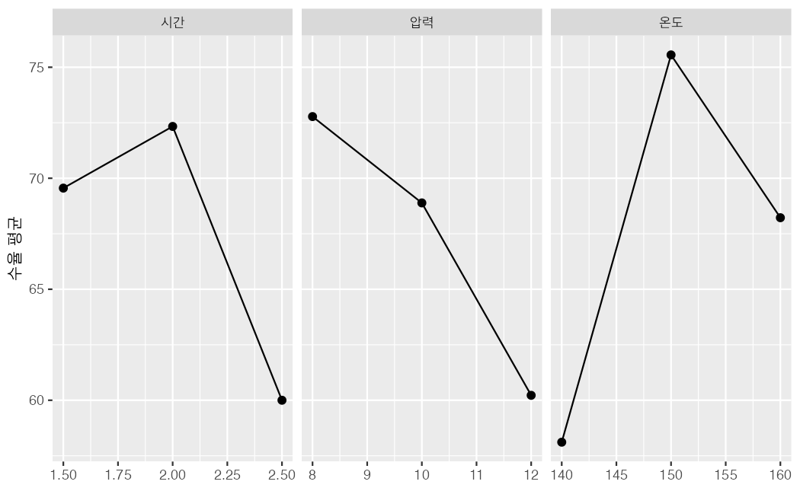

2수준 실험은 반응이 선형이라고 가정한다. 인자가 양적이고 반응이 휘어질 가능성이 있으면 3수준이 필요하다. 3수준이면 각 인자의 2차 효과(곡률)를 추정할 수 있다.

## 1. 표기와 자유도

수준을 0, 1, 2로 쓰고 처리조합을 숫자열로 나타낸다. $3^2$이면 $00, 01, 02, 10, \dots, 22$의 9개다.

| 효과 | 자유도 | 분해 |
|---|---|---|
| 주효과 $A$ | 2 | 1차($A_L$) + 2차($A_Q$) |
| 2인자 교호작용 $A\times B$ | 4 | $AB$ (2) + $AB^2$ (2) |
| 3인자 교호작용 $A\times B\times C$ | 8 | $ABC$, $ABC^2$, $AB^2C$, $AB^2C^2$ (각 2) |

## 2. 직교다항식에 의한 주효과의 분해

수준이 등간격이면 직교다항식 계수로 주효과를 1차와 2차 성분으로 나눈다.

| 성분 | 수준 0 | 수준 1 | 수준 2 | $\sum c^2$ |
|---|---|---|---|---|
| 1차 (L) | −1 | 0 | 1 | 2 |
| 2차 (Q) | 1 | −2 | 1 | 6 |

$$
SS_L = \frac{r'(\sum c_i\bar y_i)^2}{\sum c_i^2}
$$

$r'$은 각 수준의 관측 수다. [다원배치법](/posts/doe-04-multi-way-ems)의 합성반응 실험(압력 $A$, 시간 $B$, 온도 $C$를 각각 3수준, 27회)으로 분해한다.

```r
library(tidyverse)

synth <- expand_grid(시간 = c(1.5, 2.0, 2.5), 온도 = c(140, 150, 160), 압력 = c(8, 10, 12)) |>
  mutate(수율 = c(74, 61, 50, 86, 78, 70, 76, 71, 60,
                  72, 62, 49, 91, 81, 68, 87, 77, 64,
                  48, 55, 52, 65, 72, 69, 56, 63, 60),
         A = factor(압력), B = factor(시간), C = factor(온도))

for (f in c("A", "B", "C")) contrasts(synth[[f]]) <- contr.poly(3)
fit <- aov(수율 ~ (A + B + C)^2, data = synth)
summary(fit, split = list(A = list(L = 1, Q = 2), B = list(L = 1, Q = 2), C = list(L = 1, Q = 2)))
```

| 인자 | 수준별 평균 | 1차 SS | 2차 SS |
|---|---|---|---|
| $A$ 압력 | 72.8, 68.9, 60.2 | 709.4 | 34.2 |
| $B$ 시간 | 69.6, 72.3, 60.0 | 410.9 | 342.5 |
| $C$ 온도 | 58.1, 75.6, 68.2 | 460.1 | 920.9 |

압력은 거의 선형으로 감소하고, 시간과 온도는 중간 수준에서 최대인 2차 형태다. 특히 온도는 2차 성분이 1차의 두 배다. 2수준 실험이었다면 이 곡률을 놓쳤을 것이다.

```r
synth |>
  pivot_longer(c(압력, 시간, 온도), names_to = "인자", values_to = "수준") |>
  group_by(인자, 수준) |>
  summarise(평균 = mean(수율), .groups = "drop") |>
  ggplot(aes(수준, 평균)) +
  geom_line() + geom_point(size = 2) +
  facet_wrap(~인자, scales = "free_x") +
  labs(x = NULL, y = "수율 평균")
```



## 3. 교호작용의 $AB$, $AB^2$ 성분

$x_A, x_B \in \{0, 1, 2\}$일 때

$$
AB: \; x_A + x_B \pmod 3, \qquad AB^2: \; x_A + 2x_B \pmod 3
$$

의 값(0, 1, 2)으로 9개 조합을 세 그룹으로 나누면, 각 그룹 평균의 차이가 자유도 2인 성분이다. 두 성분은 직교하고 합이 $A\times B$다. 이 성분 자체에 물리적 의미는 없지만, 교락과 일부실시의 기본 단위가 된다. 관례상 첫 인자의 지수를 1로 맞춘다($A^2B = (A^2B)^2 = A^4B^2 = AB^2$).

```r
synth <- synth |>
  mutate(xa = as.integer(A) - 1, xb = as.integer(B) - 1, xc = as.integer(C) - 1,
         AB = factor((xa + xb) %% 3), AB2 = factor((xa + 2 * xb) %% 3))

ss_comp <- function(g) {
  m <- tapply(synth$수율, g, mean)
  sum(table(g) * (m - mean(synth$수율))^2)
}
c(AB = ss_comp(synth$AB), AB2 = ss_comp(synth$AB2))
```

$SS_{AB} = 288.3$, $SS_{AB^2} = 363.6$으로 합이 $SS_{A\times B} = 651.9$다.

## 4. $3^n$ 요인실험의 교락법

$3^n$을 3개 블록으로 나눌 때는 정의대비 $A^{\alpha_1}B^{\alpha_2}\cdots$에 대해

$$
L = \alpha_1x_1 + \alpha_2x_2 + \cdots \pmod 3
$$

이 0, 1, 2인 조합끼리 묶는다. 교락된 효과는 자유도 2를 블록에 넘긴다. $3^3$을 $ABC^2$으로 교락하면 3인자 교호작용 8자유도 중 2자유도만 잃는다.

9개 블록이 필요하면 정의대비 $P$, $Q$를 고르고 일반화 교호작용 $PQ$, $PQ^2$도 함께 교락된다(합 4개 성분, 자유도 8).

## 5. $3^{n-p}$ 일부실시법

$3^3$에서 $I = ABC$로 1/3만 실험하면 $x_A + x_B + x_C \equiv 0 \pmod 3$인 9개 조합이다. 이는 $3\times3$ 라틴방격과 같다.

별명은 정의관계를 곱하고, 그 제곱도 곱해서 구한다.

$$
A \times ABC = A^2BC = AB^2C^2, \qquad A \times (ABC)^2 = A^3B^2C^2 = BC
$$

즉 $A = AB^2C^2 = BC$이다. 주효과가 2인자 교호작용 성분과 섞인다(해상도 III).

```r
frac <- filter(synth, (xa + xb + xc) %% 3 == 0)
frac |> select(압력, 시간, 온도, 수율)
summary(aov(수율 ~ A + B + C, data = frac))
```

| 인자 | 1/3 실시 수준별 평균 | 전체 실험 수준별 평균 |
|---|---|---|
| 압력 | 75.3, 69.0, 59.7 | 72.8, 68.9, 60.2 |
| 시간 | 71.7, 72.3, 60.0 | 69.6, 72.3, 60.0 |
| 온도 | 59.3, 72.0, 72.7 | 58.1, 75.6, 68.2 |

9회 실험으로도 압력과 시간의 경향은 비슷하게 잡히지만, 온도의 최적 수준이 160°C로 바뀌었다. 이 자료에는 $A\times B$ 교호작용이 크고(651.9), $C$가 그 성분과 별명이기 때문이다($C = AB$의 성분). 일부실시법은 교호작용이 작다는 가정이 맞을 때만 믿을 수 있다.

## 6. 직교배열표에 의한 배치

| 직교배열표 | 실험횟수 | 3수준 열 |
|---|---|---|
| $L_9(3^4)$ | 9 | 4 |
| $L_{27}(3^{13})$ | 27 | 13 |

$L_9(3^4)$의 기본표시는 $a$, $b$, $ab$, $ab^2$이다. 1열과 2열에 $A$, $B$를 놓으면 그 교호작용은 3열과 4열(두 성분)에 나타나므로, 교호작용을 보려면 두 열을 비워야 한다. 3수준 인자의 교호작용은 열 2개(자유도 4)를 차지한다.

```r
# L9(3^4): 1, 2열은 기본, 3열 = 1열 + 2열, 4열 = 1열 + 2×2열 (mod 3)
L9 <- expand_grid(c1 = 0:2, c2 = 0:2) |>
  mutate(c3 = (c1 + c2) %% 3, c4 = (c1 + 2 * c2) %% 3)
L9
```

### 혼합수준 배치

2수준과 3수준 인자가 섞이면 3수준 열에 2수준 인자를 넣고 한 수준을 반복하는 **의사수준법**(dummy level), 또는 $L_{18}(2^1 \times 3^7)$ 같은 혼합 직교배열표를 쓴다. $L_{18}$은 교호작용이 여러 열에 고르게 퍼져 있어 교호작용을 따로 검출하기 어렵지만, 주효과를 많이 선별하는 다구치 방법에서 널리 쓴다.

## 정리

| 개념 | 핵심 | 예제 |
|---|---|---|
| 3수준의 장점 | 2차 효과(곡률) 추정 | 온도의 2차 SS 920.9 > 1차 460.1 |
| 교호작용 성분 | $AB$, $AB^2$ (각 자유도 2, mod 3) | 288.3 + 363.6 = 651.9 |
| 교락법 | $\sum\alpha_ix_i \bmod 3$으로 블록 | |
| 일부실시 | $I = ABC$ → 라틴방격, $A = BC = AB^2C^2$ | 온도 최적 수준이 바뀜 |
| 직교배열표 | $L_9(3^4)$, $L_{27}(3^{13})$, $L_{18}$ | 교호작용은 열 2개 |
