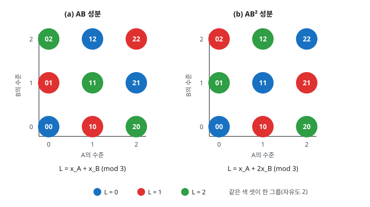

2수준 실험은 반응이 선형이라고 가정한다. 인자가 양적이고 반응이 휘어질 가능성이 있으면 3수준이 필요하다. 3수준이면 각 인자의 2차 효과(곡률)를 추정할 수 있다. 대신 실험횟수가 $3^n$으로 빨리 늘어나므로, [2ⁿ 요인실험의 교락법과 일부실시법](/posts/doe-07-confounding-fractional)과 같은 장치가 3수준에서 어떻게 바뀌는지가 이 글의 중심이다.

## 1. 표기와 자유도

수준을 0, 1, 2(낮은, 중간, 높은 수준)로 쓰고 처리조합을 숫자열로 나타낸다. $3^2$이면 $00, 01, 02, 10, \dots, 22$의 9개이고, 모형은 반복 없는 이원배치와 같다.

$$
y_{ij} = \mu + a_i + b_j + e_{ij}, \qquad i, j = 0, 1, 2
$$

$3^3$의 처리조합은 $000$부터 $222$까지 27개다.

| 효과 | 자유도 | 분해 |
|---|---|---|
| 주효과 $A$ | 2 | 1차($A_L$) + 2차($A_Q$) |
| 2인자 교호작용 $A\times B$ | 4 | $AB$ (2) + $AB^2$ (2) |
| 3인자 교호작용 $A\times B\times C$ | 8 | $ABC$, $ABC^2$, $AB^2C$, $AB^2C^2$ (각 2) |

## 2. 직교다항식에 의한 주효과의 분해

수준이 등간격이면 직교다항식 계수로 주효과를 1차와 2차 성분으로 나눈다. 교재는 2차 효과의 추론을 다루지 않으므로 이 절은 교재 밖이다.

| 성분 | 수준 0 | 수준 1 | 수준 2 | $\sum c^2$ |
|---|---|---|---|---|
| 1차 (L) | −1 | 0 | 1 | 2 |
| 2차 (Q) | 1 | −2 | 1 | 6 |

$$
SS_L = \frac{r'(\sum c_i\bar y_i)^2}{\sum c_i^2}
$$

$r'$은 각 수준의 관측 수다. [다원배치법](/posts/doe-04-multi-way-ems)의 합성반응 실험(압력 $A$, 시간 $B$, 온도 $C$를 각각 3수준, 27회)으로 분해한다.

```r
library(tidyverse)

synth <- expand_grid(시간 = c(1.5, 2.0, 2.5), 온도 = c(140, 150, 160), 압력 = c(8, 10, 12)) |>
  mutate(수율 = c(74, 61, 50, 86, 78, 70, 76, 71, 60,
                  72, 62, 49, 91, 81, 68, 87, 77, 64,
                  48, 55, 52, 65, 72, 69, 56, 63, 60),
         A = factor(압력), B = factor(시간), C = factor(온도))

for (f in c("A", "B", "C")) contrasts(synth[[f]]) <- contr.poly(3)
fit <- aov(수율 ~ (A + B + C)^2, data = synth)
summary(fit, split = list(A = list(L = 1, Q = 2), B = list(L = 1, Q = 2), C = list(L = 1, Q = 2)))
```

| 인자 | 수준별 평균 | 1차 SS | 2차 SS |
|---|---|---|---|
| $A$ 압력 | 72.8, 68.9, 60.2 | 709.4 | 34.2 |
| $B$ 시간 | 69.6, 72.3, 60.0 | 410.9 | 342.5 |
| $C$ 온도 | 58.1, 75.6, 68.2 | 460.1 | 920.9 |

압력은 거의 선형으로 감소하고, 시간과 온도는 중간 수준에서 최대인 2차 형태다. 특히 온도는 2차 성분이 1차의 두 배다. 2수준 실험이었다면 이 곡률을 놓쳤을 것이다.

```r
means <- synth |>
  pivot_longer(c(압력, 시간, 온도), names_to = "인자", values_to = "수준") |>
  group_by(인자, 수준) |>
  summarise(평균 = mean(수율), .groups = "drop")
means

ggplot(means, aes(수준, 평균)) +
  geom_line() + geom_point(size = 2) +
  facet_wrap(~인자, scales = "free_x") +
  labs(x = NULL, y = "수율 평균")
```


## 3. 교호작용의 $AB$, $AB^2$ 성분

3수준 교락법의 블록 자유도는 $3^p - 1$(2, 8, 26, …)인데 교호작용의 자유도는 $2^k$(4, 8, 16, …)라서 교호작용을 통째로 블록에 넘길 수 없다. 그래서 교호작용을 자유도 2인 성분으로 쪼갠다. $x_A, x_B \in \{0, 1, 2\}$일 때

$$
AB: \; x_A + x_B \pmod 3, \qquad AB^2: \; x_A + 2x_B \pmod 3
$$

의 값(0, 1, 2)으로 9개 조합을 세 그룹으로 나누면, 각 그룹 평균의 차이가 자유도 2인 성분이다.



두 성분은 각각 $3\times3$ 라틴방격이고, 서로 직교한다(AB의 한 그룹이 $AB^2$의 세 그룹과 한 점씩 만난다). 그래서 두 성분의 제곱합을 더하면 $A\times B$다. 성분 자체에 물리적 의미는 없지만, 교락과 일부실시의 기본 단위가 된다.

$3^n$에서는 $A^3 = B^3 = \cdots = 1$이고, 자유도 2인 성분 $X$에 대해 $X^2 = X$로 본다. 같은 그룹 나누기를 주기 때문이다. 그래서 관례상 첫 인자의 지수를 1로 맞춘다($A^2B = (A^2B)^2 = A^4B^2 = AB^2$).

```r
synth <- synth |>
  mutate(xa = as.integer(A) - 1, xb = as.integer(B) - 1, xc = as.integer(C) - 1,
         AB = factor((xa + xb) %% 3), AB2 = factor((xa + 2 * xb) %% 3))

ss_comp <- function(g, y) {
  m <- tapply(y, g, mean)
  sum(table(g) * (m - mean(y))^2)
}
c(AB = ss_comp(synth$AB, synth$수율), AB2 = ss_comp(synth$AB2, synth$수율))
```

$SS_{AB} = 288.3$, $SS_{AB^2} = 363.6$으로 합이 앞 분산분석표의 $SS_{A\times B} = 651.9$다.

성분끼리의 곱은 지수 벡터를 더해 mod 3으로 줄이면 된다. 다음 절부터 일반화 교호작용과 별명을 이 함수로 확인한다.

```r
# 성분을 지수 벡터로 다룬다: ABC^2 = c(1, 1, 2)
norm3 <- function(v) {              # 첫 지수를 1로 맞춘다 (X^2 = X)
  v <- v %% 3
  if (v[v != 0][1] == 2) v <- (2 * v) %% 3
  v
}
word <- function(v) paste0(c("A", "B", "C")[v > 0], ifelse(v[v > 0] == 2, "^2", ""), collapse = "")
prod3 <- function(X, Y) c(XY = word(norm3(X + Y)), XY2 = word(norm3(X + 2 * Y)))
```

## 4. $3^n$ 요인실험의 교락법

### 단독교락

$3^n$을 3개 블록으로 나눌 때는 정의대비 $A^{\alpha_1}B^{\alpha_2}\cdots$에 대해

$$
L = \alpha_1x_1 + \alpha_2x_2 + \cdots \pmod 3
$$

이 0, 1, 2인 조합끼리 묶는다. 교락된 성분은 자유도 2를 블록에 넘긴다.

$3^2$ 실험 9회를 하루 3회씩 사흘에 나누어 하려면 $AB$나 $AB^2$ 중 하나를 블록과 교락시킨다. 반복이 없어 교호작용은 어차피 검출할 수 없기 때문이다. 교재는 $I = AB^2$, $L = x_1 + 2x_2 \pmod 3$으로 블록을 나누고 실험했다.

```r
conf <- expand_grid(xa = 0:2, xb = 0:2) |>
  mutate(블록 = (xa + 2 * xb) %% 3,
         y = c(1, 0, 2, -2, 4, -1, 3, 1, 2),
         A = factor(xa), B = factor(xb))
conf |> arrange(블록)

summary(aov(y ~ A + B, data = conf))
c(AB = ss_comp((conf$xa + conf$xb) %% 3, conf$y),
  AB2_블록 = ss_comp(conf$블록, conf$y))
```

블록은 $\{00, 11, 22\}$, $\{10, 21, 02\}$, $\{20, 01, 12\}$다. $SS_A = 4.222$, $SS_B = 1.556$, 오차 $SS_E = 23.111$(자유도 4)로 교재 표와 같다. 오차는 $AB$ 성분 16.222와 블록과 교락된 $AB^2$ 성분 6.889의 합이다. 즉 이 분석의 오차에는 교호작용과 블록 효과가 모두 들어 있다.

$3^3$을 세 블록으로 나눌 때는 3인자 교호작용의 한 성분을 쓴다. $I = ABC^2$이면 $L = x_1 + x_2 + 2x_3 \pmod 3$이고, 3인자 교호작용 8자유도 중 2자유도만 잃는다.

### 2중교락

성분 두 개 $X$, $Y$를 블록과 교락시키면 블록이 9개가 되고, 블록 자유도 8은 성분 4개로 채워진다. $X$, $Y$와 함께 일반화 교호작용 $XY$, $XY^2$도 교락된다.

$$
I = X = Y = XY = XY^2
$$

$3^3$에서 $ABC^2$와 $AB^2$을 고르면

$$
(ABC^2)(AB^2) = A^2C^2 = AC, \qquad (ABC^2)(AB^2)^2 = A^3B^5C^2 = B^2C^2 = BC
$$

이다. 네 성분 중 어느 두 개를 골라도 나머지 둘이 만들어지므로 독립인 것은 2개다.

```r
prod3(c(1, 1, 2), c(1, 2, 0))   # ABC^2, AB^2
prod3(c(1, 1, 2), c(1, 2, 1))   # ABC^2, AB^2C

blocks9 <- expand_grid(x1 = 0:2, x2 = 0:2, x3 = 0:2) |>
  mutate(L1 = (x1 + x2 + 2 * x3) %% 3, L2 = (x1 + 2 * x2) %% 3,
         처리 = paste0(x1, x2, x3))
blocks9 |>
  group_by(L1, L2) |>
  summarise(처리조합 = paste(처리, collapse = " "),
            AC = n_distinct((x1 + x3) %% 3), BC = n_distinct((x2 + x3) %% 3), .groups = "drop")
```

9개 블록은 교재 그림 7.4와 같고, 블록 안에서 $AC$와 $BC$의 합동식 값이 하나뿐(`n_distinct` = 1)이므로 두 성분도 블록과 교락되어 있음을 확인할 수 있다. 교락된 성분은 $A\times B\times C$, $A\times B$, $A\times C$, $B\times C$의 것이므로 주효과는 검출할 수 있다. 블록 효과를 무시할 수 있으면 $A$, $B$, $C$가 각 자유도 2, 오차가 20이다.

반면 $ABC^2$와 $AB^2C$를 고르면 일반화 교호작용이 $A$와 $BC^2$이 되어 주효과 $A$의 성분이 블록과 교락된다. 정의대비는 일반화 교호작용까지 계산해 보고 골라야 한다.

## 5. $3^{n-p}$ 일부실시법

교락법으로 나눈 블록 중 하나만 실험하면 일부실시법이다. 1/3 실시, 1/9 실시, … 의 실험횟수는 $3^{n-1}$, $3^{n-2}$, … 이다.

별명은 효과에 정의관계와 그 제곱을 각각 곱해 구한다. 그래서 1/3 실시에서는 효과마다 별명이 2개다. 교재의 $3^{3-1}$은 $I = ABC^2$의 한 블록이다.

$$
A \cdot ABC^2 = A^2BC^2 = AB^2C, \qquad A \cdot (ABC^2)^2 = A^3B^2C^4 = B^2C = BC^2
$$

```r
I_book <- c(1, 1, 2)                       # I = ABC^2
effects <- list(A = c(1, 0, 0), B = c(0, 1, 0), C = c(0, 0, 1), AB2 = c(1, 2, 0))
t(sapply(effects, prod3, Y = I_book))
```

| 효과 | 별명 |
|---|---|
| $A$ | $AB^2C = BC^2$ |
| $B$ | $AB^2C^2 = AC^2$ |
| $C$ | $AB = ABC$ |
| 오차 $AB^2$ | $AC = BC$ |

2인자 이상의 교호작용을 무시할 수 있으면 주효과 $A$, $B$, $C$를 각 자유도 2로 검출하고 남는 2자유도가 오차다. 주효과가 2인자 교호작용 성분과 섞이므로 해상도 III이다. 9개 블록 중 하나만 하는 $3^{3-2}$는 총자유도가 2라서 실제로는 쓸 수 없다.

### 예제: 합성반응 실험을 1/3만 했다면

합성반응 자료에서 $I = ABC$, 즉 $x_A + x_B + x_C \equiv 0 \pmod 3$인 9개 조합만 했다고 하자. 9개는 $3\times3$ 라틴방격을 이룬다. $I = ABC$의 별명은 $A = AB^2C^2 = BC$, $B = AB^2C = AC$, $C = ABC^2 = AB$다.

```r
prod3(c(0, 0, 1), c(1, 1, 1))              # C의 별명

frac <- filter(synth, (xa + xb + xc) %% 3 == 0)
frac |> select(압력, 시간, 온도, 수율)
summary(aov(수율 ~ A + B + C, data = frac))
frac |>
  pivot_longer(c(압력, 시간, 온도), names_to = "인자", values_to = "수준") |>
  group_by(인자, 수준) |>
  summarise(평균 = mean(수율), .groups = "drop")
```

| 인자 | 1/3 실시 수준별 평균 | 전체 실험 수준별 평균 |
|---|---|---|
| 압력 | 75.3, 69.0, 59.7 | 72.8, 68.9, 60.2 |
| 시간 | 71.7, 72.3, 60.0 | 69.6, 72.3, 60.0 |
| 온도 | 59.3, 72.0, 72.7 | 58.1, 75.6, 68.2 |

9회 실험으로도 압력과 시간의 경향은 비슷하게 잡히지만, 온도의 최적 수준이 160°C로 바뀌었다. 이 자료에는 $A\times B$ 교호작용이 크고(651.9, 그중 $AB$ 성분 288.3), $C$가 바로 그 $AB$ 성분과 별명이기 때문이다. 일부실시법은 교호작용이 작다는 가정이 맞을 때만 믿을 수 있다.

## 6. 직교배열표에 의한 배치

3수준계 직교배열표는 한 열의 자유도가 2이고, $3^{n-p}$ 실험이면 열의 수가 $(3^{n-p} - 1)/2$다.

| 직교배열표 | 실험횟수 | 3수준 열 |
|---|---|---|
| $L_9(3^4)$ | 9 | 4 |
| $L_{27}(3^{13})$ | 27 | 13 |
| $L_{81}(3^{40})$ | 81 | 40 |

$L_9(3^4)$의 기본표시는 $x$, $y$, $xy$, $x^2y$이고, 각 열은 $i + j$, $2i + j \pmod 3$으로 채운다. $x^2y = (x^2y)^2 = xy^2$이므로 $xy^2$로 써도 같은 성분이지만, 교재는 열의 숫자를 $2i + j$로 만들기 때문에 $x^2y$로 쓴다. 0, 1, 2를 −1, 0, 1로 바꾸면 두 열은 직교한다.

두 열의 교호작용은 두 열에 나타난다. $x$열과 $xy$열에 놓은 인자의 교호작용은 $x \cdot xy = x^2y$열과 $x^2 \cdot xy = y$열이다. 그래서 1열과 2열에 $A$, $B$를 놓으면 $A\times B$는 3열과 4열(두 성분)에 나타나고, 교호작용을 보려면 두 열(자유도 4)을 비워야 한다.

교재 표 7.2는 교호작용이 없다고 보고 $3^{3-1}$을 $L_9$에 배치했다($A$ 1열, $B$ 2열, $e$ 3열, $C$ 4열).

```r
L9 <- expand_grid(c1 = 0:2, c2 = 0:2) |>
  mutate(c3 = (c1 + c2) %% 3, c4 = (2 * c1 + c2) %% 3,
         y = c(8, 12, 10, 10, 12, 15, 22, 18, 18))
L9
summary(aov(y ~ factor(c1) + factor(c2) + factor(c4), data = L9))
```

$SS_A = 141.56$(F = 49.0, p = 0.020), $SS_B = 1.56$, $SS_C = 26.89$(p = 0.097), 오차 2.89(자유도 2)로 교재와 같다. $B$의 F가 1보다 작으므로 오차에 풀링해 다시 분석할 수 있다.

### 선점도와 $L_{27}$

$L_{27}(3^{13})$부터는 선점도를 쓴다. 점은 인자를 놓는 열(자유도 2), 선은 두 인자의 교호작용이 놓이는 열 두 개(자유도 4)다. $L_{27}$의 표준 선점도 두 가지에는 서로 떨어진 선 두 개가 없으므로 $A\times B$와 $C\times D$를 함께 보려면 $L_{81}$로 가야 한다.

교재 예제 7.1은 시편의 강도에 3수준 인자 7개($A \sim G$)와 교호작용 $A\times C$, $C\times D$가 영향을 준다고 보고 자유도 22를 $L_{27}$에 배치했다.

| 열 | 1 | 2 | 3, 4 | 5 | 6 | 7 | 8 | 9, 10 | 11 | 12, 13 |
|---|---|---|---|---|---|---|---|---|---|---|
| 기본표시 | $x$ | $y$ | $xy$, $x^2y$ | $z$ | $xz$ | $x^2z$ | $yz$ | $xyz$, $x^2yz$ | $y^2z$ | $xy^2z$, $x^2y^2z$ |
| 배치 | $C$ | $A$ | $A\times C$ | $B$ | $E$ | $F$ | $G$ | $e$ | $D$ | $C\times D$ |

```r
basis27 <- list(c(1, 0, 0), c(0, 1, 0), c(1, 1, 0), c(2, 1, 0), c(0, 0, 1), c(1, 0, 1), c(2, 0, 1),
                c(0, 1, 1), c(1, 1, 1), c(2, 1, 1), c(0, 2, 1), c(1, 2, 1), c(2, 2, 1))
g27 <- as.matrix(expand_grid(x = 0:2, y = 0:2, z = 0:2))
L27 <- sapply(basis27, \(e) as.vector(g27 %*% e) %% 3)

spec <- tibble(C = L27[, 1], A = L27[, 2], B = L27[, 5], E = L27[, 6], F = L27[, 7],
               G = L27[, 8], D = L27[, 11],
               강도 = c(39, 75, 107, 30, 69, 71, 38, 92, 122, 45, 75, 119, 90, 98,
                        118, 48, 68, 98, 36, 95, 115, 54, 91, 134, 65, 55, 144)) |>
  mutate(across(-강도, factor))

print(summary(aov(강도 ~ A + B + C + D + E + F + G + A:C + C:D, data = spec)), digits = 7)
```

| 요인 | 제곱합 | 자유도 | F | p값 |
|---|---|---|---|---|
| $B$ | 18908.1 | 2 | 174.2 | < 0.001 |
| $C$ | 1321.2 | 2 | 12.18 | 0.020 |
| $E$ | 1121.0 | 2 | 10.33 | 0.026 |
| $G$ | 932.5 | 2 | 8.59 | 0.036 |
| $A\times C$ | 2700.1 | 4 | 12.44 | 0.016 |
| $C\times D$ | 1567.5 | 4 | 7.22 | 0.041 |
| $A$, $D$, $F$ | 133.4, 29.4, 19.2 | 각 2 | 1.23, 0.27, 0.18 | 0.38, 0.78, 0.84 |
| 오차 | 217.0 | 4 | | |

교재 표 7.4와 일치한다. $A\times C$와 $C\times D$의 2원표에서 $C$의 최적 수준이 엇갈리므로 교재는 $A_1B_2C_1D_2E_1G_1$과 $A_1B_2C_2D_1E_1G_1$을 비교했다. $F$는 오차에 풀링하고, $A$와 $D$는 교호작용 때문에 모형에 남긴다.

$$
\hat\mu(A_1B_2C_1D_2E_1G_1) = \bar y_{A_1C_1} + \bar y_{C_1D_2} + \bar y_{B_2} - \bar y_{C_1} + \bar y_{E_1} + \bar y_{G_1} - 3\bar y
$$

```r
m <- function(...) mean(filter(spec, ...)$강도)
est <- c(C1D2 = m(A == 1, C == 1) + m(C == 1, D == 2) + m(B == 2) - m(C == 1) +
           m(E == 1) + m(G == 1) - 3 * mean(spec$강도),
         C2D1 = m(A == 1, C == 2) + m(C == 2, D == 1) + m(B == 2) - m(C == 2) +
           m(E == 1) + m(G == 1) - 3 * mean(spec$강도))
est

n_e <- 27 / 21                              # 1/n_e = 1/3 + 1/3 + 1/9 - 1/9 + 1/9 + 1/9 - 3/27
fit_pool <- lm(강도 ~ A + B + C + D + E + G + A:C + C:D, data = spec)
mse_pool <- deviance(fit_pool) / df.residual(fit_pool)
c(교재_반폭 = qt(0.975, 4) * sqrt(54.259 / n_e),
  풀링_MSE = mse_pool,
  풀링_반폭 = qt(0.975, 6) * sqrt(mse_pool / n_e))
```

두 조건의 추정값은 158.0과 151.3이므로 $A_1B_2C_1D_2E_1G_1$이 최적조건이다. 실험한 27회 중 최대 강도(144)보다 높고, 이 조건은 실제로 실험하지 않았으므로 확인실험이 필요하다.

> **주의**: 교재는 $F$를 오차항에 넣은 모형으로 추정하면서, 신뢰구간에는 풀링 전 분산분석표의 $MSE = 54.259$(자유도 4)를 써서 158.0 ± 18.04를 얻었다. $F$를 풀링한 모형에 맞추면 $MSE = 39.37$(자유도 6)이고 구간은 158.0 ± 13.54다. 점추정값은 같다.

## 7. 교락법의 배치

3수준계 교락법은 블록이 3개, 9개, … 로 나뉘므로 단독교락의 블록은 자유도 2로 직교배열표의 한 열에 놓으면 된다. 예제 7.1의 27회를 한 번에 할 수 없으면 오차를 둔 9열이나 10열에 블록을 놓는다. 그 열의 숫자가 0, 1, 2인 실험끼리 한 블록이다. 세 블록 중 하나를 랜덤하게 골라 그 안의 9회를 랜덤 순서로 실험하고, 다음 블록으로 넘어간다. 2중교락이면 블록(자유도 8)이 서로 교호작용 관계인 네 열을 차지한다.

## 8. $2^{n-p}3^{m-q}$ 요인실험의 배치

대부분의 인자가 2수준인데 한두 인자만 3수준이어야 할 때가 있다(원료 납품사가 세 곳, 온도를 세 수준에서 보고 싶을 때 등). 이때는 [4수준 인자 배치](/posts/doe-07-confounding-fractional)의 원리로 2수준계 직교배열표에 3수준 인자를 넣는다. 두 열의 조합 네 개 중 세 개에 수준 0, 1, 2를 주고, 남는 (1,1)은 더 정밀하게 추정하고 싶은 수준을 한 번 더 쓴다. 이것을 **의사수준법**(dummy level)이라 한다.

| 한 열 | 다른 열 | 3수준 인자의 수준 |
|---|---|---|
| 0 | 0 | 0 |
| 0 | 1 | 1 |
| 1 | 0 | 2 |
| 1 | 1 | 0, 1, 2 중 하나 |

세 조합은 랜덤하게 고르는 것이 좋다. 3수준 인자의 자유도는 2지만, 수준을 정하는 두 열의 숫자가 모두 쓰이므로 4수준 인자처럼 **두 열과 그 교호작용 열, 모두 세 열**을 차지한다. 남는 1자유도는 오차로 돌린다. 3수준 인자와 2수준 인자의 교호작용도 같은 이유로 세 열을 차지한다.

> **주의**: 교재 예제 7.2(3수준 $A$, $B$와 2수준 $C$, $D$, $F$, $G$, $H$, 교호작용 $A\times C$, $C\times D$, $C\times F$)는 자유도 합이 13이라 $L_{16}$에 배치했다. 제목은 "$3^2\times2^4$"이지만 2수준 인자는 5개다. 교재 표 7.8의 배치는 $A$ 1, 2열, $C$ 4열, $A\times C$ 5, 6열, $B$ 7, 8열, $D$ 15열, $F$ 10열, $C\times F$ 12열, $H$ 14열인데, 세 곳이 어긋난다. ① 15열($xyzu$)은 $B$를 놓은 7열($xyz$)과 8열($u$)의 교호작용 열이라 $D$가 $B$와 섞인다. ② 7열은 $A$의 셋째 열(3열, $xy$)과 $C$의 교호작용 열이라 $B$가 $A\times C$와 섞인다. ③ $C$(4열, $z$)와 $F$(10열, $yu$)의 교호작용은 $yzu$, 즉 14열이라 $H$와 섞인다.

```r
bits <- function(k, m) as.integer(intToBits(k))[1:m]
grid16 <- as.matrix(expand_grid(x = 0:1, y = 0:1, z = 0:1, u = 0:1))
L16 <- sapply(1:15, \(k) as.vector(grid16 %*% bits(k, 4)) %% 2)
lev3 <- function(p, q, dummy) c(0, 1, 2, dummy)[2 * p + q + 1]

book72 <- function(dummy) {
  tibble(A = lev3(L16[, 1], L16[, 2], dummy), C = L16[, 4], B = lev3(L16[, 7], L16[, 8], dummy),
         G = L16[, 9], F = L16[, 10], H = L16[, 14], D = L16[, 15]) |>
    mutate(across(everything(), factor))
}
X <- model.matrix(~ A + B + C + D + F + G + H + A:C + C:D + C:F, data = book72(0))
c(모수 = ncol(X), 계수 = qr(X)$rank)
sapply(1:2, \(dm) qr(model.matrix(~ A + B + C + D + F + G + H + A:C + C:D + C:F,
                                  data = book72(dm)))$rank)
with(book72(0), table(B, D))
```

모형의 모수는 14개인데 계수(rank)가 12다. (1,1)을 수준 1이나 2로 바꿔도 13이라 모든 효과를 따로 추정할 수 없다. $B$와 $D$의 교차표를 보면 (1,1)을 수준 0으로 둘 때 $B = 0$이면 언제나 $D = 0$이다. 이 실험은 $L_{16}$에 들어가지 않는다. $A$(1~3열)와 $A\times C$(5~7열)가 1~7열을 모두 쓰면 남는 8~15열은 어느 두 열의 교호작용도 1~7열에 떨어져서 $B$가 차지할 세 열을 만들 수 없다. 자유도만 세면 13 ≤ 15지만, 차지하는 열을 세면 $A$ 3 + $B$ 3 + $A\times C$ 3 + 2수준 인자 5 + $C\times D$, $C\times F$ 2 = 16열이다. 교호작용을 줄이거나 $L_{32}$를 써야 한다.

## 9. 혼합 직교배열표

2수준 열과 3수준 열이 섞인 표를 **혼합 직교배열표**라 한다. 위처럼 $L_{16}$의 두 열 묶음 두 개를 각각 3수준 열로 보면 $L_{16}(2^{11}\times3^2)$이 된다. 다구치는 실험 상황에 맞는 여러 혼합 직교배열표를 소개했다. 대표적인 것은 $L_{18}(2^1\times3^7)$, $L_{32}(2^1\times4^9)$, $L_{36}(2^{11}\times3^{12})$이고, 교호작용은 배치하지 않고 주로 인자만 배치할 때 쓴다.

교재 표 7.9는 자동차 케이블의 인장력 규격을 맞추기 위한 실험으로, $L_{18}$에 2수준 인자 $A$와 3수준 인자 $B \sim I$를 놓고 SN비를 측정했다. 열의 총자유도가 $1 + 2\times7 = 15$이고 실험의 총자유도가 17이므로 오차 열을 따로 두지 않아도 오차 자유도 2가 남는다.

```r
L18 <- matrix(c(
  0,0,0,0,0,0,0,0,  0,0,1,1,1,1,1,1,  0,0,2,2,2,2,2,2,  0,1,0,0,1,1,2,2,  0,1,1,1,2,2,0,0,  0,1,2,2,0,0,1,1,
  0,2,0,1,0,2,1,2,  0,2,1,2,1,0,2,0,  0,2,2,0,2,1,0,1,  1,0,0,2,2,1,1,0,  1,0,1,0,0,2,2,1,  1,0,2,1,1,0,0,2,
  1,1,0,1,2,0,2,1,  1,1,1,2,0,1,0,2,  1,1,2,0,1,2,1,0,  1,2,0,2,1,2,0,1,  1,2,1,0,2,0,1,2,  1,2,2,1,0,1,2,0),
  ncol = 8, byrow = TRUE, dimnames = list(NULL, c("A", "B", "C", "D", "F", "G", "H", "I")))

cable <- as_tibble(L18) |>
  mutate(across(everything(), factor),
         SN = c(14.0, 7.8, 26.4, 19.0, 11.0, 6.9, 15.6, 24.3, 14.5,
                14.3, 14.5, 11.6, 2.6, 12.1, 16.5, 16.9, 17.7, 20.5))

# 어떤 두 열을 골라도 수준 조합이 같은 횟수로 나온다
all(combn(8, 2, \(p) length(unique(as.vector(table(L18[, p[1]], L18[, p[2]])))) == 1))

summary(aov(SN ~ ., data = cable))
summary(aov(SN ~ A * B + C + D + F + G + H + I, data = cable))
```

모든 열 쌍이 균형을 이루므로(`TRUE`) 주효과끼리 직교한다. 주효과 모형에서 $B$(p = 0.044)와 $I$(p = 0.039)가 5%에서, $D$(p = 0.062)와 $H$(p = 0.070)가 10%에서 유의하다. 오차 제곱합은 6.53(자유도 2)이다. $A\times B$를 넣으면 그 제곱합이 정확히 6.53이고 오차가 남지 않는다. $L_{18}$에서 1열과 2열의 교호작용은 다른 열과 직교해 열을 희생하지 않고 따로 구할 수 있지만, 다른 열들의 교호작용은 여러 열에 고르게 퍼져 있어 따로 검출할 수 없다. 그래서 주효과를 많이 선별하는 다구치 방법에서 널리 쓴다.

반대로 3수준계 표에 2수준 인자를 넣을 때도 3수준 열의 한 수준을 반복하는 의사수준을 쓴다.

## 10. 비교

| 구분 | $2^n$ 계열 | $3^n$ 계열 |
|---|---|---|
| 인자 하나의 자유도 | 1 | 2 (1차 + 2차) |
| 곡률 | 추정할 수 없음 | 추정할 수 있음 |
| 4인자 전부 실시 | 16회 | 81회 |
| 교호작용의 단위 | 효과 자체 (자유도 1) | 성분 $AB$, $AB^2$ (각 자유도 2) |
| 블록 나누기 | $\sum\alpha_ix_i \pmod 2$, 블록 $2^p$개 | $\sum\alpha_ix_i \pmod 3$, 블록 $3^p$개 |
| 정의대비 2개의 일반화 교호작용 | $PQ$ 1개 | $PQ$, $PQ^2$ 2개 |
| 1/2, 1/3 실시의 별명 수 | 효과마다 1개 | 효과마다 2개 |
| 직교배열표의 교호작용 | 1열 | 2열 |

주효과를 1차·2차로 나누는 것과 교호작용을 $AB$·$AB^2$로 나누는 것은 둘 다 자유도를 쪼개지만 목적이 다르다.

| 분해 | 직교다항식 ($L$, $Q$) | $AB$, $AB^2$ 성분 |
|---|---|---|
| 단위 | 자유도 1씩 | 자유도 2씩 |
| 의미 | 추세와 곡률 | 물리적 의미 없음 |
| 조건 | 양적 인자, 등간격 수준 | 질적 인자도 가능 |
| 쓰임 | 해석, 최적 수준 찾기 | 교락, 일부실시, 직교배열 설계 |

3수준은 곡률을 보는 대가로 실험이 빨리 늘고 교호작용이 열을 두 배로 먹는다. 인자 대부분이 선형이면 2수준에 중심점을 더하는 편이 싸고, 곡률이 중요한 소수 인자만 3수준으로 두려면 의사수준법이나 혼합 직교배열표를 쓴다. 반응표면 자체를 추정하려면 [반응표면분석](/posts/doe-10-rsm-mixture)으로 넘어간다.

## 정리

- 3수준 교호작용은 자유도 2인 성분으로 쪼갠다. $AB$는 $x_A + x_B$, $AB^2$는 $x_A + 2x_B \pmod 3$으로 그룹을 나누고, 지수는 첫 인자가 1이 되도록 맞춘다($X^2 = X$).
- 정의대비 $X$, $Y$로 9블록을 만들면 $XY$, $XY^2$도 교락된다. 별명도 정의관계와 그 제곱을 곱해 효과마다 2개씩 생긴다.
- $L_9$, $L_{27}$에서 두 인자의 교호작용은 두 열을 차지한다. 열을 채우는 식($2i + j$인지 $i + 2j$인지)은 표마다 다를 수 있으니 기본표시를 확인한다.
- 2수준계 표에 3수준 인자를 넣으면 자유도는 2지만 열은 세 개를 차지한다. 자유도 합만 보고 배열표를 고르면 배치가 불가능할 수 있다.
