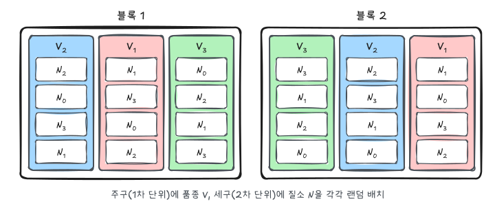
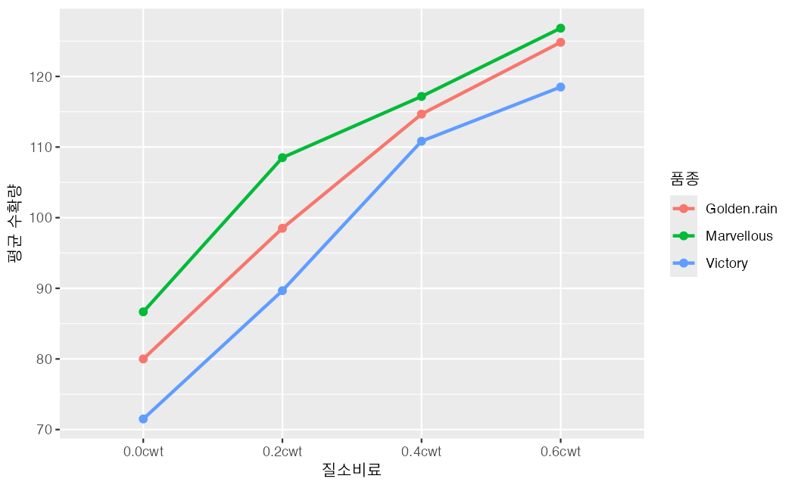
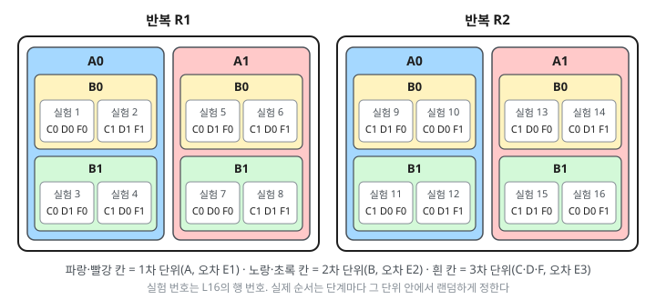

지금까지는 인자들이 서로 **교차**(crossed)했다. 모든 수준조합이 의미가 있고, 실험 전체 또는 블록 안을 한 번에 확률화했다. 이 글은 그 두 가지가 깨지는 경우를 다룬다.

- **지분실험법**(nested): 한 인자의 수준이 다른 인자의 수준 안에 속해 있다.
- **분할법**(split-plot): 확률화를 단계적으로 해서 오차가 여러 층으로 생긴다.

## 1. 지분실험법

나라별로 수입한 원유의 탄소 성분(%)이 같은지 알아보려 한다. 나라별로 드럼통 4개를 랜덤하게 뽑고, 드럼통마다 시료를 3회 채취해 측정했다.

| 나라 | $A_1$ | | | | $A_2$ | | | | $A_3$ | | | |
|---|---|---|---|---|---|---|---|---|---|---|---|---|
| 드럼통 | 1 | 2 | 3 | 4 | 1 | 2 | 3 | 4 | 1 | 2 | 3 | 4 |
| | 86 | 83 | 83 | 86 | 86 | 85 | 84 | 85 | 87 | 83 | 86 | 88 |
| | 84 | 82 | 85 | 89 | 83 | 89 | 85 | 88 | 89 | 85 | 84 | 87 |
| | 85 | 81 | 86 | 85 | 82 | 87 | 83 | 87 | 85 | 87 | 87 | 86 |

$A_1$의 드럼통 1과 $A_2$의 드럼통 1은 같은 것이 아니다. 드럼통은 나라 **안에** 속해 있으므로 "드럼통 1의 평균"이나 나라×드럼통 교호작용은 의미가 없다.

$$
y_{ijk} = \mu + a_i + b_{j(i)} + e_{k(ij)}, \qquad b_{j(i)} \sim N(0, \sigma_B^2), \quad e_{k(ij)} \sim N(0, \sigma_E^2)
$$

$j(i)$는 "$i$ 안의 $j$"라는 뜻이다. 관심은 두 가지다.

1. 드럼통 간 산포 $\sigma_B^2$이 0인가 (품질의 균질성)
2. 나라별 평균이 같은가

### 분산분석과 EMS

$$
SS_{B(A)} = r\sum_i\sum_j(\bar y_{ij.} - \bar y_{i..})^2, \qquad \nu_{B(A)} = l(m - 1)
$$

| 요인 | 자유도 | $E(MS)$ | F 분모 |
|---|---|---|---|
| $A$ | $l - 1$ | $\sigma_E^2 + r\sigma_B^2 + mr\,Q(A)$ | $MS_{B(A)}$ |
| $B(A)$ | $l(m - 1)$ | $\sigma_E^2 + r\sigma_B^2$ | $MS_E$ |
| $E$ | $lm(r - 1)$ | $\sigma_E^2$ | |

나라의 효과는 드럼통 간 변동과 비교해야 한다. 나라에서 드럼통을 다시 뽑으면 그 산포만큼 나라 평균이 흔들리기 때문이다. 지분 구조에는 교차 실험용 글자표기 EMS를 쓸 수 없다.

```r
library(tidyverse)

oil <- expand_grid(반복 = 1:3, 나라 = c("A1", "A2", "A3"), 드럼 = 1:4) |>
  mutate(탄소 = c(86, 83, 83, 86, 86, 85, 84, 85, 87, 83, 86, 88,
                  84, 82, 85, 89, 83, 89, 85, 88, 89, 85, 84, 87,
                  85, 81, 86, 85, 82, 87, 83, 87, 85, 87, 87, 86),
         나라 = factor(나라),
         드럼통 = factor(paste(나라, 드럼, sep = "-")))   # 나라마다 다른 드럼통

# Error()로 나라 효과를 드럼통 층에서 검정
fit_nest <- aov(탄소 ~ 나라 + Error(드럼통), data = oil)
summary(fit_nest)

# 드럼통 효과는 나라 안에서 검정
summary(aov(탄소 ~ 나라 / 드럼통, data = oil))
```

| 요인 | 제곱합 | 자유도 | 평균제곱 | F | p값 |
|---|---|---|---|---|---|
| 나라 | 15.06 | 2 | 7.53 | 0.97 | 0.416 |
| 드럼통(나라) | 69.92 | 9 | 7.77 | 2.94 | 0.017 |
| 오차 | 63.33 | 24 | 2.64 | | |

드럼통 간 산포가 유의하므로 드럼통마다 탄소 성분이 균질하지 않다. 나라 간 차이는 드럼통 간 변동에 비해 작아 유의하지 않다. 만약 나라 효과를 $MS_E$로 나누면 $F = 2.85$가 되어 결론을 잘못 낼 수 있다.

분산성분은

$$
\hat\sigma_E^2 = 2.64, \qquad \hat\sigma_B^2 = \frac{7.77 - 2.64}{3} = 1.71
$$

이다. 측정 한 번의 분산 4.35 중 39%가 드럼통 간 변동이다. 품질 관리를 개선하려면 드럼통 수준의 변동을 줄여야 한다. 나라 평균의 분산이 $(\sigma_E^2 + r\sigma_B^2)/(mr)$이므로, 정밀도를 높이려면 시료 수 $r$보다 드럼통 수 $m$을 늘리는 것이 효과적이다.

## 2. 단일분할법

어떤 인자는 수준을 바꾸기 어렵다(가마의 온도, 넓은 땅의 관개 방식). 이런 인자는 큰 실험단위(**1차 단위**, 주구)에 랜덤 배정하고, 그 안을 작은 단위(**2차 단위**, 세구)로 나누어 바꾸기 쉬운 인자를 랜덤 배정한다.



확률화가 두 단계이므로 오차도 두 개다.

$$
y_{ijk} = \mu + r_k + a_i + e^{(1)}_{ik} + b_j + (ab)_{ij} + e^{(2)}_{ijk}
$$

| 층 | 요인 | F 분모 |
|---|---|---|
| 1차 단위 | 블록(반복) $R$, 1차 인자 $A$ | $e^{(1)} = R\times A$ |
| 2차 단위 | 2차 인자 $B$, $A\times B$ | $e^{(2)}$ |

1차 인자 $A$는 큰 단위끼리 비교하므로 오차가 크고 자유도가 작아 검출력이 낮다. 대신 2차 인자 $B$와 교호작용 $A\times B$는 같은 큰 단위 안에서 비교하므로 정밀하다. **정밀하게 알고 싶은 인자를 2차 단위에 둔다.**

### 예제: 귀리 품종과 질소비료

`MASS::oats` 자료(Yates)는 6개 블록에서 블록을 3개 주구로 나누어 귀리 품종($V$)을 배정하고, 각 주구를 다시 4개 세구로 나누어 질소비료($N$: 0, 0.2, 0.4, 0.6 cwt)를 배정한 단일분할법이다.

```r
oats <- MASS::oats

fit_sp <- aov(Y ~ V * N + Error(B / V), data = oats)
summary(fit_sp)
```

| 층 | 요인 | 제곱합 | 자유도 | 평균제곱 | F | p값 |
|---|---|---|---|---|---|---|
| 블록 | 블록 | 15875 | 5 | 3175 | | |
| 1차 단위 | 품종 $V$ | 1786 | 2 | 893 | 1.49 | 0.272 |
| | 1차 오차 ($B\times V$) | 6013 | 10 | 601 | | |
| 2차 단위 | 질소 $N$ | 20021 | 3 | 6674 | 37.69 | < 0.001 |
| | $V\times N$ | 322 | 6 | 54 | 0.30 | 0.932 |
| | 2차 오차 | 7969 | 45 | 177 | | |

1차 오차(601)가 2차 오차(177)의 3배 이상이다. 같은 블록 안에서도 주구 간 차이가 크다는 뜻이다. 품종은 이 큰 오차로 검정되어 유의하지 않고, 질소는 작은 오차로 검정되어 매우 유의하다.

분할 구조를 무시하고 `aov(Y ~ B + V * N)`로 분석하면 두 오차가 섞여 품종의 F값이 부풀려진다.

```r
oats |>
  group_by(V, N) |>
  summarise(수확량 = mean(Y), .groups = "drop") |>
  ggplot(aes(N, 수확량, color = V, group = V)) +
  geom_line(linewidth = 1) + geom_point(size = 2) +
  labs(x = "질소비료", y = "평균 수확량", color = "품종")
```



세 품종 모두 질소비료에 따라 거의 평행하게 증가한다. 교호작용이 없다.

### 비교할 때의 표준오차

1차 인자 수준 간 비교와 2차 인자 수준 간 비교는 표준오차가 다르다. $r$은 블록 수, $a$, $b$는 1차·2차 인자의 수준수다.

| 비교 | 표준오차 |
|---|---|
| 1차 인자 두 수준 평균 | $\sqrt{2MS_{E1}/(rb)}$ |
| 2차 인자 두 수준 평균 | $\sqrt{2MS_{E2}/(ra)}$ |
| 같은 1차 수준 안에서 2차 인자 두 수준 | $\sqrt{2MS_{E2}/r}$ |
| 다른 1차 수준의 셀 평균끼리 | $\sqrt{2[(b - 1)MS_{E2} + MS_{E1}]/(rb)}$ (자유도는 Satterthwaite) |

### 1차 단위 인자가 둘일 때

교재 예제 8.3은 타이어 코드 열처리 실험이다. 첨가제 양 $A$(3수준)와 규격지 $B$(2수준)를 1차 단위에, 열처리 온도 $C$(3수준)를 2차 단위에 두고 전체를 2회 반복($R$)해 내열강력(%)을 쟀다.

$$
y_{ijkp} = \mu + r_p + a_i + b_j + (ab)_{ij} + e^{(1)}_{ijp} + c_k + (ac)_{ik} + (bc)_{jk} + (abc)_{ijk} + e^{(2)}_{ijkp}
$$

1차 오차에는 $A\times R$, $B\times R$, $A\times B\times R$이 섞여 있다. 분할법에서 반복과 인자의 교호작용은 의미가 없으므로 셋을 묶어 1차 오차(자유도 $2 + 1 + 2 = 5$)로 쓴다. R에서는 1차 단위인 "반복 안의 $A\times B$ 칸"을 `Error(R / (A:B))`로 지정한다.

```r
cord <- expand_grid(A = 1:3, B = 1:2, R = 1:2, C = 1:3) |>
  mutate(강력 = c(88, 84, 79, 86, 87, 81, 90, 85, 82, 89, 86, 80,
                  87, 91, 86, 91, 92, 87, 91, 90, 87, 90, 90, 87,
                  92, 91, 89, 91, 89, 88, 91, 92, 92, 90, 90, 89),
         across(A:C, factor))

fit_cord <- aov(강력 ~ A * B * C + Error(R / (A:B)), data = cord)
summary(fit_cord)

# 1차 오차를 2차 오차로 검정
pf((16.556 / 5) / (14 / 12), 5, 12, lower.tail = FALSE)
```

| 층 | 요인 | 제곱합 | 자유도 | 평균제곱 | F | p값 |
|---|---|---|---|---|---|---|
| 1차 단위 | $A$ | 206.06 | 2 | 103.03 | 31.12 | 0.002 |
| | $B$ | 4.00 | 1 | 4.00 | 1.21 | 0.322 |
| | $A\times B$ | 1.50 | 2 | 0.75 | 0.23 | 0.805 |
| | 1차 오차 | 16.56 | 5 | 3.31 | | |
| 2차 단위 | $C$ | 113.39 | 2 | 56.69 | 48.60 | < 0.001 |
| | $A\times C$ | 49.44 | 4 | 12.36 | 10.60 | < 0.001 |
| | $B\times C$ | 3.17 | 2 | 1.58 | 1.36 | 0.294 |
| | $A\times B\times C$ | 9.33 | 4 | 2.33 | 2.00 | 0.159 |
| | 2차 오차 | 14.00 | 12 | 1.17 | | |

첨가제 $A$, 온도 $C$, 교호작용 $A\times C$가 유의하다. 1차 오차는 2차 오차에 비해 유의하게 크지 않다($F = 2.84$, $p = 0.064$). 이럴 때 교재는 1차 오차와 유의하지 않은 교호작용을 2차 오차에 풀링해 완전확률화 요인실험처럼 분석한다. 실험은 분할법으로 편하게 하고 분석은 요인실험과 같은 결과를 얻는 셈이다. 최적조건은 유의한 $A\times C$의 셀 평균에서 고른다.

```r
cord |>
  group_by(A, C) |>
  summarise(평균 = mean(강력), .groups = "drop") |>
  pivot_wider(names_from = C, values_from = 평균, names_prefix = "C")
```

$A_3C_1$(91.0)이 가장 높지만 현재 온도인 $A_3C_2$(90.5)와 차이가 작다. 교재는 온도를 바꾸기 어렵다는 점을 고려해 $A_3C_2$를 표준 조건으로 정했다.

### 인자가 분할되지 않는 경우

교재 예제 8.4는 반응온도 $A$와 원료 회사 $B$(각 3수준)의 9개 조건을 랜덤 순서로 한 번씩 실험하고, 실험마다 표본을 2개 떠서 이사틴 생성률을 쟀다. 두 측정은 **같은 실험의 측정**이지 반복 실험이 아니다. 실험 조건이 1차 단위, 표본이 2차 단위가 된다.

$$
y_{ijk} = \mu + a_i + b_j + e^{(1)}_{ij} + e^{(2)}_{ijk}
$$

반복이 없으므로 1차 오차에는 교호작용 $A\times B$가 교락되어 있다. $E(MS_A) = \sigma_{E_2}^2 + 2\sigma_{E_1}^2 + 6Q(A)$이므로 $A$와 $B$는 $MS_{E_1}$으로 검정한다.

```r
isatin <- expand_grid(B = c("B1", "B2", "B3"), A = c("60", "70", "80"), 표본 = 1:2) |>
  mutate(생성률 = c(61.0, 60.2, 64.1, 63.2, 65.2, 66.1,
                    63.3, 62.7, 66.2, 65.4, 66.6, 67.2,
                    61.3, 61.9, 63.3, 64.2, 66.0, 66.4),
         조건 = interaction(A, B))

summary(aov(생성률 ~ A + B + Error(조건), data = isatin))
```

| 층 | 요인 | 제곱합 | 자유도 | 평균제곱 | F | p값 |
|---|---|---|---|---|---|---|
| 1차 단위 | $A$ | 61.87 | 2 | 30.93 | 90.61 | < 0.001 |
| | $B$ | 11.91 | 2 | 5.95 | 17.44 | 0.011 |
| | 1차 오차 ($\equiv A\times B$) | 1.37 | 4 | 0.34 | | |
| 2차 단위 | 2차 오차 | 2.48 | 9 | 0.28 | | |

온도와 원료 모두 유의하다. 두 표본을 반복으로 보고 교호작용이 있는 이원배치로 분석하면 $A$, $B$를 측정 오차($MS_{E_2}$)로 나누게 되어 F값이 부풀려진다.

> **주의** 교재 표 8.15의 제곱합(61.814, 11.964, 1.442, 2.570)은 $B_3$·70°C의 첫 값을 63.3이 아니라 63.2로 하면 재현된다. 위 결과는 교재 표 8.13에 인쇄된 자료로 계산한 것이다.

## 3. 2단분할법

2차 단위를 다시 나누어 세 번째 단계의 인자를 배정하면 **2단분할법**(split-split-plot)이다. 오차가 세 개가 된다.



$$
y_{ijkl} = \mu + r_l + a_i + e^{(1)}_{il} + b_j + (ab)_{ij} + e^{(2)}_{ijl} + c_k + (ac)_{ik} + (bc)_{jk} + (abc)_{ijk} + e^{(3)}_{ijkl}
$$

| 층 | 요인 | 오차 |
|---|---|---|
| 1차 단위 | $R$, $A$ | $e^{(1)} = R\times A$ |
| 2차 단위 | $B$, $A\times B$ | $e^{(2)} = R\times B + R\times A\times B$ |
| 3차 단위 | $C$, $A\times C$, $B\times C$, $A\times B\times C$ | $e^{(3)}$ |

**$m$차 단위 인자와 $n$차 단위 인자($m < n$)의 교호작용은 $n$차 단위에 속한다.** 그래서 $A\times C$, $B\times C$는 3차 단위에서 검정한다. R에서는 `aov(y ~ A * B * C + Error(R / A / B))`로 분석한다. 층이 내려갈수록 오차가 작고 자유도가 커진다.

### 예제: 적층 플라스틱판의 마멸도

교재 예제 8.5는 3단계 공정이다. 1단계에서 건조온도 $A$, 2단계에서 적층원료 $B$, 3단계에서 광택제 $C$, 광택정도 $D$, 압착온도 $F$를 정하고(모두 2수준) 전체를 2회 반복한다. 모든 조합을 하면 $2^6 = 64$회이므로, 주효과와 의심되는 교호작용 $A\times B$, $B\times F$만 보기로 하고 $L_{16}(2^{15})$에 배치한다.

| 단위 | 효과 | 자유도 | 배치한 열 |
|---|---|---|---|
| 1차 | $R$, $A$, $E_1 (= R\times A)$ | 3 | 1, 2, 3열 (1·2군) |
| 2차 | $B$, $A\times B$, $E_2 (= R\times B + R\times A\times B)$ | 4 | 4~7열 (3군) |
| 3차 | $C$, $D$, $F$, $B\times F$, $E_3$ | 8 | 8~15열 (4군) |

낮은 단위의 효과를 낮은 군에 두는 이유는 높은 단위 인자끼리의 교호작용이 1·2차 오차 열과 겹치지 않게 하려는 것이다. 예를 들어 $C$, $D$를 9열($xu$), 10열($yu$)에 두면 $C\times D$는 3열($xy$)로 가서 1차 오차와 교락된다.

평균제곱의 기댓값은 다음과 같다($\sigma_1^2, \sigma_2^2, \sigma_3^2$는 1·2·3차 오차의 분산).

| 요인 | $E(MS)$ | F 분모 |
|---|---|---|
| $R$ | $\sigma_3^2 + 2\sigma_2^2 + 4\sigma_1^2 + 8\sigma_R^2$ | $MS_{E_1}$ |
| $A$ | $\sigma_3^2 + 2\sigma_2^2 + 4\sigma_1^2 + 8Q(A)$ | $MS_{E_1}$ |
| $E_1$ | $\sigma_3^2 + 2\sigma_2^2 + 4\sigma_1^2$ | $MS_{E_2}$ |
| $B$ | $\sigma_3^2 + 2\sigma_2^2 + 8Q(B)$ | $MS_{E_2}$ |
| $A\times B$ | $\sigma_3^2 + 2\sigma_2^2 + 4Q(A\times B)$ | $MS_{E_2}$ |
| $E_2$ | $\sigma_3^2 + 2\sigma_2^2$ | $MS_{E_3}$ |
| $C$, $D$, $F$ | $\sigma_3^2 + 8Q(\cdot)$ | $MS_{E_3}$ |
| $B\times F$ | $\sigma_3^2 + 4Q(B\times F)$ | $MS_{E_3}$ |
| $E_3$ | $\sigma_3^2$ | |

$L_{16}$의 $j$열은 $j$를 이진수로 쓴 기본 성분($x, y, z, u$)의 합을 2로 나눈 나머지다. 이를 이용해 배치를 만든다.

```r
run <- 0:15
기본 <- cbind(x = run %/% 8 %% 2, y = run %/% 4 %% 2, z = run %/% 2 %% 2, u = run %% 2)
L16 <- function(j) as.vector(기본 %*% as.integer(intToBits(j))[1:4] %% 2)

plastic <- tibble(R = L16(1), A = L16(2), B = L16(4), F = L16(8), C = L16(9), D = L16(15),
                  마멸도 = c(51.0, 28.0, 31.5, 27.0, 44.0, 31.5, 32.5, 33.0,
                            53.5, 32.0, 26.0, 22.0, 48.0, 37.5, 21.5, 24.0)) |>
  mutate(across(R:D, factor))

fit_ssp <- aov(마멸도 ~ A + A:B + B + C + D + F + B:F + Error(R / A / B), data = plastic)
summary(fit_ssp)
```

| 층 | 요인 | 제곱합 | 자유도 | 평균제곱 | F | p값 |
|---|---|---|---|---|---|---|
| 1차 단위 | $A$ | 0.06 | 1 | 0.06 | 0.03 | 0.895 |
| | 1차 오차 | 2.25 | 1 | 2.25 | | |
| 2차 단위 | $B$ | 729.00 | 1 | 729.00 | 9.81 | 0.089 |
| | $A\times B$ | 4.00 | 1 | 4.00 | 0.05 | 0.838 |
| | 2차 오차 | 148.63 | 2 | 74.31 | | |
| 3차 단위 | $C$ | 2.25 | 1 | 2.25 | 0.12 | 0.746 |
| | $D$ | 0.06 | 1 | 0.06 | 0.00 | 0.957 |
| | $F$ | 333.06 | 1 | 333.06 | 17.85 | 0.013 |
| | $B\times F$ | 240.25 | 1 | 240.25 | 12.88 | 0.023 |
| | 3차 오차 | 74.63 | 4 | 18.66 | | |

$B$는 큰 마멸도 차이(제곱합 729)에도 2차 오차의 자유도가 2뿐이라 5%에서 유의하지 않다. 1·2차 오차, 반복, $A\times B$가 모두 유의하지 않으므로 교재는 이들을 3차 오차에 풀링해 $2^{5-1}$ 요인실험처럼 다시 분석한다.

```r
fit_pool <- aov(마멸도 ~ A + B + F + C + D + B:F, data = plastic)
summary(fit_pool)

plastic |> group_by(B, F) |> summarise(평균 = mean(마멸도), .groups = "drop")

# 최적조건 B1F1의 95% 신뢰구간: 평균 4개의 분산은 MSE / 4
26.5 + c(-1, 1) * qt(0.975, 9) * sqrt(241.75 / 9 / 4)
```

풀링하면 $B$($F = 27.14$, $p < 0.001$), $F$($F = 12.40$, $p = 0.007$), $B\times F$($F = 8.94$, $p = 0.015$)가 유의하다($MS_E = 26.86$, 자유도 9). 마멸도가 가장 작은 조건은 $B_1F_1$(평균 26.5)이고 95% 신뢰구간은 $26.5 \pm 5.86 = (20.64, 32.36)$이다.

## 4. 지분실험과 분할법의 관계

분할법의 1차 오차 $R\times A$는 "블록 안에 속한 주구"의 변동이고, 2차 단위는 주구 안에 지분되어 있다. 즉 분할법은 실험단위가 지분 구조를 이루는 요인실험이다. 두 설계 모두 **실험단위가 어떤 층에서 확률화되었는지**를 보고 각 효과를 그 층의 오차로 검정한다는 원칙을 따른다. 이 원칙은 반복측정자료와 혼합모형으로 이어진다.

`Error()` 항의 각 층은 혼합모형의 변량효과와 같다. 귀리 자료라면 블록과 블록 안의 주구를 변량효과로 두는 `lme4::lmer(Y ~ V * N + (1 | B / V), data = oats)`가 같은 모형이다. 자료가 균형이면 두 방법의 고정효과 검정이 일치한다(혼합모형의 F검정에는 `lmerTest` 같은 패키지가 필요하다). 결측으로 균형이 깨지면 `Error()`의 층이 서로 직교하지 않아 분석이 부정확해지므로 혼합모형을 쓴다.

## 5. 비교

| 구분 | 요인실험 (완전확률화·난괴법) | 단일분할법 | 2단분할법 | 지분실험 |
|---|---|---|---|---|
| 확률화 | 모든 조합을 한 번에 (또는 블록마다) | 1차 인자 → 2차 인자 순서로 두 단계 | 1차 → 2차 → 3차의 세 단계 | 상위 단위 안에서 하위 단위를 뽑음 |
| 인자 관계 | 교차 | 교차 (확률화만 단계적) | 교차 (확률화만 단계적) | 지분 (하위 수준이 상위마다 다름) |
| 오차항 | 1개 | 2개 (1차 오차, 2차 오차) | 3개 | 단계별 분산성분 |
| 교호작용의 위치 | 하나의 오차로 검정 | 1차×2차 인자는 2차 단위 | 낮은 단위×높은 단위는 높은 단위 | 하위 인자와의 교호작용은 정의되지 않음 |
| 주된 목적 | 효과 추정 | 바꾸기 어려운 인자를 포함한 실험 | 단계별 공정에서 인자를 나눠 바꾸는 실험 | 변동의 원천별 분산성분 추정 |

### 분할 구조를 무시하고 분석하면

앞의 귀리 자료를 분할 구조를 무시한 채 블록 + 요인실험(난괴법, `Y ~ B + V * N`)이나 완전확률화(`Y ~ V * N`)로 분석해 올바른 분석과 비교한다.

```r
fit_rcbd <- aov(Y ~ B + V * N, data = oats)
summary(fit_rcbd)

fit_crd <- aov(Y ~ V * N, data = oats)
summary(fit_crd)
```

블록은 유지하되 분할 구조만 무시하면(`Y ~ B + V * N`) 1차 오차(601, 자유도 10)와 2차 오차(177, 자유도 45)가 254(자유도 55)로 합쳐진다. 품종은 큰 1차 오차 대신 작은 합동 오차로 검정되어 $p$값이 0.272에서 0.037로 바뀌어 유의해지고, 질소는 반대로 $F$값이 37.7에서 26.3으로 작아진다. 블록까지 빼고 완전확률화(`Y ~ V * N`)로 분석하면 블록 변동(15,875)까지 오차에 섞여 합동 오차가 498(자유도 60)로 커지지만($V$: $F = 1.80, p = 0.175$; $N$: $F = 13.41$), 여전히 확률화 구조를 어긴 잘못된 검정이다. 분할 구조를 무시한 분석은 1차 인자에는 관대하고 2차 인자에는 보수적이다. 분할법으로 실험했다면 분석도 확률화의 구조를 따라야 한다.

## 정리

| 설계 | 구조 | 핵심 |
|---|---|---|
| 지분실험법 | $B$가 $A$ 안에 속함 | $A$는 $MS_{B(A)}$로 검정, 분산성분 추정 |
| 원유 예제 | 드럼통 산포 유의 ($p = 0.017$), 나라 차이 무의미 | $\hat\sigma_B^2 = 1.71$ |
| 단일분할법 | 1차 인자는 주구, 2차 인자는 세구 | 오차 2개, 2차 인자가 더 정밀 |
| 귀리 예제 | 품종 $F = 1.49$ (1차 오차), 질소 $F = 37.7$ (2차 오차) | 교호작용 무의미, 분할 무시(`B + V * N`) 시 품종 $p = 0.037$로 오판 |
| 1차 인자 둘 (타이어 코드) | 1차 오차 = $A\times R + B\times R + A\times B\times R$ | `Error(R / (A:B))`, 최적 $A_3C_1$, 표준 $A_3C_2$ |
| 분할되지 않는 인자 (이사틴) | 1차 오차 $\equiv A\times B$ | $A$, $B$는 $MS_{E_1}$으로 검정 |
| 2단분할법 | 오차 3개 | `Error(R/A/B)` |
| 마멸도 예제 | $L_{16}$에 단위별로 군을 나눠 배치 | 풀링 후 $B$, $F$, $B\times F$ 유의, 최적 $B_1F_1$ (26.5) |
