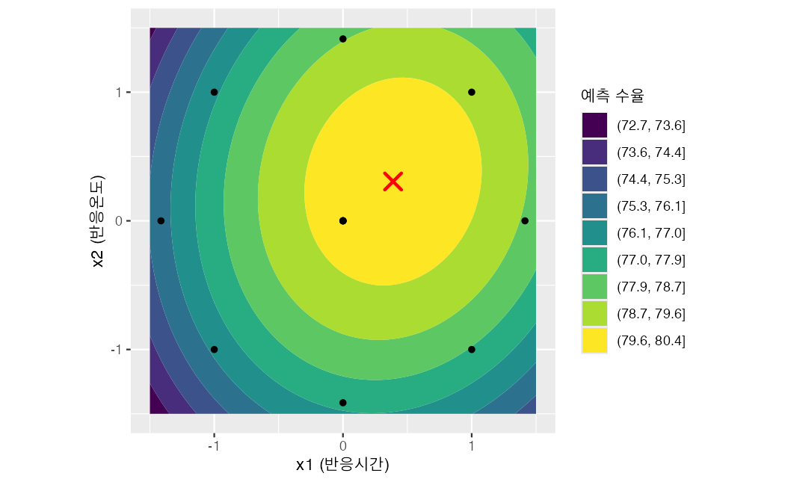
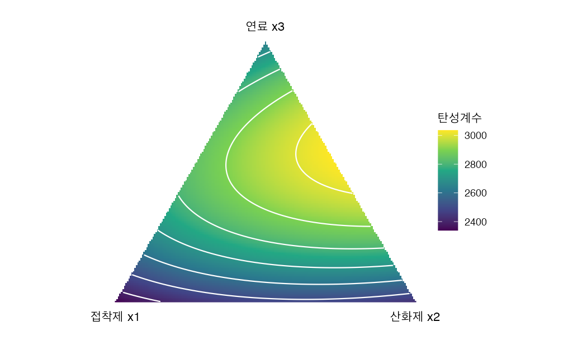

지금까지는 인자 수준의 **어느 조합이 가장 좋은가**를 분산분석으로 비교했다. 반응표면분석은 양적 인자와 반응 사이의 **함수 관계**를 회귀모형으로 추정해 최적조건을 연속적으로 찾는다. 혼합물 실험은 인자들의 합이 1로 묶여 있는 특수한 경우다.

## 1. 반응표면분석의 흐름

인자를 코딩변수 $x_i$(중심 0, 한 단위 = 실험 간격)로 바꾸어 분석한다.

1. **선별**: [2ⁿ 일부실시법](/posts/doe-07-confounding-fractional)으로 중요한 인자를 고른다.
2. **최대경사법**: 현재 영역에서 1차 모형을 적합하고, 반응이 가장 빠르게 좋아지는 방향으로 이동한다.
3. **2차 모형**: 최적점 근처에서 곡률이 나타나면 2차 모형을 적합하고 정상점을 찾는다.

## 2. 1차 모형과 최대경사법

$$
\hat y = \hat\beta_0 + \sum_{i=1}^{k}\hat\beta_i x_i
$$

반응이 가장 빠르게 증가하는 방향은 기울기 벡터 $(\hat\beta_1, \dots, \hat\beta_k)$ 방향이다. 기준 인자의 이동 폭 $\Delta x_j$를 정하면 다른 인자는

$$
\Delta x_i = \frac{\hat\beta_i}{\hat\beta_j}\Delta x_j
$$

만큼 움직인다. 이 경로를 따라 실험하다가 반응이 더 좋아지지 않는 지점에서 새 실험영역을 잡는다. 1차 모형이 적합한지는 중심점 반복으로 순수오차를 구해 곡률검정과 적합결여검정으로 확인한다.

## 3. 2차 모형과 정상점

$$
\hat y = \hat\beta_0 + \mathbf{x}'\mathbf b + \mathbf{x}'\mathbf B\mathbf{x}, \qquad
\mathbf b = \begin{pmatrix}\hat\beta_1\\ \vdots\\ \hat\beta_k\end{pmatrix},\quad
\mathbf B = \begin{pmatrix}\hat\beta_{11} & \hat\beta_{12}/2 & \cdots\\ \hat\beta_{12}/2 & \hat\beta_{22} & \\ \vdots & & \ddots\end{pmatrix}
$$

기울기가 0인 **정상점**은

$$
\mathbf x_s = -\frac12\mathbf B^{-1}\mathbf b, \qquad \hat y_s = \hat\beta_0 + \frac12\mathbf x_s'\mathbf b
$$

이다. 정상점이 최대인지 최소인지는 **정준분석**으로 판단한다. 좌표를 정상점으로 옮기고 $\mathbf B$의 고유벡터 방향으로 회전하면

$$
\hat y = \hat y_s + \lambda_1 w_1^2 + \cdots + \lambda_k w_k^2
$$

이 된다($\lambda_i$는 $\mathbf B$의 고유값).

| 고유값 | 정상점 |
|---|---|
| 모두 음수 | 최대점 |
| 모두 양수 | 최소점 |
| 부호가 섞임 | 안장점 |
| 일부가 0에 가까움 | 능선(ridge): 그 방향으로 반응이 거의 변하지 않음 |

## 4. 2차 모형을 위한 실험계획

### 중심합성계획 (CCD)

$2^k$ 요인점 + $2k$개 축점($\pm\alpha$) + 중심점 $n_0$개로 구성된다.


- $\alpha = (2^k)^{1/4}$이면 **회전성**: 중심에서 같은 거리에 있는 점의 예측분산이 같다. $k = 2$이면 $\alpha = 1.414$이고, 8각형 계획이 된다.
- 중심점을 여러 번 반복해 순수오차를 추정하고 중심 근처의 예측 정밀도를 높인다.
- 요인점 부분을 먼저 실험해 1차 모형을 보고, 곡률이 있으면 축점을 추가하는 순차적 실험이 가능하다.

**Box-Behnken 계획**은 각 변의 중점과 중심점을 쓰는 3수준 계획으로, 꼭짓점(모든 인자가 극단값)을 실험하지 않아도 된다.

### 예제

반응시간($x_1$)과 반응온도($x_2$)에 따른 수율을 회전성 CCD로 13회 실험했다(Montgomery의 교재 예제).

| $x_1$ | $x_2$ | 수율 | | $x_1$ | $x_2$ | 수율 |
|---|---|---|---|---|---|---|
| −1 | −1 | 76.5 | | 1.414 | 0 | 78.4 |
| −1 | 1 | 77.0 | | −1.414 | 0 | 75.6 |
| 1 | −1 | 78.0 | | 0 | 1.414 | 78.5 |
| 1 | 1 | 79.5 | | 0 | −1.414 | 77.0 |
| 0 | 0 | 79.9, 80.3, 80.0, 79.7, 79.8 | | | | |

```r
library(tidyverse)

ccd <- tibble(
  x1 = c(-1, -1, 1, 1, 0, 0, 0, 0, 0, 1.414, -1.414, 0, 0),
  x2 = c(-1, 1, -1, 1, 0, 0, 0, 0, 0, 0, 0, 1.414, -1.414),
  y  = c(76.5, 77.0, 78.0, 79.5, 79.9, 80.3, 80.0, 79.7, 79.8, 78.4, 75.6, 78.5, 77.0)
)

fit2 <- lm(y ~ x1 + x2 + I(x1^2) + I(x2^2) + x1:x2, data = ccd)
summary(fit2)

# 적합결여검정: 같은 점의 반복으로 구한 순수오차와 비교
fit_sat <- lm(y ~ factor(paste(x1, x2)), data = ccd)
anova(fit2, fit_sat)
```

$$
\hat y = 79.94 + 0.995x_1 + 0.515x_2 - 1.376x_1^2 - 1.001x_2^2 + 0.250x_1x_2, \qquad R^2 = 0.983
$$

잔차제곱합 0.496 중 순수오차가 0.212(자유도 4), 적합결여가 0.284(자유도 3)이다. 적합결여 $F = (0.284/3)/(0.212/4) = 1.79$, p값 약 0.29로 2차 모형이 적절하다.

```r
b <- coef(fit2)[c("x1", "x2")]
B <- matrix(c(coef(fit2)["I(x1^2)"], coef(fit2)["x1:x2"] / 2,
              coef(fit2)["x1:x2"] / 2, coef(fit2)["I(x2^2)"]), 2)
xs <- -0.5 * solve(B, b)
ys <- coef(fit2)[1] + 0.5 * sum(xs * b)
eigen(B)
c(xs, ys)
```

정상점은 $\mathbf x_s = (0.389, 0.306)$, 예측 수율 80.21이다. 고유값이 $-1.414$, $-0.963$으로 모두 음수이므로 최대점이다. 두 고유값의 크기가 비슷해 등고선이 원에 가까운 타원이다.

```r
grid <- expand_grid(x1 = seq(-1.5, 1.5, length.out = 100), x2 = seq(-1.5, 1.5, length.out = 100))
grid$yhat <- predict(fit2, grid)

ggplot(grid, aes(x1, x2, z = yhat)) +
  geom_contour_filled(bins = 10) +
  geom_point(data = ccd, aes(x1, x2), inherit.aes = FALSE) +
  annotate("point", x = xs[1], y = xs[2], shape = 4, size = 4, stroke = 1.5, color = "red") +
  coord_equal() +
  labs(x = "x1 (반응시간)", y = "x2 (반응온도)", fill = "예측 수율")
```



`rsm` 패키지의 `rsm(y ~ SO(x1, x2))`를 쓰면 정상점, 정준분석, 적합결여검정을 한 번에 출력한다.

### 여러 반응을 동시에 최적화

수율과 순도처럼 반응이 여럿이면 각 반응의 반응표면을 겹쳐 등고선이 모두 만족되는 영역을 찾거나, 각 반응을 0~1의 만족도 $d_i$로 바꾼 뒤 기하평균 $D = (d_1\cdots d_m)^{1/m}$을 최대화한다(만족도 함수법).

## 5. 혼합물실험계획법

폭약, 합금, 식품 배합처럼 반응이 성분의 **비율**에만 의존하는 실험이다.

$$
x_i \ge 0, \qquad x_1 + x_2 + \cdots + x_q = 1
$$

실험영역은 $(q - 1)$차원 단체(삼각형, 사면체)다. 성분이 서로 독립적으로 움직일 수 없으므로 일반 다항식 대신 절편이 없는 **Scheffé 정준다항식**을 쓴다.

$$
E(y) = \sum_i\beta_ix_i + \sum_{i<j}\beta_{ij}x_ix_j \quad (\text{2차}), \qquad + \sum_{i<j<k}\beta_{ijk}x_ix_jx_k \quad (\text{특수 3차})
$$

$\beta_i$는 순수 성분 $i$의 반응, $\beta_{ij} > 0$이면 두 성분이 섞일 때 시너지(상승효과)가 있다는 뜻이다.

### 실험점

| 계획 | 실험점 | 적합 가능한 모형 |
|---|---|---|
| $\{q, m\}$ 단체격자 | 각 성분이 $0, 1/m, \dots, 1$인 모든 조합 | $m$차 모형 |
| 단체중심 | 순수 성분, 2성분 1:1, 3성분 1:1:1, …, 전체 중심 | 특수 다항식 |
| 보강 단체중심 | 단체중심 + 내부 점(축 위의 점) | 적합결여 검토 가능 |


### 예제: 폭약의 탄성계수

접착제($x_1$), 산화제($x_2$), 연료($x_3$)의 혼합비율에 따른 폭약의 탄성계수를 보강 단체중심계획 10점에서 측정했다.

| $x_1$ | $x_2$ | $x_3$ | $y$ |
|---|---|---|---|
| 1 | 0 | 0 | 2350 |
| 0 | 1 | 0 | 2450 |
| 0 | 0 | 1 | 2650 |
| 1/2 | 1/2 | 0 | 2400 |
| 1/2 | 0 | 1/2 | 2750 |
| 0 | 1/2 | 1/2 | 2950 |
| 1/3 | 1/3 | 1/3 | 3000 |
| 2/3 | 1/6 | 1/6 | 2690 |
| 1/6 | 2/3 | 1/6 | 2770 |
| 1/6 | 1/6 | 2/3 | 2980 |

```r
mix <- tibble(
  x1 = c(1, 0, 0, 1/2, 1/2, 0, 1/3, 2/3, 1/6, 1/6),
  x2 = c(0, 1, 0, 1/2, 0, 1/2, 1/3, 1/6, 2/3, 1/6),
  x3 = c(0, 0, 1, 0, 1/2, 1/2, 1/3, 1/6, 1/6, 2/3),
  y  = c(2350, 2450, 2650, 2400, 2750, 2950, 3000, 2690, 2770, 2980)
)

# Scheffé 2차 모형: 절편 없음
fit_mix <- lm(y ~ -1 + x1 + x2 + x3 + x1:x2 + x1:x3 + x2:x3, data = mix)
summary(fit_mix)
```

$$
\hat y = 2338.5x_1 + 2433.1x_2 + 2640.3x_3 + 372.8x_1x_2 + 1387.4x_1x_3 + 1976.5x_2x_3
$$

순수 성분 중에는 연료($x_3$)의 탄성계수가 가장 높다. 교호작용 계수가 모두 양수라 섞으면 순수 성분보다 높아지고, 특히 산화제와 연료의 조합($\beta_{23} = 1976.5$)에서 상승효과가 크다. 절편이 없는 모형이라 `summary()`의 $R^2$는 의미가 없다. 평균 기준으로 계산하면 0.928이다.

```r
tri <- expand_grid(x1 = seq(0, 1, 0.01), x2 = seq(0, 1, 0.01)) |>
  filter(x1 + x2 <= 1) |>
  mutate(x3 = 1 - x1 - x2)
tri$yhat <- predict(fit_mix, tri)
slice_max(tri, yhat, n = 1)

# 삼각형 좌표(가로 u, 세로 v)의 규칙 격자에서 성분비를 역산해 등고선을 그린다
tern <- expand_grid(u = seq(0, 1, length.out = 201), v = seq(0, sqrt(3) / 2, length.out = 175)) |>
  mutate(x3 = v / (sqrt(3) / 2), x2 = u - x3 / 2, x1 = 1 - x2 - x3)
tern$yhat <- predict(fit_mix, tern)
tern$yhat[with(tern, x1 < 0 | x2 < 0)] <- NA

ggplot(tern, aes(u, v)) +
  geom_raster(aes(fill = yhat)) +
  geom_contour(aes(z = yhat), color = "white", binwidth = 100, na.rm = TRUE) +
  scale_fill_viridis_c(na.value = "white") +
  annotate("text", x = c(0, 1, 0.5), y = c(-0.05, -0.05, 0.92),
           label = c("접착제 x1", "산화제 x2", "연료 x3")) +
  coord_equal(clip = "off") +
  theme_void() + theme(plot.margin = margin(10, 30, 25, 30)) + labs(fill = "탄성계수")
```



예측값이 최대인 혼합비는 접착제 0, 산화제 0.45, 연료 0.55로 약 3036이다. 다만 실제 제품에는 접착제가 일정 비율 이상 들어가야 하므로, 이런 제약을 둔 **제한된 영역의 혼합물 실험**을 한다. 각 성분에 하한·상한이 있으면 실험영역이 단체 안의 다각형이 되고, 꼭짓점과 변의 중점 등을 실험점으로 쓴다. 하한만 있으면 의사성분 $x_i' = (x_i - L_i)/(1 - \sum L_j)$로 바꾸어 다시 단체로 만든다.

## 정리

| 개념 | 핵심 | 예제 |
|---|---|---|
| 최대경사법 | 1차 모형의 기울기 방향으로 이동 | |
| 2차 모형 | 정상점 $-\frac12\mathbf B^{-1}\mathbf b$ | $(0.389, 0.306)$, 80.21 |
| 정준분석 | $\mathbf B$의 고유값 부호로 최대·최소·안장점 판정 | −1.41, −0.96 → 최대점 |
| 적합결여검정 | 중심점 반복의 순수오차와 비교 | $F = 1.79$ |
| CCD | 요인점 + 축점 + 중심점, $\alpha = (2^k)^{1/4}$이면 회전성 | $k = 2$, $\alpha = 1.414$ |
| 혼합물 실험 | $\sum x_i = 1$, Scheffé 모형(절편 없음) | 산화제 0.45, 연료 0.55 |
