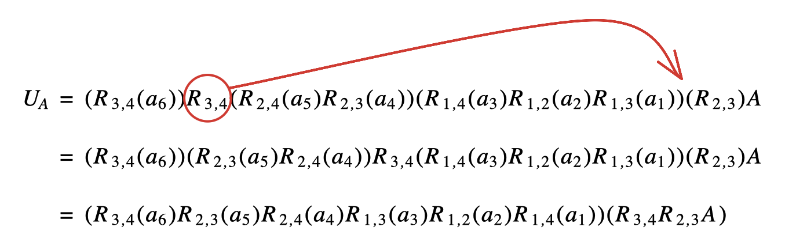

행렬곱을 행벡터와 열벡터의 결합으로 이해하면, 가우스 소거법도 단순한 계산 절차가 아니라 행렬을 곱해 변형하는 과정으로 볼 수 있다.

이 글에서는 가우스-조르당 소거법과 역행렬의 관계, 그리고 LU 분해가 어떤 정보를 나누어 담는지를 정리한다.

이전 글에서는 벡터의 선형결합, 내적과 외적, 행렬곱을 바라보는 여러 관점을 정리했다.

- [선형대수 - 벡터와 행렬곱을 보는 여러 관점](/posts/la-vector-matrix)

## 1. 가우스-조르당 소거법과 역행렬

$A X_{3 \times 3} = I$를 만족하는 $X$를 찾는 과정이라고 생각할 수 있다. 즉, A의 오른쪽에 붙였을 때 단위행렬이 나오게 만드는 행렬이 $A^{-1}$이다.

 

## 2. LU 분해(factorization)

먼저 LU는 각각 lower, upper를 의미한다. 즉, 하삼각행렬 $\times$ 상삼각행렬 꼴을 의미한다. 하삼각행렬은 주대각선 위가 모두 0인 행렬이고, 상삼각행렬은 주대각선 아래가 모두 0인 행렬이다. 
LU 분해에서는 `하삼각행렬`이 소거 과정에서 사용한 배수 정보를 담고, `상삼각행렬`은 가우스 소거 결과로 나온 행사다리꼴 정보를 담는다고 이해하면 좋다.

 

> **하삼각행렬 성질** 
a) 하삼각행렬끼리의 곱도 하삼각행렬 
b) 모든 대각성분의 곱이 0이 아닌 하삼각행렬의 역행렬도 하삼각행렬

> **상삼각행렬 성질** 
a) 상삼각행렬끼리의 곱도 상삼각행렬 
b) 모든 대각성분의 곱이 0이 아닌 상삼각행렬의 역행렬도 상삼각행렬

 

LU분해 예시

$$
A = \begin{pmatrix}
1 & 2 & 4\\
3 & 8 & 14\\
2 & 6 & 13
\end{pmatrix}
\to R_{2,3}(-2) R_2( \frac{1}{2}) R_{1,3}(-2) R_{1,2}(-3) A 
= \begin{pmatrix}
1 & 2 & 4\\
0 & 1 & 1\\
0 & 0 & 3
\end{pmatrix}
$$

 

가우스 소거법으로 A를 다음과 같은 형태의 행사다리꼴로 변환시키면 $L_A = R_{2,3}(-2) R_2( \frac{1}{2}) R_{1,3}(-2) R_{1,2}(-3)$이 되고 이때의 상황을 $L_A A = U_A$라고 표현할 수 있다.  
결과적으로 $A = L_A^{-1}U_A$라고 표현할 수 있다. 
그리고 $L_A$의 역행렬 $L_A^{-1}$ = $R_{1,2}(3) R_{1,3}(2) R_2(2) R_{2,3}(2)$이다.

 

정리하면 다음처럼 A = LU형태로 분해된다.

 
$$
A = R_{1,2}(3) R_{1,3}(2) R_2(2) R_{2,3}(2) \begin{pmatrix}
1 & 2 & 4\\
0 & 2 & 2\\
0 & 0 & 3
\end{pmatrix}
=
\begin{pmatrix}
1 & 0 & 0\\
3 & 1 & 0\\
2 & 2 & 1
\end{pmatrix}
\begin{pmatrix}
1 & 2 & 4\\
0 & 2 & 2\\
0 & 0 & 3
\end{pmatrix}
$$

 

### LU 분해가 바로 안 되는 경우

일반적으로 LU 분해가 가능하지만, 행의 순서를 바꿔야 하는 행렬에서는 바로 LU 분해가 되지 않을 수 있다. 
해결 방법은 처음에 행의 순서를 바꾸고 연산을 시작하는 것이다. 이때 순서를 바꾸는 작업과 다른 행 연산 사이의 교환 규칙을 확인해야 한다. 
결론부터 말하면 성립하지만 규칙이 들어간다. 아래는 예시이다.

 

 

결과적으로 $R_{3,4}$ 같은 행교환 연산을 가장 오른쪽으로 옮기는 것이 목표인데, 이때의 규칙은 옮겨지면서 한 블럭 내의 연산에서 문자로 표현한 부분은 그대로 가고 아래 숫자는 왼쪽과 오른쪽이 뒤바뀌는 것이다. 
그리고 이때 $R_{3,4} R_{2,3}$과 같이 $R_{k, l}$들의 곱으로 이루어진 행렬은 치환행렬의 특징을 보인다. 
`치환행렬`이란 각 행 각 열에 1이 한 개씩만 존재하고 나머지가 모두 0인 정사각행렬을 말한다.

 

따라서 적당한 행교환 이후 가우스 소거법을 사용하면, `가역`이라는 조건하에 LU 분해를 구할 수 있다.

## 다음 글

다음 글에서는 행렬식, 치환, 치환행렬, 여인자 전개, 보간다항식을 이어서 정리한다.

- [선형대수 - 행렬식, 치환과 보간다항식](/posts/la-determinant)
