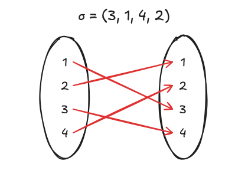
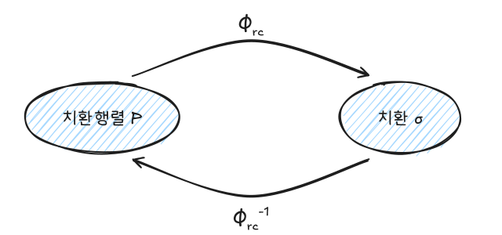
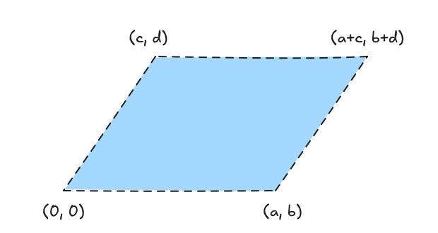
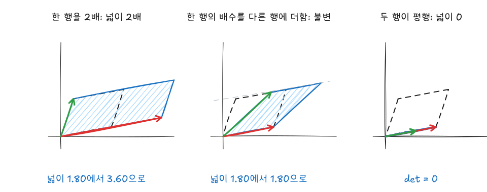
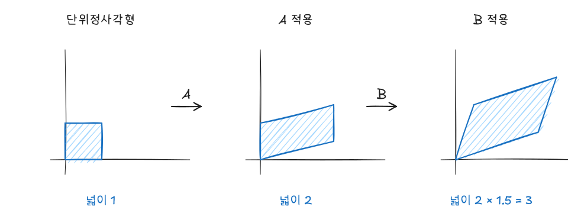
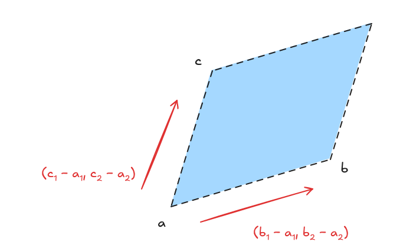
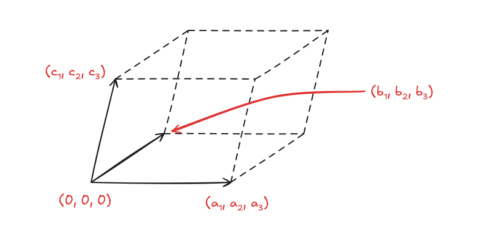

행렬식은 정사각행렬 하나를 숫자 하나로 요약한다. 이 숫자는 역행렬이 존재하는지, 선형변환이 넓이·부피를 몇 배로 바꾸는지를 알려 준다. 이 글은 행렬식의 성질에서 치환을 이용한 정의를 유도하고, 치환행렬, 여인자 전개, 기하학적 의미, 보간다항식까지 정리한다. 각 절에 R과 Python 확인을 붙이고, 통계에서 행렬식이 쓰이는 곳(공선성, 야코비안, 다변량 정규 밀도, QDA)을 적었다.

이전 글: [선형대수 - 가우스 소거법, 역행렬과 LU 분해](/posts/la-gauss-lu)

## 1. 행렬식의 성질

### 정의가 되는 세 성질

행렬식은 다음 세 성질을 만족하는 유일한 함수다. 나머지 성질은 모두 여기서 유도된다.

1. **행에 대해 선형**: 한 행이 합이면 행렬식도 합으로 쪼개지고, 한 행의 상수배는 밖으로 나온다.

$$
\det\begin{pmatrix} a + a' & b + b' \\ c & d \end{pmatrix}
= \det\begin{pmatrix} a & b \\ c & d \end{pmatrix} + \det\begin{pmatrix} a' & b' \\ c & d \end{pmatrix},
\qquad
\det\begin{pmatrix} ka & kb \\ c & d \end{pmatrix} = k\det\begin{pmatrix} a & b \\ c & d \end{pmatrix}
$$

2. **교대성**: 두 행을 바꾸면 부호가 바뀐다.
3. **정규화**: $\det(\mathbf{I}) = 1$

### 유도되는 성질

| 성질 | 내용 |
|---|---|
| 같은 행 | 두 행이 같으면 $\det = 0$ (바꿔도 같은데 부호가 바뀌어야 하므로) |
| 0인 행 | 한 행이 모두 0이면 $\det = 0$ |
| 행 더하기 | 한 행의 상수배를 다른 행에 더해도 $\det$는 그대로 |
| 상수배 | $\det(k\mathbf{A}) = k^n\det(\mathbf{A})$ ($n$개 행에서 하나씩 나온다) |
| 삼각행렬 | 하삼각·상삼각·대각행렬의 $\det$는 대각 성분의 곱 |
| 가역성 | $\mathbf{A}$가 가역 $\iff \det(\mathbf{A}) \neq 0$ |
| 곱 | $\det(\mathbf{AB}) = \det(\mathbf{A})\det(\mathbf{B})$ |
| 역행렬 | $\det(\mathbf{A}^{-1}) = 1/\det(\mathbf{A})$ |
| 전치 | $\det(\mathbf{A}^T) = \det(\mathbf{A})$. 따라서 행에 대한 성질은 열에도 성립한다 |

가역성은 소거로 보면 바로 보인다. 행 연산은 $\det$를 0이 아닌 수배만 하므로, 소거 결과 $\mathbf{U}$에 0인 행이 생기는지(대각에 0이 있는지)와 $\det = 0$인지가 같은 말이다.

$3 \times 3$ 행렬 두 개로 성질을 확인한다.

```r
A <- matrix(c(2, 1, 0,  1, 3, 1,  0, 1, 4), 3, byrow = TRUE)
B <- matrix(c(1, 2, 0,  0, 1, 1,  1, 0, 1), 3, byrow = TRUE)
det(A); det(B)                      # 18, 3
det(A %*% B); det(A) * det(B)       # 54, 54
det(3 * A); 3^3 * det(A)            # 486, 486 (k^n)
det(t(A)); det(solve(A)) * det(A)   # 18, 1
A2 <- A; A2[2, ] <- A2[2, ] - 0.5 * A2[1, ]   # 1행의 상수배를 2행에 더하기
det(A2)                             # 18, 그대로

set.seed(1); x1 <- rnorm(20)
X <- cbind(1, x1, 2 * x1)           # 3열 = 2 * 2열 (완전공선성)
det(crossprod(X))                   # 0
```

```python
import numpy as np

A = np.array([[2, 1, 0], [1, 3, 1], [0, 1, 4]], dtype=float)
B = np.array([[1, 2, 0], [0, 1, 1], [1, 0, 1]], dtype=float)
np.linalg.det(A @ B), np.linalg.det(A) * np.linalg.det(B)   # 54, 54
np.linalg.det(3 * A), 3**3 * np.linalg.det(A)                # 486, 486
```

$\det\mathbf{A} = 18$, $\det\mathbf{B} = 3$이고 $\det(\mathbf{AB}) = 54 = 18 \times 3$이다. 3배 한 행렬은 $3^3 = 27$배인 486이 되며, 행 더하기는 값을 바꾸지 않는다.

**통계에서의 쓰임:** 가역성 판정이 곧 **완전공선성** 판정이다. 설계행렬 $\mathbf{X}$의 열이 일차종속이면 $\det(\mathbf{X}^T\mathbf{X}) = 0$이라 정규방정식의 해가 유일하지 않다. 같은 열을 2배 한 열을 추가한 $\mathbf{X}$로 `det(crossprod(X))`를 계산하면 0이 나온다. 또 공분산 행렬의 행렬식 $\det\boldsymbol\Sigma$를 **일반화 분산**이라 하며, 변수들이 흩어진 정도를 부피로 요약한다. 다음 6절 끝에서 이 값이 밀도에 들어가는 모습을 본다.

## 2. 성질만으로 행렬식 공식 유도하기

$3 \times 3$에서 1행을 선형성으로 쪼개면

$$
\det\mathbf{A}
= {\color{red}a_{11}}\det\begin{pmatrix} 1 & 0 & 0 \\ a_{21} & a_{22} & a_{23} \\ a_{31} & a_{32} & a_{33} \end{pmatrix}
+ {\color{red}a_{12}}\det\begin{pmatrix} 0 & 1 & 0 \\ \cdots \end{pmatrix}
+ {\color{red}a_{13}}\det\begin{pmatrix} 0 & 0 & 1 \\ \cdots \end{pmatrix}
$$

각 항의 2행, 3행도 같은 방식으로 쪼갠다. 이때 **1이 같은 열에 두 번 오는 항은 같은 행이 생겨 0**이 된다. 따라서 살아남는 항은 각 행과 각 열에 1이 하나씩 있는 경우뿐이다. 예를 들어 $a_{11}$에서 시작하면

$$
{\color{red}a_{11}}{\color{blue}a_{22}}a_{33}\det\begin{pmatrix} 1 & 0 & 0 \\ 0 & 1 & 0 \\ 0 & 0 & 1 \end{pmatrix} = a_{11}a_{22}a_{33},
\qquad
{\color{red}a_{11}}{\color{blue}a_{23}}a_{32}\det\begin{pmatrix} 1 & 0 & 0 \\ 0 & 0 & 1 \\ 0 & 1 & 0 \end{pmatrix} = -a_{11}a_{23}a_{32}
$$

두 번째 항은 2행과 3행을 한 번 바꿔야 $\mathbf{I}$가 되므로 $-1$이 붙는다. 살아남는 항은 "각 행에서 서로 다른 열을 하나씩 고르는 방법"마다 하나이므로 $n!$개이고, 부호는 단위행렬로 돌아가는 데 필요한 행교환 횟수의 짝홀로 정해진다. 이를 치환으로 쓰면

$$
\det(\mathbf{A}) = \sum_{\sigma \in S_n} \operatorname{sgn}(\sigma)\, a_{1\sigma(1)}\, a_{2\sigma(2)} \cdots a_{n\sigma(n)}
$$

$\sigma(i)$는 $i$행에서 고른 열 번호다.

## 3. 치환

### 정의

**치환**은 $\{1, \dots, n\}$에서 자기 자신으로 가는 전단사함수이고, 전체 집합을 $S_n$, 그 개수를 $|S_n| = n!$로 쓴다. $\sigma = (\sigma(1), \dots, \sigma(n))$처럼 함숫값을 나열해 표기한다.



- **역치환**: 화살표를 거꾸로 읽는다. $\sigma = (3, 1, 4, 2)$이면 $\sigma^{-1} = (2, 4, 1, 3)$이다.
- **호환** $\tau_{i,j}$: $i$와 $j$만 맞바꾸고 나머지는 그대로 두는 치환
- **반전**: $i < j$인데 $\sigma(i) > \sigma(j)$인 쌍. $(3, 2, 4, 1)$의 반전은 $(3,2), (3,1), (2,1), (4,1)$로 4개다.

### 호환의 합성으로 나타내기

반전을 하나씩 없애도록 값을 맞바꾸면 항등치환이 된다.

$$
(3, 2, 4, 1) \xrightarrow{\tau_{1,4}} (3, 2, 1, 4) \xrightarrow{\tau_{1,2}} (3, 1, 2, 4) \xrightarrow{\tau_{1,3}} (1, 3, 2, 4) \xrightarrow{\tau_{2,3}} (1, 2, 3, 4)
$$

$$
\tau_{2,3} \circ \tau_{1,3} \circ \tau_{1,2} \circ \tau_{1,4} \circ \sigma = \mathrm{id}
$$

### 부호

같은 치환을 호환으로 나타내는 방법은 여러 가지지만, **사용한 호환 개수의 짝홀은 항상 같다**. 그래서 부호를 정의할 수 있다.

$$
\operatorname{sgn}(\sigma) =
\begin{cases}
+1 & \text{짝치환 (반전 개수가 짝수)} \\
-1 & \text{홀치환 (반전 개수가 홀수)}
\end{cases}
$$

- $\operatorname{sgn}(\sigma^{-1}) = \operatorname{sgn}(\sigma)$
- 호환을 하나 합성하면 부호가 바뀐다: $\operatorname{sgn}(\tau_{i,j} \circ \sigma) = -\operatorname{sgn}(\sigma)$
- $n \ge 2$이면 짝치환과 홀치환이 각각 $n!/2$개다.

## 4. 치환행렬

**치환행렬**은 각 행과 각 열에 1이 정확히 하나 있고 나머지가 0인 정사각행렬이다. 치환행렬 $\mathbf{P}$에서 두 가지 치환을 읽을 수 있다.

- $\sigma_{rc} = \Phi_{rc}(\mathbf{P})$: $i$행의 1이 있는 **열** 번호를 나열
- $\sigma_{cr} = \Phi_{cr}(\mathbf{P})$: $j$열의 1이 있는 **행** 번호를 나열

$$
\mathbf{P} = \begin{pmatrix} 0 & 0 & 1 & 0 \\ 1 & 0 & 0 & 0 \\ 0 & 0 & 0 & 1 \\ 0 & 1 & 0 & 0 \end{pmatrix}
\quad\Rightarrow\quad
\Phi_{rc}(\mathbf{P}) = (3, 1, 4, 2), \qquad \Phi_{cr}(\mathbf{P}) = (2, 4, 1, 3)
$$

$\Phi_{rc}$는 치환행렬과 치환 사이의 일대일대응이다.



### 성질

| 성질 | 식 |
|---|---|
| 두 치환은 서로 역치환 | $\Phi_{cr}(\mathbf{P}) = \Phi_{rc}(\mathbf{P})^{-1}$ |
| 대응하는 두 행렬은 서로 전치 | $\Phi_{cr}^{-1}(\sigma) = \big(\Phi_{rc}^{-1}(\sigma)\big)^T$ |
| 곱은 순서가 뒤집힌 합성 | $\Phi_{rc}(\mathbf{PQ}) = \Phi_{rc}(\mathbf{Q}) \circ \Phi_{rc}(\mathbf{P})$, $\Phi_{cr}(\mathbf{PQ}) = \Phi_{cr}(\mathbf{P}) \circ \Phi_{cr}(\mathbf{Q})$ |
| 호환 ↔ 행교환 | $\Phi_{rc}^{-1}(\tau_{i,j}) = R_{i,j}$ |
| 역행렬 | 치환행렬은 항상 가역이고 $\mathbf{P}^{-1} = \mathbf{P}^T$ |

### 행렬식 = 치환의 부호

치환을 $k$개의 호환으로 쓸 수 있으면, 치환행렬은 $k$개의 행교환 행렬 $R_{i,j}$의 곱이다. 예를 들어

$$
\mathbf{P} = \begin{pmatrix} 0 & 0 & 0 & 1 \\ 0 & 1 & 0 & 0 \\ 1 & 0 & 0 & 0 \\ 0 & 0 & 1 & 0 \end{pmatrix},
\qquad
\Phi_{rc}(\mathbf{P}) = (4, 2, 1, 3) = \tau_{1,2} \circ \tau_{1,4} \circ \tau_{2,4} \circ \tau_{3,4}
$$

이므로 (곱은 합성 순서가 뒤집힌다)

$$
\mathbf{P} = R_{3,4}\,R_{2,4}\,R_{1,4}\,R_{1,2},
\qquad
\det(\mathbf{P}) = (-1)^4 = 1
$$

행교환 하나마다 $\det$에 $-1$이 곱해지므로 일반적으로

$$
\det(\mathbf{P}) = \operatorname{sgn}\big(\Phi_{rc}(\mathbf{P})\big)
$$

이것이 2절의 행렬식 공식에 $\operatorname{sgn}(\sigma)$가 붙는 이유다.

위 $\mathbf{P}$로 확인한다. 반전 개수를 세면 $(4, 2, 1, 3)$은 4개($4>2, 4>1, 4>3, 2>1$)로 짝치환이다.

```r
P <- matrix(c(0,0,0,1,  0,1,0,0,  1,0,0,0,  0,0,1,0), 4, byrow = TRUE)
apply(P, 1, which.max)                 # Φ_rc(P) = 4 2 1 3
det(P)                                 # 1 = (-1)^4
R <- function(i, j, n = 4) { M <- diag(n); M[c(i, j), ] <- M[c(j, i), ]; M }   # 행교환 행렬
all(R(3,4) %*% R(2,4) %*% R(1,4) %*% R(1,2) == P)   # TRUE
all.equal(solve(P), t(P))              # TRUE: P^{-1} = P^T
```

```python
P = np.array([[0,0,0,1],[0,1,0,0],[1,0,0,0],[0,0,1,0]], dtype=float)
np.linalg.det(P)                       # 1.0
np.allclose(np.linalg.inv(P), P.T)     # True
```

## 5. 여인자 전개와 수반행렬

### 정의

- **소행렬식** $M_{i,j}$: $\mathbf{A}$에서 $i$행과 $j$열을 지운 행렬의 행렬식
- **여인자** $C_{i,j} = (-1)^{i+j}M_{i,j}$: 위치에 따른 부호(체스판 무늬)를 붙인 소행렬식

$3 \times 3$에서 예를 들면

$$
M_{3,1} = \det\begin{pmatrix} a_{12} & a_{13} \\ a_{22} & a_{23} \end{pmatrix},
\qquad
C_{3,1} = (-1)^{3+1}M_{3,1} = M_{3,1}
$$

### 여인자 전개

임의의 $i$행(또는 $j$열)을 따라

$$
\det(\mathbf{A}) = \sum_{k=1}^{n} a_{ik}\,C_{i,k} = \sum_{k=1}^{n} a_{kj}\,C_{k,j}
$$

0이 많은 행이나 열을 골라 전개하면 계산이 줄어든다.

### 수반행렬과 역행렬

여인자를 모은 행렬을 전치한 것이 **수반행렬**이다.

$$
\operatorname{adj}(\mathbf{A}) = \big(C_{i,j}\big)^T =
\begin{pmatrix}
C_{1,1} & C_{2,1} & \cdots & C_{n,1} \\
\vdots & \vdots & \ddots & \vdots \\
C_{1,n} & C_{2,n} & \cdots & C_{n,n}
\end{pmatrix}
$$

$\mathbf{A}\operatorname{adj}(\mathbf{A})$의 $(i, i)$ 성분은 $i$행 여인자 전개라서 $\det\mathbf{A}$이다. $(i, j)$ 성분($i \neq j$)은 $j$행을 $i$행으로 바꾼 행렬, 즉 같은 행이 두 개인 행렬의 전개라서 0이다. 따라서

$$
\mathbf{A}\operatorname{adj}(\mathbf{A}) = \det(\mathbf{A})\,\mathbf{I}
\quad\Rightarrow\quad
\mathbf{A}^{-1} = \frac{1}{\det(\mathbf{A})}\operatorname{adj}(\mathbf{A})
$$

$2 \times 2$에서는 익숙한 공식 $\begin{pmatrix} a & b \\ c & d \end{pmatrix}^{-1} = \dfrac{1}{ad - bc}\begin{pmatrix} d & -b \\ -c & a \end{pmatrix}$가 된다.

### 크래머 공식

$\mathbf{A}$가 가역이면 $\mathbf{Ax} = \mathbf{b}$의 해는

$$
x_i = \frac{\det(\mathbf{A}_i)}{\det(\mathbf{A})}, \qquad \mathbf{A}_i = \mathbf{A}\text{의 } i\text{번째 열을 } \mathbf{b}\text{로 바꾼 행렬}
$$

$\mathbf{x} = \mathbf{A}^{-1}\mathbf{b} = \frac{1}{\det\mathbf{A}}\operatorname{adj}(\mathbf{A})\mathbf{b}$의 $i$번째 성분 $\sum_k C_{k,i}b_k$가 $\mathbf{A}_i$를 $i$열로 여인자 전개한 값과 같아서 나온다.

예를 들어 $2x + y = 5$, $x + y = 3$이면 $\det\mathbf{A} = 1$이고

$$
x = \det\begin{pmatrix} 5 & 1 \\ 3 & 1 \end{pmatrix} = 2,
\qquad
y = \det\begin{pmatrix} 2 & 5 \\ 1 & 3 \end{pmatrix} = 1
$$

행렬식을 $n + 1$번 계산해야 하므로 큰 계산에는 소거법을 쓰고, 해를 식으로 나타내거나 성분 하나만 필요할 때 쓴다.

앞의 $3 \times 3$ 행렬 $\mathbf{A}$로 수반행렬 공식과 크래머 공식을 확인한다. 여인자 전개를 재귀로 옮기면 정의가 그대로 코드가 된다.

```r
b <- c(1, 2, 3)
cof_det <- function(M) {                 # 1행 여인자 전개
  if (nrow(M) == 1) return(M[1, 1])
  sum(sapply(1:ncol(M), function(j) (-1)^(1 + j) * M[1, j] * cof_det(M[-1, -j, drop = FALSE])))
}
cof_det(A)                               # 18
adj <- function(M) {
  n <- nrow(M); C <- matrix(0, n, n)
  for (i in 1:n) for (j in 1:n) C[i, j] <- (-1)^(i + j) * det(M[-i, -j, drop = FALSE])
  t(C)                                   # 여인자 행렬의 전치
}
adj(A)                                   # [[11,-4,1],[-4,8,-2],[1,-2,5]]
all.equal(solve(A), adj(A) / det(A))     # TRUE
sapply(1:3, function(i) { Ai <- A; Ai[, i] <- b; det(Ai) / det(A) })   # 1/3 1/3 2/3
solve(A, b)                              # 같은 해
```

```python
Ai = lambda i: np.column_stack([b if j == i else A[:, j] for j in range(3)])
b = np.array([1, 2, 3], dtype=float)
[np.linalg.det(Ai(i)) / np.linalg.det(A) for i in range(3)]   # [1/3, 1/3, 2/3]
np.linalg.solve(A, b)                                          # 같은 해
```

`adj(A)`를 $\det\mathbf{A}=18$로 나눈 것이 `solve(A)`와 같고, 크래머 공식의 세 값 $(1/3,\ 1/3,\ 2/3)$이 `solve(A, b)`와 일치한다.

## 6. 행렬식의 기하학적 의미

$\lvert\det\rvert$는 행벡터(또는 열벡터)가 만드는 평행사변형의 넓이, 평행육면체의 부피다. 부호는 방향(오른손·왼손)을 나타낸다.

### 원점에서 시작하는 평행사변형



$$
\text{넓이} = \left|\det\begin{pmatrix} a & b \\ c & d \end{pmatrix}\right| = |ad - bc|
$$

### 성질의 기하적 의미

1절의 성질은 넓이의 성질로 읽을 수 있다. 두 행 $\mathbf{r}_1 = (1.6, 0.3)$, $\mathbf{r}_2 = (0.4, 1.2)$가 만드는 평행사변형(점선, 넓이 1.80)에 각 연산을 적용한다.



한 행을 2배 하면 밑변이 2배가 되어 넓이도 2배다(행에 대한 선형성). 한 행의 상수배를 다른 행에 더하면 평행사변형이 $\mathbf{r}_1$ 방향으로 밀릴 뿐 밑변과 높이가 그대로이므로 넓이가 같다(전단). 두 행이 평행하면 평행사변형이 선분으로 납작해져 넓이가 0이고, 이것이 $\det = 0 \iff$ 행들이 일차종속이라는 성질이다. 두 행을 바꾸면 넓이는 같고 두 변을 도는 방향(시계·반시계)만 뒤집히므로 부호가 바뀐다.

행렬식이 넓이의 배율이라는 관점에서는 곱셈 공식도 자연스럽다. $\mathbf{A}$가 넓이를 2배, $\mathbf{B}$가 1.5배 하면, 연달아 적용한 $\mathbf{BA}$는 넓이를 3배 한다.



$$
\mathbf{A} = \begin{pmatrix} 2 & 0 \\ 0.5 & 1 \end{pmatrix},\quad
\mathbf{B} = \begin{pmatrix} 1 & 0.5 \\ 0 & 1.5 \end{pmatrix},\qquad
\det(\mathbf{BA}) = \det(\mathbf{B})\det(\mathbf{A}) = 1.5 \times 2 = 3
$$

같은 이유로 $\det(\mathbf{A}^{-1}) = 1/\det(\mathbf{A})$는 넓이를 되돌리는 배율이다.

### 세 점으로 정해지는 평행사변형



$\mathbf{a}$를 원점으로 옮기면 두 변이 $\mathbf{b} - \mathbf{a}$, $\mathbf{c} - \mathbf{a}$가 된다.

$$
\text{넓이} =
\left|\det\begin{pmatrix} b_1 - a_1 & b_2 - a_2 \\ c_1 - a_1 & c_2 - a_2 \end{pmatrix}\right|
=
\left|\det\begin{pmatrix} 1 & a_1 & a_2 \\ 1 & b_1 & b_2 \\ 1 & c_1 & c_2 \end{pmatrix}\right|
$$

오른쪽 식은 2, 3행에서 1행을 빼고 1열로 전개하면 왼쪽과 같아진다. 세 점이 만드는 **삼각형** 넓이는 이 값의 절반이다.

### 평행육면체



$$
\text{부피} = \left|\det\begin{pmatrix} a_1 & a_2 & a_3 \\ b_1 & b_2 & b_3 \\ c_1 & c_2 & c_3 \end{pmatrix}\right|
= |(\mathbf{a} \times \mathbf{b}) \cdot \mathbf{c}|
$$

$(\mathbf{a} \times \mathbf{b}) \cdot \mathbf{c}$를 **스칼라 삼중적**이라 한다. 밑면 넓이 $\lVert\mathbf{a} \times \mathbf{b}\rVert$에 높이를 곱한 것과 같다.

### 통계에서의 쓰임: 야코비안, 다변량 정규 밀도, QDA

**변수 변환의 야코비안.** 비선형 변환도 한 점 근처에서는 선형이고, 그 선형 근사(야코비 행렬)의 $\lvert\det\rvert$가 그 점에서 넓이가 늘어나는 배율이다. 변수를 $\mathbf{y} = g(\mathbf{x})$로 바꿀 때 밀도는 $f_{\mathbf{Y}}(\mathbf{y}) = f_{\mathbf{X}}(\mathbf{x})\,\lvert\det\mathbf{J}\rvert^{-1}$ 꼴로 이 배율만큼 보정된다. 극좌표 $(x, y) = (r\cos\theta,\ r\sin\theta)$에서는

$$
\mathbf{J} = \begin{pmatrix} \cos\theta & -r\sin\theta \\ \sin\theta & r\cos\theta \end{pmatrix},
\qquad \det\mathbf{J} = r\cos^2\theta + r\sin^2\theta = r
$$

이라서 $dx\,dy = r\,dr\,d\theta$이다.

**다변량 정규 밀도.** $\mathbf{x} \sim N_p(\boldsymbol\mu, \boldsymbol\Sigma)$의 밀도는

$$
f(\mathbf{x}) = \frac{1}{\sqrt{(2\pi)^p\,\det\boldsymbol\Sigma}}\exp\!\Big(-\tfrac12(\mathbf{x}-\boldsymbol\mu)^T\boldsymbol\Sigma^{-1}(\mathbf{x}-\boldsymbol\mu)\Big)
$$

이고, $\det\boldsymbol\Sigma$는 정규화 상수로 들어간다. 분포가 퍼질수록 $\sqrt{\det\boldsymbol\Sigma}$가 커져 밀도의 높이가 낮아진다.

**QDA.** 판별분석은 집단 $k$의 판별 점수를 계산한다. 집단마다 공분산 $\boldsymbol\Sigma_k$가 다르면(QDA)

$$
\delta_k(\mathbf{x}) = -\tfrac12\log\det\boldsymbol\Sigma_k - \tfrac12(\mathbf{x}-\boldsymbol\mu_k)^T\boldsymbol\Sigma_k^{-1}(\mathbf{x}-\boldsymbol\mu_k) + \log\pi_k
$$

이므로 $\log\det\boldsymbol\Sigma_k$가 집단별로 달라 경계가 곡선이 된다. 공분산이 같으면(LDA) 이 항이 모든 집단에 공통이라 사라진다. 행렬식은 곱 때문에 값이 매우 크거나 작아지기 쉬워, 실제 계산에서는 `determinant(S, logarithm = TRUE)`처럼 로그를 직접 구한다.

```r
f <- function(p) c(p[1] * cos(p[2]), p[1] * sin(p[2]))
p <- c(2, pi / 6); h <- 1e-6
J <- sapply(1:2, function(k) { e <- c(0, 0); e[k] <- h; (f(p + e) - f(p - e)) / (2 * h) })
det(J)                                   # 2 = r

Sigma <- matrix(c(4, 2, 2, 3), 2); mu <- c(1, 2); x <- c(2, 1)
det(Sigma)                               # 8
q <- drop(t(x - mu) %*% solve(Sigma) %*% (x - mu))   # 1.375
exp(-q / 2) / sqrt((2 * pi)^2 * det(Sigma))          # 0.0283
determinant(Sigma, logarithm = TRUE)$modulus[1]      # 2.079 = log 8

g <- split(iris[, 1:4], iris$Species)
sapply(g, function(d) log(det(cov(d))))  # QDA의 log|Σ_k|
```

```python
f = lambda p: np.array([p[0]*np.cos(p[1]), p[0]*np.sin(p[1])])
p, h = np.array([2, np.pi/6]), 1e-6
J = np.column_stack([(f(p + h*e) - f(p - h*e)) / (2*h) for e in np.eye(2)])
np.linalg.det(J)                         # 2.0

Sigma = np.array([[4, 2], [2, 3]], dtype=float)
sign, logdet = np.linalg.slogdet(Sigma)  # log|Σ| = 2.079
```

수치 미분으로 구한 야코비 행렬의 행렬식이 $2 = r$이고, $\boldsymbol\Sigma$의 $\det = 8$, $\log\det = 2.079$이다. $\mathbf{x} = (2, 1)$에서 마할라노비스 제곱거리 1.375를 넣으면 밀도 0.0283이 나온다. iris의 세 종에서 `log(det(cov))`는 setosa $-13.07$, versicolor $-10.87$, virginica $-8.93$으로 종마다 크게 달라, LDA의 등공분산 가정을 의심해 볼 만한 차이다.

## 7. 보간다항식

서로 다른 $x_0, \dots, x_n$에서 $n + 1$개의 점 $(x_i, y_i)$를 지나는 $n$차 이하 다항식은 **유일하게** 존재한다. 이를 **보간다항식**이라 한다.

### 반데르몽드 행렬로 계수 구하기

$f(x) = a_0 + a_1x + \cdots + a_nx^n$에 각 점을 대입하면 연립방정식이 된다.

$$
\underbrace{\begin{pmatrix}
1 & x_0 & x_0^2 & \cdots & x_0^n \\
1 & x_1 & x_1^2 & \cdots & x_1^n \\
\vdots & \vdots & \vdots & \ddots & \vdots \\
1 & x_n & x_n^2 & \cdots & x_n^n
\end{pmatrix}}_{\mathbf{V}\;(\text{반데르몽드 행렬})}
\begin{pmatrix} a_0 \\ a_1 \\ \vdots \\ a_n \end{pmatrix}
=
\begin{pmatrix} y_0 \\ y_1 \\ \vdots \\ y_n \end{pmatrix}
$$

$$
\det(\mathbf{V}) = \prod_{0 \le i < j \le n}(x_j - x_i)
$$

$x_i$가 서로 다르면 $\det\mathbf{V} \neq 0$이므로 $\mathbf{V}$가 가역이고, 계수가 $\mathbf{a} = \mathbf{V}^{-1}\mathbf{y}$로 유일하게 정해진다.

### 라그랑주 보간다항식

같은 다항식을 계수를 구하지 않고 바로 쓰는 방법이다.

$$
L(x) = \sum_{i=0}^{n} y_i\,\ell_i(x),
\qquad
\ell_i(x) = \prod_{j \neq i}\frac{x - x_j}{x_i - x_j}
$$

$\ell_i(x_i) = 1$이고 $j \neq i$에서 $\ell_i(x_j) = 0$이라서 $L(x_i) = y_i$가 바로 성립한다. 보간다항식이 유일하므로 반데르몽드 방식과 **같은 다항식**이며, 표현하는 기저(단항식 $x^k$ vs. $\ell_i$)만 다르다.

네 점 $(1, 1), (2, 3), (4, 2), (7, 5)$를 지나는 3차 다항식으로 확인한다.

```r
x <- c(1, 2, 4, 7); y <- c(1, 3, 2, 5)
V <- outer(x, 0:3, `^`)                  # 반데르몽드 행렬
det(V)                                   # 540
prod(outer(x, x, function(a, b) b - a)[upper.tri(diag(4))])   # 540: ∏(x_j - x_i)
a <- solve(V, y)                         # 계수 a0..a3
a                                        # -4.178  7.144  -2.156  0.189
L <- function(t) sum(sapply(1:4, function(i) y[i] * prod((t - x[-i]) / (x[i] - x[-i]))))
L(3); sum(a * 3^(0:3))                   # 2.956, 2.956: 같은 다항식
```

```python
x = np.array([1, 2, 4, 7]); y = np.array([1, 3, 2, 5], dtype=float)
V = np.vander(x, increasing=True)        # 열: 1, x, x^2, x^3
np.linalg.det(V)                         # 540.0
np.linalg.solve(V, y)                    # [-4.178, 7.144, -2.156, 0.189]
```

$\det\mathbf{V} = 540 = (2-1)(4-1)(7-1)(4-2)(7-2)(7-4)$이다. 두 방법이 $x = 3$에서 모두 2.956을 주어 같은 다항식임이 확인된다.

**통계에서의 쓰임:** 반데르몽드 행렬은 **다항회귀의 설계행렬** $\mathbf{X}$ 그 자체다. 서로 다른 $x$가 $n + 1$개이고 $n$차 다항식을 쓰면 $\mathbf{X}$가 정사각 가역행렬이라 모든 점을 정확히 지나는 해(보간)가 유일하게 나오며, 이는 잔차가 0인 과적합 모형이다. 관측이 모형의 모수보다 많을 때 비로소 최소제곱이 의미를 가진다. 또 $x$ 값이 서로 가까우면 $\det\mathbf{V}$가 0에 가까워져 계수가 불안정해지는데, 고차 다항회귀에서 `poly()`로 직교다항식을 쓰는 이유가 이것이다.

## 비교

**행렬식 계산법.** 같은 값을 세 방법으로 구할 수 있다.

| 방법 | 근거 | 비용 | 쓰임 |
|---|---|---|---|
| 소거 | 행 연산 후 대각 성분의 곱 (LU) | $\approx\tfrac23n^3$ | 실제 계산 (`det()`) |
| 여인자 전개 | 행·열을 따라 재귀 | $O(n!)$ | 0이 많은 행렬, 기호 계산, 이론 |
| 치환 공식 | $\sum_\sigma\operatorname{sgn}(\sigma)\prod a_{i\sigma(i)}$ | $n!$개 항 | 정의, 증명 |

항의 수 $n!$은 $n=10$이면 3,628,800이므로 손으로나 컴퓨터로나 큰 $n$에는 소거만 쓴다.

**크래머 공식과 소거.** 크래머는 행렬식을 $n+1$번 계산하므로 소거보다 훨씬 비싸다. 해를 $x_i = \det\mathbf{A}_i/\det\mathbf{A}$ 식으로 쓰거나 성분 하나만 필요할 때만 쓴다.

**라그랑주와 반데르몽드 보간.** 둘은 같은 다항식이고 기저만 다르다. 반데르몽드는 계수 $a_k$를 주지만 연립방정식을 풀어야 하고, 라그랑주는 연립방정식 없이 $L(x)$를 바로 쓴다.

## 정리

| 개념 | 핵심 |
|---|---|
| 정의 성질 | 행 선형성, 교대성(행교환 시 부호 반전), $\det\mathbf{I} = 1$ |
| 공식 | $\det\mathbf{A} = \sum_{\sigma \in S_n}\operatorname{sgn}(\sigma)\prod_i a_{i\sigma(i)}$, $n!$개 항 |
| 가역성 | $\det\mathbf{A} \neq 0 \iff$ 가역 |
| 곱·전치·역 | $\det(\mathbf{AB}) = \det\mathbf{A}\det\mathbf{B}$, $\det\mathbf{A}^T = \det\mathbf{A}$, $\det\mathbf{A}^{-1} = 1/\det\mathbf{A}$ |
| 상수배 | $\det(k\mathbf{A}) = k^n\det\mathbf{A}$ |
| 치환 부호 | 반전 개수의 짝홀, 호환 하나마다 부호 반전 |
| 치환행렬 | $\mathbf{P}^{-1} = \mathbf{P}^T$, $\det\mathbf{P} = \operatorname{sgn}(\sigma)$ |
| 여인자 전개 | $\det\mathbf{A} = \sum_k a_{ik}C_{i,k}$, $C_{i,j} = (-1)^{i+j}M_{i,j}$ |
| 역행렬 | $\mathbf{A}^{-1} = \operatorname{adj}(\mathbf{A})/\det\mathbf{A}$ |
| 크래머 공식 | $x_i = \det\mathbf{A}_i / \det\mathbf{A}$, $\mathbf{A}_i$는 $i$열을 $\mathbf{b}$로 교체 |
| 기하 | $\lvert\det\rvert$ = 넓이·부피, 세 점 삼각형은 절반 |
| 보간 | 반데르몽드 $\det = \prod_{i<j}(x_j - x_i)$, 라그랑주는 같은 다항식의 다른 표현 |

## 참고자료

- 하길찬, 『해설이 있는 선형대수학』
- 유호석, 「선형대수학」, 세종대학교, KOCW 공개강의

다음 글: [선형대수 - 벡터공간, 기저와 차원](/posts/la-vector-space)
