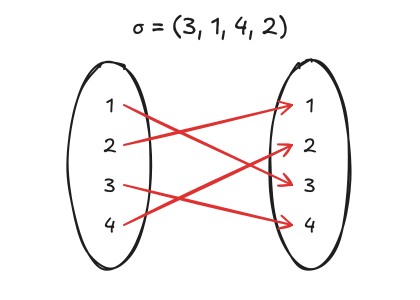
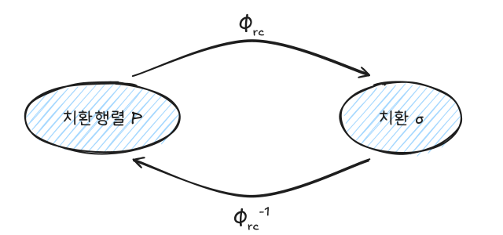
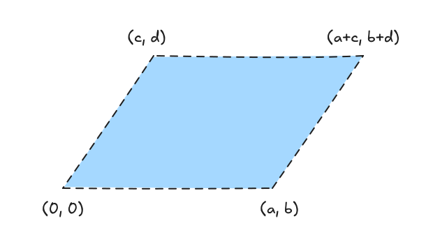
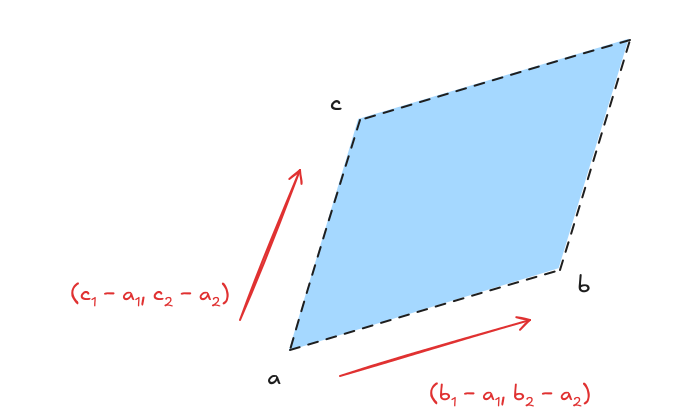
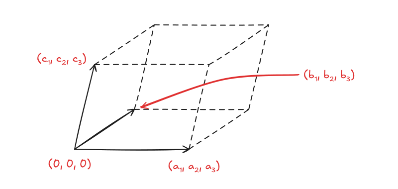

행렬식은 정사각행렬 하나를 숫자 하나로 요약한다. 이 숫자는 역행렬이 존재하는지, 선형변환이 넓이·부피를 몇 배로 바꾸는지를 알려 준다. 이 글은 행렬식의 성질에서 치환을 이용한 정의를 유도하고, 치환행렬, 여인자 전개, 기하학적 의미, 보간다항식까지 정리한다.

이전 글: [선형대수 - 가우스 소거법, 역행렬과 LU 분해](/posts/la-gauss-lu)

## 1. 행렬식의 성질

### 정의가 되는 세 성질

행렬식은 다음 세 성질을 만족하는 유일한 함수다. 나머지 성질은 모두 여기서 유도된다.

1. **행에 대해 선형**: 한 행이 합이면 행렬식도 합으로 쪼개지고, 한 행의 상수배는 밖으로 나온다.

$$
\det\begin{pmatrix} a + a' & b + b' \\ c & d \end{pmatrix}
= \det\begin{pmatrix} a & b \\ c & d \end{pmatrix} + \det\begin{pmatrix} a' & b' \\ c & d \end{pmatrix},
\qquad
\det\begin{pmatrix} ka & kb \\ c & d \end{pmatrix} = k\det\begin{pmatrix} a & b \\ c & d \end{pmatrix}
$$

2. **교대성**: 두 행을 바꾸면 부호가 바뀐다.
3. **정규화**: $\det(\mathbf{I}) = 1$

### 유도되는 성질

| 성질 | 내용 |
|---|---|
| 같은 행 | 두 행이 같으면 $\det = 0$ (바꿔도 같은데 부호가 바뀌어야 하므로) |
| 0인 행 | 한 행이 모두 0이면 $\det = 0$ |
| 행 더하기 | 한 행의 상수배를 다른 행에 더해도 $\det$는 그대로 |
| 상수배 | $\det(k\mathbf{A}) = k^n\det(\mathbf{A})$ ($n$개 행에서 하나씩 나온다) |
| 삼각행렬 | 하삼각·상삼각·대각행렬의 $\det$는 대각 성분의 곱 |
| 가역성 | $\mathbf{A}$가 가역 $\iff \det(\mathbf{A}) \neq 0$ |
| 곱 | $\det(\mathbf{AB}) = \det(\mathbf{A})\det(\mathbf{B})$ |
| 역행렬 | $\det(\mathbf{A}^{-1}) = 1/\det(\mathbf{A})$ |
| 전치 | $\det(\mathbf{A}^T) = \det(\mathbf{A})$. 따라서 행에 대한 성질은 열에도 성립한다 |

가역성은 소거로 보면 바로 보인다. 행 연산은 $\det$를 0이 아닌 수배만 하므로, 소거 결과 $\mathbf{U}$에 0인 행이 생기는지(대각에 0이 있는지)와 $\det = 0$인지가 같은 말이다.

## 2. 성질만으로 행렬식 공식 유도하기

$3 \times 3$에서 1행을 선형성으로 쪼개면

$$
\det\mathbf{A}
= {\color{red}a_{11}}\det\begin{pmatrix} 1 & 0 & 0 \\ a_{21} & a_{22} & a_{23} \\ a_{31} & a_{32} & a_{33} \end{pmatrix}
+ {\color{red}a_{12}}\det\begin{pmatrix} 0 & 1 & 0 \\ \cdots \end{pmatrix}
+ {\color{red}a_{13}}\det\begin{pmatrix} 0 & 0 & 1 \\ \cdots \end{pmatrix}
$$

각 항의 2행, 3행도 같은 방식으로 쪼갠다. 이때 **1이 같은 열에 두 번 오는 항은 같은 행이 생겨 0**이 된다. 따라서 살아남는 항은 각 행과 각 열에 1이 하나씩 있는 경우뿐이다. 예를 들어 $a_{11}$에서 시작하면

$$
{\color{red}a_{11}}{\color{blue}a_{22}}a_{33}\det\begin{pmatrix} 1 & 0 & 0 \\ 0 & 1 & 0 \\ 0 & 0 & 1 \end{pmatrix} = a_{11}a_{22}a_{33},
\qquad
{\color{red}a_{11}}{\color{blue}a_{23}}a_{32}\det\begin{pmatrix} 1 & 0 & 0 \\ 0 & 0 & 1 \\ 0 & 1 & 0 \end{pmatrix} = -a_{11}a_{23}a_{32}
$$

두 번째 항은 2행과 3행을 한 번 바꿔야 $\mathbf{I}$가 되므로 $-1$이 붙는다. 살아남는 항은 "각 행에서 서로 다른 열을 하나씩 고르는 방법"마다 하나이므로 $n!$개이고, 부호는 단위행렬로 돌아가는 데 필요한 행교환 횟수의 짝홀로 정해진다. 이를 치환으로 쓰면

$$
\det(\mathbf{A}) = \sum_{\sigma \in S_n} \operatorname{sgn}(\sigma)\, a_{1\sigma(1)}\, a_{2\sigma(2)} \cdots a_{n\sigma(n)}
$$

$\sigma(i)$는 $i$행에서 고른 열 번호다.

## 3. 치환

### 정의

**치환**은 $\{1, \dots, n\}$에서 자기 자신으로 가는 전단사함수이고, 전체 집합을 $S_n$, 그 개수를 $|S_n| = n!$로 쓴다. $\sigma = (\sigma(1), \dots, \sigma(n))$처럼 함숫값을 나열해 표기한다.

- **역치환**: 화살표를 거꾸로 읽는다. $\sigma = (3, 1, 4, 2)$이면 $\sigma^{-1} = (2, 4, 1, 3)$이다.
- **호환** $\tau_{i,j}$: $i$와 $j$만 맞바꾸고 나머지는 그대로 두는 치환
- **반전**: $i < j$인데 $\sigma(i) > \sigma(j)$인 쌍. $(3, 2, 4, 1)$의 반전은 $(3,2), (3,1), (2,1), (4,1)$로 4개다.

### 호환의 합성으로 나타내기

반전을 하나씩 없애도록 값을 맞바꾸면 항등치환이 된다.

$$
(3, 2, 4, 1) \xrightarrow{\tau_{1,4}} (3, 2, 1, 4) \xrightarrow{\tau_{1,2}} (3, 1, 2, 4) \xrightarrow{\tau_{1,3}} (1, 3, 2, 4) \xrightarrow{\tau_{2,3}} (1, 2, 3, 4)
$$

$$
\tau_{2,3} \circ \tau_{1,3} \circ \tau_{1,2} \circ \tau_{1,4} \circ \sigma = \mathrm{id}
$$

### 부호

같은 치환을 호환으로 나타내는 방법은 여러 가지지만, **사용한 호환 개수의 짝홀은 항상 같다**. 그래서 부호를 정의할 수 있다.

$$
\operatorname{sgn}(\sigma) =
\begin{cases}
+1 & \text{짝치환 (반전 개수가 짝수)} \\
-1 & \text{홀치환 (반전 개수가 홀수)}
\end{cases}
$$

- $\operatorname{sgn}(\sigma^{-1}) = \operatorname{sgn}(\sigma)$
- 호환을 하나 합성하면 부호가 바뀐다: $\operatorname{sgn}(\tau_{i,j} \circ \sigma) = -\operatorname{sgn}(\sigma)$
- $n \ge 2$이면 짝치환과 홀치환이 각각 $n!/2$개다.

## 4. 치환행렬

**치환행렬**은 각 행과 각 열에 1이 정확히 하나 있고 나머지가 0인 정사각행렬이다. 치환행렬 $\mathbf{P}$에서 두 가지 치환을 읽을 수 있다.

- $\sigma_{rc} = \Phi_{rc}(\mathbf{P})$: $i$행의 1이 있는 **열** 번호를 나열
- $\sigma_{cr} = \Phi_{cr}(\mathbf{P})$: $j$열의 1이 있는 **행** 번호를 나열

$$
\mathbf{P} = \begin{pmatrix} 0 & 0 & 1 & 0 \\ 1 & 0 & 0 & 0 \\ 0 & 0 & 0 & 1 \\ 0 & 1 & 0 & 0 \end{pmatrix}
\quad\Rightarrow\quad
\Phi_{rc}(\mathbf{P}) = (3, 1, 4, 2), \qquad \Phi_{cr}(\mathbf{P}) = (2, 4, 1, 3)
$$

$\Phi_{rc}$는 치환행렬과 치환 사이의 일대일대응이다.

### 성질

| 성질 | 식 |
|---|---|
| 두 치환은 서로 역치환 | $\Phi_{cr}(\mathbf{P}) = \Phi_{rc}(\mathbf{P})^{-1}$ |
| 대응하는 두 행렬은 서로 전치 | $\Phi_{cr}^{-1}(\sigma) = \big(\Phi_{rc}^{-1}(\sigma)\big)^T$ |
| 곱은 순서가 뒤집힌 합성 | $\Phi_{rc}(\mathbf{PQ}) = \Phi_{rc}(\mathbf{Q}) \circ \Phi_{rc}(\mathbf{P})$, $\Phi_{cr}(\mathbf{PQ}) = \Phi_{cr}(\mathbf{P}) \circ \Phi_{cr}(\mathbf{Q})$ |
| 호환 ↔ 행교환 | $\Phi_{rc}^{-1}(\tau_{i,j}) = R_{i,j}$ |
| 역행렬 | 치환행렬은 항상 가역이고 $\mathbf{P}^{-1} = \mathbf{P}^T$ |

### 행렬식 = 치환의 부호

치환을 $k$개의 호환으로 쓸 수 있으면, 치환행렬은 $k$개의 행교환 행렬 $R_{i,j}$의 곱이다. 예를 들어

$$
\mathbf{P} = \begin{pmatrix} 0 & 0 & 0 & 1 \\ 0 & 1 & 0 & 0 \\ 1 & 0 & 0 & 0 \\ 0 & 0 & 1 & 0 \end{pmatrix},
\qquad
\Phi_{rc}(\mathbf{P}) = (4, 2, 1, 3) = \tau_{1,2} \circ \tau_{1,4} \circ \tau_{2,4} \circ \tau_{3,4}
$$

이므로 (곱은 합성 순서가 뒤집힌다)

$$
\mathbf{P} = R_{3,4}\,R_{2,4}\,R_{1,4}\,R_{1,2},
\qquad
\det(\mathbf{P}) = (-1)^4 = 1
$$

행교환 하나마다 $\det$에 $-1$이 곱해지므로 일반적으로

$$
\det(\mathbf{P}) = \operatorname{sgn}\big(\Phi_{rc}(\mathbf{P})\big)
$$

이것이 2절의 행렬식 공식에 $\operatorname{sgn}(\sigma)$가 붙는 이유다.

## 5. 여인자 전개와 수반행렬

### 정의

- **소행렬식** $M_{i,j}$: $\mathbf{A}$에서 $i$행과 $j$열을 지운 행렬의 행렬식
- **여인자** $C_{i,j} = (-1)^{i+j}M_{i,j}$: 위치에 따른 부호(체스판 무늬)를 붙인 소행렬식

$3 \times 3$에서 예를 들면

$$
M_{3,1} = \det\begin{pmatrix} a_{12} & a_{13} \\ a_{22} & a_{23} \end{pmatrix},
\qquad
C_{3,1} = (-1)^{3+1}M_{3,1} = M_{3,1}
$$

### 여인자 전개

임의의 $i$행(또는 $j$열)을 따라

$$
\det(\mathbf{A}) = \sum_{k=1}^{n} a_{ik}\,C_{i,k} = \sum_{k=1}^{n} a_{kj}\,C_{k,j}
$$

0이 많은 행이나 열을 골라 전개하면 계산이 줄어든다.

### 수반행렬과 역행렬

여인자를 모은 행렬을 전치한 것이 **수반행렬**이다.

$$
\operatorname{adj}(\mathbf{A}) = \big(C_{i,j}\big)^T =
\begin{pmatrix}
C_{1,1} & C_{2,1} & \cdots & C_{n,1} \\
\vdots & \vdots & \ddots & \vdots \\
C_{1,n} & C_{2,n} & \cdots & C_{n,n}
\end{pmatrix}
$$

$\mathbf{A}\operatorname{adj}(\mathbf{A})$의 $(i, i)$ 성분은 $i$행 여인자 전개라서 $\det\mathbf{A}$이다. $(i, j)$ 성분($i \neq j$)은 $j$행을 $i$행으로 바꾼 행렬, 즉 같은 행이 두 개인 행렬의 전개라서 0이다. 따라서

$$
\mathbf{A}\operatorname{adj}(\mathbf{A}) = \det(\mathbf{A})\,\mathbf{I}
\quad\Rightarrow\quad
\mathbf{A}^{-1} = \frac{1}{\det(\mathbf{A})}\operatorname{adj}(\mathbf{A})
$$

$2 \times 2$에서는 익숙한 공식 $\begin{pmatrix} a & b \\ c & d \end{pmatrix}^{-1} = \dfrac{1}{ad - bc}\begin{pmatrix} d & -b \\ -c & a \end{pmatrix}$가 된다.

## 6. 행렬식의 기하학적 의미

$\lvert\det\rvert$는 행벡터(또는 열벡터)가 만드는 평행사변형의 넓이, 평행육면체의 부피다. 부호는 방향(오른손·왼손)을 나타낸다.

### 원점에서 시작하는 평행사변형

$$
\text{넓이} = \left|\det\begin{pmatrix} a & b \\ c & d \end{pmatrix}\right| = |ad - bc|
$$

### 세 점으로 정해지는 평행사변형

$\mathbf{a}$를 원점으로 옮기면 두 변이 $\mathbf{b} - \mathbf{a}$, $\mathbf{c} - \mathbf{a}$가 된다.

$$
\text{넓이} =
\left|\det\begin{pmatrix} b_1 - a_1 & b_2 - a_2 \\ c_1 - a_1 & c_2 - a_2 \end{pmatrix}\right|
=
\left|\det\begin{pmatrix} 1 & a_1 & a_2 \\ 1 & b_1 & b_2 \\ 1 & c_1 & c_2 \end{pmatrix}\right|
$$

오른쪽 식은 2, 3행에서 1행을 빼고 1열로 전개하면 왼쪽과 같아진다. 세 점이 만드는 **삼각형** 넓이는 이 값의 절반이다.

### 평행육면체

$$
\text{부피} = \left|\det\begin{pmatrix} a_1 & a_2 & a_3 \\ b_1 & b_2 & b_3 \\ c_1 & c_2 & c_3 \end{pmatrix}\right|
= |(\mathbf{a} \times \mathbf{b}) \cdot \mathbf{c}|
$$

$(\mathbf{a} \times \mathbf{b}) \cdot \mathbf{c}$를 **스칼라 삼중적**이라 한다. 밑면 넓이 $\lVert\mathbf{a} \times \mathbf{b}\rVert$에 높이를 곱한 것과 같다.

## 7. 보간다항식

서로 다른 $x_0, \dots, x_n$에서 $n + 1$개의 점 $(x_i, y_i)$를 지나는 $n$차 이하 다항식은 **유일하게** 존재한다. 이를 **보간다항식**이라 한다.

### 반데르몽드 행렬로 계수 구하기

$f(x) = a_0 + a_1x + \cdots + a_nx^n$에 각 점을 대입하면 연립방정식이 된다.

$$
\underbrace{\begin{pmatrix}
1 & x_0 & x_0^2 & \cdots & x_0^n \\
1 & x_1 & x_1^2 & \cdots & x_1^n \\
\vdots & \vdots & \vdots & \ddots & \vdots \\
1 & x_n & x_n^2 & \cdots & x_n^n
\end{pmatrix}}_{\mathbf{V}\;(\text{반데르몽드 행렬})}
\begin{pmatrix} a_0 \\ a_1 \\ \vdots \\ a_n \end{pmatrix}
=
\begin{pmatrix} y_0 \\ y_1 \\ \vdots \\ y_n \end{pmatrix}
$$

$$
\det(\mathbf{V}) = \prod_{0 \le i < j \le n}(x_j - x_i)
$$

$x_i$가 서로 다르면 $\det\mathbf{V} \neq 0$이므로 $\mathbf{V}$가 가역이고, 계수가 $\mathbf{a} = \mathbf{V}^{-1}\mathbf{y}$로 유일하게 정해진다.

### 라그랑주 보간다항식

같은 다항식을 계수를 구하지 않고 바로 쓰는 방법이다.

$$
L(x) = \sum_{i=0}^{n} y_i\,\ell_i(x),
\qquad
\ell_i(x) = \prod_{j \neq i}\frac{x - x_j}{x_i - x_j}
$$

$\ell_i(x_i) = 1$이고 $j \neq i$에서 $\ell_i(x_j) = 0$이라서 $L(x_i) = y_i$가 바로 성립한다. 보간다항식이 유일하므로 반데르몽드 방식과 **같은 다항식**이며, 표현하는 기저(단항식 $x^k$ vs. $\ell_i$)만 다르다.

## 요약

| 개념 | 핵심 |
|---|---|
| 정의 성질 | 행 선형성, 교대성(행교환 시 부호 반전), $\det\mathbf{I} = 1$ |
| 공식 | $\det\mathbf{A} = \sum_{\sigma \in S_n}\operatorname{sgn}(\sigma)\prod_i a_{i\sigma(i)}$, $n!$개 항 |
| 가역성 | $\det\mathbf{A} \neq 0 \iff$ 가역 |
| 곱·전치·역 | $\det(\mathbf{AB}) = \det\mathbf{A}\det\mathbf{B}$, $\det\mathbf{A}^T = \det\mathbf{A}$, $\det\mathbf{A}^{-1} = 1/\det\mathbf{A}$ |
| 상수배 | $\det(k\mathbf{A}) = k^n\det\mathbf{A}$ |
| 치환 부호 | 반전 개수의 짝홀, 호환 하나마다 부호 반전 |
| 치환행렬 | $\mathbf{P}^{-1} = \mathbf{P}^T$, $\det\mathbf{P} = \operatorname{sgn}(\sigma)$ |
| 여인자 전개 | $\det\mathbf{A} = \sum_k a_{ik}C_{i,k}$, $C_{i,j} = (-1)^{i+j}M_{i,j}$ |
| 역행렬 | $\mathbf{A}^{-1} = \operatorname{adj}(\mathbf{A})/\det\mathbf{A}$ |
| 기하 | $\lvert\det\rvert$ = 넓이·부피, 세 점 삼각형은 절반 |
| 보간 | 반데르몽드 $\det = \prod_{i<j}(x_j - x_i)$, 라그랑주는 같은 다항식의 다른 표현 |

다음 글: [선형대수 - 벡터공간, 기저와 차원](/posts/la-vector-space)
