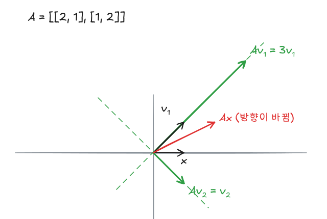
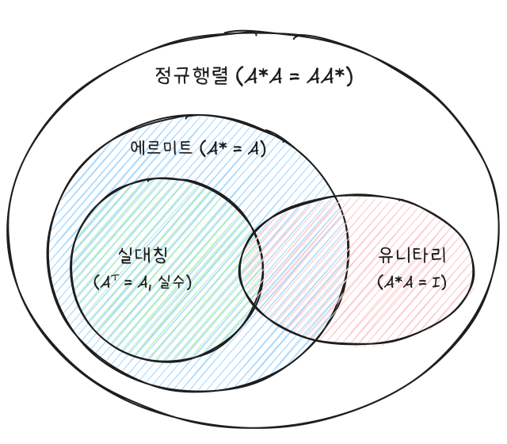

고유벡터는 행렬을 곱해도 방향이 바뀌지 않고 크기만 고유값 배만큼 변하는 벡터다. 고유벡터로 기저를 만들 수 있으면 행렬이 대각행렬로 단순해진다. 이 글은 대각화 조건, 대칭·에르미트·유니타리·정규행렬의 대각화, 스펙트럼 분해, 양의 정부호 판정과 이차형식을 정리한다.

이전 글: [선형대수 - 선형사상과 행렬표현](/posts/la-linear-map)

## 1. 고유값과 고유벡터

### 정의

정사각행렬 $\mathbf{A}$에 대해

$$
\mathbf{A}\mathbf{v} = \lambda\mathbf{v}, \qquad \mathbf{v} \neq \mathbf{0}
$$

을 만족하는 스칼라 $\lambda$를 **고유값**, $\mathbf{v}$를 $\lambda$에 대응하는 **고유벡터**라 한다. $\lambda$에 대응하는 고유벡터와 $\mathbf{0}$을 모은 부분공간을 **고유공간**이라 한다.

$$
E_{\mathbf{A}}(\lambda) = \{\mathbf{v} \mid \mathbf{A}\mathbf{v} = \lambda\mathbf{v}\} = N(\mathbf{A} - \lambda\mathbf{I})
$$



$\mathbf{A} = \begin{pmatrix} 2 & 1 \\ 1 & 2 \end{pmatrix}$에서 $(1, 1)$ 방향은 3배로 늘고 $(1, -1)$ 방향은 그대로 유지된다. 그 밖의 벡터, 예를 들어 $(1, 0)$은 $(2, 1)$로 방향이 바뀐다.

선형사상 $L : V \to V$에서도 $L(\mathbf{v}) = \lambda\mathbf{v}$로 같게 정의하며, 기저 $\mathcal{B}$를 잡으면 $[L]_{\mathcal{B}}[\mathbf{v}]_{\mathcal{B}} = \lambda[\mathbf{v}]_{\mathcal{B}}$로 행렬 문제가 된다. 닮음행렬은 같은 사상이므로 고유값이 같다.

### 특성방정식

$(\mathbf{A} - \lambda\mathbf{I})\mathbf{v} = \mathbf{0}$이 $\mathbf{0}$이 아닌 해를 가지려면 $\mathbf{A} - \lambda\mathbf{I}$가 가역이 아니어야 한다.

$$
\det(\mathbf{A} - \lambda\mathbf{I}) = 0
$$

이를 **특성방정식**이라 한다. 근을 중복도까지 세면(복소수 포함) 항상

$$
\det(\mathbf{A}) = \lambda_1\lambda_2\cdots\lambda_n,
\qquad
\operatorname{tr}(\mathbf{A}) = \lambda_1 + \lambda_2 + \cdots + \lambda_n
$$

이 성립한다. 대각화 가능 여부와 관계없다.

### 예시

$\mathbf{A} = \begin{pmatrix} 5 & -6 \\ 2 & -2 \end{pmatrix}$에 대해

$$
\det\begin{pmatrix} 5 - \lambda & -6 \\ 2 & -2 - \lambda \end{pmatrix}
= \lambda^2 - 3\lambda + 2 = (\lambda - 1)(\lambda - 2) = 0
$$

| 고유값 | $\mathbf{A} - \lambda\mathbf{I}$ | 고유공간 |
|---|---|---|
| $\lambda_1 = 1$ | $\begin{pmatrix} 4 & -6 \\ 2 & -3 \end{pmatrix}$, $2x = 3y$ | $E(1) = \operatorname{span}\{(3, 2)^T\}$ |
| $\lambda_2 = 2$ | $\begin{pmatrix} 3 & -6 \\ 2 & -4 \end{pmatrix}$, $x = 2y$ | $E(2) = \operatorname{span}\{(2, 1)^T\}$ |

확인: $\det\mathbf{A} = -10 + 12 = 2 = 1 \times 2$, $\operatorname{tr}\mathbf{A} = 3 = 1 + 2$.

### 케일리-해밀턴 정리

특성다항식 $p(\lambda) = \det(\lambda\mathbf{I} - \mathbf{A})$에 행렬 자신을 넣으면 영행렬이 된다.

$$
p(\mathbf{A}) = \mathbf{O}
$$

위 예시는 $p(\lambda) = \lambda^2 - 3\lambda + 2$이므로 $\mathbf{A}^2 - 3\mathbf{A} + 2\mathbf{I} = \mathbf{O}$이다. 따라서 $\mathbf{A}^2 = 3\mathbf{A} - 2\mathbf{I}$처럼 높은 거듭제곱을 낮은 차수로 줄일 수 있고, 역행렬도 $\mathbf{A}(3\mathbf{I} - \mathbf{A}) = 2\mathbf{I}$에서 $\mathbf{A}^{-1} = \frac{1}{2}(3\mathbf{I} - \mathbf{A})$처럼 다항식으로 쓸 수 있다.

## 2. 대각화

### 정의와 조건

$\mathbf{P}^{-1}\mathbf{A}\mathbf{P} = \mathbf{D}$(대각행렬)가 되는 가역행렬 $\mathbf{P}$가 있으면 $\mathbf{A}$를 **대각화 가능**하다고 한다. 즉 대각행렬과 닮음이다.

$\mathbf{AP} = \mathbf{PD}$를 열별로 보면 $\mathbf{A}\mathbf{p}_i = \lambda_i\mathbf{p}_i$이다. 따라서

- $\mathbf{P}$의 열 = 고유벡터, $\mathbf{D}$의 대각 = 대응하는 고유값
- $\mathbf{P}$가 가역 = 고유벡터 $n$개가 일차독립

$$
\mathbf{A} \text{ 대각화 가능} \iff \text{고유벡터로 이루어진 } \mathbb{R}^n \text{(또는 } \mathbb{C}^n\text{)의 기저가 존재}
$$

위 예시에서는

$$
\begin{pmatrix} 3 & 2 \\ 2 & 1 \end{pmatrix}^{-1}
\begin{pmatrix} 5 & -6 \\ 2 & -2 \end{pmatrix}
\begin{pmatrix} 3 & 2 \\ 2 & 1 \end{pmatrix}
=
\begin{pmatrix} 1 & 0 \\ 0 & 2 \end{pmatrix}
$$

### 판정에 쓰는 사실

- 서로 다른 고유값에 대응하는 고유벡터들은 일차독립이다.
- 따라서 **서로 다른 고유값이 $n$개**면 대각화 가능하다(충분조건).
- 중근이 있으면 각 고유값의 고유공간 차원(기하적 중복도)이 근의 중복도(대수적 중복도)와 같은지 확인해야 한다. 예를 들어 $\begin{pmatrix} 1 & 1 \\ 0 & 1 \end{pmatrix}$은 고유값 1이 중근인데 고유공간이 1차원이라 대각화되지 않는다.

### 대각화가 안 될 때: 조르당 형태

고유벡터가 부족하면 대각행렬 대신 대각 바로 위에 1이 붙은 **조르당 블록**까지만 단순화할 수 있다. 모든 복소 정사각행렬은 조르당 블록을 대각으로 늘어놓은 행렬과 닮음이다.

$$
\mathbf{P}^{-1}\mathbf{A}\mathbf{P} = \begin{pmatrix} \mathbf{J}_1 & & \\ & \ddots & \\ & & \mathbf{J}_s \end{pmatrix},
\qquad
\mathbf{J}_i = \begin{pmatrix} \lambda_i & 1 & & \\ & \lambda_i & \ddots & \\ & & \ddots & 1 \\ & & & \lambda_i \end{pmatrix}
$$

- 블록의 개수는 일차독립인 고유벡터의 개수와 같다.
- 모든 블록이 $1 \times 1$이면 대각화 가능이다.
- 앞의 $\begin{pmatrix} 1 & 1 \\ 0 & 1 \end{pmatrix}$은 그 자체가 $2 \times 2$ 조르당 블록이다.

조르당 형태는 성분이 조금만 바뀌어도 모양이 달라질 만큼 수치적으로 불안정하다. 그래서 실제 계산에서는 쓰지 않고 쉬르 분해나 SVD를 쓴다.

### 쓰임: 거듭제곱

$\mathbf{A} = \mathbf{PDP}^{-1}$이면 $\mathbf{A}^k = \mathbf{P}\mathbf{D}^k\mathbf{P}^{-1}$이고, $\mathbf{D}^k$는 대각 성분만 $k$제곱하면 된다.

## 3. 특별한 행렬들

### 복소행렬과 켤레전치

복소행렬 $\mathbf{A}$의 **켤레전치** $\mathbf{A}^* = \overline{\mathbf{A}}^T$는 켤레를 취한 뒤 전치한 것이다.

$$
\mathbf{A} = \begin{pmatrix} i & 1 - i \\ 2 & 3 + 2i \end{pmatrix}
\quad\Rightarrow\quad
\mathbf{A}^* = \begin{pmatrix} -i & 2 \\ 1 + i & 3 - 2i \end{pmatrix}
$$

복소 내적은 $\langle \mathbf{u}, \mathbf{v} \rangle = \mathbf{v}^*\mathbf{u}$이고, 실수에서의 전치 $T$ 역할을 복소수에서는 $*$가 한다.

### 종류

| 이름 | 조건 | 예 | 실수 버전 |
|---|---|---|---|
| 에르미트 | $\mathbf{A}^* = \mathbf{A}$ | $\begin{pmatrix} 3 & 1 + i \\ 1 - i & 4 \end{pmatrix}$ | 대칭 $\mathbf{A}^T = \mathbf{A}$ |
| 유니타리 | $\mathbf{U}^*\mathbf{U} = \mathbf{U}\mathbf{U}^* = \mathbf{I}$ | $\frac12\begin{pmatrix} 1 + i & 1 + i \\ 1 - i & -1 + i \end{pmatrix}$ | 직교 $\mathbf{Q}^T\mathbf{Q} = \mathbf{I}$ |
| 정규 | $\mathbf{A}^*\mathbf{A} = \mathbf{A}\mathbf{A}^*$ | $\begin{pmatrix} 1 & i \\ i & 1 \end{pmatrix}$ | |

유니타리(직교)행렬의 열은 정규직교기저를 이룬다. 실대칭행렬은 에르미트행렬이고, 에르미트행렬과 유니타리행렬은 모두 정규행렬이다.



### 고유값의 성질

| 행렬 | 고유값 | 고유벡터 |
|---|---|---|
| 에르미트(실대칭) | 모두 **실수**. $\mathbf{v}^*\mathbf{A}\mathbf{v}$도 항상 실수 | 서로 다른 고유값의 고유벡터는 직교. 실대칭이면 고유벡터도 실수로 잡을 수 있다 |
| 유니타리(직교) | 절댓값이 **1**인 복소수 | 서로 다른 고유값의 고유벡터는 직교 |

유니타리행렬은 내적과 길이를 보존한다: $\langle \mathbf{U}\mathbf{u}, \mathbf{U}\mathbf{v} \rangle = \langle \mathbf{u}, \mathbf{v} \rangle$, $\lVert \mathbf{U}\mathbf{u} \rVert = \lVert \mathbf{u} \rVert$.

## 4. 쉬르 정리와 스펙트럼 정리

### 쉬르 정리: 삼각화는 항상 된다

대각화가 안 되는 행렬도 있지만, **모든 복소 정사각행렬**은 유니타리행렬로 상삼각행렬로 만들 수 있다.

$$
\mathbf{U}^*\mathbf{A}\mathbf{U} = \mathbf{T} = \begin{pmatrix} \lambda_1 & * & * \\ 0 & \lambda_2 & * \\ 0 & 0 & \lambda_3 \end{pmatrix}
$$

$\mathbf{T}$의 대각에는 $\mathbf{A}$의 고유값이 놓인다. 실행렬의 고유값이 모두 실수이면 $\mathbf{U}$를 실직교행렬로 잡을 수 있다.

### 스펙트럼 정리: 언제 유니타리 대각화가 되는가

쉬르 정리의 $\mathbf{T}$가 대각행렬이 되는 조건이 정규성이다.

$$
\mathbf{A} \text{가 정규행렬} \iff \mathbf{U}^*\mathbf{A}\mathbf{U} = \mathbf{D} \text{인 유니타리 } \mathbf{U} \text{가 존재 (유니타리 대각화 가능)}
$$

실수 범위에서는

$$
\mathbf{A} \text{가 실대칭행렬} \iff \mathbf{P}^T\mathbf{A}\mathbf{P} = \mathbf{D} \text{인 직교행렬 } \mathbf{P} \text{가 존재 (직교 대각화 가능)}
$$

실직교행렬은 정규행렬이라 복소수 범위에서는 유니타리 대각화되지만, 회전행렬처럼 고유값이 복소수일 수 있어 실수 범위에서는 일반적으로 대각화되지 않는다.

| $\mathbf{U}^*\mathbf{A}\mathbf{U} = \mathbf{D}$에서 | $\mathbf{U}$ | $\mathbf{D}$의 대각 (고유값) |
|---|---|---|
| $\mathbf{A}$ 정규 | 복소 유니타리 | 복소수 |
| $\mathbf{A}$ 에르미트 | 복소 유니타리 | **실수** |
| $\mathbf{A}$ 실대칭 | **실직교** | **실수** |
| $\mathbf{A}$ 유니타리 | 복소 유니타리 | 절댓값 **1** |

**동시 대각화**: 유니타리 대각화 가능한 $\mathbf{A}, \mathbf{B}$를 같은 $\mathbf{U}$로 동시에 대각화할 수 있다 $\iff \mathbf{AB} = \mathbf{BA}$.

## 5. 스펙트럼 분해

### 형태

정규행렬 $\mathbf{A}$의 서로 다른 고유값을 $\lambda_1, \dots, \lambda_k$, 각 고유공간으로의 정사영 행렬을 $\mathbf{P}_i$라 하면

$$
\mathbf{A} = \lambda_1\mathbf{P}_1 + \lambda_2\mathbf{P}_2 + \cdots + \lambda_k\mathbf{P}_k
$$

$$
\mathbf{P}_i^2 = \mathbf{P}_i, \qquad \mathbf{P}_i^* = \mathbf{P}_i, \qquad \mathbf{P}_i\mathbf{P}_j = \mathbf{O}\ (i \neq j), \qquad \mathbf{P}_1 + \cdots + \mathbf{P}_k = \mathbf{I}
$$

고유값 $\lambda_i$의 정규직교 고유벡터를 $\mathbf{u}$들이라 하면 $\mathbf{P}_i = \sum \mathbf{u}\mathbf{u}^*$이다. 1편의 "열 × 행 = rank 1 행렬의 합" 관점 그대로다.

### 의미

$\mathbf{P}_i\mathbf{v} \in E_{\mathbf{A}}(\lambda_i)$, 즉 $\mathbf{P}_i$는 임의의 벡터를 $\lambda_i$의 고유공간으로 정사영한다. 따라서

$$
\mathbf{A}\mathbf{v} = \lambda_1(\mathbf{P}_1\mathbf{v}) + \cdots + \lambda_k(\mathbf{P}_k\mathbf{v})
$$

는 $\mathbf{v}$를 고유공간 성분으로 쪼갠 뒤 각 성분을 고유값 배만큼 늘리는 것이다.

### 행렬 함수

$\mathbf{P}_i$의 성질 때문에 거듭제곱이 고유값에만 작용한다.

$$
\mathbf{A}^m = \lambda_1^m\mathbf{P}_1 + \cdots + \lambda_k^m\mathbf{P}_k,
\qquad
f(\mathbf{A}) = f(\lambda_1)\mathbf{P}_1 + \cdots + f(\lambda_k)\mathbf{P}_k
$$

### 정사영 행렬 $\mathbf{P}_i$ 구하기

$f(\lambda_1) = 1$, $f(\lambda_j) = 0$ ($j \neq 1$)인 다항식을 고르면 $f(\mathbf{A}) = \mathbf{P}_1$이다. 이런 $f$가 바로 라그랑주 보간의 기저다.

$$
\mathbf{P}_i = \prod_{j \neq i}\frac{\mathbf{A} - \lambda_j\mathbf{I}}{\lambda_i - \lambda_j}
$$

고유벡터를 따로 구하지 않고 고유값만으로 정사영 행렬을 얻는다.

## 6. 양의 정부호 행렬

### 정의와 판정

에르미트(실대칭) 행렬 $\mathbf{H}$에 대해

| | 고유값 | 이차형식 | 소행렬식 판정 |
|---|---|---|---|
| 양의 정부호 (PD) | 모두 $> 0$ | $\mathbf{z}^*\mathbf{H}\mathbf{z} > 0$ ($\mathbf{z} \neq \mathbf{0}$) | **선행** 주소행렬식이 모두 $> 0$ |
| 양의 준정부호 (PSD) | 모두 $\ge 0$ | $\mathbf{z}^*\mathbf{H}\mathbf{z} \ge 0$ | **모든** 주소행렬식이 $\ge 0$ |
| 음의 정부호 | 모두 $< 0$ | $\mathbf{z}^*\mathbf{H}\mathbf{z} < 0$ | $(-1)^k\det\mathbf{H}_k > 0$ |

**실베스터 판정법**: $k$번째 선행 주소행렬 $\mathbf{H}_k$(왼쪽 위 $k \times k$ 부분)에 대해 $\det\mathbf{H}_k > 0$ ($k = 1, \dots, n$)이면 양의 정부호다. $3 \times 3$이면

$$
h_{11} > 0, \qquad \det\begin{pmatrix} h_{11} & h_{12} \\ h_{21} & h_{22} \end{pmatrix} > 0, \qquad \det\mathbf{H} > 0
$$

고유값을 구하지 않고 행렬식만으로 판정할 수 있다. 준정부호는 **선행 소행렬식에 등호만 붙여서는 안 된다**. 예를 들어 $\operatorname{diag}(0, -1)$은 선행 소행렬식이 $0, 0$이지만 PSD가 아니다. 모든 주소행렬식(임의의 행·열 집합을 같이 고른 것)을 봐야 한다.

### 부분공간에서 양수인 경우

에르미트 행렬 $\mathbf{A}$와 $k$차원 부분공간 $W$에 대해, $W$의 모든 $\mathbf{w} \neq \mathbf{0}$에서 $\mathbf{w}^*\mathbf{A}\mathbf{w} > 0$이면 $\mathbf{A}$는 양수 고유값을 **적어도 $k$개** 가진다. 전체 공간($k = n$)에서 성립하면 양의 정부호다.

## 7. 이차형식

### 정의와 주축정리

실대칭행렬 $\mathbf{A}$에 대해 $Q(\mathbf{x}) = \mathbf{x}^T\mathbf{A}\mathbf{x}$를 **이차형식**이라 한다. 교차항 계수는 반씩 나눠 대칭으로 배치한다.

$$
2x^2 + 2xy + 2y^2 = \begin{pmatrix} x & y \end{pmatrix}\begin{pmatrix} 2 & 1 \\ 1 & 2 \end{pmatrix}\begin{pmatrix} x \\ y \end{pmatrix}
$$

$\mathbf{A} = \mathbf{PDP}^T$로 직교 대각화하고 $\mathbf{y} = \mathbf{P}^T\mathbf{x}$로 좌표를 돌리면 교차항이 사라진다(**주축정리**).

$$
Q = \mathbf{y}^T\mathbf{D}\mathbf{y} = \lambda_1y_1^2 + \cdots + \lambda_ny_n^2
$$

예에서 고유값은 $3$(방향 $(1, 1)/\sqrt2$)과 $1$(방향 $(1, -1)/\sqrt2$)이므로 $Q = 3y_1^2 + y_2^2$이다. 두 고유값이 양수라 $Q > 0$, 즉 양의 정부호이고, $Q = 1$은 주축이 $45°$ 기울어진 타원이다.

### 고유값으로 보는 이차형식

| 고유값 부호 | 이차형식 | $Q = 1$의 모양 (2차원) |
|---|---|---|
| 모두 양수 | 양의 정부호, 최솟값 0 | 타원 |
| 양수와 음수 섞임 | 부정부호, 안장점 | 쌍곡선 |
| 0 포함, 나머지 양수 | 양의 준정부호 | 평행한 두 직선 |

통계에서 공분산행렬과 $\mathbf{X}^T\mathbf{X}$는 항상 양의 준정부호이고, 주성분분석(PCA)은 공분산행렬의 이 주축을 찾는 것이다.

## 8. 가역행렬 동치조건 총정리

$n \times n$ 행렬 $\mathbf{A}$에 대해 다음은 모두 **동치**다. 시리즈 곳곳에 흩어진 조건을 한곳에 모았다.

| 관점 | 조건 | 다룬 글 |
|---|---|---|
| 역행렬 | $\mathbf{A}^{-1}$이 존재한다 | 벡터와 행렬곱 |
| 소거 | 기약행사다리꼴이 $\mathbf{I}$, 기본행렬들의 곱으로 표현된다 | 가우스 소거법 |
| 연립방정식 | 모든 $\mathbf{b}$에 대해 $\mathbf{Ax} = \mathbf{b}$의 해가 유일하다 | 가우스 소거법 |
| 동차방정식 | $\mathbf{Ax} = \mathbf{0}$의 해는 $\mathbf{x} = \mathbf{0}$뿐이다 | 벡터공간 |
| 행렬식 | $\det\mathbf{A} \neq 0$ | 행렬식 |
| 계수 | $\operatorname{rank}\mathbf{A} = n$, $\operatorname{nullity}\mathbf{A} = 0$ | 벡터공간 |
| 열과 행 | 열(행)이 일차독립이다, $\mathbb{R}^n$을 생성한다, 기저를 이룬다 | 벡터공간 |
| 부분공간 | $C(\mathbf{A}) = \mathbb{R}^n$, $N(\mathbf{A}) = \{\mathbf{0}\}$ | 벡터공간 |
| 선형사상 | $\mathbf{x} \mapsto \mathbf{Ax}$가 단사, 전사, 동형사상 | 선형사상 |
| 전치와 곱 | $\mathbf{A}^T$가 가역, $\mathbf{A}^T\mathbf{A}$가 양의 정부호 | 정규직교기저 |
| 고유값 | 0이 고유값이 아니다 | 고유값 |
| 특잇값 | 특잇값이 모두 양수다 | SVD |

정사각행렬에서는 단사와 전사가 같은 말이라 하나만 확인하면 된다는 점이 핵심이다.

## 요약

| 개념 | 핵심 |
|---|---|
| 고유값 | $\det(\mathbf{A} - \lambda\mathbf{I}) = 0$, $\det\mathbf{A} = \prod\lambda_i$, $\operatorname{tr}\mathbf{A} = \sum\lambda_i$ |
| 대각화 | $\mathbf{P}^{-1}\mathbf{AP} = \mathbf{D}$ $\iff$ 고유벡터 기저 존재. 서로 다른 고유값 $n$개면 충분 |
| 케일리-해밀턴 | $p(\mathbf{A}) = \mathbf{O}$, 거듭제곱과 역행렬을 다항식으로 |
| 조르당 형태 | 대각화가 안 되면 조르당 블록까지, 블록 수 = 고유벡터 수 |
| 쉬르 정리 | 모든 복소행렬은 유니타리 삼각화 가능 |
| 스펙트럼 정리 | 정규 $\iff$ 유니타리 대각화, 실대칭 $\iff$ 직교 대각화 |
| 에르미트·실대칭 | 고유값 실수, 고유벡터 직교 |
| 유니타리·직교 | $\lvert\lambda\rvert = 1$, 길이·내적 보존 |
| 스펙트럼 분해 | $\mathbf{A} = \sum\lambda_i\mathbf{P}_i$, $f(\mathbf{A}) = \sum f(\lambda_i)\mathbf{P}_i$ |
| 정사영 행렬 | $\mathbf{P}_i = \prod_{j \neq i}(\mathbf{A} - \lambda_j\mathbf{I})/(\lambda_i - \lambda_j)$ |
| 양의 정부호 | 고유값 $> 0$ $\iff$ 선행 주소행렬식 $> 0$ (준정부호는 모든 주소행렬식 $\ge 0$) |
| 이차형식 | $\mathbf{x}^T\mathbf{Ax} = \sum\lambda_iy_i^2$, 주축 = 고유벡터 |

## R / Python으로 확인

```r
A <- matrix(c(5, 2, -6, -2), nrow = 2)
e <- eigen(A)
e$values; e$vectors                  # 고유벡터는 길이 1로 정규화되어 나온다
A %*% A - 3 * A + 2 * diag(2)        # 케일리-해밀턴: 영행렬

S <- matrix(c(2, 1, 1, 2), nrow = 2)
eigen(S, symmetric = TRUE)           # 대칭행렬: 고유값 내림차순, 직교 고유벡터
chol(S)                              # 양의 정부호면 성공 (S = t(R) %*% R)
```

```python
import numpy as np

A = np.array([[5, -6], [2, -2]], dtype=float)
w, V = np.linalg.eig(A)          # 고유값 [2, 1] 순서는 보장되지 않음, 열이 정규화된 고유벡터
A @ A - 3 * A + 2 * np.eye(2)    # 케일리-해밀턴: 영행렬

S = np.array([[2, 1], [1, 2]], dtype=float)
w, Q = np.linalg.eigh(S)         # 대칭행렬 전용: 고유값 오름차순 [1, 3], Q는 직교행렬
np.linalg.cholesky(S)            # 양의 정부호면 성공, 아니면 LinAlgError
```

## 참고자료

- 하길찬, 『해설이 있는 선형대수학』
- 유호석, 「선형대수학」, 세종대학교, KOCW 공개강의

다음 글: [선형대수 - 특잇값 분해와 주성분분석](/posts/la-svd)
