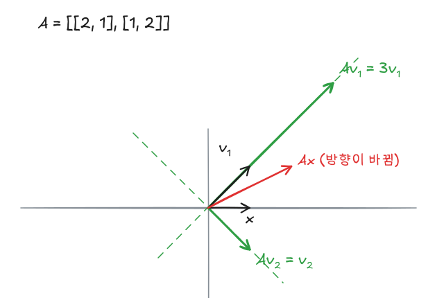
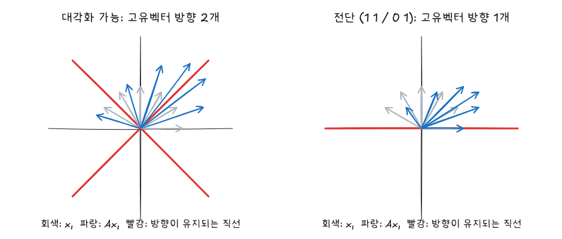
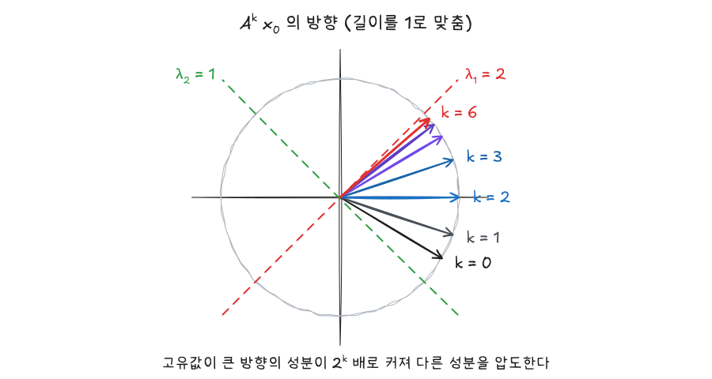
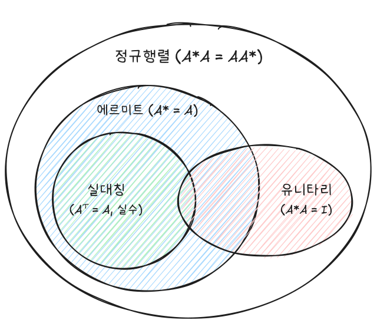
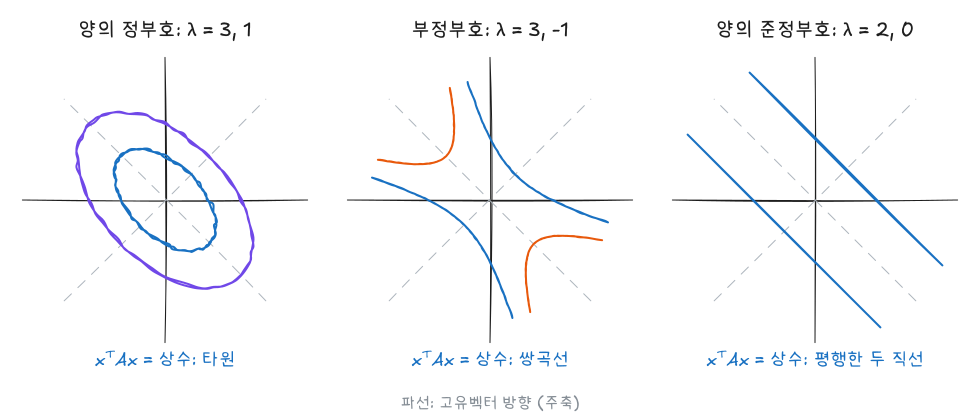

고유벡터는 행렬을 곱해도 방향이 바뀌지 않고 크기만 고유값 배만큼 변하는 벡터다. 고유벡터로 기저를 만들 수 있으면 행렬이 대각행렬로 단순해진다. 이 글은 대각화 조건, 대칭·에르미트·유니타리·정규행렬의 대각화, 스펙트럼 분해, 양의 정부호 판정과 이차형식을 정리하고, 여러 분해를 비교한 뒤 통계에서의 쓰임으로 마무리한다. 모든 코드는 소절 바로 아래에서 손계산과 맞춰 본다.

이전 글: [선형대수 - 선형사상과 행렬표현](/posts/la-linear-map)

## 1. 고유값과 고유벡터

### 정의

정사각행렬 $\mathbf{A}$에 대해

$$
\mathbf{A}\mathbf{v} = \lambda\mathbf{v}, \qquad \mathbf{v} \neq \mathbf{0}
$$

을 만족하는 스칼라 $\lambda$를 **고유값**, $\mathbf{v}$를 $\lambda$에 대응하는 **고유벡터**라 한다. $\lambda$에 대응하는 고유벡터와 $\mathbf{0}$을 모은 부분공간을 **고유공간**이라 한다.

$$
E_{\mathbf{A}}(\lambda) = \{\mathbf{v} \mid \mathbf{A}\mathbf{v} = \lambda\mathbf{v}\} = N(\mathbf{A} - \lambda\mathbf{I})
$$



$\mathbf{A} = \begin{pmatrix} 2 & 1 \\ 1 & 2 \end{pmatrix}$에서 $(1, 1)$ 방향은 3배로 늘고 $(1, -1)$ 방향은 그대로 유지된다. 그 밖의 벡터, 예를 들어 $(1, 0)$은 $(2, 1)$로 방향이 바뀐다.

선형사상 $L : V \to V$에서도 $L(\mathbf{v}) = \lambda\mathbf{v}$로 같게 정의하며, 기저 $\mathcal{B}$를 잡으면 $[L]_{\mathcal{B}}[\mathbf{v}]_{\mathcal{B}} = \lambda[\mathbf{v}]_{\mathcal{B}}$로 행렬 문제가 된다. 닮음행렬은 같은 사상이므로 고유값이 같다.

### 특성방정식

$(\mathbf{A} - \lambda\mathbf{I})\mathbf{v} = \mathbf{0}$이 $\mathbf{0}$이 아닌 해를 가지려면 $\mathbf{A} - \lambda\mathbf{I}$가 가역이 아니어야 한다.

$$
\det(\mathbf{A} - \lambda\mathbf{I}) = 0
$$

이를 **특성방정식**이라 한다. 근을 중복도까지 세면(복소수 포함) 항상

$$
\det(\mathbf{A}) = \lambda_1\lambda_2\cdots\lambda_n,
\qquad
\operatorname{tr}(\mathbf{A}) = \lambda_1 + \lambda_2 + \cdots + \lambda_n
$$

이 성립한다. 대각화 가능 여부와 관계없다.

### 예시

$\mathbf{A} = \begin{pmatrix} 5 & -6 \\ 2 & -2 \end{pmatrix}$에 대해

$$
\det\begin{pmatrix} 5 - \lambda & -6 \\ 2 & -2 - \lambda \end{pmatrix}
= \lambda^2 - 3\lambda + 2 = (\lambda - 1)(\lambda - 2) = 0
$$

| 고유값 | $\mathbf{A} - \lambda\mathbf{I}$ | 고유공간 |
|---|---|---|
| $\lambda_1 = 1$ | $\begin{pmatrix} 4 & -6 \\ 2 & -3 \end{pmatrix}$, $2x = 3y$ | $E(1) = \operatorname{span}\{(3, 2)^T\}$ |
| $\lambda_2 = 2$ | $\begin{pmatrix} 3 & -6 \\ 2 & -4 \end{pmatrix}$, $x = 2y$ | $E(2) = \operatorname{span}\{(2, 1)^T\}$ |

확인: $\det\mathbf{A} = -10 + 12 = 2 = 1 \times 2$, $\operatorname{tr}\mathbf{A} = 3 = 1 + 2$.

```r
A <- matrix(c(5, 2, -6, -2), nrow = 2)
e <- eigen(A)
e$values                              # 2 1 (큰 값부터)
e$vectors                             # 길이 1로 정규화: (2,1)/sqrt(5), (3,2)/sqrt(13)
c(det(A), prod(e$values))             # 2 2
c(sum(diag(A)), sum(e$values))        # 3 3
```

```python
import numpy as np

A = np.array([[5, -6], [2, -2]], dtype=float)
w, V = np.linalg.eig(A)   # 고유값 [2, 1], 순서는 보장되지 않는다. 열이 정규화된 고유벡터
np.linalg.det(A), w.prod(), np.trace(A), w.sum()
```

`eigen()`은 고유값을 내림차순으로 $2, 1$을 주고, 고유벡터는 길이 1로 맞춰 나오므로 손으로 구한 $(2, 1)^T$, $(3, 2)^T$를 $\sqrt5$, $\sqrt{13}$으로 나눈 값($0.894, 0.447$ / $0.832, 0.555$)이다. 행렬식과 대각합도 손계산과 같다.

### 케일리-해밀턴 정리

특성다항식 $p(\lambda) = \det(\lambda\mathbf{I} - \mathbf{A})$에 행렬 자신을 넣으면 영행렬이 된다.

$$
p(\mathbf{A}) = \mathbf{O}
$$

위 예시는 $p(\lambda) = \lambda^2 - 3\lambda + 2$이므로 $\mathbf{A}^2 - 3\mathbf{A} + 2\mathbf{I} = \mathbf{O}$이다. 따라서 $\mathbf{A}^2 = 3\mathbf{A} - 2\mathbf{I}$처럼 높은 거듭제곱을 낮은 차수로 줄일 수 있고, 역행렬도 $\mathbf{A}(3\mathbf{I} - \mathbf{A}) = 2\mathbf{I}$에서 $\mathbf{A}^{-1} = \frac{1}{2}(3\mathbf{I} - \mathbf{A})$처럼 다항식으로 쓸 수 있다.

```r
A %*% A - 3 * A + 2 * diag(2)         # 영행렬
solve(A)                              # [-1, 3 / -1, 2.5]
(3 * diag(2) - A) / 2                 # 같은 행렬
```

```python
A @ A - 3 * A + 2 * np.eye(2)         # 영행렬
np.allclose(np.linalg.inv(A), (3 * np.eye(2) - A) / 2)   # True
```

## 2. 대각화

### 정의와 조건

$\mathbf{P}^{-1}\mathbf{A}\mathbf{P} = \mathbf{D}$(대각행렬)가 되는 가역행렬 $\mathbf{P}$가 있으면 $\mathbf{A}$를 **대각화 가능**하다고 한다. 즉 대각행렬과 닮음이다.

$\mathbf{AP} = \mathbf{PD}$를 열별로 보면 $\mathbf{A}\mathbf{p}_i = \lambda_i\mathbf{p}_i$이다. 따라서

- $\mathbf{P}$의 열 = 고유벡터, $\mathbf{D}$의 대각 = 대응하는 고유값
- $\mathbf{P}$가 가역 = 고유벡터 $n$개가 일차독립

$$
\mathbf{A} \text{ 대각화 가능} \iff \text{고유벡터로 이루어진 } \mathbb{R}^n \text{(또는 } \mathbb{C}^n\text{)의 기저가 존재}
$$

위 예시에서는

$$
\begin{pmatrix} 3 & 2 \\ 2 & 1 \end{pmatrix}^{-1}
\begin{pmatrix} 5 & -6 \\ 2 & -2 \end{pmatrix}
\begin{pmatrix} 3 & 2 \\ 2 & 1 \end{pmatrix}
=
\begin{pmatrix} 1 & 0 \\ 0 & 2 \end{pmatrix}
$$

```r
P <- cbind(c(3, 2), c(2, 1))          # 열 = 고유벡터 (3,2), (2,1)
solve(P) %*% A %*% P                  # 대각행렬 diag(1, 2) (부동소수점 오차 1e-15 수준)
```

```python
P = np.array([[3, 2], [2, 1]], dtype=float)
np.linalg.inv(P) @ A @ P              # diag(1, 2)
```

### 판정에 쓰는 사실

- 서로 다른 고유값에 대응하는 고유벡터들은 일차독립이다.
- 따라서 **서로 다른 고유값이 $n$개**면 대각화 가능하다(충분조건).
- 중근이 있으면 각 고유값의 고유공간 차원(기하적 중복도)이 근의 중복도(대수적 중복도)와 같은지 확인해야 한다. 예를 들어 $\begin{pmatrix} 1 & 1 \\ 0 & 1 \end{pmatrix}$은 고유값 1이 중근인데 고유공간이 1차원이라 대각화되지 않는다.

### 대각화가 안 될 때: 조르당 형태

고유벡터가 부족하면 대각행렬 대신 대각 바로 위에 1이 붙은 **조르당 블록**까지만 단순화할 수 있다. 모든 복소 정사각행렬은 조르당 블록을 대각으로 늘어놓은 행렬과 닮음이다.

$$
\mathbf{P}^{-1}\mathbf{A}\mathbf{P} = \begin{pmatrix} \mathbf{J}_1 & & \\ & \ddots & \\ & & \mathbf{J}_s \end{pmatrix},
\qquad
\mathbf{J}_i = \begin{pmatrix} \lambda_i & 1 & & \\ & \lambda_i & \ddots & \\ & & \ddots & 1 \\ & & & \lambda_i \end{pmatrix}
$$

- 블록의 개수는 일차독립인 고유벡터의 개수와 같다.
- 모든 블록이 $1 \times 1$이면 대각화 가능이다.
- 앞의 $\begin{pmatrix} 1 & 1 \\ 0 & 1 \end{pmatrix}$은 그 자체가 $2 \times 2$ 조르당 블록이다.

조르당 형태는 성분이 조금만 바뀌어도 모양이 달라질 만큼 수치적으로 불안정하다. 그래서 실제 계산에서는 쓰지 않고 쉬르 분해나 SVD를 쓴다.

두 경우를 같은 단위원 위의 벡터들로 비교하면 고유벡터가 부족하다는 것이 무슨 뜻인지 보인다.



대칭행렬 $\begin{pmatrix} 1.5 & 0.5 \\ 0.5 & 1.5 \end{pmatrix}$은 방향이 유지되는 직선이 두 개(빨강)이고, 다른 벡터들은 모두 고유값이 큰 $(1, 1)$ 방향 쪽으로 끌려간다. 전단 $\begin{pmatrix} 1 & 1 \\ 0 & 1 \end{pmatrix}$은 $x$축 하나만 방향이 유지되고, 나머지 벡터는 모두 오른쪽으로 기운다. 평면을 덮으려면 독립인 방향이 두 개 필요한데 고유벡터 방향이 하나뿐이므로, 고유벡터로 기저를 만들 수 없다. 이것이 대각화가 안 된다는 것의 기하적 의미다.

```r
J <- matrix(c(1, 0, 1, 1), nrow = 2)  # 전단 [[1,1],[0,1]]
eigen(J)$values                       # 1 1 (중근)
eigen(J)$vectors                      # 두 열이 사실상 같은 방향: (1,0)과 (-1, 2e-16)
det(eigen(J)$vectors)                 # 2.2e-16 ≈ 0, 고유벡터가 기저를 이루지 못한다
```

```python
J = np.array([[1, 1], [0, 1]], dtype=float)
w, V = np.linalg.eig(J)
np.linalg.matrix_rank(V), abs(np.linalg.det(V))   # 1, 2.2e-16: 독립인 고유벡터가 하나뿐
```

### 쓰임: 거듭제곱

$\mathbf{A} = \mathbf{PDP}^{-1}$이면 $\mathbf{A}^k = \mathbf{P}\mathbf{D}^k\mathbf{P}^{-1}$이고, $\mathbf{D}^k$는 대각 성분만 $k$제곱하면 된다.

거듭제곱을 고유벡터 좌표로 보면 $\mathbf{A}^k\mathbf{x}$의 장기적인 방향이 결정된다. $\mathbf{x} = c_1\mathbf{p}_1 + c_2\mathbf{p}_2$이면

$$
\mathbf{A}^k\mathbf{x} = c_1\lambda_1^k\mathbf{p}_1 + c_2\lambda_2^k\mathbf{p}_2
= \lambda_1^k\Big(c_1\mathbf{p}_1 + c_2\big(\tfrac{\lambda_2}{\lambda_1}\big)^k\mathbf{p}_2\Big)
$$

이므로 $\lvert\lambda_1\rvert > \lvert\lambda_2\rvert$이고 $c_1 \neq 0$이면 $\mathbf{A}^k\mathbf{x}$의 방향은 $\mathbf{p}_1$로 수렴한다.



그림의 $\mathbf{A} = \begin{pmatrix} 1.5 & 0.5 \\ 0.5 & 1.5 \end{pmatrix}$에서 $\mathbf{x}_0 = (1, -0.6)$은 처음에 $\lambda_2 = 1$인 방향 성분이 훨씬 크지만, 곱할 때마다 $\lambda_1 = 2$ 방향 성분만 2배씩 커진다. $\mathbf{x}_0 = 0.2(1, 1) + 0.8(1, -1)$이므로 $\mathbf{x}_6 = 0.2\cdot 2^6(1, 1) + 0.8\cdot 1^6(1, -1) = (13.6, 12)$가 되어, 두 성분의 비가 $1 : 1$에 가까운 $1 : 0.88$이 된다. 수렴 속도는 $\lvert\lambda_2/\lambda_1\rvert^k$로 정해진다. 이 원리를 이용해 가장 큰 고유값과 고유벡터를 구하는 방법이 **거듭제곱법**이고, 마르코프 연쇄가 정상분포로 수렴하는 것과 웹페이지 순위(PageRank)도 같은 원리다.

```r
B <- matrix(c(1.5, 0.5, 0.5, 1.5), nrow = 2)
x <- c(1, -0.6)
for (k in 1:6) x <- B %*% x
x                                     # (13.6, 12)
x[2] / x[1]                           # 0.882: 6번 곱한 뒤 (1,1) 방향(비 1)에 가까워진다
```

```python
B = np.array([[1.5, 0.5], [0.5, 1.5]])
x = np.array([1, -0.6])
for _ in range(6):
    x = B @ x
x, x[1] / x[0]                        # [13.6, 12.0], 0.882
```

## 3. 특별한 행렬들

### 복소행렬과 켤레전치

복소행렬 $\mathbf{A}$의 **켤레전치** $\mathbf{A}^* = \overline{\mathbf{A}}^T$는 켤레를 취한 뒤 전치한 것이다.

$$
\mathbf{A} = \begin{pmatrix} i & 1 - i \\ 2 & 3 + 2i \end{pmatrix}
\quad\Rightarrow\quad
\mathbf{A}^* = \begin{pmatrix} -i & 2 \\ 1 + i & 3 - 2i \end{pmatrix}
$$

복소 내적은 $\langle \mathbf{u}, \mathbf{v} \rangle = \mathbf{v}^*\mathbf{u}$이고, 실수에서의 전치 $T$ 역할을 복소수에서는 $*$가 한다.

### 종류

| 이름 | 조건 | 예 | 실수 버전 |
|---|---|---|---|
| 에르미트 | $\mathbf{A}^* = \mathbf{A}$ | $\begin{pmatrix} 3 & 1 + i \\ 1 - i & 4 \end{pmatrix}$ | 대칭 $\mathbf{A}^T = \mathbf{A}$ |
| 유니타리 | $\mathbf{U}^*\mathbf{U} = \mathbf{U}\mathbf{U}^* = \mathbf{I}$ | $\frac12\begin{pmatrix} 1 + i & 1 + i \\ 1 - i & -1 + i \end{pmatrix}$ | 직교 $\mathbf{Q}^T\mathbf{Q} = \mathbf{I}$ |
| 정규 | $\mathbf{A}^*\mathbf{A} = \mathbf{A}\mathbf{A}^*$ | $\begin{pmatrix} 1 & i \\ i & 1 \end{pmatrix}$ | |

유니타리(직교)행렬의 열은 정규직교기저를 이룬다. 실대칭행렬은 에르미트행렬이고, 에르미트행렬과 유니타리행렬은 모두 정규행렬이다.



### 고유값의 성질

| 행렬 | 고유값 | 고유벡터 |
|---|---|---|
| 에르미트(실대칭) | 모두 **실수**. $\mathbf{v}^*\mathbf{A}\mathbf{v}$도 항상 실수 | 서로 다른 고유값의 고유벡터는 직교. 실대칭이면 고유벡터도 실수로 잡을 수 있다 |
| 유니타리(직교) | 절댓값이 **1**인 복소수 | 서로 다른 고유값의 고유벡터는 직교 |

유니타리행렬은 내적과 길이를 보존한다: $\langle \mathbf{U}\mathbf{u}, \mathbf{U}\mathbf{v} \rangle = \langle \mathbf{u}, \mathbf{v} \rangle$, $\lVert \mathbf{U}\mathbf{u} \rVert = \lVert \mathbf{u} \rVert$.

```r
H <- matrix(c(3, 1 - 1i, 1 + 1i, 4), nrow = 2)       # 에르미트
all.equal(H, Conj(t(H)))                             # TRUE
eigen(H)$values                                      # 5 2: 모두 실수

U <- 0.5 * matrix(c(1 + 1i, 1 - 1i, 1 + 1i, -1 + 1i), nrow = 2)   # 유니타리
round(Conj(t(U)) %*% U, 10)                          # 단위행렬
Mod(eigen(U)$values)                                 # 1 1: 절댓값 1
```

```python
H = np.array([[3, 1 + 1j], [1 - 1j, 4]])
np.allclose(H, H.conj().T), np.linalg.eigvalsh(H)    # True, [2, 5]
U = 0.5 * np.array([[1 + 1j, 1 + 1j], [1 - 1j, -1 + 1j]])
np.allclose(U.conj().T @ U, np.eye(2)), np.abs(np.linalg.eigvals(U))   # True, [1, 1]
```

## 4. 쉬르 정리와 스펙트럼 정리

### 쉬르 정리: 삼각화는 항상 된다

대각화가 안 되는 행렬도 있지만, **모든 복소 정사각행렬**은 유니타리행렬로 상삼각행렬로 만들 수 있다.

$$
\mathbf{U}^*\mathbf{A}\mathbf{U} = \mathbf{T} = \begin{pmatrix} \lambda_1 & * & * \\ 0 & \lambda_2 & * \\ 0 & 0 & \lambda_3 \end{pmatrix}
$$

$\mathbf{T}$의 대각에는 $\mathbf{A}$의 고유값이 놓인다. 실행렬의 고유값이 모두 실수이면 $\mathbf{U}$를 실직교행렬로 잡을 수 있다.

```python
from scipy.linalg import schur

B = np.array([[1, 2, 3], [4, 5, 6], [7, 8, 10]], dtype=float)
T, Z = schur(B)                       # B = Z T Z^T, Z 직교, T 상삼각
np.allclose(Z @ T @ Z.T, B)           # True
np.diag(T), np.linalg.eigvals(B)      # 같은 값: 16.707, -0.906, 0.198 (순서는 다를 수 있다)
```

쉬르 분해의 $\mathbf{T}$ 대각이 고유값이다. $\mathbf{B}$는 대칭이 아니므로 $\mathbf{T}$의 대각 위쪽(`4.76, 1.15, -0.10`)이 0이 아니며, 대칭이면 이 부분이 0이 되어 스펙트럼 정리가 된다. R 기본 함수에는 쉬르 분해가 없어 Python으로 확인했다.

### 스펙트럼 정리: 언제 유니타리 대각화가 되는가

쉬르 정리의 $\mathbf{T}$가 대각행렬이 되는 조건이 정규성이다.

$$
\mathbf{A} \text{가 정규행렬} \iff \mathbf{U}^*\mathbf{A}\mathbf{U} = \mathbf{D} \text{인 유니타리 } \mathbf{U} \text{가 존재 (유니타리 대각화 가능)}
$$

실수 범위에서는

$$
\mathbf{A} \text{가 실대칭행렬} \iff \mathbf{P}^T\mathbf{A}\mathbf{P} = \mathbf{D} \text{인 직교행렬 } \mathbf{P} \text{가 존재 (직교 대각화 가능)}
$$

실직교행렬은 정규행렬이라 복소수 범위에서는 유니타리 대각화되지만, 회전행렬처럼 고유값이 복소수일 수 있어 실수 범위에서는 일반적으로 대각화되지 않는다.

| $\mathbf{U}^*\mathbf{A}\mathbf{U} = \mathbf{D}$에서 | $\mathbf{U}$ | $\mathbf{D}$의 대각 (고유값) |
|---|---|---|
| $\mathbf{A}$ 정규 | 복소 유니타리 | 복소수 |
| $\mathbf{A}$ 에르미트 | 복소 유니타리 | **실수** |
| $\mathbf{A}$ 실대칭 | **실직교** | **실수** |
| $\mathbf{A}$ 유니타리 | 복소 유니타리 | 절댓값 **1** |

**동시 대각화**: 유니타리 대각화 가능한 $\mathbf{A}, \mathbf{B}$를 같은 $\mathbf{U}$로 동시에 대각화할 수 있다 $\iff \mathbf{AB} = \mathbf{BA}$.

```r
S <- matrix(c(2, 1, 1, 2), nrow = 2)
eS <- eigen(S)                        # 대칭행렬: 고유값 3, 1
eS$vectors                            # 직교: (1,1)/sqrt(2), (-1,1)/sqrt(2)
crossprod(eS$vectors)                 # V'V = I
Cm <- matrix(c(1, 1i, 1i, 1), nrow = 2)               # 정규행렬 [[1,i],[i,1]]
Cm %*% Conj(t(Cm)) - Conj(t(Cm)) %*% Cm              # 영행렬: 정규
```

## 5. 스펙트럼 분해

### 형태

정규행렬 $\mathbf{A}$의 서로 다른 고유값을 $\lambda_1, \dots, \lambda_k$, 각 고유공간으로의 정사영 행렬을 $\mathbf{P}_i$라 하면

$$
\mathbf{A} = \lambda_1\mathbf{P}_1 + \lambda_2\mathbf{P}_2 + \cdots + \lambda_k\mathbf{P}_k
$$

$$
\mathbf{P}_i^2 = \mathbf{P}_i, \qquad \mathbf{P}_i^* = \mathbf{P}_i, \qquad \mathbf{P}_i\mathbf{P}_j = \mathbf{O}\ (i \neq j), \qquad \mathbf{P}_1 + \cdots + \mathbf{P}_k = \mathbf{I}
$$

고유값 $\lambda_i$의 정규직교 고유벡터를 $\mathbf{u}$들이라 하면 $\mathbf{P}_i = \sum \mathbf{u}\mathbf{u}^*$이다. [벡터와 행렬곱](/posts/la-vector-matrix)의 "열 × 행 = rank 1 행렬의 합" 관점 그대로다.

### 의미

$\mathbf{P}_i\mathbf{v} \in E_{\mathbf{A}}(\lambda_i)$, 즉 $\mathbf{P}_i$는 임의의 벡터를 $\lambda_i$의 고유공간으로 정사영한다. 따라서

$$
\mathbf{A}\mathbf{v} = \lambda_1(\mathbf{P}_1\mathbf{v}) + \cdots + \lambda_k(\mathbf{P}_k\mathbf{v})
$$

는 $\mathbf{v}$를 고유공간 성분으로 쪼갠 뒤 각 성분을 고유값 배만큼 늘리는 것이다.

### 행렬 함수

$\mathbf{P}_i$의 성질 때문에 거듭제곱이 고유값에만 작용한다.

$$
\mathbf{A}^m = \lambda_1^m\mathbf{P}_1 + \cdots + \lambda_k^m\mathbf{P}_k,
\qquad
f(\mathbf{A}) = f(\lambda_1)\mathbf{P}_1 + \cdots + f(\lambda_k)\mathbf{P}_k
$$

### 정사영 행렬 $\mathbf{P}_i$ 구하기

$f(\lambda_1) = 1$, $f(\lambda_j) = 0$ ($j \neq 1$)인 다항식을 고르면 $f(\mathbf{A}) = \mathbf{P}_1$이다. 이런 $f$가 바로 라그랑주 보간의 기저다.

$$
\mathbf{P}_i = \prod_{j \neq i}\frac{\mathbf{A} - \lambda_j\mathbf{I}}{\lambda_i - \lambda_j}
$$

고유벡터를 따로 구하지 않고 고유값만으로 정사영 행렬을 얻는다.

세 고유값이 모두 다른 대칭행렬 $\mathbf{S} = \begin{pmatrix} 2 & -1 & 0 \\ -1 & 2 & -1 \\ 0 & -1 & 2 \end{pmatrix}$로 확인한다. 고유값은 $2 + \sqrt2,\ 2,\ 2 - \sqrt2$이다.

```r
S3 <- matrix(c(2, -1, 0, -1, 2, -1, 0, -1, 2), nrow = 3)
e3 <- eigen(S3); lam <- e3$values; Q <- e3$vectors     # 3.414 2 0.586

# 라그랑주 보간 기저로 정사영 행렬을 만든다
Pl <- lapply(1:3, function(i)
  Reduce(`%*%`, lapply(setdiff(1:3, i), function(j) (S3 - lam[j] * diag(3)) / (lam[i] - lam[j]))))
max(abs(Pl[[1]] - Q[, 1] %o% Q[, 1]))                  # ~1e-16: 고유벡터로 만든 uu'와 같다
max(abs(S3 - Reduce(`+`, Map(`*`, lam, Pl))))          # ~1e-16: A = sum(lambda_i P_i)
Reduce(`+`, Map(function(l, P) exp(l) * P, lam, Pl))   # 행렬 지수 exp(S), 값이 [11.74, -10.11, 4.35 ...]
```

```python
S3 = np.array([[2, -1, 0], [-1, 2, -1], [0, -1, 2]], dtype=float)
lam, Q = np.linalg.eigh(S3)
Ps = [np.outer(Q[:, i], Q[:, i]) for i in range(3)]    # P_i = u u^T
np.allclose(sum(l * P for l, P in zip(lam, Ps)), S3), np.allclose(sum(Ps), np.eye(3))   # True True
sum(np.exp(l) * P for l, P in zip(lam, Ps)).round(3)   # exp(S), R의 결과와 같다
```

## 6. 양의 정부호 행렬

### 정의와 판정

에르미트(실대칭) 행렬 $\mathbf{H}$에 대해

| | 고유값 | 이차형식 | 소행렬식 판정 |
|---|---|---|---|
| 양의 정부호 (PD) | 모두 $> 0$ | $\mathbf{z}^*\mathbf{H}\mathbf{z} > 0$ ($\mathbf{z} \neq \mathbf{0}$) | **선행** 주소행렬식이 모두 $> 0$ |
| 양의 준정부호 (PSD) | 모두 $\ge 0$ | $\mathbf{z}^*\mathbf{H}\mathbf{z} \ge 0$ | **모든** 주소행렬식이 $\ge 0$ |
| 음의 정부호 | 모두 $< 0$ | $\mathbf{z}^*\mathbf{H}\mathbf{z} < 0$ ($\mathbf{z} \neq \mathbf{0}$) | $(-1)^k\det\mathbf{H}_k > 0$ |

**실베스터 판정법**: $k$번째 선행 주소행렬 $\mathbf{H}_k$(왼쪽 위 $k \times k$ 부분)에 대해 $\det\mathbf{H}_k > 0$ ($k = 1, \dots, n$)이면 양의 정부호다. $3 \times 3$이면

$$
h_{11} > 0, \qquad \det\begin{pmatrix} h_{11} & h_{12} \\ h_{21} & h_{22} \end{pmatrix} > 0, \qquad \det\mathbf{H} > 0
$$

고유값을 구하지 않고 행렬식만으로 판정할 수 있다. 준정부호는 **선행 소행렬식에 등호만 붙여서는 안 된다**. 예를 들어 $\operatorname{diag}(0, -1)$은 선행 소행렬식이 $0, 0$이지만 PSD가 아니다. 모든 주소행렬식(임의의 행·열 집합을 같이 고른 것)을 봐야 한다.

```r
S3 <- matrix(c(2, -1, 0, -1, 2, -1, 0, -1, 2), nrow = 3)
c(det(S3[1, 1, drop = FALSE]), det(S3[1:2, 1:2]), det(S3))   # 2 3 4: 선행 소행렬식이 모두 양수
chol(S3)                              # 성공 = 양의 정부호. 상삼각 R, S3 = t(R) %*% R

M <- matrix(c(1, 2, 2, 1), nrow = 2)  # 고유값 3, -1
try(chol(M))                          # 오류: 양의 정부호가 아니다
```

```python
np.linalg.cholesky(S3).round(4)       # 하삼각 L, S3 = L L^T
try:
    np.linalg.cholesky(np.array([[1, 2], [2, 1.]]))
except np.linalg.LinAlgError as err:
    print(err)                        # Matrix is not positive definite
```

선행 소행렬식 $2, 3, 4$가 모두 양수이고 `chol`도 성공한다. 두 번째 행렬은 고유값이 $3, -1$이라 `chol`이 실패한다. 콜레스키 분해 $\mathbf{S} = \mathbf{R}^T\mathbf{R}$은 양의 정부호일 때만 존재하는 삼각 분해이며, [가우스 소거법과 LU 분해](/posts/la-gauss-lu)의 대칭 버전으로 계산량이 LU의 절반이다.

### 부분공간에서 양수인 경우

에르미트 행렬 $\mathbf{A}$와 $k$차원 부분공간 $W$에 대해, $W$의 모든 $\mathbf{w} \neq \mathbf{0}$에서 $\mathbf{w}^*\mathbf{A}\mathbf{w} > 0$이면 $\mathbf{A}$는 양수 고유값을 **적어도 $k$개** 가진다. 전체 공간($k = n$)에서 성립하면 양의 정부호다.

## 7. 이차형식

### 정의와 주축정리

실대칭행렬 $\mathbf{A}$에 대해 $Q(\mathbf{x}) = \mathbf{x}^T\mathbf{A}\mathbf{x}$를 **이차형식**이라 한다. 교차항 계수는 반씩 나눠 대칭으로 배치한다.

$$
2x^2 + 2xy + 2y^2 = \begin{pmatrix} x & y \end{pmatrix}\begin{pmatrix} 2 & 1 \\ 1 & 2 \end{pmatrix}\begin{pmatrix} x \\ y \end{pmatrix}
$$

$\mathbf{A} = \mathbf{PDP}^T$로 직교 대각화하고 $\mathbf{y} = \mathbf{P}^T\mathbf{x}$로 좌표를 돌리면 교차항이 사라진다(**주축정리**).

$$
Q = \mathbf{y}^T\mathbf{D}\mathbf{y} = \lambda_1y_1^2 + \cdots + \lambda_ny_n^2
$$

예에서 고유값은 $3$(방향 $(1, 1)/\sqrt2$)과 $1$(방향 $(1, -1)/\sqrt2$)이므로 $Q = 3y_1^2 + y_2^2$이다. 두 고유값이 양수라 $Q > 0$, 즉 양의 정부호이고, $Q = 1$은 주축이 $45°$ 기울어진 타원이다.

### 고유값으로 보는 이차형식

| 고유값 부호 | 이차형식 | $Q = 1$의 모양 (2차원) |
|---|---|---|
| 모두 양수 | 양의 정부호, 최솟값 0 | 타원 |
| 양수와 음수 섞임 | 부정부호, 안장점 | 쌍곡선 |
| 0 포함, 나머지 양수 | 양의 준정부호 | 평행한 두 직선 |

통계에서 공분산행렬과 $\mathbf{X}^T\mathbf{X}$는 항상 양의 준정부호이고, 주성분분석(PCA)은 공분산행렬의 이 주축을 찾는 것이다.

세 경우의 등고선 $Q(\mathbf{x}) = c$를 그리면 다음과 같다. 파선은 고유벡터 방향(주축)이다.



세 행렬 $\begin{pmatrix} 2 & 1 \\ 1 & 2 \end{pmatrix}$, $\begin{pmatrix} 1 & 2 \\ 2 & 1 \end{pmatrix}$, $\begin{pmatrix} 1 & 1 \\ 1 & 1 \end{pmatrix}$은 고유벡터가 모두 $(1, 1)$과 $(1, -1)$ 방향으로 같고 고유값만 다르다. 주축 좌표에서 $Q = \lambda_1y_1^2 + \lambda_2y_2^2$이므로, 등고선의 모양은 고유값의 부호로만 정해진다. 둘 다 양수이면 어느 방향으로 가도 $Q$가 커지므로 원점을 둘러싼 타원이고, 고유값이 큰 방향일수록 빨리 커지므로 그 방향으로 짧다. 부호가 섞이면 한 방향으로는 커지고 다른 방향으로는 작아지는 안장이므로 쌍곡선이 된다(파랑 $Q = 1$, 주황 $Q = -1$). 고유값이 0이면 그 방향으로는 $Q$가 변하지 않으므로 등고선이 그 방향으로 끝없이 뻗은 직선이 된다. 최적화에서 헤세행렬의 고유값 부호로 극소·극대·안장점을 판정하는 것이 바로 이 그림이다.

## 8. 가역행렬 동치조건 총정리

$n \times n$ 행렬 $\mathbf{A}$에 대해 다음은 모두 **동치**다. 시리즈 곳곳에 흩어진 조건을 한곳에 모았다.

| 관점 | 조건 | 다룬 글 |
|---|---|---|
| 역행렬 | $\mathbf{A}^{-1}$이 존재한다 | 벡터와 행렬곱 |
| 소거 | 기약행사다리꼴이 $\mathbf{I}$, 기본행렬들의 곱으로 표현된다 | 가우스 소거법 |
| 연립방정식 | 모든 $\mathbf{b}$에 대해 $\mathbf{Ax} = \mathbf{b}$의 해가 유일하다 | 가우스 소거법 |
| 동차방정식 | $\mathbf{Ax} = \mathbf{0}$의 해는 $\mathbf{x} = \mathbf{0}$뿐이다 | 벡터공간 |
| 행렬식 | $\det\mathbf{A} \neq 0$ | 행렬식 |
| 계수 | $\operatorname{rank}\mathbf{A} = n$, $\operatorname{nullity}\mathbf{A} = 0$ | 벡터공간 |
| 열과 행 | 열(행)이 일차독립이다, $\mathbb{R}^n$을 생성한다, 기저를 이룬다 | 벡터공간 |
| 부분공간 | $C(\mathbf{A}) = \mathbb{R}^n$, $N(\mathbf{A}) = \{\mathbf{0}\}$ | 벡터공간 |
| 선형사상 | $\mathbf{x} \mapsto \mathbf{Ax}$가 단사, 전사, 동형사상 | 선형사상 |
| 전치와 곱 | $\mathbf{A}^T$가 가역, $\mathbf{A}^T\mathbf{A}$가 양의 정부호 | 정규직교기저 |
| 고유값 | 0이 고유값이 아니다 | 고유값 |
| 특잇값 | 특잇값이 모두 양수다 | SVD |

정사각행렬에서는 단사와 전사가 같은 말이라 하나만 확인하면 된다는 점이 핵심이다.

## 9. 통계에서의 쓰임

**공분산행렬의 스펙트럼 분해.** 표본공분산 $\mathbf{S}$는 실대칭 양의 준정부호이므로 $\mathbf{S} = \mathbf{V}\boldsymbol\Lambda\mathbf{V}^T = \sum\lambda_j\mathbf{v}_j\mathbf{v}_j^T$로 직교 대각화된다. 고유벡터 $\mathbf{v}_j$가 주성분 방향, 고유값 $\lambda_j$가 그 방향의 분산이다. 이 분해에서 PCA가 나오며, 수학적 유도와 SVD와의 관계는 [특잇값 분해와 주성분분석](/posts/la-svd), 통계적 해석은 [데이터 마이닝 - 주성분분석](/posts/dm-pca)에서 다룬다.

**이차형식과 카이제곱.** 마할라노비스 거리 제곱은 $\boldsymbol\Sigma^{-1}$의 이차형식이고, 주축 좌표에서는 분산으로 나눈 제곱의 합이 된다.

$$
d^2 = (\mathbf{x} - \boldsymbol\mu)^T\boldsymbol\Sigma^{-1}(\mathbf{x} - \boldsymbol\mu)
= \sum_{j=1}^{p}\frac{\big(\mathbf{v}_j^T(\mathbf{x} - \boldsymbol\mu)\big)^2}{\lambda_j}
$$

$\mathbf{x} \sim N_p(\boldsymbol\mu, \boldsymbol\Sigma)$이면 $\mathbf{v}_j^T(\mathbf{x} - \boldsymbol\mu)/\sqrt{\lambda_j}$가 서로 독립인 표준정규이므로 $d^2 \sim \chi^2_p$이다. 고유값이 작은 방향의 편차가 크게 반영되어 이상치 탐지와 판별분석(QDA의 $\log\lvert\boldsymbol\Sigma_k\rvert = \sum\log\lambda_j$)에 쓰인다.

**AR 정상성 조건.** AR($p$)의 동반행렬 $\mathbf{C}$는 첫 행이 $(\phi_1, \dots, \phi_p)$이고 아래는 단위행렬이 밀려 내려간 행렬이다. $\mathbf{C}$의 고유값은 $\Phi(B) = 1 - \phi_1B - \cdots - \phi_pB^p = 0$의 근의 **역수**이므로, "특성근이 단위원 밖"([시계열 - ARMA](/posts/ts-06-arma))은 "$\mathbf{C}$의 고유값이 모두 단위원 안"과 같다.

**마르코프 연쇄.** 전이행렬 $\mathbf{P}$의 $k$단계 전이는 $\mathbf{P}^k = \mathbf{V}\mathbf{D}^k\mathbf{V}^{-1}$이다. 고유값 1에 대응하는 왼쪽 고유벡터가 정상분포이고, 나머지 고유값의 절댓값이 1보다 작으면 그 크기($\lvert\lambda_2\rvert^k$)대로 정상분포에 수렴한다([확률과정론 - 마코프체인과 정상분포](/posts/sp-04-markov-chain-stationary)).

```r
# 마할라노비스 거리: iris의 setosa 50개, 4개 변수
X  <- as.matrix(iris[iris$Species == "setosa", 1:4])
S  <- cov(X); mu <- colMeans(X)
e  <- eigen(S); e$values                              # 0.2365 0.0369 0.0268 0.0090
Z  <- sweep(X, 2, mu) %*% e$vectors                   # 주축 좌표 v_j'(x - mu)
d2 <- rowSums(sweep(Z^2, 2, e$values, "/"))           # sum( (v'(x-mu))^2 / lambda )
all.equal(d2, mahalanobis(X, mu, S))                  # TRUE
c(mean(d2), mean(d2 <= qchisq(0.95, df = 4)))         # 3.92  0.90

# AR(2): 동반행렬의 고유값 = 특성근의 역수
ar_check <- function(phi) {
  p <- length(phi)
  C <- rbind(phi, cbind(diag(p - 1), 0))
  c(eig_max = max(Mod(eigen(C)$values)), root_min = min(Mod(polyroot(c(1, -phi)))))
}
ar_check(c(0.5, 0.3))                 # 0.852  1.174: 정상 (고유값 < 1, 근 > 1)
ar_check(c(0.5, 0.6))                 # 1.064  0.940: 비정상

# 마르코프 연쇄: 날씨 전이행렬
Pm <- matrix(c(0.4, 0.6, 0.7, 0.3), nrow = 2, byrow = TRUE)
eigen(Pm)$values                      # 1.0 -0.3
w <- eigen(t(Pm)); pi_hat <- Re(w$vectors[, 1]); pi_hat / sum(pi_hat)   # 0.538 0.462
Pk <- diag(2); for (k in 1:20) Pk <- Pk %*% Pm; Pk    # 두 행이 모두 (0.538, 0.462)
```

```python
# AR(2)와 마르코프 연쇄
for phi in ([0.5, 0.3], [0.5, 0.6]):
    C = np.array([phi, [1, 0]])
    print(np.abs(np.linalg.eigvals(C)).max())         # 0.852 (정상), 1.064 (비정상)

P = np.array([[0.4, 0.6], [0.7, 0.3]])
w, V = np.linalg.eig(P.T)             # 왼쪽 고유벡터는 P^T의 고유벡터
pi = V[:, np.argmax(w.real)].real
pi / pi.sum()                         # [0.538, 0.462]
np.linalg.matrix_power(P, 20)         # 두 행이 모두 정상분포
```

setosa 자료의 표본공분산 고유값은 $0.2365, 0.0369, 0.0268, 0.0090$이고, 주축 좌표로 계산한 $d^2$는 `mahalanobis()`와 일치한다. 표본공분산으로 계산한 $d^2$의 평균은 항상 $p(n-1)/n = 4 \times 49/50 = 3.92$이고, 50개 중 45개(0.90)가 $\chi^2_4$의 95% 분위수 이하였다. 모수를 추정했고 표본이 작으며 정규성도 완전하지 않으므로 이론값 0.95와 이 정도 차이는 날 수 있다. AR(2) $(0.5, 0.3)$은 동반행렬의 최대 고유값이 $0.852$($= 1/1.174$)라 정상이고, $(0.5, 0.6)$은 $1.064 > 1$이라 비정상이다. 날씨 전이행렬은 고유값이 $1, -0.3$이므로 $\mathbf{P}^{20}$의 오차는 $0.3^{20}$ 수준으로 사라져 두 행이 모두 정상분포 $(0.538, 0.462)$가 된다.

## 비교

대각화 계열의 분해는 포함 관계로 정리된다.

$$
\text{실대칭} \subset \text{에르미트} \subset \text{정규} \subset \text{대각화 가능} \subset \text{정사각행렬 전체}
$$

조건이 약할수록 적용 범위가 넓지만 분해가 약속하는 것은 줄어든다.

| 분해 | 대상 | 형태 | 기저가 직교인가 | 쓰임 |
|---|---|---|---|---|
| 대각화 | 일차독립 고유벡터가 $n$개인 정사각 | $\mathbf{P}\boldsymbol\Lambda\mathbf{P}^{-1}$ | 아니다 | 거듭제곱, 마르코프 연쇄 |
| 쉬르 | 모든 정사각 | $\mathbf{U}\mathbf{T}\mathbf{U}^*$ ($\mathbf{T}$ 상삼각) | 그렇다 | 고유값 계산 알고리즘, 증명 |
| 스펙트럼 | 정규($\mathbf{A}^*\mathbf{A} = \mathbf{A}\mathbf{A}^*$), 실수에서는 대칭 | $\mathbf{Q}\boldsymbol\Lambda\mathbf{Q}^T$ | 그렇다 | 공분산, 이차형식, PCA |
| 조르당 | 모든 정사각 | $\mathbf{P}\mathbf{J}\mathbf{P}^{-1}$ | 아니다 | 이론, 수치 계산에는 불안정 |

고르는 기준은 다음과 같다.

- 대칭(에르미트)이면 스펙트럼 분해를 쓴다. 고유값이 실수이고 기저가 직교라 가장 안정적이다.
- 대칭이 아니어도 대각화되면 대각화로 거듭제곱을 계산한다. 고유벡터가 거의 평행하면(위의 전단 예시) 수치 오차가 커진다.
- 대각화가 안 되거나 불확실하면 쉬르 분해로 삼각화한다. 직사각행렬은 고유값 분해 자체가 없으므로 SVD를 쓴다([SVD와 고유값 분해의 비교](/posts/la-svd)).

## 정리

| 개념 | 핵심 |
|---|---|
| 고유값 | $\det(\mathbf{A} - \lambda\mathbf{I}) = 0$, $\det\mathbf{A} = \prod\lambda_i$, $\operatorname{tr}\mathbf{A} = \sum\lambda_i$ |
| 대각화 | $\mathbf{P}^{-1}\mathbf{AP} = \mathbf{D}$ $\iff$ 고유벡터 기저 존재. 서로 다른 고유값 $n$개면 충분 |
| 케일리-해밀턴 | $p(\mathbf{A}) = \mathbf{O}$, 거듭제곱과 역행렬을 다항식으로 |
| 조르당 형태 | 대각화가 안 되면 조르당 블록까지, 블록 수 = 고유벡터 수 |
| 쉬르 정리 | 모든 복소행렬은 유니타리 삼각화 가능 |
| 스펙트럼 정리 | 정규 $\iff$ 유니타리 대각화, 실대칭 $\iff$ 직교 대각화 |
| 에르미트·실대칭 | 고유값 실수, 고유벡터 직교 |
| 유니타리·직교 | $\lvert\lambda\rvert = 1$, 길이·내적 보존 |
| 스펙트럼 분해 | $\mathbf{A} = \sum\lambda_i\mathbf{P}_i$, $f(\mathbf{A}) = \sum f(\lambda_i)\mathbf{P}_i$ |
| 정사영 행렬 | $\mathbf{P}_i = \prod_{j \neq i}(\mathbf{A} - \lambda_j\mathbf{I})/(\lambda_i - \lambda_j)$ |
| 양의 정부호 | 고유값 $> 0$ $\iff$ 선행 주소행렬식 $> 0$ (준정부호는 모든 주소행렬식 $\ge 0$) |
| 이차형식 | $\mathbf{x}^T\mathbf{Ax} = \sum\lambda_iy_i^2$, 주축 = 고유벡터 |

## 참고자료

- 하길찬, 『해설이 있는 선형대수학』
- 유호석, 「선형대수학」, 세종대학교, KOCW 공개강의

다음 글: [선형대수 - 특잇값 분해와 주성분분석](/posts/la-svd)
