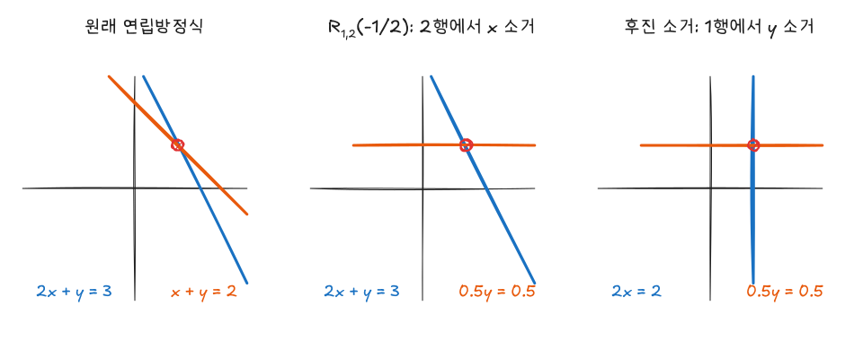
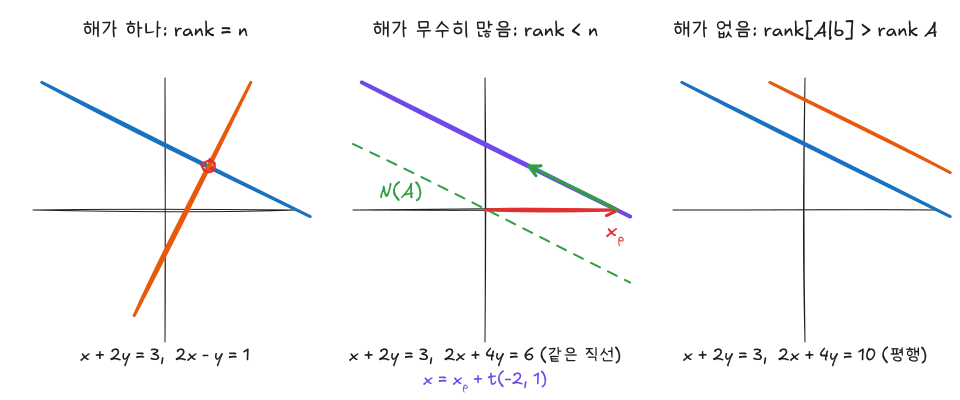

가우스 소거법은 기본행렬을 왼쪽에 차례로 곱하는 과정이다. 이 관점으로 가우스-조르당 소거법으로 역행렬을 구하는 방법, LU 분해와 행교환이 필요한 경우의 $\mathbf{PA} = \mathbf{LU}$, 해의 존재와 유일성을 정리한다. 각 절에 R과 Python 확인을 붙이고, 통계에서 이 계산이 어디에 쓰이는지 적었다.

이전 글: [선형대수 - 벡터와 행렬곱을 보는 여러 관점](/posts/la-vector-matrix)

## 1. 기본행렬

기본 행 연산 세 가지는 각각 단위행렬에 같은 연산을 한 **기본행렬**을 왼쪽에 곱하는 것과 같다. 이 시리즈에서 쓰는 표기는 다음과 같다.

| 표기 | 연산 | 역행렬 | 행렬식 |
|---|---|---|---|
| $R_{i,j}$ | $i$행과 $j$행을 바꾼다 | $R_{i,j}$ (자기 자신) | $-1$ |
| $R_i(c)$ | $i$행에 $c \neq 0$을 곱한다 | $R_i(1/c)$ | $c$ |
| $R_{i,j}(c)$ | $i$행의 $c$배를 $j$행에 더한다 | $R_{i,j}(-c)$ | $1$ |

역행렬은 "한 연산을 되돌리는 연산"이라 바로 읽힌다.

## 2. 가우스-조르당 소거법과 역행렬

### 원리

$\mathbf{A}$를 기본행렬 $\mathbf{E}_k \cdots \mathbf{E}_1$로 단위행렬까지 줄였다면

$$
\mathbf{E}_k \cdots \mathbf{E}_1 \mathbf{A} = \mathbf{I} \quad\Rightarrow\quad \mathbf{A}^{-1} = \mathbf{E}_k \cdots \mathbf{E}_1 = \mathbf{E}_k \cdots \mathbf{E}_1\mathbf{I}
$$

즉 $\mathbf{A}$에 한 행 연산을 $\mathbf{I}$에도 똑같이 하면 $\mathbf{I}$가 $\mathbf{A}^{-1}$이 된다. 그래서 첨가행렬 $[\mathbf{A} \mid \mathbf{I}]$를 만들어 왼쪽이 $\mathbf{I}$가 될 때까지 소거한다.

$$
[\mathbf{A} \mid \mathbf{I}] \;\longrightarrow\; [\mathbf{I} \mid \mathbf{A}^{-1}]
$$

왼쪽에 0인 행이 생기면 $\mathbf{A}$는 가역이 아니다.

### 기하적 의미: 소거는 교점을 바꾸지 않는다

아래 예시의 행렬로 $\mathbf{A}\mathbf{x} = (3, 2)^T$를 소거하면서 행 그림을 그리면, 각 단계에서 직선은 바뀌지만 교점은 그대로다.



$R_{1,2}(-\tfrac12)$은 두 번째 방정식을 "원래 두 번째 식 $-\tfrac12 \times$ 첫 번째 식"으로 바꾼다. 두 식을 모두 만족하는 점은 이 새 식도 만족하므로, 새 직선은 같은 교점 $(1, 1)$을 지나면서 $x$가 사라진 수평선 $y = 1$이 된다. 후진 소거는 첫 번째 직선을 수직선 $x = 1$로 만든다. 가우스-조르당 소거는 교점을 지나는 직선들을 좌표축에 평행하게 돌려 세워, 해를 그대로 읽을 수 있게 만드는 과정이다. 행 연산이 되돌릴 수 있는 연산이므로 해집합이 바뀌지 않는다는 것이 이 그림의 근거다.

### 예시

$$
\left(\begin{array}{cc|cc} 2 & 1 & 1 & 0 \\ 1 & 1 & 0 & 1 \end{array}\right)
\xrightarrow{R_{1,2}(-\frac12)}
\left(\begin{array}{cc|cc} 2 & 1 & 1 & 0 \\ 0 & \frac12 & -\frac12 & 1 \end{array}\right)
\xrightarrow{R_2(2)}
\left(\begin{array}{cc|cc} 2 & 1 & 1 & 0 \\ 0 & 1 & -1 & 2 \end{array}\right)
$$

$$
\xrightarrow{R_{2,1}(-1)}
\left(\begin{array}{cc|cc} 2 & 0 & 2 & -2 \\ 0 & 1 & -1 & 2 \end{array}\right)
\xrightarrow{R_1(\frac12)}
\left(\begin{array}{cc|cc} 1 & 0 & 1 & -1 \\ 0 & 1 & -1 & 2 \end{array}\right)
$$

따라서 $\mathbf{A}^{-1} = \begin{pmatrix} 1 & -1 \\ -1 & 2 \end{pmatrix}$이고, $\mathbf{A}\mathbf{A}^{-1} = \mathbf{I}$로 확인된다.

- **가우스 소거법**: 행사다리꼴(선행성분 아래가 0)까지 만든다.
- **가우스-조르당 소거법**: 기약행사다리꼴(선행성분이 1이고, 그 열의 다른 성분이 모두 0)까지 만든다.

```r
M <- matrix(c(2, 1, 1, 1), nrow = 2)   # [[2, 1], [1, 1]]
solve(M)                               # 역행렬: [[1, -1], [-1, 2]]
M %*% solve(M)                         # 단위행렬
```

```python
import numpy as np

np.linalg.inv([[2, 1], [1, 1]])        # [[ 1, -1], [-1,  2]]
```

손으로 구한 $\mathbf{A}^{-1}$과 같다. 수치 계산에서는 역행렬을 직접 구해 곱하기보다 `solve(A, b)`처럼 연립방정식으로 푸는 편이 정확하고 빠르다.

**통계에서의 쓰임:** 선형회귀의 정규방정식 $(\mathbf{X}^T\mathbf{X})\hat{\boldsymbol\beta} = \mathbf{X}^T\mathbf{y}$를 푸는 일이 곧 $\mathbf{X}^T\mathbf{X}$로 소거하는 일이다. R의 `solve(A, b)`는 내부적으로 $\mathbf{A}$를 LU 분해(부분 피벗 포함)해서 $\mathbf{Ax}=\mathbf{b}$를 푼다. 공식 $\hat{\boldsymbol\beta}=(\mathbf{X}^T\mathbf{X})^{-1}\mathbf{X}^T\mathbf{y}$는 역행렬을 구하라는 뜻이 아니라 이 연립방정식을 풀라는 뜻으로 읽는다.

## 3. LU 분해

### 아이디어

행교환 없이 소거가 끝나면, 사용한 기본행렬은 모두 $R_{i,j}(c)$ ($i < j$) 형태이고 이들은 하삼각행렬이다.

$$
\underbrace{\mathbf{E}_k \cdots \mathbf{E}_1}_{\text{하삼각}}\mathbf{A} = \mathbf{U}\;(\text{상삼각})
\quad\Rightarrow\quad
\mathbf{A} = \underbrace{\mathbf{E}_1^{-1} \cdots \mathbf{E}_k^{-1}}_{\mathbf{L}}\,\mathbf{U}
$$

- $\mathbf{U}$: 소거 결과인 행사다리꼴
- $\mathbf{L}$: 소거에 쓴 **배수**를 기록한 하삼각행렬. $j$행에서 $i$행의 $l_{ji}$배를 뺐다면 $\mathbf{L}$의 $(j, i)$ 성분이 $l_{ji}$이고, 대각은 1이다.

하삼각행렬끼리의 곱과 (가역인) 하삼각행렬의 역행렬은 다시 하삼각행렬이다. 상삼각행렬도 마찬가지다. 그래서 $\mathbf{L}$이 하삼각으로 유지된다.

### 예시

$$
\mathbf{A} = \begin{pmatrix} 1 & 2 & 4 \\ 3 & 8 & 14 \\ 2 & 6 & 13 \end{pmatrix}
$$

| 단계 | 연산 | 배수 | 결과 |
|---|---|---|---|
| 1 | 2행 $-$ 3 $\times$ 1행 | $l_{21} = 3$ | 2행 $= (0, 2, 2)$ |
| 2 | 3행 $-$ 2 $\times$ 1행 | $l_{31} = 2$ | 3행 $= (0, 2, 5)$ |
| 3 | 3행 $-$ 1 $\times$ 2행 | $l_{32} = 1$ | 3행 $= (0, 0, 3)$ |

$$
\mathbf{A} = \mathbf{LU} =
\begin{pmatrix} 1 & 0 & 0 \\ 3 & 1 & 0 \\ 2 & 1 & 1 \end{pmatrix}
\begin{pmatrix} 1 & 2 & 4 \\ 0 & 2 & 2 \\ 0 & 0 & 3 \end{pmatrix}
$$

곱해 보면 3행은 $2(1, 2, 4) + 1(0, 2, 2) + (0, 0, 3) = (2, 6, 13)$으로 $\mathbf{A}$와 같다. 위 표의 과정을 코드로 옮겨 확인한다. 행교환 없이 소거하는 짧은 함수다.

```r
lu_nopivot <- function(A) {
  n <- nrow(A); L <- diag(n); U <- A
  for (j in 1:(n - 1)) for (i in (j + 1):n) {
    L[i, j] <- U[i, j] / U[j, j]          # 배수를 L에 기록
    U[i, ] <- U[i, ] - L[i, j] * U[j, ]   # i행에서 j행의 배수를 뺀다
  }
  list(L = L, U = U)
}
A <- matrix(c(1, 3, 2, 2, 8, 6, 4, 14, 13), nrow = 3)   # 열 우선 입력
r <- lu_nopivot(A)
r$L; r$U
all.equal(r$L %*% r$U, A)    # TRUE
```

출력은 $\mathbf{L} = \begin{pmatrix}1&0&0\\3&1&0\\2&1&1\end{pmatrix}$, $\mathbf{U} = \begin{pmatrix}1&2&4\\0&2&2\\0&0&3\end{pmatrix}$로 손계산과 같고, $\mathbf{LU}=\mathbf{A}$이다. $\det\mathbf{A} = 1\cdot2\cdot3 = 6$이며 `det(A)`도 6이다.

### 쓰임

$\mathbf{Ax} = \mathbf{b}$를 $\mathbf{Ly} = \mathbf{b}$(전진대입), $\mathbf{Ux} = \mathbf{y}$(후진대입) 두 번으로 푼다. $\mathbf{A}$가 같고 $\mathbf{b}$만 바뀌는 문제에서 분해를 한 번만 하면 된다. 또한 $\det(\mathbf{A}) = \det(\mathbf{U}) = u_{11}u_{22}\cdots u_{nn}$이다.

### 콜레스키 분해

$\mathbf{A}$가 대칭이고 양의 정부호이면 행교환 없이 $\mathbf{A} = \mathbf{R}^T\mathbf{R}$($\mathbf{R}$은 대각 성분이 양수인 상삼각행렬)로 분해된다. 이를 **콜레스키 분해**라 하며, LU 분해에서 $\mathbf{U}$를 $\mathbf{L}^T$의 꼴로 대칭적으로 나눈 것으로 볼 수 있어 계산량이 대략 절반이다. 양의 정부호의 뜻과 판정은 [고유값과 대각화](/posts/la-eigen)에서 다룬다.

**통계에서의 쓰임:** $\mathbf{X}^T\mathbf{X}$는 대칭이고 $\mathbf{X}$의 열이 일차독립이면 양의 정부호이므로 콜레스키 분해가 가능하다. 공분산 행렬 $\boldsymbol\Sigma = \mathbf{R}^T\mathbf{R}$을 분해하면 독립인 표준정규 벡터 $\mathbf{z}$에서 $\mathbf{R}^T\mathbf{z}$로 공분산이 $\boldsymbol\Sigma$인 다변량 정규 난수를 만들 수 있다. R에서는 `chol()`이다.

```r
X <- cbind(1, c(1, 2, 3, 4)); y <- c(2.1, 3.9, 6.2, 7.8)
XtX <- crossprod(X)         # [[4, 10], [10, 30]]
Xty <- crossprod(X, y)      # (20, 59.7)
solve(XtX, Xty)             # 정규방정식의 해: 0.15, 1.94
coef(lm(y ~ X[, 2]))        # lm()의 계수와 같다
chol(XtX)                   # 상삼각 R: [[2, 5], [0, 2.236]]
```

```python
X = np.c_[np.ones(4), [1, 2, 3, 4]]; y = np.array([2.1, 3.9, 6.2, 7.8])
np.linalg.solve(X.T @ X, X.T @ y)    # [0.15, 1.94]
np.linalg.cholesky(X.T @ X)          # 하삼각 L (R의 chol은 R^T = L)
```

정규방정식을 `solve()`로 풀면 절편 0.15, 기울기 1.94가 나오고 `lm()`의 계수와 일치한다. 손으로도 $\det(\mathbf{X}^T\mathbf{X}) = 4\cdot30-10^2 = 20$이고 $\hat\beta_0 = (30\cdot20-10\cdot59.7)/20 = 0.15$이다. `chol(XtX)`의 $\mathbf{R}$은 $\mathbf{R}^T\mathbf{R} = \mathbf{X}^T\mathbf{X}$를 만족한다.

## 4. 행교환이 필요한 경우: PA = LU

피벗 자리에 0이 오면 행을 바꿔야 하고, 그러면 $\mathbf{L}$이 하삼각이 아니게 된다. 해결책은 **행교환을 모두 맨 오른쪽(가장 먼저 하는 연산)으로 옮기는 것**이다.

### 행교환 행렬 옮기기

$R_{k,l}$을 다른 기본행렬 오른쪽으로 넘길 때는, 그 기본행렬 첨자의 $k$와 $l$을 서로 바꾼다.

$$
R_{k,l}\,R_{i,j}(c) = R_{i',j'}(c)\,R_{k,l} \qquad (i', j' = i, j \text{에서 } k \leftrightarrow l)
$$

예를 들어 $R_{3,4}R_{2,4}(c) = R_{2,3}(c)R_{3,4}$이다. 양쪽 모두 "3행 자리에 (원래 4행 + $c \times$ 2행), 4행 자리에 원래 3행"을 만든다. 이 규칙을 반복하면

$$
\begin{aligned}
\mathbf{U} &= R_{3,4}(a_6)\,R_{3,4}\,\big(R_{2,4}(a_5)\,R_{2,3}(a_4)\big)\big(R_{1,4}(a_3)\,R_{1,2}(a_2)\,R_{1,3}(a_1)\big)R_{2,3}\,\mathbf{A} \\
&= R_{3,4}(a_6)\big(R_{2,3}(a_5)\,R_{2,4}(a_4)\big)\,R_{3,4}\,\big(R_{1,4}(a_3)\,R_{1,2}(a_2)\,R_{1,3}(a_1)\big)R_{2,3}\,\mathbf{A} \\
&= \underbrace{R_{3,4}(a_6)\,R_{2,3}(a_5)\,R_{2,4}(a_4)\,R_{1,3}(a_3)\,R_{1,2}(a_2)\,R_{1,4}(a_1)}_{\text{하삼각}}\;\underbrace{R_{3,4}\,R_{2,3}}_{\mathbf{P}}\,\mathbf{A}
\end{aligned}
$$

행교환을 모두 모은 $\mathbf{P}$는 **치환행렬**(각 행과 각 열에 1이 정확히 하나)이다. 따라서

$$
\mathbf{PA} = \mathbf{LU}
$$

**가역행렬은 항상** 적절한 치환행렬 $\mathbf{P}$에 대해 이렇게 분해된다.

실제 수치 계산에서는 0이 아니더라도 절댓값이 가장 큰 성분을 피벗으로 고른다(**부분 피벗**). 작은 수로 나누면 반올림 오차가 커지기 때문이다. 앞의 $\mathbf{A}$를 라이브러리로 분해하면 첫 열에서 가장 큰 성분 3(2행)이 피벗이 되어, 손으로 한 것과 다른 $\mathbf{P}, \mathbf{L}, \mathbf{U}$가 나온다.

```r
library(Matrix)
e <- expand(lu(A))                       # A = P L U
P <- as.matrix(e$P); L <- as.matrix(e$L); U <- as.matrix(e$U)
t(P) %*% A                               # A의 행을 2, 3, 1행 순서로 재배열 (PA의 P는 t(P))
all.equal(t(P) %*% A, L %*% U)           # TRUE
```

```python
from scipy.linalg import lu

A = np.array([[1, 2, 4], [3, 8, 14], [2, 6, 13]], dtype=float)
P, L, U = lu(A)      # A = P @ L @ U (부분 피벗)
```

`t(P) %*% A`의 행 순서는 $(3, 8, 14), (2, 6, 13), (1, 2, 4)$이다. 이 행렬의 소거 배수는 $\mathbf{L}$의 $2/3,\ 1/3,\ -1$이고 $\mathbf{U}$의 대각은 $3,\ 2/3,\ 3$이다. 라이브러리는 $\mathbf{A} = \mathbf{PLU}$ 꼴로 돌려주므로, 이 글의 $\mathbf{PA} = \mathbf{LU}$에서 쓰는 치환행렬은 $\mathbf{P}^T$이다. 같은 $\mathbf{A}$라도 피벗 선택에 따라 $\mathbf{L}$과 $\mathbf{U}$가 달라지며, 대각의 곱 $3\cdot\tfrac23\cdot3 = 6$은 $\lvert\det\mathbf{A}\rvert$와 같다.

## 5. 해의 존재와 유일성

### rank로 판정하기

$m \times n$ 행렬 $\mathbf{A}$와 첨가행렬 $[\mathbf{A} \mid \mathbf{b}]$를 소거하면 해의 개수가 rank로 정해진다. $r = \operatorname{rank}(\mathbf{A})$라 하면

| 조건 | 해 | 소거 결과의 모습 |
|---|---|---|
| $\operatorname{rank}[\mathbf{A} \mid \mathbf{b}] > r$ | 없음 | $(0 \cdots 0 \mid c)$, $c \neq 0$인 행이 생긴다 |
| $\operatorname{rank}[\mathbf{A} \mid \mathbf{b}] = r = n$ | 유일 | 모든 변수가 선행변수 |
| $\operatorname{rank}[\mathbf{A} \mid \mathbf{b}] = r < n$ | 무수히 많음 | 자유변수가 $n - r$개 |

해가 존재한다는 것은 $\mathbf{b}$가 $\mathbf{A}$의 열들의 선형결합, 즉 $\mathbf{b} \in C(\mathbf{A})$라는 뜻이다.

### 해집합의 구조

해가 있으면 모든 해는 **특수해 하나 + 동차방정식의 해** 꼴이다.

$$
\mathbf{x} = \mathbf{x}_p + \mathbf{x}_h, \qquad \mathbf{A}\mathbf{x}_p = \mathbf{b},\quad \mathbf{x}_h \in N(\mathbf{A})
$$

두 해의 차가 $\mathbf{A}(\mathbf{x}_1 - \mathbf{x}_2) = \mathbf{0}$을 만족하기 때문이다. 예를 들어 $x + 2y = 3$, $2x + 4y = 6$은 두 식이 사실상 같아서 $r = 1 < n = 2$이고

$$
\begin{pmatrix} x \\ y \end{pmatrix} = \begin{pmatrix} 3 \\ 0 \end{pmatrix} + t\begin{pmatrix} -2 \\ 1 \end{pmatrix}, \qquad t \in \mathbb{R}
$$

반면 두 번째 식이 $2x + 4y = 7$이면 소거 후 $(0\ \ 0 \mid 1)$이 생겨 해가 없다. 정사각행렬은 가역일 때 정확히 유일해 $\mathbf{x} = \mathbf{A}^{-1}\mathbf{b}$를 갖는다.

```r
A2 <- matrix(c(1, 2, 2, 4), nrow = 2)       # [[1, 2], [2, 4]]
qr(A2)$rank                                 # r = 1
qr(cbind(A2, c(3, 6)))$rank                 # 1 = r < n = 2: 무수히 많음
qr(cbind(A2, c(3, 7)))$rank                 # 2 > r: 해 없음
solve(matrix(c(2, 1, 1, 1), nrow = 2), c(3, 2))   # 가역이면 유일해: 1, 1
```

```python
np.linalg.matrix_rank([[1, 2], [2, 4]])                  # 1
np.linalg.matrix_rank([[1, 2, 3], [2, 4, 6]])            # 1: 해가 무수히 많음
np.linalg.matrix_rank([[1, 2, 3], [2, 4, 7]])            # 2: 해 없음
```

첨가행렬의 rank가 $r=1$로 그대로이면 해가 존재하고, $2$로 올라가면 해가 없다. 가역인 $\begin{pmatrix}2&1\\1&1\end{pmatrix}$에 $\mathbf{b}=(3,2)^T$를 주면 `solve()`가 유일해 $(1, 1)$을 돌려준다.

세 경우를 행 그림으로 나란히 놓으면 다음과 같다. 해가 없는 경우는 구분이 잘 되도록 $2x + 4y = 10$을 그렸다.



두 직선이 한 점에서 만나면 해가 하나, 겹치면 직선 전체가 해, 평행하면 해가 없다. 가운데 그림은 해집합의 구조를 그대로 보여 준다. 해집합(보라색)은 특수해 $\mathbf{x}_p = (3, 0)$에서 출발해 영공간 $N(\mathbf{A})$(초록 점선)의 방향 $(-2, 1)$으로 움직인 직선, 즉 영공간을 $\mathbf{x}_p$만큼 평행이동한 것이다. 영공간은 원점을 지나지만 해집합은 원점을 지나지 않으므로, $\mathbf{b} \neq \mathbf{0}$인 연립방정식의 해집합은 부분공간이 아니다.


## 비교

세 방법은 모두 기본 행 연산을 쓰지만 무엇을 남기느냐가 다르다.

| 방법 | 형태 | 비용 | 쓰임 |
|---|---|---|---|
| 가우스-조르당 | $[\mathbf{A}\mid\mathbf{I}]\to[\mathbf{I}\mid\mathbf{A}^{-1}]$ | 크다 ($\mathbf{I}$까지 함께 소거) | 손으로 역행렬 |
| LU | $\mathbf{A}=\mathbf{LU}$ | 분해 $\approx\tfrac23n^3$, 이후 풀이 $\approx 2n^2$ | 같은 $\mathbf{A}$, 여러 $\mathbf{b}$ |
| PA=LU | $\mathbf{PA}=\mathbf{LU}$ | LU와 같고 피벗 탐색만 추가 | 실제 수치 계산 (`solve()`) |

- 0 피벗이 없고 손으로 풀 때는 LU, 행교환이 필요하거나 컴퓨터로 풀 때는 PA=LU를 쓴다. 역행렬이 꼭 필요할 때만 가우스-조르당을 쓴다.
- 해의 경우(없음, 유일, 무수히 많음)를 rank로 가르는 표는 5절에 있다.

## 정리

| 항목 | 핵심 |
|---|---|
| 행 연산 | 기본행렬을 **왼쪽**에 곱하는 것 |
| 기본행렬의 역 | $R_{i,j}^{-1} = R_{i,j}$, $R_i(c)^{-1} = R_i(1/c)$, $R_{i,j}(c)^{-1} = R_{i,j}(-c)$ |
| LU 분해 | $\mathbf{L}$ = 소거 배수(대각 1), $\mathbf{U}$ = 행사다리꼴, $\det\mathbf{A} = \prod u_{ii}$ |
| 행교환 필요 | $\mathbf{PA} = \mathbf{LU}$, $R_{k,l}$을 넘길 때 첨자 $k \leftrightarrow l$ |
| 해의 개수 | $\operatorname{rank}[\mathbf{A} \mid \mathbf{b}] > r$이면 없음, $= r = n$이면 유일, $= r < n$이면 $\mathbf{x}_p + N(\mathbf{A})$ |
| 혼동 | 라이브러리의 $\mathbf{A}=\mathbf{PLU}$와 책의 $\mathbf{PA}=\mathbf{LU}$는 $\mathbf{P}$가 전치 관계, 역행렬은 구하지 말고 `solve(A, b)` |

## 참고자료

- 하길찬, 『해설이 있는 선형대수학』
- 유호석, 「선형대수학」, 세종대학교, KOCW 공개강의

다음 글: [선형대수 - 행렬식, 치환과 보간다항식](/posts/la-determinant)
