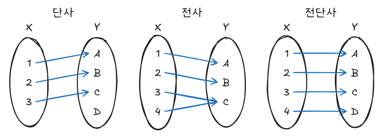
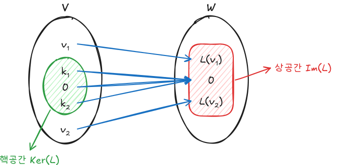
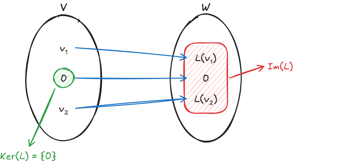
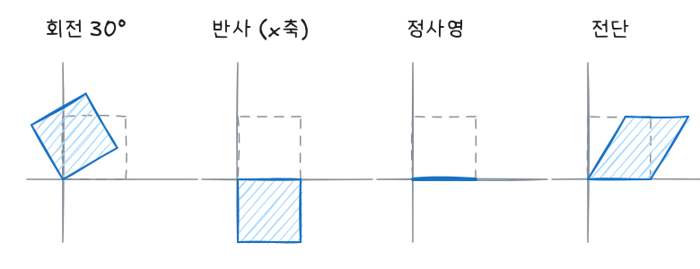
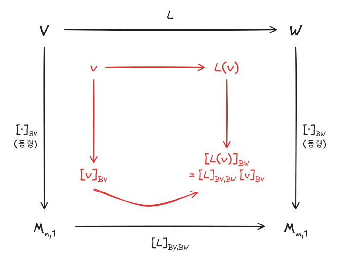

선형사상은 벡터공간 사이에서 덧셈과 스칼라배를 보존하는 함수이고, 기저를 고정하면 하나의 행렬로 표현된다. 이 글은 핵공간·상공간과 차원정리, 동형·등장사상, 행렬표현과 닮음행렬을 다룬다.

이전 글: [선형대수 - 정규직교기저와 최소제곱법](/posts/la-orthonormal)

## 1. 단사, 전사, 전단사

선형사상의 성질을 말할 때 계속 쓰이므로 함수의 세 종류부터 정리한다. $f : X \to Y$에 대해

| 종류 | 정의 | 직관 |
|---|---|---|
| 단사 (injective) | $f(x_1) = f(x_2) \Rightarrow x_1 = x_2$ | 공역의 각 원소가 화살표를 **최대 한 개** 받는다 |
| 전사 (surjective) | $f(X) = Y$ (치역 = 공역) | 공역의 모든 원소가 화살표를 **적어도 한 개** 받는다 |
| 전단사 (bijective) | 단사이면서 전사 | 일대일대응, 역함수가 존재한다 |



## 2. 선형사상

### 정의

벡터공간 $V, W$와 함수 $L : V \to W$가 모든 $\mathbf{v}_1, \mathbf{v}_2, \mathbf{v} \in V$, 스칼라 $k$에 대해 다음을 만족하면 $L$을 **선형사상**이라 한다.

$$
L(\mathbf{v}_1 + \mathbf{v}_2) = L(\mathbf{v}_1) + L(\mathbf{v}_2), \qquad L(k\mathbf{v}) = kL(\mathbf{v})
$$

두 조건을 합쳐 $L(a\mathbf{u} + b\mathbf{v}) = aL(\mathbf{u}) + bL(\mathbf{v})$ 하나로 확인해도 된다.

### 바로 따라오는 성질

$$
L(\mathbf{0}) = \mathbf{0}, \qquad L(-\mathbf{v}) = -L(\mathbf{v}), \qquad L(\mathbf{u} - \mathbf{v}) = L(\mathbf{u}) - L(\mathbf{v})
$$

$L(\mathbf{0}) \neq \mathbf{0}$이면 선형사상이 아니므로, 선형성 판별에서 가장 먼저 확인할 조건이다. 또한 선형사상의 합성 $L_2 \circ L_1$도 선형사상이다.

## 3. 핵공간과 상공간

### 정의

$$
\operatorname{Ker}(L) = \{\mathbf{v} \in V : L(\mathbf{v}) = \mathbf{0}\}, \qquad
\operatorname{Im}(L) = \{L(\mathbf{v}) : \mathbf{v} \in V\}
$$

- **핵공간** $\operatorname{Ker}(L)$: $\mathbf{0}$으로 가는 정의역 벡터의 모임. $V$의 부분공간이다.
- **상공간** $\operatorname{Im}(L)$: 화살표를 받는 공역 벡터의 모임(치역). $W$의 부분공간이다.



### 핵공간과 단사

$L(\mathbf{v}_1) = L(\mathbf{v}_2) \Leftrightarrow L(\mathbf{v}_1 - \mathbf{v}_2) = \mathbf{0} \Leftrightarrow \mathbf{v}_1 - \mathbf{v}_2 \in \operatorname{Ker}(L)$이므로

$$
L \text{이 단사} \iff \operatorname{Ker}(L) = \{\mathbf{0}\}
$$

핵공간에 $\mathbf{0}$만 남으면 서로 다른 벡터가 같은 곳으로 갈 수 없다.



마찬가지로 $\operatorname{Im}(L)$은 $W$의 부분공간이므로, 유한차원에서는 $\dim \operatorname{Im}(L) = \dim W$일 때 $L$이 전사다.

### 차원정리 (rank-nullity)

$\operatorname{nullity}(L) = \dim \operatorname{Ker}(L)$, $\operatorname{rank}(L) = \dim \operatorname{Im}(L)$이라 하면

$$
\operatorname{nullity}(L) + \operatorname{rank}(L) = \dim V
$$

정의역의 차원은 "$\mathbf{0}$으로 사라지는 차원"과 "공역에 살아남는 차원"으로 나뉜다는 뜻이다. $m \times n$ 행렬 $\mathbf{A}$에 대해서는 같은 정리가 다음과 같이 쓰인다.

$$
\dim N(\mathbf{A}) + \operatorname{rank}(\mathbf{A}) = n \;(\mathbf{A}\text{의 열의 수})
$$

## 4. 동형사상과 등장사상

### 동형사상

선형사상이면서 전단사인 $L$을 **동형사상**, 이때 두 공간을 **동형**이라 하고 $V \cong W$로 쓴다. 차원정리에 대입하면

$$
\dim \operatorname{Ker}(L) = 0, \qquad \dim \operatorname{Im}(L) = \dim W \quad\Rightarrow\quad \dim V = \dim W
$$

- 동형사상의 역함수 $L^{-1}$도 선형사상이며, 이를 **역사상**이라 한다.
- 같은 체 위의 유한차원 벡터공간은 **차원이 같으면 동형**이다. 즉 $\dim V = \dim W = n$이면 $V \cong W \cong \mathbb{R}^n$이다.

### 등장사상

내적(따라서 길이)을 보존하는 선형사상을 **등장사상**이라 한다.

$$
\langle L(\mathbf{u}), L(\mathbf{v}) \rangle_W = \langle \mathbf{u}, \mathbf{v} \rangle_V
\iff \lVert L(\mathbf{u}) \rVert = \lVert \mathbf{u} \rVert
$$

선형사상에서는 내적 보존과 norm 보존이 서로 동치다. 내적은 norm으로 표현되기 때문이다($\langle \mathbf{u}, \mathbf{v}\rangle = \tfrac{1}{4}(\lVert \mathbf{u}+\mathbf{v} \rVert^2 - \lVert \mathbf{u}-\mathbf{v} \rVert^2)$).

## 5. 선형사상의 행렬표현

### 유도

$\dim V = n$, $\dim W = m$이고 기저를 $B_V = \{\mathbf{v}_1, \dots, \mathbf{v}_n\}$, $B_W$로 고정한다. $\mathbf{v} = c_1\mathbf{v}_1 + \cdots + c_n\mathbf{v}_n$이면 선형성에 의해

$$
\begin{aligned}
[L(\mathbf{v})]_{B_W}
&= c_1[L(\mathbf{v}_1)]_{B_W} + \cdots + c_n[L(\mathbf{v}_n)]_{B_W} \\
&= \begin{pmatrix} [L(\mathbf{v}_1)]_{B_W} & \cdots & [L(\mathbf{v}_n)]_{B_W} \end{pmatrix}
\begin{pmatrix} c_1 \\ \vdots \\ c_n \end{pmatrix}
\end{aligned}
$$

가운데 $m \times n$ 행렬을 $[L]_{B_V, B_W}$, 오른쪽 좌표벡터를 $[\mathbf{v}]_{B_V}$로 쓰면

$$
[L(\mathbf{v})]_{B_W} = [L]_{B_V, B_W}\,[\mathbf{v}]_{B_V}
$$

$[L]_{B_V, B_W}$를 기저 $B_V, B_W$에 대한 $L$의 **행렬표현**이라 한다.

- **$j$번째 열** $= [L(\mathbf{v}_j)]_{B_W}$, 즉 $j$번째 기저벡터가 어디로 가는지를 $B_W$ 좌표로 적은 것이다.
- 기저를 고정하면 행렬표현은 **유일**하다. 좌표벡터를 아는 것이 벡터를 아는 것과 같기 때문이다.
- $V = \mathbb{R}^n$, $W = \mathbb{R}^m$에서 표준기저를 쓰면 $j$번째 열은 $L(\mathbf{e}_j)$이다.

### 평면 선형변환의 예

$\mathbb{R}^2$에서 행렬의 두 열은 $\mathbf{e}_1 = (1, 0)$, $\mathbf{e}_2 = (0, 1)$이 가는 곳이다. 그래서 단위정사각형이 어떻게 바뀌는지만 보면 행렬을 바로 읽을 수 있다.



| 변환 | 행렬 | $\det$ | 특징 |
|---|---|---|---|
| 회전 ($\theta$) | $\begin{pmatrix} \cos\theta & -\sin\theta \\ \sin\theta & \cos\theta \end{pmatrix}$ | $1$ | 직교행렬, 길이와 각을 보존하는 등장사상 |
| 반사 ($x$축) | $\begin{pmatrix} 1 & 0 \\ 0 & -1 \end{pmatrix}$ | $-1$ | 직교행렬, 방향(시계/반시계)이 뒤집힌다 |
| 정사영 ($x$축) | $\begin{pmatrix} 1 & 0 \\ 0 & 0 \end{pmatrix}$ | $0$ | $\operatorname{Ker}$ = $y$축, $\operatorname{Im}$ = $x$축, $\mathbf{P}^2 = \mathbf{P}$ |
| 전단 | $\begin{pmatrix} 1 & k \\ 0 & 1 \end{pmatrix}$ | $1$ | 넓이는 보존, 길이와 각은 바뀐다 |

행렬식의 절댓값이 넓이 배율, 부호가 방향 보존 여부라는 기하학적 의미와 맞아떨어진다. 정사영은 $\det = 0$이라 단사가 아니며, 차원정리대로 $\dim\operatorname{Ker} + \dim\operatorname{Im} = 1 + 1 = 2$이다.

### 가환 도식

선형사상으로 바로 가는 길(위)과 좌표로 옮긴 뒤 행렬을 곱하는 길(아래)은 같은 결과에 도착한다.



$$
[L(\mathbf{v})]_{B_W} = [L]_{B_V, B_W}\,[\mathbf{v}]_{B_V}
$$

세로 화살표인 좌표 대응이 동형사상이므로, $\mathbf{A} = [L]_{B_V, B_W}$라 하면 선형사상의 성질이 행렬의 성질로 그대로 옮겨진다.

$$
\operatorname{Ker}(L) \cong N(\mathbf{A}), \qquad \operatorname{Im}(L) \cong C(\mathbf{A}), \qquad \operatorname{rank}(L) = \operatorname{rank}(\mathbf{A})
$$

즉 선형사상의 핵공간은 행렬의 **영공간**, 상공간은 행렬의 **열공간**에 대응한다.

### 합성·역·등장사상의 행렬표현

| 상황 | 행렬표현 |
|---|---|
| 합성 $F : V_1 \to V_2$, $G : V_2 \to V_3$ | $[G \circ F]_{B_1, B_3} = [G]_{B_2, B_3}\,[F]_{B_1, B_2}$ |
| 역사상 ($L$이 동형사상) | $[L^{-1}]_{B_2, B_1} = \left([L]_{B_1, B_2}\right)^{-1}$ |
| 등장사상 (실내적공간, $B_1, B_2$가 정규직교기저) | $[L]_{B_1, B_2}^{T}\,[L]_{B_1, B_2} = \mathbf{I}$ (열들이 정규직교, 정사각이면 직교행렬) |

합성은 행렬곱 순서가 사상을 적용하는 순서와 **반대**라는 점에 주의한다.

## 6. 닮음행렬

### 정의

$n \times n$ 행렬 $\mathbf{A}, \mathbf{B}$에 대해 가역행렬 $\mathbf{P}$가 있어 $\mathbf{A} = \mathbf{P}^{-1}\mathbf{B}\mathbf{P}$이면 $\mathbf{A}$와 $\mathbf{B}$를 **닮음행렬**이라 한다.

### 유도: 기저만 바꾼 같은 사상

$L : V \to V$를 두 기저 $B_1, B_2$로 표현해 본다. 항등사상 $\mathrm{id}$를 양쪽에 끼우고 합성의 행렬표현을 쓰면

$$
\begin{aligned}
[L]_{B_1} &= [\mathrm{id} \circ L \circ \mathrm{id}]_{B_1, B_1} \\
&= [\mathrm{id}]_{B_2, B_1}\,[L]_{B_2}\,[\mathrm{id}]_{B_1, B_2} \\
&= \mathbf{P}^{-1}\,[L]_{B_2}\,\mathbf{P}, \qquad \mathbf{P} = [\mathrm{id}]_{B_1, B_2}
\end{aligned}
$$

$\mathbf{P}$는 $B_1$ 좌표를 $B_2$ 좌표로 바꾸는 전이행렬이다. 따라서 **닮음행렬은 같은 선형사상을 다른 기저로 본 행렬**이다. $\mathbf{P}$를 잘 고르면 행렬표현이 단순해지고(대각행렬 등) 계산량이 줄어든다. 이것이 다음 글의 대각화로 이어진다.

### 닮음에서 변하지 않는 값

같은 사상이므로 기저에 의존하지 않는 값은 같다.

$$
\det(\mathbf{A}) = \det(\mathbf{P}^{-1})\det(\mathbf{B})\det(\mathbf{P}) = \det(\mathbf{B})
$$

$$
\operatorname{tr}(\mathbf{A}) = \operatorname{tr}(\mathbf{P}^{-1}\mathbf{B}\mathbf{P}) = \operatorname{tr}(\mathbf{B}\mathbf{P}\mathbf{P}^{-1}) = \operatorname{tr}(\mathbf{B})
$$

두 번째 식은 $\operatorname{tr}(\mathbf{XY}) = \operatorname{tr}(\mathbf{YX})$를 이용했다. 같은 이유로 계수(rank)와 고유값도 같다.

## 요약

| 개념 | 핵심 식 | 기억할 점 |
|---|---|---|
| 선형사상 | $L(a\mathbf{u} + b\mathbf{v}) = aL(\mathbf{u}) + bL(\mathbf{v})$ | $L(\mathbf{0}) = \mathbf{0}$부터 확인 |
| 핵공간 | $\operatorname{Ker}(L) = \{\mathbf{v} : L(\mathbf{v}) = \mathbf{0}\}$ | 행렬의 영공간 $N(\mathbf{A})$에 대응 |
| 상공간 | $\operatorname{Im}(L) = \{L(\mathbf{v})\}$ | 행렬의 열공간 $C(\mathbf{A})$에 대응 |
| 단사 판정 | $\operatorname{Ker}(L) = \{\mathbf{0}\}$ | |
| 차원정리 | $\operatorname{nullity}(L) + \operatorname{rank}(L) = \dim V$ | 행렬: $\dim N(\mathbf{A}) + \operatorname{rank}\mathbf{A} = $ 열의 수 |
| 동형 | 선형 + 전단사 | 유한차원에서 차원이 같으면 동형 |
| 등장 | $\lVert L(\mathbf{u}) \rVert = \lVert \mathbf{u} \rVert$ | 정규직교기저에서 행렬표현의 열이 정규직교 |
| 행렬표현 | $[L(\mathbf{v})]_{B_W} = [L]_{B_V,B_W}[\mathbf{v}]_{B_V}$ | $j$열 $= [L(\mathbf{v}_j)]_{B_W}$ |
| 합성 | $[G \circ F] = [G][F]$ | 곱하는 순서가 적용 순서의 반대 |
| 닮음 | $\mathbf{A} = \mathbf{P}^{-1}\mathbf{B}\mathbf{P}$ | 같은 사상, 다른 기저. det·tr·rank·고유값 동일 |

## R / Python으로 확인

```r
th <- pi / 6
rotation <- matrix(c(cos(th), sin(th), -sin(th), cos(th)), nrow = 2)
shear    <- matrix(c(1, 0, 0.6, 1), nrow = 2)

square <- matrix(c(0, 0, 1, 0, 1, 1, 0, 1), nrow = 2)   # 꼭짓점을 열로
rotation %*% square
det(rotation); det(shear)                               # 넓이 배율 1, 1
```

```python
import numpy as np

t = np.deg2rad(30)
rotation   = np.array([[np.cos(t), -np.sin(t)], [np.sin(t), np.cos(t)]])
reflection = np.array([[1, 0], [0, -1]])
projection = np.array([[1, 0], [0, 0]])
shear      = np.array([[1, 0.6], [0, 1]])

square = np.array([[0, 1, 1, 0], [0, 0, 1, 1]])   # 단위정사각형의 꼭짓점(열)
rotation @ square                                  # 변환된 꼭짓점
[np.linalg.det(M) for M in (rotation, reflection, projection, shear)]   # 넓이 배율: 1, -1, 0, 1
```

## 참고자료

- 하길찬, 『해설이 있는 선형대수학』
- 유호석, 「선형대수학」, 세종대학교, KOCW 공개강의

다음 글: [선형대수 - 고유값, 대각화와 이차형식](/posts/la-eigen)
