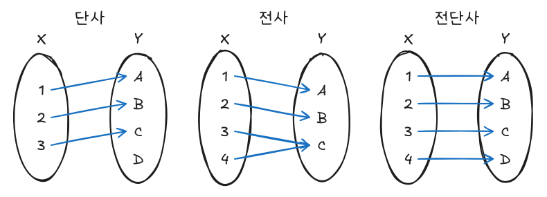
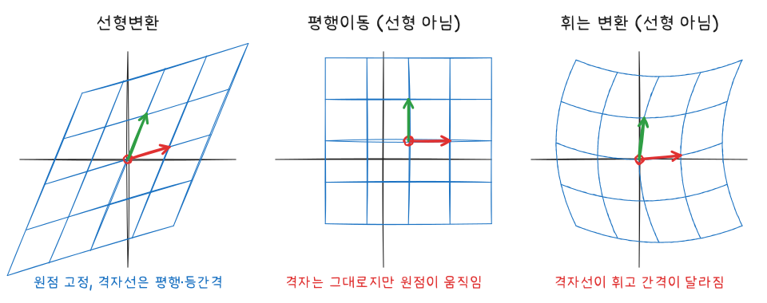
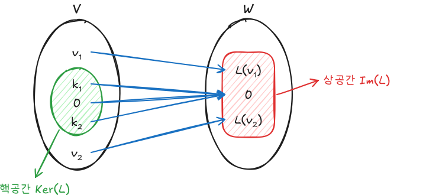
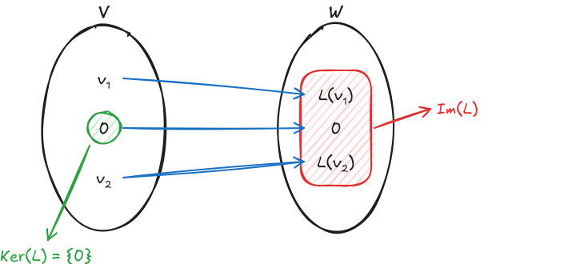
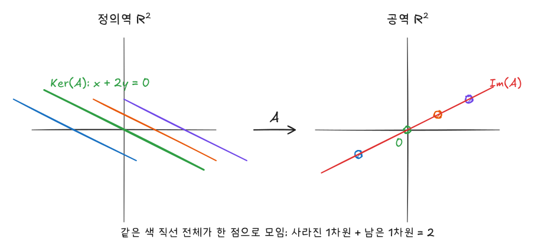
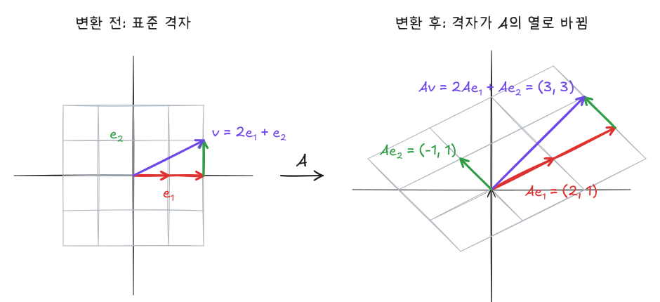
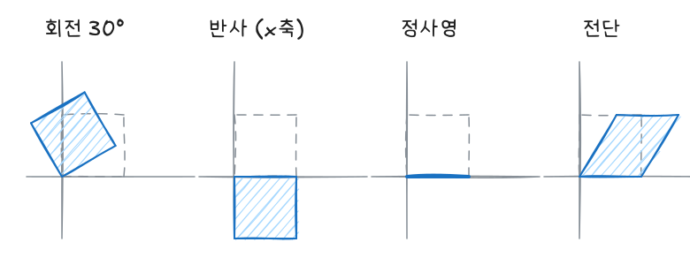
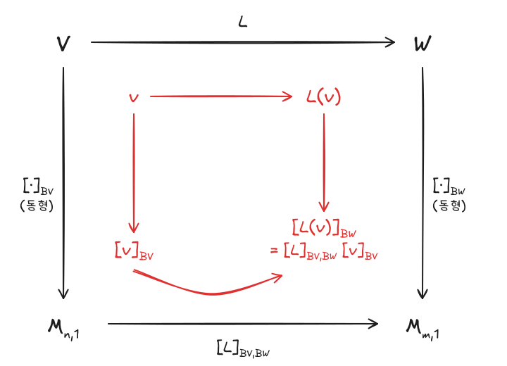
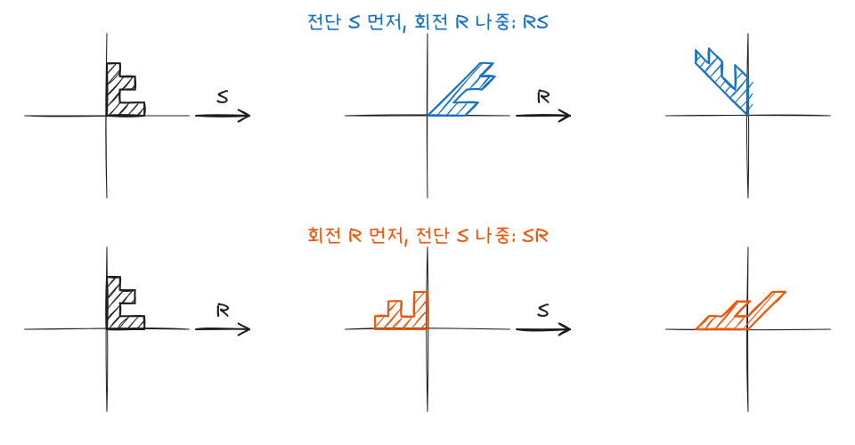
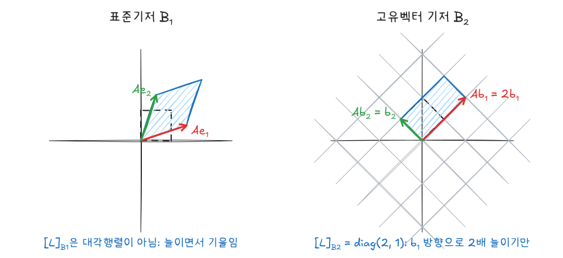

선형사상은 벡터공간 사이에서 덧셈과 스칼라배를 보존하는 함수이고, 기저를 고정하면 하나의 행렬로 표현된다. 이 글은 핵공간·상공간과 차원정리, 동형·등장사상, 행렬표현과 닮음행렬을 다룬다. 코드는 해당 소절에 붙였고, 7절에서 표준화, 회전, 주성분 점수가 선형사상으로 어떻게 읽히는지 보인다. 헷갈리는 쌍은 비교 절에 모았다.

이전 글: [선형대수 - 정규직교기저와 최소제곱법](/posts/la-orthonormal)

## 1. 단사, 전사, 전단사

선형사상의 성질을 말할 때 계속 쓰이므로 함수의 세 종류부터 정리한다. $f : X \to Y$에 대해

| 종류 | 정의 | 직관 |
|---|---|---|
| 단사 (injective) | $f(x_1) = f(x_2) \Rightarrow x_1 = x_2$ | 공역의 각 원소가 화살표를 **최대 한 개** 받는다 |
| 전사 (surjective) | $f(X) = Y$ (치역 = 공역) | 공역의 모든 원소가 화살표를 **적어도 한 개** 받는다 |
| 전단사 (bijective) | 단사이면서 전사 | 일대일대응, 역함수가 존재한다 |



## 2. 선형사상

### 정의

벡터공간 $V, W$와 함수 $L : V \to W$가 모든 $\mathbf{v}_1, \mathbf{v}_2, \mathbf{v} \in V$, 스칼라 $k$에 대해 다음을 만족하면 $L$을 **선형사상**이라 한다.

$$
L(\mathbf{v}_1 + \mathbf{v}_2) = L(\mathbf{v}_1) + L(\mathbf{v}_2), \qquad L(k\mathbf{v}) = kL(\mathbf{v})
$$

두 조건을 합쳐 $L(a\mathbf{u} + b\mathbf{v}) = aL(\mathbf{u}) + bL(\mathbf{v})$ 하나로 확인해도 된다.

### 기하적 의미

평면의 격자에 사상을 적용해 보면 선형성의 조건이 그림으로 드러난다. 덧셈을 보존하므로 격자선은 직선으로 남고 서로 평행하며, 스칼라배를 보존하므로 격자선의 간격이 일정하게 유지된다. 그리고 $L(\mathbf{0}) = \mathbf{0}$이므로 원점이 움직이지 않는다.



평행이동 $\mathbf{v} \mapsto \mathbf{v} + \mathbf{b}$는 격자의 모양을 그대로 두지만 원점을 옮기므로 선형사상이 아니다. 이런 사상은 선형사상과 평행이동의 합성으로, **아핀사상**이라 한다. 격자선을 휘게 하는 변환은 두 조건을 모두 만족하지 않는다. 선형사상은 공간을 늘이고, 기울이고, 회전하고, 뒤집고, 납작하게 할 수는 있어도 휘게 할 수는 없다.

### 바로 따라오는 성질

$$
L(\mathbf{0}) = \mathbf{0}, \qquad L(-\mathbf{v}) = -L(\mathbf{v}), \qquad L(\mathbf{u} - \mathbf{v}) = L(\mathbf{u}) - L(\mathbf{v})
$$

$L(\mathbf{0}) \neq \mathbf{0}$이면 선형사상이 아니므로, 선형성 판별에서 가장 먼저 확인할 조건이다. 또한 선형사상의 합성 $L_2 \circ L_1$도 선형사상이다.

## 3. 핵공간과 상공간

### 정의

$$
\operatorname{Ker}(L) = \{\mathbf{v} \in V : L(\mathbf{v}) = \mathbf{0}\}, \qquad
\operatorname{Im}(L) = \{L(\mathbf{v}) : \mathbf{v} \in V\}
$$

- **핵공간** $\operatorname{Ker}(L)$: $\mathbf{0}$으로 가는 정의역 벡터의 모임. $V$의 부분공간이다.
- **상공간** $\operatorname{Im}(L)$: 화살표를 받는 공역 벡터의 모임(치역). $W$의 부분공간이다.



### 핵공간과 단사

$L(\mathbf{v}_1) = L(\mathbf{v}_2) \Leftrightarrow L(\mathbf{v}_1 - \mathbf{v}_2) = \mathbf{0} \Leftrightarrow \mathbf{v}_1 - \mathbf{v}_2 \in \operatorname{Ker}(L)$이므로

$$
L \text{이 단사} \iff \operatorname{Ker}(L) = \{\mathbf{0}\}
$$

핵공간에 $\mathbf{0}$만 남으면 서로 다른 벡터가 같은 곳으로 갈 수 없다.



마찬가지로 $\operatorname{Im}(L)$은 $W$의 부분공간이므로, 유한차원에서는 $\dim \operatorname{Im}(L) = \dim W$일 때 $L$이 전사다.

### 차원정리 (rank-nullity)

$\operatorname{nullity}(L) = \dim \operatorname{Ker}(L)$, $\operatorname{rank}(L) = \dim \operatorname{Im}(L)$이라 하면

$$
\operatorname{nullity}(L) + \operatorname{rank}(L) = \dim V
$$

정의역의 차원은 "$\mathbf{0}$으로 사라지는 차원"과 "공역에 살아남는 차원"으로 나뉜다는 뜻이다. $m \times n$ 행렬 $\mathbf{A}$에 대해서는 같은 정리가 다음과 같이 쓰인다.

$$
\dim N(\mathbf{A}) + \operatorname{rank}(\mathbf{A}) = n \;(\mathbf{A}\text{의 열의 수})
$$

계수가 1인 $\mathbf{A} = \begin{pmatrix} 1 & 2 \\ 0.5 & 1 \end{pmatrix}$로 차원정리를 그림으로 확인한다. 두 열이 평행하므로 평면 전체가 직선 하나로 납작해진다.



핵공간은 $x + 2y = 0$인 직선이고, 이 직선은 원점으로 간다. 핵공간과 평행한 다른 직선 $x + 2y = c$도 각각 한 점 $(c, 0.5c)$로 모인다. 직선 위의 두 점은 차이가 핵공간에 속하므로 같은 곳으로 가기 때문이다. 결과적으로 정의역의 2차원 중 핵 방향의 1차원은 사라지고, 나머지 1차원만 상공간 $\operatorname{Im}(\mathbf{A})$라는 직선으로 남는다. 같은 그림에서 $\mathbf{A}\mathbf{x} = \mathbf{b}$의 해집합도 읽을 수 있다. $\mathbf{b}$가 상공간 위에 있으면 해집합은 핵공간을 평행이동한 직선 하나이고, 상공간 밖에 있으면 해가 없다.

```r
A <- matrix(c(1, 0.5, 2, 1), nrow = 2)   # 열이 (1, 0.5), (2, 1): 서로 평행
qr(A)$rank                               # rank 1
s <- svd(A)
round(s$d, 10)                           # 특이값 2.5, 0: 평면이 직선으로 납작해진다
s$v[, 2]                                 # 핵공간 방향 (0.894, -0.447) ∝ (2, -1)
A %*% c(-2, 1)                           # 핵공간의 벡터는 0으로 간다
```

```python
import numpy as np

A = np.array([[1, 2], [0.5, 1]])
np.linalg.matrix_rank(A)                 # 1
U, d, Vt = np.linalg.svd(A)
np.round(d, 10)                          # [2.5, 0]
Vt[1]                                    # 핵공간 방향 (부호는 라이브러리에 따라 다르다)
A @ np.array([-2, 1])                    # [0, 0]
```

rank가 1이므로 $\dim\operatorname{Ker} = 2 - 1 = 1$이고, 핵공간 방향은 $x + 2y = 0$인 직선의 방향 $(2, -1)$(부호는 임의)에 해당한다. 두 번째 특이값이 0이라는 것이 평면이 한 방향으로 납작해진다는 뜻이다(특이값은 [SVD](/posts/la-svd) 글에서 다룬다).

## 4. 동형사상과 등장사상

### 동형사상

선형사상이면서 전단사인 $L$을 **동형사상**, 이때 두 공간을 **동형**이라 하고 $V \cong W$로 쓴다. 차원정리에 대입하면

$$
\dim \operatorname{Ker}(L) = 0, \qquad \dim \operatorname{Im}(L) = \dim W \quad\Rightarrow\quad \dim V = \dim W
$$

- 동형사상의 역함수 $L^{-1}$도 선형사상이며, 이를 **역사상**이라 한다.
- 같은 체 위의 유한차원 벡터공간은 **차원이 같으면 동형**이다. 즉 $\dim V = \dim W = n$이면 $V \cong W \cong \mathbb{R}^n$이다.

### 등장사상

내적(따라서 길이)을 보존하는 선형사상을 **등장사상**이라 한다.

$$
\langle L(\mathbf{u}), L(\mathbf{v}) \rangle_W = \langle \mathbf{u}, \mathbf{v} \rangle_V
\iff \lVert L(\mathbf{u}) \rVert = \lVert \mathbf{u} \rVert
$$

선형사상에서는 내적 보존과 norm 보존이 서로 동치다. 내적은 norm으로 표현되기 때문이다($\langle \mathbf{u}, \mathbf{v}\rangle = \tfrac{1}{4}(\lVert \mathbf{u}+\mathbf{v} \rVert^2 - \lVert \mathbf{u}-\mathbf{v} \rVert^2)$).

## 5. 선형사상의 행렬표현

### 유도

$\dim V = n$, $\dim W = m$이고 기저를 $B_V = \{\mathbf{v}_1, \dots, \mathbf{v}_n\}$, $B_W$로 고정한다. $\mathbf{v} = c_1\mathbf{v}_1 + \cdots + c_n\mathbf{v}_n$이면 선형성에 의해

$$
\begin{aligned}
[L(\mathbf{v})]_{B_W}
&= c_1[L(\mathbf{v}_1)]_{B_W} + \cdots + c_n[L(\mathbf{v}_n)]_{B_W} \\
&= \begin{pmatrix} [L(\mathbf{v}_1)]_{B_W} & \cdots & [L(\mathbf{v}_n)]_{B_W} \end{pmatrix}
\begin{pmatrix} c_1 \\ \vdots \\ c_n \end{pmatrix}
\end{aligned}
$$

가운데 $m \times n$ 행렬을 $[L]_{B_V, B_W}$, 오른쪽 좌표벡터를 $[\mathbf{v}]_{B_V}$로 쓰면

$$
[L(\mathbf{v})]_{B_W} = [L]_{B_V, B_W}\,[\mathbf{v}]_{B_V}
$$

$[L]_{B_V, B_W}$를 기저 $B_V, B_W$에 대한 $L$의 **행렬표현**이라 한다.

- **$j$번째 열** $= [L(\mathbf{v}_j)]_{B_W}$, 즉 $j$번째 기저벡터가 어디로 가는지를 $B_W$ 좌표로 적은 것이다.
- 기저를 고정하면 행렬표현은 **유일**하다. 좌표벡터를 아는 것이 벡터를 아는 것과 같기 때문이다.
- $V = \mathbb{R}^n$, $W = \mathbb{R}^m$에서 표준기저를 쓰면 $j$번째 열은 $L(\mathbf{e}_j)$이다.

행렬의 열이 기저벡터가 가는 곳이라는 사실은 그림으로 보면 더 분명하다. $\mathbf{A} = \begin{pmatrix} 2 & -1 \\ 1 & 1 \end{pmatrix}$에 대해 $\mathbf{v} = (2, 1) = 2\mathbf{e}_1 + \mathbf{e}_2$를 변환한다.



변환 후의 격자는 $\mathbf{A}\mathbf{e}_1 = (2, 1)$과 $\mathbf{A}\mathbf{e}_2 = (-1, 1)$, 즉 $\mathbf{A}$의 두 열이 만드는 격자다. $\mathbf{v}$는 변환 전 격자에서 "$\mathbf{e}_1$ 방향으로 2칸, $\mathbf{e}_2$ 방향으로 1칸"인 점이었고, 선형성에 의해 변환 후에도 새 격자에서 같은 칸 수만큼 간 점으로 옮겨진다.

$$
\mathbf{A}\mathbf{v} = 2\,\mathbf{A}\mathbf{e}_1 + 1\,\mathbf{A}\mathbf{e}_2 = 2\begin{pmatrix} 2 \\ 1 \end{pmatrix} + \begin{pmatrix} -1 \\ 1 \end{pmatrix} = \begin{pmatrix} 3 \\ 3 \end{pmatrix}
$$

행렬과 벡터의 곱을 "열들의 선형결합"으로 읽는 관점이 바로 이것이다. 좌표는 그대로 두고 기준이 되는 격자만 바뀐다.

```r
M <- matrix(c(2, 1, -1, 1), nrow = 2)    # 열: (2, 1), (-1, 1)
v <- c(2, 1)
M %*% v                                  # (3, 3)
2 * M[, 1] + 1 * M[, 2]                  # 열의 선형결합: 같은 값
```

```python
M = np.array([[2, -1], [1, 1]])
v = np.array([2, 1])
M @ v, 2 * M[:, 0] + 1 * M[:, 1]         # 둘 다 [3, 3]
```

### 평면 선형변환의 예

$\mathbb{R}^2$에서 행렬의 두 열은 $\mathbf{e}_1 = (1, 0)$, $\mathbf{e}_2 = (0, 1)$이 가는 곳이다. 그래서 단위정사각형이 어떻게 바뀌는지만 보면 행렬을 바로 읽을 수 있다.



| 변환 | 행렬 | $\det$ | 특징 |
|---|---|---|---|
| 회전 ($\theta$) | $\begin{pmatrix} \cos\theta & -\sin\theta \\ \sin\theta & \cos\theta \end{pmatrix}$ | $1$ | 직교행렬, 길이와 각을 보존하는 등장사상 |
| 반사 ($x$축) | $\begin{pmatrix} 1 & 0 \\ 0 & -1 \end{pmatrix}$ | $-1$ | 직교행렬, 방향(시계/반시계)이 뒤집힌다 |
| 정사영 ($x$축) | $\begin{pmatrix} 1 & 0 \\ 0 & 0 \end{pmatrix}$ | $0$ | $\operatorname{Ker}$ = $y$축, $\operatorname{Im}$ = $x$축, $\mathbf{P}^2 = \mathbf{P}$ |
| 전단 | $\begin{pmatrix} 1 & k \\ 0 & 1 \end{pmatrix}$ | $1$ | 넓이는 보존, 길이와 각은 바뀐다 |

행렬식의 절댓값이 넓이 배율, 부호가 방향 보존 여부라는 기하학적 의미와 맞아떨어진다. 정사영은 $\det = 0$이라 단사가 아니며, 차원정리대로 $\dim\operatorname{Ker} + \dim\operatorname{Im} = 1 + 1 = 2$이다.

```r
th <- pi / 6
rotation   <- matrix(c(cos(th), sin(th), -sin(th), cos(th)), nrow = 2)
reflection <- diag(c(1, -1))
projection <- diag(c(1, 0))
shear      <- matrix(c(1, 0, 0.6, 1), nrow = 2)

square <- matrix(c(0, 0, 1, 0, 1, 1, 0, 1), nrow = 2)   # 꼭짓점을 열로
rotation %*% square                                     # 변환된 꼭짓점
sapply(list(rotation, reflection, projection, shear), det)   # 넓이 배율: 1, -1, 0, 1
zapsmall(crossprod(rotation))                           # Q'Q = I: 회전은 등장사상
```

```python
t = np.deg2rad(30)
rotation   = np.array([[np.cos(t), -np.sin(t)], [np.sin(t), np.cos(t)]])
reflection = np.array([[1, 0], [0, -1]])
projection = np.array([[1, 0], [0, 0]])
shear      = np.array([[1, 0.6], [0, 1]])

square = np.array([[0, 1, 1, 0], [0, 0, 1, 1]])   # 단위정사각형의 꼭짓점(열)
rotation @ square                                  # 변환된 꼭짓점
[np.linalg.det(M) for M in (rotation, reflection, projection, shear)]   # 넓이 배율: 1, -1, 0, 1
np.allclose(rotation.T @ rotation, np.eye(2))     # True
```

행렬식이 표의 값(1, $-1$, 0, 1)과 같고, 회전 행렬은 $\mathbf{Q}^T\mathbf{Q} = \mathbf{I}$를 만족한다. 전단은 $\det = 1$이어도 $\mathbf{S}^T\mathbf{S} \neq \mathbf{I}$라 넓이만 보존하고 등장사상은 아니다.

### 가환 도식

선형사상으로 바로 가는 길(위)과 좌표로 옮긴 뒤 행렬을 곱하는 길(아래)은 같은 결과에 도착한다.



$$
[L(\mathbf{v})]_{B_W} = [L]_{B_V, B_W}\,[\mathbf{v}]_{B_V}
$$

세로 화살표인 좌표 대응이 동형사상이므로, $\mathbf{A} = [L]_{B_V, B_W}$라 하면 선형사상의 성질이 행렬의 성질로 그대로 옮겨진다.

$$
\operatorname{Ker}(L) \cong N(\mathbf{A}), \qquad \operatorname{Im}(L) \cong C(\mathbf{A}), \qquad \operatorname{rank}(L) = \operatorname{rank}(\mathbf{A})
$$

즉 선형사상의 핵공간은 행렬의 **영공간**, 상공간은 행렬의 **열공간**에 대응한다.

### 합성·역·등장사상의 행렬표현

| 상황 | 행렬표현 |
|---|---|
| 합성 $F : V_1 \to V_2$, $G : V_2 \to V_3$ | $[G \circ F]_{B_1, B_3} = [G]_{B_2, B_3}\,[F]_{B_1, B_2}$ |
| 역사상 ($L$이 동형사상) | $[L^{-1}]_{B_2, B_1} = \left([L]_{B_1, B_2}\right)^{-1}$ |
| 등장사상 (실내적공간, $B_1, B_2$가 정규직교기저) | $[L]_{B_1, B_2}^{T}\,[L]_{B_1, B_2} = \mathbf{I}$ (열들이 정규직교, 정사각이면 직교행렬) |

합성은 행렬곱 순서가 사상을 적용하는 순서와 **반대**라는 점에 주의한다.

순서를 바꾸면 결과도 달라진다. $90^\circ$ 회전 $\mathbf{R} = \begin{pmatrix} 0 & -1 \\ 1 & 0 \end{pmatrix}$과 전단 $\mathbf{S} = \begin{pmatrix} 1 & 1 \\ 0 & 1 \end{pmatrix}$을 두 순서로 합성한다.



$$
\mathbf{R}\mathbf{S} = \begin{pmatrix} 0 & -1 \\ 1 & 1 \end{pmatrix}, \qquad \mathbf{S}\mathbf{R} = \begin{pmatrix} 1 & -1 \\ 1 & 0 \end{pmatrix}
$$

전단을 먼저 하면 세로로 서 있던 도형이 오른쪽으로 기운 뒤 회전하고, 회전을 먼저 하면 가로로 누운 도형이 수평 방향으로 밀린다. 두 결과 모두 넓이는 보존되지만($\det = 1$) 모양이 다르다. 행렬곱이 교환법칙을 만족하지 않는 것은 변환을 적용하는 순서가 결과를 바꾸기 때문이다.

```r
R <- matrix(c(0, 1, -1, 0), nrow = 2)    # 90도 회전
S <- matrix(c(1, 0, 1, 1), nrow = 2)     # 전단
R %*% S                                  # 전단 후 회전
S %*% R                                  # 회전 후 전단
c(det(R %*% S), det(S %*% R))            # 둘 다 1
```

```python
R = np.array([[0, -1], [1, 0]])
S = np.array([[1, 1], [0, 1]])
R @ S, S @ R                             # 두 결과가 다르다
```

## 6. 닮음행렬

### 정의

$n \times n$ 행렬 $\mathbf{A}, \mathbf{B}$에 대해 가역행렬 $\mathbf{P}$가 있어 $\mathbf{A} = \mathbf{P}^{-1}\mathbf{B}\mathbf{P}$이면 $\mathbf{A}$와 $\mathbf{B}$를 **닮음행렬**이라 한다.

### 유도: 기저만 바꾼 같은 사상

$L : V \to V$를 두 기저 $B_1, B_2$로 표현해 본다. 항등사상 $\mathrm{id}$를 양쪽에 끼우고 합성의 행렬표현을 쓰면

$$
\begin{aligned}
[L]_{B_2} &= [\mathrm{id} \circ L \circ \mathrm{id}]_{B_2, B_2} \\
&= [\mathrm{id}]_{B_1, B_2}\,[L]_{B_1}\,[\mathrm{id}]_{B_2, B_1} \\
&= \mathbf{P}^{-1}\,[L]_{B_1}\,\mathbf{P}, \qquad \mathbf{P} = [\mathrm{id}]_{B_2, B_1}
\end{aligned}
$$

$\mathbf{P}$는 신기저 $B_2$의 벡터들을 $B_1$ 좌표로 나타낸 전이행렬($B_2 \to B_1$)이며, 그 역행렬 $\mathbf{P}^{-1}$이 $B_1$ 좌표를 $B_2$ 좌표로 바꾼다. 따라서 **닮음행렬은 같은 선형사상을 다른 기저로 본 행렬**이다. $\mathbf{P}$를 잘 고르면 행렬표현이 단순해지고(대각행렬 등) 계산량이 줄어든다. 이것이 다음 글의 대각화로 이어진다.

$\mathbf{A} = \begin{pmatrix} 1.5 & 0.5 \\ 0.5 & 1.5 \end{pmatrix}$를 예로 든다. 표준기저에서는 단위정사각형이 기울어진 평행사변형이 되어 사상의 성질이 잘 보이지 않는다. 기저를 $\mathbf{b}_1 = \tfrac{1}{\sqrt 2}(1, 1)$, $\mathbf{b}_2 = \tfrac{1}{\sqrt 2}(-1, 1)$로 바꾸어 보면, 같은 사상이 $\mathbf{b}_1$ 방향으로 2배 늘이고 $\mathbf{b}_2$ 방향은 그대로 두는 단순한 변환이다.



$$
\mathbf{P} = \frac{1}{\sqrt 2}\begin{pmatrix} 1 & -1 \\ 1 & 1 \end{pmatrix}, \qquad
\mathbf{P}^{-1}\mathbf{A}\mathbf{P} = \begin{pmatrix} 2 & 0 \\ 0 & 1 \end{pmatrix}
$$

두 행렬은 겉모습이 다르지만 같은 사상이므로, 아래에서 보듯 행렬식($1.5^2 - 0.5^2 = 2 = 2 \times 1$)과 대각합($3 = 2 + 1$)이 같다. 행렬표현이 대각행렬이 되는 기저의 벡터 $\mathbf{b}_1$, $\mathbf{b}_2$는 사상을 적용해도 방향이 바뀌지 않는 벡터로, 다음 글의 고유벡터다.

```r
A <- matrix(c(1.5, 0.5, 0.5, 1.5), nrow = 2)
P <- matrix(c(1, 1, -1, 1), nrow = 2) / sqrt(2)          # 열: b1, b2
round(solve(P) %*% A %*% P, 10)                          # diag(2, 1)
c(det(A), sum(diag(A)))                                 # 2, 3
eigen(A)$values                                         # 고유값 2, 1
```

```python
A = np.array([[1.5, 0.5], [0.5, 1.5]])
P = np.array([[1, -1], [1, 1]]) / np.sqrt(2)             # 열: b1, b2
np.round(np.linalg.inv(P) @ A @ P, 10)                   # diag(2, 1)
np.linalg.det(A), np.trace(A)                            # 2, 3
np.linalg.eigvalsh(A)                                    # [1, 2]
```

$\mathbf{P}^{-1}\mathbf{A}\mathbf{P}$가 $\operatorname{diag}(2, 1)$이고, $\det = 2 = 2 \times 1$, $\operatorname{tr} = 3 = 2 + 1$이며 고유값도 $2, 1$이다. 닮음은 기저만 바꾼 것이므로 기저에 의존하지 않는 값이 보존된다.

### 닮음에서 변하지 않는 값

같은 사상이므로 기저에 의존하지 않는 값은 같다.

$$
\det(\mathbf{A}) = \det(\mathbf{P}^{-1})\det(\mathbf{B})\det(\mathbf{P}) = \det(\mathbf{B})
$$

$$
\operatorname{tr}(\mathbf{A}) = \operatorname{tr}(\mathbf{P}^{-1}\mathbf{B}\mathbf{P}) = \operatorname{tr}(\mathbf{B}\mathbf{P}\mathbf{P}^{-1}) = \operatorname{tr}(\mathbf{B})
$$

두 번째 식은 $\operatorname{tr}(\mathbf{XY}) = \operatorname{tr}(\mathbf{YX})$를 이용했다. 같은 이유로 계수(rank)와 고유값도 같다.

## 7. 통계에서의 쓰임

**표준화와 공분산의 변환.** 자료행렬 $\mathbf{X}$의 각 행을 $\mathbf{x}_i$라 하자. 중심화 $\mathbf{x} \mapsto \mathbf{x} - \bar{\mathbf{x}}$는 평행이동이라 선형사상이 아니라 아핀사상이고, 표준화에서 각 변수를 표준편차로 나누는 부분 $\mathbf{x} \mapsto \mathbf{D}^{-1}\mathbf{x}$ ($\mathbf{D} = \operatorname{diag}(s_1, \dots, s_p)$)만 선형사상이다. 평행이동은 공분산에 영향을 주지 않고 선형 부분만 공분산을 바꾼다.

$$
\operatorname{Cov}(\mathbf{A}\mathbf{x} + \mathbf{b}) = \mathbf{A}\,\boldsymbol\Sigma\,\mathbf{A}^T
$$

표준화한 자료의 공분산은 $\mathbf{D}^{-1}\mathbf{S}\mathbf{D}^{-1}$, 즉 상관행렬이다.

**주성분 점수는 좌표 변환이다.** 표본공분산 $\mathbf{S}$는 대칭이므로 정규직교 고유벡터 $\mathbf{V} = (\mathbf{v}_1, \dots, \mathbf{v}_p)$가 있고($\mathbf{V}^T\mathbf{V} = \mathbf{I}$, 다음 글에서 다룬다), 중심화한 관측치의 주성분 점수는 새 기저 $\{\mathbf{v}_j\}$에 대한 좌표다.

$$
\text{점수} = [\mathbf{x} - \bar{\mathbf{x}}]_{\mathcal{V}} = \mathbf{V}^{-1}(\mathbf{x} - \bar{\mathbf{x}}) = \mathbf{V}^T(\mathbf{x} - \bar{\mathbf{x}})
$$

정규직교 기저로의 좌표 변환이므로 이는 **등장사상**이다. 길이와 점 사이의 거리가 변하지 않고, 점들을 회전(과 반사)해서 축을 자료의 분산 방향에 맞춘 것이다. 점수의 공분산은 $\mathbf{V}^T\mathbf{S}\mathbf{V} = \mathbf{V}^{-1}\mathbf{S}\mathbf{V} = \boldsymbol\Lambda$로, $\mathbf{S}$와 대각행렬 $\boldsymbol\Lambda$는 6절의 닮음이다. 따라서 닮음에서 변하지 않는 값이 통계량이 된다: $\operatorname{tr}(\mathbf{S}) = \sum\lambda_j$는 **총분산**, $\det(\mathbf{S}) = \prod\lambda_j$는 **일반화 분산**이다.

```r
X  <- as.matrix(iris[, 1:4])
Xc <- scale(X, scale = FALSE)            # 중심화 (평행이동)
S  <- cov(X)
e  <- eigen(S); V <- e$vectors
scores <- Xc %*% V                       # 행마다 V'(x - xbar)

all.equal(abs(scores), abs(prcomp(X)$x), check.attributes = FALSE)  # prcomp 점수와 같다
round(crossprod(V), 10)                  # V'V = I
round(cov(scores), 4)                    # 대각행렬 Lambda
c(sum(diag(S)), sum(e$values))           # 총분산: 닮음 불변량 tr
c(det(S), prod(e$values))                # 일반화 분산: 닮음 불변량 det
all.equal(as.numeric(dist(scores)), as.numeric(dist(Xc)))   # 거리 보존 (등장)
```

```python
import numpy as np
from sklearn.datasets import load_iris   # scikit-learn이 없으면 R의 iris를 csv로 내보내 읽어도 된다

X = load_iris().data
Xc = X - X.mean(axis=0)
S = np.cov(X, rowvar=False)
lam, V = np.linalg.eigh(S)
lam, V = lam[::-1], V[:, ::-1]           # 큰 고유값 순서
scores = Xc @ V
np.round(np.cov(scores, rowvar=False), 4)          # 대각행렬
np.trace(S), lam.sum(), np.linalg.det(S), lam.prod()
```

`iris`의 네 측정값에서 고유값은 $4.228, 0.243, 0.078, 0.024$이고, 점수의 공분산은 이 값을 대각에 둔 행렬이다(비대각은 0). 총분산은 $\operatorname{tr}(\mathbf{S}) = 4.573 = 4.228 + 0.243 + 0.078 + 0.024$, 일반화 분산은 $\det(\mathbf{S}) = 0.00191$로 고유값의 곱과 같다. 점수 사이의 거리는 중심화한 원자료의 거리와 같다. 주성분 점수는 새 정보를 만든 것이 아니라 같은 점을 다른 좌표계에서 읽은 것이고, 상위 몇 개 성분만 남기면 정사영([정규직교기저와 최소제곱법](/posts/la-orthonormal))이 되어 차원이 줄어든다. 통계적 해석은 [데이터 마이닝 - 주성분분석](/posts/dm-pca)에서 다룬다.

**그 밖의 대응.** 회귀의 hat 행렬 $\mathbf{H}$는 $\mathbb{R}^n$에서 $C(\mathbf{X})$로의 사영이라는 선형사상으로, $\operatorname{Ker}(\mathbf{H}) = C(\mathbf{X})^{\perp}$(잔차 공간), $\operatorname{Im}(\mathbf{H}) = C(\mathbf{X})$(적합값 공간)이며 차원정리가 $(n - p) + p = n$이다. 설계행렬 $\mathbf{X}$의 열이 일차독립이면 $\mathbf{X}\boldsymbol\beta$가 단사라 $\boldsymbol\beta$가 유일하다(비교 절의 표).

## 비교

**단사, 전사, 전단사의 행렬 판정.** $m \times n$ 행렬 $\mathbf{A}$가 정의하는 $L(\mathbf{x}) = \mathbf{A}\mathbf{x}$ ($\mathbb{R}^n \to \mathbb{R}^m$)에서 rank를 $r$이라 하면

| | 단사 | 전사 | 전단사(동형) |
|---|---|---|---|
| 핵공간 조건 | $N(\mathbf{A}) = \{\mathbf{0}\}$ | 해당 없음 | $N(\mathbf{A}) = \{\mathbf{0}\}$ |
| rank 조건 | $r = n$ (열이 일차독립) | $r = m$ ($C(\mathbf{A}) = \mathbb{R}^m$) | $r = m = n$ |
| 모양 | $m \ge n$ | $m \le n$ | 정사각, 가역 |
| $\mathbf{Ax} = \mathbf{b}$의 해 | 있으면 유일 | 항상 존재 | 항상 유일하게 존재 |
| 통계에서 | 계수 $\boldsymbol\beta$가 유일 (공선성 없음) | 어떤 $\mathbf{y}$도 $\mathbf{X}\boldsymbol\beta$로 표현 | $n = p$일 때 완전 적합 |

**동형사상과 등장사상.** 모든 등장사상은 단사이고, 정사각이면 동형이다. 반대는 성립하지 않는다.

| 항목 | 선형사상 | 동형사상 | 등장사상 |
|---|---|---|---|
| 보존하는 것 | 덧셈, 스칼라배 | 선형 구조 전부(전단사) | 선형 구조 + 내적과 길이 |
| 조건 | $L(a\mathbf{u} + b\mathbf{v}) = aL(\mathbf{u}) + bL(\mathbf{v})$ | 선형 + 전단사, $\dim V = \dim W$ | $\lVert L(\mathbf{u}) \rVert = \lVert \mathbf{u} \rVert$ |
| 행렬표현 | 임의의 $m \times n$ | 정사각 가역 | 정규직교기저에서 $\mathbf{A}^T\mathbf{A} = \mathbf{I}$ |
| 예 | 정사영, 전단 | 전단, 회전, 가역행렬 | 회전, 반사 |
| 평면에서 | 늘이고, 기울이고, 납작하게 | 납작하게 하지는 않는다($\det \ne 0$) | 모양도 유지($\lvert\det\rvert = 1$) |

**닮음에서 변하는 값과 변하지 않는 값.** $\mathbf{A} = \mathbf{P}^{-1}\mathbf{B}\mathbf{P}$이면

| 닮음에서 변하지 않음 (사상의 성질) | 닮음에서 변함 (기저의 성질) |
|---|---|
| 행렬식 $\det$ | 행렬의 각 성분 |
| 대각합 $\operatorname{tr}$ | 열공간 $C(\mathbf{A})$, 영공간 $N(\mathbf{A})$ 자체($\mathbf{P}$로 옮겨진다) |
| 계수(rank), nullity, 가역 여부 | 고유벡터의 좌표 |
| 고유값(특성다항식) | 대칭성(직교행렬 $\mathbf{P}$일 때만 유지) |

닮음은 정의역과 공역이 같은 공간이고 양쪽에 같은 기저를 쓰는 경우다. 정의역과 공역의 기저를 따로 바꾸면 행렬표현은 $\mathbf{Q}^{-1}\mathbf{A}\mathbf{P}$ 꼴이 되어 닮음이 아니므로 $\det$, $\operatorname{tr}$, 고유값이 보존되지 않는다(rank만 보존된다). 주성분처럼 직교행렬 $\mathbf{P}$를 쓰면 $\mathbf{P}^{-1} = \mathbf{P}^T$라 닮음이면서 합동($\mathbf{P}^T\mathbf{B}\mathbf{P}$)이 된다.

## 정리

| 개념 | 핵심 식 | 기억할 점 |
|---|---|---|
| 선형사상 | $L(a\mathbf{u} + b\mathbf{v}) = aL(\mathbf{u}) + bL(\mathbf{v})$ | $L(\mathbf{0}) = \mathbf{0}$부터 확인, 평행이동은 아핀 |
| 핵공간 | $\operatorname{Ker}(L) = \{\mathbf{v} : L(\mathbf{v}) = \mathbf{0}\}$ | 행렬의 영공간 $N(\mathbf{A})$에 대응 |
| 상공간 | $\operatorname{Im}(L) = \{L(\mathbf{v})\}$ | 행렬의 열공간 $C(\mathbf{A})$에 대응 |
| 단사 판정 | $\operatorname{Ker}(L) = \{\mathbf{0}\}$ | 행렬이면 $r = n$ |
| 차원정리 | $\operatorname{nullity}(L) + \operatorname{rank}(L) = \dim V$ | 행렬: $\dim N(\mathbf{A}) + \operatorname{rank}\mathbf{A} = $ 열의 수 |
| 동형 | 선형 + 전단사 | 유한차원에서 차원이 같으면 동형 |
| 등장 | $\lVert L(\mathbf{u}) \rVert = \lVert \mathbf{u} \rVert$ | 정규직교기저에서 행렬표현의 열이 정규직교 |
| 행렬표현 | $[L(\mathbf{v})]_{B_W} = [L]_{B_V,B_W}[\mathbf{v}]_{B_V}$ | $j$열 $= [L(\mathbf{v}_j)]_{B_W}$ |
| 합성 | $[G \circ F] = [G][F]$ | 곱하는 순서가 적용 순서의 반대 |
| 닮음 | $\mathbf{A} = \mathbf{P}^{-1}\mathbf{B}\mathbf{P}$ | 같은 사상, 다른 기저. det, tr, rank, 고유값 동일 |
| 공분산의 변환 | $\operatorname{Cov}(\mathbf{Ax}+\mathbf{b}) = \mathbf{A}\boldsymbol\Sigma\mathbf{A}^T$ | 평행이동은 영향 없음 |

## 참고자료

- 하길찬, 『해설이 있는 선형대수학』
- 유호석, 「선형대수학」, 세종대학교, KOCW 공개강의

다음 글: [선형대수 - 고유값, 대각화와 이차형식](/posts/la-eigen)
