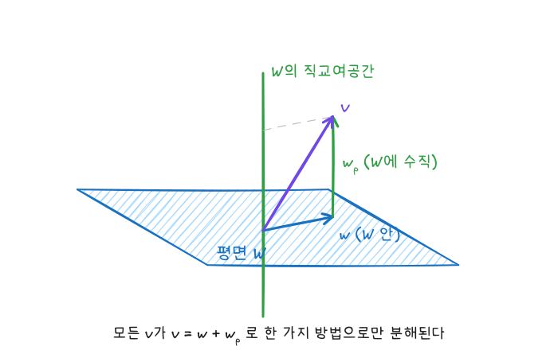
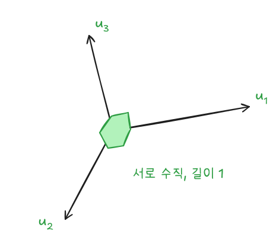
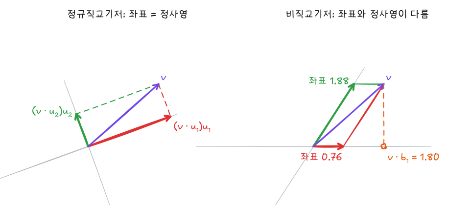
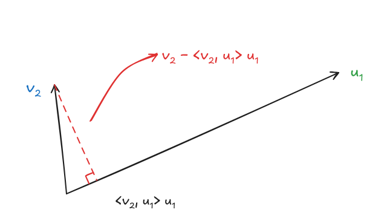
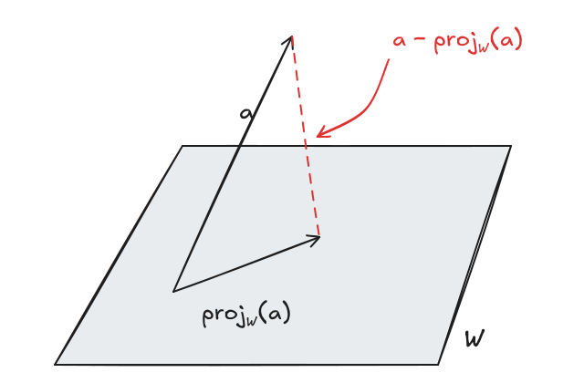
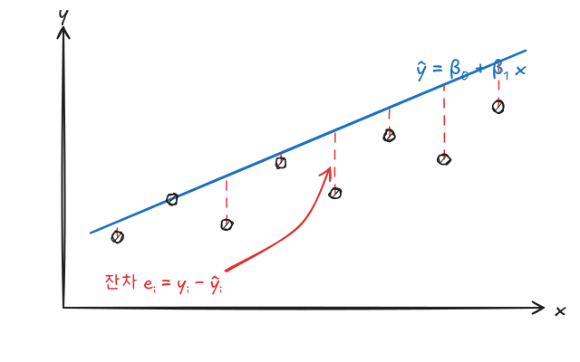

기저를 바꾸면 좌표가 어떻게 바뀌는지, 벡터를 부분공간과 그에 수직인 성분으로 어떻게 나누는지 정리한다. 정규직교기저를 만드는 그람-슈미트 직교화와 QR 분해를 거쳐, 해가 없는 연립방정식의 최선의 근사해를 구하는 최소제곱법까지 이어진다. 코드는 해당 절에 붙였고, 7절에서 회귀분석을 사영으로 읽는다(모자 행렬, 잔차의 직교성, 제곱합 분해, 지렛값). 헷갈리는 쌍은 비교 절에 모았다.

이전 글: [선형대수 - 벡터공간, 기저와 차원](/posts/la-vector-space)

## 1. 좌표벡터와 전이행렬

### 순서기저와 좌표벡터

벡터의 순서까지 고정한 기저를 **순서기저**라 한다. 순서기저 $\mathcal{B} = \{\mathbf{u}_1, \dots, \mathbf{u}_n\}$에 대해 $\mathbf{v} = a_1\mathbf{u}_1 + \cdots + a_n\mathbf{u}_n$이면, 계수를 모은

$$
[\mathbf{v}]_{\mathcal{B}} = (a_1, \dots, a_n)^T
$$

를 $\mathcal{B}$에 대한 **좌표벡터**라 한다. 기저 표현은 유일하므로 좌표벡터도 유일하다. 또한 $\{\mathbf{v}_1, \dots, \mathbf{v}_k\}$가 일차독립인 것과 $\{[\mathbf{v}_1]_{\mathcal{B}}, \dots, [\mathbf{v}_k]_{\mathcal{B}}\}$가 일차독립인 것은 같다. 그래서 $n$차원 공간의 문제는 $\mathbb{R}^n$의 문제로 옮겨 풀 수 있다.

### 전이행렬

같은 공간의 두 기저 $\mathcal{B}_1, \mathcal{B}_2$ 사이에서 좌표를 바꿔 주는 행렬을 **전이행렬**(transition matrix)이라 한다.

$$
[\mathbf{v}]_{\mathcal{B}_2} = \mathbf{P}_{\mathcal{B}_1, \mathcal{B}_2}[\mathbf{v}]_{\mathcal{B}_1},
\qquad
\mathbf{P}_{\mathcal{B}_2, \mathcal{B}_1} = \mathbf{P}_{\mathcal{B}_1, \mathcal{B}_2}^{-1}
$$

$\mathbf{P}_{\mathcal{B}_1, \mathcal{B}_2}$의 $j$번째 열은 $[\mathbf{v}_j]_{\mathcal{B}_2}$, 즉 $\mathcal{B}_1$의 $j$번째 기저벡터를 $\mathcal{B}_2$ 좌표로 쓴 것이다.

## 2. 직교여공간

내적공간 $V$의 부분공간 $W$에 대해, $W$의 모든 벡터와 직교하는 벡터의 모임을 **직교여공간**이라 한다.

$$
W^{\perp} = \{\mathbf{v} \in V : \langle \mathbf{v}, \mathbf{w} \rangle = 0,\ \forall \mathbf{w} \in W\}
$$

$W$의 기저 $\{\mathbf{w}_1, \dots, \mathbf{w}_k\}$와만 직교하면 $W$ 전체와 직교한다. 내적이 선형이기 때문이다.

$V$가 유한차원이면

$$
V = W \oplus W^{\perp},
\qquad
\dim W + \dim W^{\perp} = \dim V,
\qquad
(W^{\perp})^{\perp} = W
$$

$\oplus$는 **직합**으로, $W_1 + W_2$이면서 $W_1 \cap W_2 = \{\mathbf{0}\}$인 경우다. 모든 벡터가 $\mathbf{v} = \mathbf{w} + \mathbf{w}^{\perp}$로 **유일하게** 분해된다는 뜻이다. 행렬에서는 $N(\mathbf{A}) = C(\mathbf{A}^T)^{\perp}$, 즉 영공간과 행공간이 서로의 직교여공간이다.



$\mathbb{R}^3$에서 $W$가 원점을 지나는 평면이면 $W^{\perp}$는 그 평면에 수직인 직선이다. 차원은 $2 + 1 = 3$으로 맞물리고, 임의의 벡터 $\mathbf{v}$는 평면 안의 성분 $\mathbf{w}$와 평면에 수직인 성분으로 한 가지 방법으로만 나뉜다. 이 분해에서 $\mathbf{w}$가 $\mathbf{v}$의 $W$ 위로의 정사영이며, 6절의 최소제곱법은 이 그림에서 $\mathbf{v}$와 가장 가까운 평면 위의 점을 찾는 문제다.

## 3. 정규직교기저와 정사영

### 정의

서로 직교하고($\langle \mathbf{u}_i, \mathbf{u}_j \rangle = 0$, $i \neq j$) 길이가 1인($\langle \mathbf{u}_i, \mathbf{u}_i \rangle = 1$) 벡터들로 이루어진 기저를 **정규직교기저**라 한다.



### 좌표가 내적 한 번으로 나온다

$\mathbf{v} = a_1\mathbf{v}_1 + \cdots + a_k\mathbf{v}_k$에서 양변을 $\mathbf{v}_i$와 내적하면, 직교성 때문에 $i$번째 항만 남는다.

$$
\langle \mathbf{v}, \mathbf{v}_i \rangle = a_i\langle \mathbf{v}_i, \mathbf{v}_i \rangle
\quad\Rightarrow\quad
a_i = \frac{\langle \mathbf{v}, \mathbf{v}_i \rangle}{\lVert \mathbf{v}_i \rVert^2}
$$

정규직교기저라면 분모가 1이므로

$$
\mathbf{v} = \sum_{i=1}^{n}\langle \mathbf{v}, \mathbf{u}_i \rangle\mathbf{u}_i,
\qquad
[\mathbf{v}]_{\mathcal{B}} = \big(\langle \mathbf{v}, \mathbf{u}_1 \rangle, \dots, \langle \mathbf{v}, \mathbf{u}_n \rangle\big)^T
$$

연립방정식을 풀 필요 없이 내적만으로 좌표가 나온다는 것이 정규직교기저의 가장 큰 장점이다.
기저가 직교하지 않으면 이 간편함이 사라진다.



정규직교기저에서는 $\mathbf{v}$에서 각 축으로 수선을 내린 발이 곧 좌표다. 직교하지 않는 기저에서는 좌표를 얻으려면 다른 축에 평행하게 선을 그어 평행사변형을 만들어야 하고, 이렇게 얻은 $\mathbf{b}_1$ 방향 좌표(0.76)는 $\mathbf{b}_1$ 위로의 정사영 길이 $\mathbf{v} \cdot \mathbf{b}_1 = 1.80$과 전혀 다르다. 좌표 하나를 구하는 데 다른 기저벡터가 모두 관여하므로 연립방정식을 풀어야 한다. 그람-슈미트 직교화(4절)는 임의의 기저를 이 왼쪽 그림의 상황으로 바꾸는 절차다.


### 성질

정규직교기저 $\mathcal{B} = \{\mathbf{u}_1, \dots, \mathbf{u}_n\}$에 대해

- 내적과 길이가 좌표에서 그대로 계산된다: $\langle \mathbf{v}, \mathbf{w} \rangle = [\mathbf{v}]_{\mathcal{B}} \cdot [\mathbf{w}]_{\mathcal{B}}$, $\lVert \mathbf{v} \rVert = \lVert [\mathbf{v}]_{\mathcal{B}} \rVert$
- 일부 $\{\mathbf{u}_{i_1}, \dots, \mathbf{u}_{i_k}\}$가 생성하는 부분공간 $W$로의 **정사영**은 해당 항만 골라 더한 것이다.

$$
\operatorname{proj}_W(\mathbf{v}) = \sum_{j=1}^{k}\langle \mathbf{v}, \mathbf{u}_{i_j} \rangle\mathbf{u}_{i_j}
$$

## 4. 그람-슈미트 직교화

일차독립인 $\{\mathbf{v}_1, \dots, \mathbf{v}_n\}$에서 같은 공간을 생성하는 정규직교기저 $\{\mathbf{u}_1, \dots, \mathbf{u}_n\}$을 만드는 방법이다. 새 벡터에서 **이미 만든 방향으로의 성분(정사영)을 빼고**, 남은 수직 성분을 길이 1로 맞춘다.



$$
\begin{aligned}
\mathbf{u}_1 &= \frac{\mathbf{v}_1}{\lVert \mathbf{v}_1 \rVert} \\
\mathbf{u}_2 &= \frac{\mathbf{v}_2 - \langle \mathbf{v}_2, \mathbf{u}_1 \rangle\mathbf{u}_1}{\lVert \mathbf{v}_2 - \langle \mathbf{v}_2, \mathbf{u}_1 \rangle\mathbf{u}_1 \rVert} \\
\mathbf{u}_k &= \frac{\mathbf{v}_k - \sum_{j<k}\langle \mathbf{v}_k, \mathbf{u}_j \rangle\mathbf{u}_j}{\lVert \mathbf{v}_k - \sum_{j<k}\langle \mathbf{v}_k, \mathbf{u}_j \rangle\mathbf{u}_j \rVert}
\end{aligned}
$$

분자는 "그림자를 뺀 높이", 분모는 길이 정규화다. 각 단계에서 $\operatorname{span}\{\mathbf{u}_1, \dots, \mathbf{u}_k\} = \operatorname{span}\{\mathbf{v}_1, \dots, \mathbf{v}_k\}$가 유지된다.

이 과정을 그대로 코드로 옮기면 다음과 같다. 5절의 행렬 $\mathbf{A}$의 세 열에 적용한다.

```r
A <- matrix(c(1, 1, 1, 1, 1, 2, 2, 1, 2, 3, 1, 6), nrow = 4)

gs <- function(A) {
  Q <- matrix(0, nrow(A), ncol(A))
  for (k in seq_len(ncol(A))) {
    v <- A[, k]
    for (j in seq_len(k - 1)) v <- v - sum(v * Q[, j]) * Q[, j]   # 이전 방향의 정사영을 뺀다
    Q[, k] <- v / sqrt(sum(v^2))                                   # 길이 1로 맞춘다
  }
  Q
}
Q <- gs(A)
round(Q, 4)
round(crossprod(Q), 10)      # Q'Q = I
```

```python
import numpy as np

A = np.array([[1, 1, 2], [1, 2, 3], [1, 2, 1], [1, 1, 6]], dtype=float)

def gs(A):
    Q = np.zeros_like(A)
    for k in range(A.shape[1]):
        v = A[:, k].copy()
        for j in range(k):
            v -= (v @ Q[:, j]) * Q[:, j]       # 이전 방향의 정사영을 뺀다
        Q[:, k] = v / np.linalg.norm(v)        # 길이 1로 맞춘다
    return Q

Q = gs(A)
np.round(Q, 4)
np.allclose(Q.T @ Q, np.eye(3))                # True
```

$\mathbf{u}_1 = (0.5, 0.5, 0.5, 0.5)$, $\mathbf{u}_2 = (-0.5, 0.5, 0.5, -0.5)$, $\mathbf{u}_3 = (-0.6325, 0.3162, -0.3162, 0.6325)$가 나오고 $\mathbf{Q}^T\mathbf{Q}$는 단위행렬이다. 안쪽 반복문이 "이전 방향의 정사영을 빼는" 부분이다.

> **주의** 이 반복문은 개념을 보이기 위한 고전적 그람-슈미트이고, 열이 거의 종속이면 수치 오차가 쌓여 직교성이 깨진다. 실제 계산에서는 하우스홀더 반사를 쓰는 라이브러리의 QR(`qr()`, `np.linalg.qr`)을 쓴다.

## 5. QR 분해

### 형태

열이 일차독립인 $m \times n$ 행렬 $\mathbf{A}$ ($m \ge n$)는 다음처럼 분해된다.

$$
\underset{m \times n}{\mathbf{A}} = \underset{m \times n}{\mathbf{Q}}\;\underset{n \times n}{\mathbf{R}}
$$

- $\mathbf{Q}$: $\mathbf{A}$의 열에 그람-슈미트를 적용한 $\mathbf{u}_1, \dots, \mathbf{u}_n$을 열로 갖는다. 열이 정규직교이므로 $\mathbf{Q}^T\mathbf{Q} = \mathbf{I}$이다.
- $\mathbf{R}$: $r_{ij} = \langle \mathbf{v}_j, \mathbf{u}_i \rangle$인 상삼각행렬. $\mathbf{u}_i$는 $\mathbf{v}_1, \dots, \mathbf{v}_i$로만 만들어졌으므로 $i > j$이면 $\mathbf{v}_j \perp \mathbf{u}_i$, 즉 대각 아래가 0이다.

### 예시

$$
\begin{pmatrix} 1 & 1 & 2 \\ 1 & 2 & 3 \\ 1 & 2 & 1 \\ 1 & 1 & 6 \end{pmatrix}
=
\begin{pmatrix}
\frac12 & -\frac12 & -\frac{2}{\sqrt{10}} \\
\frac12 & \frac12 & \frac{1}{\sqrt{10}} \\
\frac12 & \frac12 & -\frac{1}{\sqrt{10}} \\
\frac12 & -\frac12 & \frac{2}{\sqrt{10}}
\end{pmatrix}
\begin{pmatrix} 2 & 3 & 6 \\ 0 & 1 & -2 \\ 0 & 0 & \sqrt{10} \end{pmatrix}
$$

라이브러리의 QR로 확인한다. $\mathbf{R}$은 $r_{ij} = \langle \mathbf{v}_j, \mathbf{u}_i \rangle$이므로 `crossprod(Q, A)`로도 얻는다.

```r
q <- qr(A)
qr.Q(q); qr.R(q)                      # 부호는 열마다 반대로 나올 수 있다
all.equal(abs(qr.Q(q)), abs(Q), check.attributes = FALSE)   # 부호를 빼면 gs()와 같다
round(crossprod(Q, A), 4)             # R = Q'A: 대각 2, 1, 3.1623 (= sqrt(10))
all.equal(Q %*% crossprod(Q, A), A)   # A = QR
```

```python
Q2, R2 = np.linalg.qr(A)              # 부호는 열마다 반대로 나올 수 있다
np.allclose(np.abs(Q2), np.abs(Q))    # True
np.round(Q.T @ A, 4)                  # R = Q'A
np.allclose(Q @ (Q.T @ A), A)         # True
```

위 식의 $\mathbf{R} = \begin{pmatrix} 2 & 3 & 6 \\ 0 & 1 & -2 \\ 0 & 0 & \sqrt{10} \end{pmatrix}$이 그대로 나오고(R의 `qr()`은 $\mathbf{u}_1$, $\mathbf{u}_2$의 부호를 반대로 잡아 $\mathbf{R}$의 해당 행 부호도 반대다), 대각 아래는 0이다. $\mathbf{Q}$의 열이 정규직교기저이므로 3절에서 본 대로 $\mathbf{Q}^T\mathbf{v}$가 좌표다. $\mathbf{v} = (1, 2, 3, 4)^T$는 $C(\mathbf{A})$(3차원) 밖에 있어 $\mathbf{Q}^T\mathbf{v} = (5, 0, 1.581)^T$이고, $\mathbf{Q}\mathbf{Q}^T\mathbf{v} = (1.5, 3, 2, 3.5)^T$가 $\mathbf{v}$를 $C(\mathbf{A})$에 정사영한 점이다.

**언제 쓰는가:** 연립방정식을 풀거나 최소제곱을 풀 때, 정규방정식 없이 $\mathbf{Q}^T\mathbf{b}$와 후진대입만으로 답을 얻고 싶을 때 쓴다(6절).

### 직교행렬

$\mathbf{Q}$가 **정사각**이면서 $\mathbf{Q}^T\mathbf{Q} = \mathbf{I}$이면 **직교행렬**이라 하고, $\mathbf{Q}^{-1} = \mathbf{Q}^T$이다. 직사각 $\mathbf{Q}$는 $\mathbf{Q}^T\mathbf{Q} = \mathbf{I}$이지만 $\mathbf{Q}\mathbf{Q}^T \neq \mathbf{I}$라서 역행렬이 아니다. $\mathbf{Q}\mathbf{Q}^T$는 $C(\mathbf{A})$로의 정사영 행렬이다.

### QR로 연립방정식 풀기

최대 계수($\operatorname{rank}(\mathbf{A}) = \min(m, n)$)인 $m \times n$ 행렬에 대해

| 경우 | 해 |
|---|---|
| $m \ge n$, $\mathbf{A} = \mathbf{QR}$ | $\mathbf{b} \in C(\mathbf{A})$이면 유일해 $\mathbf{x} = \mathbf{R}^{-1}\mathbf{Q}^T\mathbf{b}$. 아니면 해가 없고, 같은 식이 최소제곱해가 된다 |
| $m < n$, $\mathbf{A}^T = \mathbf{QR}$ | 해가 무수히 많다. $\mathbf{x} = \mathbf{Q}(\mathbf{R}^T)^{-1}\mathbf{b}$가 길이가 가장 짧은 해이고, 나머지 해는 여기에 $N(\mathbf{A}) = C(\mathbf{A}^T)^{\perp}$의 벡터를 더한 것 |

$\mathbf{R}$이 상삼각이므로 $\mathbf{R}^{-1}$을 직접 구하지 않고 후진대입으로 푼다.

## 6. 최소제곱법

### 정사영과 정규방정식

$W = C(\mathbf{B})$이고 $\mathbf{B}$의 열 $\mathbf{b}_1, \dots, \mathbf{b}_k$가 정규직교가 아닌 일반 기저일 때, $\mathbf{a}$의 정사영을 $\operatorname{proj}_W(\mathbf{a}) = \mathbf{B}\hat{\mathbf{c}}$로 쓰자.



남은 성분 $\mathbf{a} - \mathbf{B}\hat{\mathbf{c}}$는 $W$에 수직이므로 모든 $\mathbf{b}_i$와 내적이 0이다.

$$
\mathbf{b}_i^T(\mathbf{a} - \mathbf{B}\hat{\mathbf{c}}) = 0 \;(i = 1, \dots, k)
\iff
\mathbf{B}^T(\mathbf{a} - \mathbf{B}\hat{\mathbf{c}}) = \mathbf{0}
$$

$$
\mathbf{B}^T\mathbf{B}\,\hat{\mathbf{c}} = \mathbf{B}^T\mathbf{a}
\quad\Rightarrow\quad
\hat{\mathbf{c}} = (\mathbf{B}^T\mathbf{B})^{-1}\mathbf{B}^T\mathbf{a},
\qquad
\operatorname{proj}_W(\mathbf{a}) = \mathbf{B}(\mathbf{B}^T\mathbf{B})^{-1}\mathbf{B}^T\mathbf{a}
$$

$\hat{\mathbf{c}}$는 기저 $\mathbf{b}_i$에 대한 정사영의 좌표벡터다.

### $\mathbf{B}^T\mathbf{B}$가 가역인 이유

$\mathbf{B}^T\mathbf{B}\mathbf{x} = \mathbf{0}$이면 $\mathbf{x}^T\mathbf{B}^T\mathbf{B}\mathbf{x} = \lVert \mathbf{B}\mathbf{x} \rVert^2 = 0$이므로 $\mathbf{B}\mathbf{x} = \mathbf{0}$이다. 따라서 $N(\mathbf{B}^T\mathbf{B}) = N(\mathbf{B})$이고, $\mathbf{B}$의 열이 일차독립이면($N(\mathbf{B}) = \{\mathbf{0}\}$) 정사각행렬 $\mathbf{B}^T\mathbf{B}$는 가역이다.

### 사영 행렬의 성질

$\mathbf{H} = \mathbf{B}(\mathbf{B}^T\mathbf{B})^{-1}\mathbf{B}^T$는 다음을 만족한다.

- $\mathbf{H}^2 = \mathbf{H}$ (멱등): 이미 $W$에 있는 벡터는 다시 사영해도 그대로다.
- $\mathbf{H}^T = \mathbf{H}$ (대칭)
- $\mathbf{I} - \mathbf{H}$는 $W^{\perp}$로의 사영 행렬이다.
- $\operatorname{tr}(\mathbf{H}) = \operatorname{rank}(\mathbf{H}) = \dim W$
- 거꾸로, 대칭이면서 멱등인 행렬은 모두 자기 열공간으로의 정사영 행렬이다.

회귀분석에서는 $\mathbf{H} = \mathbf{X}(\mathbf{X}^T\mathbf{X})^{-1}\mathbf{X}^T$를 **hat 행렬**이라 한다(7절). 4행 3열 행렬 $\mathbf{A}$(5절의 예)로 성질을 확인한다.

```r
H <- A %*% solve(crossprod(A)) %*% t(A)       # C(A)로의 사영 행렬 (4 x 4)
round(H, 2)
all.equal(H %*% H, H); isSymmetric(H)         # 멱등, 대칭
sum(diag(H))                                  # tr(H) = rank = 3
round(range(eigen(H, symmetric = TRUE)$values), 10)   # 고유값은 0 또는 1
all.equal(H, Q %*% t(Q))                      # 정규직교 열이면 H = QQ'
```

```python
H = A @ np.linalg.inv(A.T @ A) @ A.T
np.allclose(H @ H, H), np.allclose(H, H.T)     # (True, True)
np.trace(H)                                    # 3.0
np.allclose(H, Q @ Q.T)                        # True
```

$\mathbf{H}$의 대각은 $(0.9, 0.6, 0.6, 0.9)$로 합이 3이고, 고유값은 0이 1개, 1이 3개다. $\mathbf{H}^2 = \mathbf{H}$를 만족하는 행렬은 고유값이 0과 1뿐이므로, 사영 행렬은 "$C(\mathbf{A})$ 방향은 그대로 두고 나머지 방향은 없애는" 변환이다. $\mathbf{A}$의 열이 정규직교가 아니어도 $\mathbf{H}$는 정규직교기저 $\mathbf{Q}$로 만든 $\mathbf{Q}\mathbf{Q}^T$와 같다. 열공간만 같으면 사영 행렬은 기저와 무관하다.

### 최소제곱해

$\mathbf{Ax} = \mathbf{b}$에서 식이 변수보다 많으면 보통 해가 없다($\mathbf{b} \notin C(\mathbf{A})$). $\mathbf{Ax}$가 갈 수 있는 곳은 $C(\mathbf{A})$뿐이므로, $\lVert \mathbf{b} - \mathbf{Ax} \rVert$를 최소로 하는 최선의 선택은 $\mathbf{b}$를 $C(\mathbf{A})$에 정사영한 점이다. 이 $\hat{\mathbf{x}}$는 **정규방정식**을 만족한다.

$$
\mathbf{A}^T\mathbf{A}\hat{\mathbf{x}} = \mathbf{A}^T\mathbf{b}
\quad\Rightarrow\quad
\hat{\mathbf{x}} = (\mathbf{A}^T\mathbf{A})^{-1}\mathbf{A}^T\mathbf{b}
$$

원래 식 $\mathbf{Ax} = \mathbf{b}$와 동치가 아니라, 해가 없을 때도 항상 풀리는 **대체 문제**다. $\mathbf{A} = \mathbf{QR}$이면 $\mathbf{A}^T\mathbf{A} = \mathbf{R}^T\mathbf{R}$이므로 다음처럼 쓸 수 있고, 수치적으로도 더 안정적이다.

$$
\hat{\mathbf{x}} = \mathbf{R}^{-1}\mathbf{Q}^T\mathbf{b}
$$

$\mathbf{A}$와 $\mathbf{b} = (1, 2, 2, 4)^T$로 세 방법이 같은 답을 주는지, 잔차가 $C(\mathbf{A})$에 수직인지 확인한다.

```r
b <- c(1, 2, 2, 4)

solve(crossprod(A), crossprod(A, b))   # 정규방정식
qr.solve(A, b)                         # QR 최소제곱
coef(lm(b ~ A - 1))                    # 회귀 계수 (절편 열은 A에 이미 있다)

xhat <- qr.solve(A, b)
e <- b - A %*% xhat                    # 잔차
t(e); crossprod(A, e)                  # A'e = 0: 잔차는 A의 모든 열에 수직
c(sum(b^2), sum((A %*% xhat)^2), sum(e^2))   # 피타고라스
```

```python
b = np.array([1, 2, 2, 4], dtype=float)
x1 = np.linalg.solve(A.T @ A, A.T @ b)          # 정규방정식
Q2, R2 = np.linalg.qr(A)
x2 = np.linalg.solve(R2, Q2.T @ b)              # QR
x3 = np.linalg.lstsq(A, b, rcond=None)[0]       # 라이브러리
e = b - A @ x3
np.allclose(x1, x2), np.allclose(x1, x3)        # (True, True)
np.round(A.T @ e, 10)                           # [0, 0, 0]
b @ b, (A @ x3) @ (A @ x3), e @ e               # 25, 24.1, 0.9
```

세 방법 모두 $\hat{\mathbf{x}} = (-0.6, 0.7, 0.6)^T$이다. 잔차는 $\mathbf{e} = (-0.3, -0.6, 0.6, 0.3)^T$이고 $\mathbf{A}^T\mathbf{e}$는 0(부동소수점 오차 $10^{-16}$ 수준)이다. 정규방정식 $\mathbf{A}^T(\mathbf{b} - \mathbf{A}\hat{\mathbf{x}}) = \mathbf{0}$이 곧 "잔차가 모든 열에 수직"이라는 식이다. 직교하므로 $\lVert\mathbf{b}\rVert^2 = 25 = 24.1 + 0.9 = \lVert \mathbf{A}\hat{\mathbf{x}} \rVert^2 + \lVert \mathbf{e} \rVert^2$이 맞는다.

### 정규방정식과 QR의 수치 안정성

정규방정식은 $\mathbf{A}^T\mathbf{A}$를 만들어 푸는데, 이 과정에서 조건수(민감도)가 제곱이 된다: $\kappa(\mathbf{A}^T\mathbf{A}) = \kappa(\mathbf{A})^2$. 위의 $\mathbf{A}$는 $\kappa(\mathbf{A}) = 20.8$, $\kappa(\mathbf{A}^T\mathbf{A}) = 434.5$다. 열이 거의 종속이면 차이가 커진다. $x = 1, \dots, 20$에서 5차 다항식의 설계행렬 $\mathbf{B}$를 만들고, 답이 $\mathbf{a} = (1, \dots, 1)$이 되도록 $\mathbf{y} = \mathbf{B}\mathbf{a}$를 잡아 두 방법의 오차를 본다.

```r
x <- 1:20
B <- outer(x, 0:5, `^`)                 # 1, x, ..., x^5
a <- rep(1, 6); y <- B %*% a            # 정확한 답이 a

c(kappa(B, exact = TRUE), kappa(crossprod(B), exact = TRUE))
max(abs(solve(crossprod(B), crossprod(B, y)) - a))   # 정규방정식의 오차
max(abs(qr.solve(B, y) - a))                          # QR의 오차
```

```python
x = np.arange(1, 21, dtype=float)
B = np.vander(x, 6, increasing=True)
a = np.ones(6); y = B @ a
Qb, Rb = np.linalg.qr(B)
np.linalg.cond(B), np.linalg.cond(B.T @ B)
np.abs(np.linalg.solve(B.T @ B, B.T @ y) - a).max()   # 정규방정식의 오차
np.abs(np.linalg.solve(Rb, Qb.T @ y) - a).max()        # QR의 오차
```

R에서 $\kappa(\mathbf{B}) = 1.5 \times 10^{7}$, $\kappa(\mathbf{B}^T\mathbf{B}) = 2.1 \times 10^{14}$이고, 정확한 답에서 벗어난 최대 오차는 정규방정식이 $1.8 \times 10^{-6}$, QR이 $1.4 \times 10^{-9}$이다(Python도 오차가 3~4자릿수 차이를 보이며 정확한 값은 라이브러리마다 다르다). 수식으로는 같은 해이지만, 열이 거의 종속인 자료(고차 다항식, 공선성이 큰 설명변수)에서는 QR을 쓰는 쪽이 정확하다. 이 설정 하나의 결과이므로 "항상 이만큼 차이난다"는 뜻은 아니다.

### 왜 정사영이 최소인가


$\mathbf{w} = \operatorname{proj}_W(\mathbf{y})$, $\mathbf{w}^{\perp} = \mathbf{y} - \mathbf{w}$라 하면, $W$의 임의의 $\mathbf{f}$에 대해 $\mathbf{w} - \mathbf{f} \in W$와 $\mathbf{w}^{\perp} \in W^{\perp}$가 직교하므로 피타고라스 정리에 의해

$$
\lVert \mathbf{y} - \mathbf{f} \rVert^2 = \lVert \mathbf{w} - \mathbf{f} \rVert^2 + \lVert \mathbf{w}^{\perp} \rVert^2 \ge \lVert \mathbf{w}^{\perp} \rVert^2
$$

등호는 $\mathbf{f} = \mathbf{w}$일 때만 성립한다.

### 다항식 근사 (회귀)



세로 점선(잔차)의 제곱합이 가장 작은 직선을 찾는 문제다. 자료 $(x_1, y_1), \dots, (x_m, y_m)$에 $n$차 다항식 $f(x) = a_0 + a_1x + \cdots + a_nx^n$ ($n < m$)을 맞추되 $\sum_i (y_i - f(x_i))^2$을 최소로 하려면, 다음 문제의 최소제곱해를 구하면 된다.

$$
\underbrace{\begin{pmatrix}
1 & x_1 & \cdots & x_1^n \\
1 & x_2 & \cdots & x_2^n \\
\vdots & \vdots & \ddots & \vdots \\
1 & x_m & \cdots & x_m^n
\end{pmatrix}}_{\mathbf{B}}
\begin{pmatrix} a_0 \\ a_1 \\ \vdots \\ a_n \end{pmatrix}
\approx
\begin{pmatrix} y_1 \\ y_2 \\ \vdots \\ y_m \end{pmatrix}
\qquad\Rightarrow\qquad
\hat{\mathbf{a}} = (\mathbf{B}^T\mathbf{B})^{-1}\mathbf{B}^T\mathbf{y}
$$

통계의 선형회귀 계수 $\hat{\boldsymbol{\beta}} = (\mathbf{X}^T\mathbf{X})^{-1}\mathbf{X}^T\mathbf{y}$가 정확히 이 식이다. $x_i$ 중 서로 다른 값이 $n + 1$개 이상이면 $\mathbf{B}$의 열이 일차독립이라 해가 유일하다.

## 7. 회귀분석을 사영으로 읽기

선형회귀 $\mathbf{y} = \mathbf{X}\boldsymbol\beta + \boldsymbol\varepsilon$의 최소제곱 추정은 6절의 문제 $\mathbf{X}\boldsymbol\beta \approx \mathbf{y}$ 그 자체다. $\mathbf{X}$는 $n \times p$(절편 열 포함), 열이 일차독립이라 하면 $\hat{\boldsymbol\beta} = (\mathbf{X}^T\mathbf{X})^{-1}\mathbf{X}^T\mathbf{y}$이고, 적합값과 잔차는 $\mathbf{y}$를 $C(\mathbf{X})$와 $C(\mathbf{X})^{\perp}$로 가른 두 성분이다.

$$
\mathbf{y} = \underbrace{\mathbf{H}\mathbf{y}}_{\hat{\mathbf{y}} \in C(\mathbf{X})} + \underbrace{(\mathbf{I} - \mathbf{H})\mathbf{y}}_{\mathbf{e} \in C(\mathbf{X})^{\perp}}
$$

이 한 장면에서 회귀의 성질이 대부분 나온다. `cars`(속도 `speed`로 제동거리 `dist`를 설명, $n = 50$, $p = 2$)로 하나씩 확인한다.

```r
fit <- lm(dist ~ speed, data = cars)
X <- model.matrix(fit); y <- cars$dist
H <- X %*% solve(crossprod(X)) %*% t(X)          # 50 x 50 hat 행렬
e <- resid(fit)

all.equal(as.vector(H %*% y), unname(fitted(fit)))   # 적합값 = Hy
c(sum(diag(H)), fit$df.residual)                     # tr(H) = 2, 잔차 자유도 48
crossprod(X, e)                                      # X'e = 0
sum(e)                                               # 절편 열이 있으므로 잔차의 합도 0
```

**잔차의 직교성과 자유도.** `H %*% y`가 `fitted()`와 같고, $\operatorname{tr}(\mathbf{H}) = 2 = p$다. 모형이 차지하는 부분공간이 2차원이므로 나머지 $C(\mathbf{X})^{\perp}$가 $48 = n - p$차원이고, 이것이 잔차 자유도다. $\mathbf{X}^T\mathbf{e}$는 $10^{-12}$ 수준의 0이다. 절편 열 $\mathbf{1}$이 $\mathbf{X}$의 열이므로 $\mathbf{1}^T\mathbf{e} = \sum e_i = 0$이 정규방정식에서 따라 나온다(합이 $3 \times 10^{-14}$). 절편 없는 모형에서는 이 성질이 성립하지 않는다.

**제곱합 분해와 $R^2$.** $\mathbf{1} \in C(\mathbf{X})$이므로 $\hat{\mathbf{y}} - \bar y\mathbf{1}$도 $C(\mathbf{X})$ 안에 있고 $\mathbf{e}$와 수직이다. $\mathbf{y} - \bar y\mathbf{1} = (\hat{\mathbf{y}} - \bar y\mathbf{1}) + \mathbf{e}$에 피타고라스를 쓰면

$$
\underbrace{\lVert \mathbf{y} - \bar y\mathbf{1} \rVert^2}_{SST} = \underbrace{\lVert \hat{\mathbf{y}} - \bar y\mathbf{1} \rVert^2}_{SSR} + \underbrace{\lVert \mathbf{e} \rVert^2}_{SSE},
\qquad
R^2 = \frac{SSR}{SST} = \cos^2\theta
$$

$\theta$는 중심화한 $\mathbf{y}$와 중심화한 $\hat{\mathbf{y}}$ 사이의 각이다. 정사영하면 길이는 줄고, 그 비율이 $\cos^2\theta$다.

```r
yc <- y - mean(y); yhc <- fitted(fit) - mean(y)
c(sum(yc^2), sum(yhc^2), sum(e^2))                   # SST, SSR, SSE
c(sum(yhc^2) / sum(yc^2), summary(fit)$r.squared)    # R^2
acos(sqrt(summary(fit)$r.squared)) * 180 / pi        # 각도 (도)
```

SST $= 32539.0$, SSR $= 21185.5$, SSE $= 11353.5$로 $21185.5 + 11353.5 = 32539.0$이 맞고, $R^2 = 0.651$은 `summary()`의 값과 같다. 중심화한 $\mathbf{y}$와 $\hat{\mathbf{y}}$ 사이의 각은 $36.2^{\circ}$이다. 단순회귀에서는 $R^2 = r^2$(표본상관계수의 제곱)이므로 상관계수가 두 중심화 벡터의 $\cos$라는 해석과도 연결된다.

**지렛값.** $\mathbf{H}$의 $(i, j)$ 성분은 $\hat y_i = \sum_j h_{ij}y_j$에서 $y_j$가 $\hat y_i$에 미치는 영향이다. 대각 $h_{ii}$를 **지렛값**(leverage)이라 하며, $\mathbf{H}^2 = \mathbf{H}$, $\mathbf{H}^T = \mathbf{H}$에서 두 가지가 바로 나온다.

$$
h_{ii} = \sum_j h_{ij}^2 \ge h_{ii}^2 \;\Rightarrow\; 0 \le h_{ii} \le 1,
\qquad
\sum_i h_{ii} = \operatorname{tr}(\mathbf{H}) = p
$$

평균 지렛값은 $p/n$이다. 단순회귀에서는 $h_{ii} = \frac{1}{n} + \frac{(x_i - \bar x)^2}{\sum_k (x_k - \bar x)^2}$로, $x_i$가 $\bar x$에서 멀수록 크다. 잔차의 분산은 $\operatorname{Var}(e_i) = \sigma^2(1 - h_{ii})$이므로 지렛값이 큰 점은 직선을 자기 쪽으로 끌어당긴다.

```r
h <- hatvalues(fit)
all.equal(unname(h), unname(diag(H)))
range(h); mean(h)                                    # 평균 p/n = 0.04
xs <- cars$speed
all.equal(unname(h), 1/50 + (xs - mean(xs))^2 / sum((xs - mean(xs))^2))
sort(h, decreasing = TRUE)[1:3]; cars$speed[order(h, decreasing = TRUE)[1:3]]
```

`hatvalues()`는 $\operatorname{diag}(\mathbf{H})$와 같고 범위는 $0.020$~$0.115$, 평균은 $0.04 = 2/50$이다. 단순회귀 공식과도 일치한다. 가장 큰 값은 속도가 가장 작은 4인 두 관측($h = 0.115$)이고, 평균 속도 $\bar x = 15.4$에서 가장 먼 쪽이다. 흔히 쓰는 기준 $2p/n = 0.08$을 넘는 관측은 속도 4 두 개와 25 하나다. 레버리지(지렛값)로 고영향점을 살피고 잔차로 이상점을 진단하는 기준은 [데이터 마이닝 - 선형회귀](/posts/dm-linear-regression)에서도 다룬다(그 글에서는 절편을 제외한 설명변수 수를 $p$로 두어 평균 레버리지를 $(p+1)/n$으로 적는다).

**`lm()`은 정규방정식이 아니라 QR로 푼다.** 위에서 본 수치 안정성 때문에 `lm()`은 $\mathbf{X}$를 QR 분해(피벗을 쓰는 하우스홀더 방식)하고 $\mathbf{R}\hat{\boldsymbol\beta} = \mathbf{Q}^T\mathbf{y}$를 후진대입으로 푼다. 열이 일차종속이면 이 과정에서 종속인 열이 드러나 해당 계수가 `NA`로 남는다([벡터공간](/posts/la-vector-space)의 완전공선성).

```r
class(fit$qr)                                         # "qr"
all.equal(unname(qr.coef(fit$qr, y)), unname(coef(fit)))   # 저장된 QR로 계수를 복원
```

**직교다항식.** 추세를 다항식으로 맞출 때([시계열 - 추세모형](/posts/ts-02-trend)) $1, x, x^2$ 열은 서로 거의 종속이라 계수가 불안정하다. 열을 그람-슈미트로 직교화한 것이 `poly()`다. $\mathbf{X}^T\mathbf{X}$가 대각이 되므로 계수가 서로 영향을 주지 않고, 차수를 올려도 낮은 차수의 계수가 변하지 않는다.

```r
sp <- cars$speed
P <- poly(sp, 2)                                      # 열이 정규직교, 열 평균 0
round(crossprod(P), 10)                               # 단위행렬
all.equal(unname(fitted(lm(dist ~ P, cars))),
          unname(fitted(lm(dist ~ sp + I(sp^2), cars))))   # 같은 부분공간이므로 같은 적합값
coef(summary(lm(dist ~ P, cars)))
coef(summary(lm(dist ~ sp + I(sp^2), cars)))
```

`crossprod(P)`가 단위행렬이고, 두 모형은 같은 열공간을 쓰므로 적합값이 같다. 2차 항의 $t$ 값은 두 모형 모두 $1.515$(유의확률 $0.136$)로 같지만, 1차 항은 직교다항식에서 $t = 9.59$($p = 1.2 \times 10^{-12}$), 원래의 $x$를 쓰면 $t = 0.449$($p = 0.656$)로 크게 다르다. 원래의 $x$와 $x^2$는 상관이 커서 1차 항의 검정이 2차 항의 존재에 좌우되고, 직교다항식은 이 문제가 없다. 최고차 항의 검정은 기저와 무관하지만, 낮은 차수 항의 검정은 어떤 기저를 쓰느냐에 따라 의미가 달라진다.

## 비교

**정사영, 최소제곱, 그람-슈미트, QR.** 모두 "수직 성분을 떼어 내는" 같은 아이디어의 다른 얼굴이다.

| 항목 | 정사영 | 최소제곱 | 그람-슈미트 | QR |
|---|---|---|---|---|
| 하는 일 | 부분공간 $W$로 사영 | $\mathbf{Ax} \approx \mathbf{b}$의 최선의 근사 | 일차독립 벡터에서 정규직교기저 생성 | $\mathbf{A} = \mathbf{QR}$ |
| 입력 | $\mathbf{v}$, $W$의 기저 | $\mathbf{A}$, $\mathbf{b}$ | $\mathbf{v}_1, \dots, \mathbf{v}_n$ | 열이 독립인 $\mathbf{A}$ |
| 출력 | $\mathbf{B}(\mathbf{B}^T\mathbf{B})^{-1}\mathbf{B}^T\mathbf{v}$ | $\hat{\mathbf{x}}$ (정사영의 좌표) | $\mathbf{u}_1, \dots, \mathbf{u}_n$ | $\mathbf{Q}$ (정규직교 열), $\mathbf{R}$ (상삼각) |
| 서로의 관계 | 최소제곱의 $\mathbf{A}\hat{\mathbf{x}}$가 $\mathbf{b}$의 정사영 | 정사영 문제와 같다 | QR의 $\mathbf{Q}$를 만드는 절차 | $\hat{\mathbf{x}} = \mathbf{R}^{-1}\mathbf{Q}^T\mathbf{b}$, $\mathbf{H} = \mathbf{Q}\mathbf{Q}^T$ |

**사영 행렬과 일반 행렬.**

| 항목 | 사영 행렬 $\mathbf{H}$ | 일반 정사각행렬 | 직교행렬 $\mathbf{Q}$ |
|---|---|---|---|
| 정의 | $\mathbf{H}^2 = \mathbf{H} = \mathbf{H}^T$ | 조건 없음 | $\mathbf{Q}^T\mathbf{Q} = \mathbf{I}$ |
| 고유값 | 0 또는 1 | 임의 | 절댓값 1 |
| 가역성 | 전체 공간으로의 사영($\mathbf{H} = \mathbf{I}$)일 때만 | 보통 가역 | 항상 가역, $\mathbf{Q}^{-1} = \mathbf{Q}^T$ |
| 계수와 대각합 | $\operatorname{rank} = \operatorname{tr}$ | 일반적으로 다르다 | $\operatorname{rank} = n$ |
| 길이 | 줄이거나 그대로 | 임의 | 보존 |

**정규방정식과 QR 풀이.**

| 항목 | 정규방정식 | QR |
|---|---|---|
| 식 | $\mathbf{A}^T\mathbf{A}\hat{\mathbf{x}} = \mathbf{A}^T\mathbf{b}$ | $\mathbf{R}\hat{\mathbf{x}} = \mathbf{Q}^T\mathbf{b}$ |
| 조건수 | $\kappa(\mathbf{A})^2$ | $\kappa(\mathbf{A})$ |
| 계산 | $\mathbf{A}^T\mathbf{A}$를 만들어 풀기. 공식 유도와 손계산에 편하다 | 분해 후 후진대입. 수치 계산의 표준 |
| 쓰임 | 이론, 해석 | `lm()`, 라이브러리의 최소제곱 |

## 정리

| 개념 | 핵심 식 | 기억할 점 |
|---|---|---|
| 전이행렬 | $[\mathbf{v}]_{\mathcal{B}_2} = \mathbf{P}_{\mathcal{B}_1,\mathcal{B}_2}[\mathbf{v}]_{\mathcal{B}_1}$ | 반대 방향은 역행렬 |
| 직교여공간 | $V = W \oplus W^{\perp}$ | $N(\mathbf{A}) = C(\mathbf{A}^T)^{\perp}$ |
| 정규직교 좌표 | $[\mathbf{v}]_{\mathcal{B}} = (\langle \mathbf{v}, \mathbf{u}_i \rangle)_i$ | 내적 한 번으로 좌표 |
| 그람-슈미트 | 이전 방향 정사영을 빼고 정규화 | 생성 공간 유지 |
| QR 분해 | $\mathbf{A} = \mathbf{QR}$, $r_{ij} = \langle \mathbf{v}_j, \mathbf{u}_i \rangle$ | $\mathbf{Q}^T\mathbf{Q} = \mathbf{I}$, $\mathbf{R}$ 상삼각 |
| 정사영 행렬 | $\mathbf{B}(\mathbf{B}^T\mathbf{B})^{-1}\mathbf{B}^T$ | 정규직교 열이면 $\mathbf{Q}\mathbf{Q}^T$ |
| 정규방정식 | $\mathbf{A}^T\mathbf{A}\hat{\mathbf{x}} = \mathbf{A}^T\mathbf{b}$ | 잔차가 열공간에 수직 |
| QR 최소제곱 | $\hat{\mathbf{x}} = \mathbf{R}^{-1}\mathbf{Q}^T\mathbf{b}$ | 후진대입, 조건수가 제곱되지 않는다 |
| hat 행렬 | $\mathbf{H}^2 = \mathbf{H} = \mathbf{H}^T$ | $\hat{\mathbf{y}} = \mathbf{H}\mathbf{y}$, $\operatorname{tr}\mathbf{H} = p$ |
| 지렛값 | $h_{ii}$, $0 \le h_{ii} \le 1$, $\sum h_{ii} = p$ | 평균 $p/n$ |
| 제곱합 분해 | $SST = SSR + SSE$, $R^2 = \cos^2\theta$ | 절편 열이 있을 때 |

## 참고자료

- 하길찬, 『해설이 있는 선형대수학』
- 유호석, 「선형대수학」, 세종대학교, KOCW 공개강의

다음 글: [선형대수 - 선형사상과 행렬표현](/posts/la-linear-map)
