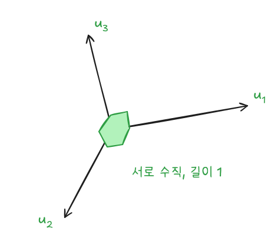
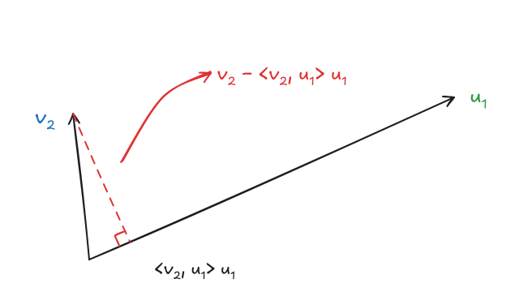
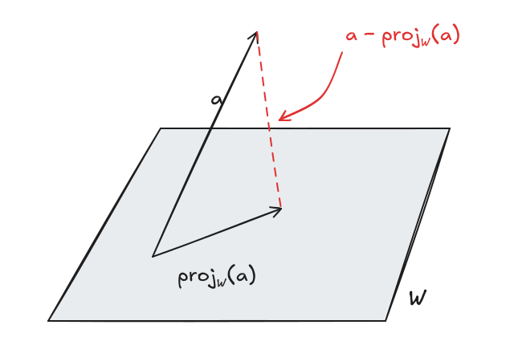
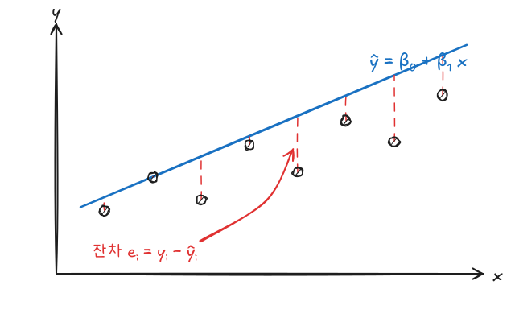

기저를 바꾸면 좌표가 어떻게 바뀌는지, 벡터를 부분공간과 그에 수직인 성분으로 어떻게 나누는지 정리한다. 정규직교기저를 만드는 그람-슈미트 직교화와 QR 분해를 거쳐, 해가 없는 연립방정식의 최선의 근사해를 구하는 최소제곱법까지 이어진다.

이전 글: [선형대수 - 벡터공간, 기저와 차원](/posts/la-vector-space)

## 1. 좌표벡터와 전이행렬

### 순서기저와 좌표벡터

벡터의 순서까지 고정한 기저를 **순서기저**라 한다. 순서기저 $\mathcal{B} = \{\mathbf{u}_1, \dots, \mathbf{u}_n\}$에 대해 $\mathbf{v} = a_1\mathbf{u}_1 + \cdots + a_n\mathbf{u}_n$이면, 계수를 모은

$$
[\mathbf{v}]_{\mathcal{B}} = (a_1, \dots, a_n)^T
$$

를 $\mathcal{B}$에 대한 **좌표벡터**라 한다. 기저 표현은 유일하므로 좌표벡터도 유일하다. 또한 $\{\mathbf{v}_1, \dots, \mathbf{v}_k\}$가 일차독립인 것과 $\{[\mathbf{v}_1]_{\mathcal{B}}, \dots, [\mathbf{v}_k]_{\mathcal{B}}\}$가 일차독립인 것은 같다. 그래서 $n$차원 공간의 문제는 $\mathbb{R}^n$의 문제로 옮겨 풀 수 있다.

### 전이행렬

같은 공간의 두 기저 $\mathcal{B}_1, \mathcal{B}_2$ 사이에서 좌표를 바꿔 주는 행렬을 **전이행렬**(transition matrix)이라 한다.

$$
[\mathbf{v}]_{\mathcal{B}_2} = \mathbf{P}_{\mathcal{B}_1, \mathcal{B}_2}[\mathbf{v}]_{\mathcal{B}_1},
\qquad
\mathbf{P}_{\mathcal{B}_2, \mathcal{B}_1} = \mathbf{P}_{\mathcal{B}_1, \mathcal{B}_2}^{-1}
$$

$\mathbf{P}_{\mathcal{B}_1, \mathcal{B}_2}$의 $j$번째 열은 $[\mathbf{v}_j]_{\mathcal{B}_2}$, 즉 $\mathcal{B}_1$의 $j$번째 기저벡터를 $\mathcal{B}_2$ 좌표로 쓴 것이다.

## 2. 직교여공간

내적공간 $V$의 부분공간 $W$에 대해, $W$의 모든 벡터와 직교하는 벡터의 모임을 **직교여공간**이라 한다.

$$
W^{\perp} = \{\mathbf{v} \in V : \langle \mathbf{v}, \mathbf{w} \rangle = 0,\ \forall \mathbf{w} \in W\}
$$

$W$의 기저 $\{\mathbf{w}_1, \dots, \mathbf{w}_k\}$와만 직교하면 $W$ 전체와 직교한다. 내적이 선형이기 때문이다.

$V$가 유한차원이면

$$
V = W \oplus W^{\perp},
\qquad
\dim W + \dim W^{\perp} = \dim V,
\qquad
(W^{\perp})^{\perp} = W
$$

$\oplus$는 **직합**으로, $W_1 + W_2$이면서 $W_1 \cap W_2 = \{\mathbf{0}\}$인 경우다. 모든 벡터가 $\mathbf{v} = \mathbf{w} + \mathbf{w}^{\perp}$로 **유일하게** 분해된다는 뜻이다. 행렬에서는 $N(\mathbf{A}) = C(\mathbf{A}^T)^{\perp}$, 즉 영공간과 행공간이 서로의 직교여공간이다.

## 3. 정규직교기저와 정사영

### 정의

서로 직교하고($\langle \mathbf{u}_i, \mathbf{u}_j \rangle = 0$, $i \neq j$) 길이가 1인($\langle \mathbf{u}_i, \mathbf{u}_i \rangle = 1$) 벡터들로 이루어진 기저를 **정규직교기저**라 한다.



### 좌표가 내적 한 번으로 나온다

$\mathbf{v} = a_1\mathbf{v}_1 + \cdots + a_k\mathbf{v}_k$에서 양변을 $\mathbf{v}_i$와 내적하면, 직교성 때문에 $i$번째 항만 남는다.

$$
\langle \mathbf{v}, \mathbf{v}_i \rangle = a_i\langle \mathbf{v}_i, \mathbf{v}_i \rangle
\quad\Rightarrow\quad
a_i = \frac{\langle \mathbf{v}, \mathbf{v}_i \rangle}{\lVert \mathbf{v}_i \rVert^2}
$$

정규직교기저라면 분모가 1이므로

$$
\mathbf{v} = \sum_{i=1}^{n}\langle \mathbf{v}, \mathbf{u}_i \rangle\mathbf{u}_i,
\qquad
[\mathbf{v}]_{\mathcal{B}} = \big(\langle \mathbf{v}, \mathbf{u}_1 \rangle, \dots, \langle \mathbf{v}, \mathbf{u}_n \rangle\big)^T
$$

연립방정식을 풀 필요 없이 내적만으로 좌표가 나온다는 것이 정규직교기저의 가장 큰 장점이다.

### 성질

정규직교기저 $\mathcal{B} = \{\mathbf{u}_1, \dots, \mathbf{u}_n\}$에 대해

- 내적과 길이가 좌표에서 그대로 계산된다: $\langle \mathbf{v}, \mathbf{w} \rangle = [\mathbf{v}]_{\mathcal{B}} \cdot [\mathbf{w}]_{\mathcal{B}}$, $\lVert \mathbf{v} \rVert = \lVert [\mathbf{v}]_{\mathcal{B}} \rVert$
- 일부 $\{\mathbf{u}_{i_1}, \dots, \mathbf{u}_{i_k}\}$가 생성하는 부분공간 $W$로의 **정사영**은 해당 항만 골라 더한 것이다.

$$
\operatorname{proj}_W(\mathbf{v}) = \sum_{j=1}^{k}\langle \mathbf{v}, \mathbf{u}_{i_j} \rangle\mathbf{u}_{i_j}
$$

## 4. 그람-슈미트 직교화

일차독립인 $\{\mathbf{v}_1, \dots, \mathbf{v}_n\}$에서 같은 공간을 생성하는 정규직교기저 $\{\mathbf{u}_1, \dots, \mathbf{u}_n\}$을 만드는 방법이다. 새 벡터에서 **이미 만든 방향으로의 성분(정사영)을 빼고**, 남은 수직 성분을 길이 1로 맞춘다.



$$
\begin{aligned}
\mathbf{u}_1 &= \frac{\mathbf{v}_1}{\lVert \mathbf{v}_1 \rVert} \\
\mathbf{u}_2 &= \frac{\mathbf{v}_2 - \langle \mathbf{v}_2, \mathbf{u}_1 \rangle\mathbf{u}_1}{\lVert \mathbf{v}_2 - \langle \mathbf{v}_2, \mathbf{u}_1 \rangle\mathbf{u}_1 \rVert} \\
\mathbf{u}_k &= \frac{\mathbf{v}_k - \sum_{j<k}\langle \mathbf{v}_k, \mathbf{u}_j \rangle\mathbf{u}_j}{\lVert \mathbf{v}_k - \sum_{j<k}\langle \mathbf{v}_k, \mathbf{u}_j \rangle\mathbf{u}_j \rVert}
\end{aligned}
$$

분자는 "그림자를 뺀 높이", 분모는 길이 정규화다. 각 단계에서 $\operatorname{span}\{\mathbf{u}_1, \dots, \mathbf{u}_k\} = \operatorname{span}\{\mathbf{v}_1, \dots, \mathbf{v}_k\}$가 유지된다.

## 5. QR 분해

### 형태

열이 일차독립인 $m \times n$ 행렬 $\mathbf{A}$ ($m \ge n$)는 다음처럼 분해된다.

$$
\underset{m \times n}{\mathbf{A}} = \underset{m \times n}{\mathbf{Q}}\;\underset{n \times n}{\mathbf{R}}
$$

- $\mathbf{Q}$: $\mathbf{A}$의 열에 그람-슈미트를 적용한 $\mathbf{u}_1, \dots, \mathbf{u}_n$을 열로 갖는다. 열이 정규직교이므로 $\mathbf{Q}^T\mathbf{Q} = \mathbf{I}$이다.
- $\mathbf{R}$: $r_{ij} = \langle \mathbf{v}_j, \mathbf{u}_i \rangle$인 상삼각행렬. $\mathbf{u}_i$는 $\mathbf{v}_1, \dots, \mathbf{v}_i$로만 만들어졌으므로 $i > j$이면 $\mathbf{v}_j \perp \mathbf{u}_i$, 즉 대각 아래가 0이다.

### 예시

$$
\begin{pmatrix} 1 & 1 & 2 \\ 1 & 2 & 3 \\ 1 & 2 & 1 \\ 1 & 1 & 6 \end{pmatrix}
=
\begin{pmatrix}
\frac12 & -\frac12 & -\frac{2}{\sqrt{10}} \\
\frac12 & \frac12 & \frac{1}{\sqrt{10}} \\
\frac12 & \frac12 & -\frac{1}{\sqrt{10}} \\
\frac12 & -\frac12 & \frac{2}{\sqrt{10}}
\end{pmatrix}
\begin{pmatrix} 2 & 3 & 6 \\ 0 & 1 & -2 \\ 0 & 0 & \sqrt{10} \end{pmatrix}
$$

### 직교행렬

$\mathbf{Q}$가 **정사각**이면서 $\mathbf{Q}^T\mathbf{Q} = \mathbf{I}$이면 **직교행렬**이라 하고, $\mathbf{Q}^{-1} = \mathbf{Q}^T$이다. 직사각 $\mathbf{Q}$는 $\mathbf{Q}^T\mathbf{Q} = \mathbf{I}$이지만 $\mathbf{Q}\mathbf{Q}^T \neq \mathbf{I}$라서 역행렬이 아니다. $\mathbf{Q}\mathbf{Q}^T$는 $C(\mathbf{A})$로의 정사영 행렬이다.

### QR로 연립방정식 풀기

$\operatorname{rank}(\mathbf{A}) = n$인 $m \times n$ 행렬에 대해

| 경우 | 해 |
|---|---|
| $m \ge n$, $\mathbf{A} = \mathbf{QR}$ | $\mathbf{b} \in C(\mathbf{A})$이면 유일해 $\mathbf{x} = \mathbf{R}^{-1}\mathbf{Q}^T\mathbf{b}$. 아니면 해가 없고, 같은 식이 최소제곱해가 된다 |
| $m < n$, $\mathbf{A}^T = \mathbf{QR}$ | 해가 무수히 많다. $\mathbf{x} = \mathbf{Q}(\mathbf{R}^T)^{-1}\mathbf{b}$가 길이가 가장 짧은 해이고, 나머지 해는 여기에 $N(\mathbf{A}) = C(\mathbf{A}^T)^{\perp}$의 벡터를 더한 것 |

$\mathbf{R}$이 상삼각이므로 $\mathbf{R}^{-1}$을 직접 구하지 않고 후진대입으로 푼다.

## 6. 최소제곱법

### 정사영과 정규방정식

$W = C(\mathbf{B})$이고 $\mathbf{B}$의 열 $\mathbf{b}_1, \dots, \mathbf{b}_k$가 정규직교가 아닌 일반 기저일 때, $\mathbf{a}$의 정사영을 $\operatorname{proj}_W(\mathbf{a}) = \mathbf{B}\hat{\mathbf{c}}$로 쓰자.



남은 성분 $\mathbf{a} - \mathbf{B}\hat{\mathbf{c}}$는 $W$에 수직이므로 모든 $\mathbf{b}_i$와 내적이 0이다.

$$
\mathbf{b}_i^T(\mathbf{a} - \mathbf{B}\hat{\mathbf{c}}) = 0 \;(i = 1, \dots, k)
\iff
\mathbf{B}^T(\mathbf{a} - \mathbf{B}\hat{\mathbf{c}}) = \mathbf{0}
$$

$$
\mathbf{B}^T\mathbf{B}\,\hat{\mathbf{c}} = \mathbf{B}^T\mathbf{a}
\quad\Rightarrow\quad
\hat{\mathbf{c}} = (\mathbf{B}^T\mathbf{B})^{-1}\mathbf{B}^T\mathbf{a},
\qquad
\operatorname{proj}_W(\mathbf{a}) = \mathbf{B}(\mathbf{B}^T\mathbf{B})^{-1}\mathbf{B}^T\mathbf{a}
$$

$\hat{\mathbf{c}}$는 기저 $\mathbf{b}_i$에 대한 정사영의 좌표벡터다.

### $\mathbf{B}^T\mathbf{B}$가 가역인 이유

$\mathbf{B}^T\mathbf{B}\mathbf{x} = \mathbf{0}$이면 $\mathbf{x}^T\mathbf{B}^T\mathbf{B}\mathbf{x} = \lVert \mathbf{B}\mathbf{x} \rVert^2 = 0$이므로 $\mathbf{B}\mathbf{x} = \mathbf{0}$이다. 따라서 $N(\mathbf{B}^T\mathbf{B}) = N(\mathbf{B})$이고, $\mathbf{B}$의 열이 일차독립이면($N(\mathbf{B}) = \{\mathbf{0}\}$) 정사각행렬 $\mathbf{B}^T\mathbf{B}$는 가역이다.

### 사영 행렬의 성질

$\mathbf{H} = \mathbf{B}(\mathbf{B}^T\mathbf{B})^{-1}\mathbf{B}^T$는 다음을 만족한다.

- $\mathbf{H}^2 = \mathbf{H}$ (멱등): 이미 $W$에 있는 벡터는 다시 사영해도 그대로다.
- $\mathbf{H}^T = \mathbf{H}$ (대칭)
- $\mathbf{I} - \mathbf{H}$는 $W^{\perp}$로의 사영 행렬이다.
- $\operatorname{tr}(\mathbf{H}) = \operatorname{rank}(\mathbf{H}) = \dim W$
- 거꾸로, 대칭이면서 멱등인 행렬은 모두 자기 열공간으로의 정사영 행렬이다.

회귀분석에서는 $\mathbf{H} = \mathbf{X}(\mathbf{X}^T\mathbf{X})^{-1}\mathbf{X}^T$를 **hat 행렬**이라 한다. 적합값은 $\hat{\mathbf{y}} = \mathbf{H}\mathbf{y}$, 잔차는 $\mathbf{e} = (\mathbf{I} - \mathbf{H})\mathbf{y}$이고, $\operatorname{tr}(\mathbf{H}) = p$(계수 개수)가 잔차 자유도 $n - p$의 근거가 된다.

### 최소제곱해

$\mathbf{Ax} = \mathbf{b}$에서 식이 변수보다 많으면 보통 해가 없다($\mathbf{b} \notin C(\mathbf{A})$). $\mathbf{Ax}$가 갈 수 있는 곳은 $C(\mathbf{A})$뿐이므로, $\lVert \mathbf{b} - \mathbf{Ax} \rVert$를 최소로 하는 최선의 선택은 $\mathbf{b}$를 $C(\mathbf{A})$에 정사영한 점이다. 이 $\hat{\mathbf{x}}$는 **정규방정식**을 만족한다.

$$
\mathbf{A}^T\mathbf{A}\hat{\mathbf{x}} = \mathbf{A}^T\mathbf{b}
\quad\Rightarrow\quad
\hat{\mathbf{x}} = (\mathbf{A}^T\mathbf{A})^{-1}\mathbf{A}^T\mathbf{b}
$$

원래 식 $\mathbf{Ax} = \mathbf{b}$와 동치가 아니라, 해가 없을 때도 항상 풀리는 **대체 문제**다. $\mathbf{A} = \mathbf{QR}$이면 $\mathbf{A}^T\mathbf{A} = \mathbf{R}^T\mathbf{R}$이므로 다음처럼 쓸 수 있고, 수치적으로도 더 안정적이다.

$$
\hat{\mathbf{x}} = \mathbf{R}^{-1}\mathbf{Q}^T\mathbf{b}
$$

### 왜 정사영이 최소인가

$\mathbf{w} = \operatorname{proj}_W(\mathbf{y})$, $\mathbf{w}^{\perp} = \mathbf{y} - \mathbf{w}$라 하면, $W$의 임의의 $\mathbf{f}$에 대해 $\mathbf{w} - \mathbf{f} \in W$와 $\mathbf{w}^{\perp} \in W^{\perp}$가 직교하므로 피타고라스 정리에 의해

$$
\lVert \mathbf{y} - \mathbf{f} \rVert^2 = \lVert \mathbf{w} - \mathbf{f} \rVert^2 + \lVert \mathbf{w}^{\perp} \rVert^2 \ge \lVert \mathbf{w}^{\perp} \rVert^2
$$

등호는 $\mathbf{f} = \mathbf{w}$일 때만 성립한다.

### 다항식 근사 (회귀)



세로 점선(잔차)의 제곱합이 가장 작은 직선을 찾는 문제다. 자료 $(x_1, y_1), \dots, (x_m, y_m)$에 $n$차 다항식 $f(x) = a_0 + a_1x + \cdots + a_nx^n$ ($n < m$)을 맞추되 $\sum_i (y_i - f(x_i))^2$을 최소로 하려면, 다음 문제의 최소제곱해를 구하면 된다.

$$
\underbrace{\begin{pmatrix}
1 & x_1 & \cdots & x_1^n \\
1 & x_2 & \cdots & x_2^n \\
\vdots & \vdots & \ddots & \vdots \\
1 & x_m & \cdots & x_m^n
\end{pmatrix}}_{\mathbf{B}}
\begin{pmatrix} a_0 \\ a_1 \\ \vdots \\ a_n \end{pmatrix}
\approx
\begin{pmatrix} y_1 \\ y_2 \\ \vdots \\ y_m \end{pmatrix}
\qquad\Rightarrow\qquad
\hat{\mathbf{a}} = (\mathbf{B}^T\mathbf{B})^{-1}\mathbf{B}^T\mathbf{y}
$$

통계의 선형회귀 계수 $\hat{\boldsymbol{\beta}} = (\mathbf{X}^T\mathbf{X})^{-1}\mathbf{X}^T\mathbf{y}$가 정확히 이 식이다. $x_i$ 중 서로 다른 값이 $n + 1$개 이상이면 $\mathbf{B}$의 열이 일차독립이라 해가 유일하다.

## 요약

| 개념 | 핵심 식 | 기억할 점 |
|---|---|---|
| 전이행렬 | $[\mathbf{v}]_{\mathcal{B}_2} = \mathbf{P}_{\mathcal{B}_1,\mathcal{B}_2}[\mathbf{v}]_{\mathcal{B}_1}$ | 반대 방향은 역행렬 |
| 직교여공간 | $V = W \oplus W^{\perp}$ | $N(\mathbf{A}) = C(\mathbf{A}^T)^{\perp}$ |
| 정규직교 좌표 | $[\mathbf{v}]_{\mathcal{B}} = (\langle \mathbf{v}, \mathbf{u}_i \rangle)_i$ | 내적 한 번으로 좌표 |
| 그람-슈미트 | 이전 방향 정사영을 빼고 정규화 | 생성 공간 유지 |
| QR 분해 | $\mathbf{A} = \mathbf{QR}$, $r_{ij} = \langle \mathbf{v}_j, \mathbf{u}_i \rangle$ | $\mathbf{Q}^T\mathbf{Q} = \mathbf{I}$, $\mathbf{R}$ 상삼각 |
| 직교행렬 | 정사각 + $\mathbf{Q}^T\mathbf{Q} = \mathbf{I}$ | $\mathbf{Q}^{-1} = \mathbf{Q}^T$ |
| 정사영 행렬 | $\mathbf{B}(\mathbf{B}^T\mathbf{B})^{-1}\mathbf{B}^T$ | 정규직교 열이면 $\mathbf{Q}\mathbf{Q}^T$ |
| 정규방정식 | $\mathbf{A}^T\mathbf{A}\hat{\mathbf{x}} = \mathbf{A}^T\mathbf{b}$ | 열이 독립이면 $\mathbf{A}^T\mathbf{A}$ 가역 |
| QR 최소제곱 | $\hat{\mathbf{x}} = \mathbf{R}^{-1}\mathbf{Q}^T\mathbf{b}$ | 후진대입, 수치적으로 안정 |
| hat 행렬 | $\mathbf{H}^2 = \mathbf{H} = \mathbf{H}^T$ | $\operatorname{tr}\mathbf{H} = p$, 잔차는 $(\mathbf{I} - \mathbf{H})\mathbf{y}$ |
| 회귀 | $\hat{\boldsymbol{\beta}} = (\mathbf{X}^T\mathbf{X})^{-1}\mathbf{X}^T\mathbf{y}$ | 다항식 근사와 같은 식 |

## R / Python으로 확인

```r
A <- matrix(c(1, 1, 1, 1, 1, 2, 2, 1, 2, 3, 1, 6), nrow = 4)
b <- c(1, 2, 2, 4)

q <- qr(A)
qr.Q(q); qr.R(q)                     # 부호는 열마다 반대로 나올 수 있다

solve(crossprod(A), crossprod(A, b)) # 정규방정식
qr.solve(A, b)                       # QR 최소제곱
coef(lm(b ~ A - 1))                  # 회귀 계수와 같다

H <- A %*% solve(crossprod(A)) %*% t(A)   # 사영(hat) 행렬
```

```python
import numpy as np

A = np.array([[1, 1, 2], [1, 2, 3], [1, 2, 1], [1, 1, 6]], dtype=float)
Q, R = np.linalg.qr(A)      # 부호는 열마다 반대로 나올 수 있다

# 최소제곱: 세 방법이 같은 답
b = np.array([1, 2, 2, 4], dtype=float)
x1 = np.linalg.solve(A.T @ A, A.T @ b)          # 정규방정식
x2 = np.linalg.solve(R, Q.T @ b)                # QR
x3 = np.linalg.lstsq(A, b, rcond=None)[0]       # 라이브러리

H = A @ np.linalg.inv(A.T @ A) @ A.T            # 사영(hat) 행렬
np.allclose(H @ H, H), np.allclose(H, H.T)      # (True, True)
```

## 참고자료

- 하길찬, 『해설이 있는 선형대수학』
- 유호석, 「선형대수학」, 세종대학교, KOCW 공개강의

다음 글: [선형대수 - 선형사상과 행렬표현](/posts/la-linear-map)
