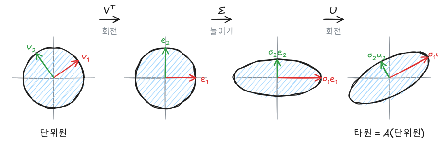

고유값 분해는 정사각행렬, 그중에서도 대각화 가능한 행렬에만 쓸 수 있다. **특잇값 분해(SVD)**는 직사각행렬을 포함한 모든 행렬을 회전, 늘이기, 회전으로 분해한다. 시리즈의 마지막 글로 SVD의 유도와 의미, 저차원 근사, 유사역행렬, 주성분분석과의 관계를 정리한다.

이전 글: [선형대수 - 고유값, 대각화와 이차형식](/posts/la-eigen)

## 1. 정의

임의의 $m \times n$ 실행렬 $\mathbf{A}$(rank $r$)는 다음처럼 분해된다.

$$
\underset{m \times n}{\mathbf{A}} = \underset{m \times m}{\mathbf{U}}\;\underset{m \times n}{\boldsymbol{\Sigma}}\;\underset{n \times n}{\mathbf{V}^T},
\qquad
\boldsymbol{\Sigma} = \begin{pmatrix} \sigma_1 & & & \\ & \ddots & & \mathbf{O} \\ & & \sigma_r & \\ & \mathbf{O} & & \mathbf{O} \end{pmatrix}
$$

| 구성 | 성질 | 이름 |
|---|---|---|
| $\mathbf{U}$ | 직교행렬, 열 $\mathbf{u}_i$ | 왼쪽 특이벡터 |
| $\mathbf{V}$ | 직교행렬, 열 $\mathbf{v}_i$ | 오른쪽 특이벡터 |
| $\boldsymbol{\Sigma}$ | 대각에 $\sigma_1 \ge \sigma_2 \ge \cdots \ge \sigma_r > 0$, 나머지 0 | 특잇값 |

특잇값은 항상 **실수이고 0 이상**이며, 0이 아닌 특잇값의 개수가 rank다.

## 2. 유도: $\mathbf{A}^T\mathbf{A}$의 고유값 분해

$\mathbf{A}^T\mathbf{A}$는 $n \times n$ 대칭행렬이고 $\mathbf{x}^T\mathbf{A}^T\mathbf{A}\mathbf{x} = \lVert \mathbf{Ax} \rVert^2 \ge 0$이라 양의 준정부호다. 따라서 스펙트럼 정리로 직교 대각화되고 고유값이 모두 0 이상이다.

1. $\mathbf{A}^T\mathbf{A}$의 고유값 $\lambda_1 \ge \cdots \ge \lambda_n \ge 0$과 정규직교 고유벡터 $\mathbf{v}_1, \dots, \mathbf{v}_n$을 구한다.
2. 특잇값은 $\sigma_i = \sqrt{\lambda_i}$이다.
3. $\sigma_i > 0$인 $i$에 대해 $\mathbf{u}_i = \dfrac{\mathbf{A}\mathbf{v}_i}{\sigma_i}$로 정한다. 이들은 자동으로 정규직교다.

$$
\langle \mathbf{u}_i, \mathbf{u}_j \rangle = \frac{\mathbf{v}_i^T\mathbf{A}^T\mathbf{A}\mathbf{v}_j}{\sigma_i\sigma_j} = \frac{\lambda_j\,\mathbf{v}_i^T\mathbf{v}_j}{\sigma_i\sigma_j} =
\begin{cases} 1 & i = j \\ 0 & i \neq j \end{cases}
$$

4. 부족한 $\mathbf{u}$는 그람-슈미트로 채워 $\mathbb{R}^m$의 정규직교기저를 완성한다.

$\mathbf{A}\mathbf{v}_i = \sigma_i\mathbf{u}_i$를 행렬로 모으면 $\mathbf{AV} = \mathbf{U}\boldsymbol{\Sigma}$, 즉 $\mathbf{A} = \mathbf{U}\boldsymbol{\Sigma}\mathbf{V}^T$이다. 같은 방식으로 $\mathbf{A}\mathbf{A}^T = \mathbf{U}\boldsymbol{\Sigma}\boldsymbol{\Sigma}^T\mathbf{U}^T$이므로 $\mathbf{u}_i$는 $\mathbf{A}\mathbf{A}^T$의 고유벡터다.

### 예시

$$
\mathbf{A} = \begin{pmatrix} 3 & 0 \\ 4 & 5 \end{pmatrix},
\qquad
\mathbf{A}^T\mathbf{A} = \begin{pmatrix} 25 & 20 \\ 20 & 25 \end{pmatrix}
$$

| | 고유값 | $\sigma_i$ | $\mathbf{v}_i$ | $\mathbf{u}_i = \mathbf{A}\mathbf{v}_i / \sigma_i$ |
|---|---|---|---|---|
| 1 | $45$ | $3\sqrt5$ | $\frac{1}{\sqrt2}(1, 1)$ | $\frac{1}{\sqrt{10}}(1, 3)$ |
| 2 | $5$ | $\sqrt5$ | $\frac{1}{\sqrt2}(1, -1)$ | $\frac{1}{\sqrt{10}}(3, -1)$ |

$$
\mathbf{A} =
\frac{1}{\sqrt{10}}\begin{pmatrix} 1 & 3 \\ 3 & -1 \end{pmatrix}
\begin{pmatrix} 3\sqrt5 & 0 \\ 0 & \sqrt5 \end{pmatrix}
\frac{1}{\sqrt2}\begin{pmatrix} 1 & 1 \\ 1 & -1 \end{pmatrix}
$$

확인: $\sigma_1\sigma_2 = 15 = \lvert\det\mathbf{A}\rvert$, $\sigma_1^2 + \sigma_2^2 = 50 = \operatorname{tr}(\mathbf{A}^T\mathbf{A})$.

## 3. 기하학적 의미

$\mathbf{Ax} = \mathbf{U}\boldsymbol{\Sigma}\mathbf{V}^T\mathbf{x}$를 오른쪽부터 읽으면 모든 선형변환은 **회전(또는 반사) → 축 방향 늘이기 → 회전**이다.



- $\mathbf{V}^T$: 입력 공간의 직교 방향 $\mathbf{v}_i$를 좌표축 $\mathbf{e}_i$로 돌린다.
- $\boldsymbol{\Sigma}$: 각 축을 $\sigma_i$배 늘인다.
- $\mathbf{U}$: 결과를 출력 공간의 직교 방향 $\mathbf{u}_i$로 돌린다.

그래서 단위원(구)은 반지름이 $\sigma_i$인 타원(타원체)이 된다. $\sigma_1 = \max_{\lVert \mathbf{x} \rVert = 1}\lVert \mathbf{Ax} \rVert$는 행렬이 벡터를 가장 많이 늘이는 배율이며, 이를 행렬의 **2-노름** $\lVert \mathbf{A} \rVert_2$라 한다.

## 4. 네 가지 기본 부분공간과의 관계

SVD는 네 부분공간의 정규직교기저를 한 번에 준다.

| 공간 | 정규직교기저 |
|---|---|
| 행공간 $R(\mathbf{A})$ | $\mathbf{v}_1, \dots, \mathbf{v}_r$ |
| 영공간 $N(\mathbf{A})$ | $\mathbf{v}_{r+1}, \dots, \mathbf{v}_n$ |
| 열공간 $C(\mathbf{A})$ | $\mathbf{u}_1, \dots, \mathbf{u}_r$ |
| 좌영공간 $N(\mathbf{A}^T)$ | $\mathbf{u}_{r+1}, \dots, \mathbf{u}_m$ |

$\mathbf{A}$는 행공간의 $\mathbf{v}_i$를 열공간의 $\sigma_i\mathbf{u}_i$로 보내고, 영공간의 $\mathbf{v}_i$는 $\mathbf{0}$으로 보낸다.

## 5. rank 1 행렬의 합과 저차원 근사

### 외적 형태

$\boldsymbol{\Sigma}$의 0을 버리면 SVD는 rank 1 행렬의 합이다.

$$
\mathbf{A} = \sigma_1\mathbf{u}_1\mathbf{v}_1^T + \sigma_2\mathbf{u}_2\mathbf{v}_2^T + \cdots + \sigma_r\mathbf{u}_r\mathbf{v}_r^T
$$

1편의 "열 × 행 = rank 1 행렬의 합" 관점에서, 중요도($\sigma_i$) 순으로 정렬한 버전이다.

### 에카르트-영 정리

앞의 $k$개 항만 남긴 $\mathbf{A}_k = \sum_{i=1}^{k}\sigma_i\mathbf{u}_i\mathbf{v}_i^T$는 rank가 $k$ 이하인 행렬 중 $\mathbf{A}$에 **가장 가까운** 행렬이다.

$$
\lVert \mathbf{A} - \mathbf{A}_k \rVert_2 = \sigma_{k+1},
\qquad
\lVert \mathbf{A} - \mathbf{A}_k \rVert_F = \sqrt{\sigma_{k+1}^2 + \cdots + \sigma_r^2}
$$

특잇값이 빠르게 작아지는 행렬은 적은 수의 항으로 거의 복원된다. 이미지 압축, 추천 시스템의 행렬 분해, 잡음 제거가 이 원리를 쓴다.

## 6. 유사역행렬과 최소제곱

### 정의

$$
\mathbf{A}^{+} = \mathbf{V}\boldsymbol{\Sigma}^{+}\mathbf{U}^T,
\qquad
\boldsymbol{\Sigma}^{+} = \operatorname{diag}(1/\sigma_1, \dots, 1/\sigma_r, 0, \dots, 0)^T \;(n \times m)
$$

0이 아닌 특잇값만 역수를 취하고 전치한다. 이를 **무어-펜로즈 유사역행렬**이라 한다.

### 성질

- $\mathbf{A}$가 가역이면 $\mathbf{A}^{+} = \mathbf{A}^{-1}$
- 열이 일차독립이면 $\mathbf{A}^{+} = (\mathbf{A}^T\mathbf{A})^{-1}\mathbf{A}^T$, 즉 정규방정식의 해와 같다.
- 일반적으로 $\hat{\mathbf{x}} = \mathbf{A}^{+}\mathbf{b}$는 $\lVert \mathbf{Ax} - \mathbf{b} \rVert$를 최소로 하는 해 중 **길이가 가장 짧은** 해다. 열이 종속이라 $\mathbf{A}^T\mathbf{A}$가 가역이 아닐 때도 쓸 수 있다.
- $\mathbf{A}\mathbf{A}^{+}$는 열공간으로의, $\mathbf{A}^{+}\mathbf{A}$는 행공간으로의 정사영 행렬이다.

### 조건수

$\kappa(\mathbf{A}) = \sigma_1 / \sigma_n$을 **조건수**라 한다. 클수록 $\mathbf{b}$의 작은 오차가 해에서 크게 증폭된다. 위 예시는 $\kappa = 3\sqrt5 / \sqrt5 = 3$이다. 회귀에서 다중공선성이 있으면 $\mathbf{X}$의 가장 작은 특잇값이 0에 가까워져 조건수가 커지고, 계수 추정이 불안정해진다.

## 7. 주성분분석(PCA)

### 공분산행렬과 SVD

$n$개 관측, $p$개 변수의 자료 행렬을 열별로 평균을 빼 중심화한 것을 $\mathbf{X}_c$라 하면, 표본공분산행렬과 SVD는

$$
\mathbf{S} = \frac{1}{n - 1}\mathbf{X}_c^T\mathbf{X}_c,
\qquad
\mathbf{X}_c = \mathbf{U}\boldsymbol{\Sigma}\mathbf{V}^T
\quad\Rightarrow\quad
\mathbf{S} = \mathbf{V}\,\frac{\boldsymbol{\Sigma}^2}{n - 1}\,\mathbf{V}^T
$$

즉 $\mathbf{X}_c$의 SVD가 공분산행렬의 고유값 분해를 그대로 준다.

| PCA 용어 | SVD로 표현 |
|---|---|
| 주성분 방향(loading) | $\mathbf{V}$의 열 $\mathbf{v}_i$ |
| 주성분 점수(score) | $\mathbf{X}_c\mathbf{V} = \mathbf{U}\boldsymbol{\Sigma}$ |
| $i$번째 주성분의 분산 | $\sigma_i^2 / (n - 1)$ |
| 설명 분산 비율 | $\sigma_i^2 / \sum_j \sigma_j^2$ |

### 왜 이것이 "분산이 가장 큰 방향"인가

단위벡터 $\mathbf{w}$ 방향으로 사영한 자료의 분산은 $\mathbf{w}^T\mathbf{S}\mathbf{w}$이고, 이 이차형식은 $\mathbf{S}$의 가장 큰 고유값의 고유벡터 $\mathbf{v}_1$에서 최대가 된다(고유값 글의 주축정리). 그다음 주성분은 $\mathbf{v}_1$에 수직인 방향 중에서 분산이 가장 큰 $\mathbf{v}_2$이고, 이렇게 이어진다. 앞의 $k$개 주성분으로 자료를 근사하는 것은 $\mathbf{X}_c$를 rank $k$로 근사하는 에카르트-영 정리와 같다.

실무에서는 $\mathbf{X}_c^T\mathbf{X}_c$를 직접 만들면 조건수가 제곱으로 커지므로, 공분산행렬의 고유값 분해 대신 $\mathbf{X}_c$의 SVD를 계산한다. R의 `prcomp`와 scikit-learn의 `PCA`도 SVD를 쓴다.

## 8. 고유값 분해와 비교

| | 고유값 분해 $\mathbf{A} = \mathbf{PDP}^{-1}$ | SVD $\mathbf{A} = \mathbf{U}\boldsymbol{\Sigma}\mathbf{V}^T$ |
|---|---|---|
| 적용 대상 | 대각화 가능한 정사각행렬 | **모든** 행렬 |
| 기저 | 고유벡터 (직교라는 보장 없음) | 두 개의 정규직교기저 |
| 대각 성분 | 고유값 (음수, 복소수 가능) | 특잇값 (항상 0 이상 실수) |
| 일치하는 경우 | 양의 준정부호 대칭행렬에서는 두 분해가 같다 | |

## 요약

| 개념 | 핵심 |
|---|---|
| SVD | $\mathbf{A} = \mathbf{U}\boldsymbol{\Sigma}\mathbf{V}^T$, 모든 행렬에 존재 |
| 구하는 법 | $\mathbf{A}^T\mathbf{A}$의 고유값 분해: $\sigma_i = \sqrt{\lambda_i}$, $\mathbf{u}_i = \mathbf{A}\mathbf{v}_i/\sigma_i$ |
| 기하 | 회전 → 늘이기 → 회전, 단위원 → 타원, $\lVert \mathbf{A} \rVert_2 = \sigma_1$ |
| 네 부분공간 | $\mathbf{v}_{1..r}$: 행공간, $\mathbf{v}_{r+1..n}$: 영공간, $\mathbf{u}_{1..r}$: 열공간, $\mathbf{u}_{r+1..m}$: 좌영공간 |
| 저차원 근사 | $\mathbf{A}_k = \sum_{i \le k}\sigma_i\mathbf{u}_i\mathbf{v}_i^T$가 최적, 오차 $\sigma_{k+1}$ |
| 유사역행렬 | $\mathbf{A}^{+} = \mathbf{V}\boldsymbol{\Sigma}^{+}\mathbf{U}^T$, 최소노름 최소제곱해 $\mathbf{A}^{+}\mathbf{b}$ |
| 조건수 | $\sigma_1/\sigma_n$, 다중공선성 진단 |
| PCA | 중심화한 $\mathbf{X}_c$의 SVD, 방향 $\mathbf{V}$, 점수 $\mathbf{U}\boldsymbol{\Sigma}$, 분산 $\sigma_i^2/(n-1)$ |

## R / Python으로 확인

```r
A <- matrix(c(3, 4, 0, 5), nrow = 2)
s <- svd(A)
s$d                                   # 6.708 2.236
s$u %*% diag(s$d) %*% t(s$v)          # A 복원

MASS::ginv(A)                         # 유사역행렬

# PCA: prcomp는 내부적으로 중심화한 자료의 SVD를 쓴다
X <- matrix(rnorm(300), ncol = 3)
p <- prcomp(X)
p$rotation                            # 주성분 방향 = V
p$sdev^2                              # 각 주성분의 분산 = d^2 / (n - 1)
```

```python
import numpy as np

A = np.array([[3, 0], [4, 5]], dtype=float)
U, s, Vt = np.linalg.svd(A)      # s = [6.708, 2.236] = [3√5, √5]
np.allclose(U @ np.diag(s) @ Vt, A)              # True

# rank k 근사
k = 1
A1 = s[0] * np.outer(U[:, 0], Vt[0])

# 유사역행렬과 최소노름 해
np.linalg.pinv(A)

# PCA: 중심화한 자료의 SVD
X = np.random.default_rng(0).normal(size=(100, 3))
Xc = X - X.mean(axis=0)
U, s, Vt = np.linalg.svd(Xc, full_matrices=False)
components = Vt                  # 주성분 방향 (행)
scores = U * s                   # = Xc @ Vt.T
explained = s**2 / (len(X) - 1)  # 각 주성분의 분산
```

## 참고자료

- 하길찬, 『해설이 있는 선형대수학』
- 유호석, 「선형대수학」, 세종대학교, KOCW 공개강의
