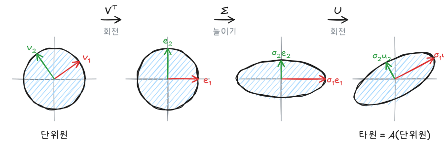
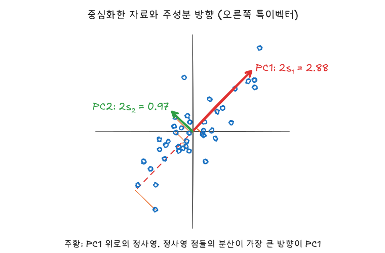
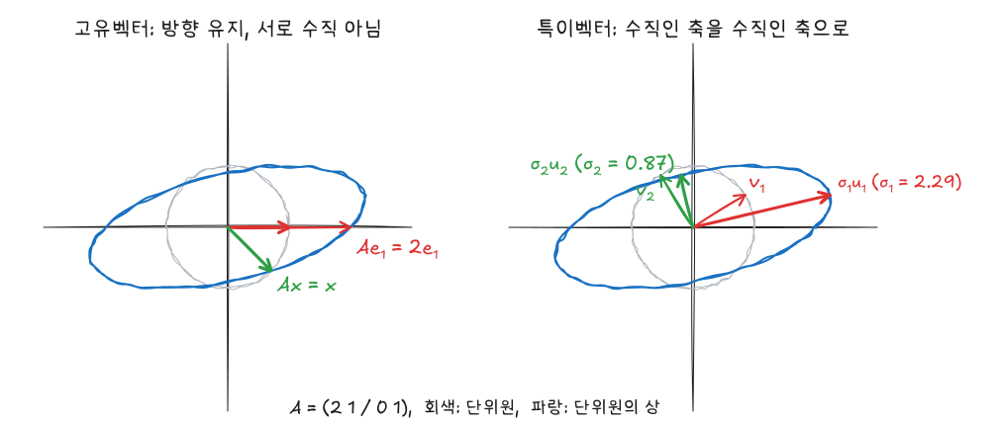

고유값 분해는 정사각행렬, 그중에서도 대각화 가능한 행렬에만 쓸 수 있다. **특잇값 분해(SVD)**는 직사각행렬을 포함한 모든 행렬을 회전, 늘이기, 회전으로 분해한다. 시리즈의 마지막 글로 SVD의 유도와 의미, 저차원 근사, 유사역행렬, 주성분분석과의 관계를 수학 쪽에서 정리한다. PCA의 통계적 해석(적재값 읽기, 표준화, 성분 수 선택)은 [데이터 마이닝 - 주성분분석](/posts/dm-pca)이 맡는다.

이전 글: [선형대수 - 고유값, 대각화와 이차형식](/posts/la-eigen)

## 1. 정의

임의의 $m \times n$ 실행렬 $\mathbf{A}$(rank $r$)는 다음처럼 분해된다.

$$
\underset{m \times n}{\mathbf{A}} = \underset{m \times m}{\mathbf{U}}\;\underset{m \times n}{\boldsymbol{\Sigma}}\;\underset{n \times n}{\mathbf{V}^T},
\qquad
\boldsymbol{\Sigma} = \begin{pmatrix} \sigma_1 & & & \\ & \ddots & & \mathbf{O} \\ & & \sigma_r & \\ & \mathbf{O} & & \mathbf{O} \end{pmatrix}
$$

| 구성 | 성질 | 이름 |
|---|---|---|
| $\mathbf{U}$ | 직교행렬, 열 $\mathbf{u}_i$ | 왼쪽 특이벡터 |
| $\mathbf{V}$ | 직교행렬, 열 $\mathbf{v}_i$ | 오른쪽 특이벡터 |
| $\boldsymbol{\Sigma}$ | 대각에 $\sigma_1 \ge \sigma_2 \ge \cdots \ge \sigma_r > 0$, 나머지 0 | 특잇값 |

특잇값은 항상 **실수이고 0 이상**이며, 0이 아닌 특잇값의 개수가 rank다. 위의 $\mathbf{U}$, $\mathbf{V}$가 정사각인 형태를 **완전(full) SVD**, 0이 아닌 $r$개만 남긴 $\mathbf{A} = \mathbf{U}_r\boldsymbol{\Sigma}_r\mathbf{V}_r^T$ ($\mathbf{U}_r$: $m \times r$, $\boldsymbol{\Sigma}_r$: $r \times r$, $\mathbf{V}_r$: $n \times r$)를 **간소(compact) SVD**라 한다. 한편 $k = \min(m, n)$개의 특잇값과 이에 대응하는 $\mathbf{U}$($m \times k$), $\mathbf{V}$($n \times k$)의 열만 남기는 형태는 **얇은(thin) SVD**라 하며, rank가 모자라면 0인 특잇값도 함께 남는다. R의 `svd()`는 기본적으로 thin SVD($\min(m, n)$개의 열)를 돌려주지만, NumPy의 `np.linalg.svd()`는 기본값이 `full_matrices=True`라 완전 SVD를 돌려준다(`full_matrices=False`일 때 thin SVD).

## 2. 유도: $\mathbf{A}^T\mathbf{A}$의 고유값 분해

$\mathbf{A}^T\mathbf{A}$는 $n \times n$ 대칭행렬이고 $\mathbf{x}^T\mathbf{A}^T\mathbf{A}\mathbf{x} = \lVert \mathbf{Ax} \rVert^2 \ge 0$이라 양의 준정부호다. 따라서 스펙트럼 정리로 직교 대각화되고 고유값이 모두 0 이상이다.

1. $\mathbf{A}^T\mathbf{A}$의 고유값 $\lambda_1 \ge \cdots \ge \lambda_n \ge 0$과 정규직교 고유벡터 $\mathbf{v}_1, \dots, \mathbf{v}_n$을 구한다.
2. 특잇값은 $\sigma_i = \sqrt{\lambda_i}$이다.
3. $\sigma_i > 0$인 $i$에 대해 $\mathbf{u}_i = \dfrac{\mathbf{A}\mathbf{v}_i}{\sigma_i}$로 정한다. 이들은 자동으로 정규직교다.

$$
\langle \mathbf{u}_i, \mathbf{u}_j \rangle = \frac{\mathbf{v}_i^T\mathbf{A}^T\mathbf{A}\mathbf{v}_j}{\sigma_i\sigma_j} = \frac{\lambda_j\,\mathbf{v}_i^T\mathbf{v}_j}{\sigma_i\sigma_j} =
\begin{cases} 1 & i = j \\ 0 & i \neq j \end{cases}
$$

4. 부족한 $\mathbf{u}$는 그람-슈미트로 채워 $\mathbb{R}^m$의 정규직교기저를 완성한다.

고유값 글의 스펙트럼 정리가 여기서 쓰이는 이유는 $\mathbf{A}^T\mathbf{A}$가 항상 실대칭이라 직교 대각화되기 때문이다. $\mathbf{A}$ 자체는 정사각이 아니어도, 대각화 가능하지 않아도 된다. 그래서 SVD는 모든 행렬에 존재한다.

$\mathbf{A}\mathbf{v}_i = \sigma_i\mathbf{u}_i$를 행렬로 모으면 $\mathbf{AV} = \mathbf{U}\boldsymbol{\Sigma}$, 즉 $\mathbf{A} = \mathbf{U}\boldsymbol{\Sigma}\mathbf{V}^T$이다. 같은 방식으로 $\mathbf{A}\mathbf{A}^T = \mathbf{U}\boldsymbol{\Sigma}\boldsymbol{\Sigma}^T\mathbf{U}^T$이므로 $\mathbf{u}_i$는 $\mathbf{A}\mathbf{A}^T$의 고유벡터다.

### 예시

$$
\mathbf{A} = \begin{pmatrix} 3 & 0 \\ 4 & 5 \end{pmatrix},
\qquad
\mathbf{A}^T\mathbf{A} = \begin{pmatrix} 25 & 20 \\ 20 & 25 \end{pmatrix}
$$

| | 고유값 | $\sigma_i$ | $\mathbf{v}_i$ | $\mathbf{u}_i = \mathbf{A}\mathbf{v}_i / \sigma_i$ |
|---|---|---|---|---|
| 1 | $45$ | $3\sqrt5$ | $\frac{1}{\sqrt2}(1, 1)$ | $\frac{1}{\sqrt{10}}(1, 3)$ |
| 2 | $5$ | $\sqrt5$ | $\frac{1}{\sqrt2}(1, -1)$ | $\frac{1}{\sqrt{10}}(3, -1)$ |

$$
\mathbf{A} =
\frac{1}{\sqrt{10}}\begin{pmatrix} 1 & 3 \\ 3 & -1 \end{pmatrix}
\begin{pmatrix} 3\sqrt5 & 0 \\ 0 & \sqrt5 \end{pmatrix}
\frac{1}{\sqrt2}\begin{pmatrix} 1 & 1 \\ 1 & -1 \end{pmatrix}
$$

확인: $\sigma_1\sigma_2 = 15 = \lvert\det\mathbf{A}\rvert$, $\sigma_1^2 + \sigma_2^2 = 50 = \operatorname{tr}(\mathbf{A}^T\mathbf{A})$.

```r
A <- matrix(c(3, 4, 0, 5), nrow = 2)
s <- svd(A)
s$d                                   # 6.708 2.236 = 3*sqrt(5), sqrt(5)
eigen(crossprod(A))$values            # 45 5 = sigma^2
c(prod(s$d), abs(det(A)))             # 15 15
c(sum(s$d^2), sum(A^2))               # 50 50: sigma^2의 합 = 모든 성분 제곱의 합
s$u; s$v                              # 손계산과 열의 부호가 반대일 수 있다
max(abs(s$u %*% diag(s$d) %*% t(s$v) - A))   # ~1e-15: A 복원
norm(A, "2")                          # 6.708 = sigma_1 (2-노름)
```

```python
import numpy as np

A = np.array([[3, 0], [4, 5]], dtype=float)
U, s, Vt = np.linalg.svd(A)           # s = [6.708, 2.236] = [3√5, √5]
np.allclose(U @ np.diag(s) @ Vt, A)   # True
np.linalg.eigvalsh(A.T @ A)[::-1]     # [45, 5] = s**2
s.prod(), abs(np.linalg.det(A)), (s**2).sum(), (A**2).sum()   # 15, 15, 50, 50
```

R의 `svd()`는 $\mathbf{u}_1 = -(1, 3)/\sqrt{10}$처럼 부호가 손계산과 반대로 나온다. $\mathbf{u}_i$와 $\mathbf{v}_i$를 함께 뒤집어도 $\sigma_i\mathbf{u}_i\mathbf{v}_i^T$는 같으므로 특이벡터의 부호는 정해지지 않고, 특잇값과 rank 1 성분은 부호와 무관하다. $\mathbf{A}^T\mathbf{A}$의 고유값은 $45, 5$로 $\sigma^2$과 일치한다.

## 3. 기하학적 의미

$\mathbf{Ax} = \mathbf{U}\boldsymbol{\Sigma}\mathbf{V}^T\mathbf{x}$를 오른쪽부터 읽으면 모든 선형변환은 **회전(또는 반사) → 축 방향 늘이기 → 회전**이다.



- $\mathbf{V}^T$: 입력 공간의 직교 방향 $\mathbf{v}_i$를 좌표축 $\mathbf{e}_i$로 돌린다.
- $\boldsymbol{\Sigma}$: 각 축을 $\sigma_i$배 늘인다.
- $\mathbf{U}$: 결과를 출력 공간의 직교 방향 $\mathbf{u}_i$로 돌린다.

그래서 단위원(구)은 반지름이 $\sigma_i$인 타원(타원체)이 된다. $\sigma_1 = \max_{\lVert \mathbf{x} \rVert = 1}\lVert \mathbf{Ax} \rVert$는 행렬이 벡터를 가장 많이 늘이는 배율이며, 이를 행렬의 **2-노름** $\lVert \mathbf{A} \rVert_2$라 한다.

## 4. 네 가지 기본 부분공간과의 관계

SVD는 네 부분공간의 정규직교기저를 한 번에 준다.

| 공간 | 정규직교기저 |
|---|---|
| 행공간 $R(\mathbf{A})$ | $\mathbf{v}_1, \dots, \mathbf{v}_r$ |
| 영공간 $N(\mathbf{A})$ | $\mathbf{v}_{r+1}, \dots, \mathbf{v}_n$ |
| 열공간 $C(\mathbf{A})$ | $\mathbf{u}_1, \dots, \mathbf{u}_r$ |
| 좌영공간 $N(\mathbf{A}^T)$ | $\mathbf{u}_{r+1}, \dots, \mathbf{u}_m$ |

$\mathbf{A}$는 행공간의 $\mathbf{v}_i$를 열공간의 $\sigma_i\mathbf{u}_i$로 보내고, 영공간의 $\mathbf{v}_i$는 $\mathbf{0}$으로 보낸다.

rank가 모자란 $3 \times 4$ 행렬로 확인한다. 넷째 열이 $2 \times$ 첫째 열 $+$ 둘째 열이라 rank는 2다.

```r
B <- cbind(c(1, 2, 3), c(0, 1, 1), c(1, 3, 4), c(2, 1, 3))
B[, 4] <- 2 * B[, 1] + B[, 2]                      # 종속인 열: rank 2
sb <- svd(B, nu = 3, nv = 4)                       # 완전한 V(4x4), U(3x3)를 요청
round(sb$d, 4)                                     # 10.9442 0.4748 0.0000: 0이 아닌 특잇값 2개 = rank
round(B %*% sb$v[, 3:4], 10)                       # 0: v_3, v_4가 영공간의 기저
```

```python
B = np.array([[1, 0, 1, 2], [2, 1, 3, 1], [3, 1, 4, 3]], dtype=float)
B[:, 3] = 2 * B[:, 0] + B[:, 1]
U, s, Vt = np.linalg.svd(B)           # 기본값이 full_matrices=True: Vt는 4x4
s.round(4)                            # [10.9442, 0.4748, 0.]
np.abs(B @ Vt[2:].T).max()            # ~0: 아래 두 행이 영공간의 기저
```

특잇값이 $10.944, 0.475, 0$이므로 rank는 2이고, $\mathbf{V}$의 마지막 두 열이 영공간 $N(\mathbf{B})$($4 - 2 = 2$차원)의 정규직교기저다. `B %*% v`가 0이 되는 것으로 확인된다.

## 5. rank 1 행렬의 합과 저차원 근사

### 외적 형태

$\boldsymbol{\Sigma}$의 0을 버리면 SVD는 rank 1 행렬의 합이다.

$$
\mathbf{A} = \sigma_1\mathbf{u}_1\mathbf{v}_1^T + \sigma_2\mathbf{u}_2\mathbf{v}_2^T + \cdots + \sigma_r\mathbf{u}_r\mathbf{v}_r^T
$$

1편의 "열 × 행 = rank 1 행렬의 합" 관점에서, 중요도($\sigma_i$) 순으로 정렬한 버전이다.

### 에카르트-영 정리

앞의 $k$개 항만 남긴 $\mathbf{A}_k = \sum_{i=1}^{k}\sigma_i\mathbf{u}_i\mathbf{v}_i^T$는 rank가 $k$ 이하인 행렬 중 $\mathbf{A}$에 **가장 가까운** 행렬이다.

$$
\lVert \mathbf{A} - \mathbf{A}_k \rVert_2 = \sigma_{k+1},
\qquad
\lVert \mathbf{A} - \mathbf{A}_k \rVert_F = \sqrt{\sigma_{k+1}^2 + \cdots + \sigma_r^2}
$$

특잇값이 빠르게 작아지는 행렬은 적은 수의 항으로 거의 복원된다. 이미지 압축, 추천 시스템의 행렬 분해, 잡음 제거가 이 원리를 쓴다.

`iris`의 네 측정값을 중심화한 $150 \times 4$ 행렬로 오차 공식을 확인한다.

```r
Xc <- scale(as.matrix(iris[, 1:4]), scale = FALSE)
sx <- svd(Xc); sx$d                                # 25.100 6.013 3.414 1.885
A1 <- sx$d[1] * sx$u[, 1] %o% sx$v[, 1]            # rank 1 근사
c(norm(Xc - A1, "2"), sx$d[2])                     # 6.013 6.013: 오차의 2-노름 = sigma_2
c(norm(Xc - A1, "F"), sqrt(sum(sx$d[2:4]^2)))      # 7.167 7.167: 프로베니우스 오차
A2 <- sx$u[, 1:2] %*% diag(sx$d[1:2]) %*% t(sx$v[, 1:2])   # rank 2 근사
c(norm(Xc - A2, "F"), sqrt(sum(sx$d[3:4]^2)))      # 3.899 3.899
cumsum(sx$d^2) / sum(sx$d^2)                       # 0.925 0.978 0.995 1: 근사가 담는 제곱합의 비율
```

```python
from sklearn.datasets import load_iris   # scikit-learn이 없으면 R의 iris를 csv로 내보내 읽어도 된다

Xc = load_iris().data
Xc = Xc - Xc.mean(axis=0)
U, s, Vt = np.linalg.svd(Xc, full_matrices=False)
k = 1
A1 = (U[:, :k] * s[:k]) @ Vt[:k]                    # rank k 근사
np.linalg.norm(Xc - A1, 2), s[k]                    # 같다
np.linalg.norm(Xc - A1, "fro"), np.sqrt((s[k:]**2).sum())   # 같다
```

오차 공식이 두 노름 모두 정확히 맞는다. 두 번째 항까지만 남겨도 제곱합의 97.8%가 설명되므로 네 변수의 변동은 거의 2차원 평면에 놓여 있다. 이것이 PCA에서 앞의 주성분 몇 개로 자료를 요약하는 근거다.

## 6. 유사역행렬과 최소제곱

### 정의

$$
\mathbf{A}^{+} = \mathbf{V}\boldsymbol{\Sigma}^{+}\mathbf{U}^T,
\qquad
\boldsymbol{\Sigma}^{+} = \operatorname{diag}(1/\sigma_1, \dots, 1/\sigma_r, 0, \dots, 0)^T \;(n \times m)
$$

0이 아닌 특잇값만 역수를 취하고 전치한다. 이를 **무어-펜로즈 유사역행렬**이라 한다.

### 성질

- $\mathbf{A}$가 가역이면 $\mathbf{A}^{+} = \mathbf{A}^{-1}$
- 열이 일차독립이면 $\mathbf{A}^{+} = (\mathbf{A}^T\mathbf{A})^{-1}\mathbf{A}^T$, 즉 정규방정식의 해와 같다.
- 일반적으로 $\hat{\mathbf{x}} = \mathbf{A}^{+}\mathbf{b}$는 $\lVert \mathbf{Ax} - \mathbf{b} \rVert$를 최소로 하는 해 중 **길이가 가장 짧은** 해다. 열이 종속이라 $\mathbf{A}^T\mathbf{A}$가 가역이 아닐 때도 쓸 수 있다.
- $\mathbf{A}\mathbf{A}^{+}$는 열공간으로의, $\mathbf{A}^{+}\mathbf{A}$는 행공간으로의 정사영 행렬이다.

설계행렬의 넷째 열이 둘째, 셋째 열의 합인 작은 자료($n = 6$)로 확인한다. $\mathbf{X}^T\mathbf{X}$가 특이행렬이라 정규방정식은 풀리지 않는다.

```r
x1 <- c(1, 2, 3, 4, 5, 6); x2 <- c(2, 1, 4, 3, 6, 5); y <- c(1.1, 1.9, 3.2, 3.8, 5.3, 5.9)
X <- cbind(1, x1, x2, x1 + x2)                     # 넷째 열 = 둘째 + 셋째: rank 3
try(solve(crossprod(X), crossprod(X, y)))          # 오류: exactly singular
b <- MASS::ginv(X) %*% y; drop(b)                  # -0.0542 0.5042 -0.1625 0.3417
sum(b^2)                                           # 0.400: 최소제곱해 중 길이가 가장 짧다
cf <- coef(lm(y ~ x1 + x2 + I(x1 + x2))); cf       # lm은 넷째 계수를 NA로 두고 나머지 셋을 푼다
sum(cf[!is.na(cf)]^2)                              # 0.750: 다른 최소제곱해, 길이는 더 길다
max(abs(X %*% b - fitted(lm(y ~ x1 + x2))))        # ~1e-15: 적합값은 같다
```

```python
x1 = np.array([1, 2, 3, 4, 5, 6.]); x2 = np.array([2, 1, 4, 3, 6, 5.])
y = np.array([1.1, 1.9, 3.2, 3.8, 5.3, 5.9])
X = np.column_stack([np.ones(6), x1, x2, x1 + x2])
b = np.linalg.pinv(X) @ y             # [-0.0542, 0.5042, -0.1625, 0.3417]
(b**2).sum()                          # 0.400
np.linalg.lstsq(X, y, rcond=None)[0]  # lstsq도 SVD로 같은 최소노름 해를 준다
```

정규방정식은 `solve()`가 실패하지만 유사역행렬은 해를 준다. 해는 무수히 많고(영공간 방향 $(0, 1, 1, -1)$을 더해도 적합값이 같다), 유사역행렬이 고르는 해는 길이가 $\sqrt{0.400} = 0.633$으로 가장 짧다. `lm()`이 고르는 해(넷째 계수 `NA`)의 제곱합은 $0.750$이라 더 길다. 계수의 값은 어느 해를 고르느냐에 달려 있어도 적합값 $\mathbf{X}\hat{\boldsymbol\beta}$는 모두 같다.

### 조건수

$\kappa(\mathbf{A}) = \sigma_1 / \sigma_{\min(m, n)}$을 **조건수**라 한다(rank가 모자라면 $\sigma_{\min(m, n)} = 0$이므로 $\infty$다). 클수록 $\mathbf{b}$의 작은 오차가 해에서 크게 증폭된다. 위 예시는 $\kappa = 3\sqrt5 / \sqrt5 = 3$이다. 회귀에서 다중공선성이 있으면 $\mathbf{X}$의 가장 작은 특잇값이 0에 가까워져 조건수가 커지고, 계수 추정이 불안정해진다. 정규방정식은 $\mathbf{X}^T\mathbf{X}$를 만들기 때문에 조건수가 제곱이 된다: $\kappa(\mathbf{X}^T\mathbf{X}) = \kappa(\mathbf{X})^2$ ([정규직교기저와 최소제곱법](/posts/la-orthonormal)에서 QR이 더 안정적인 이유).

```r
Xs <- scale(as.matrix(iris[, 2:4]))                # Sepal.Width, Petal.Length, Petal.Width 표준화
d <- svd(Xs)$d; d                                  # 18.19 10.53 2.27
c(d[1] / d[3], kappa(Xs, exact = TRUE))            # 8.00 8.00: 조건수 = sigma_1 / sigma_3
c((d[1] / d[3])^2, kappa(crossprod(Xs), exact = TRUE))   # 64.0 64.0: X'X의 조건수는 제곱
cor(Xs)[2, 3]                                      # 0.963: Petal.Length와 Petal.Width의 상관
```

```python
from sklearn.datasets import load_iris

Xs = load_iris().data[:, 1:4]
Xs = (Xs - Xs.mean(axis=0)) / Xs.std(axis=0, ddof=1)
s = np.linalg.svd(Xs, compute_uv=False)   # [18.19, 10.53, 2.27]
s[0] / s[-1], np.linalg.cond(Xs)          # 8.00 8.00
np.linalg.cond(Xs.T @ Xs)                 # 64.0 = 8.00**2
```

두 꽃잎 변수의 상관이 $0.963$이라 가장 작은 특잇값이 $2.27$로 줄어들고, 조건수는 $8.0$, $\mathbf{X}^T\mathbf{X}$의 조건수는 $64.0$이다. $\kappa(\mathbf{X}) = 10^4$이면 $\mathbf{X}^T\mathbf{X}$의 조건수는 $10^8$이라 배정밀도 16자리 중 약 8자리를 잃으므로, 공선성이 심한 자료에서는 정규방정식 대신 QR이나 SVD를 쓴다.

## 7. 주성분분석(PCA)

### 공분산행렬과 SVD

$n$개 관측, $p$개 변수의 자료 행렬을 열별로 평균을 빼 중심화한 것을 $\mathbf{X}_c$라 하면, 표본공분산행렬과 SVD는

$$
\mathbf{S} = \frac{1}{n - 1}\mathbf{X}_c^T\mathbf{X}_c,
\qquad
\mathbf{X}_c = \mathbf{U}\boldsymbol{\Sigma}\mathbf{V}^T
\quad\Rightarrow\quad
\mathbf{S} = \mathbf{V}\,\frac{\boldsymbol{\Sigma}^2}{n - 1}\,\mathbf{V}^T
$$

즉 $\mathbf{X}_c$의 SVD가 공분산행렬의 고유값 분해를 그대로 준다.

| PCA 용어 | SVD로 표현 |
|---|---|
| 주성분 방향(loading) | $\mathbf{V}$의 열 $\mathbf{v}_i$ |
| 주성분 점수(score) | $\mathbf{X}_c\mathbf{V} = \mathbf{U}\boldsymbol{\Sigma}$ |
| $i$번째 주성분의 분산 | $\sigma_i^2 / (n - 1)$ |
| 설명 분산 비율 | $\sigma_i^2 / \sum_j \sigma_j^2$ |

점수 $\mathbf{X}_c\mathbf{V}$가 새 정규직교 기저에 대한 좌표, 즉 거리를 보존하는 등장사상이라는 해석은 [선형사상과 행렬표현](/posts/la-linear-map)에서 다뤘다. 여기서는 그 $\mathbf{V}$를 SVD로 구하는 방법과 분산이 최대인 이유에 집중한다.



그림은 상관이 있는 두 변수의 자료 40개를 중심화한 것이다. $\mathbf{X}_c$의 첫 번째 오른쪽 특이벡터 $\mathbf{v}_1$(PC1)은 자료가 가장 길게 퍼진 방향이고, 화살표 길이로 표시한 그 방향의 표준편차(2배)는 2.88로 PC2 방향(0.97)의 세 배 가까이 된다. 주황색 선은 몇몇 관측값을 PC1 위로 정사영한 것이다. 2차원 자료를 PC1 하나로 요약한다는 것은 각 점을 이 직선 위의 정사영으로 바꾸는 것이고, 버려지는 것은 PC2 방향의 작은 변동이다.

### 왜 이것이 "분산이 가장 큰 방향"인가

단위벡터 $\mathbf{w}$ 방향으로 사영한 자료의 분산은 $\mathbf{w}^T\mathbf{S}\mathbf{w}$이고, 이 이차형식은 $\mathbf{S}$의 가장 큰 고유값의 고유벡터 $\mathbf{v}_1$에서 최대가 된다(고유값 글의 주축정리). 그다음 주성분은 $\mathbf{v}_1$에 수직인 방향 중에서 분산이 가장 큰 $\mathbf{v}_2$이고, 이렇게 이어진다. 앞의 $k$개 주성분으로 자료를 근사하는 것은 $\mathbf{X}_c$를 rank $k$로 근사하는 에카르트-영 정리와 같다.

실무에서는 $\mathbf{X}_c^T\mathbf{X}_c$를 직접 만들면 조건수가 제곱으로 커지므로(위의 조건수 예시), 공분산행렬의 고유값 분해 대신 $\mathbf{X}_c$의 SVD를 계산한다. R의 `prcomp`와 scikit-learn의 `PCA`도 SVD를 쓴다.

```r
p <- prcomp(iris[, 1:4])               # 5절의 Xc, sx와 같은 자료
all.equal(p$sdev^2, sx$d^2 / (150 - 1))                       # TRUE: 분산 = sigma^2 / (n - 1)
all.equal(abs(p$rotation), abs(sx$v), check.attributes = FALSE)   # TRUE: 방향 = V (부호 제외)
all.equal(abs(p$x), abs(sx$u %*% diag(sx$d)), check.attributes = FALSE)   # TRUE: 점수 = U Sigma
round(p$sdev^2, 4)                     # 4.2282 0.2427 0.0782 0.0238
round(cumsum(p$sdev^2) / sum(p$sdev^2), 3)   # 0.925 0.978 0.995 1
```

```python
X = load_iris().data
Xc = X - X.mean(axis=0)
U, s, Vt = np.linalg.svd(Xc, full_matrices=False)
components = Vt                        # 주성분 방향 (행)
scores = U * s                         # = Xc @ Vt.T
explained = s**2 / (len(X) - 1)        # 각 주성분의 분산: [4.2282, 0.2427, 0.0782, 0.0238]
np.allclose(scores, Xc @ Vt.T), np.allclose(np.cov(X, rowvar=False), Vt.T @ np.diag(explained) @ Vt)   # True True
```

`prcomp`의 분산은 $\sigma_i^2/(n-1)$과, 회전행렬은 $\mathbf{V}$와, 점수는 $\mathbf{U}\boldsymbol{\Sigma}$와 일치한다(부호만 다를 수 있다). 분산이 $4.228, 0.243, 0.078, 0.024$이므로 첫 주성분이 총분산의 92.5%를 설명하고, 이는 5절에서 구한 rank 1 근사의 제곱합 비율과 같은 수다. 이 값을 어떻게 읽고 성분 수를 어떻게 정하는지는 [데이터 마이닝 - 주성분분석](/posts/dm-pca)에서 다룬다.

## 8. 통계에서의 쓰임

**릿지 회귀의 축소.** 표준화한 $\mathbf{X} = \mathbf{U}\mathbf{D}\mathbf{V}^T$와 중심화한 $\mathbf{y}$에서 OLS의 적합값은 $\mathbf{U}\mathbf{U}^T\mathbf{y}$이고, 릿지($\lambda > 0$)는 각 성분을 $\dfrac{d_j^2}{d_j^2 + \lambda}$배로 줄인다.

$$
\hat{\mathbf{y}}_{\text{ridge}} = \sum_{j=1}^{p}\mathbf{u}_j\,\frac{d_j^2}{d_j^2 + \lambda}\,\mathbf{u}_j^T\mathbf{y},
\qquad
\hat{\boldsymbol\beta}_{\text{ridge}} = \sum_{j=1}^{p}\mathbf{v}_j\,\frac{d_j}{d_j^2 + \lambda}\,\mathbf{u}_j^T\mathbf{y}
$$

$d_j$가 작은 방향(분산이 작은 주성분, 공선성이 만드는 방향)일수록 많이 줄어든다. 주성분회귀(PCR)는 앞의 $M$개 성분을 그대로(계수 1), 나머지를 버리는(계수 0) 극단적인 버전이다. 정규화의 통계적 성질은 [데이터 마이닝 - 정규화](/posts/dm-regularization)에서 다룬다.

```r
Xs <- scale(as.matrix(iris[, 2:4]))                # 앞 절과 같은 자료, 반응은 Sepal.Length
y  <- iris$Sepal.Length - mean(iris$Sepal.Length)
sr <- svd(Xs); lambda <- 20
round(sr$d^2 / (sr$d^2 + lambda), 3)               # 0.943 0.847 0.205: 마지막 성분이 가장 많이 줄어든다
b_svd <- sr$v %*% ((sr$d / (sr$d^2 + lambda)) * crossprod(sr$u, y))
b_dir <- solve(crossprod(Xs) + lambda * diag(3), crossprod(Xs, y))
b_ols <- solve(crossprod(Xs), crossprod(Xs, y))
round(cbind(ridge_svd = b_svd, ridge_direct = b_dir, ols = b_ols), 4)
```

```python
X = load_iris().data
Xs = (X[:, 1:4] - X[:, 1:4].mean(axis=0)) / X[:, 1:4].std(axis=0, ddof=1)
y = X[:, 0] - X[:, 0].mean()
U, d, Vt = np.linalg.svd(Xs, full_matrices=False)
lam = 20
d**2 / (d**2 + lam)                                # [0.943, 0.847, 0.205]
b_svd = Vt.T @ (d / (d**2 + lam) * (U.T @ y))
b_dir = np.linalg.solve(Xs.T @ Xs + lam * np.eye(3), Xs.T @ y)
b_ols = np.linalg.solve(Xs.T @ Xs, Xs.T @ y)
np.allclose(b_svd, b_dir), b_svd.round(4), b_ols.round(4)
```

| | Sepal.Width | Petal.Length | Petal.Width |
|---|---|---|---|
| OLS | 0.2837 | 1.2518 | $-0.4242$ |
| 릿지 ($\lambda = 20$) | 0.1808 | 0.5307 | 0.2050 |

SVD로 만든 릿지 계수는 $(\mathbf{X}^T\mathbf{X} + \lambda\mathbf{I})^{-1}\mathbf{X}^T\mathbf{y}$를 직접 푼 값과 같다. 꽃잎 길이와 너비의 상관이 $0.963$이라 OLS는 `Petal.Width`의 계수가 $-0.42$로 음수가 되는 불안정한 추정을 한다. 릿지는 가장 작은 특잇값 방향(축소 비율 약 $0.2$)을 크게 줄여 이 계수를 $+0.21$로 안정시킨다.

**그 밖의 쓰임.** 주성분의 방향과 분산은 [데이터 마이닝 - 주성분분석](/posts/dm-pca)에서 통계적으로 해석하고, PCR과 PLS는 [데이터 마이닝 - 정규화](/posts/dm-regularization)의 차원축소 절에서 다룬다. 결측이 있는 행렬의 **행렬 완성**은 에카르트-영 정리를 반복 적용해 관측된 칸에서의 rank $k$ 근사를 구하는 방법이다([데이터 마이닝 - 주성분분석](/posts/dm-pca)). 조건수와 공선성은 6절의 예시를 본다.

## 비교

SVD와 고유값 분해는 $\mathbf{A}^T\mathbf{A}$와 $\mathbf{A}\mathbf{A}^T$를 통해 이어진다.

$$
\mathbf{A}^T\mathbf{A} = \mathbf{V}\boldsymbol{\Sigma}^T\boldsymbol{\Sigma}\mathbf{V}^T,
\qquad
\mathbf{A}\mathbf{A}^T = \mathbf{U}\boldsymbol{\Sigma}\boldsymbol{\Sigma}^T\mathbf{U}^T
$$

즉 $\mathbf{V}$, $\mathbf{U}$는 두 대칭행렬의 고유벡터이고 $\sigma_i^2$이 고유값이다. $\mathbf{A}$가 정규행렬이면 $\sigma_i = \lvert\lambda_i\rvert$이고, 대칭 양의 준정부호이면 $\mathbf{U} = \mathbf{V}$인 두 분해가 같다. 고유값이 음수인 대칭행렬 $\begin{pmatrix} 1 & 2 \\ 2 & 1 \end{pmatrix}$은 고유값이 $3, -1$이고 특잇값이 $3, 1$이다.

| | 고유값 분해 $\mathbf{A} = \mathbf{PDP}^{-1}$ | SVD $\mathbf{A} = \mathbf{U}\boldsymbol{\Sigma}\mathbf{V}^T$ |
|---|---|---|
| 적용 대상 | 대각화 가능한 정사각행렬 | **모든** 행렬 |
| 기저 | 고유벡터 (직교라는 보장 없음) | 두 개의 정규직교기저 |
| 대각 성분 | 고유값 (음수, 복소수 가능) | 특잇값 (항상 0 이상 실수) |
| 기하 | 방향이 유지되는 축 | 단위원이 변하는 타원의 축 |
| 일치하는 경우 | 대칭 양의 준정부호 행렬에서는 두 분해가 같다 | |

두 분해의 차이는 대칭이 아닌 행렬에서 분명해진다. $\mathbf{A} = \begin{pmatrix} 2 & 1 \\ 0 & 1 \end{pmatrix}$의 고유값은 2와 1이고, 특잇값은 2.29와 0.87이다.



고유벡터 $(1, 0)$과 $(1, -1)$은 변환 후에도 방향이 유지되지만 서로 $45°$를 이루어 수직이 아니다. 그래서 고유벡터 기저는 길이와 각을 보존하지 않고, $\mathbf{P}^{-1}$이 $\mathbf{P}^T$가 되지 않는다. 특이벡터는 방향이 유지된다는 조건을 포기하는 대신, 서로 수직인 입력 방향 $\mathbf{v}_1$, $\mathbf{v}_2$를 서로 수직인 출력 방향 $\mathbf{u}_1$, $\mathbf{u}_2$로 보낸다는 조건을 택한다. 단위원의 상인 타원의 장축과 단축이 정확히 $\sigma_1\mathbf{u}_1$과 $\sigma_2\mathbf{u}_2$다. 두 분해 모두 넓이의 배율은 같아서 $\lambda_1\lambda_2 = \sigma_1\sigma_2 = \lvert\det\mathbf{A}\rvert = 2$이다.

```r
M <- matrix(c(2, 0, 1, 1), nrow = 2)               # [[2,1],[0,1]]
eigen(M)$values; svd(M)$d                          # 2 1 / 2.288 0.874
c(prod(eigen(M)$values), prod(svd(M)$d))           # 2 2: 넓이의 배율은 같다
eigen(matrix(c(1, 2, 2, 1), 2))$values             # 3 -1
svd(matrix(c(1, 2, 2, 1), 2))$d                    # 3 1: 대칭이면 sigma = |lambda|
```

```python
M = np.array([[2, 1], [0, 1.]]); S = np.array([[1, 2], [2, 1.]])
np.linalg.eigvals(M).real, np.linalg.svd(M, compute_uv=False)   # [2, 1], [2.288, 0.874]
np.linalg.eigvalsh(S), np.linalg.svd(S, compute_uv=False)       # [-1, 3], [3, 1]
```

최소제곱을 푸는 세 방법도 같은 틀에서 비교된다.

| | 정규방정식 | QR | SVD (유사역행렬) |
|---|---|---|---|
| 푸는 식 | $(\mathbf{X}^T\mathbf{X})\boldsymbol\beta = \mathbf{X}^T\mathbf{y}$ | $\mathbf{R}\boldsymbol\beta = \mathbf{Q}^T\mathbf{y}$ | $\boldsymbol\beta = \mathbf{V}\boldsymbol\Sigma^{+}\mathbf{U}^T\mathbf{y}$ |
| 조건수 | $\kappa(\mathbf{X})^2$ | $\kappa(\mathbf{X})$ | $\kappa(\mathbf{X})$ |
| rank 부족 | 풀 수 없다 | 피벗 없이는 불안정 | 최소노름 해를 준다 |
| 계산량 | 가장 적다 | 중간 | 가장 많다 |
| 쓰임 | 손계산, 이론 | `lm()`의 기본 | 공선성, `ginv`, PCA |

## 정리

| 개념 | 핵심 |
|---|---|
| SVD | $\mathbf{A} = \mathbf{U}\boldsymbol{\Sigma}\mathbf{V}^T$, 모든 행렬에 존재 |
| 구하는 법 | $\mathbf{A}^T\mathbf{A}$의 고유값 분해: $\sigma_i = \sqrt{\lambda_i}$, $\mathbf{u}_i = \mathbf{A}\mathbf{v}_i/\sigma_i$ |
| 기하 | 회전 → 늘이기 → 회전, 단위원 → 타원, $\lVert \mathbf{A} \rVert_2 = \sigma_1$ |
| 네 부분공간 | $\mathbf{v}_{1..r}$: 행공간, $\mathbf{v}_{r+1..n}$: 영공간, $\mathbf{u}_{1..r}$: 열공간, $\mathbf{u}_{r+1..m}$: 좌영공간 |
| 저차원 근사 | $\mathbf{A}_k = \sum_{i \le k}\sigma_i\mathbf{u}_i\mathbf{v}_i^T$가 최적, 오차 $\sigma_{k+1}$ |
| 유사역행렬 | $\mathbf{A}^{+} = \mathbf{V}\boldsymbol{\Sigma}^{+}\mathbf{U}^T$, 최소노름 최소제곱해 $\mathbf{A}^{+}\mathbf{b}$ |
| 조건수 | $\sigma_1/\sigma_{\min(m, n)}$, 다중공선성 진단, $\kappa(\mathbf{X}^T\mathbf{X}) = \kappa(\mathbf{X})^2$ |
| 릿지 | 성분별 축소 $d_j^2/(d_j^2 + \lambda)$, 작은 특잇값 방향을 가장 크게 줄인다 |
| 고유분해와의 관계 | $\mathbf{A}^T\mathbf{A} = \mathbf{V}\boldsymbol{\Sigma}^2\mathbf{V}^T$, 정규행렬이면 $\sigma_i = \lvert\lambda_i\rvert$ |
| PCA | 중심화한 $\mathbf{X}_c$의 SVD, 방향 $\mathbf{V}$, 점수 $\mathbf{U}\boldsymbol{\Sigma}$, 분산 $\sigma_i^2/(n-1)$ |

## 참고자료

- 하길찬, 『해설이 있는 선형대수학』
- 유호석, 「선형대수학」, 세종대학교, KOCW 공개강의
