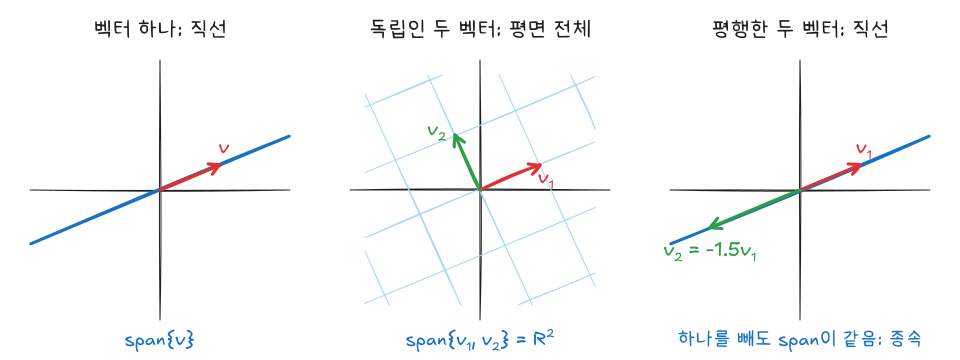
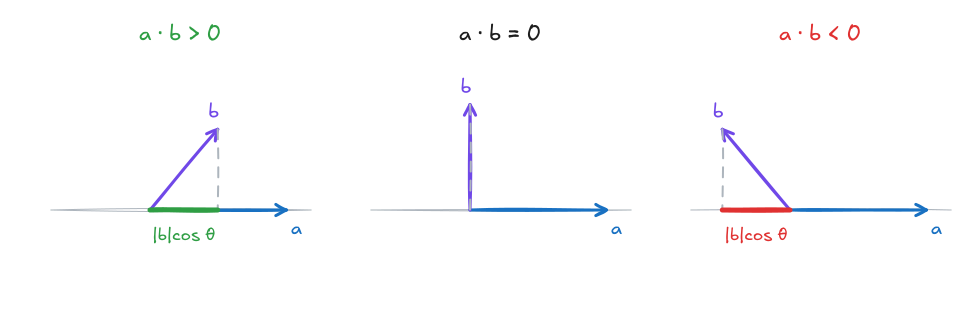
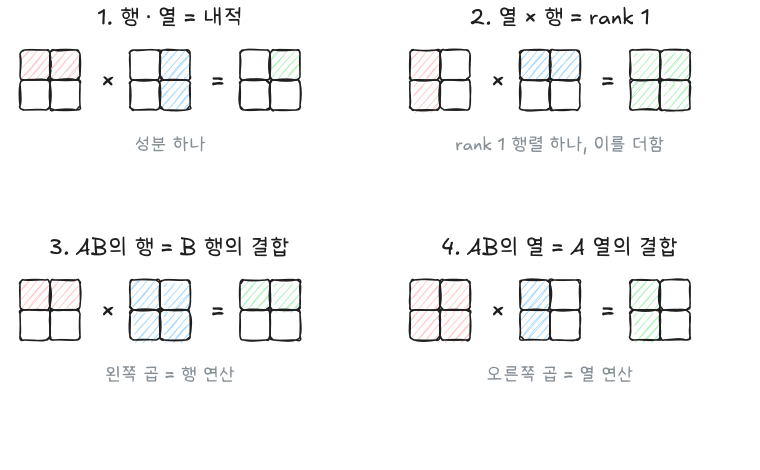
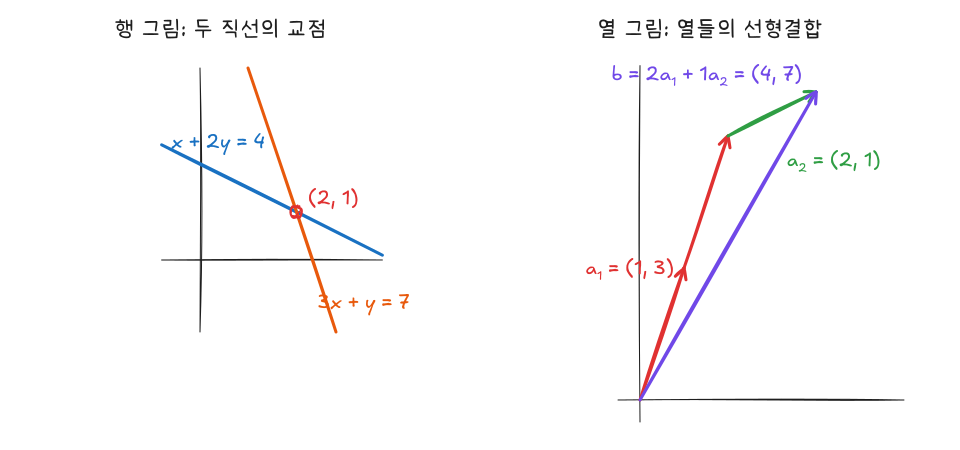

선형대수 시리즈의 첫 글이다. 선형결합, 내적과 외적, 노름, 행렬 연산의 기본 성질을 정리하고, 이후 가우스 소거법과 LU 분해의 기반이 되는 행렬곱의 네 가지 관점을 다룬다. 개념마다 R과 Python으로 계산을 확인하고, 통계에서 어디에 쓰이는지 한두 문장으로 붙였다.

## 1. 선형결합과 생성

벡터로 새 벡터를 만드는 연산은 **상수배**와 **덧셈** 두 가지뿐이다. 벡터 $\mathbf{v}_1, \dots, \mathbf{v}_n$과 스칼라 $c_1, \dots, c_n$에 대해

$$
c_1\mathbf{v}_1 + c_2\mathbf{v}_2 + \cdots + c_n\mathbf{v}_n
$$

을 **선형결합**(일차결합)이라 하고, 가능한 모든 선형결합의 집합을 $\operatorname{span}\{\mathbf{v}_1, \dots, \mathbf{v}_n\}$이라 한다.

- **생성**: 어떤 공간의 모든 벡터가 $\mathbf{v}_i$들의 선형결합으로 표현되면, $\mathbf{v}_i$들이 그 공간을 생성한다고 한다.
- **기저**: 공간을 생성하면서 **선형독립**인 집합. 즉 불필요한 벡터가 없는 최소 생성 집합이다. 생성한다고 해서 항상 기저인 것은 아니다.

평면에서 그려 보면 생성과 독립의 관계가 바로 보인다.



벡터 하나의 선형결합은 그 벡터 방향의 직선이다. 방향이 다른 두 벡터의 선형결합은 두 벡터가 만드는 기울어진 격자를 따라 평면 전체를 덮는다. 그러나 두 벡터가 평행하면 하나가 다른 하나의 상수배여서 새로운 방향을 더하지 못하고, 생성하는 공간은 여전히 직선이다. 이렇게 빼도 생성하는 공간이 줄지 않는 벡터가 있으면 **선형종속**이고, 기저에서는 그런 벡터를 모두 덜어낸다.

## 2. 내적과 외적

| | 내적 $\mathbf{a} \cdot \mathbf{b}$ | 외적 $\mathbf{a} \times \mathbf{b}$ |
|---|---|---|
| 결과 | 스칼라 | 벡터 ($\mathbb{R}^3$에서만 정의) |
| 기하 | $\lVert\mathbf{a}\rVert\lVert\mathbf{b}\rVert\cos\theta$ | 크기 $\lVert\mathbf{a}\rVert\lVert\mathbf{b}\rVert\sin\theta$, 방향은 오른손 법칙 |
| 교환법칙 | 성립 | 성립하지 않음, $\mathbf{b} \times \mathbf{a} = -\mathbf{a} \times \mathbf{b}$ |
| 의미 | 사잇각, 사영 | $\mathbf{a}, \mathbf{b}$에 모두 수직. 크기는 평행사변형 넓이 |

### 내적

성분으로 쓰면 $\mathbf{a} \cdot \mathbf{b} = a_1b_1 + a_2b_2 + \cdots + a_nb_n$이고, 다음 성질을 만족한다.

- $\mathbf{a} \cdot \mathbf{a} \ge 0$, 등호는 $\mathbf{a} = \mathbf{0}$일 때만 성립
- $\mathbf{a} \cdot \mathbf{b} = \mathbf{b} \cdot \mathbf{a}$
- $(\mathbf{a} + \mathbf{b}) \cdot \mathbf{c} = \mathbf{a} \cdot \mathbf{c} + \mathbf{b} \cdot \mathbf{c}$
- $(k\mathbf{a}) \cdot \mathbf{b} = k(\mathbf{a} \cdot \mathbf{b}) = \mathbf{a} \cdot (k\mathbf{b})$

$\mathbf{a} \cdot \mathbf{b} = 0$이면 두 벡터는 수직(직교)이다.

기하적으로 내적은 한 벡터를 다른 벡터 방향으로 정사영한 길이에 그 벡터의 길이를 곱한 값이다.

$$
\mathbf{a} \cdot \mathbf{b} = \lVert\mathbf{a}\rVert \times \big(\lVert\mathbf{b}\rVert\cos\theta\big)
$$



사잇각이 예각이면 정사영이 $\mathbf{a}$와 같은 방향이라 내적이 양수, 둔각이면 반대 방향이라 음수, 직각이면 정사영이 점 하나로 줄어 0이다. 내적의 부호만으로 두 벡터가 같은 쪽을 향하는지 알 수 있고, 이 관점은 [정사영과 최소제곱법](/posts/la-orthonormal)에서 그대로 쓰인다.

### 노름과 두 부등식

벡터의 길이는 내적으로 정의한다. 이 길이를 **노름**이라 한다.

$$
\lVert\mathbf{a}\rVert = \sqrt{\mathbf{a}\cdot\mathbf{a}} = \sqrt{a_1^2 + \cdots + a_n^2}
$$

노름과 내적 사이에는 다음 두 부등식이 성립한다.

$$
\lvert\mathbf{a}\cdot\mathbf{b}\rvert \le \lVert\mathbf{a}\rVert\,\lVert\mathbf{b}\rVert \quad(\text{코시-슈바르츠}),
\qquad
\lVert\mathbf{a}+\mathbf{b}\rVert \le \lVert\mathbf{a}\rVert + \lVert\mathbf{b}\rVert \quad(\text{삼각 부등식})
$$

코시-슈바르츠는 $\mathbf{a}\cdot\mathbf{b} = \lVert\mathbf{a}\rVert\lVert\mathbf{b}\rVert\cos\theta$에서 $\lvert\cos\theta\rvert\le 1$이기 때문에 나온다. 등호는 두 벡터가 평행할 때만 성립한다. 삼각 부등식은 $\lVert\mathbf{a}+\mathbf{b}\rVert^2 = \lVert\mathbf{a}\rVert^2 + 2\,\mathbf{a}\cdot\mathbf{b} + \lVert\mathbf{b}\rVert^2$에 코시-슈바르츠를 쓰면 $(\lVert\mathbf{a}\rVert + \lVert\mathbf{b}\rVert)^2$ 이하가 된다는 것에서 따른다.

**통계에서의 쓰임:** $\mathbf{a}\cdot\mathbf{b}/(\lVert\mathbf{a}\rVert\lVert\mathbf{b}\rVert) = \cos\theta$의 절댓값이 1 이하라는 사실이 곧 표본상관계수가 $-1$과 $1$ 사이라는 증명이다. 평균을 뺀 두 변수를 벡터로 보면 상관계수는 두 벡터 사이각의 코사인이고, 잔차제곱합은 $\lVert\mathbf{y}-\hat{\mathbf{y}}\rVert^2$이다.

### 외적

$\mathbf{a} = (a_1, a_2, a_3)$, $\mathbf{b} = (b_1, b_2, b_3)$일 때 형식적인 행렬식으로 외우면 편하다.

$$
\mathbf{a} \times \mathbf{b} =
\begin{vmatrix}
\mathbf{i} & \mathbf{j} & \mathbf{k} \\
a_1 & a_2 & a_3 \\
b_1 & b_2 & b_3
\end{vmatrix}
= (a_2b_3 - a_3b_2,\; a_3b_1 - a_1b_3,\; a_1b_2 - a_2b_1)
$$

- 외적의 선형성(행렬식의 행 선형성)에 의해 $(k\mathbf{a}) \times \mathbf{b} = k(\mathbf{a} \times \mathbf{b}) = \mathbf{a} \times (k\mathbf{b})$
- **스칼라 삼중적**: 세 벡터가 만드는 평행육면체의 (부호 있는) 부피이며, 행렬식과 같다.

$$
(\mathbf{a} \times \mathbf{b}) \cdot \mathbf{c} =
\begin{vmatrix}
a_1 & a_2 & a_3 \\
b_1 & b_2 & b_3 \\
c_1 & c_2 & c_3
\end{vmatrix}
$$

외적이 교환법칙을 만족하지 않는 것처럼, 행렬곱도 일반적으로 $\mathbf{AB} \neq \mathbf{BA}$이다.

> **주의** 이 글의 "외적"은 $\mathbb{R}^3$의 벡터곱 $\mathbf{a}\times\mathbf{b}$이다. 관점 2에 나오는 $\mathbf{a}\mathbf{b}^T$(열벡터 곱하기 행벡터)는 이름이 비슷하지만 다른 연산이다. 입력은 어떤 차원의 두 벡터든 되고, 출력은 $m\times n$ 행렬(rank 1)이다. 내적 $\mathbf{a}^T\mathbf{b}$는 같은 두 벡터에서 스칼라를 만든다.

### 예시

$\mathbf{a} = (3, 4)$, $\mathbf{b} = (1, 2)$에 대해 손으로 계산하면 $\lVert\mathbf{a}\rVert = 5$, $\mathbf{a}\cdot\mathbf{b} = 3 + 8 = 11$이다. 코시-슈바르츠는 $11 \le 5\sqrt{5} \approx 11.18$로 성립한다.

```r
a <- c(3, 4); b <- c(1, 2)
sqrt(sum(a^2))                                  # 노름 5
sum(a * b)                                      # 내적 11
abs(sum(a * b)) <= sqrt(sum(a^2)) * sqrt(sum(b^2))   # 코시-슈바르츠: TRUE
sqrt(sum((a + b)^2)); sqrt(sum(a^2)) + sqrt(sum(b^2))   # 삼각 부등식: 7.21 <= 7.24
outer(a, b)                                     # a b^T, 2x2 rank 1 행렬
```

```python
import numpy as np

a = np.array([3, 4]); b = np.array([1, 2])
np.linalg.norm(a)         # 5.0
a @ b                     # 11
np.outer(a, b)            # [[3, 6], [4, 8]]
np.cross([1, 0, 0], [0, 1, 0])   # array([0, 0, 1]), 3차원 벡터곱
```

내적은 열벡터의 짝이 같은 차원이어야 하고 결과가 스칼라이지만, `outer(a, b)`는 같은 두 벡터에서 $(3, 6; 4, 8)$을 만든다. 두 행이 비례하므로 rank 1이다.

## 3. 행렬의 기본

### 용어

| 용어 | 정의 |
|---|---|
| $M_{m,n}$ | 실수 성분 $m \times n$ 행렬 전체의 집합. $M_{1,n}$은 행벡터, $M_{m,1}$은 열벡터 |
| 영행렬 $\mathbf{O}$ | 모든 성분이 0 |
| 대각행렬 | 정사각행렬에서 주대각 성분 외에는 모두 0. $\operatorname{diag}(a_{11}, \dots, a_{nn})$ |
| 스칼라행렬 | 주대각 성분이 모두 같은 대각행렬, $k\mathbf{I}_n$ |
| 단위행렬 $\mathbf{I}_n$ | 주대각 성분이 모두 1인 대각행렬 |
| 행렬의 상등 | $\mathbf{A} = \mathbf{B} \iff$ 크기가 같고 모든 $(i,j)$에서 $a_{ij} = b_{ij}$ |

### 연산 성질

덧셈은 교환·결합법칙, 곱셈은 결합법칙과 분배법칙이 성립한다.

$$
\mathbf{A}(\mathbf{BC}) = (\mathbf{AB})\mathbf{C}, \qquad
\mathbf{A}(\mathbf{B} + \mathbf{C}) = \mathbf{AB} + \mathbf{AC}, \qquad
k(\mathbf{AB}) = (k\mathbf{A})\mathbf{B} = \mathbf{A}(k\mathbf{B})
$$

곱셈의 교환법칙은 일반적으로 성립하지 않는다.

### 역행렬, 전치행렬, 대각합

$n$차 정사각행렬 $\mathbf{A}$에 대해 $\mathbf{AX} = \mathbf{XA} = \mathbf{I}_n$인 $\mathbf{X}$가 있으면 이를 **역행렬** $\mathbf{A}^{-1}$이라 하고, $\mathbf{A}$를 **가역**이라 한다. $m \times n$ 행렬 $\mathbf{A}$의 **전치행렬** $\mathbf{A}^T$는 $(\mathbf{A}^T)_{ij} = a_{ji}$인 $n \times m$ 행렬이다. **대각합**은 $\operatorname{tr}(\mathbf{A}) = \sum_{k=1}^{n} a_{kk}$이다.

| 역행렬 ($\mathbf{A}, \mathbf{B}$ 가역, $k \neq 0$) | 전치행렬 | 대각합 |
|---|---|---|
| 역행렬은 유일하다 | $(\mathbf{A}^T)^T = \mathbf{A}$ | $\operatorname{tr}(\mathbf{A}^T) = \operatorname{tr}(\mathbf{A})$ |
| $(\mathbf{A}^{-1})^{-1} = \mathbf{A}$ | $(k\mathbf{A})^T = k\mathbf{A}^T$ | $\operatorname{tr}(k\mathbf{A}) = k\operatorname{tr}(\mathbf{A})$ |
| $(\mathbf{AB})^{-1} = \mathbf{B}^{-1}\mathbf{A}^{-1}$ | $(\mathbf{A} + \mathbf{B})^T = \mathbf{A}^T + \mathbf{B}^T$ | $\operatorname{tr}(\mathbf{A} + \mathbf{B}) = \operatorname{tr}(\mathbf{A}) + \operatorname{tr}(\mathbf{B})$ |
| $(k\mathbf{A})^{-1} = \frac{1}{k}\mathbf{A}^{-1}$ | $(\mathbf{AB})^T = \mathbf{B}^T\mathbf{A}^T$ | $\operatorname{tr}(\mathbf{AB}) = \operatorname{tr}(\mathbf{BA})$ |
| $(\mathbf{A}^T)^{-1} = (\mathbf{A}^{-1})^T$ | | $\operatorname{tr}(\mathbf{ABC}) = \operatorname{tr}(\mathbf{CAB}) = \operatorname{tr}(\mathbf{BCA})$ |

곱의 역행렬과 전치는 **순서가 뒤집힌다**. 대각합은 **순환(cyclic) 순서**로만 바꿀 수 있으며, 일반적으로 $\operatorname{tr}(\mathbf{ABC}) \neq \operatorname{tr}(\mathbf{ACB})$이다.

$\operatorname{tr}(\mathbf{AB}) = \operatorname{tr}(\mathbf{BA})$는 성분으로 쓰면 바로 확인된다. $\mathbf{A}$가 $m\times n$, $\mathbf{B}$가 $n\times m$일 때

$$
\operatorname{tr}(\mathbf{AB}) = \sum_{i=1}^m\sum_{k=1}^n a_{ik}b_{ki} = \sum_{k=1}^n\sum_{i=1}^m b_{ki}a_{ik} = \operatorname{tr}(\mathbf{BA})
$$

이다. $\mathbf{AB}$는 $m\times m$, $\mathbf{BA}$는 $n\times n$으로 크기가 달라도 대각합은 같다. 이 성질로 $\mathbf{x}^T\mathbf{A}\mathbf{x} = \operatorname{tr}(\mathbf{A}\mathbf{x}\mathbf{x}^T)$처럼 스칼라를 대각합으로 바꿔 순서를 옮길 수 있고, 다변량 정규분포의 로그가능도를 정리할 때 쓰인다.

### 블록행렬의 곱

부분행렬끼리의 곱이 정의되도록 나누기만 하면, 블록을 성분처럼 취급해 곱할 수 있다.

$$
\begin{pmatrix} \mathbf{X}_1 & \mathbf{Y}_1 \\ \mathbf{Z}_1 & \mathbf{W}_1 \end{pmatrix}
\begin{pmatrix} \mathbf{X}_2 & \mathbf{Y}_2 \\ \mathbf{Z}_2 & \mathbf{W}_2 \end{pmatrix}
=
\begin{pmatrix}
\mathbf{X}_1\mathbf{X}_2 + \mathbf{Y}_1\mathbf{Z}_2 & \mathbf{X}_1\mathbf{Y}_2 + \mathbf{Y}_1\mathbf{W}_2 \\
\mathbf{Z}_1\mathbf{X}_2 + \mathbf{W}_1\mathbf{Z}_2 & \mathbf{Z}_1\mathbf{Y}_2 + \mathbf{W}_1\mathbf{W}_2
\end{pmatrix}
$$

블록끼리도 곱의 순서를 바꾸면 안 된다($\mathbf{Y}_1\mathbf{Z}_2 \neq \mathbf{Z}_2\mathbf{Y}_1$).

## 4. 행렬곱을 보는 네 가지 관점



색칠한 칸이 각 관점에서 함께 보는 부분이다. 예시는 모두 같은 곱이다.

$$
\mathbf{AB} =
\begin{pmatrix} 1 & 2 \\ 3 & 4 \end{pmatrix}
\begin{pmatrix} a & b \\ c & d \end{pmatrix}
=
\begin{pmatrix} a + 2c & b + 2d \\ 3a + 4c & 3b + 4d \end{pmatrix}
$$

### 관점 1. 행 · 열 = 내적

$(\mathbf{AB})_{ij}$는 $\mathbf{A}$의 $i$행과 $\mathbf{B}$의 $j$열의 내적이다. 성분 하나를 계산할 때 쓰는 기본 방식이다.

$$
(\mathbf{AB})_{12} = \begin{pmatrix} 1 & 2 \end{pmatrix}\begin{pmatrix} b \\ d \end{pmatrix} = b + 2d
$$

### 관점 2. 열 × 행 = rank 1 행렬의 합

$\mathbf{A}$의 $k$번째 열과 $\mathbf{B}$의 $k$번째 행의 곱(외적 형태)은 rank 1 행렬이고, $\mathbf{AB}$는 그 합이다.

$$
\mathbf{AB} = \sum_{k} (\mathbf{A}\text{의 } k\text{열})(\mathbf{B}\text{의 } k\text{행})
= \begin{pmatrix} 1 \\ 3 \end{pmatrix}\begin{pmatrix} a & b \end{pmatrix}
+ \begin{pmatrix} 2 \\ 4 \end{pmatrix}\begin{pmatrix} c & d \end{pmatrix}
= \begin{pmatrix} a & b \\ 3a & 3b \end{pmatrix} + \begin{pmatrix} 2c & 2d \\ 4c & 4d \end{pmatrix}
$$

SVD처럼 행렬을 rank 1 조각의 합으로 분해할 때 이 관점이 쓰인다.

**통계에서의 쓰임:** 평균을 뺀 자료행렬 $\tilde{\mathbf{X}}$($n\times p$)의 표본 공분산은 관측치 하나하나의 rank 1 행렬의 평균이다.

$$
\mathbf{S} = \frac{1}{n-1}\tilde{\mathbf{X}}^T\tilde{\mathbf{X}} = \frac{1}{n-1}\sum_{i=1}^n \tilde{\mathbf{x}}_i\tilde{\mathbf{x}}_i^T
$$

여기서 $\tilde{\mathbf{x}}_i^T$는 $\tilde{\mathbf{X}}$의 $i$행이다. $\tilde{\mathbf{X}}^T$의 $i$열이 $\tilde{\mathbf{x}}_i$이고 $\tilde{\mathbf{X}}$의 $i$행이 $\tilde{\mathbf{x}}_i^T$이므로 관점 2를 그대로 쓴 것이다. 새 관측치가 들어올 때 이 합에 항을 하나 더하는 식으로 공분산을 갱신할 수 있는 이유이기도 하다.

### 관점 3. $\mathbf{AB}$의 행 = $\mathbf{B}$의 행들의 선형결합

$\mathbf{AB}$의 $i$행은 $\mathbf{A}$의 $i$행 성분을 계수로 한 $\mathbf{B}$의 행들의 선형결합이다.

$$
(\mathbf{AB})\text{의 1행} = 1\begin{pmatrix} a & b \end{pmatrix} + 2\begin{pmatrix} c & d \end{pmatrix}
$$

따라서 **왼쪽에 곱하는 행렬은 행 연산**이다. 가우스 소거법의 기본 행 연산은 다음 세 가지다.

1. 두 행을 바꾼다.
2. 한 행에 0이 아닌 상수를 곱한다.
3. 한 행의 상수배를 다른 행에 더한다.

각 행 연산은 단위행렬에 같은 연산을 한 **기본행렬**을 왼쪽에 곱하는 것과 같다. 예를 들어 "1행의 $-1$배를 3행에 더한다"($R_{1,3}(-1)$)는

$$
\underbrace{\begin{pmatrix} 1 & 0 & 0 \\ 0 & 1 & 0 \\ -1 & 0 & 1 \end{pmatrix}}_{\mathbf{E}}
\underbrace{\begin{pmatrix} 1 & 2 & 1 \\ 0 & 1 & 1 \\ 1 & 1 & 2 \end{pmatrix}}_{\mathbf{A}}
=
\begin{pmatrix} 1 & 2 & 1 \\ 0 & 1 & 1 \\ 0 & -1 & 1 \end{pmatrix}
$$

$\mathbf{E}$의 3행 $(-1, 0, 1)$이 "1행 $\times(-1)$ + 3행 $\times 1$"을 그대로 적은 것이다.

### 관점 4. $\mathbf{AB}$의 열 = $\mathbf{A}$의 열들의 선형결합

$\mathbf{AB}$의 $j$열은 $\mathbf{B}$의 $j$열 성분을 계수로 한 $\mathbf{A}$의 열들의 선형결합이다.

$$
(\mathbf{AB})\text{의 1열} = a\begin{pmatrix} 1 \\ 3 \end{pmatrix} + c\begin{pmatrix} 2 \\ 4 \end{pmatrix}
$$

따라서 **오른쪽에 곱하는 행렬은 열 연산**이고, $\mathbf{A}\mathbf{x}$는 $\mathbf{A}$의 열들의 선형결합이다. $\mathbf{A}\mathbf{x} = \mathbf{b}$에 해가 있다는 것은 $\mathbf{b}$가 $\mathbf{A}$의 열공간에 있다는 뜻이다.

**통계에서의 쓰임:** 선형회귀의 설계행렬 $\mathbf{X}$($n\times(p+1)$, 첫 열은 모두 1)에 대해 $\mathbf{X}\boldsymbol\beta = \beta_0\mathbf{1} + \beta_1\mathbf{x}_1 + \cdots + \beta_p\mathbf{x}_p$이다. 적합값 $\hat{\mathbf{y}} = \mathbf{X}\hat{\boldsymbol\beta}$는 설명변수 열들의 선형결합이고, 따라서 $\mathbf{X}$의 열공간 안에 있다. 최소제곱은 이 열공간에서 $\mathbf{y}$에 가장 가까운 벡터를 찾는 문제이며, [정사영과 최소제곱법](/posts/la-orthonormal)에서 다룬다.

```r
X <- cbind(1, c(1, 2, 3, 4)); beta <- c(0.1, 2)
X %*% beta                              # 2.1 4.1 6.1 8.1
beta[1] * X[, 1] + beta[2] * X[, 2]     # 열의 선형결합, 같은 값
```

```python
X = np.c_[np.ones(4), [1, 2, 3, 4]]; beta = np.array([0.1, 2.0])
X @ beta                                # [2.1, 4.1, 6.1, 8.1]
beta[0] * X[:, 0] + beta[1] * X[:, 1]   # 열의 선형결합, 같은 값
```

### 행 그림과 열 그림

관점 1과 관점 4는 연립방정식 $\mathbf{A}\mathbf{x} = \mathbf{b}$를 보는 두 가지 그림에 대응한다.

$$
\begin{pmatrix} 1 & 2 \\ 3 & 1 \end{pmatrix}\begin{pmatrix} x \\ y \end{pmatrix} = \begin{pmatrix} 4 \\ 7 \end{pmatrix}
$$



**행 그림**은 각 행(방정식)을 하나의 직선으로 보고, 해를 두 직선의 교점 $(2, 1)$으로 찾는다. 행과 $\mathbf{x}$의 내적이 정해진 값이 되는 점들의 모임이 직선이기 때문이다. **열 그림**은 같은 문제를 "$\mathbf{A}$의 열 $\mathbf{a}_1$, $\mathbf{a}_2$를 몇 배씩 더하면 $\mathbf{b}$가 되는가"로 본다. $2\mathbf{a}_1 + 1\mathbf{a}_2 = \mathbf{b}$이므로 해는 $(2, 1)$이다. 2차원에서는 행 그림이 직관적이지만, 변수가 많아지면 초평면의 교점을 상상하기 어렵다. 열 그림은 차원과 관계없이 "$\mathbf{b}$가 열들이 생성하는 공간 안에 있는가"라는 하나의 질문으로 해의 존재를 다루므로, 이후의 열공간과 계수 논의는 모두 열 그림 위에서 진행된다.


## 비교

네 관점은 같은 곱 $\mathbf{AB}$를 어느 단위로 쪼개 보느냐의 차이이고, 결과는 모두 같다.

| 관점 | 식 | 언제 쓰는가 |
|---|---|---|
| 행 · 열 내적 | $(\mathbf{AB})_{ij} = (\mathbf{A}\text{의 } i\text{행}) \cdot (\mathbf{B}\text{의 } j\text{열})$ | 성분 하나를 계산할 때 |
| 열 × 행의 합 | $\mathbf{AB} = \sum_k \mathbf{a}_k \mathbf{b}_k^T$ | rank 1 분해, SVD, 표본 공분산 $\sum_i\tilde{\mathbf{x}}_i\tilde{\mathbf{x}}_i^T$ |
| 행의 선형결합 | $\mathbf{AB}$의 행 = $\mathbf{B}$ 행들의 결합 | 행 연산, 가우스 소거법 (왼쪽 곱) |
| 열의 선형결합 | $\mathbf{AB}$의 열 = $\mathbf{A}$ 열들의 결합 | 열공간, $\mathbf{Ax} = \mathbf{b}$의 해 존재, $\mathbf{X}\boldsymbol\beta$ |

관점 1은 결과를 성분 단위로, 관점 2는 rank 1 행렬 단위로, 관점 3과 4는 행 또는 열 벡터 단위로 만든다. 곱하는 쪽이 왼쪽이면 행을 섞고(관점 3), 오른쪽이면 열을 섞는다(관점 4)는 점이 가장 자주 쓰인다.

### 예시

앞의 행렬 $\mathbf{A}$와 $\mathbf{B} = \begin{pmatrix}5&6\\7&8\end{pmatrix}$로 관점 1과 관점 2가 같은 결과를 주는지, 그리고 $\mathbf{AB}\ne\mathbf{BA}$이면서도 대각합은 같은지 확인한다.

```r
A <- matrix(c(1, 3, 2, 4), nrow = 2)   # 열 우선 입력: [[1, 2], [3, 4]]
B <- matrix(c(5, 7, 6, 8), nrow = 2)

A %*% B                                         # 행렬곱 (* 는 성분별 곱)
outer(A[, 1], B[1, ]) + outer(A[, 2], B[2, ])   # 관점 2: rank 1 행렬의 합
sum(diag(A %*% B)); sum(diag(B %*% A))          # 둘 다 69
A %*% B - B %*% A                               # 0이 아니다: 교환법칙 불성립
crossprod(A)                                    # t(A) %*% A
```

```python
A = np.array([[1, 2], [3, 4]])
B = np.array([[5, 6], [7, 8]])

A @ B                                   # 행렬곱
np.outer(A[:, 0], B[0]) + np.outer(A[:, 1], B[1])   # 관점 2: rank 1 행렬의 합
np.trace(A @ B) == np.trace(B @ A)      # True
```

$\mathbf{AB} = \begin{pmatrix}19&22\\43&50\end{pmatrix}$이고 관점 2의 합도 같은 행렬이다. 손계산으로 $1\cdot5+2\cdot7 = 19$가 (1,1) 성분과 맞는다. $\mathbf{AB}-\mathbf{BA} = \begin{pmatrix}-4&-12\\12&4\end{pmatrix}$로 교환법칙은 성립하지 않지만, $\operatorname{tr}(\mathbf{AB}) = \operatorname{tr}(\mathbf{BA}) = 69$이다.

표본 공분산도 같은 방식으로 확인된다. 세 관측치 $(2,1), (4,3), (6,2)$를 열별로 평균을 빼면 `crossprod(Zc) / (nrow(Z) - 1)`과 `cov(Z)`가 모두 $\begin{pmatrix}4&1\\1&1\end{pmatrix}$이다.

```r
Z <- cbind(c(2, 4, 6), c(1, 3, 2))
Zc <- sweep(Z, 2, colMeans(Z))          # 열 평균 빼기
crossprod(Zc) / (nrow(Z) - 1)           # (1/(n-1)) X~' X~
cov(Z)                                  # 같은 값
```

## 정리

| 자주 헷갈리는 것 | 정리 |
|---|---|
| 곱의 역행렬·전치 | $(\mathbf{AB})^{-1} = \mathbf{B}^{-1}\mathbf{A}^{-1}$, $(\mathbf{AB})^T = \mathbf{B}^T\mathbf{A}^T$ |
| 대각합 | $\operatorname{tr}(\mathbf{AB}) = \operatorname{tr}(\mathbf{BA})$, 세 개 이상은 순환 순서만 |
| 외적 | 벡터곱은 $\mathbb{R}^3$ 전용, 반교환. $\mathbf{a}\mathbf{b}^T$(rank 1 행렬)와 다르다 |
| 코시-슈바르츠 | $\lvert\mathbf{a}\cdot\mathbf{b}\rvert\le\lVert\mathbf{a}\rVert\lVert\mathbf{b}\rVert$, 평행할 때만 등호 |
| 생성 vs 기저 | 기저 = 생성 + 선형독립 |

## 참고자료

- 하길찬, 『해설이 있는 선형대수학』
- 유호석, 「선형대수학」, 세종대학교, KOCW 공개강의

다음 글: [선형대수 - 가우스 소거법, 역행렬과 LU 분해](/posts/la-gauss-lu)
