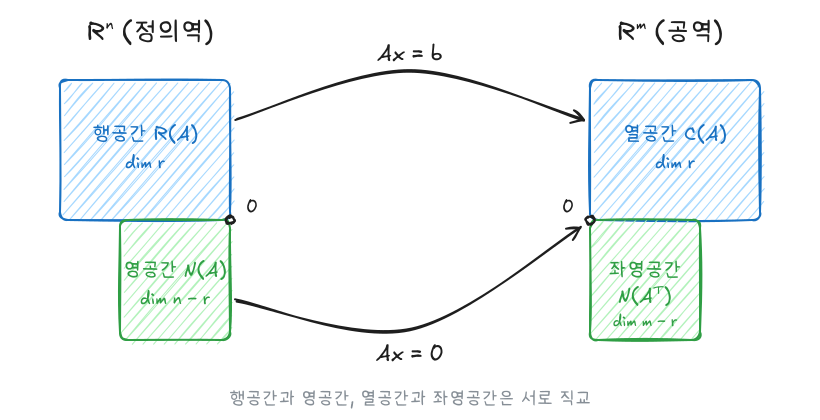

벡터공간은 선형대수의 모든 개념이 놓이는 무대다. 이 글은 벡터공간과 내적공간의 공리, 부분공간과 생성, 일차독립, 기저와 차원, 행렬의 네 가지 기본 공간 중 행공간·열공간·영공간과 계수를 정리한다.

이전 글: [선형대수 - 행렬식, 치환과 보간다항식](/posts/la-determinant)

## 1. 벡터공간

### 공리

집합 $V$에 덧셈과 실수배가 정의되어 있고, 두 연산의 결과가 다시 $V$에 속하며(**닫힘**), 임의의 $\mathbf{u}, \mathbf{v}, \mathbf{w} \in V$, $h, k \in \mathbb{R}$에 대해 다음 8가지가 성립하면 $V$를 **벡터공간**이라 한다. 원소를 **벡터**라 부른다.

| | 덧셈 | | 실수배 |
|---|---|---|---|
| A1 | $(\mathbf{u} + \mathbf{v}) + \mathbf{w} = \mathbf{u} + (\mathbf{v} + \mathbf{w})$ | S1 | $1\mathbf{u} = \mathbf{u}$ |
| A2 | $\mathbf{u} + \mathbf{v} = \mathbf{v} + \mathbf{u}$ | S2 | $(hk)\mathbf{u} = h(k\mathbf{u})$ |
| A3 | 영벡터 $\mathbf{0}$이 존재해 $\mathbf{u} + \mathbf{0} = \mathbf{u}$ | S3 | $(h + k)\mathbf{u} = h\mathbf{u} + k\mathbf{u}$ |
| A4 | 역원 $-\mathbf{u}$가 존재해 $\mathbf{u} + (-\mathbf{u}) = \mathbf{0}$ | S4 | $k(\mathbf{u} + \mathbf{v}) = k\mathbf{u} + k\mathbf{v}$ |

공리에서 $0\mathbf{u} = \mathbf{0}$, $(-1)\mathbf{u} = -\mathbf{u}$가 따라 나온다.

### $\mathbb{R}^n$과 표준단위벡터

$\mathbb{R}^n = \{(x_1, \dots, x_n) \mid x_i \in \mathbb{R}\}$은 성분별 덧셈과 실수배로 벡터공간이 된다. $i$번째 성분만 1인 벡터 $\mathbf{e}_i$를 **표준단위벡터**라 한다.

$\mathbb{R}^n$의 벡터는 행벡터($M_{1,n}$)로도 열벡터($M_{n,1}$)로도 쓸 수 있다. 같은 공간이지만 어느 쪽으로 세웠는지 강조할 때 $\mathbb{R}^n_r$, $\mathbb{R}^n_c$로 구분해 쓰기도 한다.

## 2. 내적공간

벡터공간 $V$에 다음 네 조건을 만족하는 $\langle \cdot, \cdot \rangle$이 정의되면 **내적공간**이라 한다.

1. $\langle \mathbf{u}, \mathbf{u} \rangle \ge 0$이고, $\langle \mathbf{u}, \mathbf{u} \rangle = 0 \iff \mathbf{u} = \mathbf{0}$
2. $\langle \mathbf{u}, \mathbf{v} \rangle = \langle \mathbf{v}, \mathbf{u} \rangle$
3. $\langle \mathbf{u} + \mathbf{v}, \mathbf{w} \rangle = \langle \mathbf{u}, \mathbf{w} \rangle + \langle \mathbf{v}, \mathbf{w} \rangle$
4. $\langle k\mathbf{u}, \mathbf{v} \rangle = k\langle \mathbf{u}, \mathbf{v} \rangle$

내적으로 길이 $\lVert \mathbf{u} \rVert = \sqrt{\langle \mathbf{u}, \mathbf{u} \rangle}$를 정의하면, 모든 내적공간에서 **코시-슈바르츠 부등식**이 성립한다.

$$
\lvert\langle \mathbf{u}, \mathbf{v} \rangle\rvert \le \lVert \mathbf{u} \rVert \lVert \mathbf{v} \rVert
$$

등호는 두 벡터가 평행(한쪽이 다른 쪽의 상수배)일 때만 성립한다. 이 부등식 덕분에 $\cos\theta = \dfrac{\langle \mathbf{u}, \mathbf{v} \rangle}{\lVert \mathbf{u} \rVert \lVert \mathbf{v} \rVert}$로 사잇각을 정의할 수 있다.

## 3. 부분공간과 생성

### 부분공간

$V$의 부분집합 $W$가 $\mathbf{0}$을 포함하고 다음 두 조건을 만족하면 $W$는 그 자체로 벡터공간이 되며, $V$의 **부분공간**이라 한다.

$$
\mathbf{w}_1, \mathbf{w}_2 \in W \Rightarrow \mathbf{w}_1 + \mathbf{w}_2 \in W,
\qquad
\mathbf{w} \in W,\ k \in \mathbb{R} \Rightarrow k\mathbf{w} \in W
$$

나머지 공리는 $V$에서 물려받으므로 닫힘만 확인하면 된다.

### 생성

$S = \{\mathbf{v}_1, \dots, \mathbf{v}_n\}$의 선형결합 전체

$$
\operatorname{span}(S) = \langle S \rangle = \{c_1\mathbf{v}_1 + \cdots + c_n\mathbf{v}_n \mid c_i \in \mathbb{R}\}
$$

는 항상 부분공간이다. 이를 $S$가 **생성하는** 부분공간이라 하고, $S$를 **생성집합**이라 한다.

### 부분공간의 교집합과 합

두 부분공간 $W_1, W_2$에 대해

- **교집합** $W_1 \cap W_2$는 부분공간이다.
- **합집합** $W_1 \cup W_2$는 일반적으로 부분공간이 **아니다**. 예를 들어 $x$축과 $y$축의 합집합에서 $(1, 0) + (0, 1) = (1, 1)$은 어느 축에도 없다.
- 대신 **합공간** $W_1 + W_2 = \{\mathbf{w}_1 + \mathbf{w}_2\}$는 부분공간이고, $W_1 \cup W_2$를 포함하는 가장 작은 부분공간이다.

$$
\dim(W_1 + W_2) = \dim W_1 + \dim W_2 - \dim(W_1 \cap W_2)
$$

## 4. 일차독립

### 정의

$\mathbf{v}_1, \dots, \mathbf{v}_n$이 **일차독립**이라는 것은

$$
c_1\mathbf{v}_1 + \cdots + c_n\mathbf{v}_n = \mathbf{0} \;\Rightarrow\; c_1 = \cdots = c_n = 0
$$

이라는 뜻이다. 이를 만족하지 않으면(0이 아닌 $c_j$가 있으면) **일차종속**이다. 일차종속은 어떤 벡터 하나가 나머지의 선형결합으로 표현된다는 것과 같다. 벡터가 두 개일 때는 한쪽이 다른 쪽의 상수배, 즉 평행하다는 뜻이 된다.

### $\mathbb{R}^n$에서 판별하기

| 방법 | 판별 |
|---|---|
| 소거 | 벡터들을 행으로 쌓아 행사다리꼴로 만든다. 0인 행이 생기면 일차종속 |
| 행렬식 | $n$개의 벡터를 쌓은 $n \times n$ 행렬 $\mathbf{A}$에 대해, 일차독립 $\iff \det\mathbf{A} \neq 0$ |
| 개수 | $\mathbb{R}^n$에서 $n$개보다 많은 벡터는 항상 일차종속 |

## 5. 기저와 차원

### 기저

유한집합 $B \subset V$가 다음 두 조건을 만족하면 $V$의 **기저**다.

1. $B$가 $V$를 생성한다: $\langle B \rangle = V$
2. $B$가 일차독립이다.

### 차원

같은 공간의 기저는 여러 가지지만 **원소의 개수는 항상 같다**. 이 개수를 **차원** $\dim V$라 한다. 예를 들어 $\dim\mathbb{R}^n = n$이고, $\{\mathbf{e}_1, \dots, \mathbf{e}_n\}$이 표준기저다.

$\dim V = n$일 때 다음이 성립한다.

- $n$개의 벡터는 **생성하거나 일차독립이기만 하면** 기저다. 둘 중 하나가 나머지를 보장한다.
- 부분공간 $W$에 대해 $\dim W \le n$이고, $\dim W = n$이면 $W = V$이다.

## 6. 행렬의 공간과 계수

$m \times n$ 행렬 $\mathbf{A}$에 대해 다음 공간을 정의한다.

| 공간 | 정의 | 위치 |
|---|---|---|
| 열공간 $C(\mathbf{A})$ | 열들의 생성 $= \{\mathbf{A}\mathbf{x} \mid \mathbf{x} \in M_{n,1}\}$ | $M_{m,1}$의 부분공간 |
| 행공간 $R(\mathbf{A})$ | 행들의 생성 $= \{\mathbf{y}\mathbf{A} \mid \mathbf{y} \in M_{1,m}\}$ | $M_{1,n}$의 부분공간 |
| 영공간 $N(\mathbf{A})$ | $\{\mathbf{x} \mid \mathbf{A}\mathbf{x} = \mathbf{0}\}$ | $M_{n,1}$의 부분공간 |

### 열공간 = $\mathbf{Ax}$가 갈 수 있는 곳

$\mathbf{Ax}$는 $\mathbf{A}$의 열들의 선형결합이다.

$$
\begin{pmatrix} 1 & 2 & 3 & 0 \\ 2 & 3 & 4 & 1 \\ 5 & -1 & 7 & 2 \end{pmatrix}
\begin{pmatrix} x \\ y \\ z \\ w \end{pmatrix}
= x\begin{pmatrix} 1 \\ 2 \\ 5 \end{pmatrix} + y\begin{pmatrix} 2 \\ 3 \\ -1 \end{pmatrix} + z\begin{pmatrix} 3 \\ 4 \\ 7 \end{pmatrix} + w\begin{pmatrix} 0 \\ 1 \\ 2 \end{pmatrix}
$$

따라서 $\mathbf{Ax}$의 치역은 열공간이고, $\mathbf{Ax} = \mathbf{b}$에 해가 있다 $\iff \mathbf{b} \in C(\mathbf{A})$이다. 행공간은 전치로 연결된다: $R(\mathbf{A}) = C(\mathbf{A}^T)^T$.

### 행 연산은 행공간을 바꾸지 않는다

행 연산은 행들의 선형결합이고 되돌릴 수도 있으므로 행공간이 그대로다. 그래서 **기약행사다리꼴의 0이 아닌 행이 행공간의 기저**가 된다.

$$
\mathbf{A} = \begin{pmatrix} 1 & 1 & 0 \\ -1 & 1 & 2 \\ 0 & 2 & 2 \end{pmatrix}
\;\longrightarrow\;
\begin{pmatrix} 1 & 0 & -1 \\ 0 & 1 & 1 \\ 0 & 0 & 0 \end{pmatrix}
$$

세 행이 $R(\mathbf{A})$를 생성하지만 기저는 $\{(1, 0, -1), (0, 1, 1)\}$ 두 개면 충분하다. 즉 $\dim R(\mathbf{A}) = 2$이다.

### 계수: 행계수 = 열계수

$$
\mathbf{A} = \begin{pmatrix} 1 & 0 & 1 & 1 \\ 1 & 1 & 0 & 1 \\ 3 & 2 & 1 & 3 \end{pmatrix}
\;\longrightarrow\;
\begin{pmatrix} 1 & 0 & 1 & 1 \\ 0 & 1 & -1 & 0 \\ 0 & 0 & 0 & 0 \end{pmatrix},
\qquad
\mathbf{A}^T \;\longrightarrow\;
\begin{pmatrix} 1 & 0 & 1 \\ 0 & 1 & 2 \\ 0 & 0 & 0 \\ 0 & 0 & 0 \end{pmatrix}
$$

행공간과 열공간의 차원이 모두 2다. 이는 우연이 아니라 항상 성립하므로, 둘을 구분하지 않고 **계수**라 한다.

$$
\operatorname{rank}(\mathbf{A}) = \dim R(\mathbf{A}) = \dim C(\mathbf{A}) = \text{기약행사다리꼴의 선행성분 개수}
$$

### 영공간과 nullity

위의 $\mathbf{A}$로 $\mathbf{Ax} = \mathbf{0}$을 풀면, 기약행사다리꼴에서

- **선행변수** $x_1, x_2$: 선행성분이 있는 열. 다른 변수로 결정된다.
- **자유변수** $x_3, x_4$: 아무 값이나 가질 수 있다.

$$
x_1 = -x_3 - x_4,\quad x_2 = x_3
\quad\Rightarrow\quad
\mathbf{x} = x_3\begin{pmatrix} -1 \\ 1 \\ 1 \\ 0 \end{pmatrix} + x_4\begin{pmatrix} -1 \\ 0 \\ 0 \\ 1 \end{pmatrix}
$$

두 벡터가 $N(\mathbf{A})$의 기저이고, $\operatorname{nullity}(\mathbf{A}) = \dim N(\mathbf{A}) = 2$ = 자유변수의 개수다. 선행변수와 자유변수를 합치면 전체 변수이므로

$$
\operatorname{rank}(\mathbf{A}) + \operatorname{nullity}(\mathbf{A}) = n \;(\text{열의 수} = \text{변수의 수})
$$

이 차원정리는 다음 글들의 선형사상에서 $\dim\operatorname{Im}(L) + \dim\operatorname{Ker}(L) = \dim V$로 다시 등장한다.

### 네 가지 기본 부분공간

$\mathbf{A}^T$의 영공간 $N(\mathbf{A}^T) = \{\mathbf{y} \mid \mathbf{A}^T\mathbf{y} = \mathbf{0}\}$을 **좌영공간**이라 한다. $\mathbf{y}^T\mathbf{A} = \mathbf{0}^T$, 즉 왼쪽에서 곱해 0을 만드는 벡터들이다. 앞의 세 공간과 합쳐 **네 가지 기본 부분공간**이라 부른다.



| 공간 | 위치 | 차원 | 직교하는 짝 |
|---|---|---|---|
| 행공간 $R(\mathbf{A})$ | $\mathbb{R}^n$ | $r$ | 영공간 |
| 영공간 $N(\mathbf{A})$ | $\mathbb{R}^n$ | $n - r$ | 행공간 |
| 열공간 $C(\mathbf{A})$ | $\mathbb{R}^m$ | $r$ | 좌영공간 |
| 좌영공간 $N(\mathbf{A}^T)$ | $\mathbb{R}^m$ | $m - r$ | 열공간 |

- $\mathbf{Ax} = \mathbf{0}$은 $\mathbf{A}$의 모든 행과 $\mathbf{x}$의 내적이 0이라는 뜻이다. 그래서 영공간은 행공간에 수직이다. 같은 이유로 좌영공간은 열공간에 수직이다.
- 차원이 맞물려 $\mathbb{R}^n = R(\mathbf{A}) \oplus N(\mathbf{A})$, $\mathbb{R}^m = C(\mathbf{A}) \oplus N(\mathbf{A}^T)$로 나뉜다.
- $\mathbf{A}$는 행공간을 열공간으로 일대일 대응시키고 영공간은 $\mathbf{0}$으로 보낸다.
- 위 예시의 $\mathbf{A}$($3 \times 4$, rank 2)는 영공간이 $4 - 2 = 2$차원, 좌영공간이 $3 - 2 = 1$차원이다. 3행 = 1행 + 2 $\times$ 2행이므로 $\mathbf{y} = (1, 2, -1)^T$가 $\mathbf{y}^T\mathbf{A} = \mathbf{0}^T$를 만족한다.

## 요약

| 개념 | 핵심 |
|---|---|
| 벡터공간 | 덧셈·실수배에 닫힘 + 8개 공리 |
| 부분공간 판정 | $\mathbf{0}$ 포함, 덧셈·실수배에 닫힘 |
| 교집합·합집합 | 교집합과 합공간 $W_1 + W_2$는 부분공간, 합집합은 일반적으로 아님 |
| 일차독립 | $\sum c_i\mathbf{v}_i = \mathbf{0} \Rightarrow$ 모든 $c_i = 0$ |
| 기저 | 생성 + 일차독립. $\dim V = n$이면 $n$개 벡터는 둘 중 하나만 확인 |
| 차원 | 기저 원소의 개수, 기저와 무관하게 일정 |
| 열공간 | $\mathbf{Ax}$의 치역, $\mathbf{Ax} = \mathbf{b}$ 해 존재 $\iff \mathbf{b} \in C(\mathbf{A})$ |
| 행공간 | 행 연산으로 불변, 기약행사다리꼴의 0 아닌 행이 기저 |
| 계수 | 행계수 = 열계수 = 선행성분 개수 |
| 네 부분공간 | $\mathbb{R}^n$: 행공간 $\perp$ 영공간 ($r$, $n - r$), $\mathbb{R}^m$: 열공간 $\perp$ 좌영공간 ($r$, $m - r$) |
| 차원정리 | $\operatorname{rank} + \operatorname{nullity} = $ 열의 수, nullity = 자유변수 개수 |

## R / Python으로 확인

```r
A <- matrix(c(1, 1, 3, 0, 1, 2, 1, 0, 1, 1, 1, 3), nrow = 3)

qr(A)$rank          # 2
MASS::Null(t(A))    # N(A)의 기저, 열 2개
MASS::Null(A)       # 좌영공간 N(A^T)의 기저, 열 1개
```

```python
import numpy as np
from scipy.linalg import null_space

A = np.array([[1, 0, 1, 1], [1, 1, 0, 1], [3, 2, 1, 3]], dtype=float)
np.linalg.matrix_rank(A)    # 2
null_space(A)               # N(A)의 정규직교기저, 열 2개
null_space(A.T)             # 좌영공간 N(A^T)의 기저, 열 1개
```

## 참고자료

- 하길찬, 『해설이 있는 선형대수학』
- 유호석, 「선형대수학」, 세종대학교, KOCW 공개강의

다음 글: [선형대수 - 정규직교기저와 최소제곱법](/posts/la-orthonormal)
