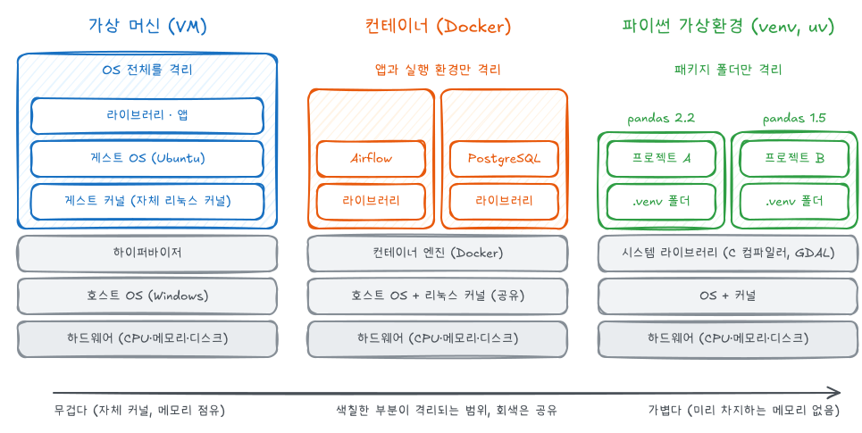
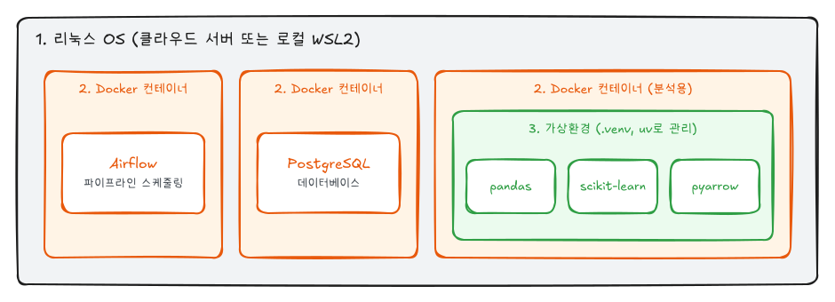

개인 노트북에서 Jupyter로 분석하다가 실무 서버에 들어가면 마우스 없이 명령어를 입력하는 리눅스 터미널을 먼저 만난다. 이 글은 데이터 분석가가 리눅스를 알아야 하는 이유와, 처음에 가장 헷갈리는 **가상 머신, 컨테이너, 파이썬 가상환경**의 차이를 정리한다. Windows에서 리눅스를 쓰는 방법은 다음 글 [WSL2](/posts/wsl2-for-data-analysis)에서 다룬다.

## 1. 리눅스란

리눅스는 1991년 리누스 토르발스가 만든 **오픈소스 운영체제 커널**이다. 흔히 말하는 Ubuntu, Debian, CentOS는 이 커널에 유틸리티와 패키지 관리자를 묶은 **배포판**이다.

실무 데이터 환경이 대부분 리눅스인 이유는 세 가지다.

- **비용**: 클라우드(AWS, GCP, Azure)에서 서버를 수십 대 띄워도 OS 라이선스 비용이 없다.
- **자원 효율**: 그래픽 UI 없이 명령줄(CLI)로 동작하므로 CPU와 메모리를 연산에 쓴다.
- **생태계**: Airflow, Spark, Hadoop, Docker 같은 데이터 도구가 리눅스를 기준으로 먼저 개발되고 배포된다.

## 2. 격리 환경 세 가지

리눅스 기반 환경을 만들다 보면 가상 머신(VM), Docker 컨테이너, 파이썬 가상환경(`venv`, `uv`, `conda`)이 함께 나온다. 셋 다 "독립된 공간"을 만들지만, 격리하는 층위와 무게가 다르다.

| 구분 | 가상 머신 (VM) | 컨테이너 (Docker) | 파이썬 가상환경 (`venv`, `uv`) |
| :--- | :--- | :--- | :--- |
| 격리 대상 | 운영체제 전체 | 애플리케이션과 실행 환경 | 파이썬 패키지 폴더 |
| 커널 | 자체 커널을 띄운다 | 호스트 커널을 공유한다 | 격리하지 않는다 |
| 메모리 부담 | 크다 (설정한 용량을 점유) | 작다 (실행 중인 프로세스만큼) | 거의 없다 |
| 주요 목적 | Windows 위에 리눅스 OS 띄우기 | Airflow, DB를 서버와 같은 환경으로 배포 | 프로젝트별 라이브러리 버전 충돌 방지 |

비유하면 VM은 새로 지은 단독주택, 컨테이너는 한 건물 안의 원룸, 파이썬 가상환경은 내 책상 위의 전용 서랍이다.

> **주의** 파이썬 가상환경은 OS를 새로 띄우는 것이 아니다. 패키지가 설치되는 폴더 경로와 실행할 파이썬만 바꿔 주므로, 켜 두어도 미리 차지하는 메모리가 없다. 반대로 시스템 라이브러리(C 컴파일러, GDAL 같은 것)까지는 격리하지 못한다. 그 수준이 필요하면 컨테이너를 쓴다.

실무에서는 이 셋이 층으로 쌓인다.

1. **리눅스 OS** (클라우드 서버 또는 로컬 WSL2): 모든 작업의 기반
2. **Docker**: Airflow, PostgreSQL 같은 파이프라인 도구를 컨테이너로 실행
3. **`uv` / `venv`**: 리눅스나 컨테이너 안에서 `pandas`, `scikit-learn` 같은 분석 패키지를 관리

`uv`로 가상환경을 만드는 방법은 [외장 드라이브용 .bat과 uv](/posts/portable-bat-uv) 글에 있다.

## 3. 기본 명령어

리눅스 서버나 WSL2에서 데이터 파일을 다룰 때 매일 쓰는 명령어다.

### 파일과 폴더 탐색

| 명령어 | 하는 일 |
|---|---|
| `pwd` | 현재 폴더 경로를 출력한다 |
| `ls -lh` | 파일 목록과 크기를 `K`, `M`, `G` 단위로 보여 준다 |
| `cd 폴더명` | 폴더로 이동한다. `cd ..`은 상위 폴더 |

### 큰 파일 미리보기

수 GB짜리 CSV는 엑셀이나 에디터로 열면 멈추지만, 아래 명령어는 파일 전체를 메모리에 올리지 않아 바로 결과가 나온다.

| 명령어 | 하는 일 |
|---|---|
| `head -n 10 data.csv` | 맨 위 10줄(컬럼명 포함)을 출력한다 |
| `tail -n 10 data.csv` | 맨 아래 10줄을 출력한다 |
| `wc -l data.csv` | 전체 줄 수를 센다. 헤더가 있으면 행 수는 1을 뺀 값이다 |

`wc -l`은 줄바꿈 문자 수를 센다. 셀 안에 줄바꿈이 들어 있는 CSV에서는 행 수와 다를 수 있다. 줄바꿈 문자 자체가 일으키는 문제는 [CRLF와 LF](/posts/crlf-lf-csv-parsing) 글에서 다룬다.

### 자원 확인

| 명령어 | 하는 일 |
|---|---|
| `htop` (또는 `top`) | 프로세스별 CPU와 메모리 사용량을 실시간으로 보여 준다 |
| `df -h` | 디스크 남은 용량을 보여 준다. 큰 데이터를 적재하기 전에 확인한다 |

## 정리

- 리눅스는 커널이고, Ubuntu 같은 배포판이 그 위에 도구를 얹은 것이다.
- VM은 OS 전체, 컨테이너는 애플리케이션과 실행 환경, 파이썬 가상환경은 패키지 폴더만 격리한다. 아래로 갈수록 가볍다.
- 실무 구조는 리눅스 → Docker → `uv`/`venv` 순서로 쌓인다.
- 큰 파일은 열지 말고 `head`, `tail`, `wc -l`로 먼저 확인한다.
