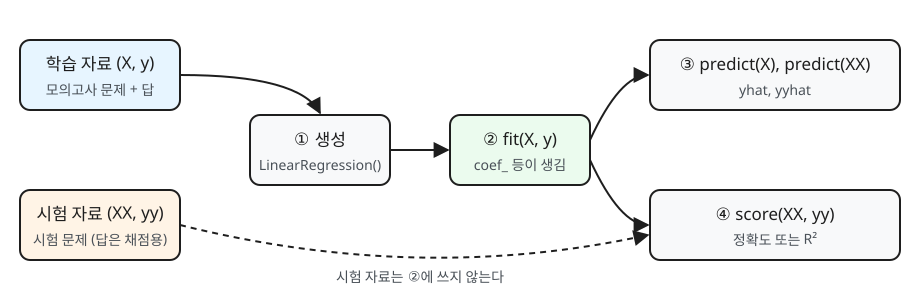

**지도학습 예측 문제**(supervised prediction)는 설명변수 $X$와 반응변수 $y$가 함께 주어진 자료로 둘 사이의 관계를 배우고, $y$를 모르는 새 $X$에 대해 $y$를 맞히는 문제다. 이 시리즈는 이 문제를 scikit-learn(이하 sklearn)과 AutoGluon으로 푸는 방법과, 각 방법이 어떤 자료에서 무너지는지를 정리한다. 모형의 이론은 [데이터 마이닝 - 개요와 모델 평가](/posts/dm-overview)부터 시작하는 데이터 마이닝 시리즈가 담당하고, 여기서는 필요한 곳에서 링크로 넘긴다.

## 학습 자료와 시험 자료

예측 대회는 시험과 구조가 같다.

| | 시험의 비유 | 들어 있는 것 | 하는 일 |
|---|---|---|---|
| 학습 자료 (training set) | 모의고사 문제 + 답 | $X$와 $y$ | 관계를 배운다 |
| 시험 자료 (test set) | 실제 시험 문제 | $X$만 (답은 채점자만 앎) | 배운 관계로 $y$를 예측한다 |

타이타닉 대회의 학습 자료는 승객 891명의 등급(`Pclass`), 이름, 성별, 나이, 동반 가족 수(`SibSp`, `Parch`), 운임 등과 생존 여부(`Survived`)다. 시험 자료에는 `Survived` 열이 없다. 그래서 두 자료는 열의 수부터 다르다.

시험 자료의 답을 모르면 내 방법이 얼마나 좋은지 제출 전에는 알 수 없다. 그래서 실습에서는 학습 자료를 다시 나눠 일부를 시험 자료처럼 쓴다. 이 글에서는 891명을 7:3으로 나눴다.

```python
df = pd.read_csv('titanic/train.csv')                      # (891, 12)
tr, te = sklearn.model_selection.train_test_split(df, test_size=0.3, random_state=42)
```

### 기호

변수 이름을 `df_train_X`처럼 형식과 용도를 모두 적으면 길어지므로 이 시리즈에서는 다음과 같이 쓴다. 자료형(DataFrame, ndarray, list)은 구분하지 않는다.

| 기호 | 뜻 |
|---|---|
| `X`, `y` | 학습 자료의 설명변수, 반응변수 |
| `XX`, `yy` | 시험 자료의 설명변수, 반응변수 |
| `yhat` | `predictr.predict(X)`, 학습 자료에 대한 적합값 |
| `yyhat` | `predictr.predict(XX)`, 시험 자료에 대한 예측값 |

통계 용어로는 $X$가 독립변수·설명변수, $y$가 종속변수·반응변수이고, 기계학습에서는 각각 특성(feature)과 타깃(target)이라고 부른다.

## 기준선: 규칙 하나로 맞히기

모형을 만들기 전에 가장 단순한 규칙의 점수를 먼저 잰다. 이것이 **기준선**(baseline)이다. 생존 여부를 맞힌 비율인 정확도(accuracy)는

$$
\text{accuracy} = \frac{1}{n}\sum_{i=1}^n I(y_i = \hat y_i)
$$

이다. 대회가 예시로 주는 제출 파일은 "여성은 살고 남성은 죽는다"는 규칙이다.

```python
(df.Survived == (df.Sex == 'female')).mean()               # 0.7868
```

규칙 하나로 891명 중 78.7%를 맞힌다. 나눈 자료에서도 학습 0.785, 시험 0.791로 비슷하다. 성별과 등급별 생존율을 보면 이유가 드러난다.

| | 1등급 | 2등급 | 3등급 |
|---|---|---|---|
| 여성 | 0.968 | 0.921 | 0.500 |
| 남성 | 0.369 | 0.157 | 0.135 |

여성의 생존율은 대부분 0.5를 넘고 남성은 모두 0.5 아래라서, 성별만으로 칸마다 다수 쪽을 고른 것과 같다. 3등급 여성(0.500)과 1등급 남성(0.369)처럼 성별 규칙이 틀리기 쉬운 칸이 있다는 점이 앞으로 모형이 더 맞힐 여지다.

> **주의.** 기준선보다 낫지 않은 모형은 쓸 이유가 없다. 정확도 0.8은 그 자체로 높은지 낮은지 알 수 없고, 기준선 0.787과 비교해야 의미가 생긴다.

## predictor의 네 단계

sklearn의 모든 모형은 같은 사용법을 따른다. 모형 객체를 이 시리즈에서는 **predictor**라고 부른다.



| 단계 | 코드 | 하는 일 |
|---|---|---|
| ① 생성 | `predictr = ...RandomForestClassifier(...)` | 방법과 하이퍼파라미터를 정한다. 아직 아무것도 모른다 |
| ② 학습 | `predictr.fit(X, y)` | 자료에서 모수를 추정한다 |
| ③ 예측 | `predictr.predict(XX)` | 새 $X$에 대한 $\hat y$ |
| ④ 평가 | `predictr.score(XX, yy)` | 분류는 정확도, 회귀는 $R^2$ |

1단계 전에 자료를 `X`, `y`로 정리하는 일(전처리)이 있다. 실제 분석 시간의 대부분은 여기에 들고, 3편에서 따로 다룬다.

(강의 예제) 타이타닉 튜토리얼의 랜덤포레스트를 네 단계로 쓰면 다음과 같다.

```python
feat = ["Pclass", "Sex", "SibSp", "Parch"]
X, y   = pd.get_dummies(tr[feat]), tr.Survived
XX, yy = pd.get_dummies(te[feat]), te.Survived

predictr = sklearn.ensemble.RandomForestClassifier(n_estimators=100, max_depth=5, random_state=1)  # ①
predictr.fit(X, y)                                                                                   # ②
yyhat = predictr.predict(XX)                                                                         # ③
predictr.score(X, y), predictr.score(XX, yy)                                                         # ④ (0.8154, 0.8060)
```

`pd.get_dummies`는 문자열 열 `Sex`를 `Sex_female`, `Sex_male` 두 개의 0/1 열로 바꾼다(원핫 인코딩, 2편). 시험 정확도 0.806은 기준선 0.791보다 0.015 높다. 이 분할에서는 268명 중 4명쯤 더 맞힌 셈이다. 랜덤포레스트가 무엇인지는 8편에서 다룬다. 지금은 방법이 바뀌어도 네 단계가 그대로라는 점만 보면 된다.

### 순서를 어기면

학습 전에는 예측할 수 없다. 학습이 끝나야 `coef_`(선형모형의 계수)나 `estimators_`(앙상블의 나무들) 같은 속성이 생기고, 예측은 이 속성으로 계산되기 때문이다. sklearn에서 이름 끝에 밑줄이 붙은 속성은 모두 fit이 만든 것이다.

```python
sklearn.ensemble.RandomForestClassifier().predict(XX)
# NotFittedError: This RandomForestClassifier instance is not fitted yet. Call 'fit' ...
```

## 입력 형식: X는 2차원

`fit(X, y)`의 `X`는 반드시 (관측치 수, 변수 수)의 2차원이어야 한다. 변수가 하나여도 마찬가지다. `y`는 1차원과 2차원 모두 받는다.

| `X`의 형태 | 예 | `fit` |
|---|---|---|
| DataFrame | `df[['Fare']]` | 됨 |
| 2차원 ndarray, 2차원 list | `np.array(df[['Fare']])` | 됨 |
| Series | `df['Fare']` | `ValueError: Expected a 2-dimensional container` |
| 1차원 ndarray, 1차원 list | `np.array(df['Fare'])` | 오류 |

`df['Fare']`는 Series(1차원), `df[['Fare']]`는 열이 하나인 DataFrame(2차원)이다. 대괄호 한 겹 차이가 가장 흔한 오류의 원인이다. 1차원 배열은 `reshape(-1, 1)`로 열벡터로 바꾼다. 반대로 `y`를 2차원으로 넣으면 대부분의 분류기가 `DataConversionWarning`을 내고 1차원으로 바꿔 쓴다. 경고가 싫으면 `y = df['Survived']`처럼 Series로 넣는다.

이 형식은 선형대수의 설계행렬 $\mathbf X \in \mathbb R^{n\times p}$를 그대로 옮긴 것이다. 행이 관측치, 열이 변수이므로 변수가 하나여도 $n\times 1$ 행렬이다.

## 비교: 통계와 기계학습의 관점

같은 선형회귀라도 무엇을 궁금해하는지에 따라 보는 곳이 다르다.

| | 통계적 추론 | 예측 (이 시리즈) |
|---|---|---|
| 목표 | 모수 $\beta$의 추정과 검정 | 새 자료의 $\hat y$ |
| 주로 보는 것 | 계수, 표준오차, p-값 | 시험 자료의 점수 |
| 모형의 옳고 그름 | 가정(정규성, 등분산)을 점검 | 시험 점수가 좋으면 채택 |
| 자료 사용 | 전체 자료로 적합 | 학습과 시험을 나눈다 |
| 대표 도구 | R `lm`, `glm`, SAS | sklearn, AutoGluon |

sklearn의 `LinearRegression`은 계수는 주지만 표준오차와 p-값은 주지 않는다. 예측이 목적이기 때문이다. 추론이 필요하면 `statsmodels`나 R을 쓴다. 다만 이 시리즈에서도 계수의 해석은 자주 본다. 2편부터는 계수가 이상하게 나오는 상황(다중공선성, 이상치)이 곧 예측이 나빠지는 신호이기 때문이다.

## 요약

| 개념 | 내용 |
|---|---|
| 학습 / 시험 자료 | $(X, y)$로 배우고 $XX$로 예측한다. 시험 자료는 학습에 쓰지 않는다 |
| 기준선 | 성별 규칙의 정확도 0.787. 모형은 이것과 비교한다 |
| 네 단계 | 생성 → `fit(X, y)` → `predict(XX)` → `score(XX, yy)` |
| 입력 형식 | `X`는 2차원, `y`는 1차원 권장 |
| 학습된 속성 | `coef_`, `estimators_`처럼 밑줄로 끝나며 fit 후에 생긴다 |

- 모든 모형이 같은 네 단계를 따르므로, 방법을 바꾸는 일은 대개 ① 한 줄을 바꾸는 일이다.
- `score`의 기본 지표는 분류에서 정확도, 회귀에서 $R^2$다. 정확도만으로 부족한 경우는 9편에서 다룬다.

## 참고자료

- 최규빈, 「기계학습활용」 강의노트 (2023), <https://guebin.github.io/MP2023/>
- Kaggle, *Titanic - Machine Learning from Disaster*, <https://www.kaggle.com/competitions/titanic>
- scikit-learn User Guide, *Getting Started* 및 *Glossary: fit, predict, score*, <https://scikit-learn.org/stable/getting_started.html>
- Buitinck, L. et al. (2013). API design for machine learning software: experiences from the scikit-learn project. *ECML PKDD Workshop*.
